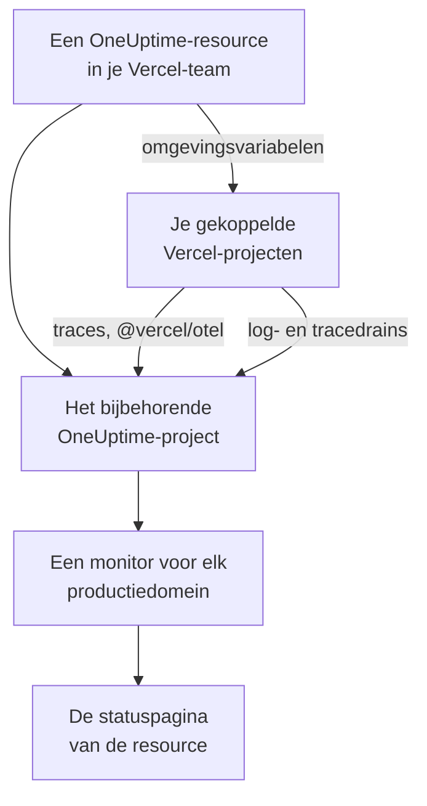

# Vercel

Voeg OneUptime vanuit de [Vercel Marketplace](https://vercel.com/marketplace) toe aan je Vercel-team. Je meldt je aan met je Vercel-account en betaalt via je Vercel-rekening, en je Vercel-projecten krijgen traces, logs, uptime-monitoring en een statuspagina in OneUptime, zonder dat je iets met de hand hoeft in te stellen.

:::cards
- [OneUptime aan je Vercel-team toevoegen](#oneuptime-aan-je-vercel-team-toevoegen): Een resource, een abonnement en je projecten, in het Vercel-dashboard.
- [Traces verzenden met @vercel/otel](#traces-verzenden-met-vercelotel): De omgevingsvariabelen staan er al.
- [Logs en traces verzenden met drains](#logs-en-traces-verzenden-met-drains): De eigen logs en spans van Vercel, op Pro en Enterprise.
- [Abonnementen en facturering](#abonnementen-en-facturering): De abonnementen van OneUptime, op je Vercel-factuur.
:::

## Hoe het werkt

Elke OneUptime-resource die je in Vercel toevoegt, is een apart OneUptime-project. Vercel geeft elk Vercel-project dat je aan de resource koppelt de omgevingsvariabelen van de resource, en die sturen de traces van het project naar OneUptime. Drains sturen de logs en spans van Vercel, en het productiedomein van elk gekoppeld project krijgt een uptime-monitor op de statuspagina van de resource.



De integratie is voor OneUptime Cloud (`oneuptime.com`). Een zelf gehoste OneUptime kan niet vanuit de Vercel Marketplace worden toegevoegd: zie [Zelf gehoste OneUptime](#zelf-gehoste-oneuptime).

## Voordat je begint

- **Een Vercel-team**, op elk abonnement. Log- en tracedrains hebben het Pro- of Enterprise-abonnement van Vercel nodig; traces van `@vercel/otel` werken op elk abonnement.
- **Een geverifieerd e-mailadres** op je Vercel-account. OneUptime meldt je daarmee aan, en maakt er je OneUptime-account mee aan als je er nog geen hebt.
- **Een betaalmethode in Vercel**, voor elk abonnement: monitors en telemetrie worden naar gebruik gefactureerd, ook op het Free-abonnement. Zie [Abonnementen en facturering](#abonnementen-en-facturering).

## OneUptime aan je Vercel-team toevoegen

:::steps
### OneUptime openen in de Vercel Marketplace

Open in het Vercel-dashboard **Integrations**, dan **Browse Marketplace**, en zoek OneUptime onder **Observability**. Klik op **Installeren** en accepteer de voorwaarden van OneUptime.

### Een abonnement kiezen

Kies **Gratis**, **Growth** of **Scale**. Het zijn de eigen abonnementen van OneUptime, tegen de prijzen op [oneuptime.com/pricing](https://oneuptime.com/pricing).

### De resource een naam geven en de instellingen kiezen

Noem de resource naar wat hij bewaakt, zoals `storefront`: het OneUptime-project en de statuspagina ervan krijgen die naam. Twee instellingen staan bij het begin aan:

- **Monitor production domains**: een websitemonitor voor het productiedomein van elk Vercel-project dat je koppelt.
- **Create a status page**: een openbare statuspagina voor de resource, die die monitors toont.

### Je projecten koppelen

Kies de Vercel-projecten die naar deze resource sturen, en de omgevingen die de omgevingsvariabelen ervan krijgen. Geef de koppeling geen eigen prefix: `@vercel/otel` leest de variabelen onder hun eigen namen.
:::

De resource is binnen een paar seconden klaar. Klik op **Open in OneUptime** om het project ervan te zien.

## Wat je met elke resource krijgt

| Wat | Waar je het vindt |
| --- | --- |
| Een OneUptime-project, genoemd naar de resource | Jij bent de eigenaar. Je teamgenoten komen erbij wanneer ze het vanuit Vercel openen. |
| Een ingestiesleutel met de naam `Vercel` | **Projectinstellingen → Telemetrie & APM → Ingestiesleutels** |
| Omgevingsvariabelen in elk gekoppeld Vercel-project | **Settings → Environment Variables** van het project in Vercel |
| Een websitemonitor voor elk gekoppeld project | **Monitoren**, genoemd naar het Vercel-project |
| Een openbare statuspagina | **Statuspagina's**, genoemd naar de resource |

De omgevingsvariabelen zijn in elk gekoppeld project hetzelfde:

| Variabele | Waarde |
| --- | --- |
| `OTEL_EXPORTER_OTLP_ENDPOINT` | `https://oneuptime.com/otlp` |
| `OTEL_EXPORTER_OTLP_HEADERS` | `x-oneuptime-token=` en de ingestiesleutel van de resource |
| `OTEL_EXPORTER_OTLP_PROTOCOL` | `http/protobuf` |
| `ONEUPTIME_TELEMETRY_INGESTION_KEY` | Alleen de ingestiesleutel, die de drains meesturen |

Een deployment krijgt de variabelen wanneer hij wordt gebouwd: rol opnieuw uit nadat je een project hebt gekoppeld.

## Traces verzenden met @vercel/otel

`@vercel/otel` is het OpenTelemetry-pakket van Vercel voor Next.js en de andere frameworks die Vercel draait. Het leest de `OTEL_EXPORTER_OTLP_*`-variabelen, dus een project dat aan de resource is gekoppeld, heeft alleen het pakket nodig.

:::steps
### Het pakket installeren

```bash
npm install @vercel/otel @opentelemetry/api @opentelemetry/api-logs
```

### Het pakket registreren

Maak `instrumentation.ts` aan in de root van het project, of in `src` als het project die map heeft, en geef de service een naam:

```ts title="instrumentation.ts"
import { registerOTel } from "@vercel/otel";

export function register(): void {
  registerOTel({ serviceName: "storefront" });
}
```

### Uitrollen

Rol het project uit. De traces ervan verschijnen in **Traces**, onder de servicenaam.
:::

Voeg op de Pro- en Enterprise-abonnementen van Vercel ook een tracedrain toe: Vercel stuurt OneUptime dan voor elk verzoek zijn eigen spans, samen met die van je applicatie, en `@vercel/otel` laat die over aan de drain, zodat niets twee keer binnenkomt.

## Logs en traces verzenden met drains

Een drain stuurt wat Vercel over je projecten vastlegt naar OneUptime: een logdrain stuurt hun build-, functie-, edge- en verzoeklogs, en een tracedrain hun spans. Drains hebben het Pro- of Enterprise-abonnement van Vercel nodig, en Vercel factureert de gegevens die ze versturen via je Vercel-rekening.

:::steps
### Een drain toevoegen

Open in Vercel **Team Settings → Drains** en klik op **Add Drain**. Kies **Logs** of **Traces**, en daarna OneUptime onder **Native Integrations**.

### De projecten kiezen

Kies de projecten, en voor logs de bronnen en omgevingen. De drain verzendt met de ingestiesleutel van de resource: je hoeft niets in te typen.
:::

Elk Vercel-project is een service in OneUptime, genoemd naar het project. Een log behoudt zijn tijd, niveau en bericht, en zijn verzoek wordt vastgelegd onder de namen van OpenTelemetry:

| Vercel-veld | In OneUptime |
| --- | --- |
| `projectName` | De service, `service.name` |
| `timestamp`, `level`, `message` | De tijd, de ernst en de body van de log |
| `deploymentId`, `environment` | `vercel.deployment.id`, `deployment.environment.name` |
| `proxy.method`, `proxy.path`, `proxy.statusCode` | `http.request.method`, `url.path`, `vercel.proxy.status_code` |
| `traceId`, `spanId` | De trace van de log, gekoppeld aan de trace in **Traces** |
| Elk ander veld | Een attribuut onder `vercel.`, zoals `vercel.source` |

## Uptime-monitors en de statuspagina

Wanneer je een Vercel-project koppelt, maakt OneUptime een websitemonitor voor het productiedomein ervan, die vanaf de sondes van OneUptime wordt gecontroleerd, en voegt die toe aan de statuspagina van de resource. Een project dat vóór zijn eerste productiedeployment is gekoppeld, heeft nog geen domein: de monitor ervan wordt bij die deployment gemaakt. Als je het project ontkoppelt, wordt de monitor ervan verwijderd.

Elke monitor is een actieve monitor, die net als elke andere wordt gefactureerd en werkt als een monitor die je zelf hebt gemaakt: zie [Website-monitor](/docs/monitor/website-monitor). Wil je er geen, zet dan **Monitor production domains** uit in de instellingen van de resource in Vercel. Zet je die weer aan, dan worden de monitors gemaakt die nog ontbreken.

## OneUptime openen vanuit Vercel

Klik op **Open in OneUptime** bij de resource, of op een van de links ervan in Vercel, en je bent bij OneUptime aangemeld met het e-mailadres van je Vercel-account. De eerste keer kom je in het project van de resource: als beheerder als je eigenaar of lid van het Vercel-team bent, en als lid als je een van de alleen-lezen-rollen van het team hebt.

Bestaat er al een OneUptime-account met dat e-mailadres, dan meld je je bij dat account aan. Een account met tweestapsverificatie aan, of een account van een OneUptime-beheerder, meldt zich in plaats daarvan aan met zijn wachtwoord. Je zit hoe dan ook in het project.

## Abonnementen en facturering

| | Hoe het werkt |
| --- | --- |
| Abonnementen | **Gratis**, **Growth** en **Scale**, tegen de prijzen op oneuptime.com: de prijs van het abonnement per gebruiker, actieve monitors voor $1 per monitor per maand, en telemetrie per GB. |
| Waar je betaalt | Op je Vercel-factuur, één keer per maand, voor elke resource. Vercel toont bij de resource het gebruik van de maand tot nu toe, elk uur bijgewerkt. |
| Proefperiodes | Geen kosten zolang de proefperiode van het abonnement loopt: niet voor de gebruikers, niet voor de monitors en niet voor de telemetrie. |
| Van abonnement wisselen | In Vercel, bij de resource, of in OneUptime onder **Projectinstellingen → Facturering en facturen → Facturering**. Een wijziging op de ene plek geldt voor beide. |
| Onbetaalde facturen | Vercel probeert de betaling 15 dagen lang opnieuw. Daarna is het project niet meer beschikbaar totdat de factuur is betaald: de gegevens blijven bewaard, en er wordt niets verwijderd. |

Op de factuur heeft elke resource een regel voor de gebruikers, de actieve monitors, de telemetrie en eventuele bijvullingen van het saldo, in gebruikseenheden van $0.01.

## OneUptime verwijderen

| Je | Wat er gebeurt |
| --- | --- |
| Verwijdert een resource in Vercel | Het project ervan wordt verwijderd, nadat het gebruik tot dan toe is gefactureerd. De gekoppelde Vercel-projecten verliezen de omgevingsvariabelen ervan bij hun volgende deployment. |
| Deïnstalleert OneUptime uit het team | Het project van elke resource wordt verwijderd, en de laatste factuur wordt verstuurd. |
| Verwijdert het project in OneUptime | De resource wordt ook in Vercel verwijderd. |

> [!CAUTION]
> Een project verwijderen verwijdert de monitors, de statuspagina, de incidenten en de telemetrie ervan voorgoed. Exporteer eerst alles wat je wilt bewaren.

## Zelf gehoste OneUptime

Een zelf gehoste OneUptime kan niet vanuit de Vercel Marketplace worden toegevoegd, want die richt alleen OneUptime Cloud in. Je Vercel-projecten kunnen er wel naartoe sturen:

- **Traces**: stel in **Settings → Environment Variables** van het Vercel-project de variabelen uit [Wat je met elke resource krijgt](#wat-je-met-elke-resource-krijgt) in, met `https://YOUR-ONEUPTIME-HOST/otlp` als endpoint en een ingestiesleutel van je project.
- **Logs**: voeg in **Team Settings → Drains** een aangepaste logdrain toe naar `https://YOUR-ONEUPTIME-HOST/telemetry/vercel/v1/logs`, in JSON of NDJSON. Voeg de header `x-oneuptime-token` toe met je ingestiesleutel, en stel het ondertekeningsgeheim van de drain in op dezelfde sleutel: OneUptime accepteert alleen leveringen die Vercel daarmee heeft ondertekend.

Dezelfde aangepaste drain werkt ook op OneUptime Cloud, met `oneuptime.com` als host.

## Problemen oplossen

:::details Er komen geen traces binnen
- Rol het project opnieuw uit: een deployment die is gebouwd voordat het project werd gekoppeld, heeft geen `OTEL_EXPORTER_OTLP_*`-variabelen.
- Controleer de namen van de variabelen in **Settings → Environment Variables** van het project. Een koppeling met een eigen prefix geeft ze een andere naam, en dan leest `@vercel/otel` ze niet meer: koppel het project opnieuw zonder prefix.
- Controleer of `instrumentation.ts` `registerOTel` aanroept, en, op Next.js 14 en ouder, of `experimental.instrumentationHook` aanstaat in `next.config.js`.
:::

:::details Vercel toont een fout bij de drain
Vercel toont het antwoord van OneUptime op de leveringen van de drain:

- `403` met `x-vercel-signature` in het bericht: Vercel heeft de levering niet ondertekend met de sleutel die Vercel meestuurt. Controleer bij een aangepaste drain de `x-oneuptime-token`-header ervan, en stel het ondertekeningsgeheim in op dezelfde sleutel.
- `401`: OneUptime kent geen project met de sleutel die de drain meestuurt: die is verwijderd, of op beide plekken verkeerd getypt. Gebruik een sleutel uit **Projectinstellingen → Telemetrie & APM → Ingestiesleutels**.
- `422`: de sleutel is uitgeschakeld. Zet hem op dezelfde pagina weer aan, of gebruik een andere.
:::

:::details Een gekoppeld project heeft geen monitor
- **Monitor production domains** staat uit in de instellingen van de resource in Vercel.
- Het project heeft nog geen productiedomein: de monitor ervan wordt bij de eerste productiedeployment gemaakt.
- Het abonnement van het project heeft al zoveel actieve monitors als het toestaat: upgrade het abonnement en zet **Monitor production domains** daarna uit en weer aan.
:::

:::details Vercel vraagt je je e-mailadres te verifiëren
OneUptime heeft een e-mailadres nodig dat Vercel heeft geverifieerd, en een bestaand OneUptime-account met dat adres moet zijn eigen adres ook geverifieerd hebben. Verifieer het adres, en voeg daarna de resource toe of open OneUptime opnieuw.
:::

## Volgende stappen

:::cards
- [Traceverkenner](/docs/telemetry/traces-explorer): Vind een traag verzoek en de spans ervan.
- [Logboekverkenner](/docs/telemetry/logs-explorer): Doorzoek je Vercel-logs.
- [Statuspagina's](/docs/status-pages/index): Geef de statuspagina van de resource je eigen huisstijl, en voeg abonnees toe.
- [Ingestiesleutels](/docs/telemetry/ingestion-keys): Vervang de sleutel van de resource of schakel hem uit.
:::
