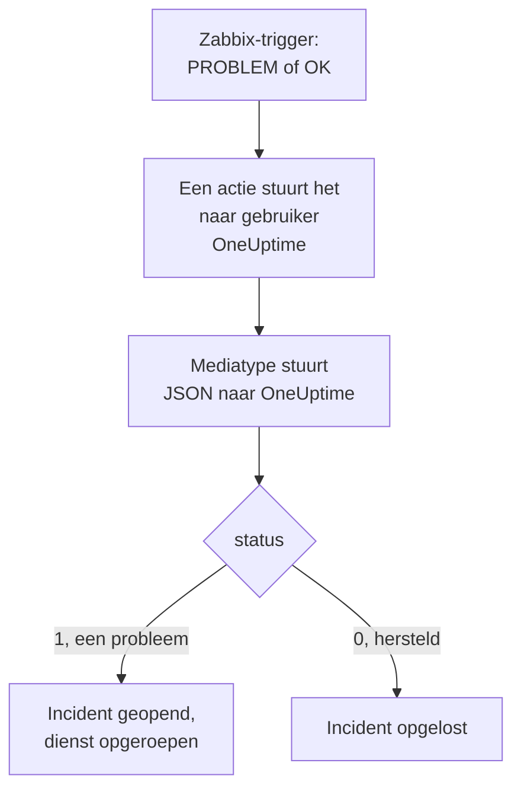

# Zabbix

Stuur [Zabbix](https://www.zabbix.com)-problemen naar OneUptime, zodat elk probleem een incident wordt dat je team met dienst oproept en wordt opgelost wanneer Zabbix herstelt. Zabbix stuurt elk probleem via een webhook-mediatype, dus aan geen van beide kanten hoef je iets te installeren.

:::cards
- [Kiezen hoe OneUptime problemen ontvangt](#kiezen-hoe-oneuptime-problemen-ontvangt): Een Incoming Request-monitor of een eigen workflow.
- [Problemen ontvangen met een monitor](#problemen-ontvangen-met-een-monitor): Eén incident per probleem, opgelost bij herstel.
- [Zabbix configureren](#zabbix-configureren): Een mediatype, een gebruiker en een actie.
- [Problemen oplossen](#problemen-oplossen): Wanneer problemen niet aankomen of incidenten open blijven.
:::

## Hoe het werkt



Zabbix stuurt een probleem naar een gebruiker, via de media van die gebruiker. Hier is het medium een webhook-mediatype met de naam **OneUptime**: het script ervan stuurt een klein JSON-document naar OneUptime met de event-ID, de naam, de host, de ernst en de status van het probleem. De status is `1` voor een probleem en `0` voor het herstel ervan.

## Voordat je begint

- Een Zabbix-server die je beheert. Deze handleiding is geschreven voor Zabbix 6.0 LTS en 7.0 LTS. Webhook-mediatypen werken vanaf Zabbix 5.0 op dezelfde manier.
- Een Zabbix-server die je OneUptime via HTTPS kan bereiken.
- In OneUptime het recht om monitoren te maken, of workflows als je die weg kiest.

## Kiezen hoe OneUptime problemen ontvangt

Stel eerst OneUptime in: dat geeft je de URL waar Zabbix naartoe stuurt.

| Manier | Gebruik het wanneer |
| --- | --- |
| Een Incoming Request-monitor (aanbevolen) | Je wilt dat elk Zabbix-probleem een incident is dat de dienst oproept en wordt opgelost wanneer Zabbix herstelt. Er valt niets te bouwen. |
| Een workflow met een Webhook-trigger | Je hebt eigen logica nodig: problemen filteren, ze anders vormgeven of eerst andere systemen aanroepen. Een workflow lost het incident bij herstel niet vanzelf op. |

Beide krijgen dezelfde JSON van hetzelfde mediatype, dus je kunt met de ene beginnen en later overstappen door één URL in Zabbix te wijzigen.

## Problemen ontvangen met een monitor

Een [Incoming Request-monitor](/docs/monitor/incoming-request-monitor) geeft je een URL, en de criteria ervan bepalen wat elk verzoek doet.

:::steps
### De monitor maken

Ga naar **Monitoren** en klik op **Monitor maken**. Kies **Incoming Request** onder **Monitortype**, noem hem `Zabbix` en klik op **Volgende**.

### Een incident melden voor elk probleem

Open in de stap **Criteria** het eerste criterium, het criterium dat de monitor als offline markeert. Stel het filter in op **Verzoeklichaam**, **Bevat**, `"status":"1"`. Dit criterium meldt al een incident wanneer het filter overeenkomt. Vul het incident in:

- **Incidenttitel**: `Zabbix: {{requestBody.name}} on {{requestBody.host}}`.
- **Ernst**: de incidenternst die Zabbix-problemen moeten krijgen.
- **Bereikbaarheidsbeleid**, onder **Bereikbaarheid**: het beleid dat moet worden opgeroepen.
- **Incident automatisch oplossen**, onder **Meer velden**: laat het aan staan, zoals het begint. Zonder deze instelling worden herstelmeldingen genegeerd en blijven incidenten open.

### Eén incident per probleem openen

Open in hetzelfde criterium **Instellingen** en zet **Group incidents and alerts by a payload field** aan. Vul het in zoals hieronder, zodat elk probleem een eigen incident krijgt en het herstel ervan het oplost:

| Veld | Waarde |
| --- | --- |
| **Open a separate incident for each…** | `requestBody.event_id` |
| **Field that signals recovery** | `requestBody.status` |
| **Value that means recovered** | `0` |

### De monitor weer online brengen

Open het tweede criterium, het criterium dat de monitor als online markeert, en stel het filter in op **Verzoeklichaam**, **Bevat**, `"status":"0"`.

### De URL kopiëren

Klik op **Monitor maken**. De pagina **Overzicht** van de monitor toont de **Heartbeat URL** ervan. Kopieer die voor Zabbix:

```text
https://oneuptime.com/heartbeat/<secret key>
```

Een zelfgehoste installatie heeft een eigen host in plaats van `oneuptime.com`.
:::

De monitor leest de JSON van het verzoek zoals die geschreven is: `"status":"1"`, zonder spaties. Zie [Alerts ontvangen van een ander systeem](/docs/monitor/incoming-request-monitor#waarschuwingen-uit-een-ander-systeem-ontvangen) voor wat elke instelling doet.

## Problemen ontvangen met een workflow

Gebruik een [workflow](/docs/workflows/index) wanneer je eigen stappen nodig hebt tussen Zabbix en het incident.

:::steps
### De workflow maken

Ga naar **Workflows**, klik op **Workflow maken** en daarna op **Vanaf nul beginnen**. Noem hem `Zabbix problems` en klik op **Workflow maken**.

### De Webhook-trigger toevoegen

Klik op het gestippelde blok **Choose what starts this workflow** en kies **Webhook**. Klik op de trigger en daarna op **URL kopiëren**, en bewaar de URL voor Zabbix.

### Controleren dat het een probleem is

Klik op **Component toevoegen**, voeg een **If / Else**-blok toe en verbind de **Out**-punt van de trigger ermee. Stel **Value to check** in op `{{local.components.webhook-1.returnValues.request-body.status}}`, **Comparison** op **is equal to** en **Compare with** op `1`.

### Het incident melden

Voeg een **Create One Incident**-blok toe en verbind de **Yes**-kant van het **If / Else**-blok ermee. Kies in **Incident Template** een sjabloon dat de ernst en het op te roepen bereikbaarheidsbeleid instelt (zie [Incidentsjablonen](/docs/incidents/settings#incidentsjablonen)). Stel in **JSON Object** in wat er uit Zabbix komt:

```json
{
  "title": "Zabbix: {{local.components.webhook-1.returnValues.request-body.name}}",
  "description": "Host: {{local.components.webhook-1.returnValues.request-body.host}}\nSeverity: {{local.components.webhook-1.returnValues.request-body.severity}}\nZabbix event: {{local.components.webhook-1.returnValues.request-body.event_id}}"
}
```

Zonder sjabloon heeft **JSON Object** ook `incidentSeverityId` nodig, de ID van een van de incidenternstniveaus van het project.

### Hem aanzetten

Zet **Ingeschakeld** aan bovenaan de **Bouwer**. Een workflow die uit staat, antwoordt Zabbix met `400`.
:::

Een herstel neemt de **No**-kant van het **If / Else**-blok, waar niets op is aangesloten, dus de uitvoering eindigt daar. Gebruik de monitor om incidenten bij herstel op te lossen.

## Zabbix configureren

Zabbix heeft drie dingen nodig: een mediatype dat naar OneUptime stuurt, een gebruiker om het naartoe te sturen en een actie die problemen naar die gebruiker stuurt.

:::steps
### Het mediatype OneUptime maken

1. Ga naar **Alerts → Media types**, of **Administration → Media types** in Zabbix 6.0, en klik op **Create media type**.
2. Stel **Name** in op `OneUptime` en **Type** op **Webhook**.
3. Voeg deze **Parameters** toe. Elke parameter zet een Zabbix-[macro](https://www.zabbix.com/documentation/current/en/manual/appendix/macros/supported_by_location) in het verzoek:

   | Naam | Waarde |
   | --- | --- |
   | `url` | `{ALERT.SENDTO}` |
   | `event_id` | `{EVENT.ID}` |
   | `event_name` | `{EVENT.NAME}` |
   | `event_value` | `{EVENT.VALUE}` |
   | `event_severity` | `{EVENT.SEVERITY}` |
   | `host` | `{HOST.NAME}` |
   | `event_date` | `{EVENT.DATE}` |
   | `event_time` | `{EVENT.TIME}` |

4. Plak dit in **Script**:

   ```javascript
   var params = JSON.parse(value);
   var request = new HttpRequest();
   request.addHeader("Content-Type: application/json");

   var payload = {
     source: "zabbix",
     event_id: params.event_id,
     name: params.event_name,
     host: params.host,
     severity: params.event_severity,
     // "1" for a problem, "0" for its recovery.
     status: params.event_value,
     date: params.event_date,
     time: params.event_time,
   };

   var response = request.post(params.url, JSON.stringify(payload));

   if (request.getStatus() < 200 || request.getStatus() >= 300) {
     throw (
       "OneUptime responded with HTTP " + request.getStatus() + ": " + response
     );
   }

   return "OK";
   ```

5. Voeg op het tabblad **Message templates** een sjabloon toe voor **Problem** en een voor **Problem recovery**. Laat de tekst ervan leeg: het script bouwt het verzoek. Zabbix gebruikt een mediatype alleen voor de soorten gebeurtenissen waarvoor het een sjabloon heeft.
6. Klik op **Add**.

### Een gebruiker maken die de problemen ontvangt

1. Ga naar **Users → Users**, of **Administration → Users** in Zabbix 6.0, en klik op **Create user**. Noem hem `OneUptime` en geef hem een gebruikersgroep en een rol die meldingen mag ontvangen, zoals **User role**.
2. Klik op het tabblad **Media** op **Add**. Stel **Type** in op `OneUptime` en **Send to** op de URL die je uit OneUptime hebt gekopieerd. Laat **When active** en de ernstniveaus zoals ze zijn, of vink de ernstniveaus uit die OneUptime niet hoort te krijgen.
3. Klik op **Add** en daarna nog eens op **Add** om de gebruiker op te slaan.

### Problemen met een actie naar OneUptime sturen

1. Ga naar **Alerts → Actions → Trigger actions**, of **Configuration → Actions** in Zabbix 6.0, en klik op **Create action**. Noem hem `Notify OneUptime`.
2. Beperk hem onder **Conditions** als je wilt, bijvoorbeeld met **Trigger severity is greater than or equals Warning**. Zonder voorwaarden wordt elk probleem verstuurd.
3. Voeg op het tabblad **Operations** een bewerking toe die naar de gebruiker `OneUptime` stuurt via het mediatype `OneUptime`.
4. Voeg dezelfde bewerking toe onder **Recovery operations**, zodat ook herstelmeldingen worden verstuurd.
5. Klik op **Add** en controleer of de actie is ingeschakeld.
:::

## Het testen

1. Open in Zabbix **Alerts → Media types** en klik op **Test** naast `OneUptime`. Vul de URL in die je hebt gekopieerd, en voorbeeldwaarden zoals `event_id` `12345`, `event_name` `Test problem`, `host` `web-1` en `event_value` `1`. Klik op **Test**: Zabbix toont het antwoord van het script, `OK`, of de fout die het gaf.
2. Open in OneUptime de monitor en controleer of er een incident is geopend, of open **Logboeken → Uitvoeringen** van de workflow en bekijk de uitvoering.
3. Test opnieuw met `event_value` `0` en dezelfde `event_id`. Met de monitor wordt het incident opgelost.

Laat daarna een echte trigger afgaan, bijvoorbeeld door een drempel even te verlagen, en kijk hoe het probleem binnenkomt.

## Zabbix-ernstniveaus toewijzen

Zabbix stuurt de ernst als tekst: `Not classified`, `Information`, `Warning`, `Average`, `High` of `Disaster`.

- **Met de monitor** klik je op **Criteria toevoegen** voor elke groep ernstniveaus en sleep je het nieuwe criterium boven het eerste: criteria worden van boven af gecontroleerd, en het eerste dat overeenkomt beslist. Geef elk twee filters, `"status":"1"` en een ernst zoals `"severity":"Disaster"`, met **Overeenkomstvoorwaarde** op **Alle**. Geef elk een incident met een eigen **Ernst** en **Incident automatisch oplossen**, en dezelfde groeperingsinstellingen.
- **Met de workflow** voeg je een [Switch / Case](/docs/workflows/components#switch-case)-blok toe op `{{local.components.webhook-1.returnValues.request-body.severity}}`, met een geval per ernstniveau, en na elk geval een **Create One Incident**-blok met een eigen sjabloon.

## Problemen oplossen

:::details Er komt niets aan in OneUptime
- Open in Zabbix **Reports → Action log** en controleer of de actie het probleem heeft verstuurd, en wat er terugkwam.
- Stuur vanaf de Zabbix-server zelf een verzoek: `curl -i -X POST <url> -H 'Content-Type: application/json' -d '{"status":"1","event_id":"1","name":"Test","host":"test"}'`.
- De monitor antwoordt meteen `200`, voordat hij iets controleert, zelfs bij een verkeerde geheime sleutel. Bekijk de tijdlijn van de monitor om te zien of verzoeken binnenkomen.
- Een workflow die uit staat, antwoordt `400`. Zet **Ingeschakeld** aan bovenaan de **Bouwer** ervan.
:::

:::details Zabbix meldt een scriptfout
Open het mediatype en gebruik **Test**: Zabbix toont het resultaat van het script of de fout die het gaf. Elk antwoord van OneUptime anders dan `2xx` geeft het script door als fout met de status erbij, dus controleer eerst de URL.
:::

:::details Incidenten openen, maar worden nooit opgelost
- De actie heeft **Recovery operations** nodig, anders stuurt Zabbix het herstel nooit.
- Het incident van het criterium heeft **Incident automatisch oplossen** nodig, onder **Meer velden**.
- **Field that signals recovery** moet `requestBody.status` zijn, en **Value that means recovered** precies `0`.
- Een workflow lost incidenten bij herstel niet op. Gebruik de monitor.
:::

:::details Het incident toont een verwijzing in plaats van een waarde
Een verwijzing naar een veld dat het verzoek niet heeft, blijft staan zoals ze geschreven is, accolades en al, in plaats van te worden leeggemaakt. Controleer of Zabbix `Content-Type: application/json` stuurt en of de veldnamen die je gebruikt (`name`, `host`, `severity`, `status`, `event_id`) overeenkomen met de payload van het script. Open voor een workflow de uitvoering in **Logboeken → Uitvoeringen** en vergelijk met wat de trigger ontving. Zie [Valkuilen](/docs/workflows/variables#valkuilen).
:::

:::details Elk probleem komt twee keer aan
Waarschijnlijk heeft de actie twee bewerkingen die naar dezelfde gebruiker sturen, zoals een eerste stap en een escalatiestap. Controleer de **Operations** van de actie.
:::

## Beveiliging

- **Behandel de URL als een wachtwoord.** Iedereen die hem heeft, kan incidenten openen. Lekt hij uit, stel hem dan opnieuw in: **Geheime sleutel voor inkomende aanvraag opnieuw instellen** op de pagina **Instellingen** van de monitor, of **URL opnieuw instellen** in de **Webhook**-trigger van de workflow. Werk daarna **Send to** bij in het medium van de Zabbix-gebruiker.
- **Stuur alleen wat een incident nodig heeft.** Gebruik de voorwaarden van de actie, of de ernstniveaus van het medium van de gebruiker, om problemen met een lage ernst in Zabbix te houden.
- **Zelfgehost?** Laat je Zabbix-server je OneUptime via HTTPS door je firewall bereiken.

## Volgende stappen

:::cards
- [Inkomende-verzoek-monitor](/docs/monitor/incoming-request-monitor): Elke instelling van de monitor die Zabbix-problemen ontvangt.
- [Escalatieregels](/docs/on-call/escalation-rules): Bepaal wie een bereikbaarheidsbeleid oproept, en wanneer.
- [Workflow-triggers](/docs/workflows/triggers#webhook): Hoe de webhook-URL van een workflow werkt.
- [Overzicht van integraties](/docs/integrations/index): De andere tools die je kunt koppelen.
:::
