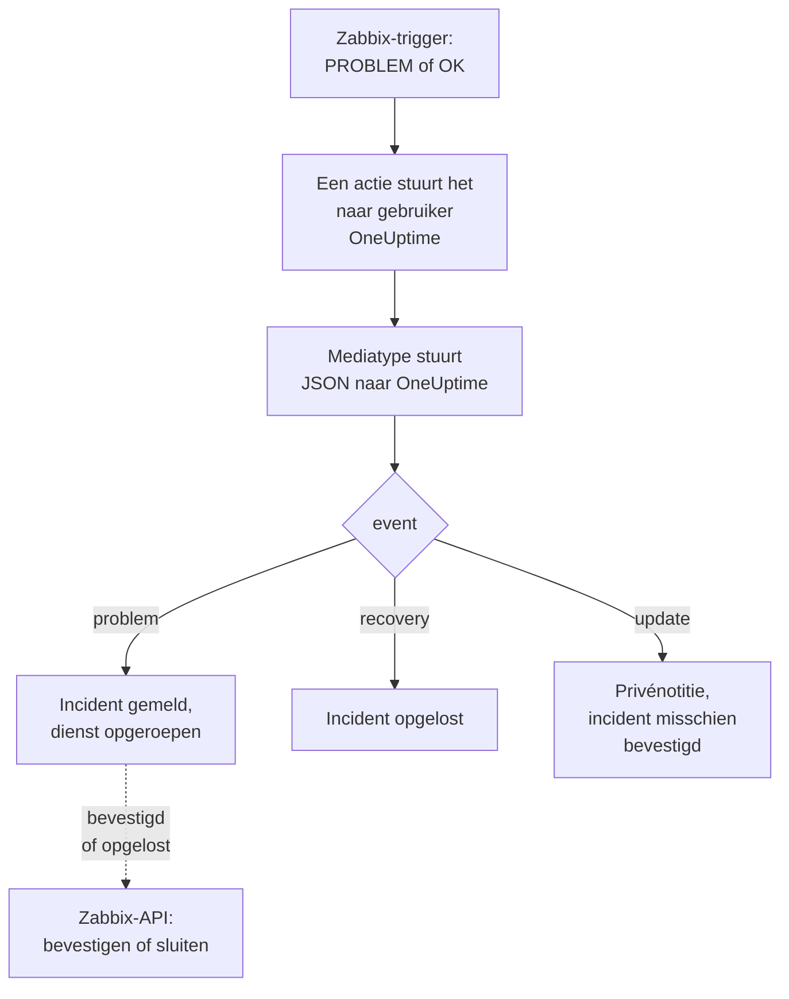

# Zabbix

Stuur [Zabbix](https://www.zabbix.com)-problemen naar OneUptime, zodat elk probleem een incident wordt dat je team met dienst oproept en wordt opgelost wanneer Zabbix herstelt. Kant-en-klare workflowsjablonen houden beide kanten gelijk: wat mensen in Zabbix doen, wordt op het incident genoteerd, en het incident bevestigen of oplossen bevestigt of sluit het probleem in Zabbix. Zabbix stuurt elk probleem via een webhook-mediatype, dus aan geen van beide kanten hoef je iets te installeren.

:::cards
- [Kiezen hoe OneUptime problemen ontvangt](#kiezen-hoe-oneuptime-problemen-ontvangt): Workflowsjablonen of een Incoming Request-monitor.
- [Beginnen met de sjablonen](#beginnen-met-de-sjablonen): Zes sjablonen, wat ze doen en wat ze vragen.
- [Zabbix configureren](#zabbix-configureren): Een mediatype, een gebruiker en een actie.
- [Problemen oplossen](#problemen-oplossen): Wanneer problemen niet aankomen of incidenten open blijven.
:::

## Hoe het werkt



Zabbix stuurt een probleem naar een gebruiker, via de media van die gebruiker. Hier is het medium een webhook-mediatype met de naam **OneUptime**: het script ervan stuurt een klein JSON-document naar OneUptime voor elk probleem, voor het herstel ervan en voor elke update die iemand er in Zabbix aan doet, met de event-ID, de naam, de host en de ernst van het probleem. Aan de event-ID vindt OneUptime het incident dat een probleem heeft geopend.

## Voordat je begint

- Een Zabbix-server die je beheert. Deze handleiding is geschreven voor Zabbix 6.0 LTS en 7.0 LTS. Webhook-mediatypen werken vanaf Zabbix 5.0 op dezelfde manier. De sjablonen die de API van Zabbix aanroepen, hebben Zabbix 6.4 of later nodig, of [één wijziging op Zabbix 6.0](#op-zabbix-60).
- Een Zabbix-server die je OneUptime via HTTPS kan bereiken en, voor de sjablonen die Zabbix aanroepen, een OneUptime die Zabbix kan bereiken.
- In OneUptime het recht om workflows te maken, of monitoren als je die weg kiest. In OneUptime Cloud hebben workflows het abonnement **Growth** of hoger nodig.

## Kiezen hoe OneUptime problemen ontvangt

Stel eerst OneUptime in: dat geeft je de URL waar Zabbix naartoe stuurt.

| Manier | Gebruik het wanneer |
| --- | --- |
| De workflowsjablonen (aanbevolen) | Je wilt elk probleem als een incident of een waarschuwing met de Zabbix-ernst, met de dienst opgeroepen voor High en Disaster, opgelost bij herstel, met wat mensen in Zabbix doen erop genoteerd, en Zabbix bevestigd of gesloten vanuit OneUptime. |
| Een Incoming Request-monitor | Je wilt incidenten zonder workflow, op elk abonnement, en een monitor waarvan de status Zabbix volgt. Er gaat niets terug naar Zabbix. |

Beide krijgen dezelfde JSON van hetzelfde mediatype, dus je kunt met de ene beginnen en later overstappen door één URL in Zabbix te wijzigen.

## Beginnen met de sjablonen

Het dialoogvenster **Een workflow maken** heeft zes Zabbix-sjablonen, onder **Zabbix** in de lijst met categorieën: drie voor incidenten, daarna dezelfde drie voor waarschuwingen.

| Sjabloon | Wat het doet | Wat het vraagt |
| --- | --- | --- |
| **Incidenten** | | |
| Declare an incident for each Zabbix problem | De workflow waar Zabbix elk event naartoe stuurt. Hij meldt een incident voor elk probleem, roept de dienst op voor High en Disaster, noteert updates die in Zabbix zijn gedaan en lost het incident op bij herstel. | Zabbix URL |
| Acknowledge or close the Zabbix problem with the incident | Wanneer het incident wordt bevestigd, bevestigt het zijn probleem. Wanneer het wordt opgelost, sluit het het probleem, of bevestigt het waar Zabbix niet toestaat het met de hand te sluiten. | Zabbix URL, Zabbix API Token |
| Copy incident private notes to the Zabbix problem | Voegt elke privénotitie op het incident als bericht aan zijn probleem toe. | Zabbix URL, Zabbix API Token |
| **Waarschuwingen** | | |
| Create an alert for each Zabbix problem | Hetzelfde als voor incidenten, met een waarschuwing voor elk probleem. | Zabbix URL |
| Acknowledge or close the Zabbix problem with the alert | Hetzelfde als voor incidenten, op basis van de status van de waarschuwing. | Zabbix URL, Zabbix API Token |
| Copy alert private notes to the Zabbix problem | Voegt elke privénotitie op de waarschuwing als bericht aan zijn probleem toe. | Zabbix URL, Zabbix API Token |

Begin met **Declare an incident for each Zabbix problem**, of met **Create an alert for each Zabbix problem** voor waarschuwingen: het incident of de waarschuwing die het opent, bewaart de event-ID van het probleem in zijn aangepaste veld `zabbixEventId`, en de andere twee sjablonen vinden het probleem daarmee.

### Wat de sjablonen vragen

- **Zabbix URL**: het adres waarop je Zabbix opent, zoals `https://zabbix.example.com`, of `https://example.com/zabbix` als Zabbix onder een pad draait. Links naar een probleem gaan daarheen, en de sjablonen die Zabbix aanroepen, sturen hun verzoeken naar zijn `api_jsonrpc.php`. Het veld weigert het adres van een pagina in Zabbix.
- **Zabbix API Token**: een API-token van de Zabbix-gebruiker als wie de workflow handelt. [Het API-token maken](#het-api-token-maken) laat zien hoe. Het wordt opgeslagen als geheime variabele en alleen naar Zabbix verstuurd: in de header `Authorization`, of op Zabbix 6.0 in de body van het verzoek.

### Problemen ontvangen met het sjabloon

:::steps
1. Ga naar **Workflows** en klik op **Workflow maken**. Kies onder **Of begin met een sjabloon** de categorie **Zabbix**, klik op **Declare an incident for each Zabbix problem** en daarna op **Dit sjabloon gebruiken**.
2. Vul **Zabbix URL** in. Kies onder **Who to page for High and Disaster problems** het bereikbaarheidsbeleid dat moet worden opgeroepen, of niets om niemand op te roepen, en klik op **Workflow maken**. De workflow opent in de **Bouwer**, uitgeschakeld.
3. Klik op de trigger **Webhook**, daarna op **URL kopiëren**, en bewaar de URL voor Zabbix.
4. Zet **Ingeschakeld** aan bovenaan de **Bouwer**. Een workflow die uit staat, antwoordt Zabbix met `400`.
:::

Daarna [configureer je Zabbix](#zabbix-configureren) zodat het zijn problemen naar die URL stuurt.

### Wat de workflow doet

Na de trigger **Webhook** leest de stap **Check With JavaScript** `read-event-1` de `event` die het mediatype stuurt, en **Incident From Another Tool**, of **Alert From Another Tool** in het sjabloon voor waarschuwingen, doet wat die betekent, via de event-ID van het probleem:

| Event | Wat de workflow doet |
| --- | --- |
| `problem` | Meldt een incident met de titel `Zabbix: <problem> on <host>`, met de ernst waar de Zabbix-ernst op uitkomt, buiten je statuspagina's gehouden. De beschrijving linkt naar het probleem in Zabbix en noemt de host, de ernst, wanneer het begon, de operationele gegevens en de tags. Voor een probleem met High of Disaster roept hij het bereikbaarheidsbeleid op dat je hebt gekozen. Een probleem dat Zabbix opnieuw stuurt, met dezelfde event-ID, opent geen tweede incident. |
| `recovery` | Lost het incident van het probleem op, tenzij het al is opgelost. Waarom staat op de tijdlijn ervan. |
| `update` | Voegt wat in Zabbix is gedaan als privénotitie aan het incident toe: wie het deed, wat diegene deed en wat diegene schreef. Als de update het probleem bevestigde, bevestigt hij ook het incident, waardoor de dienst niet verder escaleert. |

Al het andere, zoals een verzoek van een ander hulpmiddel, blijft ongemoeid: `read-event-1` neemt **No**, en de **Stappen** van de uitvoering zeggen waarom. Een stap die mislukt, laat de uitvoering mislukken, en zijn vermelding in **Stappen** zegt waarom.

### Ernstniveaus

In een nieuw project wijst het sjabloon de zes ernstniveaus van Zabbix toe aan deze incident- en waarschuwingsernstniveaus:

| Zabbix-ernst | Incident | Waarschuwing | Dienst |
| --- | --- | --- | --- |
| Disaster | Critical Incident | High | Opgeroepen |
| High | Critical Incident | High | Opgeroepen |
| Average | Major Incident | Low | Niet opgeroepen |
| Warning | Major Incident | Low | Niet opgeroepen |
| Information | Minor Incident | Low | Niet opgeroepen |
| Not classified | Minor Incident | Low | Niet opgeroepen |

Met eigen ernstniveaus gaan Disaster en High naar je ernstigste, Average en Warning naar het middelste, en Information en Not classified naar je minst ernstige. Zabbix nummert zijn ernstniveaus van 0 (Not classified) tot 5 (Disaster), en het sjabloon leest het nummer, dus een ernstniveau in Zabbix hernoemen verandert niets.

- Om een ernstniveau op naam aan een van de jouwe toe te wijzen, bewerk je `SEVERITY_BY_NAME` in de stap `read-event-1`, zoals `{ 2: 'Minor Incident' }` voor Warning.
- Om ook voor Average-problemen op te roepen, zet je **Compare with** van de stap `if-page-1` **If / Else** op `3`.

### Bevestigingen en notities terugsturen naar Zabbix

:::steps
1. [Maak het API-token](#het-api-token-maken).
2. Maak een workflow van **Acknowledge or close the Zabbix problem with the incident**. Vul **Zabbix URL** en **Zabbix API Token** in, klik op **Workflow maken** en zet **Ingeschakeld** aan.
3. Wil je de notities ook in Zabbix, doe dan hetzelfde met **Copy incident private notes to the Zabbix problem**.
:::

Het statussjabloon vraagt Zabbix eerst naar het probleem, dus een probleem dat Zabbix al heeft bevestigd of opgelost, blijft zoals het is. Om een probleem te sluiten, heeft de trigger ervan **Allow manual close** in Zabbix nodig. Zonder die instelling wordt het probleem in plaats daarvan bevestigd, met een bericht dat het incident is opgelost, en sluit Zabbix het wanneer het herstelt. Incidenten die geen Zabbix-probleem heeft geopend, en incidenten gemarkeerd als **Privé-incident**, worden nooit naar Zabbix gestuurd.

### Het API-token maken

:::steps
1. Gebruik de gebruiker `OneUptime` die [problemen ontvangt](#een-gebruiker-maken-die-de-problemen-ontvangt). Zabbix stuurt een gebruiker zijn eigen updates niet, dus met het token van deze gebruiker komen de bevestigingen en berichten van OneUptime nooit als updates terug bij OneUptime.
2. Controleer de rol van de gebruiker in **Users → User roles**. Die heeft **Access to API** ingeschakeld nodig, en **Acknowledge problems**, **Add problem comments** en **Close problems** toegestaan. De **User role** staat ze toe, tenzij iemand hem heeft gewijzigd.
3. Controleer de groep van de gebruiker in **Users → User groups**. De machtiging **Read** op de hostgroepen is genoeg om problemen te bevestigen en berichten toe te voegen. Om problemen te sluiten, is **Read-write** nodig.
4. Ga naar **Users → API tokens** en klik op **Create API token**. Kies de gebruiker `OneUptime`, vink **Set expiration date and time** uit of noteer de datum, en klik op **Add**.
5. Kopieer het **Auth token**: Zabbix toont het maar één keer. Plak het in **Zabbix API Token**.
:::

### Op Zabbix 6.0

Zabbix 6.0 leest het API-token uit de body van het verzoek, niet uit de header `Authorization`. Zet in de stap **Update Zabbix Problem** van elk sjabloon dat Zabbix aanroept **Zabbix 6.0** aan, onder **Meer velden**. Zabbix 7.2 en later weigeren een token in de body, dus zet het weer uit wanneer je upgradet.

## Problemen ontvangen met een monitor

Een [Incoming Request-monitor](/docs/monitor/incoming-request-monitor) geeft je een URL, en de criteria ervan bepalen wat elk verzoek doet.

:::steps
### De monitor maken

Ga naar **Monitoren** en klik op **Monitor maken**. Kies **Incoming Request** onder **Monitortype**, noem hem `Zabbix` en klik op **Volgende**.

### Een incident melden voor elk probleem

Open in de stap **Criteria** het eerste criterium, het criterium dat de monitor als offline markeert. Stel het filter in op **Verzoeklichaam**, **Bevat**, `"status":"1"`. Dit criterium meldt al een incident wanneer het filter overeenkomt. Vul het incident in:

- **Incidenttitel**: `Zabbix: {{requestBody.name}} on {{requestBody.host}}`.
- **Ernst**: de incidenternst die Zabbix-problemen moeten krijgen.
- **Bereikbaarheidsbeleid**, onder **Bereikbaarheid**: het beleid dat moet worden opgeroepen.
- **Incident automatisch oplossen**, onder **Meer velden**: laat het aan staan, zoals het begint. Zonder deze instelling worden herstelmeldingen genegeerd en blijven incidenten open.

### Eén incident per probleem openen

Open in hetzelfde criterium **Instellingen** en zet **Group incidents and alerts by a payload field** aan. Vul het in zoals hieronder, zodat elk probleem een eigen incident krijgt en het herstel ervan het oplost:

| Veld | Waarde |
| --- | --- |
| **Open a separate incident for each…** | `requestBody.event_id` |
| **Field that signals recovery** | `requestBody.status` |
| **Value that means recovered** | `0` |

### De monitor weer online brengen

Open het tweede criterium, het criterium dat de monitor als online markeert, en stel het filter in op **Verzoeklichaam**, **Bevat**, `"status":"0"`.

### De URL kopiëren

Klik op **Monitor maken**. De pagina **Overzicht** van de monitor toont de **Heartbeat URL** ervan. Kopieer die voor Zabbix:

```text
https://oneuptime.com/heartbeat/<secret key>
```

Een zelfgehoste installatie heeft een eigen host in plaats van `oneuptime.com`.
:::

De monitor leest de JSON van het verzoek zoals die geschreven is: `"status":"1"`, zonder spaties. Zie [Alerts ontvangen van een ander systeem](/docs/monitor/incoming-request-monitor#waarschuwingen-uit-een-ander-systeem-ontvangen) voor wat elke instelling doet. Een update die in Zabbix is gedaan, wordt ook met `"status":"1"` verstuurd, wat de monitor opnieuw als het probleem leest, zonder een tweede incident te openen.

## Zabbix configureren

Zabbix heeft drie dingen nodig: een mediatype dat naar OneUptime stuurt, een gebruiker om het naartoe te sturen en een actie die problemen naar die gebruiker stuurt.

:::steps
### Het mediatype OneUptime maken

1. Ga naar **Alerts → Media types**, of **Administration → Media types** in Zabbix 6.0, en klik op **Create media type**.
2. Stel **Name** in op `OneUptime` en **Type** op **Webhook**.
3. Voeg deze **Parameters** toe. Elke parameter zet een Zabbix-[macro](https://www.zabbix.com/documentation/current/en/manual/appendix/macros/supported_by_location) in het verzoek:

   | Naam | Waarde |
   | --- | --- |
   | `url` | `{ALERT.SENDTO}` |
   | `event_id` | `{EVENT.ID}` |
   | `event_name` | `{EVENT.NAME}` |
   | `event_value` | `{EVENT.VALUE}` |
   | `event_severity` | `{EVENT.SEVERITY}` |
   | `event_nseverity` | `{EVENT.NSEVERITY}` |
   | `host` | `{HOST.NAME}` |
   | `event_date` | `{EVENT.DATE}` |
   | `event_time` | `{EVENT.TIME}` |
   | `event_opdata` | `{EVENT.OPDATA}` |
   | `event_tags` | `{EVENT.TAGSJSON}` |
   | `trigger_id` | `{TRIGGER.ID}` |
   | `event_update_status` | `{EVENT.UPDATE.STATUS}` |
   | `event_update_action` | `{EVENT.UPDATE.ACTION}` |
   | `event_update_message` | `{EVENT.UPDATE.MESSAGE}` |
   | `event_update_user` | `{USER.FULLNAME}` |

4. Plak dit in **Script**:

   ```javascript
   var params = JSON.parse(value);

   // Zabbix leaves a macro it has no value for as it is written, such as
   // {EVENT.UPDATE.MESSAGE} on a problem: it is sent as nothing.
   function given(text) {
     var written = String(text === undefined || text === null ? "" : text);
     return /^\{[A-Z0-9_.]+\}$/.test(written) || written === "*UNKNOWN*"
       ? ""
       : written;
   }

   var isUpdate = given(params.event_update_status) === "1";
   var payload = {
     source: "zabbix",
     // "problem", "recovery" or "update".
     event: isUpdate
       ? "update"
       : params.event_value === "0"
         ? "recovery"
         : "problem",
     event_id: params.event_id,
     name: params.event_name,
     host: params.host,
     severity: params.event_severity,
     // 0 Not classified, 1 Information, 2 Warning, 3 Average, 4 High, 5 Disaster.
     severity_number: params.event_nseverity,
     // "1" for a problem, "0" for its recovery.
     status: params.event_value,
     date: params.event_date,
     time: params.event_time,
     opdata: given(params.event_opdata),
     tags: [],
     trigger_id: params.trigger_id,
   };

   try {
     var tags = JSON.parse(given(params.event_tags) || "[]");
     payload.tags = Array.isArray(tags) ? tags : [];
   } catch (error) {
     payload.tags = [];
   }

   if (isUpdate) {
     payload.update = {
       action: given(params.event_update_action),
       message: given(params.event_update_message),
       user: given(params.event_update_user),
     };
   }

   var request = new HttpRequest();
   request.addHeader("Content-Type: application/json");

   var response = request.post(params.url, JSON.stringify(payload));

   if (request.getStatus() < 200 || request.getStatus() >= 300) {
     throw (
       "OneUptime responded with HTTP " + request.getStatus() + ": " + response
     );
   }

   return "OK";
   ```

5. Voeg op het tabblad **Message templates** een sjabloon toe voor **Problem**, een voor **Problem recovery** en een voor **Problem update**. Laat de tekst ervan leeg: het script bouwt het verzoek. Zabbix gebruikt een mediatype alleen voor de soorten gebeurtenissen waarvoor het een sjabloon heeft.
6. Klik op **Add**.

### Een gebruiker maken die de problemen ontvangt

1. Ga naar **Users → Users**, of **Administration → Users** in Zabbix 6.0, en klik op **Create user**. Noem hem `OneUptime` en geef hem een gebruikersgroep en een rol die meldingen mag ontvangen, zoals **User role**.
2. Klik op het tabblad **Media** op **Add**. Stel **Type** in op `OneUptime` en **Send to** op de URL die je uit OneUptime hebt gekopieerd. Laat **When active** en de ernstniveaus zoals ze zijn, of vink de ernstniveaus uit die OneUptime niet hoort te krijgen.
3. Klik op **Add** en daarna nog eens op **Add** om de gebruiker op te slaan.

### Problemen met een actie naar OneUptime sturen

1. Ga naar **Alerts → Actions → Trigger actions**, of **Configuration → Actions** in Zabbix 6.0, en klik op **Create action**. Noem hem `Notify OneUptime`.
2. Beperk hem onder **Conditions** als je wilt, bijvoorbeeld met **Trigger severity is greater than or equals Warning**. Zonder voorwaarden wordt elk probleem verstuurd.
3. Voeg op het tabblad **Operations** een bewerking toe die naar de gebruiker `OneUptime` stuurt via het mediatype `OneUptime`.
4. Voeg dezelfde bewerking toe onder **Recovery operations**, zodat ook herstelmeldingen worden verstuurd, en onder **Update operations**, zodat bevestigingen en opmerkingen uit Zabbix worden verstuurd.
5. Klik op **Add** en controleer of de actie is ingeschakeld.
:::

Om sommige problemen naar het incidentsjabloon en andere naar het waarschuwingssjabloon te sturen, geef je de gebruiker `OneUptime` twee media van het type `OneUptime`: elk stuurt naar de URL van één workflow, met de ernstniveaus die het moet krijgen.

## Het testen

1. Open in Zabbix **Alerts → Media types** en klik op **Test** naast `OneUptime`. Vul de URL in die je hebt gekopieerd, en voorbeeldwaarden zoals `event_id` `12345`, `event_name` `Test problem`, `host` `web-1`, `event_nseverity` `4` en `event_value` `1`. Klik op **Test**: Zabbix toont het antwoord van het script, `OK`, of de fout die het gaf.
2. Open in OneUptime **Logboeken → Uitvoeringen** van de workflow en bekijk de uitvoering, of open de monitor en controleer of er een incident is geopend.
3. Test opnieuw met `event_value` `0` en dezelfde `event_id`. Het incident wordt opgelost.

Laat daarna een echte trigger afgaan, bijvoorbeeld door een drempel even te verlagen, en kijk hoe het probleem binnenkomt. Om een update te proberen, bevestig je het probleem in Zabbix met een bericht: het incident krijgt een privénotitie en wordt bevestigd.

## Zabbix-ernstniveaus toewijzen

Zabbix stuurt de ernst als tekst: `Not classified`, `Information`, `Warning`, `Average`, `High` of `Disaster`.

- **Met de sjablonen** worden ernstniveaus voor je toegewezen: zie [Ernstniveaus](#ernstniveaus).
- **Met de monitor** klik je op **Criteria toevoegen** voor elke groep ernstniveaus en sleep je het nieuwe criterium boven het eerste: criteria worden van boven af gecontroleerd, en het eerste dat overeenkomt beslist. Geef elk twee filters, `"status":"1"` en een ernst zoals `"severity":"Disaster"`, met **Overeenkomstvoorwaarde** op **Alle**. Geef elk een incident met een eigen **Ernst** en **Incident automatisch oplossen**, en dezelfde groeperingsinstellingen.

## Problemen oplossen

:::details Er komt niets aan in OneUptime
- Open in Zabbix **Reports → Action log** en controleer of de actie het probleem heeft verstuurd, en wat er terugkwam.
- Stuur vanaf de Zabbix-server zelf een verzoek: `curl -i -X POST <url> -H 'Content-Type: application/json' -d '{"source":"zabbix","event":"problem","event_id":"1","name":"Test","host":"test","severity_number":"4","status":"1"}'`.
- De monitor antwoordt meteen `200`, voordat hij iets controleert, zelfs bij een verkeerde geheime sleutel. Bekijk de tijdlijn van de monitor om te zien of verzoeken binnenkomen.
- Een workflow die uit staat, antwoordt `400`. Zet **Ingeschakeld** aan bovenaan de **Bouwer** ervan.
:::

:::details Zabbix meldt een scriptfout
Open het mediatype en gebruik **Test**: Zabbix toont het resultaat van het script of de fout die het gaf. Elk antwoord van OneUptime anders dan `2xx` geeft het script door als fout met de status erbij, dus controleer eerst de URL.
:::

:::details Incidenten openen, maar worden nooit opgelost
- De actie heeft **Recovery operations** nodig, anders stuurt Zabbix het herstel nooit.
- Open met het sjabloon **Logboeken → Uitvoeringen** van de workflow en de uitvoering van het herstel: de laatste stap ervan zegt waarom. Een herstel van een probleem dat geen incident opende, verandert niets.
- Met de monitor heeft het incident van het criterium **Incident automatisch oplossen** nodig, onder **Meer velden**. **Field that signals recovery** moet `requestBody.status` zijn, en **Value that means recovered** precies `0`.
:::

:::details Het Zabbix-probleem wordt niet bevestigd of gesloten
Open de uitvoering van het statussjabloon in **Logboeken → Uitvoeringen**: de laatste stap ervan zegt wat Zabbix antwoordde.

- `Not authorized`: het API-token is onjuist, verlopen of uitgeschakeld, of Zabbix is ouder dan 6.4 (zie [Op Zabbix 6.0](#op-zabbix-60)).
- `Cannot close problem: trigger does not allow manual closing`: zet **Allow manual close** aan op de trigger. Het sjabloon bevestigt zulke problemen al in plaats van ze te sluiten.
- `No permissions to referred object or it does not exist!`: de gebruiker ziet het probleem, maar heeft de machtiging **Read-write** nodig om het te sluiten.
- `Zabbix has no problem with event ID`: de gebruiker ziet de host van het probleem niet. Geef zijn gebruikersgroep de machtiging **Read** op de hostgroep.
:::

:::details Het incident toont een verwijzing in plaats van een waarde
Een verwijzing naar een veld dat het verzoek niet heeft, blijft staan zoals ze geschreven is, accolades en al, in plaats van te worden leeggemaakt. Controleer of Zabbix `Content-Type: application/json` stuurt en of de veldnamen die je gebruikt (`name`, `host`, `severity`, `status`, `event_id`) overeenkomen met de payload van het script. Open voor een workflow de uitvoering in **Logboeken → Uitvoeringen** en vergelijk met wat de trigger ontving. Zie [Valkuilen](/docs/workflows/variables#valkuilen).
:::

:::details Elk probleem komt twee keer aan
Waarschijnlijk heeft de actie twee bewerkingen die naar dezelfde gebruiker sturen, zoals een eerste stap en een escalatiestap. Het sjabloon opent één incident per event-ID, wat er ook binnenkomt, maar elke levering is een uitvoering. Controleer de **Operations** van de actie.
:::

## Beveiliging

- **Behandel de URL als een wachtwoord.** Iedereen die hem heeft, kan incidenten openen. Lekt hij uit, stel hem dan opnieuw in: **URL opnieuw instellen** in de trigger **Webhook** van de workflow, of **Geheime sleutel voor inkomende aanvraag opnieuw instellen** op de pagina **Instellingen** van de monitor. Werk daarna **Send to** bij in het medium van de Zabbix-gebruiker.
- **Links gaan naar jouw Zabbix.** Het sjabloon linkt een probleem op de site die zijn **Zabbix URL** noemt, wat een verzoek ook zegt, en schrijft wat Zabbix stuurde als tekst.
- **Beperk het API-token tot wat de workflow doet.** Het is een geheime variabele, afgeschermd in uitvoeringslogboeken en alleen naar Zabbix verstuurd, in de header `Authorization` tenzij **Zabbix 6.0** aanstaat. Geef de gebruiker ervan een rol met niets meer dan de acties hierboven, en verwijder het token in **Users → API tokens** als het uitlekt.
- **Stuur alleen wat een incident nodig heeft.** Gebruik de voorwaarden van de actie, of de ernstniveaus van het medium van de gebruiker, om problemen met een lage ernst in Zabbix te houden.
- **Zelfgehost?** Laat je Zabbix-server je OneUptime via HTTPS door je firewall bereiken. Om een Zabbix op een privénetwerk aan te roepen, heeft de workflow [uitgaande netwerktoegang](/docs/workflows/configuration#uitgaande-netwerktoegang) nodig.

## Volgende stappen

:::cards
- [Workflowsjablonen](/docs/workflows/authoring): Maak een workflow van een sjabloon en wijzig hem in de Bouwer.
- [Inkomende-verzoek-monitor](/docs/monitor/incoming-request-monitor): Elke instelling van de monitor die Zabbix-problemen ontvangt.
- [Escalatieregels](/docs/on-call/escalation-rules): Bepaal wie een bereikbaarheidsbeleid oproept, en wanneer.
- [Overzicht van integraties](/docs/integrations/index): De andere tools die je kunt koppelen.
:::
