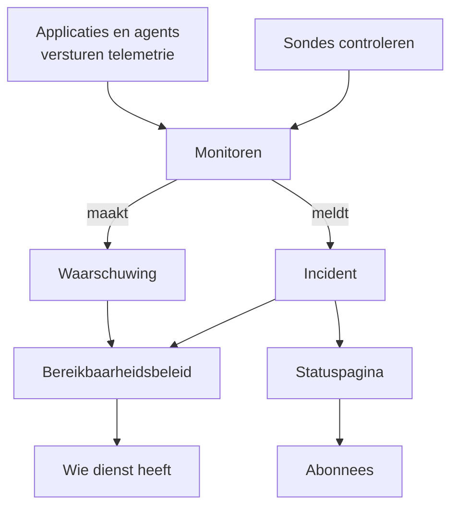
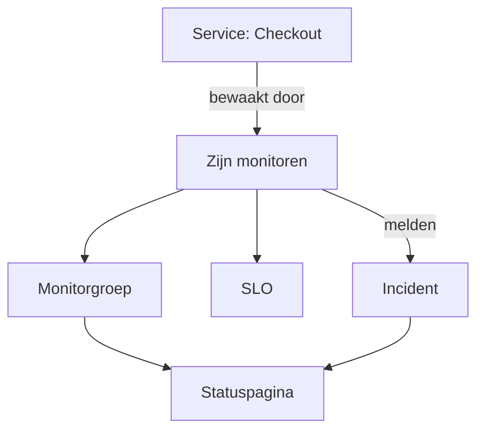

# Kernbegrippen

OneUptime heeft veel producten, maar ze rusten op een handvol ideeën: projecten, monitoren, incidenten en waarschuwingen, bereikbaarheid, statuspagina's en telemetrie. Daaromheen staan wat u bewaakt, wat u installeert en de regels die voor u handelen. Deze pagina legt elk idee in een paar zinnen uit, laat zien hoe ze samenhangen en verwijst naar de pagina's die ze uitgebreid behandelen. Lees haar één keer, en elke andere pagina van de documentatie leest makkelijker. Voor één woord tegelijk, zie de [Woordenlijst](/docs/introduction/glossary); om te kiezen tussen twee dingen die op elkaar lijken, zie [Welke gebruik ik?](/docs/introduction/which-one).

:::cards
- [Projecten en mensen](#projecten-en-mensen): Waar alles staat, en wie wat mag.
- [Monitoren en sondes](#monitoren-en-sondes): Hoe OneUptime merkt dat er iets mis is.
- [Incidenten en waarschuwingen](#incidenten-en-waarschuwingen): Het dossier waarmee uw team werkt.
- [Bereikbaarheid](#bereikbaarheid): Wie wordt opgeroepen, hoe, en wie de volgende is.
:::

## Hoe de onderdelen samenhangen

Een probleem gaat in één richting door OneUptime. Sondes en uw eigen telemetrie voeden monitoren. De criteria van een monitor bepalen wanneer er iets mis is en wat er wordt geopend: een incident, een waarschuwing of beide. Bereikbaarheidsbeleid roept mensen erover op, en statuspagina's informeren uw klanten over incidenten.

## Projecten en mensen

Een **project** bevat alles: monitoren, incidenten, bereikbaarheidsbeleid, statuspagina's, telemetrie en instellingen. De meeste bedrijven hebben er één nodig, sommige houden er één per omgeving of bedrijfsonderdeel aan. Niets wat u in het ene project maakt, is zichtbaar in een ander.

Uw **account** staat los van uw projecten. Eén account, met één e-mailadres en wachtwoord, kan bij zoveel projecten horen als u wilt; wissel ertussen met de projectkiezer linksboven. Zie [Uw account](/docs/introduction/your-account).

Mensen horen bij een project via **teams**, en de machtigingen van een team bepalen wat de leden mogen doen. Elk nieuw project begint met drie teams: Owners, met u erin, Admin en Members. Bij OneUptime Cloud heeft elk project een eigen abonnement.

:::cards
- [Gebruikers, teams en machtigingen](/docs/permissions/index): Mensen uitnodigen en bepalen wat ze mogen doen.
:::

## Monitoren en sondes

Een **monitor** controleert één ding dat u draait en beslist of het werkt. De meeste monitoren worden gecontroleerd door **sondes**: machines die de controle volgens een schema uitvoeren, zoals een pagina opvragen, een API aanroepen, een host pingen of een database bevragen. OneUptime Cloud draait sondes in meerdere regio's, een zelf-gehoste installatie draait haar eigen, en u kunt aangepaste sondes in uw netwerk toevoegen. Andere monitoren lezen juist wat u verstuurt: de telemetrie van uw applicaties, of de gegevens die een agent vanaf uw servers, Kubernetes-clusters en overige infrastructuur doorgeeft.

De **criteria** van een monitor bepalen wat elk resultaat betekent. Ze worden op volgorde bekeken, en de eerste die past kan de status van de monitor wijzigen, een incident melden, een waarschuwing aanmaken, of alle drie. Elk nieuw project heeft drie monitorstatussen: **Operationeel**, **Verminderd** en **Offline**.

:::cards
- [Een monitor maken](/docs/monitor/create-monitor): Een type kiezen, zeggen wat er gecontroleerd wordt en hoe vaak.
- [Aangepaste probes](/docs/probe/custom-probe): Controleren wat alleen uw eigen netwerk bereikt.
:::

## Wat u bewaakt

Een monitor controleert één ding. Rond uw monitoren houdt OneUptime bij wat u draait, en die records komt u in het menu tegen:

- Een **monitorgroep** voegt meerdere monitoren samen tot één status, zodat een statuspagina iets wat uit veel onderdelen bestaat, zoals Checkout, als één rij kan tonen.
- Een **service** is een applicatie of microservice die u draait. OneUptime voegt hem toe zodra zijn eerste telemetrie binnenkomt, en brengt zijn logs, traces, metrics, exceptions en incidenten samen op één pagina.
- **Hosts**, **Kubernetes**-clusters en de rest van **Infrastructuur** zijn de machines en platforms die u draait, gevuld door de agents die u installeert.
- **Inventaris** is één lijst van dat alles: services, hosts, clusters, apparaten, cloudresources en de dingen die helemaal geen telemetrie sturen.

Ze komen samen waar een probleem zich toont. De monitoren van een service kunnen samen een monitorgroep vormen, een SLO meet ze, en als er een faalt, meldt die een incident. Het incident noemt de service bij de resources die het raakt, en de statuspagina toont de groep en het incident.

:::cards
- [Monitorgroepen](/docs/monitor/monitor-groups): Meerdere monitoren samenvoegen tot één status.
- [Services](/docs/telemetry/services): Elke applicatie die u draait, elk op een eigen pagina.
- [Inventaris – Overzicht](/docs/inventory/overview): Alles wat OneUptime over uw omgeving weet.
:::

## Betrouwbaarheidsdoelen

Een **SLO** (service level objective) is een betrouwbaarheidsdoel voor wat u bewaakt, zoals 99,9% van de tijd beschikbaar over 30 dagen. OneUptime meet het elke 5 minuten aan de hand van zijn monitoren. De downtime die het doel toestaat, is het foutbudget: met ruim genoeg over kunt u risico's nemen, en met weinig over remt u af en investeert u in stabiliteit.

:::cards
- [SLO's – Overzicht](/docs/slo/introduction): Een doel stellen en zien hoeveel van het budget er nog over is.
:::

## Incidenten en waarschuwingen

Beide leggen een probleem vast, en beide kunnen degene oproepen die dienst heeft. Het verschil zit in wie het probleem raakt.

| | Incident | Waarschuwing |
| --- | --- | --- |
| **Wat het is** | Een probleem dat uw gebruikers raakt, zoals een storing of een vertraging | Een probleem waar uw team naar moet kijken voordat gebruikers er last van hebben |
| **Op statuspagina's** | Kan verschijnen, en informeert abonnees | Nooit |
| **Beginstatussen** | **Geïdentificeerd**, **Bevestigd**, **Opgelost** | **Geïdentificeerd**, **Bevestigd**, **Opgelost** |
| **Begin-ernstniveaus** | Critical Incident, Major Incident, Minor Incident | **Hoog**, **Laag** |

Bevestigen zegt dat iemand ermee bezig is, en houdt het bereikbaarheidsbeleid tegen om het volgende niveau op te roepen. Oplossen sluit het af. U kunt eigen statussen en ernstniveaus toevoegen, en waarschuwingen koppelen aan het incident waar ze bij bleken te horen.

Een **episode** groepeert gerelateerde incidenten, of gerelateerde waarschuwingen, zodat uw team ze als één geheel afhandelt. Groeperingsregels bepalen wat bij elkaar hoort.

:::cards
- [Incidenten – Overzicht](/docs/incidents/index): Hoe incidenten worden gemeld, afgehandeld en opgelost.
- [Waarschuwingen – Overzicht](/docs/alerts/index): Waar waarschuwingen vandaan komen, en hoe episodes ze groeperen.
- [Gekoppelde waarschuwingen](/docs/incidents/linked-alerts): De waarschuwingen van een storing aan het incident koppelen.
:::

## Bereikbaarheid

Een **bereikbaarheidsbeleid** bepaalt wie wordt opgeroepen over een incident of waarschuwing, en wie de volgende is als niemand reageert. De **escalatieregels** zijn de niveaus: elk niveau roept zijn mensen op en wacht tot iemand bevestigt, voordat het volgende niveau wordt opgeroepen. Een niveau kan mensen, teams of een **bereikbaarheidsschema** oproepen, een rooster dat op elk moment weet wie dienst heeft.

Hoe iemand bereikt wordt, bepaalt die persoon zelf. In de **Gebruikersinstellingen** legt ieder vast hoe OneUptime hem kan bereiken, zoals e-mail, sms, oproepen, pushmeldingen, Slack of Microsoft Teams, en welke daarvan bij een oproep worden gebruikt.

:::cards
- [Bereikbaarheid – Overzicht](/docs/on-call/index): Hoe een oproep iemand bereikt en waar elk onderdeel staat.
- [Escalatieregels](/docs/on-call/escalation-rules): Mensen niveau voor niveau oproepen tot iemand reageert.
- [Bereikbaarheidsschema's](/docs/on-call/schedules): Roosters, lagen en overdrachten.
- [Hoe OneUptime je bereikt](/docs/notifications/index): De methoden, regels en instellingen die bepalen hoe iedereen wordt bereikt.
:::

## Statuspagina's en onderhoud

Een **statuspagina** laat uw klanten zien of uw services werken. U kiest welke monitoren ze toont, onder namen die uw klanten begrijpen. Zolang een incident op een van die monitoren actief is, toont de pagina het, en krijgen haar **abonnees** bericht per e-mail, sms, Slack, Microsoft Teams of webhook. Een statuspagina kan openbaar zijn, of privé voor de mensen die u toelaat.

**Gepland onderhoud** kondigt gepland werk vooraf aan. Een gebeurtenis doorloopt **Gepland**, **Lopend**, **Beëindigd** en **Voltooid**, en de statuspagina's waarop u haar toont informeren bezoekers en abonnees erover.

:::cards
- [Statuspagina's – Overzicht](/docs/status-pages/index): Een statuspagina aanmaken en bepalen wat ze toont.
- [Abonnees en aankondigingen](/docs/status-pages/subscribers): Wie bericht krijgt, en wanneer.
- [Geplande onderhoud – Overzicht](/docs/scheduled-maintenance/index): Hoe een gebeurtenis verloopt, en wat ze pauzeert.
:::

## Telemetrie

**Telemetrie** is wat uw systemen naar OneUptime sturen: logs, metrics, traces, exceptions en profielen. Applicaties versturen haar met OpenTelemetry, en de agents van OneUptime versturen haar vanaf hosts, Kubernetes-clusters, Docker-hosts en overige infrastructuur. Elke afzender gebruikt een **ingestiesleutel**, aangemaakt onder **Projectinstellingen → Telemetrie & APM → Ingestiesleutels**. U doorzoekt telemetrie, zet haar op dashboards en bewaakt haar met telemetriemonitoren, die net als elke andere monitor incidenten en waarschuwingen openen. In het menu opent elk van **Logboeken**, **Metrieken**, **Traces**, **Profielen** en **Uitzonderingen** één soort; **AI / LLM** volgt de gesprekken van uw AI, **Data Observability** bewaakt de tabellen in uw databases, en **Topologie** brengt in kaart hoe alles samenhangt.

:::cards
- [OpenTelemetry](/docs/telemetry/open-telemetry): Logs, metrics en traces vanuit uw applicaties versturen.
- [Logs-monitor](/docs/monitor/logs-monitor): Horen wanneer een patroon in uw logs opduikt.
:::

## Beveiliging

**Beveiligingsgebeurtenissen** bewaart de beveiligingsgebeurtenissen uit uw logs, uw beveiligingstools en alles wat u verder verstuurt. De detectieregels ervan maken van wat ze vinden beveiligingszaken, die uw team in een wachtrij afhandelt en waarop playbooks reageren. **Gegevensbeveiliging** vindt de gevoelige gegevens in uw buckets, databases en telemetrie, en wat er mis is met hoe ze bewaard worden.

:::cards
- [Aan de slag met beveiliging](/docs/telemetry/security-getting-started): Dreigingen vinden in de gegevens die u al hebt.
- [Overzicht van Gegevensbeveiliging](/docs/data-security/index): Uw gevoelige gegevens vinden en verbeteren hoe ze bewaard worden.
:::

## Wat u installeert en de sleutels

Voor het grootste deel van OneUptime hoeft u niets te installeren. U installeert alleen iets om te bereiken wat OneUptime niet van buitenaf kan zien, en elk onderdeel maakt een uitgaande verbinding met OneUptime, met een sleutel:

- Een aangepaste sonde voert de controles van monitoren uit binnen uw netwerk, met een eigen sonde-ID en sleutel.
- De **OpenTelemetry Collector**, de Kubernetes-agent en de Docker-agent versturen telemetrie met een **ingestiesleutel**. De infrastructuuragent achter een Server- / VM-monitor verstuurt met de geheime sleutel van die monitor.
- Een **Runner** voert runbook-stappen uit binnen uw infrastructuur, met een eigen Runner-ID en sleutel.

Een ingestiesleutel stuurt alleen telemetrie naar binnen. Een **API-sleutel** is de andere soort: daarmee kan een script, de CLI, Terraform of een AI-assistent uw project lezen en wijzigen, met de machtigingen die u hem geeft. Geen van beide werkt in plaats van de andere.

:::cards
- [Welke gebruik ik?](/docs/introduction/which-one#sonde-agent-collector-of-runner): Wat u installeert, en welke sleutel elk onderdeel gebruikt.
- [Ingestiesleutels](/docs/telemetry/ingestion-keys): De sleutels die telemetrie versturen aanmaken, afbakenen en roteren.
:::

## Automatisering en AI

- **Workflows** voeren acties uit wanneer er iets gebeurt, zoals een bericht in Slack plaatsen wanneer een incident wordt gemeld.
- **Runbooks** zetten een responsprocedure om in stappen die uw team met de hand of automatisch kan uitvoeren.
- **OneUptime AI** onderzoekt nieuwe incidenten en waarschuwingen en zet wat het heeft gevonden op hun tijdlijn, en **AI vragen** beantwoordt vragen over uw project. Een nieuw project begint met AI aan; de schakelaar **AI inschakelen** onder **Projectinstellingen → AI → AI-functies** zet het allemaal uit.

:::cards
- [Workflows – Overzicht](/docs/workflows/index): Acties automatiseren met triggers en componenten.
- [AI SRE](/docs/ai/ai-sre): Hoe OneUptime AI incidenten en waarschuwingen onderzoekt.
:::

## Labels en eigenaren

**Labels** zijn tags die u op monitoren, incidenten, statuspagina's en de meeste andere resources zet, om ze te filteren en te groeperen. De machtigingen van een team kunnen beperkt worden tot resources met bepaalde labels. **Eigenaren** zijn de mensen en teams die verantwoordelijk zijn voor één resource: zij krijgen bericht wanneer er iets mee gebeurt. Label- en eigenaarsregels voegen voor u labels en eigenaren toe aan nieuwe resources.

:::cards
- [Label- en eigenaarsregels](/docs/configuration/label-and-owner-rules): Nieuwe resources automatisch labelen en eigenaren geven.
:::

## De soorten regels

Veel dingen in OneUptime heten een regel. Elke regel neemt één beslissing voor u wanneer er iets nieuws binnenkomt, en ze vallen in een paar families uiteen. De meeste staan onder **Regels** in de zijmenu's van **Incidenten** en **Waarschuwingen**.

| Wat ze bepalen | Regels |
| --- | --- |
| Wie wordt opgeroepen | **Bereikbaarheidsregels** kiezen het bereikbaarheidsbeleid dat een nieuw incident of een nieuwe waarschuwing uitvoert, en de **Escalatieregels** van een beleid roepen niveau voor niveau op |
| Wie de eigenaar is, en hoe het gelabeld wordt | **Eigenaarsregels**, **Labelregels** en **Privacyregels** |
| Wat bij elkaar hoort | **Groeperingsregels** openen episodes en voegen er items aan toe |
| Wat erop draait | **Runbook-regels** starten runbooks, en **AI-regels** bepalen wat OneUptime AI onderzoekt en oplost |
| Wanneer opvolgen | **SLA-regels** houden reactie- en oplostijden bij, en **Herinneringsregels** herinneren eigenaren eraan zolang het openstaat |

De eigen regels van een monitor zijn zijn criteria. De bereikbaarheidsregels onder **Gebruikersinstellingen** zijn weer iets anders: ze zijn van elke persoon zelf en bepalen hoe een oproep die persoon bereikt.

:::cards
- [Incidentinstellingen en automatisering](/docs/incidents/settings#regels-die-draaien-als-een-incident-wordt-aangemaakt): De regels die worden uitgevoerd wanneer een incident wordt aangemaakt, op volgorde.
- [Hoe ik bereikbaar ben](/docs/notifications/on-call-rules): Hoe een oproep u bereikt.
:::

## Volgende stappen

:::cards
- [Snelstart](/docs/introduction/quickstart): Deze ideeën in vijftien minuten in de praktijk brengen.
- [Woordenlijst](/docs/introduction/glossary): Elk woord dat OneUptime gebruikt, in een zin of twee.
- [Welke gebruik ik?](/docs/introduction/which-one): Incident of waarschuwing, workflow of runbook, en de andere dingen die op elkaar lijken.
- [Incidenten – Overzicht](/docs/incidents/index): Wat er gebeurt nadat een monitor een incident meldt.
:::
