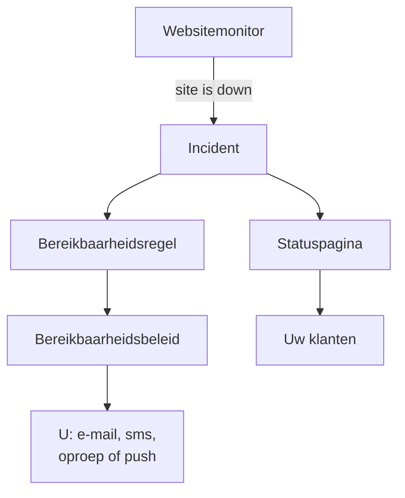

# Snelstart

Deze handleiding brengt u in ongeveer vijftien minuten van een nieuw account naar een werkende inrichting: een monitor die uw website elke vijf minuten controleert, een bereikbaarheidsbeleid dat u oproept wanneer de site uitvalt, en een statuspagina die uw klanten informeert. Ze volgt de checklist **Welkom bij OneUptime 👋** op de startpagina van uw project, en de begeleide installaties die de stappen ervan openen.

Komt u van een andere tool? [Importeer dan eerst uw inrichting](/docs/introduction/getting-started#overstappen-van-een-andere-tool): uw monitoren, bereikbaarheidsschema's en statuspagina's gaan mee.

## Voordat u begint

- **Een account.** Registreer u bij OneUptime Cloud op [oneuptime.com](https://oneuptime.com/accounts/register) en open de link in de e-mail die u ontvangt. Op uw eigen installatie opent u die in uw browser en registreert u zich: het eerste account wordt de hoofdbeheerder. Hoe u er een installeert, leest u in [Docker Compose](/docs/installation/docker-compose).
- **Een website om te bewaken.** Elk adres dat via HTTP of HTTPS antwoordt, zoals de homepage van uw bedrijf.

## Een project aanmaken

In OneUptime staat alles in een project: uw monitoren, incidenten, bereikbaarheidsbeleid, statuspagina's en de mensen die eraan werken.

:::steps
### Een nieuw project beginnen

De eerste keer dat u inlogt, toont OneUptime **Geen projecten**. Klik op **Nieuw project aanmaken**. Heeft iemand u al voor een project uitgenodigd, accepteer de uitnodiging dan op dezelfde pagina.

### Een naam geven

Voer een **Projectnaam** in, bijvoorbeeld de naam van uw bedrijf. Bij OneUptime Cloud kiest u daaronder ook een abonnement: Free is al gekozen, en de betaalde abonnementen beginnen met een gratis proefperiode.

### Het project aanmaken

Klik op **Project maken**. De startpagina van uw project opent, met bovenaan de checklist **Welkom bij OneUptime 👋**. Eerst vraagt het **Wat wil je eerst doen?**: vink **Weten wanneer mijn website of API plat ligt**, **De juiste persoon oproepen als er iets kapotgaat** en **Mijn klanten informeren met een statuspagina** aan, en klik op **Doorgaan**.
:::

## Uw website bewaken

:::steps
### De website-installatie openen

Klik in de checklist op **Maak je eerste monitor**. Dat opent de begeleide installatie **Weten wanneer mijn website of API plat ligt**, die uw site controleert, kiest wie er wordt ingelicht en een test stuurt, op één pagina. Wie geen monitoren mag maken, krijgt in plaats daarvan de lijst **Monitoren**.

### Het adres invoeren

Voer onder **Wat moeten we controleren?** het volledige adres van uw site in bij **Adres van de website of API**, bijvoorbeeld `https://example.com`, en klik op **Beginnen met controleren**. De sondes controleren het meteen, en daarna elke 5 minuten: als de site niet antwoordt, of met een fout antwoordt, gaat de monitor naar **Offline** en meldt hij een incident. Klik op **Doorgaan**.

Met het Free-abonnement van OneUptime Cloud worden monitoren naar gebruik gefactureerd, dus heeft het project een betaalmethode nodig voordat het uw site kan controleren: zonder betaalmethode vraagt de stap u om [een betaalmethode toe te voegen](/docs/configuration/billing#betaalmethoden).

### Kiezen wie er wordt ingelicht

Onder **Wie moet er op de hoogte worden gesteld?** staat u al in **Wie wordt opgeroepen**. Klik op **Opslaan en doorgaan**: dat maakt `Default on-call policy` aan, dat u oproept bij elk nieuw incident en elke nieuwe waarschuwing in het project, om te beginnen per e-mail. Om ook teamleden op te roepen die al in het project zitten, klikt u eerst op **Teamleden toevoegen**.

### Uzelf een test sturen

Klik onder **Stuur een test** op **Stuur mij een testoproep**, kies een **Ernst** en klik op **Testoproep sturen**. Open de link in de e-mail, waarin TEST staat, en bevestig de oproep daar. Klik daarna in het dialoogvenster op **Klaar**, en op **Doorgaan**: de installatie eindigt met een overzicht van wat ze heeft ingericht.
:::

Om elke optie zelf in te stellen, of om iets anders dan een website te controleren, opent u **Monitoren** vanuit het menu **Producten** en klikt u op **Monitor maken**. [Een monitor maken](/docs/monitor/create-monitor) beschrijft het formulier en elk monitortype.

Wilt u ook een API controleren, en weten wat u moet doen als de eerste controle nooit terugkomt, volg dan de handleiding [Weten wanneer uw website of API uitvalt](/docs/guides/website-down).

## Opgeroepen worden bij uitval

De website-installatie heeft al `Default on-call policy` aangemaakt, dat u per e-mail oproept bij elk nieuw incident en elke nieuwe waarschuwing, dus vinkt de checklist **Stel een bereikbaarheidsbeleid in** als gedaan af. De begeleide installatie daarvan voegt toch nog uw telefoon toe, de mensen die met u worden opgeroepen en wat er gebeurt als niemand antwoordt.

:::steps
### De bereikbaarheidsinstallatie openen

Druk op `Ctrl+K` (`Cmd+K` op een Mac), typ `get paged` en kies **De juiste persoon oproepen als er iets kapotgaat**. Zolang de checklist **Stel een bereikbaarheidsbeleid in** niet heeft afgevinkt, opent die stap dezelfde begeleide installatie.

### Kiezen hoe u bereikt wordt

Onder **Hoe moeten we je bereiken?** staat uw inlog-e-mail er al. Voor pushmeldingen installeert u de app OneUptime On-Call uit de App Store of Google Play, meldt u zich aan en klikt u op **Opnieuw controleren**. Om ook sms'jes en oproepen te krijgen, klikt u op **Sms en oproepen aanzetten**, voert u uw nummer in bij **Je telefoonnummer** en klikt u op **Stuur me een code per sms**: op OneUptime Cloud worden sms'jes en oproepen betaald uit het tegoed van het project, dus vraagt de stap u eerst tegoed toe te voegen. Klik op **Doorgaan**.

### Kiezen wie er nog meer wordt opgeroepen

Houd onder **Wie is er nog meer bereikbaar?** `Default on-call policy` aan bij **Bereikbaarheidsbeleid**. Om teamleden met u op te roepen, voegt u ze toe onder **Toevoegen aan de eerste escalatieregel**. Klik op **Opslaan en doorgaan**.

### Bepalen wat er gebeurt als niemand antwoordt

Kies onder **Wat als niemand antwoordt?** voor **Dezelfde mensen opnieuw oproepen** zolang u de enige persoon in het project bent. Zodra er teamleden zijn, roept **Iemand anders oproepen** de persoon op die u kiest onder **Daarna opgeroepen**. In OneUptime Cloud bieden alleen de betaalde abonnementen die keuze. Klik op **Opslaan en doorgaan**.

### Een testoproep sturen

Klik onder **Een testoproep sturen** op **Dit beleid testen**, kies een **Ernst** en klik op **Testoproep sturen**. Bevestig de oproep vanuit de e-mail, de sms of het telefoongesprek, klik daarna in het dialoogvenster op **Klaar**, en op **Doorgaan**. De installatie eindigt op **Oproepen zijn ingericht**.
:::

> [!NOTE]
> Sms en telefoonoproepen staan uit in een nieuw project. Een projecteigenaar, een Billing Admin of iemand met Manage Billing zet ze aan in de kaart **Meldingskanalen**, onder **Projectinstellingen → Meldingen → Meldingskanalen**.

Twee bereikbaarheidsregels activeren het beleid: een bij elk nieuw incident en een bij elke nieuwe waarschuwing. Om de eerste te zien, opent u **Incidenten** vanuit het menu **Producten**, klapt u **Regels** in het zijmenu uit en kiest u **Bereikbaarheidsregels**: die komt overeen met **Alle incidenten**. Om het beleid alleen bij sommige incidenten te activeren, zoals kritieke, bewerkt u de regel daar, of klikt u op **Incident On-Call Rule aanmaken** om er zelf een toe te voegen.

Om in plaats daarvan veld voor veld een beleid op te bouwen, opent u **Bereikbaarheid** vanuit het menu **Producten** en klikt u op **Bereikbaarheidsbeleid aanmaken**. Voor meer niveaus, roosters en hoe lang elk niveau wacht, zie [Escalatieregels](/docs/on-call/escalation-rules) en [Bereikbaarheidsschema's](/docs/on-call/schedules).

Voor elk scherm van de installatie, en wat u doet als een oproep niet aankomt, volgt u de handleiding [Opgeroepen worden via telefoon, sms of push](/docs/guides/paging).

## Een statuspagina publiceren

:::steps
### De statuspagina-installatie openen

Klik in de checklist op **Publiceer een statuspagina**. Dat opent de begeleide installatie **Publiceer een statuspagina**, die de pagina een naam geeft, uw monitor erop zet en laat zien wat uw klanten zien. Wie geen statuspagina's mag maken, krijgt in plaats daarvan de lijst **Statuspagina's**. Het overzicht van de website-installatie opent dezelfde installatie, als **Op een statuspagina tonen**.

### De pagina een naam geven en uw monitor kiezen

Houd onder **Geef de pagina een naam en kies wat ze toont** de voorgestelde **Naam van de statuspagina** aan, of typ uw eigen naam. Vink onder **Wat ze toont** uw websitemonitor aan, en klik op **De statuspagina aanmaken**. Vanaf dit moment is de pagina openbaar op haar link: iedereen met het adres kan haar openen.

### De pagina openen

Open onder **Dit zien uw klanten** het adres bij **Openbare link**: uw website staat er als operationeel. Terug in de installatie klikt u op **Ziet er goed uit**. De installatie eindigt met een overzicht van wat u daarna kunt doen.
:::

Om in plaats daarvan met de hand een pagina te maken, opent u **Statuspagina's** vanuit het menu **Producten** en klikt u op **Statuspagina maken**; voeg daarna uw monitor toe met **Monitoren toevoegen** op het **Overzicht** ervan. Hoe u de pagina uw eigen logo en kleuren geeft, leest u in [Statuspagina – branding en domeinen](/docs/status-pages/branding-and-domains).

Wilt u de statuspagina via HTTPS op uw eigen domein zetten, volg dan de handleiding [Een statuspagina publiceren](/docs/guides/status-page).

## Uw team uitnodigen

Klik in de checklist op **Nodig je team uit**, of open **Gebruikers** vanuit het menu **Producten**, onder **Instellingen**. Klik op **Gebruiker uitnodigen**, voer het **E-mail**-adres in en kies een **Team**: het ledenteam is vooraf gekozen. Klik op **Uitnodigen**. OneUptime stuurt de uitnodiging per e-mail, en het team bepaalt wat de persoon mag doen. Zie [Gebruikers, teams en machtigingen](/docs/permissions/index).

## Uitproberen

Meld een testincident om de hele keten te zien werken.

:::steps
### Een testincident melden

Open **Incidenten** en klik op **Incident melden**. Voer een **Titel** in, bijvoorbeeld `Test incident`, kies een **Ernst van incident** en klik op **Volgende**. Kies onder **Monitoren** uw websitemonitor, zodat het incident op uw statuspagina verschijnt. Klik op **Volgende** tot u bij de samenvatting bent, en dan op **Incident melden**.

### Zien wat er gebeurt

Binnen een minuut of twee roept uw bereikbaarheidsbeleid u op, en verschijnt het incident op uw statuspagina.

### Het oplossen

Klik op de pagina van het incident op **Oplossen**. De oproepen stoppen, en het incident verdwijnt van uw statuspagina.
:::

> [!WARNING]
> Iedereen die uw statuspagina opent, ziet het testincident tot u het oplost. Voer de test uit voordat u het adres van de pagina deelt.

## Problemen oplossen

:::details Ik ben niet opgeroepen
Open het incident en kies **Bereikbaarheidsuitvoeringen** in het zijmenu: daar ziet u of uw beleid is uitgevoerd en wie het heeft opgeroepen. Is het niet uitgevoerd, controleer dan of uw bereikbaarheidsregel is ingeschakeld en het beleid noemt. Is het wel uitgevoerd, controleer dan of uw methoden onder **Gebruikersinstellingen → Meldingsmethoden** geverifieerd zijn.
:::

:::details Het incident staat niet op mijn statuspagina
Een statuspagina toont een incident wanneer een van de monitoren van het incident op de pagina staat. Controleer of het incident uw monitor bij zijn getroffen resources noemt, en of de monitor op de statuspagina staat.
:::

:::details De monitor zegt offline, maar mijn site werkt
Open de monitor en bekijk wat de sondes hebben ontvangen. Zie het gedeelte over problemen oplossen in [Website-monitor](/docs/monitor/website-monitor).
:::

## Volgende stappen

:::cards
- [Kernbegrippen](/docs/introduction/core-concepts): De ideeën achter wat u net hebt ingericht.
- [Woordenlijst](/docs/introduction/glossary): Elk woord dat u onderweg bent tegengekomen, in een zin of twee.
- [Bereikbaarheidsschema's](/docs/on-call/schedules): De bereikbaarheid met uw team delen.
- [Statuspagina – branding en domeinen](/docs/status-pages/branding-and-domains): De statuspagina uw eigen maken.
- [OpenTelemetry](/docs/telemetry/open-telemetry): Logs, metrics en traces vanuit uw applicaties versturen.
:::
