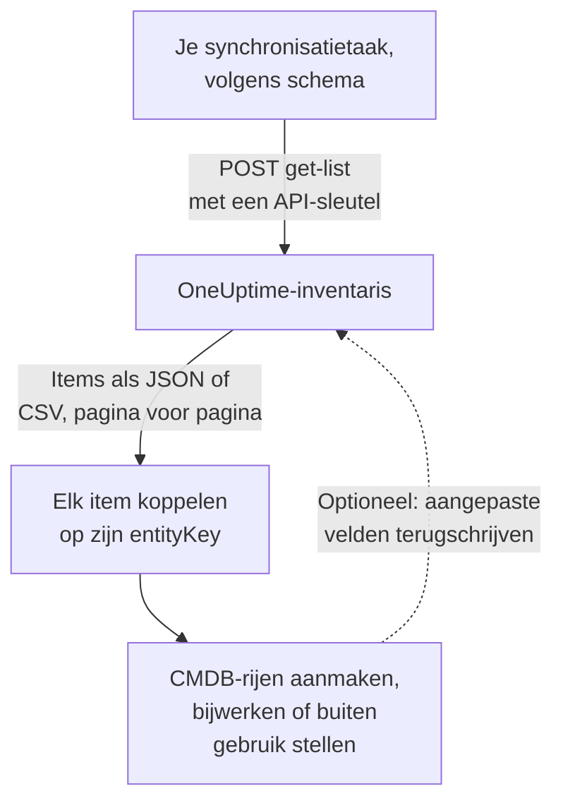

# Exporteren naar een CMDB

Als je al een CMDB of assetregister hebt, wil OneUptime dat niet vervangen. Wat het heeft en een CMDB meestal mist, is een beeld van wat er echt draait, actueel gehouden zonder dat iemand het bijhoudt: ontdekt uit telemetrie en uit de pollers die je netwerk en je cloudaccounts al in de gaten houden. Deze pagina is het recept om dat beeld in je eigen leidende systeem te halen.

:::cards
- [Hoe een synchronisatie werkt](#hoe-een-synchronisatie-werkt): Een geplande taak die de lijst leest en op een stabiele sleutel koppelt.
- [De catalogus ophalen](#de-catalogus-ophalen): Het verzoek, pagina voor pagina, als JSON of CSV.
- [Assetgegevens](#assetgegevens): Dezelfde gegevens en sleutels voor hosts en netwerkapparaten.
- [Terugschrijven](#terugschrijven): Je assettags naar OneUptime sturen, en toevoegen wat het niet kan zien.
:::

## Hoe een synchronisatie werkt

Een synchronisatie is een taak die je volgens een schema uitvoert. Ze leest de inventarislijst via de REST API met een API-sleutel, koppelt elk item aan een rij van je CMDB via zijn identiteitssleutel, en maakt rijen aan, werkt ze bij of stelt ze buiten gebruik zodat ze overeenkomen. Ze kan ook waarden terugschrijven in de aangepaste velden van de items.



## Wat je kunt ophalen

Drie REST-resources, elk met de standaardendpoints van de [OneUptime API](/docs/api-reference/api-reference):

| Resource | Endpoint | Wat het bevat |
| --- | --- | --- |
| Inventarisitem | `/api/inventory-item` | Eén rij per ding in de omgeving |
| Definities van aangepaste velden | `/api/inventory-item-custom-field` | Het eigen veldvocabulaire van je project |
| Relaties | `/api/inventory-item-relationship` | De gerichte verbindingen tussen items |

De nuttige kolommen van een inventarisitem:

| Kolom | Betekenis |
| --- | --- |
| `_id` | De ID van OneUptime: gebruik die als je externe referentie |
| `entityType` | `host`, `k8s.pod`, `network.device`, `appliance`, … |
| `entityKey` | Een stabiele identiteitshash. Die overleeft hernoemen, dus het is de betere sleutel om op te koppelen |
| `displayName` | De naam die mensen lezen |
| `source` | `discovered`, `inventory` of `manual` |
| `description` | Vrije tekst |
| `identifyingAttributes` | De attributen die het item maken tot wat het is, en die nooit veranderen |
| `descriptiveAttributes` | Alles wat er verder op is waargenomen: zie [Assetgegevens](#assetgegevens), [Assetattributen van hosts](#assetattributen-van-hosts) en [Assetattributen van netwerkapparaten](#assetattributen-van-netwerkapparaten) hieronder |
| `customFields` | Je eigen velden, op veldnaam |
| `resourceType` / `resourceId` | Een verwijzing naar het uitgebreidere OneUptime-record, als dat er is |
| `firstSeenAt` / `lastSeenAt` | Wanneer het voor het eerst en voor het laatst is waargenomen |
| `isArchived` | Of het uit de actieve lijst is gehaald |

## Voordat je begint

Een synchronisatie heeft een API-sleutel nodig die de inventaris mag lezen. In OneUptime Cloud hebben API-sleutels het abonnement **Growth** of hoger nodig.

:::steps
### Een API-sleutel aanmaken

Open **Projectinstellingen → Geavanceerd → API-sleutels** en klik op **API-sleutel aanmaken**. Geef hem een **Naam** en kies onder **Toegang** **Kijker** om alles in het project te lezen, of **Machtigingen later kiezen** om hem alleen te geven wat een synchronisatie nodig heeft.

### Hem alleen geven wat hij nodig heeft

Een alleen-lezen-export heeft één machtiging nodig, **Read Telemetry Service**: de inventaris deelt de telemetriemachtigingen in plaats van eigen machtigingen te hebben. Klik op de pagina van de sleutel op **Machtiging toevoegen** en kies hem. Om waarden terug te schrijven, voeg je ook **Edit Telemetry Service** toe.

### De sleutel kopiëren

Kopieer de **API-sleutel** van de pagina van de sleutel en maak hem beschikbaar voor je taak:

```bash
export ONEUPTIME_API_KEY="your-api-key"
```
:::

De sleutel wordt meegestuurd in de header `ApiKey` van elk verzoek en leest de inventaris van zijn eigen project, dus een verzoek noemt geen project.

## De catalogus ophalen

Stuur een `POST` naar het lijstendpoint met de kolommen die je wilt. `select` is verplicht: de API geeft alleen terug waar je om vraagt.

```bash
curl -X POST 'https://oneuptime.com/api/inventory-item/get-list' \
  -H "ApiKey: $ONEUPTIME_API_KEY" \
  -H 'Content-Type: application/json' \
  -d '{
    "query": { "isArchived": false },
    "select": {
      "_id": true,
      "entityType": true,
      "entityKey": true,
      "displayName": true,
      "source": true,
      "customFields": true,
      "descriptiveAttributes": true,
      "lastSeenAt": true
    },
    "sort": { "displayName": "ASC" },
    "limit": 100,
    "skip": 0
  }'
```

Gebruik bij een zelf gehoste installatie je eigen OneUptime-adres in plaats van `https://oneuptime.com`. Het antwoord is `{ "data": [...], "count": ... }`, waarbij `count` aangeeft hoeveel items er in totaal overeenkomen. Blader door `skip` met je `limit` te verhogen tot je ze allemaal hebt; `limit` gaat tot 10.000. Datums en ID's behalve `_id` komen verpakt terug, als `{ "_type": "DateTime", "value": "..." }` en `{ "_type": "ObjectID", "value": "..." }`: lees ze uit `value`.

### Alleen de netwerkapparaten

Beperk de lijst op `entityType`:

```bash
curl -X POST 'https://oneuptime.com/api/inventory-item/get-list' \
  -H "ApiKey: $ONEUPTIME_API_KEY" \
  -H 'Content-Type: application/json' \
  -d '{
    "query": { "entityType": "network.device", "isArchived": false },
    "select": { "_id": true, "entityKey": true, "displayName": true, "customFields": true },
    "limit": 100,
    "skip": 0
  }'
```

De `descriptiveAttributes` van elk netwerkapparaat bevatten zijn hostnaam, IP-adres, serienummer, MAC-adres, merk, model, firmware, besturingssysteem, rol, site en locatie: zie [Assetattributen van netwerkapparaten](#assetattributen-van-netwerkapparaten) hieronder. Wat de poller verder weet, zoals interfaces en buren, staat op het Network Device-record zelf: volg `resourceId` naar `/api/network-device/:id/get-item`, of haal `/api/network-device/get-list` direct op.

### Als CSV

Elk lijstendpoint antwoordt met `?output-type=csv` in CSV in plaats van JSON:

```bash
curl -X POST 'https://oneuptime.com/api/inventory-item/get-list?output-type=csv' \
  -H "ApiKey: $ONEUPTIME_API_KEY" \
  -H 'Content-Type: application/json' \
  -d '{ "query": {}, "select": { "displayName": true, "entityType": true, "customFields": true }, "limit": 500, "skip": 0 }' \
  -o inventory.csv
```

De lijst **All Items** in het dashboard exporteert op dezelfde manier, met de kolommen van aangepaste velden die je hebt aangezet. Elk [assetgegeven](#assetgegevens) is daar ook een kolom: **Hostnaam**, **IP-adres**, **Serienummer**, **Model** en de rest staan eerst verborgen, dus zet ze aan via de kolomkiezer, en de export bevat één kolom per gegeven, of een rij nu een host of een netwerkapparaat is.

## Assetgegevens

Hosts en netwerkapparaten worden met dezelfde gegevens beschreven, opgeslagen onder dezelfde sleutels. Eén CMDB-kolom bevat het serienummer, of een rij nu een server of een switch is, en de kaart **Assetgegevens** van een item in het dashboard toont elk gegeven voor beide in dezelfde volgorde. Een gegeven dat niets heeft gemeld, staat er als **Onbekend** in plaats van weg te vallen, zodat een gat zichtbaar is.

| Gegeven | Sleutel | Bij een host | Bij een netwerkapparaat |
| --- | --- | --- | --- |
| Hostnaam | `host.name` | De naam van de host. Dat is de identiteit van de host, dus staat in `identifyingAttributes` | De eigen naam van het apparaat: zijn SNMP-`sysName`, anders de NetBIOS- of DNS-naam die de ontdekking vond. Nooit zijn IP-adres |
| IP-adres | `host.ip` | Elk adres dat de collector meldt | Het adres dat OneUptime pollt, als het een IP-adres is, anders het adres waarnaar zijn probe die DNS-naam heeft omgezet |
| MAC-adres | `host.mac` | Gedetecteerd | Op het apparaat ingevoerd, of geleerd uit de ARP-tabel van een doorlopen router |
| Serienummer | `host.serial_number` | Gestempeld | ENTITY-MIB |
| Manufacturer | `device.manufacturer` | Gestempeld | ENTITY-MIB, anders wat `sysDescr` of `sysObjectID` noemt |
| Model | `device.model.name` | Gestempeld | ENTITY-MIB, anders wat `sysDescr` noemt |
| Firmwareversie | `device.firmware.version` | Gestempeld | ENTITY-MIB, anders wat `sysDescr` noemt |
| Besturingssysteem | `os.name` | `os.description` (of `os.type`) | Wat `sysDescr` noemt: Cisco IOS, Junos OS, Arista EOS, Linux |
| OS-versie | `os.version` | Gedetecteerd | ENTITY-MIB, anders wat `sysDescr` noemt |
| Device Type | `device.type` | Gestempeld. Anders deelt de kaart het in op basis van besturingssysteem en naam (Server, Firewall, ...) | Zijn rol: de rol die jij toewees, anders de rol waarmee de topologiekaart het tekent |
| Location | `device.location` | Gestempeld. Anders toont de kaart zijn cloudzone | `sysLocation`. De kaart toont eerst zijn site |

De [hosttabel](#assetattributen-van-hosts) en de [netwerkapparatentabel](#assetattributen-van-netwerkapparaten) hieronder vertellen in detail waar elke waarde vandaan komt.

## Assetattributen van hosts

`descriptiveAttributes` bij een host bevat de assetgegevens die een CMDB-rij meestal wil, op hun OpenTelemetry-attribuutnaam:

| Veld | Sleutel | Standaard verzameld? |
| --- | --- | --- |
| IP-adressen | `host.ip` | Ja: kommagescheiden als de machine er meerdere heeft |
| MAC-adressen | `host.mac` | Ja: kommagescheiden, één per actieve interface, als `AC-DE-48-23-45-67` |
| Architectuur | `host.arch` | Ja |
| Machine-ID | `host.id` | Ja: de machine-GUID op Windows, `/etc/machine-id` op Linux |
| Besturingssysteem | `os.type`, `os.description`, `os.version` | Ja |
| Cloudplaatsing | `cloud.provider`, `cloud.region`, `cloud.availability_zone` | Alleen met een clouddetector |
| Serienummer | `host.serial_number` | Vereist één configuratiestap |
| Merk | `device.manufacturer` | Vereist één configuratiestap |
| Model | `device.model.name` | Vereist één configuratiestap |
| Firmwareversie (BIOS of UEFI) | `device.firmware.version` | Vereist één configuratiestap |
| Naam van het besturingssysteem | `os.name` | Alleen van SDK's die het melden: anders noemt `os.description` het besturingssysteem |
| Apparaattype | `device.type` | Optioneel: stempel het op dezelfde manier (`Hypervisor`, `Workstation`) |
| Locatie | `device.location` | Optioneel: stempel het op dezelfde manier (`Frankfurt DC, Rack B4`) |

Alles wat met Ja is gemarkeerd, komt uit de processor `resourcedetection` van de collector en staat al in de configuratie die OneUptime voor je genereert.

De sleutels `cloud.*` hebben een clouddetector in die processor nodig: `detectors: [system, env, ec2]`, of `gcp` of `azure` voor de andere. De meegeleverde configuratie draait alleen `[system, env]`, dus die drie blijven leeg tot je er een toevoegt.

Serienummer, merk, model en firmware hebben geen resourcedetector: ze zitten in de firmware van de machine, gelezen via WMI op Windows en DMI op Linux, dus ze worden één keer op de resource gestempeld, bij het inrichten van de machine. Een apparaattype of locatie die je op de rij wilt, stempel je op dezelfde manier. [Inventarisattributen](/docs/telemetry/host-otel-collector#inventarisattributen-ip-mac-serienummer-merk-model-firmware) bevat het precieze fragment voor elk besturingssysteem. `host.manufacturer`, `host.model.name`, `host.firmware.version` en `host.bios.version` worden als andere spellingen geaccepteerd en onder de sleutels `device.*` opgeslagen (en `device.serial_number` onder `host.serial_number`), dus een synchronisatie leest altijd maar één sleutel per gegeven.

`host.id` is het bekijken waard als koppelsleutel als je CMDB al op een hardware-ID sleutelt: anders dan `entityKey` is het de eigen ID van de machine, dus het komt overeen met wat een tool voor endpointbeheer voor dezelfde machine meldt.

Attributen worden aangevuld en nooit leeggemaakt: een attribuut dat niet meer wordt gemeld, blijft op de rij staan, dus een waarde die je synchronisatie al heeft gelezen verdwijnt nooit stilletjes.

## Assetattributen van netwerkapparaten

Een netwerkapparaat (`entityType: network.device`) wordt gespiegeld uit zijn Network Device-record, en zijn `descriptiveAttributes` gebruiken dezelfde sleutels die een host voor dezelfde gegevens gebruikt, dus één CMDB-kolom bevat het serienummer, of de rij nu een server of een switch is:

| Veld | Sleutel | Waar het vandaan komt |
| --- | --- | --- |
| Hostnaam | `host.name` | De eigen naam van het apparaat: zijn SNMP-`sysName`, anders de NetBIOS- of reverse-DNS-naam die de ontdekking vond. Weggelaten als alleen zijn IP-adres het benoemt |
| IP-adres | `host.ip` | Het adres dat OneUptime pollt, als het een IP-adres is. Voor een apparaat dat op een DNS-naam wordt gepold, het adres waarnaar zijn probe die naam het laatst heeft omgezet |
| DNS-naam | `net.device.dns_name` | De reverse-DNS-naam die bij de ontdekking is gevonden, of de DNS-naam die OneUptime pollt |
| MAC-adres | `host.mac` | Op het apparaat ingevoerd, of geleerd uit de ARP-tabel van een doorlopen router |
| Merk | `device.manufacturer` | ENTITY-MIB `entPhysicalMfgName`, anders de fabrikant die `sysDescr` noemt, anders de leverancier van de `sysObjectID` |
| Model | `device.model.name` | ENTITY-MIB `entPhysicalModelName`, anders het model dat `sysDescr` noemt |
| Serienummer | `host.serial_number` | ENTITY-MIB `entPhysicalSerialNum` |
| Firmwareversie | `device.firmware.version` | ENTITY-MIB `entPhysicalFirmwareRev`, anders de firmware die `sysDescr` noemt op apparaten van Ubiquiti, HPE en Aruba |
| Besturingssysteem | `os.name` | Het besturingssysteem dat `sysDescr` noemt |
| Software- of OS-versie | `os.version` | ENTITY-MIB `entPhysicalSoftwareRev`, anders de release die `sysDescr` noemt |
| Systeembeschrijving | `os.description` | `sysDescr` |
| Apparaattype | `device.type` | De rol die je het apparaat hebt toegewezen, anders de rol waarmee de topologiekaart het indeelt, onder de naam die je project ervoor gebruikt |
| Locatie | `device.location` | `sysLocation`, tenzij het de standaardwaarde van een agent is, zoals "Sitting on the Dock of the Bay" van Net-SNMP |
| Site | `oneuptime.site.name` | De Network Site waaraan het apparaat is toegewezen |
| Gepold adres | `net.device.hostname` | Het adres dat OneUptime pollt: een IP-adres of een DNS-naam. Behouden voor synchronisaties die zijn geschreven voordat `host.name` en `host.ip` bestonden |

De ENTITY-MIB-rijen vullen zich na de eerste SNMP-walk van het apparaat. Een apparaat dat niet wordt gewalkt, omdat het alleen met ping wordt gemonitord of nog niet is gepold, krijgt toch zijn naam, merk, besturingssysteem en locatie uit wat de laatste discovery-scan van zijn adres via SNMP las, en zijn MAC-adres uit de ARP-tabel van een doorlopen router. Een apparaat dat geen ENTITY-MIB implementeert, heeft geen serienummer of firmware te melden. Zijn `sysDescr` noemt voor veel platforms toch het model en het besturingssysteem: een Cisco Meraki MX meldt `Meraki MX85`, wat het merk en model invult. Een platform waarvan de `sysDescr` geen bekende vorm heeft, voegt niets toe in plaats van te gokken.

Een waarde die op het apparaat is opgeslagen, ingetypt of via de API ingesteld, wordt nooit vervangen door wat discovery leest. Van een waarde die de eigen walk van het apparaat las en een die een scan las, wordt de nieuwste gebruikt. Wat een scan las, wordt alleen gebruikt als de scan dezelfde machine op het adres vond: als de systeemnaam, `sysObjectID` of NetBIOS-naam die hij las die van het apparaat tegenspreekt, wordt niets gebruikt van wat hij daar las. De kaart **Assetgegevens** van het item toont waar elke waarde vandaan kwam en wanneer.

De hostnaam is nooit het IP-adres. Een apparaat dat alleen zijn adres benoemt, heeft `host.ip` en geen `host.name`. Zodra zijn SNMP-walk een systeemnaam meldt, volgt `host.name` bij de volgende ronde.

Deze waarden worden elke vijftien minuten uit het Network Device-record gekopieerd, en ze **vervangen** de vorige waarden in plaats van ze aan te vullen, dus een waarde die op het apparaat is gewist (een verwijderd MAC-adres, bijvoorbeeld) verdwijnt ook uit het inventarisitem.

Er is geen versie voor een *beschikbare upgrade*: SNMP heeft daar geen standaardobject voor, dus OneUptime legt de versie vast die op het apparaat draait.

## Items aan CMDB-rijen koppelen

Koppel op `entityKey`, niet op `displayName`. Het is een hash van de identificerende attributen van het item, dus het overleeft hernoemen en nieuwe tags: een host die een nieuw label krijgt, houdt dezelfde sleutel terwijl de weergavenaam verandert. `_id` is net zo stabiel, en de eenvoudigste vreemde sleutel als je altijd maar met één project praat.

Datums in `customFields` zijn ISO-8601-tekenreeksen in UTC, en de CSV-export schrijft ze zo in plaats van in de vriendelijkere vorm die het dashboard toont, zodat ze zonder parseerverrassingen worden geïmporteerd.

## Actueel blijven

Er is geen wijzigingsfeed. Vraag het lijstendpoint op met het interval dat je uitkomt, en vergelijk op `entityKey`. `lastSeenAt` vertelt wanneer een item voor het laatst is waargenomen, wat meestal de goedkoopste manier is om te zien wat sinds je vorige ronde stil is geworden.

Een item dat tussen twee rondes verdwijnt, is ofwel verlopen (een ontdekt item dat langer stil bleef dan zijn venster), ofwel is het eigen record verwijderd. Een gespiegeld item dat waarden van aangepaste velden draagt, wordt gearchiveerd in plaats van verwijderd wanneer zijn record verdwijnt, dus vraag op met `"isArchived": true` om te zien wat buiten gebruik is gesteld zonder de bijbehorende assetgegevens kwijt te raken.

## Terugschrijven

Dezelfde endpoints accepteren schrijfacties, dus een synchronisatie kan waarden in `customFields` zetten: bijvoorbeeld de assettag die je CMDB al beheert, gestempeld op het bijbehorende OneUptime-item. De sleutel heeft daarvoor **Edit Telemetry Service** nodig.

Je kunt ook items toevoegen voor dingen die OneUptime niet kan zien, met `POST /api/inventory-item`, een `entityType` van `external.service`, `external.database` of `appliance`, en een `displayName`. OneUptime bepaalt de identiteitssleutel voor je, en die items verlopen nooit. De sleutel heeft daarvoor **Create Telemetry Service** nodig.

## Problemen oplossen

:::details Elk verzoek wordt geweigerd met 402 Payment Required
In OneUptime Cloud werken API-sleutels alleen zolang het project op het abonnement **Growth** of hoger zit. Er wordt niets verwijderd: de sleutel werkt weer zoals hij is zodra het project terug op het abonnement is. Zie [API-sleutels en SCIM onder hun abonnement](/docs/api-reference/api-reference#api-sleutels-en-scim-onder-hun-abonnement).
:::

:::details Elk verzoek antwoordt 422 You do not have permissions
De sleutel heeft geen machtiging die de inventaris leest. Een sleutel die met **Machtigingen later kiezen** is gemaakt, kan niets tot hij er een krijgt: voeg op zijn pagina **Read Telemetry Service** toe, zoals in [Voordat je begint](#voordat-je-begint).
:::

:::details De lijst komt terug zonder de kolommen die ik nodig heb
De lijst geeft alleen de kolommen terug die `select` noemt, plus `_id`. Voeg elke kolom die je leest toe aan `select`, inclusief `descriptiveAttributes` en `customFields`.
:::

:::details Een item dat ik verwachtte ontbreekt
Gearchiveerde items worden weggelaten als je `"isArchived": false` stuurt. Een ontdekt item wordt verwijderd zodra het langer stil is dan zijn venster, en een gespiegeld item gaat mee met zijn record. Vraag om `"isArchived": true` om de gearchiveerde te zien.
:::

## Volgende stappen

:::cards
- [Inventaris – Overzicht](/docs/inventory/overview): Waar items vandaan komen en hoe lang elk blijft.
- [Aangepaste inventarisvelden](/docs/inventory/custom-fields): De velden definiëren die je synchronisatie leest en schrijft.
- [OneUptime API-referentie](/docs/api-reference/api-reference): Verzoeken, statuscodes en de regels die elke schrijfactie volgt.
:::
