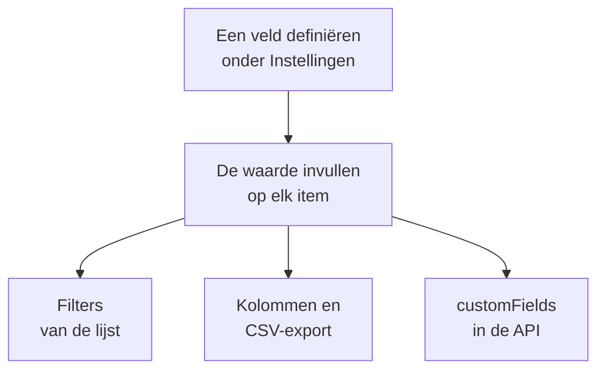

# Aangepaste inventarisvelden

OneUptime ontdekt wat er in je omgeving zit. Aangepaste velden leggen vast wat geen enkele waarneming kan vertellen: het serienummer op de sticker, de datum waarop de garantie afloopt, welk team eigenaar is van iets, of het in gebruik is of in een la met reserveonderdelen ligt. Definieer de velden één keer voor het project en vul ze daarna in op elk item.

:::cards
- [Hoe aangepaste velden werken](#hoe-aangepaste-velden-werken): Eén vocabulaire, op elk item, ongeacht de bron.
- [Velden definiëren](#velden-definiëren): Een veld aanmaken, het type kiezen, de opties van een vervolgkeuzelijst opgeven.
- [De lijst filteren](#de-lijst-filteren): In twee klikken vinden wat volgend kwartaal verloopt.
- [Opmerkingen en grenzen](#opmerkingen-en-grenzen): Hernoemen, duplicaten, datums en verwijderde velden.
:::

## Hoe aangepaste velden werken

Een veld wordt één keer voor het project gedefinieerd, en elk item kan er een waarde voor hebben: de items die OneUptime heeft ontdekt, die het spiegelt en die jij handmatig hebt toegevoegd. Een veld wordt een filter boven de lijst, een optionele kolom en een kolom van de CSV-export. De API leest en schrijft dezelfde waarden, onder `customFields` van elk item.

> [!NOTE]
> In OneUptime Cloud horen aangepaste velden bij het abonnement **Growth** en hoger. Daaronder kunnen velden niet worden gedefinieerd, opgesomd of gewijzigd: de API antwoordt `402 Payment Required`, en de lijst toont geen filters of kolommen voor aangepaste velden.

## Velden definiëren

:::steps
### De pagina met aangepaste velden openen

Ga naar **Producten → Bronnen → Inventaris**, open **Instellingen** in het zijmenu en daarna **Aangepaste velden**.

### Een veld aanmaken

Klik op **Inventory Item Custom Field aanmaken**. Geef het een **Veldnaam**, een optionele **Veldbeschrijving** en een **Veldtype** uit de tabel hieronder.

### De opties van een vervolgkeuzelijst opgeven

Voeg bij een vervolgkeuzetype de opties toe onder **Vervolgkeuzeopties**. Elke optie kan een kleur hebben, die op dezelfde manier wordt gebruikt in de tabelcel en in het filter: kies een van de benoemde kleuren, **Geen kleur**, of **Aangepaste kleur** voor een exacte kleurcode. Sleep een optie aan haar greep om haar plek in de lijst te veranderen.
:::

| Type | Gebruik het voor |
| --- | --- |
| **Tekst** | Serienummer, assettag, positie in het rack, inkoopordernummer |
| **Nummer** | Kosten, rackunit, aantal poorten |
| **Booleaans** | Onder support, binnen de PCI-scope |
| **Vervolgkeuzelijst (enkele keuze)** | Levenscyclusstatus, omgeving, kriticiteit: één antwoord uit een vaste lijst |
| **Vervolgkeuzelijst (meerdere keuzes)** | Compliancescopes, tags: meerdere antwoorden uit een vaste lijst |
| **Datum** | Aankoopdatum, einde van de garantie, einde-levensduurdatum |
| **Datum en tijd** | Laatst geaudit op, buiten gebruik gesteld op |
| **Lange tekst** | Toegangsinstructies, notities: meerdere regels platte tekst |
| **Opgemaakte tekst (Markdown)** | Notities met opmaak en links, geschreven in de Markdown-editor |
| **Bestand** | Een garantiebewijs, een ondertekende inkooporder, een foto van het rack-label: één bestand |
| **Meerdere bestanden** | Handleidingen, facturen en foto's: tot 10 bestanden |

## Een uitgewerkt assetvocabulaire

Een typisch register van hardware-assets past direct op deze velden:

| Veldnaam | Type | Voorbeeld |
| --- | --- | --- |
| `Serial Number` | Tekst | `FDO24160ABC` |
| `Asset Tag` | Tekst | `IT-004821` |
| `Purchase Date` | Datum | 2024-03-11 |
| `Warranty Expiry` | Datum | 2027-03-10 |
| `Lifecycle Status` | Vervolgkeuzelijst | In gebruik, Reserve, In reparatie, Afgeschreven |
| `Assigned Site` | Vervolgkeuzelijst | Datacenter Londen, Datacenter Frankfurt, Hoofdkantoor |
| `Owner Team` | Vervolgkeuzelijst | Netwerk, Platform, Beveiliging |
| `Cost Centre` | Tekst | `CC-4410` |

Vul de waarden in op de pagina **Aangepaste velden** van een item. Elk item neemt ze aan, ongeacht de bron, dus de switches die OneUptime heeft ontdekt en de netwerkapparaten die het spiegelt dragen hetzelfde assetvocabulaire als de appliances die jij handmatig hebt toegevoegd.

## De lijst filteren

Elk aangepast veld wordt een filter boven de lijst **All Items**, en het filter biedt de vergelijkingen die bij het type passen:

| Veldtype | Vergelijkingen |
| --- | --- |
| **Tekst**, **Lange tekst**, **Opgemaakte tekst (Markdown)** | is, is niet, bevat, bevat niet, begint met, eindigt op, is leeg, is niet leeg |
| **Nummer** | is, is niet, is groter dan, is groter dan of gelijk aan, is kleiner dan, is kleiner dan of gelijk aan, is leeg, is niet leeg |
| **Booleaans**, **Vervolgkeuzelijst (enkele keuze)**, **Vervolgkeuzelijst (meerdere keuzes)** | is, is niet, is leeg, is niet leeg |
| **Datum**, **Datum en tijd** | is, is vóór, is na, ligt tussen, is leeg, is niet leeg |
| **Bestand**, **Meerdere bestanden** | is |

Een chip voor **Bestand** of **Meerdere bestanden** vraagt maar één ding: of het veld **Heeft bestanden** of **Geen bestanden** heeft.

Filters worden met EN gecombineerd, dus "Warranty Expiry is vóór 2026-10-01 EN Lifecycle Status is In gebruik" is één weergave van de lijst. Dat is de vraag waarvoor een assetregister bestaat, en de reden om de datumtypen te gebruiken in plaats van een datum in een tekstveld: een tekstveld slaat `2026-10-01` gewoon op en kan je daarna niet vertellen wat volgend kwartaal verloopt.

Kolommen van aangepaste velden zijn eerst verborgen: zet ze aan via de kolomkiezer. Ze kunnen niet worden gesorteerd, omdat de waarden samen in één JSON-kolom staan waarop de lijst niet kan sorteren.

## Opmerkingen en grenzen

- Waarden worden op elk item opgeslagen onder de naam van het veld. Een veld hernoemen verplaatst de waarden die al onder de oude naam staan niet. Aangepaste velden van incidenten zijn de uitzondering: als je er een hernoemt, gaan de waarden mee (zie [Een veld hernoemen](/docs/incidents/settings#een-veld-hernoemen)).
- De opties van een vervolgkeuzelijst kunnen worden toegevoegd, hernoemd, in een nieuwe volgorde gesleept en verwijderd nadat items waarden hebben. Een hernoemde optie verandert op elk item dat haar heeft; een verwijderde optie blijft op de items die haar hebben, getoond als niet langer een optie, tenzij je er een andere voor kiest (zie [De opties van een vervolgkeuzelijst wijzigen](/docs/incidents/settings#de-opties-van-een-vervolgkeuzelijst-wijzigen)).
- Niets maakt een waarde uniek. Twee items kunnen hetzelfde serienummer hebben, en niets houdt je tegen.
- Datums worden opgeslagen als ISO-8601-tijdstempels in UTC en getoond in je eigen tijdzone.
- Een veld verwijderen haalt het uit de lijst en uit de filterbalk. De waarden die al zijn geschreven blijven op de items staan.
- Een veld **Bestand** of **Meerdere bestanden** neemt bestanden van elk ten hoogste 10 MB, van de soorten die onder [Bestandsvelden](/docs/incidents/settings#bestandsvelden) staan, geüpload in het project. Alleen wie het item mag zien, kan ze downloaden, en een bestand wordt verwijderd zodra niets het meer vasthoudt.

## Volgende stappen

:::cards
- [Inventaris – Overzicht](/docs/inventory/overview): Waar items vandaan komen en wat elke pagina toont.
- [Exporteren naar een CMDB](/docs/inventory/cmdb-sync): De items en hun aangepaste velden in een ander systeem halen.
- [Aangepaste velden van incidenten](/docs/incidents/settings#aangepaste-velden): Dezelfde veldtypen op incidenten, met een paar extra's.
:::
