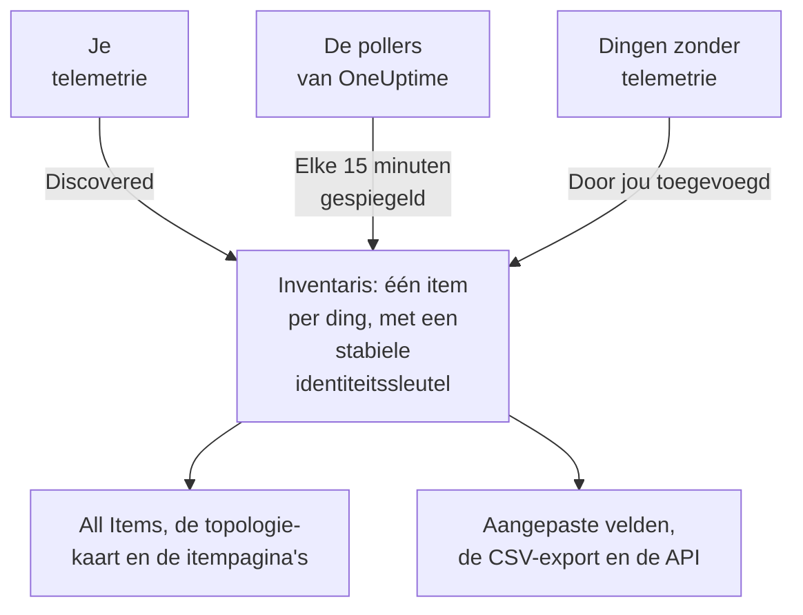

# Inventaris – Overzicht

De inventaris is één lijst van alles wat OneUptime over je omgeving weet: services, hosts, Kubernetes-objecten, virtuele machines, netwerkapparaten, cloudresources, IoT-apparaten, serverless functies en de dingen die helemaal geen telemetrie sturen. Het meeste vult zichzelf in vanuit wat OneUptime al bekijkt. Jij voegt toe wat kijken niet kan vertellen: waar iets voor is, van wie het is, wanneer de garantie afloopt.

:::cards
- [Hoe items in de inventaris komen](#hoe-items-in-de-inventaris-komen): Ontdekt, gespiegeld of door jou toegevoegd.
- [Je weg vinden](#je-weg-vinden): De pagina's van de inventaris en de eigen pagina's van elk item.
- [Iets handmatig toevoegen](#iets-handmatig-toevoegen): Een API van een derde partij, een externe database of een appliance.
- [Archiveren in plaats van verwijderen](#archiveren-in-plaats-van-verwijderen): De manier om de lijst op te ruimen die blijft.
:::

## Hoe items in de inventaris komen

OneUptime bekijkt je omgeving al om die te monitoren, dus de catalogus wordt opgebouwd uit wat het waarneemt in plaats van uit wat iemand zich herinnerde in te typen. Elk item heeft een bron, en de bron bepaalt van wie het item is: of je het kunt bewerken en of het vanzelf kan verdwijnen.

| Bron | In de API | Waar het vandaan komt | Hoe lang het blijft |
| --- | --- | --- | --- |
| **Discovered** | `discovered` | OpenTelemetry-resourceattributen, gelezen zodra telemetrie binnenkomt: een service, host, Kubernetes-object of virtuele machine die telemetrie stuurt. | Wordt bij elke batch opnieuw geregistreerd. Wordt verwijderd zodra het langer stil is dan het venster van zijn soort (zie hieronder). |
| **Mirrored** | `inventory` | Een record dat een poller van OneUptime bijhoudt: netwerkapparaten, cloudresources, IoT-apparaten, serverless functies, RUM-applicaties, Docker-hosts en Podman-hosts. Elke 15 minuten gekopieerd. | Zolang het record bestaat. Verwijder het record en het item gaat mee. |
| **Added by you** | `manual` | Door jou toegevoegd, voor iets wat OneUptime niet kan zien: een API van een derde partij, een database die een leverancier beheert, een appliance in een rack. | Tot je het verwijdert. Niets laat het verlopen. |

Een ontdekt of gespiegeld item kan niet worden hernoemd of een ander type krijgen: de bron zou de wijziging bij de volgende ronde overschrijven. De pagina **Instellingen** van het item zegt waar je in plaats daarvan een blijvende wijziging maakt. Wat je altijd aan elk item kunt toevoegen, ongeacht de bron, zijn waarden van aangepaste velden: zie [Aangepaste inventarisvelden](/docs/inventory/custom-fields).

### Hoe lang een stil item blijft

Een ontdekt item heeft een hartslag. Elke keer dat er telemetrie voor binnenkomt, schuift het tijdstip waarop het voor het laatst is gezien op, en de kolom **Status** van de lijst laat zien hoe recent dat is. Gespiegelde items en de items die jij hebt toegevoegd hebben geen hartslag, dus hun status blijft leeg in plaats van alarm te slaan.

| Status | Wat het betekent |
| --- | --- |
| **Live** | Gezien in de laatste 30 minuten. |
| **Recent** | Gezien binnen de laatste dag. |
| **Stale** | Al meer dan een dag niet gezien. De pagina **Gone Quiet** toont ze. |

Elke drie uur verwijdert OneUptime de ontdekte items die langer stil zijn dan het venster van hun soort, gearchiveerde inbegrepen, en hun waarden van aangepaste velden gaan mee. Gespiegelde items en de items die jij hebt toegevoegd worden nooit op deze manier verwijderd.

| Soort item | Verwijderd na zo lang zonder telemetrie |
| --- | --- |
| Pods, deployments, Proxmox-gasten en virtuele VMware-machines | 1 dag |
| Kubernetes-nodes en -namespaces, Proxmox-nodes, VMware-hosts, -clusters en -datastores, en de databases en externe services die je traces aanroepen | 7 dagen |
| Services, hosts, Kubernetes-, Proxmox- en Ceph-clusters, storage-arrays, vCenters en Docker Swarm-clusters | 30 dagen |

Een relatie die OneUptime heeft ontdekt, wordt verwijderd zodra die 30 dagen niet opnieuw is gezien.

## Je weg vinden

Open **Producten → Bronnen → Inventaris**. Het zijmenu heeft deze pagina's. **By Source**, **Instellingen**, **Hulp** en **Geavanceerd** staan eerst ingeklapt: klik op de titel van een sectie om die te openen.

| Pagina | Wat je er vindt |
| --- | --- |
| **Overzicht** | Hoeveel items je hebt, wat ze zijn, hoeveel er stil zijn geworden en wat het laatst is toegevoegd. |
| **All Items** | Elk item. Zoek op naam, beschrijving of identiteitssleutel, beperk de lijst op type, bron, status of aangepast veld, en voeg handmatig een item toe. |
| **Topology Map** | Hoe de items met elkaar verbonden zijn: services, wat ze aanroepen, en de hosts, pods en apparaten waarop ze draaien. |
| **Gone Quiet** | De ontdekte items die al meer dan een dag geen telemetrie hebben gestuurd. |
| **By Source** | De items van één bron: **Discovered**, **Mirrored** of **Added by You**. |
| **Instellingen → Aangepaste velden** | De velden die je project op elk item bijhoudt. |
| **Hulp → Documentatie** | Een korte gids over de inventaris, met de soorten items die hij herkent. |
| **Geavanceerd → Gearchiveerd** | De items die je hebt gearchiveerd. Haal ze hier uit het archief. |

Open een item, en het eigen zijmenu heeft zijn **Overzicht** (type, bron en status, en elk attribuut dat erop is waargenomen), zijn **Verbindingen** en zijn **Aangepaste velden**; zijn **Logboeken**, **Traces**, **Metrieken**, **Prestatieprofielen** en **Uitzonderingen**; en zijn **Incidenten**, **Waarschuwingen** en **Geplande onderhoud**. Onder **Geavanceerd** staan zijn **Instellingen**, zijn **Auditlogboeken** en **Delete Item**. De telemetriepagina's tonen wat het item zelf heeft gestuurd. De incidenten, waarschuwingen en onderhoudsgebeurtenissen zijn die van de service, host of het Kubernetes-cluster waar het item voor staat; bij elk ander item zeggen die pagina's welke resource je in plaats daarvan moet bekijken.

### Assetgegevens

Een host of een netwerkapparaat heeft een kaart **Assetgegevens** die beide op dezelfde manier beschrijft: hostnaam, IP-adres, MAC-adres, serienummer, fabrikant, model, firmwareversie, besturingssysteem, OS-versie, apparaattype en locatie. Een gegeven dat niets heeft gemeld, staat er als **Onbekend**, en de kaart legt uit hoe de onbekende worden ingevuld.

- De gegevens van een host komen uit de resourceattributen van zijn telemetrie: zijn IP- en MAC-adressen, architectuur en besturingssysteem meteen, en zijn serienummer, merk, model en firmware zodra je ze erop stempelt.
- De gegevens van een netwerkapparaat komen uit zijn SNMP-poll, zijn rol en zijn site. Wat zijn poll niet heeft gelezen, komt uit discovery: de laatste scan van zijn adres, de ARP-tabel van een router of de DNS-lookup van zijn probe. Een apparaat zonder ENTITY-MIB, zoals een Meraki MX, krijgt zijn merk en model toch uit zijn systeembeschrijving. Zijn IP-adres wordt nooit als zijn hostnaam getoond.

De kaart toont waar elk gegeven vandaan kwam en wanneer. De bron die de meeste gegevens delen, zoals de collector van een host, de eigen SNMP-poll van een netwerkapparaat of de discovery-scan die het las, wordt één keer genoemd, onder de gegevens. Elke andere bron, zoals de ARP-tabel van een router of een waarde die op het apparaat is opgeslagen, wordt onder het eigen gegeven genoemd. Een waarde die op een netwerkapparaat is opgeslagen, wordt nooit vervangen door wat discovery leest, en als de twee verschillen, toont de kaart ze allebei.

Dezelfde gegevens zijn kolommen van de lijst **All Items**, verborgen tot je ze aanzet, en ze gaan mee in de CSV-export. [Exporteren naar een CMDB](/docs/inventory/cmdb-sync#assetgegevens) noemt hun sleutels.

### Verbindingen

De pagina **Verbindingen** van een item toont zijn buren in beide richtingen, gegroepeerd in **Aanroepen**, **Aangeroepen door**, **Draait op** en **Gerelateerd**. Elke groep toont haar totaal (een groep met meer dan 100.000 verbindingen toont "100.000+"), en **Meer tonen** bladert door de rest, zodat een druk cluster, een drukke namespace of node elke verbinding toont in plaats van alleen de eerste. De pagina is niet beperkt tot een tijdsbereik: hij bevat relaties die handmatig via de API zijn toegevoegd, en buren die zijn gearchiveerd. Een buur die niet meer in de inventaris staat, wordt met zijn sleutel getoond.

## Iets handmatig toevoegen

Voeg een item toe voor iets wat OneUptime nooit zelf zal zien, zodat een afhankelijkheid ergens echt eindigt en het ding je aangepaste velden kan dragen.

:::steps
### All Items openen

Ga naar **Producten → Bronnen → Inventaris** en dan naar **All Items**.

### Het item toevoegen

Klik op **Item toevoegen**. Kies het **Type**, geef het een **Naam** en eventueel een **Beschrijving**. Naam en type samen zijn de identiteit van het item, dus twee items van hetzelfde type kunnen niet dezelfde naam hebben.

### De aangepaste velden invullen

Open het nieuwe item. De bron staat op **Added by you**, en de pagina **Aangepaste velden** neemt de waarden op die je project bijhoudt.
:::

Drie typen kun je handmatig toevoegen:

- `external.service` (**Externe service**): een API van een derde partij of een software-as-a-service-afhankelijkheid.
- `external.database` (**Externe database**): een database die geen server is die OneUptime kan modelleren. Een databaseserver, zelf gehost of beheerd, van PostgreSQL tot Snowflake, hoort in plaats daarvan onder **Databases → Database aanmaken** ([Databases](/docs/telemetry/databases)): dat record wordt gekoppeld aan de traces, containers en enginemetrics die hetzelfde adres noemen, wat een inventarisitem nooit doet, en wie dezelfde server op beide manieren toevoegt, houdt twee losse records over.
- `appliance` (**Appliance**): hardware of software zonder agent.

De beperking voorkomt duplicaten. Een handgemaakt item van een type dat OneUptime kan waarnemen, zoals een host, zou op de getypte naam worden geïdentificeerd, terwijl het ontdekte item van dezelfde machine wordt geïdentificeerd op de attributen die ze meldt. De twee zouden nooit samenkomen, dus dezelfde host zou voorgoed twee keer in je lijst staan.

## Archiveren in plaats van verwijderen

Archiveren haalt een item uit de lijst terwijl het zijn identiteit, zijn geschiedenis en zijn waarden van aangepaste velden houdt. Het zegt: dit heb ik gezien en ik wil het niet in mijn lijst. Een gearchiveerd item blijft telemetrie verzamelen.

| Bron | Archiveren | Verwijderen |
| --- | --- | --- |
| **Discovered** | Blijft gearchiveerd. | Komt terug met de volgende batch van zijn telemetrie. |
| **Mirrored** | Blijft gearchiveerd. | Komt terug met de volgende kopie. Verwijder in plaats daarvan het oorspronkelijke record. |
| **Added by you** | Blijft gearchiveerd. | Voorgoed weg. |

Om items te archiveren selecteer je ze in **All Items** en archiveer je ze in één keer, of open je een item en gebruik je de kaart **Archiveren** op de pagina **Instellingen**. Gearchiveerde items staan onder **Inventaris → Geavanceerd → Gearchiveerd**, waar je ze kunt selecteren en uit het archief kunt halen.

> [!NOTE]
> Wanneer een gespiegeld apparaat uit zijn eigen record wordt verwijderd, verwijdert OneUptime ook het item, tenzij het item waarden van aangepaste velden draagt die jij hebt ingevoerd. Die waarden zijn de enige kopie en er is geen ongedaan maken, dus wordt het item gearchiveerd in plaats van verwijderd. Je vindt het onder **Geavanceerd → Gearchiveerd**, met alles wat je hebt getypt intact.

## Relaties en topologie

OneUptime verbindt items met gerichte relaties zodra het die waarneemt. **Inventaris → Topology Map** tekent ze, en de pagina **Verbindingen** van een item toont die van het item zelf. Zie [Topologie](/docs/telemetry/topology).

| Relatie | Bijvoorbeeld |
| --- | --- |
| `runs-on` | Een pod draait op een node; een virtuele machine draait op haar host. |
| `member-of` | Een pod, node of namespace is lid van een cluster. |
| `hosted-on` | Een service wordt gehost op een host. |
| `part-of` | Een pod is deel van zijn deployment. |
| `depends-on` | Een service roept een andere aan, volgens de spans die tussen de twee overgaan. |

## Volgende stappen

:::cards
- [Aangepaste inventarisvelden](/docs/inventory/custom-fields): Serienummers, garantiedata, eigenaren en levenscyclusstatus bijhouden.
- [Exporteren naar een CMDB](/docs/inventory/cmdb-sync): De catalogus in je eigen leidende systeem halen.
- [Databases](/docs/telemetry/databases): De databaseservers monitoren die je services gebruiken.
:::
