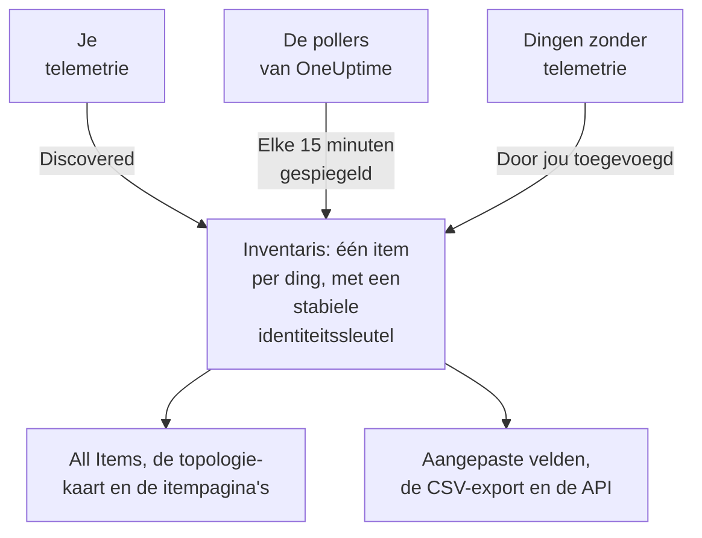

# Inventaris – Overzicht

De inventaris is één lijst van alles wat OneUptime over je omgeving weet: services, hosts, Kubernetes-objecten, virtuele machines, netwerkapparaten, cloudresources, IoT-apparaten, serverless functies en de dingen die helemaal geen telemetrie sturen. Het meeste vult zichzelf in vanuit wat OneUptime al bekijkt. Jij voegt toe wat kijken niet kan vertellen: waar iets voor is, van wie het is, wanneer de garantie afloopt. De [Woordenlijst](/docs/introduction/glossary#wat-u-bewaakt) zegt wat elk soort item erin is.

:::cards
- [Hoe items in de inventaris komen](#hoe-items-in-de-inventaris-komen): Ontdekt, gespiegeld of door jou toegevoegd.
- [Je weg vinden](#je-weg-vinden): De pagina's van de inventaris en de eigen pagina's van elk item.
- [Apparaten uit Esper importeren](#apparaten-uit-esper-importeren): Elk Android- en Apple-apparaat dat je Esper-tenant inschrijft, actueel gehouden.
- [Apparaten uit Microsoft Intune importeren](#apparaten-uit-microsoft-intune-importeren): Elke Windows-pc, Mac, iPhone, iPad en elk Android-apparaat dat Intune beheert, actueel gehouden.
- [Apparaten uit Workspace ONE UEM importeren](#apparaten-uit-workspace-one-uem-importeren): Elke telefoon, tablet en computer die Workspace ONE beheert, actueel gehouden.
- [Apparaten uit SOTI MobiControl importeren](#apparaten-uit-soti-mobicontrol-importeren): Elk robuust apparaat en elke telefoon, tablet en computer die MobiControl beheert, actueel gehouden.
- [Iets handmatig toevoegen](#iets-handmatig-toevoegen): Een API van een derde partij, een externe database of een appliance.
- [Archiveren in plaats van verwijderen](#archiveren-in-plaats-van-verwijderen): De manier om de lijst op te ruimen die blijft.
:::

## Hoe items in de inventaris komen

OneUptime bekijkt je omgeving al om die te monitoren, dus de catalogus wordt opgebouwd uit wat het waarneemt in plaats van uit wat iemand zich herinnerde in te typen. Elk item heeft een bron, en de bron bepaalt van wie het item is: of je het kunt bewerken en of het vanzelf kan verdwijnen.

| Bron | In de API | Waar het vandaan komt | Hoe lang het blijft |
| --- | --- | --- | --- |
| **Ontdekt** | `discovered` | OpenTelemetry-resourceattributen, gelezen zodra telemetrie binnenkomt: een service, host, Kubernetes-object of virtuele machine die telemetrie stuurt. | Wordt bij elke batch opnieuw geregistreerd. Wordt verwijderd zodra het langer stil is dan het venster van zijn soort (zie hieronder). |
| **Gespiegeld** | `inventory` | Een record dat een poller van OneUptime bijhoudt: netwerkapparaten, cloudresources, IoT-apparaten, serverless functies, RUM-applicaties, Docker-hosts, Podman-hosts en de apparaten die een MDM-koppeling importeert. Elke 15 minuten gekopieerd. Een beheerd apparaat telkens wanneer zijn koppeling wordt gelezen. | Zolang het record bestaat. Verwijder het record en het item gaat mee. |
| **Door u toegevoegd** | `manual` | Door jou toegevoegd, voor iets wat OneUptime niet kan zien: een API van een derde partij, een database die een leverancier beheert, een appliance in een rack. | Tot je het verwijdert. Niets laat het verlopen. |

Een ontdekt of gespiegeld item kan niet worden hernoemd of een ander type krijgen: de bron zou de wijziging bij de volgende ronde overschrijven. De pagina **Instellingen** van het item zegt waar je in plaats daarvan een blijvende wijziging maakt. Wat je altijd aan elk item kunt toevoegen, ongeacht de bron, zijn waarden van aangepaste velden: zie [Aangepaste inventarisvelden](/docs/inventory/custom-fields).

### Hoe lang een stil item blijft

Een ontdekt item heeft een hartslag. Elke keer dat er telemetrie voor binnenkomt, schuift het tijdstip waarop het voor het laatst is gezien op, en de kolom **Status** van de lijst laat zien hoe recent dat is. Dat geldt ook voor een beheerd apparaat: telkens wanneer het bij zijn MDM incheckt. Andere gespiegelde items en de items die jij hebt toegevoegd hebben geen hartslag, dus hun status blijft leeg in plaats van alarm te slaan.

| Status | Wat het betekent |
| --- | --- |
| **Live** | Gezien in de laatste 30 minuten. |
| **Recent** | Gezien binnen de laatste dag. |
| **Verouderd** | Al meer dan een dag niet gezien. De pagina **Stilgevallen** toont ze. |

Elke drie uur verwijdert OneUptime de ontdekte items die langer stil zijn dan het venster van hun soort, gearchiveerde inbegrepen, en hun waarden van aangepaste velden gaan mee. Gespiegelde items en de items die jij hebt toegevoegd worden nooit op deze manier verwijderd.

| Soort item | Verwijderd na zo lang zonder telemetrie |
| --- | --- |
| Pods, deployments, Proxmox-gasten, OpenStack-instanties en virtuele VMware-machines | 1 dag |
| Kubernetes-nodes en -namespaces, Proxmox-nodes, OpenStack-hypervisors, VMware-hosts, -clusters en -datastores, en de databases en externe services die je traces aanroepen | 7 dagen |
| Services, hosts, Kubernetes-, Proxmox- en Ceph-clusters, OpenStack-clouds, storage-arrays, vCenters en Docker Swarm-clusters | 30 dagen |

Een relatie die OneUptime heeft ontdekt, wordt verwijderd zodra die 30 dagen niet opnieuw is gezien.

## Je weg vinden

Open **Producten → Bronnen → Inventaris**. Het zijmenu heeft deze pagina's. **Per bron**, **Instellingen**, **Hulp** en **Geavanceerd** staan eerst ingeklapt: klik op de titel van een sectie om die te openen.

| Pagina | Wat je er vindt |
| --- | --- |
| **Overzicht** | Hoeveel items je hebt, wat ze zijn, hoeveel er stil zijn geworden en wat het laatst is toegevoegd. |
| **Alle items** | Elk item. Zoek op naam, beschrijving of identiteitssleutel, beperk de lijst op type, bron, status of aangepast veld, en voeg handmatig een item toe. |
| **Beheerde apparaten** | Je MDM-koppelingen – Esper, Microsoft Intune, Workspace ONE UEM en SOTI MobiControl – en elk apparaat dat ze importeren, met zijn status, groep, model en besturingssysteem. |
| **Topologiekaart** | Hoe de items met elkaar verbonden zijn: services, wat ze aanroepen, en de hosts, pods en apparaten waarop ze draaien. |
| **Stilgevallen** | De items waarvan al meer dan een dag niets is vernomen: ontdekte items die geen telemetrie hebben gestuurd, en apparaten die niet meer bij hun MDM inchecken. |
| **Per bron** | De items van één bron: **Ontdekt**, **Gespiegeld** of **Door u toegevoegd**. |
| **Instellingen → Aangepaste velden** | De velden die je project op elk item bijhoudt. |
| **Hulp → Documentatie** | Een korte gids over de inventaris, met de soorten items die hij herkent. |
| **Geavanceerd → Gearchiveerd** | De items die je hebt gearchiveerd. Haal ze hier uit het archief. |

Open een item, en het eigen zijmenu heeft zijn **Overzicht** (type, bron en status, en elk attribuut dat erop is waargenomen), zijn **Verbindingen** en zijn **Aangepaste velden**; zijn **Logboeken**, **Traces**, **Metrieken**, **Profielen** en **Uitzonderingen**; en zijn **Incidenten**, **Waarschuwingen** en **Gepland onderhoud**. Onder **Geavanceerd** staan zijn **Instellingen**, zijn **Auditlogboeken** en **Item verwijderen**. De telemetriepagina's tonen wat het item zelf heeft gestuurd. De incidenten, waarschuwingen en onderhoudsgebeurtenissen zijn die van de service, host of het Kubernetes-cluster waar het item voor staat; bij elk ander item zeggen die pagina's welke resource je in plaats daarvan moet bekijken.

### Assetgegevens

Een host of een netwerkapparaat heeft een kaart **Assetgegevens** die beide op dezelfde manier beschrijft: hostnaam, IP-adres, MAC-adres, serienummer, fabrikant, model, firmwareversie, besturingssysteem, OS-versie, apparaattype en locatie. De kaart van een Android-apparaat heeft ook zijn beveiligingspatchniveau, van de Android-agent of zijn MDM. Ze zegt ook of de patch **Niet actueel** is, zoals de kolom **Beveiligingspatchniveau**, en hoeveel dagen oud hij is. Een gegeven dat niets heeft gemeld, staat er als **Onbekend**, en de kaart legt uit waarom dat zo is en hoe de onbekende worden ingevuld: een apparaat dat ze niet via SNMP meldt, een apparaat dat nog niet is gelezen, of een Meraki-apparaat waarvan het dashboard ze heeft.

- De gegevens van een host komen uit de resourceattributen van zijn telemetrie: zijn IP- en MAC-adressen, architectuur en besturingssysteem meteen, en zijn serienummer, merk, model en firmware zodra je ze erop stempelt.
- De gegevens van een netwerkapparaat komen uit zijn SNMP-poll, zijn rol en zijn site. Wat zijn poll niet heeft gelezen, komt uit discovery: de laatste scan van zijn adres, de ARP-tabel van een router of de DNS-lookup van zijn sonde. Een apparaat zonder ENTITY-MIB, zoals een Meraki MX, krijgt zijn merk, model en besturingssysteem toch uit zijn systeembeschrijving, en zijn MAC-adres van zijn eigen poorten. Zijn IP-adres wordt nooit als zijn hostnaam getoond.
- Een Meraki-apparaat neemt ook wat zijn poll leeg laat over uit het Meraki-dashboard, waaronder zijn serienummer, model en firmware, wanneer een [Meraki-koppeling](/docs/monitor/network-traffic#cisco-meraki-zonder-netflow) zijn organisatie leest.

**Alle items** vindt de Android-apparaten waar je iets mee moet doen. Het filter **Beveiligingspatchniveau** toont de apparaten die **Niet actueel** zijn, waarvan het beveiligingspatchniveau ouder is dan 90 dagen, dezelfde regel die de waarschuwing Security Patch Out of Date van de [Host-monitor](/docs/monitor/host-monitor) hanteert. Het filter **Agentmachtigingen** toont de apparaten waarop de [Android-agent](/docs/telemetry/android-agent) nog READ_LOGS, READ_DROPBOX_DATA of gebruikstoegang mist. Elk filter heeft een kolom met dezelfde naam, verborgen tot je die aanzet, en de CSV-export neemt die mee. Daarnaast bevat de kolom **MDM-ID** de ID waaronder de MDM een apparaat kent, zoals de Esper-ID die `espercli secureadb connect --device` verwacht.

De kaart toont waar elk gegeven vandaan kwam en wanneer. De bron die de meeste gegevens delen, zoals de collector van een host, de eigen SNMP-poll van een netwerkapparaat of de discovery-scan die het las, wordt één keer genoemd, onder de gegevens. Elke andere bron, zoals de ARP-tabel van een router of een waarde die op het apparaat is opgeslagen, wordt onder het eigen gegeven genoemd. Een waarde die op een netwerkapparaat is opgeslagen, wordt nooit vervangen door wat discovery leest, en als de twee verschillen, toont de kaart ze allebei.

De kaart van een netwerkapparaat heeft een knop **Vernieuwen** voor wie netwerkapparaten mag bewerken. Die leest het apparaat nu opnieuw: zijn sonde pollt het binnen een minuut, en zijn Meraki-koppeling leest de organisatie opnieuw. De kaart zegt wanneer de nieuwe leesbeurt binnen is, of dat de sonde het apparaat niet kon bereiken, en het item wordt van het apparaat gekopieerd zodra de leesbeurt binnen is.

Dezelfde gegevens zijn kolommen van de lijst **Alle items**, verborgen tot je ze aanzet, en ze gaan mee in de CSV-export. [Exporteren naar een CMDB](/docs/inventory/cmdb-sync#assetgegevens) noemt hun sleutels.

### Verbindingen

De pagina **Verbindingen** van een item toont zijn buren in beide richtingen, gegroepeerd in **Aanroepen**, **Aangeroepen door**, **Draait op** en **Gerelateerd**. Elke groep toont haar totaal (een groep met meer dan 100.000 verbindingen toont "100.000+"), en **Meer tonen** bladert door de rest, zodat een druk cluster, een drukke namespace of node elke verbinding toont in plaats van alleen de eerste. De pagina is niet beperkt tot een tijdsbereik: hij bevat relaties die handmatig via de API zijn toegevoegd, en buren die zijn gearchiveerd. Een buur die niet meer in de inventaris staat, wordt met zijn sleutel getoond.

## Apparaten uit Esper importeren

Koppel een Esper-tenant, en elk apparaat dat die inschrijft, staat in de inventaris: zijn Android-apparaten, ook die waarvan de app nooit is gestart, en zijn iPhones, iPads en Apple TV's. Elk apparaat is één host, met wat alleen Esper erover weet: zijn groep, zijn besturingssysteem en build, zijn serienummer en IMEI, zijn batterij en opslag, en bij een Android-apparaat zijn beveiligingspatchniveau en geïnstalleerde apps. Esper stuurt zelf niets, dus OneUptime leest de tenant volgens een schema: de apparaten elke 15 minuten, en de apps van elk Android-apparaat elke 6 uur.

:::steps
### Een API-sleutel maken in Esper

Maak in de Esper-console een sleutel aan onder API Key Management. OneUptime leest alleen, dus de sleutel van een gebruiker wiens Esper-rol apparaten, groepen en apps mag lezen, volstaat. Een sleutel werkt niet meer zodra hij is vervangen of zodra zijn gebruiker is verwijderd.

### De tenant koppelen

Ga naar **Producten → Bronnen → Inventaris**, dan naar **Beheerde apparaten**, klik op **MDM koppelen**, en kies **Esper**. Vul de **Tenant** in, de naam vóór `.esper.cloud` in het adres van je Esper-console (`acme` voor `acme.esper.cloud`), en de **API-sleutel**. **Meer velden** bevat de naam van de koppeling en hoe vaak die wordt gelezen.

### De eerste leesactie controleren

**Koppelen** test de sleutel voordat er iets wordt opgeslagen: het zegt hoeveel apparaten een leesactie zal importeren, of wat er mis is en hoe je dat oplost. De eerste leesactie begint binnen een minuut, en de rij van de koppeling laat zien hoe die is verlopen.
:::

| Wat Esper meldt | Waar het staat |
| --- | --- |
| Model, fabrikant, serienummer, besturingssysteem en zijn versie, build, en IP- en MAC-adressen | De kaart **Assetgegevens** van het apparaat, en de kolommen van **Alle items** |
| Status, laatste check-in, groep, beveiligingspatchniveau, IMEI, batterij, opslag en Esper-agent | De kaart **Esper** van het apparaat, en de lijst **Apparaten** van **Beheerde apparaten** |
| Apps en hun versies | De lijst **Geïnstalleerde apps** van het apparaat |
| Zijn Esper-apparaat-ID | De kolom **MDM-ID** van **Alle items** |

### Eén apparaat, niet twee

Een app of de Android Agent die telemetrie van een apparaat stuurt, wordt samen met het apparaat dat Esper importeert één item wanneer die het apparaat noemt zoals Esper dat doet. Stel deze resourceattributen in vanuit de beheerde configuratie die Esper op elk apparaat invult:

| Resourceattribuut | Waarde in de beheerde configuratie | Wat het is |
| --- | --- | --- |
| `host.name` | `${esper.deviceName}` | De naam van het apparaat in Esper, zoals `ESP-ID-AAAAW`. Vereist. |
| `host.serial_number` | `${esper.serialNumber}` | Het serienummer van het apparaat. Optioneel. |

OneUptime vindt het item van een apparaat op zijn naam in Esper, daarna op zijn serienummer, en maakt er alleen een aan als er geen overeenkomt. De Android Agent stelt beide in vanuit zijn instellingen `device_name` en `device_serial`, en [Android-configuratie](/docs/rum/android-setup#de-vloot-uit-esper-importeren) toont de beheerde configuratie van een app.

### Als een apparaat stilvalt of Esper verlaat

Een Android-apparaat dat al 30 minuten niet heeft ingecheckt, is **Offline** en laat zien hoe lang geleden het dat voor het laatst deed; een iPhone, iPad of Apple TV, die incheckt wanneer de pushdienst van Apple hem wekt, vaak uren na elkaar, is na een dag **Offline**. De **Status** van zijn item volgt zijn laatste check-in, of zijn telemetrie als die nieuwer is, dus een apparaat dat een dag stil is, staat op de pagina **Stilgevallen**.

Een apparaat dat uit Esper is verwijderd, krijgt de status **Verwijderd**, en zijn item wordt gearchiveerd: het verdwijnt uit de lijst en wacht onder **Geavanceerd → Gearchiveerd**. Een apparaat dat terugkomt in Esper, komt terug in de lijst. 30 dagen nadat het is vertrokken, wordt het apparaat verwijderd, en zijn item ook, tenzij telemetrie of jij er iets aan hebt toegevoegd.

### Een waarschuwing krijgen als een apparaat niet meer incheckt

Klik bij **Beheerde apparaten** op **Waarschuwingen instellen** in de rij van de koppeling en maak **Esper Android Device Stopped Checking In** en **Esper Apple Device Stopped Checking In** aan. De eerste opent een waarschuwing voor elk Android-apparaat dat al meer dan een uur niet bij Esper heeft ingecheckt, de tweede voor elk Apple-apparaat na meer dan een dag, elk genoemd naar het apparaat en opgelost zodra het weer incheckt.

Elke lezing van de koppeling legt als de metriek `oneuptime.managed_device.check_in.age` vast hoeveel minuten geleden elk apparaat voor het laatst incheckte, en de monitor controleert elke 5 minuten de nieuwste waarde van elk apparaat. Een apparaat waarop ook de Android Agent draait, wordt aan **Host Stopped Reporting** overgelaten, zodat het nooit twee keer waarschuwt, en een apparaat dat uit Esper is verwijderd, lost zijn waarschuwing op. Een lezing die mislukt, legt niets van de apparaten vast, dus geen van hun waarschuwingen wordt geopend of opgelost tot er weer een lezing lukt. Verhoog voor een vloot die 's nachts uit staat de drempel van de monitor.

Maak ook **Esper Security Patch Out of Date** aan, dan opent elk Android-apparaat waarvan het beveiligingspatchniveau volgens Esper meer dan 90 dagen oud is een eigen waarschuwing, die wordt opgelost zodra het apparaat is bijgewerkt. Elke lezing legt als de metriek `oneuptime.managed_device.security_patch.age` vast hoeveel dagen oud het patchniveau van elk Android-apparaat is. Een apparaat waarop de Android Agent draait, wordt aan **Security Patch Out of Date** van zijn host overgelaten, zodat het nooit twee keer waarschuwt.

Maak ook **Esper Low Battery** en **Esper Storage Nearly Full** aan: elk apparaat waarvan de batterij volgens de laatste lezing van Esper onder 20% zit, opent een eigen waarschuwing, net als elk apparaat waarvan de opslag voor meer dan 90% vol is, en elke waarschuwing wordt opgelost zodra het apparaat is opgeladen of weer ruimte heeft. Elke lezing legt beide vast, als de metrieken `oneuptime.managed_device.battery.level` en `oneuptime.managed_device.storage.used`. Een apparaat waarop de Android Agent draait, wordt aan **Low Battery** en **Storage Nearly Full** van zijn host overgelaten, die bij dezelfde waarden waarschuwen, zodat het nooit twee keer waarschuwt.

De waarschuwingen van een apparaat staan ook bij zijn item: de kaart **Esper** van het apparaat toont de open incidenten en waarschuwingen erover, elk met een link naar zijn pagina, en de pagina's **Waarschuwingen** en **Incidenten** van een apparaat dat de Android Agent niet meldt, tonen alle die de monitors van zijn koppeling erover hebben gemeld.

### Een waarschuwing krijgen als de koppeling niet meer wordt gelezen

Maak **Esper Connection Stopped Reading** aan, dan opent de koppeling een eigen waarschuwing zodra er al zo lang geen lezing is gelukt als haar rij wacht voordat haar **Status** op **Verouderd** springt: drie van haar leesintervallen plus tien minuten, en nooit minder dan een halfuur, dus 55 minuten bij het standaardinterval van 15. De eerste debugstap toont de laatste waarden van de koppeling, elk met de fout waarop de lezing mislukte, en de eerste lezing die lukt, lost de waarschuwing op. Elke lezing, en elke lezing waarvoor de koppeling aan de beurt is, legt als de metriek `oneuptime.managed_device.connection.read.age` vast hoeveel minuten geleden er een lukte. De monitor wacht zo lang als het leesinterval van de koppeling aangeeft wanneer u hem aanmaakt, en een uitgeschakelde koppeling legt niets vast, dus een open waarschuwing blijft open tot u die oplost.

## Apparaten uit Microsoft Intune importeren

Koppel een Microsoft Intune-tenant, en elk apparaat dat Intune beheert, staat in de inventaris: zijn Windows-pc's, Macs, iPhones, iPads, Android-apparaten en Linux-machines. Elk apparaat is één host, met wat Intune erover weet: zijn categorie, zijn besturingssysteem en de versie ervan, zijn serienummer en IMEI, zijn naleving, eigendom en inschrijving, zijn opslag en de apps die Intune erop heeft gevonden. Intune stuurt zelf niets, dus OneUptime leest de tenant volgens een schema: de apparaten elke 15 minuten, en de apps van elk apparaat elke 6 uur.

:::steps
### Registreer een app in Microsoft Entra

Open in het Microsoft Entra-beheercentrum `App registrations` en klik op `New registration`. Geef haar een naam, laat `Accounts in this organizational directory only` staan en registreer haar. Haar pagina `Overview` toont de twee id's waar OneUptime om vraagt: de `Application (client) ID` en de `Directory (tenant) ID`.

### Laat haar de apparaten van Intune lezen

Klik onder `API permissions` op `Add a permission`, dan op `Microsoft Graph`, dan op `Application permissions`, en voeg `DeviceManagementManagedDevices.Read.All` toe. Klik daarna op `Grant admin consent`, wat alleen een beheerder van de tenant kan. Die ene machtiging is alles wat OneUptime nodig heeft: ze somt de apparaten op en de apps die Intune erop heeft gevonden, en kan niets wijzigen.

### Maak een clientgeheim

Klik onder `Certificates & secrets` op `New client secret`, en kopieer de `Value` ervan, niet de `Secret ID`: Microsoft toont de waarde maar één keer. Een geheim werkt niet meer zodra het verloopt, dus maak er voor die tijd een nieuw en vul het in wanneer je de koppeling bewerkt.

### Koppel de Intune-tenant

Ga naar **Producten → Bronnen → Inventaris**, dan naar **Beheerde apparaten**, klik op **MDM koppelen**, en kies **Microsoft Intune**. Vul de **Tenant-id**, de **Toepassings-id (client)** en het **Client-secret** in. Zit de tenant in een cloud van de Amerikaanse overheid, kies die dan als **Cloud** onder **Meer velden**. **Koppelen** test de app-registratie voordat er iets wordt opgeslagen: het zegt hoeveel apparaten een leesactie zal importeren, of wat er mis is en hoe je dat oplost.
:::

Een apparaat checkt ongeveer elke acht uur in bij Intune, en zijn laatste check-in is het moment waarop het dat voor het laatst deed: een apparaat dat dat een dag niet heeft gedaan, is **Offline**. Zijn apps zijn de apps die Intune erop heeft gevonden, die Microsoft Graph alleen in zijn bètaversie opsomt: bij een persoonlijk apparaat de apps die Intune beheert. De groepen van Intune zijn Microsoft Entra-groepen, die deze machtiging niet leest, dus de groep van een apparaat is zijn apparaatcategorie. Niets over de gebruiker van een apparaat wordt gelezen.

Intune geeft een apparaat de naam die zijn eigenaar het gaf, dus twee apparaten kunnen dezelfde naam hebben: elke iPhone die niemand hernoemde, heet `iPhone`. Een naam die twee apparaten van een koppeling delen, is in de inventaris van geen van beide: elk wordt in plaats daarvan naar zijn serienummer genoemd, en krijgt zijn naam terug zodra geen ander apparaat hem heeft.

Om een waarschuwing te krijgen wanneer een apparaat niet meer incheckt, klik je op **Waarschuwingen instellen** in de rij van de koppeling en maak je **Intune Device Stopped Checking In** aan. Die opent een waarschuwing voor elk apparaat dat al meer dan een dag niet bij Intune heeft ingecheckt, genoemd naar het apparaat. Een laptop die een weekend uit staat, ziet er net zo uit, dus verhoog de drempel van de monitor als een dag te kort is voor de jouwe. **Intune Security Patch Out of Date** waarschuwt voor elk Android-apparaat waarvan het beveiligingspatchniveau meer dan 90 dagen oud is, zoals het sjabloon van Esper. **Intune Storage Nearly Full** en **Intune Connection Stopped Reading** waarschuwen zoals de sjablonen van Esper. Er wordt geen batterijwaarschuwing aangeboden, omdat de apparatenlijst van Intune geen batterijniveau bevat.

## Apparaten uit Workspace ONE UEM importeren

Koppel een Workspace ONE UEM-server, en elk apparaat dat die beheert, staat in de inventaris: zijn iPhones, iPads, Macs, Windows-pc's, Android-apparaten en Linux-machines. Elk apparaat is één host, met wat Workspace ONE erover weet: zijn organisatiegroep, zijn besturingssysteem en de versie ervan, zijn model, serienummer en IMEI, zijn naleving, inschrijving en eigendom, zijn batterij, opslag en geheugen, en zijn apps. Workspace ONE stuurt zelf niets, dus OneUptime leest de server volgens een schema: de apparaten elke 15 minuten, en de apps van elk apparaat elke 6 uur.

:::steps
### Maak een rol met alleen leesrechten

Ga in de Workspace ONE UEM-console naar `Accounts`, dan naar `Administrators`, dan naar `Roles`, en klik op `Add Role`. Selecteer onder `API`, dan `REST`, `Read` voor `Devices` en voor `Apps`, en verder niets. Die rol is alles wat OneUptime nodig heeft: ze somt de apparaten en hun apps op, en kan niets wijzigen.

### Maak een OAuth-client

Ga naar `Groups & Settings`, dan naar `Configurations`, dan naar `OAuth Client Management`, en klik op `Add`. Kies de organisatiegroep waarvan OneUptime de apparaten leest, en geef de client de rol die je hebt gemaakt. Kopieer de `Client ID` en het `Client Secret` ervan: Workspace ONE toont het geheim maar één keer.

### Koppel de server

Ga naar **Producten → Bronnen → Inventaris**, dan naar **Beheerde apparaten**, klik op **MDM koppelen**, en kies **Workspace ONE UEM**. Vul de **REST API-URL** in, die `Groups & Settings`, `All Settings`, `System`, `Advanced`, `API`, `REST API` toont, zoals `https://as1234.awmdm.com`. Laat **OAuth-client** staan onder **Aanmelden met**, vul de **Client-ID** en het **Client-secret** in, en kies de **Regio** van de tokenservice van je datacenter. **Koppelen** test de client voordat er iets wordt opgeslagen: het zegt hoeveel apparaten een leesactie zal importeren, of wat er mis is en hoe je dat oplost.
:::

Een on-premises Workspace ONE-server heeft geen tokenservice: kies **Beheerdersaccount** onder **Aanmelden met**, vul de **Gebruikersnaam** en het **Wachtwoord** in van een beheerder die de rol met alleen leesrechten heeft, en vul de **REST API-sleutel** in uit dezelfde REST API-instellingen, waar basisauthenticatie moet zijn toegestaan. OneUptime Cloud leest alleen servers op het openbare internet, dus een server in een privénetwerk wordt gelezen door een zelf gehoste OneUptime.

Een apparaat meldt zich bij Workspace ONE volgens zijn eigen schema, een iPhone met uren ertussen, dus een apparaat dat zich een dag niet heeft gemeld, is **Offline**. Een apparaat dat niet meer is ingeschreven, wordt weggelaten. Een apparaat krijgt de naam die het meldt, niet zijn weergavenaam, die Workspace ONE maakt van de naam van zijn gebruiker, en niets over de gebruiker van een apparaat wordt gelezen. Elk verzoek telt mee voor het dagelijkse API-quotum van de tenant, dus een leesactie leest de apps van hoogstens 25 apparaten, en de volgende leesactie die van de volgende.

Een app of de Android Agent die telemetrie van een apparaat stuurt, wordt via het serienummer van het apparaat samen met dat apparaat één item: stel de instelling `device_serial` van de Android Agent in op de opzoekwaarde `{DeviceSerialNumber}` in zijn beheerde configuratie.

Om een waarschuwing te krijgen wanneer een apparaat niet meer incheckt, klik je op **Waarschuwingen instellen** in de rij van de koppeling en maak je **Workspace ONE Device Stopped Checking In** aan. Die opent een waarschuwing voor elk apparaat dat zich al meer dan een dag niet bij Workspace ONE heeft gemeld, genoemd naar het apparaat. **Workspace ONE Security Patch Out of Date** waarschuwt voor elk Android-apparaat waarvan het beveiligingspatchniveau meer dan 90 dagen oud is, zoals het sjabloon van Esper. **Workspace ONE Low Battery**, **Workspace ONE Storage Nearly Full** en **Workspace ONE Connection Stopped Reading** waarschuwen zoals de sjablonen van Esper.

## Apparaten uit SOTI MobiControl importeren

Koppel een SOTI MobiControl-server, in de cloud van SOTI of on-premises, en elk apparaat dat die beheert, staat in de inventaris: zijn robuuste Android-apparaten, telefoons, tablets en scanners, zijn iPhones, iPads en Macs, en zijn Windows- en Linux-computers. Elk apparaat is één host, met wat MobiControl erover weet: zijn apparaatgroep, zijn besturingssysteem en de versie ervan, zijn model, serienummer en IMEI, zijn naleving, zijn agent, zijn batterij, opslag en geheugen, en zijn geïnstalleerde applicaties. MobiControl stuurt zelf niets, dus OneUptime leest de server volgens een schema: de apparaten elke 15 minuten, en de apps van elk apparaat elke 6 uur.

:::steps
### Maak een MobiControl-gebruiker met alleen leesrechten

Voeg in de webconsole van MobiControl een eigen gebruiker van MobiControl toe, geen SOTI Identity-gebruiker. Sta `Web Console Access` en `View Installed Applications` toe in zijn algemene machtigingen en verder niets, en geef hem `View Groups` op de apparaatgroepen die OneUptime leest. Die gebruiker is alles wat OneUptime nodig heeft: hij kan de apparaten en hun apps zien, en niets wijzigen.

### Maak een API-client

Ga in de webconsole naar `Global Settings`, dan naar `Services`, dan naar `API Client`, en voeg er een toe. Kopieer de `Client ID` en het `Client Secret` ervan: MobiControl toont het geheim maar één keer. Een server die ouder is dan MobiControl 2024.0, maakt er een aan op de server met `MCAdmin.exe APIClientAdd -n:OneUptime`.

### Koppel de MobiControl-server

Ga naar **Producten → Bronnen → Inventaris**, dan naar **Beheerde apparaten**, klik op **MDM koppelen**, en kies **SOTI MobiControl**. Vul de **Server** in, het adres van je webconsole zonder `/MobiControl`, zoals `https://acme.mobicontrolcloud.com`, en de **Client-ID** en het **Client-secret** van de API-client, en daarna de **Gebruikersnaam** en het **Wachtwoord** van de gebruiker. **Koppelen** test de aanmelding voordat er iets wordt opgeslagen: het zegt hoeveel apparaten een leesactie zal importeren, of wat er mis is en hoe je dat oplost.
:::

Een MobiControl-agent houdt een actieve verbinding met zijn server, dus een apparaat waarvan de agent verbonden is, is online, en een apparaat waarvan de agent al 30 minuten niet verbonden is, is **Offline**. Een iPhone, iPad of Mac checkt in via de pushdienst van Apple, met uren ertussen, en is na een dag **Offline**. Een apparaat dat een beheerder heeft uitgeschakeld, is **Uitgeschakeld**, en een apparaat dat wordt uitgeschreven, wordt weggelaten. OneUptime Cloud leest alleen servers op het openbare internet, dus een server in een privénetwerk wordt gelezen door een zelf gehoste OneUptime. Niets over de gebruiker van een apparaat wordt gelezen.

Een app of de Android Agent die telemetrie van een apparaat stuurt, wordt via het serienummer van het apparaat samen met dat apparaat één item: stel de instelling `device_serial` van de Android Agent in op de macro `%SERIALNUM%` in zijn beheerde configuratie.

Om een waarschuwing te krijgen wanneer een apparaat niet meer incheckt, klik je op **Waarschuwingen instellen** in de rij van de koppeling en maak je **SOTI Device Stopped Checking In** en **SOTI Apple Device Stopped Checking In** aan. De eerste opent een waarschuwing voor elk Android-, Windows- of Linux-apparaat waarvan de agent al meer dan een uur niet verbonden is, de tweede voor elk Apple-apparaat dat al meer dan een dag niet heeft ingecheckt, elk genoemd naar het apparaat. **SOTI Security Patch Out of Date** waarschuwt voor elk Android-apparaat waarvan het beveiligingspatchniveau meer dan 90 dagen oud is, zoals het sjabloon van Esper. **SOTI Low Battery**, **SOTI Storage Nearly Full** en **SOTI Connection Stopped Reading** waarschuwen zoals de sjablonen van Esper.

## Iets handmatig toevoegen

Voeg een item toe voor iets wat OneUptime nooit zelf zal zien, zodat een afhankelijkheid ergens echt eindigt en het ding je aangepaste velden kan dragen.

:::steps
### Alle items openen

Ga naar **Producten → Bronnen → Inventaris** en dan naar **Alle items**.

### Het item toevoegen

Klik op **Item toevoegen**. Kies het **Type**, geef het een **Naam** en eventueel een **Beschrijving**. Naam en type samen zijn de identiteit van het item, dus twee items van hetzelfde type kunnen niet dezelfde naam hebben.

### De aangepaste velden invullen

Open het nieuwe item. De bron staat op **Door u toegevoegd**, en de pagina **Aangepaste velden** neemt de waarden op die je project bijhoudt.
:::

Drie typen kun je handmatig toevoegen:

- `external.service` (**Externe service**): een API van een derde partij of een software-as-a-service-afhankelijkheid.
- `external.database` (**Externe database**): een database die geen server is die OneUptime kan modelleren. Een databaseserver, zelf gehost of beheerd, van PostgreSQL tot Snowflake, hoort in plaats daarvan onder **Databases → Database aanmaken** ([Databases](/docs/telemetry/databases)): dat record wordt gekoppeld aan de traces, containers en engine-metrieken die hetzelfde adres noemen, wat een inventarisitem nooit doet, en wie dezelfde server op beide manieren toevoegt, houdt twee losse records over.
- `appliance` (**Appliance**): hardware of software zonder agent.

De beperking voorkomt duplicaten. Een handgemaakt item van een type dat OneUptime kan waarnemen, zoals een host, zou op de getypte naam worden geïdentificeerd, terwijl het ontdekte item van dezelfde machine wordt geïdentificeerd op de attributen die ze meldt. De twee zouden nooit samenkomen, dus dezelfde host zou voorgoed twee keer in je lijst staan.

## Archiveren in plaats van verwijderen

Archiveren haalt een item uit de lijst terwijl het zijn identiteit, zijn geschiedenis en zijn waarden van aangepaste velden houdt. Het zegt: dit heb ik gezien en ik wil het niet in mijn lijst. Een gearchiveerd item blijft telemetrie verzamelen.

| Bron | Archiveren | Verwijderen |
| --- | --- | --- |
| **Ontdekt** | Blijft gearchiveerd. | Komt terug met de volgende batch van zijn telemetrie. |
| **Gespiegeld** | Blijft gearchiveerd. | Komt terug met de volgende kopie. Verwijder in plaats daarvan het oorspronkelijke record. |
| **Door u toegevoegd** | Blijft gearchiveerd. | Voorgoed weg. |

Om items te archiveren selecteer je ze in **Alle items** en archiveer je ze in één keer, of open je een item en gebruik je de kaart **Archiveren** op de pagina **Instellingen**. Gearchiveerde items staan onder **Inventaris → Geavanceerd → Gearchiveerd**, waar je ze kunt selecteren en uit het archief kunt halen.

> [!NOTE]
> Wanneer een gespiegeld apparaat uit zijn eigen record wordt verwijderd, verwijdert OneUptime ook het item, tenzij het item waarden van aangepaste velden draagt die jij hebt ingevoerd. Die waarden zijn de enige kopie en er is geen ongedaan maken, dus wordt het item gearchiveerd in plaats van verwijderd. Je vindt het onder **Geavanceerd → Gearchiveerd**, met alles wat je hebt getypt intact.

## Relaties en topologie

OneUptime verbindt items met gerichte relaties zodra het die waarneemt. **Inventaris → Topologiekaart** tekent ze, en de pagina **Verbindingen** van een item toont die van het item zelf. Zie [Topologie](/docs/telemetry/topology).

| Relatie | Bijvoorbeeld |
| --- | --- |
| `runs-on` | Een pod draait op een node; een virtuele machine draait op haar host. |
| `member-of` | Een pod, node of namespace is lid van een cluster. |
| `hosted-on` | Een service wordt gehost op een host. |
| `part-of` | Een pod is deel van zijn deployment. |
| `depends-on` | Een service roept een andere aan, volgens de spans die tussen de twee overgaan. |

## Volgende stappen

:::cards
- [Aangepaste inventarisvelden](/docs/inventory/custom-fields): Serienummers, garantiedata, eigenaren en levenscyclusstatus bijhouden.
- [Exporteren naar een CMDB](/docs/inventory/cmdb-sync): De catalogus in je eigen leidende systeem halen.
- [Databases](/docs/telemetry/databases): De databaseservers monitoren die je services gebruiken.
:::
