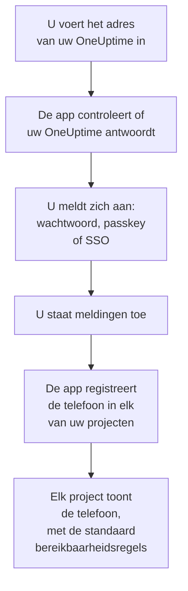
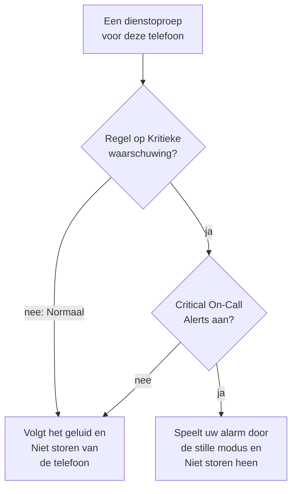

# Android-installatie

Installeer **OneUptime On-Call** op een Android-telefoon of -tablet, verbind de app met uw OneUptime en meld u aan. Stuur uzelf daarna een testmelding, en laat dringende dienstoproepen door de stille modus en Niet storen heen klinken.

:::cards
- [De app installeren](#de-app-installeren): Van Google Play, of de APK op een telefoon zonder Google Play.
- [Aanmelden](#aanmelden): Het adres van uw OneUptime, dan uw account.
- [Controleren dat oproepen de telefoon bereiken](#controleren-dat-oproepen-de-telefoon-bereiken): De telefoon in het dashboard vinden en testen.
- [Door de stille modus heen klinken](#door-de-stille-modus-heen-klinken): Kritieke meldingen en het alarmgeluid.
- [Probleemoplossing](#probleemoplossing): Problemen met aanmelden, meldingen en installeren.
:::

## Voordat u begint

- Een telefoon of tablet met Android 7.0 of nieuwer.
- Een account in een OneUptime-project. Om opgeroepen te worden, moet u ook dienst hebben: zie [Escalatieregels](/docs/on-call/escalation-rules).
- Het adres van uw OneUptime: `https://oneuptime.com` op OneUptime Cloud, of uw eigen adres, zoals `https://oneuptime.example.com`. De app maakt alleen verbinding via HTTPS.

## De app installeren

:::tabs
@tab Google Play
1. Open op de telefoon [OneUptime On-Call op Google Play](https://play.google.com/store/apps/details?id=com.oneuptime.oncall), of zoek in Google Play naar OneUptime On-Call.
2. Tik op **Installeren** en daarna op **Openen**.

Google Play houdt de app up-to-date.
@tab APK
Voor een telefoon zonder Google Play. De APK wordt voor elke OneUptime-release uit dezelfde code gebouwd en aan de release op GitHub toegevoegd.

1. Open op de telefoon [de nieuwste APK](https://github.com/OneUptime/oneuptime/releases/latest/download/oneuptime-on-call-android-app.apk).
2. Open het gedownloade bestand. Als Android erom vraagt, sta uw browser toe onbekende apps te installeren, en tik dan op **Installeren**.
3. Open OneUptime On-Call vanuit uw apps.

Een APK werkt zichzelf niet bij: installeer af en toe de nieuwste eroverheen. Uw aanmelding en instellingen blijven behouden.
:::

## Aanmelden

:::steps
### Het adres van uw OneUptime invoeren
Open de app. Houd op **Connect your workspace** `https://oneuptime.com` voor OneUptime Cloud, of voer het adres van uw eigen OneUptime in, en tik op **Connect**. De app gaat verder zodra `https://<your-oneuptime>/api/status` antwoordt.

### Aanmelden bij uw account
Gebruik de manier waarop uw account zich aanmeldt:

- Uw e-mailadres en wachtwoord, dan **Sign In**. **Forgot password?** mailt u een link om een nieuw wachtwoord in te stellen.
- **Sign in with a passkey**, zodra u er een in het dashboard hebt toegevoegd: zie [Een passkey toevoegen](/docs/introduction/your-account#een-passkey-toevoegen). Uw browser opent om hem te bevestigen en brengt u daarna terug.
- **Sign in with SSO**, als uw organisatie single sign-on gebruikt. Kies uw provider, of voer uw zakelijke e-mailadres in en tik op **Continue**. Een beveiligde browser opent, en u bent terug in de app zodra u bent aangemeld.

Met tweestapsverificatie aan voert u de zescijferige code uit uw authenticator-app in, of een van uw back-upcodes. Een beveiligingssleutel kan in de app niet worden gebruikt. Vereist uw beheerder tweestapsverificatie en hebt u die nog niet ingesteld, dan stelt de app eerst samen met u een authenticator-app in.

### Meldingen toestaan
Wanneer Android vraagt of OneUptime On-Call meldingen mag sturen, tikt u op **Toestaan**. Android 13 en nieuwer vragen het; oudere versies staan ze toe zolang u ze niet uitschakelt.

De app registreert de telefoon daarna in elk van uw projecten. Elk project toont hem tussen uw pushapparaten, met de standaard bereikbaarheidsregels, zodat uw oproepen hem vanaf nu bereiken.
:::

De app toont één project tegelijk: tik bovenaan een scherm op de naam van het project om te wisselen. Een project dat single sign-on vereist, staat onder **Settings → Manage Projects** als **SSO Required** tot u daar op **Authenticate with SSO** tikt.

## Controleren dat oproepen de telefoon bereiken

:::steps
### De telefoon in het dashboard vinden
Open in het dashboard **Gebruikersinstellingen → Meldingsmethoden** en het tabblad **Push Notifications**. De telefoon staat onder **Apparaten voor pushmeldingen** met de naam van zijn model. Elk project houdt een eigen lijst bij.

### Een test sturen
Klik op **Testmelding** in de rij van de telefoon. Er komt een melding op de telefoon; tik erop om de app te openen.
:::

Uw bereikbaarheidsregels bepalen welke oproepen naar de telefoon gaan, en hoe snel: zie **Gebruikersinstellingen → Bereikbaarheidsregels**. Een nieuwe telefoon krijgt dezelfde standaardregels als elke andere methode die u toevoegt.

## Door de stille modus heen klinken

Standaard volgt een dienstoproep de geluidsinstellingen van de telefoon: een gedempte telefoon blijft stil, en Niet storen houdt de oproep tegen. Kritieke meldingen laten dienstoproepen door beide heen klinken. Ze staan uit tot u ze inschakelt, per telefoon.

:::steps
### Critical On-Call Alerts inschakelen
Open in de app **Settings** en schakel onder **Notifications** de schakelaar **Critical On-Call Alerts** in.

### Toegang tot Niet storen toestaan
Android opent zijn lijst **Toegang tot Niet storen**. Schakel de toegang in voor OneUptime On-Call en ga terug naar de app: die controleert de toegang en meldt onder de schakelaar of oproepen zullen klinken.

### Een alarmgeluid kiezen
Tik onder de schakelaar op **Alarm sound**. Naast het eigen geluid van de telefoon biedt de app Klaxon, Siren, Digital alarm, Smoke alarm en Rising alarm, dat zacht begint en steeds harder wordt. Tik naast een geluid op afspelen om het te horen. Een kritieke oproep speelt op het alarmvolume van de telefoon, dus houd dat hoog.
:::

Alleen dienstoproepen klinken toch, en alleen van bereikbaarheidsregels die op **Kritieke waarschuwing** staan, de standaard. Een regel op **Normaal** volgt de instellingen van de telefoon, wat de schakelaar ook zegt, zodat u gewekt kunt worden voor een kritiek incident en stil opgeroepen voor een klein incident. Stuur een **Testmelding** terwijl de telefoon gedempt is om te horen wat een oproep zal doen.

## Voorkomen dat oproepen te laat aankomen

OneUptime stuurt dienstoproepen met hoge prioriteit, die Android ook bezorgt aan een telefoon die al uren niets doet. Een telefoon die het batterijgebruik van de app beperkt, kan ze toch tegenhouden:

- Open **Instellingen → Apps → OneUptime On-Call → Batterij** en kies **Onbeperkt**. Sommige telefoons noemen het **Batterijgebruik van app**.
- Controleer of de meldingen van de app aanstaan, onder **Instellingen → Apps → OneUptime On-Call → Meldingen**.
- Laat OneUptime On-Call buiten elke lijst voor batterijbesparing of slapende apps die uw telefoon bijhoudt.

## De app vergrendelen

Schakel in de app onder **Settings** de schakelaar **Biometrics Login** in, en de app vraagt bij elke start om uw vingerafdruk, uw gezicht of de schermvergrendeling van de telefoon. De schakelaar verschijnt zodra de telefoon ontgrendelen met vingerafdruk of gezicht heeft ingesteld. **Appearance**, op hetzelfde scherm, kiest het lichte of donkere uiterlijk, of volgt de telefoon.

## Bijwerken, afmelden of verwijderen

- **Bijwerken.** Google Play werkt de app bij. Installeer bij de APK de nieuwste eroverheen. De versie van de app staat onderaan het scherm **Settings**.
- **Afmelden.** **Settings → Log Out** meldt u af en haalt de telefoon in elk project uit uw pushapparaten, samen met zijn bereikbaarheidsregels. Meldt u zich weer aan, dan komt hij terug met de standaardregels.
- **Verwijderen.** Verwijder de app zoals elke andere. Was u nog aangemeld, dan blijft de telefoon in uw lijst tot een push ernaar mislukt: OneUptime markeert hem dan als **Ontvangt geen meldingen**. Verwijder die vermelding met **Verwijderen**: installeert u de app opnieuw en meldt u zich aan, dan wordt de telefoon als nieuwe vermelding toegevoegd, met de standaardregels.

## Probleemoplossing

:::details „Could not connect to the server”
De app kon `https://<your-oneuptime>/api/status` niet bereiken. Controleer het adres, inclusief `https://`. Staat uw OneUptime in een privénetwerk, verbind de telefoon er dan eerst mee, bijvoorbeeld via uw VPN. Open dat adres in de browser van de telefoon: het toont `{"status":"ok"}` als de telefoon OneUptime kan bereiken.
:::

:::details Er komen geen meldingen aan
- Controleer in de Android-instellingen of meldingen voor de app aanstaan, en of Niet storen uit is of kritieke meldingen aan zijn.
- Controleer of de telefoon onder **Push Notifications** staat in **Gebruikersinstellingen → Meldingsmethoden**, en stuur hem een **Testmelding**.
- Is de telefoon gemarkeerd als **Ontvangt geen meldingen**, open dan de app terwijl u bent aangemeld. Die registreert de telefoon opnieuw; zie [Wanneer een telefoon zich opnieuw moet registreren](/docs/mobile-desktop-apps/faq-troubleshooting#wanneer-een-telefoon-zich-opnieuw-moet-registreren).
- Controleer uw bereikbaarheidsregels onder **Gebruikersinstellingen → Bereikbaarheidsregels**.
- Controleer bij een zelf gehost OneUptime of uw server zijn push-relay bereikt: zie [Pushmeldingen](/docs/self-hosted/push-notifications#netwerktoegang).
:::

:::details Kritieke meldingen blijven stil bij Niet storen
Open in de app **Settings**: de regel onder **Critical On-Call Alerts** zegt wat er ontbreekt. Meestal is de toegang tot Niet storen niet toegestaan: sta die toe onder **Instellingen → Meldingen → Toegang tot Niet storen** en ga terug naar de app. Hebt u een alarmgeluid gekozen, dan moet ook het meldingskanaal van dat geluid Niet storen mogen negeren.
:::

:::details „App niet geïnstalleerd” bij het installeren van de APK
OneUptime On-Call staat al op de telefoon vanuit een andere bron, zoals Google Play, en Android installeert de ene niet over de andere. Verwijder de app, installeer de APK en meld u opnieuw aan.
:::

:::details Geen schakelaar Biometrics Login
De schakelaar verschijnt zodra ontgrendelen met vingerafdruk of gezicht is ingesteld in de Android-instellingen.
:::

## Volgende stappen

:::cards
- [Veelgestelde vragen en probleemoplossing](/docs/mobile-desktop-apps/faq-troubleshooting): Wat te doen als een telefoon geen oproepen meer krijgt.
- [iOS-installatie](/docs/mobile-desktop-apps/ios-installation): Dezelfde app op een iPhone of iPad.
- [Escalatieregels](/docs/on-call/escalation-rules): Bepalen wie wordt opgeroepen, en wanneer.
- [Pushmeldingen](/docs/self-hosted/push-notifications): Hoe een zelf gehost OneUptime oproepen naar telefoons stuurt.
:::
