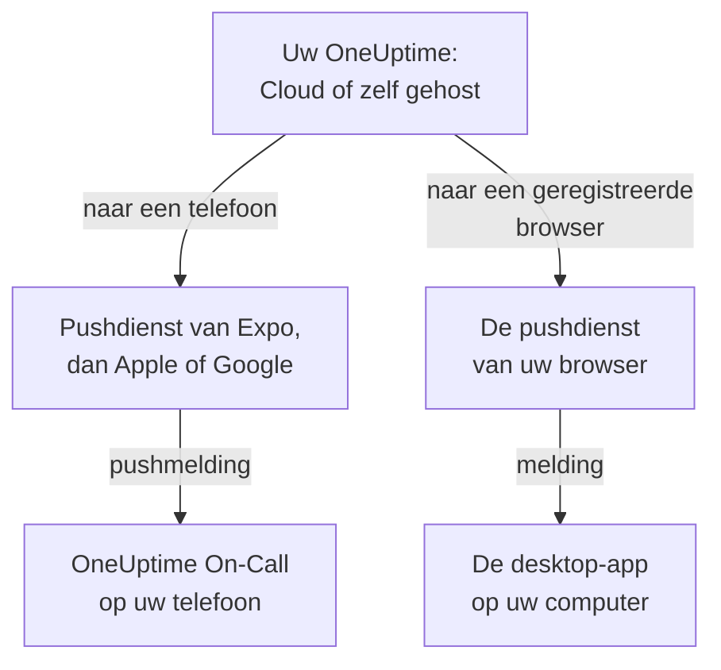

# Apps – Overzicht

OneUptime heeft een app voor uw telefoon en een voor uw computer. **OneUptime On-Call**, voor iPhone, iPad en Android, roept u op wanneer u dienst hebt en laat u bevestigen en oplossen waar u ook bent. Op Windows, macOS en Linux installeert u het OneUptime-dashboard vanuit uw browser als desktop-app met een eigen venster. Beide werken met OneUptime Cloud en met een OneUptime dat u zelf host.

:::cards
- [Een app kiezen](#een-app-kiezen): Waar elke app voor is, naast elkaar.
- [Hoe de apps OneUptime bereiken](#hoe-de-apps-oneuptime-bereiken): Welke weg aanmelden en dienstoproepen afleggen.
- [De mobiele app downloaden](#de-mobiele-app-downloaden): Uit de App Store, van Google Play of van GitHub.
- [De desktop-app installeren](#de-desktop-app-installeren): Het dashboard installeren vanuit Edge, Chrome of Safari.
:::

## Een app kiezen

|  | Mobiele app | Desktop-app |
| --- | --- | --- |
| Wat het is | OneUptime On-Call, een native app voor iPhone, iPad en Android | Het OneUptime-dashboard, geïnstalleerd vanuit uw browser |
| Waar u het krijgt | De App Store, Google Play, of een APK van GitHub | Uw eigen OneUptime: er is niets te downloaden |
| Dienstoproepen | Pushmeldingen, die door de stille modus en Niet storen heen kunnen klinken | Browsermeldingen, zodra u de browser registreert |
| Wat u kunt doen | Incidenten, waarschuwingen, beveiligingszaken, monitors en wie dienst heeft; bevestigen, oplossen, playbookstappen goedkeuren en notities toevoegen | Alles wat het dashboard doet |
| Updates | Uit de store, of door een nieuwere APK te installeren | Bij elke start laadt het het dashboard van uw OneUptime |
| Draait op | iOS 16.4 of nieuwer, Android 7.0 of nieuwer | Windows, macOS en Linux, met Edge of Chrome, of Safari op macOS Sonoma 14 of nieuwer |

U kunt beide gebruiken: houd de desktop-app op het werk open, en laat de telefoon u 's nachts wekken.

## Hoe de apps OneUptime bereiken

De mobiele app meldt zich aan bij uw OneUptime en registreert de telefoon in elk project waarvan u lid bent. Vanaf dan stuurt OneUptime de pushmeldingen van de telefoon, waaronder de dienstoproepen, via de pushdienst van Expo, die ze aan Apple of Google doorgeeft voor bezorging. Standaard stuurt een zelf gehost OneUptime ze via de push-relay van OneUptime, en heeft het dus geen eigen account bij Apple, Google of Expo nodig: zie [Pushmeldingen](/docs/self-hosted/push-notifications).

De desktop-app is het dashboard zelf, in een eigen venster. Het toont meldingen zodra u de browser ervan registreert voor pushmeldingen: de pagina's over Windows, macOS en Linux laten zien hoe.

## Voordat u begint

- Een account in een OneUptime-project. Om opgeroepen te worden, moet u ook dienst hebben: zie [Escalatieregels](/docs/on-call/escalation-rules).
- Het adres van uw OneUptime. Op OneUptime Cloud is dat `https://oneuptime.com`; een zelf gehost OneUptime heeft een eigen adres, zoals `https://oneuptime.example.com`.
- Uw OneUptime via HTTPS. De mobiele app maakt geen verbinding via gewoon HTTP, en browsers tonen alleen meldingen, en Edge en Chrome installeren alleen apps, voor HTTPS-sites.

## De mobiele app downloaden

:::steps
### OneUptime On-Call installeren
Download de app uit de [App Store](https://apps.apple.com/us/app/oneuptime-on-call/id6759615391) op een iPhone of iPad, of van [Google Play](https://play.google.com/store/apps/details?id=com.oneuptime.oncall) op Android. Installeer voor een Android-telefoon zonder Google Play in plaats daarvan de [APK](https://github.com/OneUptime/oneuptime/releases/latest/download/oneuptime-on-call-android-app.apk). Dezelfde links staan in het dashboard, onder **Projectinstellingen → Meldingen → Mobiele apps**.

### Verbinden met uw OneUptime
Open de app, houd `https://oneuptime.com` voor OneUptime Cloud of voer het adres van uw eigen OneUptime in, en meld u aan met uw wachtwoord, een passkey of single sign-on.

### Meldingen toestaan
Sta ze toe wanneer de telefoon erom vraagt. De app registreert de telefoon in elk van uw projecten, en uw dienstoproepen bereiken hem vanaf dan.
:::

Elke stap in detail, met wat u daarna controleert: [Android-installatie](/docs/mobile-desktop-apps/android-installation) en [iOS-installatie](/docs/mobile-desktop-apps/ios-installation).

## De desktop-app installeren

:::steps
### Uw dashboard openen
Meld u aan bij uw OneUptime in Microsoft Edge of Google Chrome, of in Safari op een Mac.

### Het installeren
Klik in Edge of Chrome op het installatiepictogram rechts in de adresbalk. Kies in Safari **Archief → Voeg toe aan Dock**.

### Het openen zoals elke andere app
Het opent in een eigen venster, vanuit het menu Start, het Dock of uw app-starter.
:::

Elke browser stap voor stap: [Windows-installatie](/docs/mobile-desktop-apps/windows-installation), [macOS-installatie](/docs/mobile-desktop-apps/macos-installation) en [Linux-installatie](/docs/mobile-desktop-apps/linux-installation).

## Volgende stappen

:::cards
- [Android-installatie](/docs/mobile-desktop-apps/android-installation): De app op Android installeren, aanmelden en controleren dat oproepen aankomen.
- [iOS-installatie](/docs/mobile-desktop-apps/ios-installation): De app op een iPhone of iPad installeren en kritieke meldingen inschakelen.
- [Windows-installatie](/docs/mobile-desktop-apps/windows-installation): Het dashboard installeren vanuit Edge of Chrome.
- [macOS-installatie](/docs/mobile-desktop-apps/macos-installation): Het dashboard aan het Dock toevoegen vanuit Safari, Chrome of Edge.
- [Linux-installatie](/docs/mobile-desktop-apps/linux-installation): Het dashboard installeren vanuit Chrome, Chromium of Edge.
- [Veelgestelde vragen en probleemoplossing](/docs/mobile-desktop-apps/faq-troubleshooting): Antwoorden, oplossingen, en wat te doen als een telefoon geen oproepen meer krijgt.
:::
