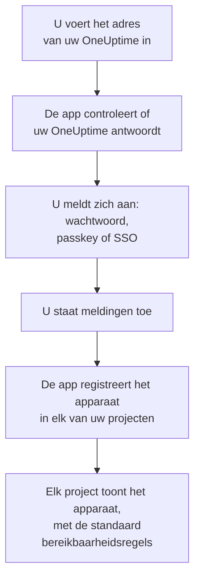
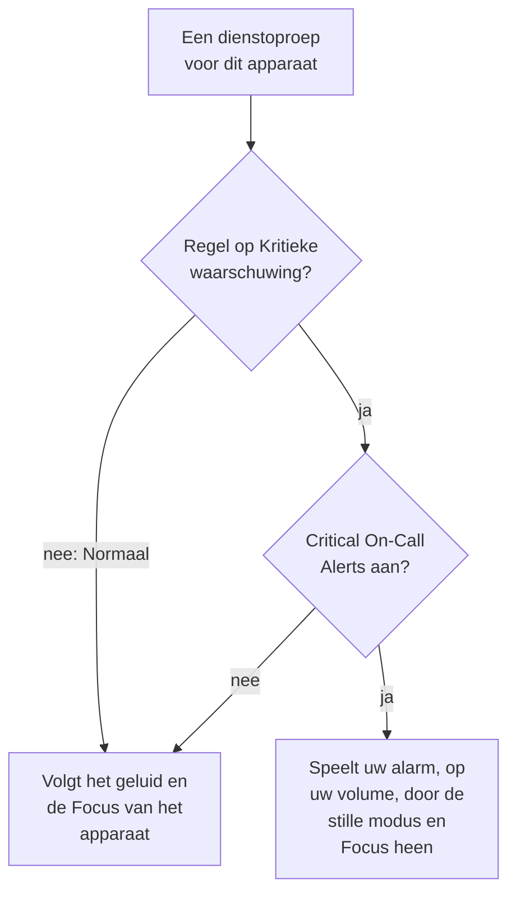

# iOS-installatie

Installeer **OneUptime On-Call** uit de App Store op een iPhone of iPad, verbind de app met uw OneUptime en meld u aan. Stuur uzelf daarna een testmelding, en laat dringende dienstoproepen door de stille modus en Focus heen klinken.

:::cards
- [De app installeren](#de-app-installeren): Uit de App Store.
- [Aanmelden](#aanmelden): Het adres van uw OneUptime, dan uw account.
- [Controleren dat oproepen het apparaat bereiken](#controleren-dat-oproepen-het-apparaat-bereiken): Het in het dashboard vinden en testen.
- [Door de stille modus heen klinken](#door-de-stille-modus-heen-klinken): Kritieke meldingen, het alarmgeluid en het volume ervan.
- [Probleemoplossing](#probleemoplossing): Problemen met aanmelden, meldingen en kritieke meldingen.
:::

## Voordat u begint

- Een iPhone of iPad met iOS 16.4 of nieuwer, of iPadOS 16.4 of nieuwer.
- Een account in een OneUptime-project. Om opgeroepen te worden, moet u ook dienst hebben: zie [Escalatieregels](/docs/on-call/escalation-rules).
- Het adres van uw OneUptime: `https://oneuptime.com` op OneUptime Cloud, of uw eigen adres, zoals `https://oneuptime.example.com`. De app maakt alleen verbinding via HTTPS.

## De app installeren

1. Open op de iPhone of iPad [OneUptime On-Call in de App Store](https://apps.apple.com/us/app/oneuptime-on-call/id6759615391), of zoek in de App Store naar OneUptime On-Call.
2. Tik op **Download** en bevestig met Face ID, Touch ID of het wachtwoord van uw Apple Account.
3. Tik op **Open**, of open OneUptime On-Call vanaf het beginscherm.

De App Store houdt de app up-to-date zolang **App-updates** aanstaat, onder **Instellingen → App Store**.

## Aanmelden

:::steps
### Het adres van uw OneUptime invoeren
Open de app. Houd op **Connect your workspace** `https://oneuptime.com` voor OneUptime Cloud, of voer het adres van uw eigen OneUptime in, en tik op **Connect**. De app gaat verder zodra `https://<your-oneuptime>/api/status` antwoordt.

### Aanmelden bij uw account
Gebruik de manier waarop uw account zich aanmeldt:

- Uw e-mailadres en wachtwoord, dan **Sign In**. **Forgot password?** mailt u een link om een nieuw wachtwoord in te stellen.
- **Sign in with a passkey**, zodra u er een in het dashboard hebt toegevoegd: zie [Een passkey toevoegen](/docs/introduction/your-account#een-passkey-toevoegen). Een browservenster opent om hem te bevestigen en brengt u daarna terug.
- **Sign in with SSO**, als uw organisatie single sign-on gebruikt. Kies uw provider, of voer uw zakelijke e-mailadres in en tik op **Continue**. Een beveiligde browser opent, en u bent terug in de app zodra u bent aangemeld.

Met tweestapsverificatie aan voert u de zescijferige code uit uw authenticator-app in, of een van uw back-upcodes. Een beveiligingssleutel kan in de app niet worden gebruikt. Vereist uw beheerder tweestapsverificatie en hebt u die nog niet ingesteld, dan stelt de app eerst samen met u een authenticator-app in.

### Meldingen toestaan
Wanneer iOS vraagt of OneUptime On-Call u berichtgeving mag sturen, tikt u op **Sta toe**.

De app registreert de iPhone of iPad daarna in elk van uw projecten. Elk project toont het apparaat tussen uw pushapparaten, met de standaard bereikbaarheidsregels, zodat uw oproepen het vanaf nu bereiken.
:::

De app toont één project tegelijk: tik bovenaan een scherm op de naam van het project om te wisselen. Een project dat single sign-on vereist, staat onder **Settings → Manage Projects** als **SSO Required** tot u daar op **Authenticate with SSO** tikt.

## Controleren dat oproepen het apparaat bereiken

:::steps
### Het apparaat in het dashboard vinden
Open in het dashboard **Gebruikersinstellingen → Meldingsmethoden** en het tabblad **Push Notifications**. De iPhone of iPad staat onder **Apparaten voor pushmeldingen** met de naam van het model. Elk project houdt een eigen lijst bij.

### Een test sturen
Klik op **Testmelding** in de rij van het apparaat. Er komt een melding op het apparaat; tik erop om de app te openen.
:::

Uw bereikbaarheidsregels bepalen welke oproepen naar het apparaat gaan, en hoe snel: zie **Gebruikersinstellingen → Bereikbaarheidsregels**. Een nieuw apparaat krijgt dezelfde standaardregels als elke andere methode die u toevoegt.

## Door de stille modus heen klinken

Standaard volgt een dienstoproep de geluidsinstellingen van het apparaat: de stille modus houdt hem stil, en een Focus zoals Niet storen houdt hem tegen. Kritieke meldingen laten dienstoproepen door beide heen klinken. Ze staan uit tot u ze inschakelt, per apparaat.

:::steps
### Critical On-Call Alerts inschakelen
Open in de app **Settings** en schakel onder **Notifications** de schakelaar **Critical On-Call Alerts** in.

### Kritieke meldingen toestaan
Wanneer iOS vraagt of OneUptime On-Call kritieke meldingen mag sturen, tikt u op **Sta toe**. iOS voegt dan onder **Instellingen → Berichtgeving → OneUptime On-Call** een schakelaar **Kritieke meldingen** voor de app toe, waarmee u later van gedachten kunt veranderen. De regel onder de schakelaar van de app zegt of oproepen zullen klinken.

### Een alarmgeluid en het volume ervan kiezen
Tik onder de schakelaar op **Alarm sound**. Naast het eigen geluid van het apparaat voor kritieke meldingen biedt de app Klaxon, Siren, Digital alarm, Smoke alarm en Rising alarm, dat zacht begint en steeds harder wordt. Tik naast een geluid op afspelen om het te horen. Kies daarna het volume waarop een oproep speelt: 25%, 50%, 75% of 100%, de standaard.
:::

Alleen dienstoproepen klinken toch, en alleen van bereikbaarheidsregels die op **Kritieke waarschuwing** staan, de standaard. Een regel op **Normaal** volgt de instellingen van het apparaat, wat de schakelaar ook zegt, zodat u gewekt kunt worden voor een kritiek incident en stil opgeroepen voor een klein incident. Stuur een **Testmelding** terwijl het apparaat op stil staat om te horen wat een oproep zal doen. Het voorbeeld op het scherm **Alarm sound** speelt op het belvolume, en helemaal niet op stil; een echte oproep klinkt door de stille modus heen op het volume dat u koos.

> [!NOTE]
> Kritieke meldingen vereisen OneUptime On-Call 1.5.0 of nieuwer uit de App Store. Eerdere versies zijn gebouwd zonder Apples toestemming voor kritieke meldingen, dus iOS heeft ze de schakelaar nooit aangeboden.

## Voorkomen dat oproepen worden tegengehouden

Zonder kritieke meldingen kunnen een Focus of een samenvatting oproepen tegenhouden:

- **Focus.** Voeg OneUptime On-Call toe aan de apps die elke Focus toestaat, onder **Instellingen → Focus**.
- **Geplande samenvatting.** Laat OneUptime On-Call erbuiten, onder **Instellingen → Berichtgeving → Geplande samenvatting**: een melding in de samenvatting wacht op het volgende moment van de samenvatting.
- **Berichtgeving.** Laat **Sta berichtgeving toe** aanstaan, onder **Instellingen → Berichtgeving → OneUptime On-Call**.

## De app vergrendelen

Schakel in de app onder **Settings** de schakelaar **Biometrics Login** in, en de app vraagt bij elke start om Face ID, Touch ID of uw toegangscode. De schakelaar verschijnt zodra Face ID of Touch ID op het apparaat is ingesteld. **Appearance**, op hetzelfde scherm, kiest het lichte of donkere uiterlijk, of volgt het apparaat.

## Bijwerken, afmelden of de app verwijderen

- **Bijwerken.** De App Store werkt de app bij; u kunt hem ook bijwerken via uw account in de App Store. De versie van de app staat onderaan het scherm **Settings**.
- **Afmelden.** **Settings → Log Out** meldt u af en haalt het apparaat in elk project uit uw pushapparaten, samen met zijn bereikbaarheidsregels. Meldt u zich weer aan, dan komt het terug met de standaardregels.
- **Verwijderen.** Houd het pictogram van de app ingedrukt en tik op **Verwijder app** en daarna op **Verwijder app** om te bevestigen. Was u nog aangemeld, dan blijft het apparaat in uw lijst tot een push ernaar mislukt: OneUptime markeert het dan als **Ontvangt geen meldingen**. Installeert u de app opnieuw en meldt u zich aan, dan komt die vermelding meestal terug, met zijn regels; gebruikt u het apparaat niet meer, verwijder de vermelding dan met **Verwijderen**.

## Probleemoplossing

:::details „Could not connect to the server”
De app kon `https://<your-oneuptime>/api/status` niet bereiken. Controleer het adres, inclusief `https://`. Staat uw OneUptime in een privénetwerk, verbind het apparaat er dan eerst mee, bijvoorbeeld via uw VPN. Open dat adres in Safari op het apparaat: het toont `{"status":"ok"}` als het apparaat OneUptime kan bereiken.
:::

:::details Er komen geen meldingen aan
- Controleer of **Sta berichtgeving toe** aanstaat onder **Instellingen → Berichtgeving → OneUptime On-Call**, en of geen Focus oproepen tegenhoudt.
- Controleer of het apparaat onder **Push Notifications** staat in **Gebruikersinstellingen → Meldingsmethoden**, en stuur het een **Testmelding**.
- Is het apparaat gemarkeerd als **Ontvangt geen meldingen**, open dan de app terwijl u bent aangemeld. Die registreert het apparaat opnieuw; zie [Wanneer een telefoon zich opnieuw moet registreren](/docs/mobile-desktop-apps/faq-troubleshooting#wanneer-een-telefoon-zich-opnieuw-moet-registreren).
- Controleer uw bereikbaarheidsregels onder **Gebruikersinstellingen → Bereikbaarheidsregels**.
- Controleer bij een zelf gehost OneUptime of uw server zijn push-relay bereikt: zie [Pushmeldingen](/docs/self-hosted/push-notifications#netwerktoegang).
:::

:::details Geen schakelaar Kritieke meldingen in de iOS-instellingen
Schakel eerst in de app **Critical On-Call Alerts** in: iOS voegt zijn schakelaar pas toe nadat de app om kritieke meldingen heeft gevraagd. Zegt de app dat deze versie geen kritieke meldingen kan ontvangen, werk OneUptime On-Call dan bij via de App Store.
:::

:::details Kritieke meldingen blijven stil
Open in de app **Settings**: de regel onder **Critical On-Call Alerts** zegt wat er ontbreekt. Controleer of **Kritieke meldingen** aanstaat onder **Instellingen → Berichtgeving → OneUptime On-Call**, en of het volume op het scherm **Alarm sound** van de app niet laag staat.
:::

:::details Geen schakelaar Biometrics Login
De schakelaar verschijnt zodra Face ID of Touch ID is ingesteld onder **Instellingen → Face ID en toegangscode** of **Instellingen → Touch ID en toegangscode**.
:::

## Volgende stappen

:::cards
- [Veelgestelde vragen en probleemoplossing](/docs/mobile-desktop-apps/faq-troubleshooting): Wat te doen als een telefoon geen oproepen meer krijgt.
- [Android-installatie](/docs/mobile-desktop-apps/android-installation): Dezelfde app op Android.
- [Escalatieregels](/docs/on-call/escalation-rules): Bepalen wie wordt opgeroepen, en wanneer.
- [Pushmeldingen](/docs/self-hosted/push-notifications): Hoe een zelf gehost OneUptime oproepen naar telefoons stuurt.
:::
