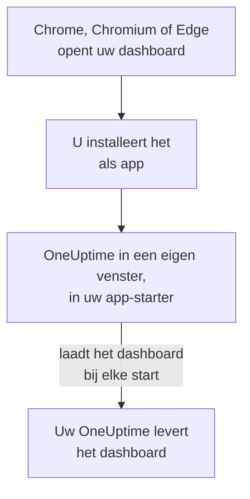

# Linux-installatie

Het OneUptime-dashboard installeert u op Linux als app, vanuit Google Chrome, Chromium of Microsoft Edge. Het opent in een eigen venster, met een eigen vermelding in de app-starter van uw desktop, en kan meldingen tonen. Er is niets te downloaden: de app is het dashboard van uw OneUptime, en is up-to-date zodra uw OneUptime dat is.

:::cards
- [De app installeren](#de-app-installeren): Vanuit Chrome, Chromium of Edge.
- [Openen vanuit uw app-starter](#openen-vanuit-uw-app-starter): Zoals elke andere desktop-app.
- [Meldingen op deze computer krijgen](#meldingen-op-deze-computer-krijgen): De browser registreren voor pushmeldingen.
- [Probleemoplossing](#probleemoplossing): Geen installatiepictogram, geen meldingen, geen vermelding in de app-starter.
:::

## Hoe de desktop-app werkt

De geïnstalleerde app deelt de aanmelding, de instellingen en de meldingstoestemming van zijn browser. Sluit u de browser, dan blijft de app in zijn eigen venster draaien.

## Voordat u begint

- Een Linux-desktop met een recente Google Chrome, Chromium of Microsoft Edge.
- Het adres van uw OneUptime, via HTTPS: `https://oneuptime.com` op OneUptime Cloud, of uw eigen adres, zoals `https://oneuptime.example.com`.
- Een account waarmee u zich bij het dashboard kunt aanmelden.

## De app installeren

:::tabs
@tab Chrome
1. Open uw OneUptime in Chrome of Chromium en meld u aan.
2. Klik op een willekeurige dashboardpagina op het installatiepictogram rechts in de adresbalk en daarna op **Installeren**. Of open **⋮ → Casten, opslaan en delen → Pagina installeren als app…**.
3. Chrome opent OneUptime in een eigen venster en voegt het toe aan uw app-starter.
@tab Edge
1. Open uw OneUptime in Edge en meld u aan.
2. Klik op een willekeurige dashboardpagina op het installatiepictogram rechts in de adresbalk en daarna op **Installeren**. Of open **Instellingen en meer (…) → Meer hulpprogramma's → Apps → Deze site als app installeren**.
3. Edge opent OneUptime in een eigen venster en voegt het toe aan uw app-starter.
:::

Installeer vanaf een dashboardpagina, nadat u zich hebt aangemeld: de aanmeldpagina is niet de app.

## Openen vanuit uw app-starter

De browser maakt een desktopvermelding voor de app, een `.desktop`-bestand in `~/.local/share/applications`, zodat OneUptime verschijnt in GNOME, KDE Plasma en andere app-starters. Maak het daar vast aan uw dock of paneel, zoals elke andere app.

## Meldingen op deze computer krijgen

De app toont meldingen via zijn browser, zodra u de browser registreert voor pushmeldingen in elk project waarvan u ze wilt krijgen.

:::steps
### Uw pushapparaten openen
Open in de app **Gebruikersinstellingen → Meldingsmethoden** en het tabblad **Push Notifications**.

### Deze browser registreren
Klik op **Apparaat registreren**, houd de voorgestelde **Apparaatnaam**, zoals `Chrome on Linux`, of wijzig hem, en klik opnieuw op **Apparaat registreren**. Wanneer de browser vraagt of OneUptime meldingen mag tonen, kiest u **Toestaan**.

### Een test sturen
Klik in het dialoogvenster **Browser Registered** op **Send Test Notification**. Uw desktop toont de melding via zijn meldingsdienst; verschijnt er niets, zie dan [Probleemoplossing](#probleemoplossing).
:::

Een browser kan niet door de Niet storen-modus van uw desktop heen klinken. Gebruik voor oproepen die u moeten wekken de mobiele app met kritieke meldingen: zie [Android-installatie](/docs/mobile-desktop-apps/android-installation#door-de-stille-modus-heen-klinken).

Bij een zelf gehost OneUptime hebben browsermeldingen de VAPID-sleutels van de server nodig: zie [Pushmeldingen](/docs/self-hosted/push-notifications#zelf-gehoste-inrichting).

## Updates

Er is niets bij te werken. De app laadt het dashboard bij elke start van uw OneUptime, dus hij verandert wanneer uw OneUptime wordt bijgewerkt. Staat een venster open sinds de update, laad het dan opnieuw met Ctrl+R.

## Verwijderen

:::tabs
@tab Chrome
Open in het venster van de app het menu **⋮**, kies het item dat de app verwijdert, en daarna **Verwijderen**.
@tab Edge
Open `edge://apps` in Edge, kies **Details** bij OneUptime en daarna **Verwijderen**.
:::

Het verwijderen van de app heft de registratie van zijn browser niet op: die krijgt nog steeds meldingen. Om ze te stoppen, verwijdert u de browser onder **Gebruikersinstellingen → Meldingsmethoden**, op het tabblad **Push Notifications**, met **Verwijderen**.

## Probleemoplossing

:::details Geen installatiepictogram in de adresbalk
Open na het aanmelden een dashboardpagina, niet de aanmeldpagina, en controleer of het adres met `https://` begint: browsers installeren alleen apps van beveiligde sites. Verschijnt het pictogram nog steeds niet, gebruik dan het menu van de browser zoals hierboven. Andere browsers installeren sites misschien niet als apps; gebruik Chrome, Chromium of Edge.
:::

:::details Er verschijnen geen meldingen
- Controleer in **Gebruikersinstellingen → Meldingsmethoden**, tabblad **Push Notifications**, of deze browser in de lijst staat, en stuur hem een **Testmelding**.
- Controleer of Niet storen van uw desktop uit staat en of zijn meldingsinstellingen de browser toestaan.
- Blokkeert de browser meldingen voor OneUptime, klik dan op het pictogram links in de adresbalk, sta meldingen voor de site toe en registreer de browser opnieuw.
- Bij een zelf gehost OneUptime zegt het dialoogvenster **Apparaat registreren** wanneer de server geen VAPID-sleutels heeft.
:::

:::details De app ontbreekt in de app-starter
Open hem in plaats daarvan vanuit de browser: `chrome://apps` in Chrome of Chromium, `edge://apps` in Edge. Een app-starter die desktopvermeldingen alleen bij het aanmelden leest, toont hem nadat u zich hebt af- en weer aangemeld.
:::

## Volgende stappen

:::cards
- [Android-installatie](/docs/mobile-desktop-apps/android-installation): Op uw telefoon opgeroepen worden, met kritieke meldingen.
- [Windows-installatie](/docs/mobile-desktop-apps/windows-installation): Dezelfde app op Windows.
- [Veelgestelde vragen en probleemoplossing](/docs/mobile-desktop-apps/faq-troubleshooting): Antwoorden over beide apps.
- [Uw account](/docs/introduction/your-account): Hoe OneUptime u in elk project bereikt.
:::
