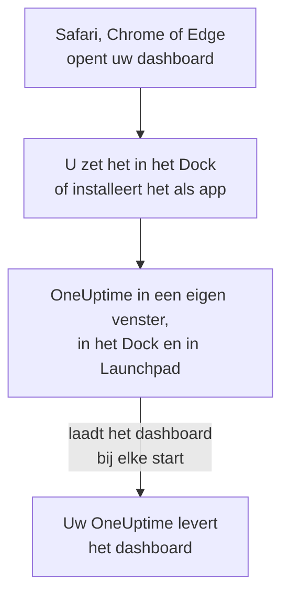

# macOS-installatie

Het OneUptime-dashboard installeert u op een Mac als app: zet het vanuit Safari in het Dock, of installeer het vanuit Google Chrome of Microsoft Edge. Het opent in een eigen venster, met een eigen pictogram in het Dock en in Launchpad, en kan meldingen tonen. Er is niets te downloaden: de app is het dashboard van uw OneUptime, en is up-to-date zodra uw OneUptime dat is.

:::cards
- [De app installeren](#de-app-installeren): Vanuit Safari, Chrome of Edge.
- [In het Dock houden](#in-het-dock-houden): Met één klik openen, of bij het inloggen.
- [Meldingen op deze Mac krijgen](#meldingen-op-deze-mac-krijgen): De app registreren voor pushmeldingen.
- [Probleemoplossing](#probleemoplossing): Geen Voeg toe aan Dock, geen meldingen, opnieuw aanmelden.
:::

## Hoe de desktop-app werkt

Een Safari-webapp heeft een eigen aanmelding, eigen cookies en eigen instellingen, los van Safari. Een app die vanuit Chrome of Edge is geïnstalleerd, deelt ze met die browser.

## Voordat u begint

- macOS Sonoma 14 of nieuwer voor Safari. Chrome en Edge installeren apps op elke macOS waarop ze draaien.
- Het adres van uw OneUptime, via HTTPS: `https://oneuptime.com` op OneUptime Cloud, of uw eigen adres, zoals `https://oneuptime.example.com`.
- Een account waarmee u zich bij het dashboard kunt aanmelden.

## De app installeren

:::tabs
@tab Safari
1. Open uw OneUptime in Safari en meld u aan.
2. Kies op een willekeurige dashboardpagina **Archief → Voeg toe aan Dock**, of klik op de deelknop in de knoppenbalk en daarna op **Voeg toe aan Dock**.
3. Houd de naam of wijzig hem, en klik op **Voeg toe**.
4. Open OneUptime vanuit het Dock en meld u nog een keer aan: de webapp deelt de aanmelding van Safari niet.
@tab Chrome
1. Open uw OneUptime in Chrome en meld u aan.
2. Klik op een willekeurige dashboardpagina op het installatiepictogram rechts in de adresbalk en daarna op **Installeren**. Of open **⋮ → Casten, opslaan en delen → Pagina installeren als app…**.
3. Chrome opent OneUptime in een eigen venster en voegt het toe aan Launchpad.
@tab Edge
1. Open uw OneUptime in Edge en meld u aan.
2. Klik op een willekeurige dashboardpagina op het installatiepictogram rechts in de adresbalk en daarna op **Installeren**. Of open **Instellingen en meer (…) → Meer hulpprogramma's → Apps → Deze site als app installeren**.
3. Edge opent OneUptime in een eigen venster en voegt het toe aan Launchpad.
:::

Installeer vanaf een dashboardpagina, nadat u zich hebt aangemeld: de aanmeldpagina is niet de app. Safari bewaart de webapp in de map Apps van uw thuismap.

## In het Dock houden

- **Dock.** Klik met de app open met ingedrukte Control-toets op het pictogram ervan in het Dock en kies **Opties → Houd in Dock**. Een Safari-webapp staat al in het Dock.
- **Openen bij inloggen.** Klik met ingedrukte Control-toets op het pictogram in het Dock en kies **Opties → Open bij inloggen**.
- **Spotlight.** Druk op Command-spatiebalk en typ OneUptime.

## Meldingen op deze Mac krijgen

De app toont meldingen zodra u hem registreert voor pushmeldingen, in elk project waarvan u ze wilt krijgen. Registreer de Safari-webapp vanuit de webapp zelf: het is een browser op zich. Een app die vanuit Chrome of Edge is geïnstalleerd, wordt met zijn browser geregistreerd.

:::steps
### Uw pushapparaten openen
Open in de app **Gebruikersinstellingen → Meldingsmethoden** en het tabblad **Push Notifications**.

### Deze app registreren
Klik op **Apparaat registreren**, houd de voorgestelde **Apparaatnaam**, zoals `Safari on macOS`, of wijzig hem, en klik opnieuw op **Apparaat registreren**. Wanneer macOS of de browser vraagt of OneUptime meldingen mag sturen, kiest u **Sta toe**.

### Een test sturen
Klik in het dialoogvenster **Browser Registered** op **Send Test Notification**. Verschijnt er niets, kijk dan naar de berichtgevingsinstellingen van de Mac: zie [Probleemoplossing](#probleemoplossing).
:::

Een browser kan niet door een Focus zoals Niet storen heen klinken. Gebruik voor oproepen die u moeten wekken de mobiele app met kritieke meldingen: zie [iOS-installatie](/docs/mobile-desktop-apps/ios-installation#door-de-stille-modus-heen-klinken).

Bij een zelf gehost OneUptime hebben browsermeldingen de VAPID-sleutels van de server nodig: zie [Pushmeldingen](/docs/self-hosted/push-notifications#zelf-gehoste-inrichting).

## Updates

Er is niets bij te werken. De app laadt het dashboard bij elke start van uw OneUptime, dus hij verandert wanneer uw OneUptime wordt bijgewerkt. Staat een venster open sinds de update, laad het dan opnieuw met Command-R.

## Verwijderen

:::tabs
@tab Safari
Open in de Finder uw thuismap, dan de map Apps daarin, en sleep OneUptime naar de prullenmand.
@tab Chrome
Open in het venster van de app het menu **⋮**, kies het item dat de app verwijdert, en daarna **Verwijderen**.
@tab Edge
Open `edge://apps` in Edge, kies **Details** bij OneUptime en daarna **Verwijderen**.
:::

Het verwijderen van de app heft zijn registratie niet op: zijn browser krijgt nog steeds meldingen. Om ze te stoppen, verwijdert u hem onder **Gebruikersinstellingen → Meldingsmethoden**, op het tabblad **Push Notifications**, met **Verwijderen**.

## Probleemoplossing

:::details Geen Voeg toe aan Dock in Safari
Safari zet webapps in het Dock vanaf macOS Sonoma 14. Werk macOS bij, of installeer de app in plaats daarvan vanuit Chrome of Edge.
:::

:::details Er verschijnen geen meldingen
- Controleer in **Gebruikersinstellingen → Meldingsmethoden**, tabblad **Push Notifications**, of de app of zijn browser in de lijst staat, en stuur een **Testmelding**.
- Open op de Mac **Systeeminstellingen → Berichtgeving** en controleer of OneUptime, of de browser waaruit het is geïnstalleerd, meldingen mag sturen, en of geen Focus ze tegenhoudt.
- Blokkeert de browser meldingen voor OneUptime, sta ze dan in zijn instellingen voor de site toe en registreer opnieuw.
- Bij een zelf gehost OneUptime zegt het dialoogvenster **Apparaat registreren** wanneer de server geen VAPID-sleutels heeft.
:::

:::details De app vraagt u opnieuw aan te melden
Een Safari-webapp heeft een eigen aanmelding: meld u aan in de app. Een app die vanuit Chrome of Edge is geïnstalleerd, deelt de aanmelding van zijn browser, dus afmelden in de browser, of zijn cookies wissen, meldt ook de app af.
:::

## Volgende stappen

:::cards
- [iOS-installatie](/docs/mobile-desktop-apps/ios-installation): Op uw iPhone opgeroepen worden, met kritieke meldingen.
- [Windows-installatie](/docs/mobile-desktop-apps/windows-installation): Dezelfde app op Windows.
- [Veelgestelde vragen en probleemoplossing](/docs/mobile-desktop-apps/faq-troubleshooting): Antwoorden over beide apps.
- [Uw account](/docs/introduction/your-account): Hoe OneUptime u in elk project bereikt.
:::
