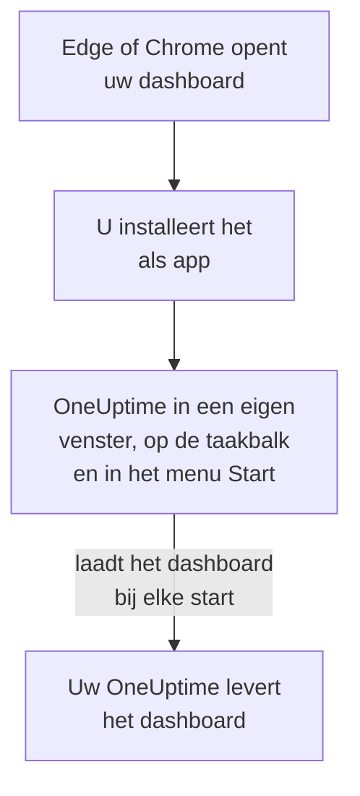

# Windows-installatie

Het OneUptime-dashboard installeert u op Windows als app, vanuit Microsoft Edge of Google Chrome. Het opent in een eigen venster, met een eigen pictogram op de taakbalk en in het menu Start, en kan meldingen tonen. Er is niets te downloaden: de app is het dashboard van uw OneUptime, en is up-to-date zodra uw OneUptime dat is.

:::cards
- [De app installeren](#de-app-installeren): Vanuit Edge of Chrome, in een paar klikken.
- [Vastmaken en met Windows starten](#vastmaken-en-met-windows-starten): Houd hem één klik weg.
- [Meldingen op deze computer krijgen](#meldingen-op-deze-computer-krijgen): De browser registreren voor pushmeldingen.
- [Probleemoplossing](#probleemoplossing): Geen installatiepictogram, geen meldingen, opnieuw aanmelden.
:::

## Hoe de desktop-app werkt

De geïnstalleerde app deelt de aanmelding, de instellingen en de meldingstoestemming van zijn browser. Sluit u de browser, dan blijft de app in zijn eigen venster draaien.

## Voordat u begint

- Windows 10 of Windows 11, met een recente Microsoft Edge of Google Chrome.
- Het adres van uw OneUptime, via HTTPS: `https://oneuptime.com` op OneUptime Cloud, of uw eigen adres, zoals `https://oneuptime.example.com`.
- Een account waarmee u zich bij het dashboard kunt aanmelden.

## De app installeren

:::tabs
@tab Edge
1. Open uw OneUptime in Edge en meld u aan.
2. Klik op een willekeurige dashboardpagina op het installatiepictogram rechts in de adresbalk en daarna op **Installeren**. Of open **Instellingen en meer (…) → Meer hulpprogramma's → Apps → Deze site als app installeren**.
3. Edge opent OneUptime in een eigen venster, en kan aanbieden het aan de taakbalk of aan Start vast te maken.
@tab Chrome
1. Open uw OneUptime in Chrome en meld u aan.
2. Klik op een willekeurige dashboardpagina op het installatiepictogram rechts in de adresbalk en daarna op **Installeren**. Of open **⋮ → Casten, opslaan en delen → Pagina installeren als app…**.
3. Chrome opent OneUptime in een eigen venster en voegt het toe aan het menu Start.
:::

Installeer vanaf een dashboardpagina, nadat u zich hebt aangemeld: de aanmeldpagina is niet de app. Zoek later in het menu Start naar OneUptime om hem te openen.

## Vastmaken en met Windows starten

- **Taakbalk.** Klik met de app open met de rechtermuisknop op het pictogram ervan op de taakbalk en kies **Vastmaken aan taakbalk**.
- **Met Windows starten.** Open in Edge `edge://apps`, kies **Details** bij OneUptime en schakel **Automatisch starten bij aanmelden op apparaat** in. Dezelfde pagina maakt de app vast aan de taakbalk of aan Start, of zet een snelkoppeling op het bureaublad.

## Meldingen op deze computer krijgen

De app toont meldingen via zijn browser, zodra u de browser registreert voor pushmeldingen in elk project waarvan u ze wilt krijgen.

:::steps
### Uw pushapparaten openen
Open in de app **Gebruikersinstellingen → Meldingsmethoden** en het tabblad **Push Notifications**.

### Deze browser registreren
Klik op **Apparaat registreren**, houd de voorgestelde **Apparaatnaam**, zoals `Edge on Windows`, of wijzig hem, en klik opnieuw op **Apparaat registreren**. Wanneer de browser vraagt of OneUptime meldingen mag tonen, kiest u **Toestaan**.

### Een test sturen
Klik in het dialoogvenster **Browser Registered** op **Send Test Notification**. Verschijnt er niets, kijk dan naar de meldingsinstellingen van Windows: zie [Probleemoplossing](#probleemoplossing).
:::

Een browser klinkt niet harder dan Windows toestaat: hij kan Niet storen niet negeren. Gebruik voor oproepen die u moeten wekken de mobiele app met kritieke meldingen: zie [Android-installatie](/docs/mobile-desktop-apps/android-installation#door-de-stille-modus-heen-klinken) of [iOS-installatie](/docs/mobile-desktop-apps/ios-installation#door-de-stille-modus-heen-klinken).

Bij een zelf gehost OneUptime hebben browsermeldingen de VAPID-sleutels van de server nodig: zie [Pushmeldingen](/docs/self-hosted/push-notifications#zelf-gehoste-inrichting).

## Updates

Er is niets bij te werken. De app laadt het dashboard bij elke start van uw OneUptime, dus hij verandert wanneer uw OneUptime wordt bijgewerkt. Staat een venster open sinds de update, laad het dan opnieuw met Ctrl+R.

## Verwijderen

:::tabs
@tab Edge
Open `edge://apps`, kies **Details** bij OneUptime en daarna **Verwijderen**.
@tab Chrome
Open in het venster van de app het menu **⋮**, kies het item dat de app verwijdert, en daarna **Verwijderen**.
:::

Windows toont de app ook onder **Instellingen → Apps → Geïnstalleerde apps**, waar **Verwijderen** hem ook weghaalt.

Het verwijderen van de app heft de registratie van zijn browser niet op: die krijgt nog steeds meldingen. Om ze te stoppen, verwijdert u de browser onder **Gebruikersinstellingen → Meldingsmethoden**, op het tabblad **Push Notifications**, met **Verwijderen**.

## Probleemoplossing

:::details Geen installatiepictogram in de adresbalk
Open na het aanmelden een dashboardpagina, niet de aanmeldpagina, en controleer of het adres met `https://` begint: browsers installeren alleen apps van beveiligde sites. Verschijnt het pictogram nog steeds niet, gebruik dan het menu van de browser zoals hierboven. Andere browsers installeren sites misschien niet als apps; gebruik Edge of Chrome.
:::

:::details Er verschijnen geen meldingen
- Controleer in **Gebruikersinstellingen → Meldingsmethoden**, tabblad **Push Notifications**, of deze browser in de lijst staat, en stuur hem een **Testmelding**.
- Open in Windows **Instellingen → Systeem → Meldingen**: meldingen moeten aanstaan, ook voor de browser, en Niet storen uit. Windows 10 noemt de pagina „Meldingen en acties”.
- Blokkeert de browser meldingen voor OneUptime, klik dan op het pictogram links in de adresbalk, sta meldingen voor de site toe en registreer de browser opnieuw.
- Bij een zelf gehost OneUptime zegt het dialoogvenster **Apparaat registreren** wanneer de server geen VAPID-sleutels heeft.
:::

:::details De app vraagt u opnieuw aan te melden
De app deelt de aanmelding van zijn browser. Afmelden in de browser, of zijn cookies wissen, meldt ook de app af.
:::

## Volgende stappen

:::cards
- [macOS-installatie](/docs/mobile-desktop-apps/macos-installation): Dezelfde app op een Mac.
- [Android-installatie](/docs/mobile-desktop-apps/android-installation): Op uw telefoon opgeroepen worden.
- [Veelgestelde vragen en probleemoplossing](/docs/mobile-desktop-apps/faq-troubleshooting): Antwoorden over beide apps.
- [Uw account](/docs/introduction/your-account): Hoe OneUptime u in elk project bereikt.
:::
