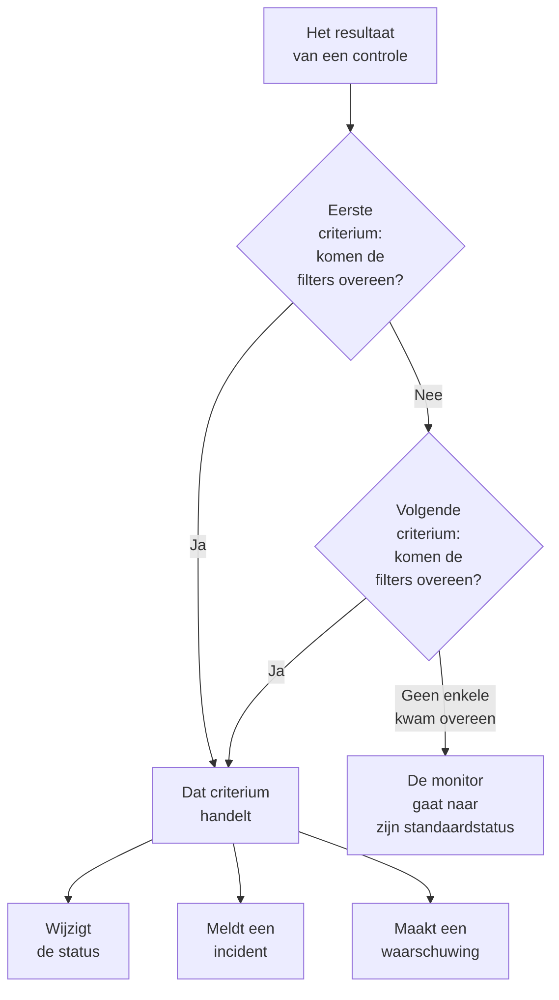
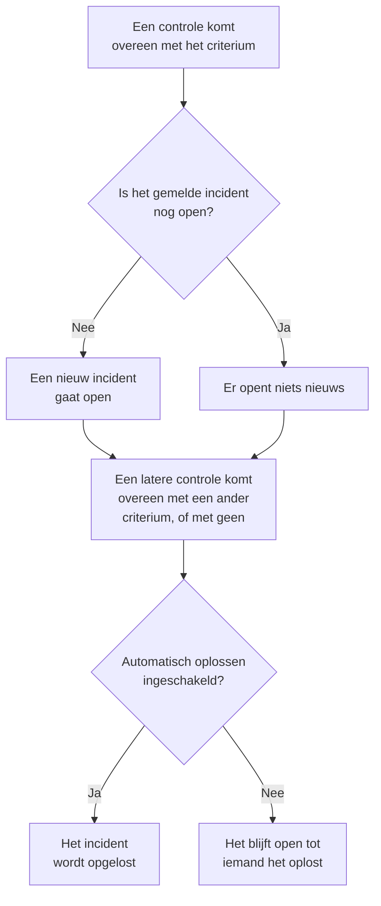

# Monitorcriteria en statussen

De criteria van een monitor bepalen wat elke controle betekent: of de monitor bereikbaar is of uitgevallen, en of OneUptime een incident meldt of een waarschuwing maakt. Statussen zijn de lijst van uw project met wat een monitor kan zijn, van **Operationeel** tot **Offline**. Deze pagina legt beide uit voor elk monitortype; de eigen pagina van elk type noemt de filters die het biedt.

:::cards
- [Hoe criteria beslissen](#hoe-criteria-beslissen): Van boven naar beneden, en de eerste overeenkomst wint.
- [Wat een criterium bevat](#wat-een-criterium-bevat): Filters, een overeenkomstvoorwaarde, acties en instellingen.
- [De criteria van een monitor wijzigen](#de-criteria-van-een-monitor-wijzigen): Criteria bewerken, toevoegen, herschikken en testen.
- [Monitorstatussen](#monitorstatussen): De ingebouwde statussen, en statussen van uzelf.
:::

## Hoe criteria beslissen

Telkens wanneer een monitor wordt gecontroleerd, beoordelen zijn criteria het resultaat van boven naar beneden in de lijst. Het eerste criterium waarvan de filters overeenkomen, bepaalt wat er gebeurt, en de criteria eronder worden voor die controle niet meer bekeken. Komt er geen overeen, dan gaat de monitor naar zijn **Standaard monitorstatus**.

De volgorde hoort bij de regel. Een nieuwe monitor zet zijn criteria van slechtste naar beste: offline, dan een waarschuwing als zijn type er een heeft (een certificaat of een domein dat binnenkort verloopt), dan online. Een breed gezond criterium, zoals **Is Online** op **Waar**, komt overeen met bijna elke controle, dus het staat als laatste: boven de andere zou het elke keer als eerste overeenkomen en zouden de andere nooit handelen.

Een criterium dat overeenkomt maar geen status wijzigt, beslist de controle toch: de monitor houdt zijn status, en de criteria eronder wachten op de volgende controle. De **Standaard monitorstatus** geldt alleen als geen enkel criterium overeenkomt. Bij een nieuwe monitor is dat **Operationeel**; wijzig het onder **Meer velden**, onder de criteria.

> [!NOTE]
> Een monitor die per host, container, schijf of interface een eigen incident of waarschuwing opent, beoordeelt bij elke controle alle criteria, zodat twee hosts tegelijk met twee verschillende criteria kunnen overeenkomen. Dat is een monitor waarvan de query een **Groeperen op** heeft, zoals een metriek- of logmonitor, of een criterium dat `*` noemt voor elke schijf of interface. Een monitor voor inkomende verzoeken die incidenten groepeert op een payloadveld, stopt toch bij de eerste overeenkomst.

## Wat een criterium bevat

Open een criterium: het heeft een naam en drie secties, die elk inklappen tot een samenvatting van één regel.

| Onderdeel | Wat het bevat |
| --- | --- |
| **Criterianaam** | De naam in de lijst met criteria, en in de oorzaak van elk incident en elke waarschuwing die het criterium opent. **Criteria toevoegen** noemt een nieuw criterium naar zijn filters, en de naam volgt ze tot u er zelf een typt. |
| **Filters** | Wat de controle moet laten zien, als een of meer filters. Kubernetes- en metriekmonitoren noemen ze **Alert Rules**. |
| **Acties** | Wat er gebeurt als de filters overeenkomen: de status wijzigen, een waarschuwing maken, een incident melden, of een combinatie daarvan. |
| **Instellingen** | **Schakel dit criterium in**, een optionele **Beschrijving** en, bij monitoren voor inkomende verzoeken, **Group incidents and alerts by a payload field**. |

### Filters

Een filter leest één gegeven uit de controle en vergelijkt het: een **Filtertype** (wat er wordt gelezen, zoals **Reactiestatuscode**), een **Filtervoorwaarde** (hoe er wordt vergeleken, zoals **Groter dan**) en een **Waarde**. Monitoren die metrieken vergelijken, zoals Kubernetes- en metriekmonitoren, vragen in plaats daarvan om een **Voorwaarde** en een **Drempel**. Elk monitortype biedt zijn eigen filtertypen, vermeld op zijn pagina, bijvoorbeeld [Website-monitor](/docs/monitor/website-monitor#bewakingscriteria).

Vanaf twee filters verschijnt eronder de **Overeenkomstvoorwaarde**: **Alle** betekent dat elk filter moet overeenkomen, **Minstens één** dat er één genoeg is. Een nieuw criterium begint op **Alle**.

Filters die elke controle meten, zoals **Is Online**, **Reactiestatuscode** en **Reactietijd (in ms)**, bieden **Evalueer deze criteria over een bepaalde periode**. Dat beoordeelt een venster van recente controles in plaats van alleen de laatste, en begint op de laatste 5 minuten met **All Values**, dat pas overeenkomt als elke controle in het venster overeenkwam. Zie [Evalueren over een periode](/docs/monitor/website-monitor#over-een-periode-evalueren).

### Acties

Elke actie is een schakelaar onder **Acties**:

| Schakelaar | Wat hij doet |
| --- | --- |
| **Wanneer filters overeenkomen, wijzig de monitorstatus.** | Zet de monitor in de status die onder **Monitorstatus wijzigen naar** is gekozen. |
| **Wanneer filters overeenkomen, maak een waarschuwing aan.** | Maakt de waarschuwingen die onder **Waarschuwing maken** zijn ingesteld. Een waarschuwing informeert uw team en verschijnt nooit op een statuspagina. |
| **Wanneer filters overeenkomen, verklaar een incident.** | Meldt de incidenten die onder **Incident maken** zijn ingesteld. Uw statuspagina's kunnen ze tonen. |

Een incident of waarschuwing vraagt om een titel, een **Ernst** en, ingeklapt, een beschrijving, eigenaren, labels en bereikbaarheidsbeleid. Titels en beschrijvingen kunnen waarden uit de controle bevatten, zoals `{{monitorName}}`: zie [Incident- en waarschuwingstemplates](/docs/monitor/incident-alert-templating). Om iemand op te roepen als het criterium overeenkomt, kiest u een beleid onder **Bereikbaarheid**: zie [Bereikbaarheidsbeleid](/docs/on-call/policies).

### Instellingen

**Schakel dit criterium in** staat aan bij elk nieuw criterium. Zet het uit om een criterium te bewaren zonder het te gebruiken: het wordt bij elke controle overgeslagen, wijzigt geen status, opent niets, en zijn kop toont **Uitgeschakeld**.

**Group incidents and alerts by a payload field** opent één incident per waarde die in een inkomend verzoek wordt gevonden, zodat één webhookadres meerdere incidenten open kan houden. Zie [Incidentgroepering inschakelen](/docs/monitor/incoming-request-monitor#incidenten-groeperen-inschakelen).

## Wanneer incidenten en waarschuwingen openen en sluiten

Een criterium dat incidenten meldt, opent er een wanneer het overeenkomt. Zodra de monitor herstelt, sluit het incident vanzelf als het criterium dat aangeeft.

- **Eén tegelijk.** Zolang een incident dat een criterium heeft gemeld nog open is, meldt hetzelfde criterium bij een nieuwe overeenkomst geen tweede. Waarschuwingen werken net zo. Een monitor die op host of payloadveld groepeert, houdt er één open per host of waarde, en een criterium van een monitor voor inkomende e-mail met **Voor elke e-mail een nieuw incident openen** opent er één per e-mail.
- **Sluiten.** Bij een latere controle waarbij een ander criterium overeenkomt, of geen, wordt een incident opgelost waarvan het criterium **Incident automatisch oplossen** aan heeft, en ook een waarschuwing met **Waarschuwing automatisch oplossen**. Beide staan onder **Meer velden** in het incident of de waarschuwing, en de criteria waarmee een nieuwe monitor begint, hebben ze aan.
- **Meerdere sondes.** Een monitor die door meer dan één sonde wordt gecontroleerd, verandert alleen als zijn sondes het eens zijn. Zie [Hoe criteria worden geëvalueerd](/docs/monitor/create-monitor#hoe-criteria-worden-geëvalueerd).
- **Een bovenliggende monitor die uitvalt.** Op de pagina **Configuratie → Afhankelijkheden** van een monitor noemt **Depends On Monitors** de monitoren waarvan hij afhangt. Zolang een van die monitoren een status heeft die onder **Suppress When Parent Status Is** staat (elke offline-status als dat leeg blijft), opent de monitor geen incidenten of waarschuwingen. Zijn status verandert nog steeds, en wat open staat, wordt nog steeds opgelost.
- **Gepland onderhoud.** Een monitor in een lopend onderhoudsevenement wordt niet gecontroleerd, dus zijn criteria draaien niet. Zie [Geplande onderhoud – Overzicht](/docs/scheduled-maintenance/index).

Om te zien hoe een controle is beoordeeld, opent u het **Overzicht** van de monitor: de kaart **Monitorsamenvatting** toont welk criterium overeenkwam en wat elk criterium deed, inclusief een incident dat werd overgeslagen omdat er al een open stond.

## De criteria van een monitor wijzigen

:::steps
### De criteriapagina openen

Ga naar **Monitoren** en open de monitor. Klap **Configuratie** uit in het zijmenu en klik op **Criteria**. De kaart **Bewakingscriteria** toont elk criterium, wat het controleert en wat het doet.

### Op Bewakingscriteria bewerken klikken

De editor toont elk criterium uitgeklapt. Klik op de kop van een criterium om het tot één regel in te klappen: de naam, hoeveel filters het heeft en wat het doet.

### Criteria toevoegen, wijzigen of herschikken

**Criteria toevoegen** voegt er onderaan een toe, uitgeklapt en vernoemd naar zijn filter. Sleep een criterium aan de greep links om het te verplaatsen: de eerste overeenkomst wint, dus zet het slechtste geval bovenaan. **Criteria verwijderen** haalt er een weg; een monitor houdt minstens één criterium.

### De criteria opslaan

Klik op **Wijzigingen opslaan**. De volgende controle wordt met de nieuwe criteria beoordeeld.

### De monitor testen

Bij een monitor die sondes controleren, klikt u op de kaart op **Monitor testen**, kiest u een sonde onder **Selecteer sonde** en klikt u op **Test uitvoeren**. **Testresultaat van monitor** toont wat de controle vond.
:::

Een handmatige monitor heeft geen criteria: u stelt zijn status zelf in. Zie [Status bijwerken](/docs/monitor/manual-monitor#de-status-bijwerken).

## Monitorstatussen

Een monitor staat altijd in een van de statussen van uw project. Een nieuw project heeft er drie, van gezondst tot slechtst:

| Status | Plaats | Kleur | Wat OneUptime ermee doet |
| --- | --- | --- | --- |
| **Operationeel** | 1 | Groen | Nieuwe monitoren beginnen erin, en het is de **Standaard monitorstatus** van een nieuwe monitor. Ingebouwd. |
| **Verminderd** | 2 | Geel | Niets uit zichzelf: een criterium van u zet een monitor hierin. |
| **Offline** | 3 | Rood | Het offline-criterium van een nieuwe monitor zet hem hierin, en OneUptime behandelt een monitor met deze status als uitgevallen. Ingebouwd. |

De lijst is een volgorde. Waar monitoren samen worden getoond, wint de status die het laagst in de lijst staat: een monitorgroep, een statuspaginagroep en de algemene status van een statuspagina tonen elk de slechtste status van hun monitoren.

### Waar een status telt

| Waar | Wat de status bepaalt |
| --- | --- |
| De lijst **Monitoren** | De huidige status van elke monitor. **Niet operationeel** toont de monitoren in elke status behalve de operationele, met een rood getal ernaast. |
| Statuspagina's | De kleur van elke rij, en haar beschikbaarheid: alleen de statussen in **Telt als downtime** van de pagina tellen mee. Een nieuwe statuspagina begint met elke status behalve de operationele. Zie [Kiezen wat de pagina toont](/docs/status-pages/index#kiezen-wat-er-op-de-pagina-komt). |
| Monitorgroepen | De status van de groep: de slechtste van haar monitoren. Zie [Monitorgroepen](/docs/monitor/monitor-groups). |
| SLO's | De downtime die een SLO telt, op basis van zijn eigen lijst met statussen. Zie [Welke statussen als downtime tellen](/docs/slo/introduction#welke-statussen-als-downtime-tellen). |
| Afhankelijkheden | Of een bovenliggende monitor de incidenten en waarschuwingen van de monitoren die van hem afhangen tegenhoudt: standaard zolang hij een offline-status heeft. |

Een status die u later toevoegt, wordt niet toegevoegd aan de lijst **Telt als downtime** van een bestaande statuspagina: voeg hem daar zelf toe.

### Een eigen status toevoegen

:::steps
### Monitorstatus openen

Ga naar **Monitoren → Instellingen → Monitorstatus**. **Instellingen** is ingeklapt in het zijmenu: klap het eerst uit. De kaart **Monitor Statussen** toont de statussen van gezondst tot slechtst.

### De status maken

Klik op **Monitorstatus aanmaken** en vul **Naam**, **Beschrijving** en **Kleur** in. De nieuwe status komt direct boven de offline-status, zodat een storing nog steeds als het slechtste telt.

### Hem op zijn plaats zetten

Sleep de status aan zijn greep. Een status lager in de lijst telt als slechter dan elke status erboven.

### Hem in een criterium gebruiken

Een status doet niets totdat een criterium monitoren erin zet. Kies hem onder **Monitorstatus wijzigen naar** bij het criterium dat hem moet instellen.
:::

De operationele en de offline-status zijn gemarkeerd als **Ingebouwd**: u kunt ze hernoemen en hun kleur wijzigen, maar niet verwijderen. In OneUptime Cloud vereist het maken of wijzigen van een status het Growth-abonnement. Statussen beheren vereist de rol Project Owner, Project Admin of Monitor Admin, of een aangepaste rol met de bijbehorende machtiging voor monitorstatussen.

### De statustijdlijn

Elke statuswijziging blijft bewaard in de **Statustijdlijn** van de monitor: wanneer ze begon, hoe lang ze duurde, en **Oorzaak bekijken** voor het criterium dat haar instelde. **Monitor Status Gebeurtenis aanmaken** voegt handmatig een status toe. Bij een monitor die sondes controleren, zet de volgende controle die overeenkomt met een criterium met een status die status opnieuw.

Een statuswijziging brengt de eigenaren van de monitor alleen op de hoogte als zij **Monitorstatus gewijzigd** in hun meldingsinstellingen hebben ingeschakeld: het staat in het begin uit. Een monitor die teruggaat naar zijn **Standaard monitorstatus** omdat geen criterium overeenkwam, brengt niemand op de hoogte. Zie [Wat aan staat voor een nieuw lid](/docs/notifications/notification-settings#wat-er-aanstaat-voor-een-nieuw-lid).

## Een monitorstatus archiveren

Archiveer een status die uw team niet meer moet gebruiken, in plaats van die te verwijderen. Archiveren wijzigt geen enkele monitor: een monitor in die status blijft erin tot zijn status verandert, en de statustijdlijn toont hem nog.

- **Archiveren** staat in het menu **⋯** van de rij. Het vraagt eerst om bevestiging en toont de monitorcriteria, sjablonen en statuspagina's die zijn ingesteld om de status te gebruiken: die blijven hem gebruiken tot u ze wijzigt.
- **Niemand kan hem nog kiezen.** Een criterium, het statusmenu van een monitor, de monitorstatus van een incident of onderhoudsgebeurtenis en de downtimestatussen van een statuspagina laten hem weg. De API, Terraform en MCP weigeren hem.
- **Gearchiveerde statussen staan apart**, in de ingeklapte sectie **Gearchiveerde monitorstatussen** onder de tabel. **Uit archief halen** zet er een terug zoals hij was.
- **De ingebouwde statussen kunnen niet worden gearchiveerd.** Nieuwe monitoren beginnen in de operationele status, en OneUptime beschouwt een monitor in de offline status als uitgevallen. Hun **Archiveren** is vergrendeld, met de reden.

## Problemen oplossen

:::details De site is uitgevallen, maar de monitor blijft Operationeel
Een criterium hoger in de lijst kwam eerst overeen. Open **Configuratie → Criteria** en controleer de volgorde: het gezonde criterium staat als laatste. Controleer ook dat bij het offline-criterium **Schakel dit criterium in** aan staat, en dat zijn actie **Wanneer filters overeenkomen, wijzig de monitorstatus.** aan staat met een gekozen status.
:::

:::details Er werd geen incident geopend toen de monitor uitviel
Controleer het criterium dat overeenkwam: **Wanneer filters overeenkomen, verklaar een incident.** moet aan staan. Er wordt geen incident gemeld zolang het incident van hetzelfde criterium nog open is, zolang een bovenliggende monitor uit **Depends On Monitors** is uitgevallen, of zolang de monitor in gepland onderhoud is. De kaart **Monitorsamenvatting** in het **Overzicht** van de monitor vertelt welke het was.
:::

:::details Het incident blijft open nadat de monitor herstelde
Open het criterium van het incident en klap **Meer velden** in zijn incident uit: **Incident automatisch oplossen** moet aan staan. Een incident van een criterium dat u sindsdien hebt verwijderd, wordt niet door de monitor opgelost: los het handmatig op.
:::

:::details De verwijderknop van Offline is vergrendeld
**Operationeel** en **Offline** zijn ingebouwd: OneUptime zet monitoren erin, dus ze kunnen worden hernoemd maar niet verwijderd. Verwijder in plaats daarvan een eigen status, of hernoem de ingebouwde.
:::

## Volgende stappen

:::cards
- [Een monitor maken](/docs/monitor/create-monitor): De drie stappen van een nieuwe monitor.
- [Incident- en waarschuwingstemplates](/docs/monitor/incident-alert-templating): Waarden uit de controle in titels en beschrijvingen zetten.
- [Monitorgroepen](/docs/monitor/monitor-groups): Meerdere monitoren tot één status samenvoegen.
- [Incidenten – Overzicht](/docs/incidents/index): Wat er gebeurt nadat een criterium een incident meldt.
:::
