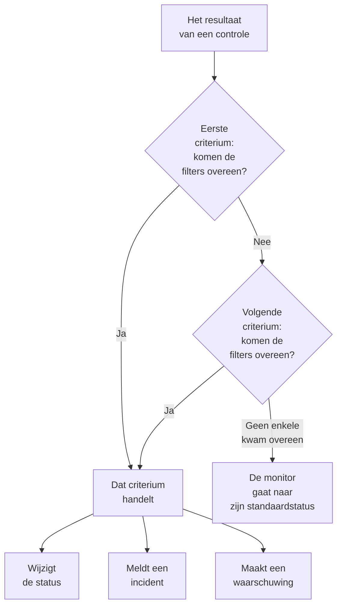
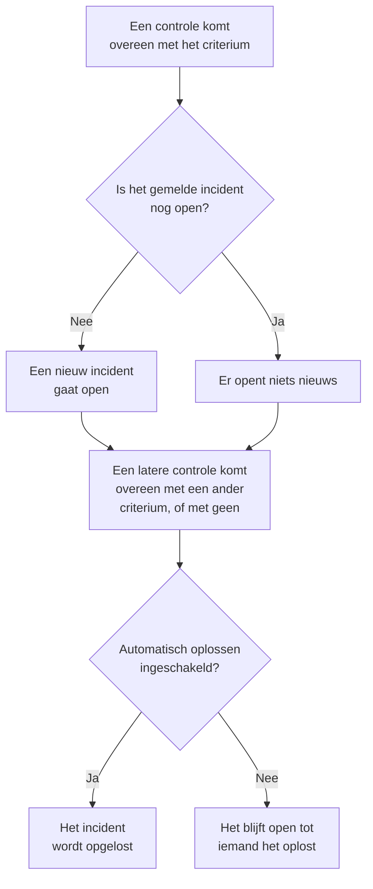

# Criteria en statussen

De criteria van een monitor bepalen wat elke controle betekent: of de monitor bereikbaar is of uitgevallen, en of OneUptime een incident meldt of een waarschuwing maakt. Statussen zijn de lijst van uw project met wat een monitor kan zijn, van **Operationeel** tot **Offline**. Deze pagina legt beide uit voor elk monitortype; de eigen pagina van elk type noemt de filters die het biedt.

:::cards
- [Hoe criteria beslissen](#hoe-criteria-beslissen): Van boven naar beneden, en de eerste overeenkomst wint.
- [Wat een criterium bevat](#wat-een-criterium-bevat): Filters, een overeenkomstvoorwaarde, acties en instellingen.
- [Een venster van controles beoordelen](#een-venster-van-controles-beoordelen): Mislukte controles tellen, instabiliteit opmerken, een percentiel lezen.
- [De criteria van een monitor wijzigen](#de-criteria-van-een-monitor-wijzigen): Criteria bewerken, toevoegen, herschikken en testen.
- [Monitorstatussen](#monitorstatussen): De ingebouwde statussen, en statussen van uzelf.
:::

## Hoe criteria beslissen

Telkens wanneer een monitor wordt gecontroleerd, beoordelen zijn criteria het resultaat van boven naar beneden in de lijst. Het eerste criterium waarvan de filters overeenkomen, bepaalt wat er gebeurt, en de criteria eronder worden voor die controle niet meer bekeken. Komt er geen overeen, dan gaat de monitor naar zijn **Standaard monitorstatus**. Zolang een criterium dat hem terugbrengt nog niet overeenkomt, behoudt hij in plaats daarvan zijn status: zie [Wanneer een criterium herstelt](#wanneer-een-criterium-herstelt).

De volgorde hoort bij de regel. Een nieuwe monitor zet zijn criteria van slechtste naar beste: offline, dan een waarschuwing als zijn type er een heeft (een certificaat of een domein dat binnenkort verloopt), dan online. Een breed gezond criterium, zoals **Is online** op **Waar**, komt overeen met bijna elke controle, dus het staat als laatste: boven de andere zou het elke keer als eerste overeenkomen en zouden de andere nooit handelen.

Een criterium dat overeenkomt maar geen status wijzigt, beslist de controle toch: de monitor houdt zijn status, en de criteria eronder wachten op de volgende controle. De **Standaard monitorstatus** geldt alleen als geen enkel criterium overeenkomt. Bij een nieuwe monitor is dat **Operationeel**; wijzig het onder **Meer velden**, onder de criteria.

> [!NOTE]
> Een monitor die per host, container, schijf of interface een eigen incident of waarschuwing opent, beoordeelt bij elke controle alle criteria, zodat twee hosts tegelijk met twee verschillende criteria kunnen overeenkomen. Dat is een monitor waarvan de query een **Groeperen op** heeft, zoals een metriek- of logmonitor, of een criterium dat `*` noemt voor elke schijf of interface. Dat geldt ook voor een metriekmonitor die een PromQL-expressie bewaakt: elke reeks die de expressie teruggeeft, wordt op zichzelf beoordeeld. Een monitor voor inkomende verzoeken die incidenten groepeert op een payloadveld, stopt toch bij de eerste overeenkomst.
>
> Zo'n monitor heeft toch één status, bepaald door het eerste criterium dat overeenkomt. Een criterium dat hem alleen terugbrengt naar zijn **Standaard monitorstatus** en geen incident of waarschuwing opent, wacht op de hosts die voldeden aan een criterium dat een andere status zet: het komt overeen zodra elk van hen eraan voldoet, wat de andere hosts ook doen. Tot dan behoudt de monitor zijn status, ook als geen criterium overeenkomt, terwijl de incidenten en waarschuwingen van elke host nog steeds elk apart worden opgelost.

## Wat een criterium bevat

Open een criterium: het heeft een naam en drie secties, die elk inklappen tot een samenvatting van één regel.

| Onderdeel | Wat het bevat |
| --- | --- |
| **Criterianaam** | De naam in de lijst met criteria, en in de oorzaak van elk incident en elke waarschuwing die het criterium opent. **Criteria toevoegen** noemt een nieuw criterium naar zijn filters, en de naam volgt ze tot u er zelf een typt. |
| **Filters** | Wat de controle moet laten zien, als een of meer filters. Kubernetes- en metriekmonitoren noemen ze **Waarschuwingsregels**. |
| **Acties** | Wat er gebeurt als de filters overeenkomen: de status wijzigen, een waarschuwing maken, een incident melden, of een combinatie daarvan. |
| **Instellingen** | **Schakel dit criterium in**, een optionele **Beschrijving**, wanneer het herstelt en wanneer het wordt beoordeeld en, bij monitors voor binnenkomende verzoeken, **Group incidents and alerts by a payload field**. |

### Filters

Een filter leest één gegeven uit de controle en vergelijkt het: een **Filtertype** (wat er wordt gelezen, zoals **Reactiestatuscode**), een **Filtervoorwaarde** (hoe er wordt vergeleken, zoals **Groter dan**) en een **Waarde**. Monitoren die metrieken vergelijken, zoals Kubernetes- en metriekmonitoren, vragen in plaats daarvan om een **Voorwaarde** en een **Drempel**. Elk monitortype biedt zijn eigen filtertypen, vermeld op zijn pagina, bijvoorbeeld [Website-monitor](/docs/monitor/website-monitor#bewakingscriteria).

Vanaf twee filters verschijnt eronder de **Overeenkomstvoorwaarde**: **Alle** betekent dat elk filter moet overeenkomen, **Minstens één** dat er één genoeg is. Een nieuw criterium begint op **Alle**.

Filters die elke controle meten, zoals **Is online**, **Reactiestatuscode** en **Reactietijd (in ms)**, bieden **Evalueer deze criteria over een bepaalde periode**. Dat beoordeelt een venster van recente controles in plaats van alleen de laatste, en begint op de laatste 5 minuten met **Alle waarden**, dat pas overeenkomt als elke controle in het venster overeenkwam. Het venster kan tot 24 uur lang zijn en de controles tellen, zoals [Een venster van controles beoordelen](#een-venster-van-controles-beoordelen) uitlegt. Zie [Evalueren over een periode](/docs/monitor/website-monitor#over-een-periode-evalueren).

### Acties

Elke actie is een schakelaar onder **Acties**:

| Schakelaar | Wat hij doet |
| --- | --- |
| **Wanneer filters overeenkomen, wijzig de monitorstatus.** | Zet de monitor in de status die onder **Monitorstatus wijzigen naar** is gekozen. |
| **Wanneer filters overeenkomen, maak een waarschuwing aan.** | Maakt de waarschuwingen die onder **Waarschuwing maken** zijn ingesteld. Een waarschuwing informeert uw team en verschijnt nooit op een statuspagina. |
| **Wanneer filters overeenkomen, verklaar een incident.** | Meldt de incidenten die onder **Incident maken** zijn ingesteld. Uw statuspagina's kunnen ze tonen. |

Een incident of waarschuwing vraagt om een titel, een **Ernst** en, ingeklapt, een beschrijving, eigenaren, labels en bereikbaarheidsbeleid. Titels en beschrijvingen kunnen waarden uit de controle bevatten, zoals `{{monitorName}}`: zie [Incident- en waarschuwingstemplates](/docs/monitor/incident-alert-templating). Om iemand op te roepen als het criterium overeenkomt, kiest u een beleid onder **Bereikbaarheid**: zie [Bereikbaarheidsbeleid](/docs/on-call/policies).

### Instellingen

**Schakel dit criterium in** staat aan bij elk nieuw criterium. Zet het uit om een criterium te bewaren zonder het te gebruiken: het wordt bij elke controle overgeslagen, wijzigt geen status, opent niets, en zijn kop toont **Uitgeschakeld**.

**Group incidents and alerts by a payload field** opent één incident per waarde die in een inkomend verzoek wordt gevonden, zodat één webhookadres meerdere incidenten open kan houden. Zie [Incidentgroepering inschakelen](/docs/monitor/incoming-request-monitor#incidenten-groeperen-inschakelen).

**Alleen herstellen wanneer aan een eigen voorwaarde is voldaan** en **Dit criterium alleen op bepaalde dagen en tijden beoordelen** staan uit voor een nieuw criterium. Zie [Wanneer een criterium herstelt](#wanneer-een-criterium-herstelt) en [Alleen op bepaalde dagen en tijden](#alleen-op-bepaalde-dagen-en-tijden).

## Een venster van controles beoordelen

Met **Evalueer deze criteria over een bepaalde periode** aangevinkt bepaalt **Evalueren** hoe de controles van het venster worden beoordeeld, en **Voor de laatste** hoe lang het venster is, van 2 minuten tot 24 uur. De eigen voorwaarde van het filter, zoals **Is online** op **Onwaar**, zegt wat elke controle moet laten zien.

| Evalueren | Komt overeen wanneer |
| --- | --- |
| **Alle waarden** | Elke controle van het venster aan de voorwaarde voldeed. |
| **Willekeurige waarde** | Minstens één controle van het venster aan de voorwaarde voldeed. |
| **Gemiddelde**, **Som**, **Maximale waarde**, **Minimale waarde** | Dat getal over de waarden van het venster aan de voorwaarde voldoet, zoals een gemiddelde reactietijd boven 300 ms. |
| **Percentiel** | Het onder **Percentiel** gekozen percentiel, van p50 tot p99, aan de voorwaarde voldoet: p95 boven 300 ms betekent dat de traagste 5% van de controles boven 300 ms ligt. |
| **Aantal** | Het aantal controles dat aan de voorwaarde voldeed zich verhoudt zoals ingesteld onder **Overeenkomende controles**: bijvoorbeeld **Groter dan** 30. |
| **Percentage** | Hun aandeel in de controles van het venster zich verhoudt zoals ingesteld onder **Aandeel overeenkomende controles**: bijvoorbeeld **Groter dan** 10%. |
| **Statuswijzigingen** | Het aantal keren dat de controles wisselden tussen wel en niet voldoen aan de voorwaarde zich verhoudt zoals ingesteld onder **Aantal wijzigingen**. Een apparaat dat uitvalt en weer terugkomt, wisselt twee keer. |

Een zin onder de instellingen van het venster leest het filter terug zoals het is ingesteld: ‘Controleer: "Is online" is onwaar bij meer dan 30 controles in de afgelopen 8 uur’.

- **Elke probe op zich.** **Aantal**, **Percentage** en **Statuswijzigingen** tellen de controles van de probe die de controle deed, dus een monitor die vanaf drie probes wordt gecontroleerd, telt niet drie keer zo snel, en zijn probes moeten het daarna eens zijn zoals bij elk criterium.
- **Een venster dat nog niet vol is.** Tot de controles terugreiken tot het begin van het venster, heeft een monitor die net is gestart minder controles dan hij zal hebben. **Aantal** en **Statuswijzigingen** komen vroeg overeen als ze **Groter dan** of **Groter dan of gelijk aan** al voorbij zijn, omdat meer controles ze alleen verhogen; al het andere wacht op een vol venster.
- **Een venster zonder controles.** Zolang het venster geen controles heeft, of nog niet vol is, beslist **Als geen gegevens**: **Ignore** wacht, **Trigger** komt overeen, en **Treat As Zero** beoordeelt het alsof de ontbrekende controles niet aan de voorwaarde voldeden.

De gemiddelden en percentielen lezen de waarden van de controles van alle probes, zoals **Gemiddelde** altijd al deed. **Aantal**, **Percentage** en **Statuswijzigingen** worden aangeboden voor elk filter waarvoor een venster wordt aangeboden: bij Website-, API-, Ping-, IP- en Port-monitors, voor de CPU, het geheugen, de schijven en de belasting van een server, voor **SNMP-apparaat is online** en de reactietijd van een netwerkapparaat, en bij DNS-, NTP-, database-, externe-statuspagina- en probestatusmonitors. **Is online** van een servermonitor wordt niet geteld: dat wordt beoordeeld op de tijd sinds de server voor het laatst rapporteerde. Metrics- en andere telemetriemonitors beoordelen in plaats daarvan het tijdsbereik van hun query, met de eigen aggregatie van de query, die ook percentielen leest.

### Voorbeeld: een access point dat uitvalt, en een dat instabiel is

Een Ping-monitor controleert elke minuut een access point op kantoor. Voordat vensters controles konden tellen, leek een access point dat steeds wegviel op een dat uitgevallen was, of op niets. Deze drie criteria, in deze volgorde, houden de twee uit elkaar:

| Criterium | Filter | Evalueren | Zet de status op |
| --- | --- | --- | --- |
| Access point is uitgevallen | **Is online** is **Onwaar** | **Alle waarden**, **Voor de laatste** 5 minuten | **Offline**, en meldt een storingsincident |
| Access point is instabiel | **Is online** is **Onwaar** | **Statuswijzigingen**, **Groter dan** 5, **Voor de laatste** 1 uur | **Verminderd**, en meldt een instabiliteitsincident |
| Access point is online | **Is online** is **Waar** | Niet over een periode | **Operationeel** |

Zet bij het tweede **Alleen herstellen wanneer aan een eigen voorwaarde is voldaan** aan met **Statuswijzigingen**, **Kleiner dan of gelijk aan** 1, **Voor de laatste** 1 uur: het instabiliteitsincident blijft open tot het access point een uur stabiel is geweest, in plaats van te sluiten in de eerste minuut dat het bereikbaar is. Om te waarschuwen als het in 8 uur meer dan 30 pings mist, stel je het tweede criterium in plaats daarvan in op **Aantal**, **Groter dan** 30, **Voor de laatste** 8 uur.

## Wanneer een criterium herstelt

Een criterium stopt met handelen zodra zijn filters niet meer overeenkomen: bij die controle worden zijn incident en waarschuwing opgelost, als **Incident automatisch oplossen** en **Waarschuwing automatisch oplossen** aan staan, en de monitor gaat naar het volgende criterium dat overeenkomt.

**Alleen herstellen wanneer aan een eigen voorwaarde is voldaan** houdt het criterium van kracht nadat zijn filters niet meer overeenkomen, tot de filters onder **Herstelt wanneer** overeenkomen. Ze beginnen als het tegendeel van de filters van het criterium, over de laatste 10 minuten, en kunnen alles gebruiken wat een filter biedt, zoals een venster dat controles telt. Een criterium is van kracht zolang de monitor de status heeft die het instelt, of een incident of waarschuwing open is die het heeft gemeld. Zolang het standhoudt, telt het als een overeenkomst op zijn plaats in de lijst: een criterium erboven dat overeenkomt, neemt het nog steeds over.

Als geen criterium overeenkomt, behoudt een monitor die een criterium van zijn **Standaard monitorstatus** heeft gehaald zijn status, zolang hij ook een criterium heeft dat hem alleen naar die status terugbrengt en niets opent. Dat is de herstelmarge: de sjablonen gaan af boven 90% en komen terug bij 81% of minder, dus bij 89% blijft de monitor waar hij is. Zijn incidenten en waarschuwingen worden nog steeds opgelost wanneer hun eigen criterium niet meer overeenkomt. Een monitor zonder zo'n criterium gaat zoals altijd naar zijn **Standaard monitorstatus**.

## Alleen op bepaalde dagen en tijden

**Dit criterium alleen op bepaalde dagen en tijden beoordelen** stelt de dagen, **Starttijd** en **Eindtijd**, en **Tijdzone** in; de tijdzone begint als die van jou. Buiten die uren wordt het criterium overgeslagen zoals een uitgeschakeld criterium: het komt nergens mee overeen, dus wat het opende wordt opgelost, en het evaluatielogboek meldt dat het buiten zijn uren viel. De uren worden gelezen op de klok van die tijdzone, dus 08:00 blijft 08:00 na de klokwissel, en uren die eerder eindigen dan ze beginnen, lopen door tot de volgende ochtend.

## Wanneer incidenten en waarschuwingen openen en sluiten

Een criterium dat incidenten meldt, opent er een wanneer het overeenkomt. Zodra de monitor herstelt, sluit het incident vanzelf als het criterium dat aangeeft.

- **Eén tegelijk.** Zolang een incident dat een criterium heeft gemeld nog open is, meldt hetzelfde criterium bij een nieuwe overeenkomst geen tweede. Waarschuwingen werken net zo. Een monitor die op host of payloadveld groepeert, houdt er één open per host of waarde, en een criterium van een monitor voor inkomende e-mail met **Voor elke e-mail een nieuw incident openen** opent er één per e-mail.
- **Sluiten.** Bij een latere controle waarbij een ander criterium overeenkomt, of geen, wordt een incident opgelost waarvan het criterium **Incident automatisch oplossen** aan heeft, en ook een waarschuwing met **Waarschuwing automatisch oplossen**. Beide staan onder **Meer velden** in het incident of de waarschuwing, en de criteria waarmee een nieuwe monitor begint, hebben ze aan.
- **Meerdere sondes.** Een monitor die door meer dan één sonde wordt gecontroleerd, verandert alleen als zijn sondes het eens zijn. Zie [Hoe criteria worden geëvalueerd](/docs/monitor/create-monitor#hoe-criteria-worden-geëvalueerd).
- **Een bovenliggende monitor die uitvalt.** Op de pagina **Configuratie → Afhankelijkheden** van een monitor noemt **Afhankelijk van monitors** de monitoren waarvan hij afhangt. Zolang een van die monitoren een status heeft die onder **Onderdrukken als status van bovenliggende monitor is** staat (elke offline-status als dat leeg blijft), opent de monitor geen incidenten of waarschuwingen. Zijn status verandert nog steeds, en wat open staat, wordt nog steeds opgelost.
- **Gepland onderhoud.** Een monitor in een lopende onderhoudsgebeurtenis wordt niet gecontroleerd, dus zijn criteria draaien niet. Zie [Gepland onderhoud – Overzicht](/docs/scheduled-maintenance/index).

Om te zien hoe een controle is beoordeeld, opent u het **Overzicht** van de monitor: de kaart **Monitorsamenvatting** toont welk criterium overeenkwam en wat elk criterium deed, inclusief een incident dat werd overgeslagen omdat er al een open stond.

## Wie bericht krijgt als hij uitvalt

**Als dit uitvalt** zegt in een paar zinnen wat er gebeurt als de monitor uitvalt en wie bericht krijgt: de status die hij instelt, het incident of de waarschuwing die hij opent, wie een e-mail krijgt en wie hij oproept, bij naam. Alles wat zou verhinderen dat iemand bericht krijgt, staat op een eigen regel, met een link naar de pagina waar u het oplost. U vindt het in het **Overzicht** van een monitor, onder de criteria op de pagina **Criteria**, in de criteriastap van **Monitor maken** voor de monitor die u instelt, en in de begeleide installatie voor websites.

Het stelt de keten vast zoals een echt incident of een echte waarschuwing dat doet: met de eigenaarsregels, privacyregels, labelregels en bereikbaarheidsregels van uw project, de incidentregel voor waarschuwingen die van een waarschuwing een incident maakt, en wie de eerste escalatieregel van elk bereikbaarheidsbeleid nu bereikt. Een bereikbaarheidsregel die vraagt wie de eigenaar van een waarschuwing is (**Eigenaar van waarschuwing**), wordt vergeleken met de eigenaren die de waarschuwing zal hebben: de personen en teams die de criteria noemen, de eigenaren van het netwerkapparaat dat de monitor bewaakt, en wie eigenaarsregels toevoegen. Een plaatshouder in de titel die pas een controle invult, wordt getoond zoals hij is geschreven. **Keten tonen** opent hem rij voor rij:

| Rij | Wat hij zegt |
| --- | --- |
| **Status** | De status die de criteria instellen. |
| **Opent** | Het incident of de waarschuwing, de ernst tussen haakjes en de titel. |
| **E-mails** | Wie de e-mail bij het aanmaken bereikt: de eigenaren, de eigenaren die eigenaarsregels toevoegen, of de Projecteigenaren als er geen zijn. Wie de oproep van de bereikbaarheidsdienst eerst bereikt, krijgt niet ook nog de e-mail als eigenaar. |
| **Eigenaarsregels** | De eigenaarsregels die eigenaren toevoegen. |
| **Privé** | Waarom het privé is: een privacyregel of de criteria. Een privé-incident verschijnt op geen enkele statuspagina en informeert geen abonnees, en alleen de eigenaren, de Projecteigenaren en de Projectbeheerders kunnen het zien. |
| **Labelregels** | De labelregels waarvan de labels veranderen welke bereikbaarheidsregels oproepen. |
| **Bereikbaarheidsregels** | De bereikbaarheidsregels die erbij passen. Bij een regel die vergelijkt wie de eigenaar van een waarschuwing is, staat welke eigenaar hem laat overeenkomen. |
| **Bereikbaarheidsbeleid** | Elk beleid dat die regels uitvoeren: wie de eerste escalatieregel nu bereikt en waarmee, en wie hij niet bereikt, en waarom. |
| **Statuspagina's** | De statuspagina's die het tonen, elk met de monitorgroep waarlangs ze de monitor toont. |
| **Incidentregel** | Bij een waarschuwing: de incidentregel voor waarschuwingen die er een incident van maakt, meteen of als de waarschuwing open blijft, en dat incident, beschreven zoals elk incident. |

### Wat verhindert dat iemand bericht krijgt

| Wat het verhindert | Link |
| --- | --- |
| Geen criteria wijzigen de status of openen een incident of waarschuwing. | **Criteria openen** |
| Niemand wordt opgeroepen: geen bereikbaarheidsregel komt overeen, of het project heeft nog geen bereikbaarheidsbeleid. | **Oproepen instellen** |
| De monitor opent waarschuwingen, en alleen incidenten hebben bereikbaarheidsregels. | **Oproepen instellen** |
| Een bereikbaarheidsbeleid heeft geen escalatieregels. | **Bereikbaarheidsbeleid openen** |
| Een bereikbaarheidsbeleid bereikt nu niemand. | **Bereikbaarheidsbeleid openen** |
| Iemand die een beleid oproept, is niet bereikbaar: hij heeft zich afgemeld, heeft geen geverifieerde methode, of heeft geen regel voor de ernst in een project zonder terugvaloptie. | **Gereedheid openen** |
| Sms, oproepen, WhatsApp of Telegram staan uit in het project. | **Meldingskanalen openen** |
| Het project heeft geen tegoed meer voor sms en oproepen (OneUptime Cloud). | **Facturering openen** |
| De server kan nog geen e-mail, sms of oproepen versturen. | **Admin-dashboard openen**, voor de beheerders van de server |

Een waarschuwing die een incidentregel voor waarschuwingen omzet in een incident dat iemand oproept, is geen onderbreking: dan wordt het beleid van het incident gecontroleerd.

Eigenaren die geen e-mail krijgen, staan na de onderbrekingen, elk met de reden en de plek waar ze zijn genoemd: iemand die geen lid is van het project, een team waarin niemand lid is (**Team openen**), of een team van een ander project, genoemd in de criteria (**Criteria openen**), bij het netwerkapparaat dat de monitor bewaakt (**Netwerkapparaat openen**) of door een eigenaarsregel (**Eigenaarsregels openen**). De e-mail gaat toch uit, naar de eigenaren die hij bereikt of naar de Projecteigenaren, dus het zijn geen onderbrekingen. De inrichtingsstatus noemt ze ook, als iets dat het oplossen waard is.

### Opnieuw controleren, en wat u ziet

Het antwoord is hooguit een minuut oud, en **Opnieuw controleren** stelt het opnieuw vast. Mislukt een nieuwe controle, dan houdt de kaart het laatste antwoord en zegt eronder waarom.

De kaart noemt alleen wat u mag lezen. Een bereikbaarheidsbeleid, een regel, een statuspagina of een monitorgroep die u niet kunt zien, houdt zijn plaats zonder zijn naam, en een privé-incident of privé-waarschuwing die u niet zult kunnen zien, zegt alleen dat het wordt geopend en dat het privé is.

## Wat een incident of waarschuwing van de controle bewaart

Een incident of waarschuwing die een monitor opent, bewaart de controle die het opende, zodat u nog lang nadat de logboeken van de monitor zelf zijn verdwenen kunt zien waarom. Onder de hoofdoorzaak noemt **Evaluatiedetails** het criterium dat overeenkwam en per filter dat overeenkwam wat de controle vond. **Details tonen** voegt de rest van het bewijs toe, de filters die niet overeenkwamen en de controle zelf: het verzoek, wanneer die liep, vanaf welke sonde en wat er terugkwam. Wat een filter vond, kan zijn:

- **Het veld.** Waar een filter **Antwoordlichaam** in een JSON-inhoud overeenkwam, zoals `checks[1].status`, of de header waarin een filter **Waarde van reactieheader** overeenkwam.
- **De waarden.** Wat elke waarde die een **JavaScript-expressie** leest bevatte toen die werd geëvalueerd, zoals `responseBody.status = "down"`.
- **Een fragment.** Een kort stuk van het antwoord rond de overeenkomst, met de overeenkomst gemarkeerd: nooit de hele inhoud.

Geheimen en persoonsgegevens worden gemaskeerd voordat er iets wordt bewaard: headers zoals `Authorization`, `Cookie` en `Set-Cookie`, velden waarvan de naam `password`, `token`, `key`, `session` of `email` zegt, en tekst die eruitziet als een bearer-token, een JWT, een kaartnummer of een e-mailadres. De URL van het verzoek is die waarmee de monitor is ingesteld, dus `{{monitorSecrets.NAME}}` blijft een naam, en een geheime querywaarde wordt gemaskeerd. De **Monitoringlogboeken** van de monitor, en elke waarde die een hoofdoorzaak citeert, worden op dezelfde manier gemaskeerd. Een incident of waarschuwing die met de hand is geopend, of voordat evaluatiedetails werden bewaard, heeft er geen.

> [!TIP]
> Als de antwoorden van een website- of API-monitor op zich gevoelig zijn, zet dan **Antwoordinhoud bewaren** uit op de kaart **Antwoordinhoud** van zijn pagina **Geavanceerd → Instellingen**. Zijn monitoringlogboeken, incidenten en waarschuwingen bewaren dan welke filters overeenkwamen, de statuscode en de responstijd, en geen enkel deel van het antwoord. Een monitor voor inkomende verzoeken heeft dezelfde schakelaar voor de verzoeken die hij ontvangt: **Verzoekinhoud bewaren**, op de kaart **Verzoekinhoud**. De schakelaar geldt voor de controles die worden uitgevoerd, en de incidenten en waarschuwingen die worden geopend, nadat u hem wijzigt. Het laatste verzoek in het overzicht van een monitor voor inkomende verzoeken volgt de schakelaar meteen.

## De criteria van een monitor wijzigen

:::steps
### De criteriapagina openen

Ga naar **Monitoren** en open de monitor. Klap **Configuratie** uit in het zijmenu en klik op **Criteria**. De kaart **Criteria** toont elk criterium, wat het controleert en wat het doet.

### Op Bewakingscriteria bewerken klikken

De editor toont elk criterium uitgeklapt. Klik op de kop van een criterium om het tot één regel in te klappen: de naam, hoeveel filters het heeft en wat het doet.

### Criteria toevoegen, wijzigen of herschikken

**Criteria toevoegen** voegt er onderaan een toe, uitgeklapt en vernoemd naar zijn filter. Sleep een criterium aan de greep links om het te verplaatsen: de eerste overeenkomst wint, dus zet het slechtste geval bovenaan. **Criteria verwijderen** haalt er een weg; een monitor houdt minstens één criterium.

### De criteria opslaan

Klik op **Wijzigingen opslaan**. De volgende controle wordt met de nieuwe criteria beoordeeld.

### De monitor testen

Bij een monitor die sondes controleren, klikt u op de kaart op **Monitor testen**: de test begint op een sonde die de monitor controleert. Kies desgewenst een andere onder **Selecteer sonde** en klik dan op **Test uitvoeren**. **Testresultaat van monitor** toont wat de controle vond. Het zegt ook aan welk criterium het antwoord voldoet en wat er zou volgen: de status, het incident of de waarschuwing, en wie bericht krijgt.
:::

Een handmatige monitor heeft geen criteria: u stelt zijn status zelf in. Zie [Status bijwerken](/docs/monitor/manual-monitor#de-status-bijwerken).

## Monitorstatussen

Een monitor staat altijd in een van de statussen van uw project. Een nieuw project heeft er drie, van gezondst tot slechtst:

| Status | Plaats | Kleur | Wat OneUptime ermee doet |
| --- | --- | --- | --- |
| **Operationeel** | 1 | Groen | Nieuwe monitoren beginnen erin, en het is de **Standaard monitorstatus** van een nieuwe monitor. Ingebouwd. |
| **Verminderd** | 2 | Geel | Niets uit zichzelf: een criterium van u zet een monitor hierin. |
| **Offline** | 3 | Rood | Het offline-criterium van een nieuwe monitor zet hem hierin, en OneUptime behandelt een monitor met deze status als uitgevallen. Ingebouwd. |

De lijst is een volgorde. Waar monitoren samen worden getoond, wint de status die het laagst in de lijst staat: een monitorgroep, een statuspaginagroep en de algemene status van een statuspagina tonen elk de slechtste status van hun monitoren.

### Waar een status telt

| Waar | Wat de status bepaalt |
| --- | --- |
| De lijst **Monitoren** | De huidige status van elke monitor. **Niet operationeel** toont de monitoren in elke status behalve de operationele, met een rood getal ernaast. Monitoren waarvan de bewaking uit staat, ontbreken daar: niets controleert ze, en **Uitgeschakeld** toont ze. **Uitgeschakeld** staat in het zijmenu onder **Alle monitoren**, met een grijs getal: de bewaking uitzetten is een keuze, geen storing. Naast **Niet operationeel**, onder **Aandacht vereist**, toont **Sondes losgekoppeld** de monitoren waarvan de ingeschakelde sondes allemaal losgekoppeld zijn, en **Geen sonde ingeschakeld** de monitoren die geen ingeschakelde sonde controleert: hun sondes zijn allemaal uitgeschakeld, of ze hebben er geen. |
| Statuspagina's | De kleur van elke rij, en haar beschikbaarheid: alleen de statussen in **Telt als downtime** van de pagina tellen mee. Een nieuwe statuspagina begint met elke status behalve de operationele. Zie [Kiezen wat de pagina toont](/docs/status-pages/index#kiezen-wat-er-op-de-pagina-komt). |
| Monitorgroepen | De status van de groep: de slechtste van haar monitoren. Zie [Monitorgroepen](/docs/monitor/monitor-groups). |
| SLO's | De downtime die een SLO telt, op basis van zijn eigen lijst met statussen. Zie [Welke statussen als downtime tellen](/docs/slo/introduction#welke-statussen-als-downtime-tellen). |
| Afhankelijkheden | Of een bovenliggende monitor de incidenten en waarschuwingen van de monitoren die van hem afhangen tegenhoudt: standaard zolang hij een offline-status heeft. |

Een status die u later toevoegt, wordt niet toegevoegd aan de lijst **Telt als downtime** van een bestaande statuspagina: voeg hem daar zelf toe.

### Een eigen status toevoegen

:::steps
### Monitorstatus openen

Ga naar **Monitoren → Instellingen → Monitorstatus**. **Instellingen** is ingeklapt in het zijmenu: klap het eerst uit. De kaart **Monitorstatussen** toont de statussen van gezondst tot slechtst.

### De status maken

Klik op **Monitorstatus aanmaken** en vul **Naam**, **Beschrijving** en **Kleur** in. De nieuwe status komt direct boven de offline-status, zodat een storing nog steeds als het slechtste telt.

### Hem op zijn plaats zetten

Sleep de status aan zijn greep. Een status lager in de lijst telt als slechter dan elke status erboven.

### Hem in een criterium gebruiken

Een status doet niets totdat een criterium monitoren erin zet. Kies hem onder **Monitorstatus wijzigen naar** bij het criterium dat hem moet instellen.
:::

De operationele en de offline-status zijn gemarkeerd als **Ingebouwd**: u kunt ze hernoemen en hun kleur wijzigen, maar niet verwijderen. In OneUptime Cloud vereist het maken of wijzigen van een status het Growth-abonnement. Statussen beheren vereist de rol Projecteigenaar, Projectbeheerder of Monitorbeheerder, of een aangepaste rol met de bijbehorende machtiging voor monitorstatussen.

### De statustijdlijn

Elke statuswijziging blijft bewaard in de **Statustijdlijn** van de monitor: wanneer ze begon, hoe lang ze duurde, en **Oorzaak bekijken** voor het criterium dat haar instelde. **Monitorstatusgebeurtenis aanmaken** voegt handmatig een status toe. Bij een monitor die sondes controleren, zet de volgende controle die overeenkomt met een criterium met een status die status opnieuw.

Een statuswijziging brengt de eigenaren van de monitor alleen op de hoogte als zij **Monitorstatus gewijzigd** in hun meldingsinstellingen hebben ingeschakeld: het staat in het begin uit. Een monitor die teruggaat naar zijn **Standaard monitorstatus** omdat geen criterium overeenkwam, brengt niemand op de hoogte. Zie [Wat aan staat voor een nieuw lid](/docs/notifications/notification-settings#wat-er-aanstaat-voor-een-nieuw-lid).

## Een monitorstatus archiveren

Archiveer een status die uw team niet meer moet gebruiken, in plaats van die te verwijderen. Archiveren wijzigt geen enkele monitor: een monitor in die status blijft erin tot zijn status verandert, en de statustijdlijn toont hem nog.

- **Archiveren** staat in het menu **⋯** van de rij. Het vraagt eerst om bevestiging en toont de monitorcriteria, sjablonen en statuspagina's die zijn ingesteld om de status te gebruiken: die blijven hem gebruiken tot u ze wijzigt.
- **Niemand kan hem nog kiezen.** Een criterium, het statusmenu van een monitor, de monitorstatus van een incident of onderhoudsgebeurtenis en de downtimestatussen van een statuspagina laten hem weg. De API, Terraform en MCP weigeren hem.
- **Gearchiveerde statussen staan apart**, in de ingeklapte sectie **Gearchiveerde monitorstatussen** onder de tabel. **Uit het archief halen** zet er een terug zoals hij was.
- **De ingebouwde statussen kunnen niet worden gearchiveerd.** Nieuwe monitoren beginnen in de operationele status, en OneUptime beschouwt een monitor in de offline status als uitgevallen. Hun **Archiveren** is vergrendeld, met de reden.

## Problemen oplossen

:::details De site is uitgevallen, maar de monitor blijft Operationeel
Een criterium hoger in de lijst kwam eerst overeen. Open **Configuratie → Criteria** en controleer de volgorde: het gezonde criterium staat als laatste. Controleer ook dat bij het offline-criterium **Schakel dit criterium in** aan staat, en dat zijn actie **Wanneer filters overeenkomen, wijzig de monitorstatus.** aan staat met een gekozen status.
:::

:::details Er werd geen incident geopend toen de monitor uitviel
Controleer het criterium dat overeenkwam: **Wanneer filters overeenkomen, verklaar een incident.** moet aan staan. Er wordt geen incident gemeld zolang het incident van hetzelfde criterium nog open is, zolang een bovenliggende monitor uit **Afhankelijk van monitors** is uitgevallen, of zolang de monitor in gepland onderhoud is. De kaart **Monitorsamenvatting** in het **Overzicht** van de monitor vertelt welke het was.
:::

:::details Het incident blijft open nadat de monitor herstelde
Open het criterium van het incident en klap **Meer velden** in zijn incident uit: **Incident automatisch oplossen** moet aan staan. Een incident van een criterium dat u sindsdien hebt verwijderd, wordt niet door de monitor opgelost: los het handmatig op.
:::

:::details De verwijderknop van Offline is vergrendeld
**Operationeel** en **Offline** zijn ingebouwd: OneUptime zet monitoren erin, dus ze kunnen worden hernoemd maar niet verwijderd. Verwijder in plaats daarvan een eigen status, of hernoem de ingebouwde.
:::

## Volgende stappen

:::cards
- [Een monitor maken](/docs/monitor/create-monitor): De drie stappen van een nieuwe monitor.
- [Incident- en waarschuwingstemplates](/docs/monitor/incident-alert-templating): Waarden uit de controle in titels en beschrijvingen zetten.
- [Monitorgroepen](/docs/monitor/monitor-groups): Meerdere monitoren tot één status samenvoegen.
- [Incidenten – Overzicht](/docs/incidents/index): Wat er gebeurt nadat een criterium een incident meldt.
:::
