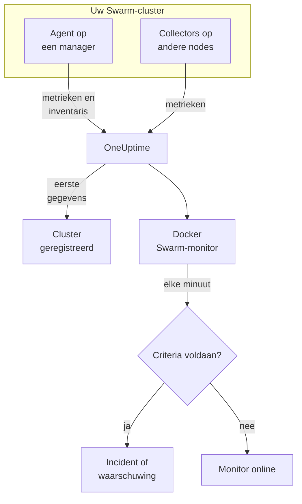

# Docker Swarm-monitor

Een Docker Swarm-monitor bewaakt de containers achter de servicetaken van een Swarm-cluster en laat u weten wanneer een taak herstart, heet loopt of door zijn geheugen raakt. Hij leest de containermetrieken die de OneUptime-Docker Swarm-agent verstuurt, dus er wordt niets van buitenaf gepeild: installeer de agent en maak de monitor dan vanuit een sjabloon of uw eigen query.

Vanaf versie 0.161.3 van zijn bestanden verstuurt de agent ook elke minuut de toestand van de swarm zelf, zodat een monitor de nodes en services zelf kan bewaken: een node die niet gereed is, of een service die minder replica's draait dan hij wil.

:::cards
- [De monitor maken](#een-docker-swarm-monitor-maken): Zes stappen in het dashboard.
- [Sjablonen](#kant-en-klare-waarschuwingssjablonen): Zeven kant-en-klare waarschuwingen, één incident per node, service of taak.
- [Metrieken](#verzamelde-metrieken): De containermetrieken waarop u kunt waarschuwen.
- [Filters](#monitorinstellingen): Een monitor beperken tot een service, een taak of een image.
:::

## Hoe het werkt

De OneUptime-Docker Swarm-agent draait op een managernode. Zijn collector leest elke 30 seconden containerstatistieken uit de Docker-daemon van die node, voorziet elke batch van de naam van het cluster, `docker.swarm.cluster.name`, en de metrieken van elke taak van de service en node van die taak. Een kleine inventarispoller ernaast leest elke 5 minuten de nodes, services en taken van het cluster uit de Swarm-API. De eerste gegevens registreren het cluster in OneUptime.

Elke minuut leest de poller bij de manager ook of elke node gereed is en hoeveel replica's elke service wil en draait, en verstuurt dat als metrieken. Zo horen **Node Not Ready** en **Service Replicas Mismatch** binnen een minuut of twee van een node of service in problemen, niet pas na vijf.

De collector ziet alleen containers op de node waarop hij draait. Voor metrieken van elke node draait u de collector op elke node met dezelfde `DOCKER_SWARM_CLUSTER_NAME`.

Een Docker Swarm-monitor is aan één cluster gebonden. Elke minuut voert hij zijn query uit over de containermetrieken van dat cluster en vergelijkt hij het resultaat met zijn criteria.

## Voordat u begint

- **Installeer de Docker Swarm-agent** op een managernode. De [handleiding voor de Docker Swarm-agent](/docs/telemetry/docker-swarm) behandelt installeren en bijwerken, en het draaien van de collector op de andere nodes.
- **Controleer of het cluster is geregistreerd.** Het verschijnt onder **Producten → Infrastructuur → Docker Swarm → Alle clusters**, genoemd naar de `DOCKER_SWARM_CLUSTER_NAME` van de agent, zodra zijn eerste gegevens binnenkomen.

## Een Docker Swarm-monitor maken

:::steps
### Een nieuwe monitor beginnen

Ga naar **Monitoren** en klik op **Monitor maken**.

### Docker Swarm kiezen

Klik onder **Monitortype** op **Meer monitortypen** en kies **Docker Swarm** onder **Infrastructuur**, of typ `swarm` in het zoekvak. Vul een **Naam** in – die wordt gebruikt in de titels van incidenten en waarschuwingen – en klik op **Volgende**.

### Het cluster kiezen

Kies onder **Docker Swarm Monitor Configuration** het cluster in **Docker Swarm-cluster**. Elk cluster dat gegevens heeft verstuurd, staat in de lijst. Na de keuze toont een regel onder het veld of er gegevens binnenkomen. **Docker Swarm-cluster toevoegen** opent installatiestappen met uw sleutels al ingevuld, die op de eerste gegevens wachten.

### Kiezen wat u bewaakt

Een nieuwe monitor begint met **Cluster Stopped Reporting**, onder **Waarover te waarschuwen**. Om iets anders te bewaken:

- **Wijzigen** – kies een ander [sjabloon](#kant-en-klare-waarschuwingssjablonen). Het stelt de metriek, de aggregatie, het tijdsbereik en de drempels in, en vervangt de criteria hieronder door die van het sjabloon. Het **Tijdsbereik** kunt u nog wijzigen.
- **Custom Metric** (onder **Meer velden**) – kies één metriek in **Docker Swarm Metric** en stel dan **Aggregatie** en **Tijdsbereik** in. De [filters](#monitorinstellingen) beperken hem tot bepaalde taken.
- **Geavanceerd** (onder **Meer velden**) – bouw zelf query's en formules onder **Selecteer metrieken**. Gebruik **Groeperen op** `resource.container.name` om elke taak afzonderlijk te beoordelen.

### De criteria controleren

Open elk criterium onder **Criteria** en controleer de **Metriek**, **Aggregatie**, **Voorwaarde** en **Drempel**. Een sjabloon vult deze in. Met **Custom Metric** of **Geavanceerd** begint de monitor met de [standaardcriteria](#standaardcriteria), die alleen opmerken dat de metriek geen gegevens stuurt; stel daarom uw eigen drempel in.

### De monitor maken

Klik op **Monitor maken**. OneUptime opent de pagina van de monitor en evalueert hem elke minuut. Incidenten en waarschuwingen die hij opent, staan ook op de pagina's **Incidenten** en **Waarschuwingen** van het cluster.
:::

> [!TIP]
> Om meerdere sjablonen tegelijk in te stellen, opent u het cluster via **Producten → Infrastructuur → Docker Swarm** en gaat u naar **Aanbevelingen**. Kies de sjablonen die u wilt en wie wordt opgeroepen, en OneUptime maakt één monitor per sjabloon.

## Monitorinstellingen

| Veld | Tabblad | Wat het doet |
| --- | --- | --- |
| **Docker Swarm-cluster** | Alle | Verplicht. Beperkt elke query tot `resource.docker.swarm.cluster.name`. De metrieken van een taak dragen `container.runtime=docker`, net als die van een Docker-host, en de agent geeft nooit `host.name` mee, dus de monitor filtert op geen van beide. |
| **Servicenaam** | Custom Metric, Geavanceerd | Optioneel. Exacte overeenkomst met `resource.docker.swarm.service.name`, de service zoals `docker service ls` hem noemt, bijvoorbeeld `web` (`<stack>_web` in een stack). |
| **Nodenaam** | Custom Metric, Geavanceerd | Optioneel. Exacte overeenkomst met `resource.docker.swarm.node.name`, de hostnaam van de node zoals `docker node ls` die toont, bijvoorbeeld `swarm-node-1`. De agent op die node geeft hem mee vanuit `DOCKER_SWARM_NODE_NAME`. |
| **Containernaam** | Custom Metric, Geavanceerd | Optioneel. Exacte overeenkomst met `resource.container.name`. De container van een taak heet `<service>.<slot>.<taskid>`, bijvoorbeeld `web.1.abc123`. |
| **Container-image** | Custom Metric, Geavanceerd | Optioneel. Komt overeen met `resource.container.image.name`, met of zonder de digest die Swarm aan de image vastzet: `nginx:latest` komt ook overeen met `nginx:latest@sha256:…`, een digest die u typt, wordt weggelaten, en een naam zonder tag betekent `:latest`. |
| **Docker Swarm Metric** | Custom Metric | Eén metriek uit de [catalogus](#verzamelde-metrieken). |
| **Aggregatie** | Custom Metric | Hoe metingen worden gecombineerd: **Gemiddelde**, **Maximum**, **Minimum**, **Som** of **Aantal**. Begint bij de gebruikelijke aggregatie van de metriek. |
| **Tijdsbereik** | Alle | Het schuivende venster dat de query leest, van **Past 1 Minute** tot **Past 365 Days**. Een nieuwe monitor begint bij **Past 1 Minute**; sjablonen stellen hun eigen in. |
| **Selecteer metrieken** | Geavanceerd | De querybouwer: **Metriek**, **Aggregate by**, **Filter by attributes**, **Groeperen op**, plus **Metriek toevoegen** en **Formule toevoegen** om query's te combineren. |

> [!NOTE]
> **Servicenaam** en **Nodenaam** hebben de bestanden van de agent vanaf versie 0.161.2 nodig: oudere bestanden versturen de service noch de node. [Werk de agent bij](/docs/telemetry/docker-swarm#de-agent-upgraden) op elke node waarop hij draait.

## Kant-en-klare waarschuwingssjablonen

De lijst **Waarover te waarschuwen** biedt zeven sjablonen. Elk bouwt een volledige monitor: een query, een criterium dat afgaat en een dat herstelt. **Node Not Ready** groepeert zijn query per node, `resource.docker.swarm.node.name`, **Service Replicas Mismatch** per service, `resource.docker.swarm.service.name`, en de taaksjablonen per `resource.container.name`, zodat elke node, service of taak apart wordt beoordeeld en een eigen incident en een eigen waarschuwing krijgt, waarvan de hoofdoorzaak de getroffen onderdelen en hun waarden noemt. De drempels zijn startpunten die u kunt aanpassen.

De taaksjablonen lezen bovendien alleen de taken van Swarm: een container die op een andere manier op een node is gestart, die van de agent zelf incluis, telt niet mee. Een query via **Custom Metric** of **Geavanceerd** leest elke container die de agent meldt; het filter **Servicenaam** beperkt hem tot de taken van één service.

Tenzij de tabel iets anders zegt, gaat een criterium alleen af als de voorwaarde elke minuut van zijn venster geldt, en herstelt het 10% voorbij de drempel, zodat een waarde die rond de grens schommelt niet heen en weer springt.

| Sjabloon | Ernst | Bewaakt | Gaat af als | Herstelt als |
| --- | --- | --- | --- | --- |
| Cluster Stopped Reporting | Kritiek | `container.memory.percent`, Count over alle containers in het cluster, laatste 10 minuten | Geen gegevens gedurende het hele venster | Er komen weer gegevens binnen |
| Node Not Ready | Kritiek | `docker.swarm.node.ready`, Min per `resource.docker.swarm.node.name`, laatste 5 minuten | Onder 1 | Op 1 |
| Service Replicas Mismatch | Waarschuwing | `docker.swarm.service.replicas.desired` − `docker.swarm.service.replicas.running` (beide Avg) per `resource.docker.swarm.service.name`, laatste 15 minuten | Boven 0 | Op of onder 0 |
| Task Down (Low Uptime) | Kritiek | `container.uptime`, Min per taak, laatste 1 minuut | Een willekeurige waarde ligt onder 60 seconden | Elke waarde ligt op of boven 66 seconden |
| High Task CPU Usage | Waarschuwing | `container.cpu.utilization`, Avg per taak, laatste 5 minuten | Boven 80 (% van één kern) | Op of onder 72 |
| High Task Memory Usage | Waarschuwing | `container.memory.percent`, Avg per taak, laatste 5 minuten | Boven 85% | Op of onder 76,5% |
| High Task Process Count | Waarschuwing | `container.pids.count`, Max per taak, laatste 5 minuten | Boven 2000 | Op of onder 1800 |

**Ernst** is het label dat de keuzelijst toont. Het incident en de waarschuwing die een sjabloon maakt, beginnen op het zwaarste incident- en waarschuwingsernstniveau van uw project; wijzig ze in de criteria.

> [!NOTE]
> **Cluster Stopped Reporting** gaat af als er tien minuten lang niets van het cluster binnenkomt: de nodes waarop de agent draait zijn uitgevallen, of de agent is gestopt, is zijn route naar OneUptime kwijtgeraakt of zijn token is ingetrokken. Het wordt opgelost zodra er weer gegevens binnenkomen. Als er geen gegevens meer komen, hebben de andere sjablonen niets om te vergelijken en houden ze hun laatste status, dus dit is het sjabloon dat het u laat weten. Een node zonder taken blijft rapporteren, omdat de agent zelf als container draait en zijn eigen gegevens rapporteert.

> [!NOTE]
> **Task Down (Low Uptime)** gaat af op één jonge meting, omdat een herstart een gebeurtenis is en geen niveau. Swarm geeft een vervangende taak een nieuwe container, en dus een nieuwe reeks; daarom zoekt het sjabloon naar een uptime onder een minuut in plaats van naar een 0. Een uitrol of een opschaling laat het ook afgaan, en het herstelt zodra de nieuwe taken een minuut uptime voorbij zijn. Een taak die sterft en niet wordt vervangen, stuurt niets en wordt dus niet opgemerkt.

> [!NOTE]
> **Node Not Ready** en **Service Replicas Mismatch** lezen de reeksen die de inventarispoller van de agent vanaf een manager verstuurt, vanaf versie 0.161.3 van zijn bestanden. Een oudere agent verstuurt geen van beide, dus beide sjablonen hebben niets te lezen en gaan nooit af: [werk de agent bij](/docs/telemetry/docker-swarm#de-agent-upgraden); een teken naast zijn versie in het overzicht van het cluster laat zien wanneer hij achterloopt. Service Replicas Mismatch wacht vijftien minuten, zodat een rolling update, die de taken van een service een paar tegelijk vervangt, niemand oproept. Een jobservice voert zijn taken tot het einde uit, heeft geen replica's die kunnen ontbreken, en telt niet mee.

## Verzamelde metrieken

De collector van de agent gebruikt de OpenTelemetry-receiver `docker_stats`, dus de metrieken zijn de standaard containermetrieken, één reeks per taakcontainer. Er zijn geen metrieken `docker_swarm_*`: nodes, services en taken worden als inventaris bijgehouden, op de pagina's **Services**, **Taken**, **Knooppunten** en verwante pagina's van het cluster.

Daarnaast verstuurt de inventarispoller van de agent vanaf versie 0.161.3 van zijn bestanden elke minuut de toestand van de swarm zelf: de drie metrieken onder [Swarm](#swarm).

### CPU

| Metriek | Eenheid | Beschrijving |
| --- | --- | --- |
| `container.cpu.utilization` | % | CPU-gebruik van de container van een taak per interval van 30 seconden, waarbij 100% één volledige CPU-kern is. |

### Geheugen

| Metriek | Eenheid | Beschrijving |
| --- | --- | --- |
| `container.memory.usage.total` | bytes | Geheugen dat de container van een taak gebruikt. |
| `container.memory.percent` | % | Gebruikt geheugen als percentage van de limiet van de container, of van het totale geheugen van de node als de service geen limiet instelt. |

### Netwerk

| Metriek | Eenheid | Beschrijving |
| --- | --- | --- |
| `container.network.io.usage.rx_bytes` | bytes | Door de container van een taak ontvangen bytes. Een teller over de hele levensduur. |
| `container.network.io.usage.tx_bytes` | bytes | Door de container van een taak verzonden bytes. Een teller over de hele levensduur. |

### Container

| Metriek | Eenheid | Beschrijving |
| --- | --- | --- |
| `container.pids.count` | aantal | Taken in de container van een taak: de cgroup-pids-controller telt threads net zo goed als processen. Een plotselinge stijging kan wijzen op een fork bomb of een threadlek. |
| `container.uptime` | seconden | Hoe lang de container van een taak al draait. Een opnieuw ingeplande of herstarte taak begint een nieuwe container op 0. |

Elke reeks draagt de identiteit van de container als resourceattributen: `resource.container.name` (`<service>.<slot>.<taskid>`), `resource.container.image.name`, `resource.docker.swarm.service.name`, `resource.docker.swarm.node.id`, `resource.docker.swarm.node.name` (als de agent de naam van de node kent) en `resource.docker.swarm.cluster.name`.

### Swarm

| Metriek | Eenheid | Beschrijving |
| --- | --- | --- |
| `docker.swarm.node.ready` | — | Of een node gereed is, zoals de managers hem zien: 1 zolang hij het is, 0 zolang hij offline, losgekoppeld of onbekend is. Eén reeks per node. |
| `docker.swarm.service.replicas.desired` | count | De taken die een gerepliceerde of globale service wil laten draaien: zijn replica's, of voor een globale service de nodes waarop hij moet draaien. Eén reeks per service. |
| `docker.swarm.service.replicas.running` | count | De taken van de service die draaien. Onder het gewenste aantal komt de service replica's tekort. |

De reeks van een node draagt `resource.docker.swarm.node.name`, `resource.docker.swarm.node.id` en `resource.docker.swarm.node.role`; die van een service draagt `resource.docker.swarm.service.name`, `resource.docker.swarm.service.mode` en, in een stack, `resource.docker.swarm.stack.namespace`. Beide dragen `resource.docker.swarm.cluster.name`.

## Bewakingscriteria

Een criterium vergelijkt een van de query's of formules van de monitor met een drempel. De criteria van een Docker Swarm-monitor hebben geen **Filtertype**: elke regel controleert de metriekwaarde, met deze velden.

| Veld | Wat het doet |
| --- | --- |
| **Metriek** | De query of formule die wordt gecontroleerd, op naam van de variabele. |
| **Aggregatie** | Hoe de waarden in het venster één antwoord worden: **Gemiddelde**, **Som**, **Maximale waarde**, **Minimale waarde**, **Alle waarden** (elke waarde moet overeenkomen, over het hele venster) of **Willekeurige waarde** (één is genoeg). |
| **Voorwaarde** | **Groter dan**, **Kleiner dan**, **Groter dan of gelijk aan**, **Kleiner dan of gelijk aan** of **Gelijk aan** – of een anomalievoorwaarde: **Afwijkend hoog**, **Afwijkend laag** of **Afwijkend**. **Geen gegevens** klopt als de query in het venster niets opleverde, **Gegevens aanwezig** als hij iets opleverde. **Verwacht boven** en **Verwacht onder** komen overeen wanneer de trend van de metriek in het venster aan het eind van **Termijn** voorbij de drempel is. |
| **Drempel** | De waarde waarmee wordt vergeleken. Ernaast staat een lijst met eenheden als de metriek een eenheid heeft. Niet getoond bij anomalievoorwaarden. |
| **Gevoeligheid** | Alleen bij anomalievoorwaarden. **Laag** (4σ), **Gemiddeld** (3σ, de standaard) of **Hoog** (2σ). |
| **Baseline-venster** | Alleen bij anomalievoorwaarden. 14 dagen (de standaard), 28, 60 of 90 dagen geschiedenis. |
| **Als geen gegevens** | Onder **Meer velden**. Wat er gebeurt als het venster geen metingen bevat: **Ignore** (de standaard), **Treat As Zero** of **Trigger**. |

Anomalievoorwaarden vergelijken elke waarde met hetzelfde uur van de week in de baseline. Ze blijven in een "Learning"-status, en geven niets, tot het baseline-venster genoeg geschiedenis bevat. Deze monitor filtert zijn query's op attributen, dus elke query, en elke reeks van een gegroepeerde query, wordt vergeleken met zijn eigen geschiedenis, zo ver terug als de metrics worden bewaard. Is dat minder dan twee weken, dan blijft een som, een telling of een query op een histogram voorgoed in die toestand, en wordt al het andere vergeleken met alle reeksen van de metric. Een percentiel van een histogram blijft altijd in die toestand.

Elk criterium zegt ook wat er moet gebeuren als het overeenkomt: de monitorstatus wijzigen, een waarschuwing maken of een incident melden. Criteria worden van boven naar beneden gecontroleerd, en het eerste dat overeenkomt, beslist.

### Standaardcriteria

Een monitor die u niet vanuit een sjabloon maakt, begint met twee criteria:

| Volgorde | Criterium | Komt overeen als | Dan |
| --- | --- | --- | --- |
| 1 | Check if _monitor name_ is offline | De eerste query heeft in het hele venster geen gegevens | Markeert de monitor als **Offline** en meldt het incident "_monitor name_ is offline", dat zichzelf oplost als de monitor herstelt. |
| 2 | Check if _monitor name_ is online | De eerste query heeft gegevens | Markeert de monitor als **Operationeel**. |

> [!IMPORTANT]
> Een waarde van `0` is ook data: een metric die vaak nul is, zoals herstarts of fouten, zet de monitor niet offline. Wilt u een melding bij een waarde, begin dan met een sjabloon of voeg een criterium met een drempel toe. Komt er helemaal geen data binnen en past geen enkel criterium, dan houdt de monitor zijn status en blijven open incidenten open: stilte is geen herstel. Tijd waarin OneUptime zelf geen data ontving, telt nooit als geen data: een controle waarvan het venster zulke tijd bevat, wacht in plaats daarvan, zoals [Als OneUptime geen gegevens ontvangt](/docs/monitor/when-oneuptime-is-not-receiving) uitlegt.

## Problemen oplossen

:::details Het cluster staat niet in de lijst Docker Swarm Cluster
Clusters registreren zichzelf uit de gegevens van de agent. Controleer of de agent op een managernode draait, of `DOCKER_SWARM_CLUSTER_NAME` is ingesteld en of het cluster onder **Producten → Infrastructuur → Docker Swarm → Alle clusters** staat. De [handleiding voor de Docker Swarm-agent](/docs/telemetry/docker-swarm) bevat de controles die u op de node uitvoert.
:::

:::details Alleen sommige taken hebben metrieken
De collector leest de Docker-daemon van de node waarop hij draait, dus hij ziet alleen de taken op die node. Draai de collector op elke node met dezelfde `DOCKER_SWARM_CLUSTER_NAME`.
:::

:::details Een monitor gefilterd op service of node vindt geen gegevens
**Servicenaam** en **Nodenaam** vergelijken met `resource.docker.swarm.service.name` en `resource.docker.swarm.node.name`, die de agent verstuurt vanaf versie 0.161.2 van zijn bestanden: [werk hem bij](/docs/telemetry/docker-swarm#de-agent-upgraden). De naam van de node komt uit `DOCKER_SWARM_NODE_NAME` in de `.env` van elke node, die het installatiescript schrijft; voeg hem daar zelf toe op een node die u op een andere manier hebt ingericht.
:::

:::details Elke taak verschijnt als één reeks
Groepeer op het resourceattribuut `resource.container.name`, zoals de sjablonen doen. De kale `container.name` komt met niets overeen, dus elke taak valt samen tot één reeks met een lege naam.
:::

:::details Node Not Ready of Service Replicas Mismatch gaat nooit af
Beide lezen de reeksen die de inventarispoller van de agent verstuurt vanaf versie 0.161.3 van zijn bestanden, en alleen vanaf een manager: [werk de agent bij](/docs/telemetry/docker-swarm#de-agent-upgraden) en controleer of de inventarispoller op een manager draait (`docker node ls` moet daar slagen). De pagina **Metrieken** van het cluster laat zien of `docker.swarm.node.ready` binnenkomt.
:::

## Volgende stappen

:::cards
- [Docker Swarm-agent](/docs/telemetry/docker-swarm): De agent installeren en bijwerken die deze monitor leest.
- [Docker-monitor](/docs/monitor/docker-monitor): De containers van één Docker-host bewaken.
- [Incidenten – Overzicht](/docs/incidents/index): Wat er gebeurt nadat een criterium een incident heeft gemeld.
- [Bereikbaarheidsschema's](/docs/on-call/schedules): Bepalen wie wordt opgeroepen als een taak stukgaat.
:::
