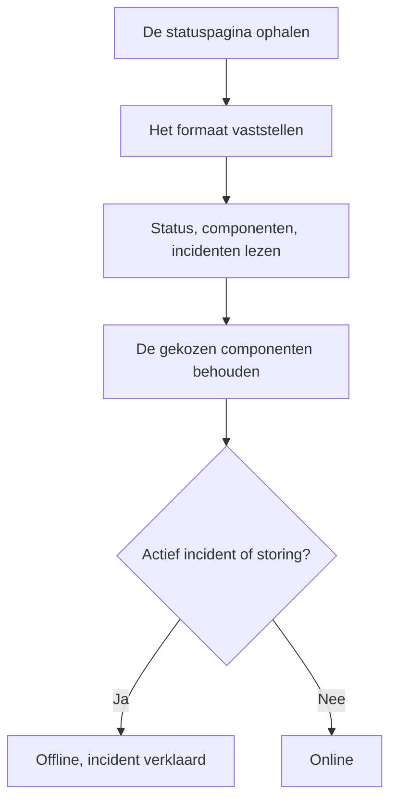

# Externe-statuspagina-monitor

Een monitor voor externe statuspagina's houdt de openbare statuspagina in de gaten van een dienst waarvan u afhankelijk bent — AWS, GCP, Azure, GitHub, OpenAI, Anthropic en vele andere — en waarschuwt u als die provider een storing of verminderde prestaties meldt. Gebruik hem om problemen bij uw leveranciers te horen zodra de provider ze meldt, en om ze te onderscheiden van uw eigen problemen.

Hij leest ook statuspagina's die met OneUptime zijn gemaakt, resource voor resource, en houdt gepland onderhoud uit elkaar met een storing: volg het project van een ander team, of een leverancier wiens statuspagina op OneUptime draait.

:::cards
- [De monitor maken](#een-monitor-voor-externe-statuspaginas-maken): Plak de URL van een statuspagina en kies wat u wilt volgen.
- [Componenten kiezen](#componenten): Volg alleen de componenten waarvan u afhankelijk bent.
- [Criteria](#bewakingscriteria): Wat standaard als uitgevallen telt.
- [OneUptime-statuspagina's](#oneuptime-statuspaginas): De resources van een ander project, en het onderhoud ervan.
- [Populaire statuspagina's](#populaire-statuspagina-urls): URL's van de diensten waarvan de meeste teams afhankelijk zijn.
:::

## Zo werkt het

Bij elke controle haalt een probe de statuspagina op, stelt vast welk formaat die gebruikt, en leest de algemene status, de componenten en de actieve incidenten. Hebt u componenten of een componentgroep gekozen, dan tellen alleen die mee. Daarna beslissen de criteria of de monitor online of offline is.

U kunt hem gebruiken om:

- De beschikbaarheid te bewaken van diensten van derden waarvan uw applicatie afhankelijk is
- Gewaarschuwd te worden als uw leveranciers een storing hebben
- De status van afzonderlijke componenten te volgen
- Alleen de componenten te volgen waarvan u afhankelijk bent (bijvoorbeeld Git Operations en Pull Requests van GitHub, of de groep "APIs" van OpenAI), zodat incidenten elders op de pagina die er niets mee te maken hebben uw monitor niet laten afgaan
- Verminderde prestaties op te merken voordat uw gebruikers er last van hebben
- Uw eigen incidenten te koppelen aan problemen bij uw leveranciers

## Ondersteunde providers

| Provider | Beschrijving |
| ------------------------ | ---------------------------------------------------------------------- |
| **Auto** (standaard) | Stelt het formaat van de statuspagina automatisch vast |
| **Atlassian Statuspage** | Statuspagina's die draaien op Atlassian Statuspage (JSON-API) |
| **incident.io** | Statuspagina's die draaien op incident.io (bijv. `https://status.openai.com`) |
| **OneUptime Status Page** | Statuspagina's die met OneUptime zijn gemaakt: de status van elke resource, en wat in onderhoud is |
| **RSS** | Statuspagina's die een RSS-feed aanbieden |
| **Atom** | Statuspagina's die een Atom-feed aanbieden |

### Automatische detectie

Staat de provider op **Auto**, dan stelt OneUptime het formaat van de statuspagina automatisch vast, in deze volgorde:

1. Eerst probeert het de API voor statuspagina's van incident.io (`/proxy/<host>`).
2. Daarna probeert het de JSON-API van Atlassian Statuspage (`/api/v2/status.json`, `/api/v2/components.json` en `/api/v2/incidents/unresolved.json`).
3. Dan vraagt het de samenvatting op van een OneUptime-statuspagina (`/status-page-api/summary/<page>`).
4. Mislukken die, dan probeert het de pagina als RSS- of Atom-feed te lezen.
5. Als laatste terugvaloptie voert het een eenvoudige controle op HTTP-bereikbaarheid uit.

> [!NOTE]
> incident.io wordt als eerste gecontroleerd, omdat sommige statuspagina's van incident.io (zoals `https://status.openai.com`) ook een beperkt, met Atlassian compatibel endpoint aanbieden dat componentgroepen en actieve incidenten weglaat. Door incident.io eerst te controleren, worden de rijkere gegevens met groepen gebruikt.

De controle op bereikbaarheid is ook de terugvaloptie als een provider die u uitdrukkelijk hebt gekozen, faalt. Die vertelt u alleen of de pagina antwoordt — online bij een antwoord `2xx` of `3xx` — en meldt geen componenten of incidenten.

## Een monitor voor externe statuspagina's maken

:::steps
### Een nieuwe monitor beginnen

Ga naar **Monitoren** en klik op **Monitor maken**. Klik onder **Monitortype** op **Meer monitortypen** en kies **External Status Page** onder **Basic Monitoring**, of typ `statuspage` in het zoekvak. Voer een **Naam** in en klik daarna op **Volgende**.

### De URL van de statuspagina invoeren

Voer de **URL statuspagina** in. Laat de **Provider** op **Auto** staan, tenzij u het formaat kent.

### Componenten kiezen, als dat nodig is

Open **Componenten** en kies uit de lijst van de pagina de componenten waarvan u afhankelijk bent, zoals `Git Operations` en `Pull Requests` op die van GitHub; laat het leeg om de hele pagina te volgen. Om in plaats daarvan één groep te volgen, opent u **Meer velden** en voert u een **Component Group Filter** in, zoals `APIs`.

### Testen

Klik op **Monitor testen** om de pagina één keer op te halen, en controleer de provider, de componenten en de incidenten die hij vond.

### De criteria nakijken

De criteriastap begint met [de standaardcriteria](#standaardcriteria), die de monitor als offline markeren als de provider een actief incident of een storing binnen de afbakening meldt. Wijzig ze als dat nodig is, en klik daarna op **Volgende**.

### Probes kiezen en maken

Selecteer de **Sondes** en een **Bewakingsinterval** — dat begint op **Elke 5 minuten** — en klik daarna op **Monitor maken**.
:::

## Configuratieopties

| Optie | Wat u invoert | Standaard |
| --- | --- | --- |
| **URL statuspagina** | De URL van de statuspagina. Voor sites die draaien op Atlassian Statuspage en incident.io is dit meestal de hoofd-URL (bijv. `https://status.example.com`). Voer voor RSS-/Atom-feeds direct de URL van de feed in. | — |
| **Provider** | **Auto** om het formaat vast te stellen, of **Atlassian Statuspage**, **incident.io**, **OneUptime Status Page**, **RSS** of **Atom** als u het kent. | **Auto** |
| **Componenten** | De componenten die u volgt, gekozen uit de lijst van de pagina of ingetypt. | De hele pagina |
| **Component Group Filter** | De groep waartoe de monitor wordt afgebakend. Onder **Meer velden**. | Alle groepen |
| **Time-out (ms)** | Hoe lang maximaal op de statuspagina wordt gewacht. Onder **Meer velden**. | `10000` (10 seconden) |
| **Nieuwe pogingen** | Hoe vaak opnieuw wordt geprobeerd, met een seconde ertussen, nadat de eerste poging is mislukt; `0` betekent één poging. Onder **Meer velden**. | `3` (tot 4 pogingen) |

### Componenten

Kies de componenten waarvan u afhankelijk bent, en de monitor volgt alleen die: **External Status Page Component Status** vergelijkt alleen hun statussen, de algemene status is de slechtste van hun statussen, en **External Status Page Active Incidents** telt alleen de incidenten die minstens één van hen raken. Het blijft één controle van de pagina, hoeveel u er ook kiest.

Als u **Componenten** opent, leest uw browser de lijst van de pagina van een Atlassian Statuspage, een incident.io-pagina of een OneUptime-statuspagina, en toont die in de groepen van de pagina; elk component dat niet operationeel is, zegt hoe het ermee staat. Een gekozen naam volgt het component met precies die naam, zonder op hoofdletters te letten: `Copilot` op de pagina van GitHub is niet `Copilot AI Model Providers`.

Kan de lijst niet worden gelezen (een interne pagina, een pagina die haar lijst niet met uw browser deelt, een RSS- of Atom-feed), typ dan een naam en druk op Enter. Een `*` staat voor willekeurige tekst: `*us-east-1*` volgt elk component met `us-east-1` in de naam. Bij een RSS- of Atom-feed telt een item als de titel een van de namen bevat.

Een incident dat geen component noemt, telt niet mee zolang u gekozen componenten volgt: niets zegt dat het die raakt. Is er niets gekozen, dan volgt de monitor de hele pagina en telt elk incident mee.

Een monitor die is opgeslagen met het oude Filter op componentnaam, blijft volgen wat hij volgde: het filter staat in **Componenten** als die naam tussen sterretjes, zoals `*API*`, wat overeenkomt met elk component waarvan de naam het bevat.

> [!WARNING]
> Een naam die nergens mee overeenkomt, volgt niets en ziet er gezond uit. **Componenten** en **Monitor testen** noemen allebei de gekozen componenten die de pagina niet toont.

### Component Group Filter

Deelt de statuspagina haar componenten in groepen in, dan kunt u de monitor afbakenen tot één groep. Op `https://status.openai.com` bakent u met `APIs` de monitor bijvoorbeeld af tot de API-diensten van OpenAI.

Is er een componentgroep ingesteld, dan worden het **aantal actieve incidenten** en de **algemene status** berekend met alleen de componenten in die groep — een incident in een groep die er niets mee te maken heeft (bijvoorbeeld ChatGPT) laat een monitor die tot de groep "APIs" is afgebakend, niet afgaan. Zijn er ook componenten gekozen, dan tellen alleen de gekozen componenten van de groep mee.

Filteren op componentgroep wordt ondersteund voor de providers **Atlassian Statuspage**, **incident.io** en **OneUptime Status Page**. RSS- en Atom-feeds kennen geen componentgroepen.

## Bewakingscriteria

U kunt criteria instellen die bepalen wanneer de externe dienst als online of offline geldt, op basis van:

| Filtertype | Wat het controleert | Filtervoorwaarden |
| --- | --- | --- |
| **External Status Page Is Online** | Of de statuspagina bereikbaar is en statusgegevens teruggeeft | Waar of Onwaar |
| **External Status Page Overall Status** | De algemene status die de pagina meldt | Gelijk aan, Niet gelijk aan, Bevat, Bevat niet, Begint met, Eindigt op |
| **External Status Page Component Status** | De status van elk component binnen de afbakening (de gekozen componenten, of die van de groep, als die zijn ingesteld): Operationeel, Under Maintenance, Degraded Performance, Partial Outage, Major Outage of Full Outage | Gelijk aan, Niet gelijk aan, Bevat, Bevat niet, Begint met, Eindigt op |
| **External Status Page Active Incidents** | Het aantal momenteel actieve incidenten op de statuspagina (alleen die een component binnen de afbakening raken, als er componenten of een groep zijn gekozen) | Gelijk aan, Niet gelijk aan en de numerieke vergelijkingen |
| **External Status Page Response Time (in ms)** | Hoe lang het ophalen van de gegevens van de statuspagina duurt | Groter dan, Kleiner dan, Groter dan of gelijk aan, Kleiner dan of gelijk aan |

De algemene status is wat de pagina zegt, dus de waarden verschillen per provider: een Atlassian Statuspage meldt haar eigen omschrijving, zoals `All Systems Operational`; een OneUptime-statuspagina de slechtste status van haar componenten binnen het bereik, zoals `under_maintenance`; een feed meldt `operational` of `degraded_performance`; de controle op bereikbaarheid meldt `reachable` of `unreachable`. Met gekozen componenten of een groep is het de slechtste status onder hen, op elke pagina. Bij deze vergelijkingen tellen hoofdletters mee. De samenvatting van de monitor toont de algemene status in woorden en kleur, net als die van elke component (`under_maintenance` staat er als **Under Maintenance**), terwijl de criteria de waarde vergelijken die de pagina meldt. Om bij storingen te waarschuwen, zijn **External Status Page Active Incidents** en **External Status Page Component Status** meestal betrouwbaarder.

Bij een RSS- of Atom-feed tellen de items van de laatste 24 uur als actieve incidenten: een RSS-item op zijn publicatiedatum, een Atom-item op zijn bijwerkdatum. Een item met een datum in de toekomst telt pas vanaf die datum.

### Standaardcriteria

Standaard maakt OneUptime criteria op basis van wat voor een statuspagina echt telt — de actieve incidenten en de gezondheid van de componenten, in plaats van alleen de bereikbaarheid:

| Criterium | Filters | Effect |
| --- | --- | --- |
| Offline | **Minstens één** van: de pagina is niet online; er is ten minste één actief incident binnen de afbakening; een component binnen de afbakening meldt Degraded Performance, Partial Outage, Major Outage of Full Outage | Markeert de monitor als offline en verklaart een incident, dat zichzelf oplost zodra het criterium niet meer overeenkomt |
| Online | **Alle** van: de pagina is online; er zijn geen actieve incidenten binnen de afbakening | Markeert de monitor als online |

Omdat het aantal actieve incidenten en de componentstatussen de gekozen componenten en groep volgen, richten deze standaardcriteria zich automatisch alleen op de componenten die voor u tellen.

## OneUptime-statuspagina's

Kies **OneUptime Status Page** als provider, of laat **Auto** staan, om een statuspagina te volgen die met OneUptime is gemaakt: het project van een ander team, of de pagina van een leverancier op OneUptime Cloud of op een zelf gehoste OneUptime. Vul het eigen adres van de pagina in bij **URL statuspagina**: haar domein, zoals `https://status.example.com`, of `https://oneuptime.com/status-page/<status-page-id>` voor een pagina zonder eigen domein.

De monitor leest de samenvatting van de pagina, `/status-page-api/summary/<page>` (zie [De samenvatting lezen](/docs/status-pages/public-api#de-samenvatting-lezen)): alleen wat de pagina haar bezoekers laat zien, en verder niets van het andere project. Elke resource op de pagina, een monitor of een monitorgroep, is een component, onder de naam die de pagina eraan geeft, in de groep van de pagina; een groep binnen een andere heet `Core / Databases`. Kies resources in **Componenten**, of volg één groep met **Component Group Filter**.

De status van een component is de waarde waar zijn status op de pagina voor staat, zodat de criteria voor componentstatus werken zoals op elke statuspagina:

| Op de pagina | Componentstatus |
| --- | --- |
| De operationele status van het project | `operational` |
| Een status met de naam `Degraded` | `degraded_performance` |
| Een status met de naam `Offline`, `Down` of `Major Outage` | `major_outage` |
| Een status met de naam `Partial Outage` | `partial_outage` |
| Een status met de naam `Full Outage` | `full_outage` |
| Een status met de naam `Maintenance` | `under_maintenance` |
| Elke andere status | `degraded_performance` |
| Een status die de pagina verbergt, met **Show current status** uit | `unknown` |

Zolang een lopende geplande onderhoudsgebeurtenis een resource raakt, omdat ze een van de monitors ervan noemt of een monitor in de monitorgroep ervan, is de component `under_maintenance`, in welke status de monitors ook staan: een monitor wordt niet gecontroleerd zolang een gebeurtenis hem vasthoudt. Een gebeurtenis die nog moet komen, of voorbij is, verandert niets. De actieve incidenten van de pagina tellen voor de resources die ze raken.

De [standaardcriteria](#standaardcriteria) zien onderhoud nooit aan voor een storing: de monitor blijft online tijdens het geplande werk van het andere project.

### Onderhoud van het andere project op uw monitor tonen

:::steps
### Het criterium toevoegen

Klik in de criteria van de monitor op **Criteria toevoegen**. Geef het het filter **External Status Page Component Status**, **Gelijk aan**, **Under Maintenance**, en kies uw onderhoudsstatus bij **Monitorstatus wijzigen naar**.

### Het bovenaan zetten

Sleep het nieuwe criterium boven de andere: het eerste criterium dat overeenkomt, wint.

### Het controleren met Monitor testen

Klik op **Monitor testen** terwijl er bij het andere project onderhoud loopt: de component die het raakt, toont **Under Maintenance**.
:::

### Wat een OneUptime-statuspagina de monitor laat lezen

Een pagina die iedereen kan openen, wordt gelezen zoals haar bezoekers haar zien. Een privépagina, die om een aanmelding, SSO of een wachtwoord vraagt, kan niet worden gelezen: met **OneUptime Status Page** gekozen mislukt de controle en zegt ze waarom. Een pagina met een IP-toelatingslijst moet het adres van de probe toelaten: volg haar vanaf een probe binnen dat netwerk.

## Sjabloonvariabelen

Als u incidenten of waarschuwingen maakt vanuit monitoren voor externe statuspagina's, kunt u deze variabelen gebruiken in titels, beschrijvingen en herstelnotities (zie [Incident- en waarschuwingstemplates](/docs/monitor/incident-alert-templating)):

| Variabele | Beschrijving |
| ------------------------- | ------------------------------------------------------------------------------- |
| `{{isOnline}}`            | Of de statuspagina online is (true/false) |
| `{{responseTimeInMs}}`    | Responstijd in milliseconden |
| `{{failureCause}}`        | De reden van de fout, als die er is |
| `{{overallStatus}}`       | De waarde van de algemene statusindicator |
| `{{activeIncidentCount}}` | Aantal actieve incidenten (van de componenten die hij volgt, als er gekozen zijn) |
| `{{componentStatuses}}`   | JSON-array met componentstatussen (`name`, `status`, `description`, `groupName`) |
| `{{provider}}`            | De vastgestelde provider (Atlassian Statuspage, incident.io, OneUptime Status Page, RSS, Atom); leeg na een controle op bereikbaarheid |
| `{{componentGroup}}`      | De componentgroep waartoe de monitor is afgebakend, als die er is |
| `{{componentName}}`       | De componenten die de monitor volgt, gescheiden door komma's, als er gekozen zijn |

## Populaire statuspagina-URL's

Hier is een lijst met statuspagina's van populaire diensten. Veel daarvan gebruiken Atlassian Statuspage of incident.io, dus de provider **Auto** herkent ze automatisch. Een pagina die op geen van beide is gebouwd en geen feed is, krijgt alleen de controle op bereikbaarheid — bewaak in dat geval liever de RSS- of Atom-feed van de provider, als die er een publiceert.

| Dienst | URL statuspagina |
| ---------------------------- | --------------------------------------------- |
| AWS                          | `https://health.aws.amazon.com/health/status` |
| Google Cloud Platform        | `https://status.cloud.google.com`             |
| Microsoft Azure              | `https://status.azure.com`                    |
| GitHub                       | `https://www.githubstatus.com`                |
| OpenAI                       | `https://status.openai.com`                   |
| Anthropic                    | `https://status.anthropic.com`                |
| Cloudflare                   | `https://www.cloudflarestatus.com`            |
| Datadog                      | `https://status.datadoghq.com`                |
| PagerDuty                    | `https://status.pagerduty.com`                |
| Twilio                       | `https://status.twilio.com`                   |
| Stripe                       | `https://status.stripe.com`                   |
| Slack                        | `https://status.slack.com`                    |
| Atlassian (Jira, Confluence) | `https://status.atlassian.com`                |
| Vercel                       | `https://www.vercel-status.com`               |
| Netlify                      | `https://www.netlifystatus.com`               |
| DigitalOcean                 | `https://status.digitalocean.com`             |
| Heroku                       | `https://status.heroku.com`                   |
| MongoDB Atlas                | `https://status.cloud.mongodb.com`            |
| Fastly                       | `https://status.fastly.com`                   |
| New Relic                    | `https://status.newrelic.com`                 |
| Sentry                       | `https://status.sentry.io`                    |
| CircleCI                     | `https://status.circleci.com`                 |

## Aanbevolen werkwijzen

- **Gebruik de provider Auto**, tenzij u het exacte formaat kent — automatische detectie werkt goed voor de meeste statuspagina's.
- **Kies de componenten waarvan u afhankelijk bent** (bijvoorbeeld Git Operations en Pull Requests van GitHub), zodat incidenten die er niets mee te maken hebben geen ruis geven.
- **Volg een hele groep** als u van de hele groep afhankelijk bent (bijvoorbeeld de "APIs" van OpenAI), zodat ook de componenten die er later bijkomen worden gevolgd.
- **Combineer met uw eigen monitoren** — zet monitoren voor externe statuspagina's naast uw eigen API- en websitemonitoren. Vallen beide tegelijk uit, dan wijst de statuspagina van de leverancier u sneller de oorzaak aan.

## Probleemoplossing

:::details De monitor is offline, maar het incident gaat over een deel van de dienst dat ik niet gebruik
Kies in **Componenten** de componenten waarvan u afhankelijk bent, of één groep in **Component Group Filter**. Het aantal actieve incidenten en de componentstatussen tellen dan alleen die; een incident dat geen component noemt, telt niet mee.
:::

:::details De monitor gaat nooit offline, zelfs niet tijdens een storing
Misschien komt een gekozen naam nergens op de pagina mee overeen, wat er gezond uitziet, of krijgt de pagina alleen de controle op bereikbaarheid. Voer **Monitor testen** uit: dat toont de provider en de componenten die het vond, en noemt elk gekozen component dat de pagina niet toont.
:::

:::details Auto kiest het verkeerde formaat, of vindt geen componenten
Zet de **Provider** op de provider waarvan u weet dat de pagina hem gebruikt. Voer voor een RSS- of Atom-feed de URL van de feed zelf in, niet die van de statuspagina.
:::

:::details De lijst bij Componenten laadt niet
Uw browser leest de lijst rechtstreeks van de statuspagina. Een interne pagina die uw browser niet bereikt, een pagina die haar lijst niet met andere sites deelt, en een RSS- of Atom-feed hebben geen lijst om uit te kiezen: typ de naam van elk component zoals de pagina die toont, en druk op Enter. De probes lezen de pagina zoals voorheen.
:::

:::details Een OneUptime-statuspagina toont geen componenten
Kies **OneUptime Status Page** als **Provider** en klik op **Monitor testen**: het resultaat zegt of de pagina privé is, of dat haar IP-toelatingslijst de probe buitensluit. Een zelf gehoste OneUptime die al een tijd niet is bijgewerkt, levert nog geen samenvatting: tot dan krijgt de pagina de controle op bereikbaarheid, of wordt ze als feed gelezen.
:::

:::details Een interne statuspagina is niet bereikbaar
Een probe weigert privénetwerkadressen, tenzij hij ze mag bereiken. Zet `PROBE_ALLOW_PRIVATE_NETWORK_MONITORS=true` op een probe binnen uw netwerk — zie [Toegang tot privénetwerk](/docs/self-hosted/private-network-access).
:::

## Volgende stappen

:::cards
- [Incident- en waarschuwingstemplates](/docs/monitor/incident-alert-templating): Zet de status van de provider in uw incidenttitels.
- [API-monitor](/docs/monitor/api-monitor): Controleer uw eigen endpoints naast de status van uw provider.
- [Een monitor maken](/docs/monitor/create-monitor): De stappen die elk monitortype deelt.
:::
