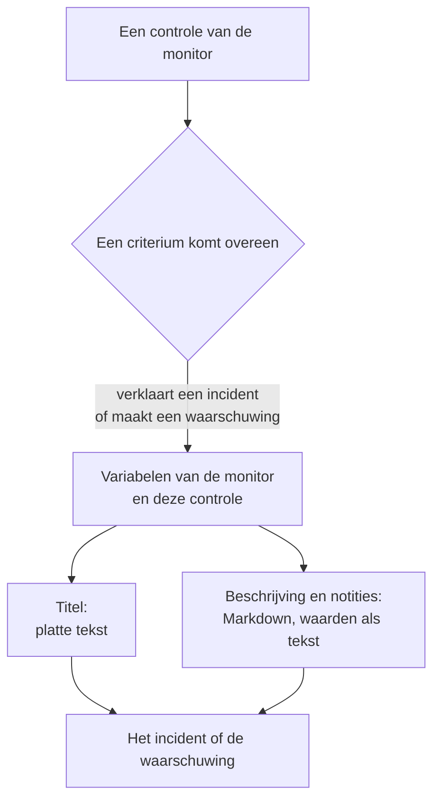

# Incident- en waarschuwingstemplates

Wanneer de criteria van een monitor een incident verklaren of een waarschuwing aanmaken, vullen ze de titel, de beschrijving en de herstelnotities in vanuit een template dat je zelf schrijft. Zet er placeholders `{{variable}}` in, zoals `{{monitorName}}` of `{{responseStatusCode}}`, en elk incident zegt wat er misging, met de waarden van de controle die het opende.

:::cards
- [Waar je een template schrijft](#waar-je-een-template-schrijft): De titel, de beschrijving en de herstelnotities van het incident of de waarschuwing van een criterium.
- [Basisgebruik](#basisgebruik): Placeholders, paden in objecten, en lijsten.
- [Variabelen van elke monitor](#variabelen-van-elke-monitor): De naam van de monitor, en de resource die de drempel overschreed.
- [Variabelen per monitortype](#variabelen-per-monitortype): Wat elk soort controle rapporteert.
:::

## Hoe templates werken

Een template wordt één keer ingevuld, wanneer het criterium het incident of de waarschuwing aanmaakt. OneUptime verzamelt de variabelen van de monitor en van de controle die overeenkwam, zet elke waarde op de plek van haar placeholder en slaat het resultaat op. Het template later wijzigen verandert de incidenten en waarschuwingen die daarna worden aangemaakt, niet de al geopende.



- **De titel is platte tekst.** Waar hij ook wordt getoond, hij leest precies zoals het template hem opleverde.
- **De beschrijving en de herstelnotities zijn Markdown.** De Markdown die je schrijft wordt weergegeven, en elke waarde die het gemonitorde systeem stuurde wordt als tekst geplaatst, zodat niets erin een link, een afbeelding of een vermelding kan toevoegen. Zie [Waarden in beschrijvingen en herstelnotities](#waarden-in-beschrijvingen-en-herstelnotities).
- **Een gegroepeerde monitor vult elk incident in voor zijn eigen reeks.** Een monitor die per host, pod of apparaat één incident opent, vult elk template met de waarden van die reeks, en voegt de naam van de reeks aan de titel toe als je template die nog niet noemt.

## Waar je een template schrijft

:::steps
### De criteria van de monitor openen

Ga naar **Monitoren**, open de monitor en klik in het zijmenu op **Criteria**. Klik op **Bewakingscriteria bewerken**.

### Het incident of de waarschuwing inschakelen

Schakel in een criterium onder **Acties** **Wanneer filters overeenkomen, verklaar een incident.** of **Wanneer filters overeenkomen, maak een waarschuwing aan.** in. Het formulier van het incident of de waarschuwing opent daaronder.

### De titel schrijven

Typ de titel in **Incidenttitel** of **Waarschuwingstitel**, bijvoorbeeld `{{monitorName}} is down`. **Learn about dynamic templates**, ernaast, opent **Dynamic Template Variables**: elke variabele die het type van deze monitor heeft, met wat ze bevat. Klik op een variabele om haar te kopiëren.

### De beschrijving en de herstelnotities schrijven

Open **Beschrijving** voor **Incidentbeschrijving** of **Waarschuwingsbeschrijving**, en **Meer velden** voor **Herstelnotities**. Deze editors bieden de variabelen zelf aan: **Sjabloonvariabelen** somt ze op onder de editor, **Variabele invoegen** in de werkbalk opent dezelfde lijst, en `{{` typen opent haar bij de cursor.

### De criteria opslaan

Klik op **Wijzigingen opslaan**. Het volgende incident of de volgende waarschuwing die dit criterium aanmaakt, gebruikt de nieuwe templates.
:::

## Basisgebruik

Een placeholder is de naam van een variabele tussen dubbele accolades. Wanneer het incident wordt aangemaakt, vervangt OneUptime hem door de waarde van de variabele, en laat de tekst eromheen zoals je hem schreef.

```text title="Title template"
{{monitorName}} returned {{responseStatusCode}} in {{responseTimeInMs}} ms
```

Als de monitor `Checkout API` heet, de statuscode van het antwoord `502` is en het antwoord `842` milliseconden duurde, krijgt het incident als titel:

```text title="Title as created"
Checkout API returned 502 in 842 ms
```

### Paden in objecten en lijsten

Een variabele die een object of een lijst bevat, lees je met een pad, net als in [JavaScript-expressies](/docs/monitor/javascript-expression):

| Schrijf | Om te lezen | Voorbeeld |
| --- | --- | --- |
| `{{object.field}}` | Een veld van een object, op elke diepte | `{{responseBody.error.message}}` |
| `{{list[0]}}` of `{{list.0}}` | Een item van een lijst, tellend vanaf 0 | `{{diskMetrics[0].usagePercent}}` |
| `{{list[last]}}` | Het laatste item van een lijst | `{{processes[last].name}}` |
| `{{object}}` | Het hele object of de hele lijst, als JSON | `{{responseBody}}` |

Een veldnaam mag een koppelteken bevatten, zoals in `{{responseHeaders.content-type}}`. Een negatieve index, zoals `[-1]`, leest niets: gebruik `[last]`.

### Als een waarde ontbreekt

Een placeholder waarvan het pad nergens heen leidt, blijft in de tekst staan zoals je hem schreef, accolades en al: als het antwoord geen veld `error` heeft, verschijnt `{{responseBody.error.id}}` zo in de titel. Hetzelfde geldt voor een variabele die deze controle niet rapporteerde, zoals `failureCause` bij een controle die niet mislukte. Een waarde die de controle als lege tekst rapporteerde, wordt door niets vervangen.

Om één template te schrijven dat werkt of de monitor nu gegroepeerd is of niet, gebruik je de variabelen van de [getroffen resource](#getroffen-resource): ze bestaan altijd en zijn leeg als de monitor niet gegroepeerd is.

### Waarden in beschrijvingen en herstelnotities

Een beschrijving en herstelnotities zijn Markdown: ze worden getoond op de pagina van het incident of de waarschuwing, in e-mail, en in de Slack- en Microsoft Teams-kanalen ervan. De waarden die een template erin zet, zijn wat het gemonitorde systeem stuurde - een body of header van een antwoord, een binnenkomend verzoek of e-mailbericht, de labels van een apparaat of een reeks -, dus elke waarde wordt als tekst geplaatst. Ze leest precies zoals ze werd verstuurd, waar het template haar ook zet, en een link, een afbeelding, een HTML-tag of een Slack-vermelding zoals `<!channel>` erin wordt als tekst getoond in plaats van iets te doen. Een los webadres in een waarde wordt wel een link, een die laat zien waar hij heen gaat. De Markdown die je in het template zelf schrijft, wordt weergegeven zoals je hem schreef.

Een waarde mag elke grootte hebben - een antwoordbody of een log van vele megabytes - en de melding gaat er toch mee uit. Elk kanaal draagt wat het aankan, en een beschrijving die er te lang voor is wordt afgekapt, bij een regeleinde als dat er is, en eindigt met "… (truncated — see OneUptime for the full text)":

- **E-mail**: elke beschrijving, notitie of hoofdoorzaak draagt tot ongeveer 256 KB van de tekst van de e-mail, en de notitie aan het eind van een langere verwijst naar het incident of de waarschuwing. Een hele e-mail - de tekst en de schermafbeeldingen - blijft onder 3 MB, wat elke mailserver en Microsoft Graph accepteren: een schermafbeelding die niet naast de tekst past, wordt weggelaten, met een notitie op haar plek.
- **De pagina van het incident of de waarschuwing** toont alles. Een beschrijving van meer dan 128 KB die lang zou duren om op te maken, wordt regel voor regel als platte tekst getoond.
- **Slack** draagt hoogstens wat Slack van een bericht toont (ongeveer 30.000 tekens). **Microsoft Teams** draagt ongeveer 40.000 tekens in een bericht van de OneUptime-app, en ongeveer 12.000 via een inkomende webhook (abonnees van statuspagina's, workflows) - gemeten wanneer het bericht wordt verstuurd, dus een tabel telt als de HTML die ze wordt.
- **Sms, telefoongesprekken, pushmeldingen, WhatsApp en Telegram** dragen wat hun providers aannemen: zie [Hoe de niveaus mensen oproepen](/docs/on-call/escalation-rules#hoe-de-niveaus-mensen-oproepen).

Elk kanaal geeft de tekst weer in een tijd die met de lengte groeit. Een deel dat een renderer veel langer zou kosten - een regel van meer dan 64 KB, een lange alinea met losse regels, een alinea vol `*`, `_` of `[` die nooit sluiten, citaten of lijsten die meer dan zestien niveaus diep genest zijn, en op de pagina van het incident of de waarschuwing een tabel of lijst van meer dan duizend regels - leest als platte tekst waar het staat, en de rest van de beschrijving wordt gewoon weergegeven.

## Geavanceerd gebruik

### Een lijst doorlopen

`{{#each path}}` herhaalt de tekst tot `{{/each}}` één keer voor elk item van de lijst op `path`:

```text title="Loop syntax"
{{#each arrayPath}}
  ...text with {{field}} placeholders for each item...
{{/each}}
```

Binnen de lus:

- `{{field}}` en `{{field.nested}}` lezen het huidige item. Een naam die het item niet heeft, wordt opgezocht in het omsluitende item, daarna in de variabelen van het hele template.
- `{{@index}}` is de positie van het item, tellend vanaf 0.
- `{{this}}` is het item zelf, voor een lijst met eenvoudige waarden zoals strings.
- Een lus over een pad dat geen lijst is, of over een lege lijst, schrijft niets.
- Lussen kunnen genest worden: een `{{#each}}` binnen een andere leest de binnenste lijst van elk buitenste item.

Bijvoorbeeld een [Inkomende-verzoek-monitor](/docs/monitor/incoming-request-monitor) die deze waarschuwingsmelding ontvangt:

```json title="Request body"
{
  "receiver": "payments",
  "alerts": [
    { "status": "firing", "labels": { "alertname": "HighLatency" } },
    { "status": "resolved", "labels": { "alertname": "DiskFull" } }
  ]
}
```

en dit beschrijvingstemplate heeft:

```text title="Description template"
Alerts for {{requestBody.receiver}}:
{{#each requestBody.alerts}}
- {{@index}}: {{labels.alertname}} ({{status}})
{{/each}}
```

maakt een incident aan waarvan de beschrijving er als volgt uitziet. Elk item behoudt de regeleinden eromheen, dus een lege regel scheidt de items, en de beschrijving toont nog steeds één lijst:

```text title="Description as created"
Alerts for payments:

- 0: HighLatency (firing)

- 1: DiskFull (resolved)
```

### Waarden van een gegroepeerde monitor

Een monitor op basis van metrieken met attributen in **Group by** opent één incident per reeks, en de waarde van elk attribuut is een variabele onder de naam van het attribuut. Groeperen op `host.name` geeft `{{host.name}}`, en groeperen op `resource.k8s.pod.name` geeft `{{resource.k8s.pod.name}}`. `{{seriesLabels}}` bevat ze allemaal, als een object.

Een gegroepeerde [Logs-monitor](/docs/monitor/logs-monitor) werkt op dezelfde manier: de waarde van elk groeperingsattribuut is een variabele onder zijn sleutel.

## Variabelen van elke monitor

### Monitor

| Variabele | Wat ze bevat | Voorbeeld |
| --- | --- | --- |
| `monitorName` | De naam van de monitor. | `Checkout API` |
| `monitorId` | De ID van de monitor. | `a0f78958-da0a-4775-9fd9-c9fc63d3456f` |
| `monitorType` | Het type van de monitor. | `Website`, `Synthetic Monitor` |

### Getroffen resource

Deze variabelen beschrijven de reeks waarvoor een gegroepeerde monitor het incident opende: een pod, een container, een host, een schijf. Ze zijn leeg voor een monitor die niet gegroepeerd is, dus een template kan ze op elke monitor gebruiken.

| Variabele | Wat ze bevat |
| --- | --- |
| `seriesResourceSuffix` | De identiteit van de reeks, beginnend met een scheidingsteken, om aan het eind van een titel te zetten. |
| `seriesResourceSummary` | Dezelfde identiteit zonder het scheidingsteken, om in een zin te zetten. |
| `seriesResourceBlock` | Elk label van de reeks, als een Markdown-lijst. Het best in een beschrijving. |
| `seriesDebugCommands` | Alleen-lezen-commando's voor precies deze resource, zoals `kubectl` of `docker`, als een Markdown-lijst. |

## Variabelen per monitortype

### Website- en API-monitoren

| Variabele | Wat ze bevat | Type |
| --- | --- | --- |
| `responseBody` | De body van het antwoord: een object als het JSON is, anders de tekst. | `JSON` of `string` |
| `responseHeaders` | De headers van het antwoord, op naam in kleine letters. | `Dictionary<string>` |
| `responseStatusCode` | De HTTP-statuscode. | `number` |
| `responseTimeInMs` | De responstijd, in milliseconden. | `number` |
| `isOnline` | Of de monitor het antwoord als online beschouwde. | `boolean` |

### Inkomende-verzoek-monitoren

| Variabele | Wat ze bevat | Type |
| --- | --- | --- |
| `requestBody` | De body van het verzoek: een object als het JSON is. | `JSON` of `string` |
| `requestHeaders` | De headers van het verzoek, op naam in kleine letters. | `Dictionary<string>` |
| `requestMethod` | De HTTP-methode, zoals `POST`. | `string` |
| `incomingRequestReceivedAt` | Wanneer het verzoek werd ontvangen, als ISO 8601-tijdstempel. | `string` |

Als bij het criterium **Group incidents and alerts by a payload field** is ingeschakeld, is de groeperingssleutel ook een variabele, genoemd naar het **laatste segment** van het groeperingspad: groeperen op `requestBody.alerts[*].labels.alertname` geeft `{{alertname}}`, en groeperen op `requestBody.alerts[*].fingerprint` geeft `{{fingerprint}}`. De hele `requestBody` staat er nog steeds naast.

> [!NOTE]
> `[*]` werkt alleen in de velden van het groeperingspad. In een template leest het niets, dus blijft de placeholder staan zoals hij geschreven is. `{{requestBody.alerts[0].annotations.summary}}` leest altijd de eerste waarschuwing van de payload, niet die waarvoor het incident werd geopend: gebruik de groeperingsvariabele en de gedeelde velden van de payload, zoals `commonLabels` en `commonAnnotations`. Zie [Inkomende-verzoek-monitor](/docs/monitor/incoming-request-monitor).

### Inkomende-e-mail-monitoren

| Variabele | Wat ze bevat | Type |
| --- | --- | --- |
| `emailSubject` | Het onderwerp van de e-mail. | `string` |
| `emailFrom` | Het e-mailadres van de afzender. | `string` |
| `emailTo` | Aan wie de e-mail werd gestuurd, met het eigen adres van de monitor gemaskeerd. | `string` |
| `emailBody` | De body van de e-mail in platte tekst. | `string` |
| `emailReceivedAt` | Wanneer de e-mail werd ontvangen, als ISO 8601-tijdstempel in UTC. | `string` |

In een titel wordt elk ervan afgekapt tot één regel van hoogstens 150 tekens. Beschrijvingen en herstelnotities krijgen de volledige waarde. Zie [Inkomende-e-mail-monitor](/docs/monitor/incoming-email-monitor#sjabloonvariabelen).

### Ping-, IP- en poortmonitoren

| Variabele | Wat ze bevat | Type |
| --- | --- | --- |
| `isOnline` | Of het doel antwoordde. | `boolean` |
| `responseTimeInMs` | De responstijd, in milliseconden. Voor een poort de DNS-lookup en de TCP-verbinding samen. | `number` |
| `failureCause` | Waarom de controle mislukte, als dat zo was. | `string` |
| `isTimeout` | Of de controle een time-out kreeg. | `boolean` |

### NTP-monitoren

| Variabele | Wat ze bevat | Type |
| --- | --- | --- |
| `isOnline` | Of de tijdserver antwoordde op het verzoek van de probe. | `boolean` |
| `isSynchronized` | Of hij antwoordde met stratum 1 tot 15, zonder het leap-alarm en met echte tijdstempels. | `boolean` |
| `stratum` | Het stratum dat de server rapporteerde: 1 voor een primaire server, 16 als hij niet gesynchroniseerd is, 0 voor een kiss-o'-death. | `number` |
| `clockOffsetInMs` | Hoe ver de klok van de server afwijkt van die van de probe, in milliseconden. Positief betekent dat de server voorloopt. | `number` |
| `referenceId` | Waarmee de server synchroniseert: een bron zoals `GPS` op stratum 1, of het adres van zijn upstream-server. | `string` |
| `leapIndicator` | 0 tot 2 als alles in orde is, 3 als de server zegt dat zijn klok niet gesynchroniseerd is. | `number` |
| `kissCode` | Bij stratum 0 de code van vier letters die de server stuurde in plaats van de tijd, zoals `RATE`. | `string` |
| `responseTimeInMs` | De tijd van het verzoek tot het antwoord, in milliseconden. | `number` |
| `roundTripDelayInMs` | De netwerkrondreis van de uitwisseling, zonder de eigen verwerkingstijd van de server. | `number` |
| `rootDelayInMs` | De rondreis van de server naar zijn referentieklok, in milliseconden. | `number` |
| `rootDispersionInMs` | De eigen schatting van de server van zijn maximale fout, in milliseconden. | `number` |
| `serverTime` | De klok van de server toen hij het antwoord stuurde, als ISO 8601-tijdstempel. | `string` |
| `referenceTime` | Wanneer de klok van de server voor het laatst werd ingesteld of gecorrigeerd, als ISO 8601-tijdstempel. | `string` |
| `serverAddress` | Het adres waar het verzoek heen ging. | `string` |
| `port` | De UDP-poort waar het verzoek heen ging. | `number` |
| `failureCause` | Waarom de server niet antwoordde, of waarom hij niet gesynchroniseerd is. | `string` |
| `isTimeout` | Of de server niet op tijd antwoordde. | `boolean` |

### SSL-certificaatmonitoren

| Variabele | Wat ze bevat | Type |
| --- | --- | --- |
| `isOnline` | Of de certificaatcontrole slaagde. | `boolean` |
| `isSelfSigned` | Of het certificaat zelfondertekend is. | `boolean` |
| `createdAt` | Wanneer het certificaat werd uitgegeven, als ISO 8601-tijdstempel. | `string` |
| `expiresAt` | Wanneer het certificaat verloopt, als ISO 8601-tijdstempel. | `string` |
| `commonName` | De common name (CN) van het certificaat. | `string` |
| `organizationalUnit` | De organisatie-eenheid (OU). | `string` |
| `organization` | De organisatie (O). | `string` |
| `locality` | De plaats (L). | `string` |
| `state` | De staat of provincie (ST). | `string` |
| `country` | Het land (C). | `string` |
| `serialNumber` | Het serienummer. | `string` |
| `fingerprint` | De SHA-1-vingerafdruk. | `string` |
| `fingerprint256` | De SHA-256-vingerafdruk. | `string` |
| `failureCause` | Waarom de controle mislukte, als dat zo was. | `string` |

### DNS-monitoren

| Variabele | Wat ze bevat | Type |
| --- | --- | --- |
| `isOnline` | Of de query werd beantwoord. | `boolean` |
| `responseTimeInMs` | De querytijd, in milliseconden. | `number` |
| `isTimeout` | Of de query een time-out kreeg. | `boolean` |
| `isDnssecValid` | Het resultaat van de DNSSEC-validatie. | `boolean` |
| `records` | De teruggegeven records, elk als `{type, value, ttl}`. | `Array<Object>` |
| `recordValues` | Alleen de waarden van de records. | `Array<string>` |
| `failureCause` | Waarom de query mislukte, als dat zo was. | `string` |

### DNSSEC-monitoren

| Variabele | Wat ze bevat | Type |
| --- | --- | --- |
| `isOnline` | Of de controle werd voltooid. | `boolean` |
| `domainName` | De gecontroleerde zone. | `string` |
| `isZoneSigned` | Of de zone DNSKEY-records heeft. | `boolean` |
| `isParentDsPresent` | Of de bovenliggende zone DS-records voor haar heeft. | `boolean` |
| `isChainValid` | Of de vertrouwensketen valideert. | `boolean` |
| `resolverConsensusAd` | Of elke resolver de AD-vlag teruggaf. | `boolean` |
| `isNameserverConsistent` | Of elke gezaghebbende nameserver hetzelfde SOA-serienummer teruggaf. | `boolean` |
| `earliestSignatureExpiration` | Wanneer de eerste RRSIG-handtekening verloopt, als ISO 8601-tijdstempel. | `string` |
| `daysUntilSignatureExpiry` | Het aantal dagen tot die handtekening verloopt. | `number` |
| `dnskeyCount` | Het aantal DNSKEY-records. | `number` |
| `dsRecordCount` | Het aantal DS-records bij de bovenliggende zone. | `number` |
| `rrsigCount` | Het aantal geziene RRSIG-records. | `number` |
| `responseTimeInMs` | Hoe lang de controle duurde, in milliseconden. | `number` |
| `failureCause` | Waarom de controle mislukte, als dat zo was. | `string` |

### Domeinmonitoren

| Variabele | Wat ze bevat | Type |
| --- | --- | --- |
| `isOnline` | Of het opzoeken van de registratie slaagde. | `boolean` |
| `domainName` | Het opgezochte domein. | `string` |
| `lookupMethod` | Het protocol dat antwoordde: RDAP of WHOIS. | `string` |
| `registrar` | De registrar. | `string` |
| `createdDate` | Wanneer het domein werd geregistreerd. | `string` |
| `updatedDate` | Wanneer de registratie voor het laatst wijzigde. | `string` |
| `expiresDate` | Wanneer de registratie verloopt. | `string` |
| `nameServers` | De nameservers van het domein. | `Array<string>` |
| `domainStatus` | De statuscodes van het register, zoals `clientTransferProhibited`. | `Array<string>` |
| `dnssec` | De DNSSEC-status van het register. | `string` |
| `responseTimeInMs` | Hoe lang het opzoeken duurde, in milliseconden. | `number` |
| `failureCause` | Waarom het opzoeken mislukte, als dat zo was. | `string` |

### Server- / VM-monitoren

| Variabele | Wat ze bevat | Type |
| --- | --- | --- |
| `hostname` | De hostnaam van de server. | `string` |
| `requestReceivedAt` | Wanneer het rapport van de server werd ontvangen, als ISO 8601-tijdstempel. | `string` |
| `cpuUsagePercent` | Gebruikte CPU, van 0 tot 100. | `number` |
| `cpuCores` | Het aantal CPU-cores. | `number` |
| `memoryUsagePercent` | Gebruikt geheugen, van 0 tot 100. | `number` |
| `memoryFreePercent` | Vrij geheugen, van 0 tot 100. | `number` |
| `memoryTotalBytes` | Totaal geheugen, in bytes. | `number` |
| `diskMetrics` | Eén item per gekoppelde schijf. | `Array<Object>` |
| `diskMetrics[].diskPath` | Het koppelpunt van de schijf. | `string` |
| `diskMetrics[].usagePercent` | Gebruikte ruimte op de schijf, van 0 tot 100. | `number` |
| `diskMetrics[].freePercent` | Vrije ruimte op de schijf, van 0 tot 100. | `number` |
| `diskMetrics[].totalBytes` | De grootte van de schijf, in bytes. | `number` |
| `processes` | De draaiende processen die de agent rapporteerde. | `Array<Object>` |
| `processes[].pid` | De proces-ID. | `number` |
| `processes[].name` | De procesnaam. | `string` |
| `processes[].command` | Het commando waarmee het proces werd gestart. | `string` |
| `failureCause` | Waarom de controle mislukte, als dat zo was. | `string` |

### Synthetische monitors

Een synthetische monitor voert zijn script één keer uit voor elke browser en schermgrootte die hij moet gebruiken, zoals Chromium op een desktopscherm en Firefox op een mobiel scherm. `syntheticResponses` bevat één item per uitvoering: lees één uitvoering op haar positie, zoals in `{{syntheticResponses[0].browserType}}`, of elke uitvoering met `{{#each syntheticResponses}}`.

| Variabele | Wat ze bevat | Type |
| --- | --- | --- |
| `failureCause` | Waarom de controle mislukte, als dat zo was. | `string` |
| `syntheticResponses` | Eén item per browser en schermgrootte waarop het script draaide. | `Array<Object>` |
| `syntheticResponses[].executionTimeInMs` | Hoe lang de uitvoering duurde, in milliseconden. | `number` |
| `syntheticResponses[].result` | Wat het script teruggaf. | `string`, `number`, `boolean` of `JSON` |
| `syntheticResponses[].scriptError` | De fout waarmee de uitvoering eindigde, als die er was. | `string` |
| `syntheticResponses[].logMessages` | Wat de uitvoering logde. | `Array<string>` |
| `syntheticResponses[].screenshots` | De schermafbeeldingen die de uitvoering maakte, op naam, elk als base64-tekst. Zie [Een schermafbeelding tonen](#een-schermafbeelding-tonen). | `Object` |
| `syntheticResponses[].browserType` | De browser van de uitvoering. | `string` |
| `syntheticResponses[].screenSizeType` | De schermgrootte van de uitvoering. | `string` |

#### Een schermafbeelding tonen

Elk item van `screenshots` is een schermafbeelding die het script maakte, onder de naam die het script haar gaf (`screenshots["login-page"] = await page.screenshot()`), als base64-tekst. Om er een te tonen in de beschrijving of de herstelnotities van een incident of waarschuwing, schrijf je er een afbeelding omheen:

```text title="Description template"
{{syntheticResponses[0].scriptError}}


```

De schermafbeelding verschijnt dan op de pagina van het incident of de waarschuwing, op de statuspagina's die het incident tonen, in de e-mailmeldingen erover, en in de Slack- en Microsoft Teams-berichten erover. In een e-mail wordt ze bijgevoegd en in de body getoond, wat Gmail, Outlook en Apple Mail allemaal weergeven, zodat wie dienst heeft kan zien hoe de pagina eruitzag zonder OneUptime te openen.

- PNG-, JPEG-, GIF- en WebP-schermafbeeldingen worden getoond. `image/png` werkt ook voor een JPEG-schermafbeelding (`page.screenshot({ type: "jpeg" })`).
- Eén e-mail draagt hoogstens 2 MB aan afbeeldingen, en hoogstens 20. Een afbeelding die niet past, wordt vervangen door een notitie met haar alt-tekst, dus geef elke afbeelding een alt-tekst. Een JPEG-schermafbeelding is veel kleiner dan een PNG, en één schermafbeelding van de mislukte uitvoering zegt meestal meer dan alle schermafbeeldingen van alle uitvoeringen.
- In Slack en Microsoft Teams wordt de schermafbeelding getoond waar de beschrijving haar zet: een afbeelding op een eigen regel neemt de plaats van die regel in, en een afbeelding midden in een zin, een lijst of een tabel laat daar haar alt-tekst achter en wordt erna getoond. Slack toont PNG-, JPEG- en GIF-schermafbeeldingen, hoogstens 10 en 10 MB per bericht; de OneUptime-app uploadt elke afbeelding privé naar je Slack-werkruimte en toont haar in het bericht. Teams toont PNG-, JPEG- en GIF-schermafbeeldingen van elk tot 1 MB in de kaart van het bericht, hoogstens 10 en 2 MB per bericht.
- Uploaden naar Slack vereist de machtiging `files:write` van de app. Als je werkruimte Slack koppelde voordat OneUptime erom vroeg, koppel Slack dan opnieuw in **Projectinstellingen → Werkruimte → Slack** (voeg op een zelfgehoste server eerst de machtiging toe aan je Slack-app - zie [Slack-integratie](/docs/self-hosted/slack-integration#afbeeldingen-in-berichten)).
- Een schermafbeelding die een chat niet kan tonen - een WebP, een boven die limieten, een die Slack of Teams weigert, of elke schermafbeelding in een bericht dat via een inkomende webhook wordt verstuurd - wordt getoond als haar alt-tekst, of "[image]" als ze er geen heeft, dus geef elke afbeelding een alt-tekst. De base64 van de afbeelding bereikt de chat nooit.
- Alleen een afbeelding die je in het template schrijft, wordt getoond. Een afbeelding in een waarde die de gemonitorde pagina of het script rapporteerde - een foutmelding, een logregel - wordt nog steeds als tekst getoond (zie [Waarden in beschrijvingen en herstelnotities](#waarden-in-beschrijvingen-en-herstelnotities)).
- OneUptime AI leest de tekst rond een schermafbeelding, niet de schermafbeelding. Wat een onderzoek, een opgestelde postmortem of notitie, de AI-stap van een runbook of de AI-stap van een workflow aan het model geeft, heeft een korte notitie op de plek van de afbeelding, zoals `[image omitted: PNG, 340 KB]`: een model leest tekst, geen afbeeldingen, en de base64 van een schermafbeelding zou bij elke aanroep honderdduizenden tokens zijn. De activiteit van het onderzoek zegt wat er werd weggelaten.

Om de schermafbeelding van elke mislukte uitvoering te tonen, zet je de afbeelding in een lus. Hier slaat het script elke schermafbeelding op als `screenshots["failure"]`:

```text title="Description template"
### What the page looked like
{{#each syntheticResponses}}
**{{browserType}} / {{screenSizeType}}**: {{scriptError}}


{{/each}}
```

### Aangepaste JavaScript-codemonitoren

| Variabele | Wat ze bevat | Type |
| --- | --- | --- |
| `result` | Wat het script teruggaf. Lees een veld met een pad, zoals in `{{result.status}}`. | `string`, `number`, `boolean` of `JSON` |
| `executionTimeInMs` | Hoe lang het script draaide, in milliseconden. | `number` |
| `scriptError` | De fout waarmee het script eindigde, als die er was. | `string` |
| `logMessages` | Wat het script logde met `console.log`. | `Array<string>` |
| `failureCause` | Waarom de controle mislukte, als dat zo was. | `string` |

### Netwerkapparaatmonitoren

| Variabele | Wat ze bevat | Type |
| --- | --- | --- |
| `isOnline` | Of het apparaat bereikbaar is, via ping **of** SNMP. Bij elke poll ingesteld. | `boolean` |
| `responseTimeInMs` | De responstijd van de SNMP-**walk**, in milliseconden. Nooit de rondreis van de ping. | `number` |
| `failureCause` | Waarom de SNMP-walk mislukte, als dat zo was. | `string` |
| `isTimeout` | Of de SNMP-walk een time-out kreeg. | `boolean` |
| `oidResponses` | De opgevraagde OID's, elk als `{oid, name, value, type}`. | `Array<Object>` |
| `{{OID_NAME}}` | De waarde van een OID met naam, op die naam, zoals in `{{sysUpTime}}`. | `string` of `number` |
| `sysName` | De naam van het apparaat, uit de SNMP-systeemgroep. | `string` |
| `sysDescr` | De beschrijving van het apparaat, uit de SNMP-systeemgroep. | `string` |
| `sysObjectId` | De geregistreerde enterprise-OID van de leverancier: de vingerafdruk van het apparaat. | `string` |
| `sysLocation` | De locatie van het apparaat, uit de SNMP-systeemgroep. | `string` |
| `downInterfaces` | Interfaces die administratief up zijn maar operationeel down, elk als `{name, alias, interfaceIndex}`. Vereist interfacemonitoring. | `Array<Object>` |
| `interfacesTotal` | Het aantal doorlopen interfaces. | `number` |
| `interfacesUp` | Interfaces die administratief en operationeel up zijn. | `number` |
| `interfacesDown` | Interfaces die administratief up zijn maar operationeel down. | `number` |
| `interfaceWalkFailure` | De fout, als de interface-walk mislukte. | `string` |
| `tables` | De SNMP-tabellen van het apparaat, op sleutel: `rowCount`, `rows`, `unhealthyRowCount` en `unhealthyRows` van elke tabel, zoals in `{{tables.ipsec_tunnels.unhealthyRowCount}}`. | `Object` |
| `snmpTable` | De SNMP-tabel waar een waarschuwing per rij over gaat. | `string` |
| `snmpTableRow` | De rij waar een waarschuwing per rij over gaat: een tunnel, een radio, een buur. | `string` |
| `trapOid` | De OID van de trap. Alleen als een SNMP-trap de controle startte. | `string` |
| `trapSourceIp` | Het adres waar de trap vandaan kwam. Alleen als een SNMP-trap de controle startte. | `string` |
| `trapVarbinds` | De varbinds van de trap, elk als `{oid, value}`. Alleen als een SNMP-trap de controle startte. | `Array<Object>` |

Een netwerkapparaat wordt bij elke poll gepingd en alleen via SNMP doorlopen als het inloggegevens heeft, dus **`isOnline` is de enige variabele hierboven die een apparaat met alleen ping invult**: alle andere komen uit de SNMP-walk en blijven zonder die walk staan zoals ze geschreven zijn. Begin met `{{isOnline}}` en de naam van het apparaat in templates die mogelijk worden gebruikt voor apparaten zonder inloggegevens. Zie [Netwerkapparaat-monitor](/docs/monitor/network-device-monitor#what-a-poll-actually-does) voor wat elk soort poll verzamelt.

### Databasegezondheidsmonitoren

| Variabele | Wat ze bevat | Type |
| --- | --- | --- |
| `isOnline` | Of de probe verbinding kon maken en de basisquery kon uitvoeren. Ontbrekende metrieken maken dit nooit onwaar. | `boolean` |
| `responseTimeInMs` | De tijd om verbinding te maken en de basisquery uit te voeren, in milliseconden. | `number` |
| `failureCause` | Waarom de controle mislukte, als dat zo was. | `string` |
| `connectionError` | De verbindingsfout, zonder inloggegevens of de verbindingsstring. | `string` |
| `engineVersion` | De versie die de databaseserver rapporteerde. | `string` |
| `collectedGroups` | De metriekgroepen die bij deze controle waarden opleverden. | `Array<string>` |
| `unavailableGroups` | De groepen die niet verzameld konden worden, elk als `{group, reason, message, remediation}`. | `Array<Object>` |
| `collectionIssueSummary` | Eén regel over elke niet-beschikbare groep, klaar voor een titel. Leeg als alles werd verzameld. | `string` |
| `metrics` | De verzamelde waarden, op reeksnaam. | `Object` |

De reeksnamen in `metrics` bevatten punten, zoals `oneuptime.monitor.database.connections.used.percent`, en een pad leest elke punt als een stap in een object, dus een template kan geen enkele waarde uit `metrics` halen. Zet `{{metrics}}` in zijn geheel, als JSON, of gebruik `{{collectionIssueSummary}}`. Een metriek die niet werd verzameld ontbreekt in `metrics`; ze is geen nul. Om op één waarde te handelen, vergelijk je haar in het criterium met een [JavaScript-expressie](/docs/monitor/javascript-expression).

### Monitoren van externe statuspagina's

| Variabele | Wat ze bevat | Type |
| --- | --- | --- |
| `overallStatus` | De algemene status van de statuspagina, zoals `major_outage`. | `string` |
| `activeIncidentCount` | Het aantal openstaande incidenten op de statuspagina. | `number` |
| `componentStatuses` | De componenten ervan, elk als `{name, status, description, groupName}`. | `Array<Object>` |
| `provider` | Het soort statuspagina: Atlassian Statuspage, incident.io, RSS of Atom. | `string` |
| `componentGroup` | De componentgroep die de monitor in de gaten houdt, als hij er een volgt. | `string` |
| `componentName` | Het component dat de monitor in de gaten houdt, als hij er een volgt. | `string` |
| `isOnline` | Of de statuspagina antwoordde. | `boolean` |
| `responseTimeInMs` | Hoe lang de statuspagina over het antwoord deed, in milliseconden. | `number` |
| `failureCause` | Waarom de controle mislukte, als dat zo was. | `string` |

### Metriek- en infrastructuurmonitoren

Metrics-, Kubernetes-, Docker-, Host-, Podman-, Docker Swarm-, Proxmox-, VMware-, Ceph-, Storage Array- en IoT Device-monitoren hebben één eigen variabele:

| Variabele | Wat ze bevat | Type |
| --- | --- | --- |
| `metricName` | De naam van de metriek die de eerste query van de monitor leest, zoals `container.cpu.time`. | `string` |

Gegroepeerd hebben ze ook de waarde van elk attribuut in **Group by**, en `seriesLabels`: zie [Waarden van een gegroepeerde monitor](#waarden-van-een-gegroepeerde-monitor). De templates van de IoT Device-monitor groeperen per apparaat, dus een monitor die met een ervan is gemaakt, heeft ook `{{device.id}}`.

### Andere monitortypen

Logs-, Traces-, Exceptions-, Security Events-, AI / LLM- en SQL Query-monitoren hebben geen eigen variabelen. Gebruik de [variabelen van elke monitor](#variabelen-van-elke-monitor), en op een gegroepeerde Logs-monitor de [groepswaarden](#waarden-van-een-gegroepeerde-monitor).

## Voorbeelden

### Een trage API

```text title="Title"
{{monitorName}} is slow: {{responseTimeInMs}} ms
```

```text title="Description"
### API error
Status: **{{responseStatusCode}}**
Latency: **{{responseTimeInMs}} ms**
Message: `{{responseBody.error.message}}`
```

### Een certificaat dat bijna verloopt

```text title="Title"
Certificate for {{commonName}} expires {{expiresAt}}
```

### Een server die zonder ruimte komt

```text title="Description"
### {{hostname}}
CPU: **{{cpuUsagePercent}}%**
Memory: **{{memoryUsagePercent}}%**

**Disks:**
{{#each diskMetrics}}
- {{diskPath}}: {{usagePercent}}% used ({{freePercent}}% free)
{{/each}}

**Processes:**
{{#each processes}}
- [{{pid}}] {{name}}: {{command}}
{{/each}}
```

### Een mislukte ping-, IP- of poortcontrole

```text title="Description"
{{monitorName}} could not be reached: {{failureCause}}
Timed out: {{isTimeout}}
Response time: {{responseTimeInMs}} ms
```

### Elke uitvoering van een synthetische monitor

```text title="Description"
### Synthetic monitor results
{{#each syntheticResponses}}
- **{{browserType}} / {{screenSizeType}}**: {{result}} in {{executionTimeInMs}} ms
  - Script error: {{scriptError}}
  - First log line: {{logMessages[0]}}
{{/each}}
```

### Een controle met aangepaste code

```text title="Description"
The script ran for {{executionTimeInMs}} ms and returned {{result}}.
Last log line: {{logMessages[last]}}
```

### Een netwerkapparaat

Deze gaan ervan uit dat het apparaat SNMP-inloggegevens heeft: op een apparaat met alleen ping blijft alles behalve `{{isOnline}}` staan zoals het geschreven is.

```text title="Title"
{{sysName}}: {{interfacesDown}} interfaces down
```

```text title="Description"
### {{sysName}} ({{sysLocation}})
Online: {{isOnline}}
SNMP walk: {{responseTimeInMs}} ms

{{#each downInterfaces}}
- {{name}} ({{alias}}) is down
{{/each}}
```

### Waarschuwingen van Alertmanager of Grafana

```text title="Title"
[{{requestBody.status}}] {{requestBody.receiver}}
```

```text title="Description"
### Alerts from {{requestBody.receiver}}
{{#each requestBody.alerts}}
**Alert {{@index}}**: {{labels.alertname}}
- Status: {{status}}
- Summary: {{annotations.summary}}
- Source: {{generatorURL}}
{{/each}}
```

## Problemen oplossen

:::details De titel toont de placeholder, accolades en al
Het pad leidt in deze controle niet naar een waarde. Controleer de naam van de variabele en de hoofdletters aan de hand van de tabellen hierboven, of open **Learn about dynamic templates** in het criterium: dat somt de variabelen van het type van deze monitor op. Een pad in de body van een antwoord of een verzoek moet overeenkomen met de body zoals die werd verstuurd, en `[*]` en negatieve indexen zoals `[-1]` lezen niets: gebruik `[0]` of `[last]`.
:::

:::details Een waarde wordt als JSON getoond
Het pad stopt bij een object of een lijst, dus wordt het geheel als JSON geplaatst. Voeg het veld dat je wilt aan het pad toe, zoals in `{{responseBody.error.message}}`, of doorloop een lijst met `{{#each}}`.
:::

:::details Een lus schrijft niets
Het pad na `#each` is in deze controle geen lijst, of de lijst is leeg. Controleer het pad aan de hand van de payload, en of elke `{{#each}}` zijn `{{/each}}` heeft.
:::

:::details Markdown in een waarde wordt als tekst getoond
Dat is met opzet: een waarde die het gemonitorde systeem stuurde, wordt als tekst geplaatst, zodat ze nooit een link, een afbeelding of een vermelding aan de beschrijving kan toevoegen. Schrijf de opmaak in plaats daarvan in het template, rond de waarde. Zie [Waarden in beschrijvingen en herstelnotities](#waarden-in-beschrijvingen-en-herstelnotities).
:::

:::details Een schermafbeelding verschijnt niet in Slack, Microsoft Teams of e-mail
Controleer het formaat en de grootte van de afbeelding aan de hand van [Een schermafbeelding tonen](#een-schermafbeelding-tonen). In Slack heeft de OneUptime-app de machtiging `files:write` nodig: koppel Slack opnieuw in **Projectinstellingen → Werkruimte → Slack** als je werkruimte het koppelde voordat OneUptime erom vroeg.
:::

## Volgende stappen

:::cards
- [JavaScript-expressies](/docs/monitor/javascript-expression): Dezelfde placeholders, in de voorwaarden van een criterium.
- [Een incident melden](/docs/incidents/declaring-incidents): Wat er gebeurt nadat een criterium er een verklaart.
- [Synthetische monitor](/docs/monitor/synthetic-monitor): Maak de schermafbeeldingen die een beschrijving kan tonen.
- [Inkomende-verzoek-monitor](/docs/monitor/incoming-request-monitor): Maak van webhooks incidenten die naar elke waarschuwing heten.
:::
