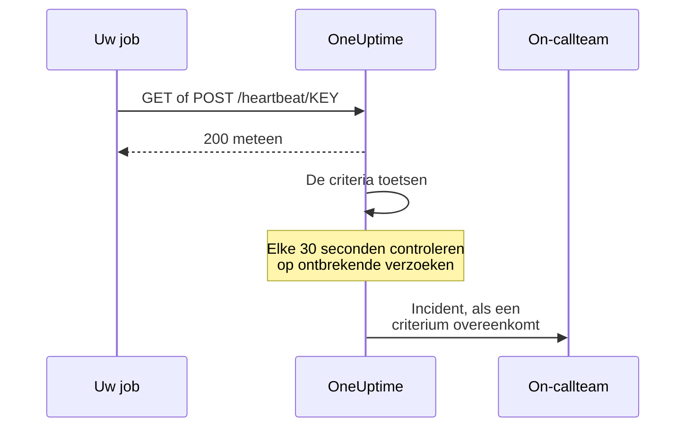

# Inkomende-verzoek-monitor

Een monitor voor inkomende verzoeken geeft u een URL waar andere systemen HTTP-verzoeken naartoe sturen. OneUptime toetst elk verzoek aan uw criteria en kan de status van de monitor wijzigen, incidenten verklaren en uw on-callrooster oproepen.

Hij dekt twee verschillende taken:

- **Heartbeat-bewaking** — een cronjob, een worker of een apparaat roept de URL volgens een schema aan, en OneUptime opent een incident als de aanroepen uitblijven.
- **Waarschuwingen uit een ander systeem ontvangen** — Prometheus Alertmanager, Grafana of alles wat JSON per POST kan versturen, stuurt waarschuwingen naar binnen, en OneUptime maakt van elke waarschuwing een incident met on-call-escalatie en automatisch oplossen bij herstel.

Beide gebruiken hetzelfde monitortype. Wat ze onderscheidt, zijn de criteria die u instelt.

:::cards
- [De monitor maken](#een-monitor-voor-inkomende-verzoeken-maken): Krijg in een paar stappen een heartbeat-URL.
- [Een heartbeat sturen](#een-heartbeat-sturen): Vanuit curl, cron, Node.js, Python of Go.
- [Waarschuwen als aanroepen uitblijven](#als-offline-markeren-als-er-10-minuten-geen-heartbeat-komt-een-dodemansknop): Maak van de monitor een dodemansknop.
- [Waarschuwingen ontvangen](#waarschuwingen-uit-een-ander-systeem-ontvangen): Eén incident per waarschuwing uit Alertmanager of Grafana.
- [Abonneren op SNS of Event Grid](#abonneren-op-amazon-sns-of-azure-event-grid): Bevestig het abonnement met één klik.
:::

## Zo werkt het

Niets controleert uw systeem van buitenaf: uw systeem roept de URL van de monitor aan, OneUptime antwoordt meteen en toetst het verzoek daarna aan de criteria van de monitor. Een criterium dat kijkt naar verzoeken die *zijn uitgebleven*, wordt bovendien elke 30 seconden op de achtergrond opnieuw getoetst, zodat ook stilte een incident kan openen.



Gebruik hem om:

- Cronjobs en geplande taken te bewaken
- Na te gaan of achtergrondworkers draaien
- Services achter firewalls te bewaken die van buitenaf niet bereikbaar zijn
- Waarschuwingen te ontvangen van Prometheus Alertmanager, Grafana en andere waarschuwingssystemen
- Heartbeat-signalen te volgen van elk systeem dat HTTP spreekt

## Een monitor voor inkomende verzoeken maken

:::steps
### Een nieuwe monitor beginnen

Ga naar **Monitoren** en klik op **Monitor maken**.

### Inkomende aanvraag kiezen

Kies onder **Monitortype** de optie **Inkomende aanvraag**: dat is een van de gangbare typen bovenaan. Voer een **Naam** in en klik op **Volgende**.

### De criteria nakijken

De stap **Criteria** begint met [de standaardcriteria](#wat-u-meteen-krijgt). Klik voor een heartbeat op **Criteria toevoegen** en geef het nieuwe criterium een filter **Inkomende aanvraag** / **Niet ontvangen in minuten** dat de status op offline zet en een incident verklaart, met **Incident automatisch oplossen** aan. Sleep het daarna bovenaan de lijst; zie [Voorbeeldcriteria](#voorbeeldcriteria) voor het waarom.

### De monitor maken

Klik op **Monitor maken**. De monitor opent op zijn pagina **Overzicht**, waar de kaart **Send the first heartbeat** de **Heartbeat URL** toont met een kopieerknop en een voorbeeldopdracht `curl`.

### Het eerste verzoek sturen

Stel uw service zo in dat hij verzoeken naar die URL stuurt (zie [Een heartbeat sturen](#een-heartbeat-sturen)). Zodra het eerste verzoek binnenkomt, maakt de kaart plaats voor de geschiedenis van de monitor, en toont een kaart **Heartbeat URL** de URL en wanneer het laatste verzoek binnenkwam.
:::

> [!NOTE]
> De URL bevat de geheime sleutel van de monitor, dus alleen mensen die monitoren mogen bewerken, kunnen hem zien. U vindt hem altijd terug op de pagina **Documentatie** van de monitor, in het onderdeel **Configuratie** van het zijmenu.

## De verzoek-URL

Uw monitor heeft een unieke URL in dit formaat:

```text
https://oneuptime.com/heartbeat/YOUR_SECRET_KEY
```

Vervang `https://oneuptime.com` door de URL van uw OneUptime-instantie als u zelf host.

Stuur **GET**- of **POST**-verzoeken naar deze URL. HEAD wordt geaccepteerd en als GET behandeld; PUT, PATCH en DELETE geven 404 terug. De geheime sleutel in het pad is het inloggegeven: er is geen header of token nodig, tenzij het project [bij elke aanvraag een geheim vereist](#bij-elke-aanvraag-een-geheim-vereisen). Querystrings worden genegeerd: stuur wat de criteria moeten lezen in de body of de headers.

> [!WARNING]
> Iedereen die deze URL kent, kan de monitor als gezond markeren, dus behandel hem als een geheim. Lekt hij uit, open dan de pagina **Instellingen** van de monitor en klik op **Geheime sleutel voor inkomende aanvraag opnieuw instellen**, en werk daarna elke afzender bij. Het overzicht van de monitor toont het laatste verzoek zoals de logs het bewaren: met geheimen en persoonsgegevens gemaskeerd, en zonder headers of body wanneer **Verzoekinhoud bewaren** uit staat. Het maskeren herkent de namen en patronen die het kent, dus stuur geen API-sleutels of tokens naar dit endpoint.

> [!IMPORTANT]
> OneUptime antwoordt meteen `200` met een leeg JSON-object (`{}`) en verwerkt het verzoek via een wachtrij. Dat antwoord wordt geschreven vóór elke controle, dus een `200` is **geen** bevestiging dat het verzoek is aanvaard: een verkeerde geheime sleutel, een verwijderde monitor en een uitgeschakelde monitor geven ook `200` terug. Controleer de tijdlijn van de monitor om te bevestigen dat de verzoeken aankomen. Een project dat bij elke aanvraag een geheim vereist, beantwoordt een verzoek zonder geheim met `401`, en een dienst die de URL controleert voordat hij iets aflevert, krijgt het antwoord dat hij verwacht: zie [Diensten die eerst de URL controleren](#diensten-die-eerst-de-url-controleren).

### Een verzoeklichaam sturen

Wilt u velden in de body aanspreken (`{{requestBody.status}}` in een incidenttitel, een JSON-pad bij het groeperen van incidenten of een criterium met een JavaScript-expressie), stuur dan `Content-Type: application/json`. Daar gaan deze pagina's overal van uit. De body moet een JSON-object of -array zijn: ongeldige JSON, of een losse waarde zoals `"error"`, wordt geweigerd met een `500`.

| Contenttype | Wat criteria en sjablonen zien |
| --- | --- |
| `application/json` | De geparste JSON. |
| `application/x-www-form-urlencoded` | Het geparste formulier. Sleutels tussen vierkante haken worden genest (`alerts[0][status]=firing`), en elke waarde is een tekenreeks. |
| `text/plain` | De geparste JSON, als de tekst een JSON-object of -array is: zo stuurt Amazon SNS zijn berichten. Elke andere tekst is de tekst zelf, dus `backup failed: error 42` zet de monitor met de standaardcriteria offline. |
| `application/cloudevents+json`, of een ander `+json`-type | De geparste JSON: zo levert Azure Event Grid CloudEvents af. |
| Alles anders, of geen | Een lege body (`{}`), dus geen enkele verwijzing naar `requestBody` wordt opgelost, en een sjabloon laat die letterlijk staan. |

Bodies tot 50 MB worden geaccepteerd; een grotere wordt geweigerd met een `413`. Comprimeer de body niet met `Content-Encoding: gzip`: dan wordt hij niet als JSON opgeslagen, en worden paden erin niet opgelost.

### Een heartbeat sturen

Elk voorbeeld stuurt één verzoek. Vervang `YOUR_SECRET_KEY` door de sleutel uit de URL van uw monitor.

:::tabs
@tab curl
```bash
# Simple GET request
curl https://oneuptime.com/heartbeat/YOUR_SECRET_KEY

# POST request with a JSON body
curl -X POST https://oneuptime.com/heartbeat/YOUR_SECRET_KEY \
  -H "Content-Type: application/json" \
  -d '{"status": "healthy", "version": "1.2.3"}'
```
@tab Cron
```bash
# Send a heartbeat every 5 minutes
*/5 * * * * curl -fsS https://oneuptime.com/heartbeat/YOUR_SECRET_KEY > /dev/null

# Or ping only when the job succeeds, so a failed run counts as a missed heartbeat
0 2 * * * /usr/local/bin/backup.sh && curl -fsS https://oneuptime.com/heartbeat/YOUR_SECRET_KEY > /dev/null
```
@tab Node.js
```javascript title="heartbeat.mjs"
// Node.js 18 or later: fetch is built in. Run with `node heartbeat.mjs`.
const response = await fetch(
  "https://oneuptime.com/heartbeat/YOUR_SECRET_KEY",
  {
    method: "POST",
    headers: { "Content-Type": "application/json" },
    body: JSON.stringify({ status: "healthy", version: "1.2.3" }),
  },
);

console.log(response.status); // 200
```
@tab Python
```python title="heartbeat.py"
# Python 3, standard library only. Run with `python3 heartbeat.py`.
import json
import urllib.request

request = urllib.request.Request(
    "https://oneuptime.com/heartbeat/YOUR_SECRET_KEY",
    data=json.dumps({"status": "healthy", "version": "1.2.3"}).encode(),
    headers={"Content-Type": "application/json"},
    method="POST",
)

with urllib.request.urlopen(request, timeout=10) as response:
    print(response.status)  # 200
```
@tab Go
```go title="heartbeat.go"
// Run with `go run heartbeat.go`.
package main

import (
	"bytes"
	"fmt"
	"net/http"
)

func main() {
	body := []byte(`{"status": "healthy", "version": "1.2.3"}`)

	resp, err := http.Post(
		"https://oneuptime.com/heartbeat/YOUR_SECRET_KEY",
		"application/json",
		bytes.NewReader(body),
	)
	if err != nil {
		panic(err)
	}
	defer resp.Body.Close()

	fmt.Println(resp.StatusCode) // 200
}
```
@tab PowerShell
```powershell
# Windows PowerShell 5.1 or PowerShell 7
Invoke-RestMethod -Method Post `
  -Uri "https://oneuptime.com/heartbeat/YOUR_SECRET_KEY" `
  -ContentType "application/json" `
  -Body '{"status": "healthy", "version": "1.2.3"}'
```
:::

## Bij elke aanvraag een geheim vereisen

Iedereen die de URL van een monitor heeft, kan er verzoeken naartoe sturen. Een Projecteigenaar of Projectbeheerder kan elke monitor voor inkomende aanvragen in het project daarnaast een van de eigen geheimen van het project laten vereisen, wie de monitor ook heeft ingesteld: zet **Bij elke aanvraag een geheim vereisen** aan. Een verzoek zonder geheim wordt geweigerd met `401` en de reden, voordat het als heartbeat telt, als laatste verzoek van de monitor wordt bewaard of criteria bereikt. Een verzoek met een geheim gaat door naar de eigen criteria van de monitor, zoals voorheen.

Projecteigenaren en Projectbeheerders beheren de geheimen en de schakelaar, en dat doet ook een aangepaste rol met de rechten Create, Read, Edit en Delete Incoming Request Secret: Read toont de waarden van de geheimen, en Edit zet de schakelaar ook aan en uit.

:::steps
### Een geheim aanmaken

Ga naar **Monitoren → Instellingen → Geheimen voor inkomende aanvragen** en maak een geheim aan. Geef het een naam en OneUptime genereert de waarde; kopieer die uit de lijst.

### Het vanaf elke afzender versturen

Stuur het geheim mee in de header `X-OneUptime-Secret`, of als Bearer-token in de header `Authorization`, afhankelijk van wat je afzender kan instellen. Een afzender die zelf geen header kan instellen, kan in plaats daarvan elk verzoek met het geheim ondertekenen: zie [Verzoeken ondertekenen met het geheim](#verzoeken-ondertekenen-met-het-geheim).

### De vergeten afzenders vinden

Zodra het project een geheim heeft, controleert OneUptime elk verzoek erop, zonder er al een te weigeren. **Aanvragen zonder geheim**, op dezelfde pagina, toont elke monitor voor inkomende aanvragen die in de afgelopen 24 uur een verzoek zonder geldig geheim kreeg, en waarom: er werd geen geheim meegestuurd, of een verkeerd. Pas die afzenders aan. Een monitor waarvan de afzenders zijn aangepast, toont bij **Laatst met geheim** een later tijdstip dan bij **Laatst zonder geheim**, en verdwijnt binnen 24 uur van de lijst.

### De vereiste aanzetten

Zet **Bij elke aanvraag een geheim vereisen** aan. Zolang het project geen geheim heeft, kan de vereiste niet worden aangezet, zodat geen afzender per ongeluk wordt geweigerd. Voordat de vereiste aangaat, zegt OneUptime hoeveel monitoren voor inkomende aanvragen in de afgelopen 24 uur een verzoek zonder geldig geheim kregen, als dat er zijn: hun afzenders worden vanaf dan geweigerd.
:::

```bash
curl -X POST https://oneuptime.com/heartbeat/YOUR_SECRET_KEY \
  -H "X-OneUptime-Secret: YOUR_PROJECT_SECRET"

# Or as a bearer token
curl -X POST https://oneuptime.com/heartbeat/YOUR_SECRET_KEY \
  -H "Authorization: Bearer YOUR_PROJECT_SECRET"
```

OneUptime bewaart het geheim nooit: het haalt de header van het verzoek en maskeert een Bearer-token dat een van de geheimen van het project is, voordat het iets bewaart.

Een adres dat een monitor in 15 minuten meer dan 10 verschillende verkeerde geheimen stuurt, wordt daarna geweigerd met `429` voor elk geheim dat het stuurt, goed of fout, tot de tijd die zijn header `Retry-After` noemt, hooguit 15 minuten. Afzenders op andere adressen merken er niets van, en een afzender die steeds één oud geheim stuurt, blijft de `401` krijgen die zegt wat er mis is.

> [!TIP]
> Om een geheim te vervangen zonder iemand te weigeren, maak je een tweede aan, zet je je afzenders erop over en verwijder je het oude zodra **Laatst gebruikt** niet meer verandert. Elk geheim van het project wordt geaccepteerd, tenzij het tot andere monitoren beperkt is, en het laatste dat een monitor dekt, kan niet worden verwijderd zolang de vereiste aanstaat.

### Verzoeken ondertekenen met het geheim

Een afzender kan elk verzoek met het geheim ondertekenen in plaats van het mee te sturen, en dat is veiliger: er gaat niets geheims over de lijn, en een verzoek dat iemand onderschepte, kan later niet opnieuw worden verstuurd. Geef er de voorkeur aan waar een afzender kan ondertekenen. OneUptime controleert deze handtekeningen, elk een HMAC-SHA256 in hex met het geheim als sleutel:

| Afzender | Header | Wat wordt ondertekend |
| --- | --- | --- |
| Je eigen code | `X-OneUptime-Signature: t=<time>,v1=<signature>` | `<time>.<body>` |
| GitHub-webhooks | `X-Hub-Signature-256` | De body |
| Slack | `X-Slack-Signature`, met `X-Slack-Request-Timestamp` | `v0:<time>:<body>` |
| Stripe | `Stripe-Signature` | `<time>.<body>` |

`<time>` is het moment waarop het verzoek werd ondertekend, in seconden sinds 1970. Een handtekening die meer dan 5 minuten van de klok van OneUptime afwijkt, wordt geweigerd, en ook een ondertekend verzoek dat een tweede keer wordt verstuurd; de handtekening van GitHub bevat geen tijd, dus OneUptime onthoudt elke handtekening een dag lang. Geef bij GitHub de webhook een van de geheimen van het project als geheim. Slack en Stripe maken hun eigen ondertekeningsgeheim: maak het geheim van het project aan met die waarde, onder **Meer velden**.

```bash
body='{"status":"healthy"}'
t=$(date +%s)
sig=$(printf '%s.%s' "$t" "$body" | openssl dgst -sha256 -hmac "YOUR_PROJECT_SECRET" | sed 's/^.* //')

curl -X POST https://oneuptime.com/heartbeat/YOUR_SECRET_KEY \
  -H "Content-Type: application/json" \
  -H "X-OneUptime-Signature: t=$t,v1=$sig" \
  -d "$body"
```

Een geheim in de querystring van de URL wordt niet geaccepteerd: proxy's en toegangslogboeken bewaren hele URL's, naast de eigen sleutel van de monitor. De ingress voor inkomende verzoeken van een sonde stuurt de body van een ondertekend verzoek door zoals die binnenkwam, dus de handtekening klopt ook via die weg.

### Een geheim beperken tot sommige monitoren

Een geheim wordt geaccepteerd door elke monitor voor inkomende aanvragen van het project, tenzij je het beperkt, zoals een project doet waarvan elke tenant zijn eigen geheim stuurt: kies daarvoor onder **Meer velden** voor **Specifieke monitoren** of **Monitoren met labels**. Elke andere monitor weigert het met `401`, zoals hij een verkeerd geheim weigert, en **Aanvragen zonder geheim** geeft als reden **Geheim niet voor deze monitor**. Zolang de vereiste aanstaat, houdt het project minstens één geheim dat een monitor dekt.

## Bewakingscriteria

U kunt criteria instellen die bepalen wanneer uw service als online, verminderd of offline geldt. Elk criteriumfilter heeft een **Filtertype** (waar wordt gekeken), een **Filtervoorwaarde** (hoe wordt vergeleken) en een **Waarde**.

### Wat u meteen krijgt

Een nieuwe monitor voor inkomende verzoeken wordt gemaakt met twee criteria die het verzoeklichaam lezen:

| Criterium | Filtertype | Filtervoorwaarde | Waarde | Effect |
| -------- | ------------ | ---------------- | ------- | -------------------------------------------- |
| Offline  | Verzoeklichaam | Bevat | `error` | Markeert de monitor als offline, opent een incident |
| Online   | Verzoeklichaam | Bevat niet | `error` | Markeert de monitor als online |

Dit past bij het gangbare geval waarin de afzender zijn eigen gezondheid in de payload meldt: een verzoek waarvan de body `error` noemt, zet de monitor offline, en het volgende verzoek zonder dat woord brengt hem weer online en lost het incident op. Een verzoek helemaal zonder body telt als "bevat geen `error`", dus een kale heartbeat-aanroep houdt de monitor online.

Verander de waarde in wat uw afzender werkelijk stuurt (`"status":"firing"`, `FAILED` enzovoort): de vergelijking is een hoofdlettergevoelige zoekactie naar een deeltekenreeks over de hele body, sleutels inbegrepen, dus ook `{"error":null}` komt overeen met `error`.

> [!NOTE]
> Deze standaardcriteria zijn **geen** dodemansknop: niets hier gaat af als verzoeken uitblijven. Wilt u bij stilte gewaarschuwd worden, voeg dan een criterium **Inkomende aanvraag** / **Niet ontvangen in minuten** toe zoals hieronder beschreven.

### Beschikbare filtertypen

| Filtertype | Controleert | Opmerkingen |
| --------------------- | ------------------------------------------------------ | -------------------------------------------------------------------------------------------- |
| Inkomende aanvraag | Of er binnen een tijdvenster een verzoek is ontvangen | De enige controle die kan afgaan als er niets binnenkomt |
| Verzoeklichaam | De body van het verzoek | Zoeken naar een deeltekenreeks. Object-bodies worden als compacte JSON vergeleken |
| Aanvraagheader | De namen van de verzoekheaders | Exacte vergelijking met een hele headernaam, zonder op hoofdletters te letten |
| Waarde van aanvraagheader | De waarden van de verzoekheaders | Exacte vergelijking met een hele headerwaarde, zonder op hoofdletters te letten |
| JavaScript-expressie | Elke expressie over `requestBody` en `requestHeaders` | De flexibelste optie: zie [JavaScript-expressies](/docs/monitor/javascript-expression) |

### Filtervoorwaarden

Elk filtertype heeft zijn eigen voorwaarden:

| Filtertype | Voorwaarden |
| --- | --- |
| **Inkomende aanvraag** | **Ontvangen in minuten**: binnen het opgegeven aantal minuten is een verzoek ontvangen. **Niet ontvangen in minuten**: binnen het opgegeven aantal minuten is geen verzoek ontvangen. |
| **Verzoeklichaam**, **Aanvraagheader**, **Waarde van aanvraagheader** | **Bevat** en **Bevat niet** |
| **JavaScript-expressie** | **Resulteert in waar** |

> [!NOTE]
> Headernamen en -waarden worden in kleine letters vergeleken, met de hele naam of waarde, niet als deeltekenreeks: `application/json` komt niet overeen met `application/json; charset=utf-8`. Alleen **Verzoeklichaam** zoekt naar een deeltekenreeks. Headers die uw proxy of de load balancer van OneUptime toevoegt (`x-forwarded-for`, `x-real-ip`), worden ook opgeslagen.

Object-bodies worden vergeleken als compacte JSON zonder spaties, dus een filter **Verzoeklichaam** / **Bevat** moet `"status":"firing"` luiden: wie `"status": "firing"` uit een opgemaakte payload kopieert, krijgt nooit een treffer.

### Voorbeeldcriteria

#### Als offline markeren als er 10 minuten geen heartbeat komt (een dodemansknop)

| Veld | Waarde |
| --- | --- |
| **Filtertype** | Inkomende aanvraag |
| **Filtervoorwaarde** | Niet ontvangen in minuten |
| **Waarde** | `10` |

#### Als verminderd markeren op basis van de inhoud van het verzoeklichaam

| Veld | Waarde |
| --- | --- |
| **Filtertype** | Verzoeklichaam |
| **Filtervoorwaarde** | Bevat |
| **Waarde** | `"status":"degraded"` |

> [!IMPORTANT]
> Zet de dodemansknop **boven** de standaardcriteria. Criteria worden van boven af getoetst, en het eerste dat overeenkomt, beslist. De controle op de achtergrond leest het laatste verzoek opnieuw, dus het standaard online-criterium ("Verzoeklichaam Bevat niet `error`") blijft ermee overeenkomen, en een criterium eronder komt nooit aan de beurt. **Criteria toevoegen** voegt een criterium onderaan toe: sleep het omhoog.

> [!WARNING]
> Een monitor wordt alleen op de achtergrond opnieuw getoetst als ten minste één van zijn criteria **Inkomende aanvraag** controleert. Een monitor waarvan de criteria alleen het verzoeklichaam, Aanvraagheader of een JavaScript-expressie controleren, wordt getoetst als er een verzoek binnenkomt en op geen ander moment, dus hij kan nooit vanzelf offline gaan. Wilt u een alarm bij een ontbrekende heartbeat, dan hebt u een criterium **Inkomende aanvraag** nodig.

De controle op de achtergrond telt hele minuten en gaat af zodra er *meer* dan de waarde verstreken is: "Niet ontvangen in minuten: 10" gaat ongeveer 11 minuten na het laatste verzoek af (de controle draait elke 30 seconden). Een monitor die nog nooit een verzoek heeft ontvangen, wordt behandeld alsof zijn aanmaaktijd het laatste verzoek was, dus hetzelfde criterium op een gloednieuwe monitor gaat ongeveer 11 minuten na het aanmaken af, ook als de afzender nooit is aangesloten. Alleen minuten waarin OneUptime ontving, tellen mee: minuten waarin OneUptime zelf herstart, wordt bijgewerkt of een achterstand inhaalt, tellen niet, zoals [Als OneUptime geen gegevens ontvangt](/docs/monitor/when-oneuptime-is-not-receiving) uitlegt.

## Waarschuwingen uit een ander systeem ontvangen

Alertmanager, Grafana en vergelijkbare tools sturen per POST een JSON-document dat één of meer waarschuwingen beschrijft. Standaard opent een criterium **één** incident, dus een payload met vijf waarschuwingen zou één incident opleveren. Het groeperen van incidenten verandert dat: het haalt een waarde uit de payload en opent een **apart incident per afwijkende waarde**, die allemaal tegelijk open kunnen staan.

```mermaid title="Incidenten groeperen: één incident per waarschuwing in de payload"
flowchart TB
    payload["Webhook-payload"] --> keys["Eén sleutel per waarschuwing"]
    keys --> state{"Waarschuwing opgelost?"}
    state -->|Nee| open["Het incident openen of open houden"]
    state -->|Ja| resolve["Het incident oplossen"]
```

### Incidenten groeperen inschakelen

:::steps
1. Open het criterium en klap **Instellingen** uit.
2. Zet **Group incidents and alerts by a payload field** aan.
3. Vul **Open a separate incident for each…** in. Wilt u dat elk incident zichzelf oplost, vul dan ook het veld en de waarde onder **Auto-resolve each incident when…** in (zie hieronder). Sla daarna de monitor op.
:::

| Veld | Voorbeeld | Wat het doet |
| ---------------------------------- | ---------------------------------------- | ---------------------------------------------------------------------- |
| Open a separate incident for each… | `requestBody.alerts[*].labels.alertname` | Het pad waarvan de verschillende waarden de incidenten uit elkaar halen |
| Field that signals recovery | `requestBody.alerts[*].status` | Het pad dat wordt gecontroleerd om te besluiten dat een waarschuwing hersteld is |
| Value that means recovered | `resolved` | De exacte waarde die het herstel markeert |
| Max incidents per request | `100` (standaard) | Veiligheidsgrens, zodat een veld met veel waarden geen onbegrensd aantal incidenten kan openen |

Groepering hoort bij het criterium waarin ze is ingeschakeld. De andere criteria van de monitor groeperen niet: als een ervan overeenkomt met een verzoek, opent het zijn incident en waarschuwing zoals op een monitor waarop geen enkel criterium groepeert.

### Syntaxis van paden

Paden moeten beginnen met het letterlijke voorvoegsel `requestBody.`. Een pad zonder dit voorvoegsel, zoals `alerts[*].labels.alertname`, vindt in geen enkel verzoek een waarde. De omhulling `{{ }}` is optioneel: `requestBody.status` en `{{requestBody.status}}` gedragen zich hetzelfde.

- `[*]` waaiert uit over een array: één incident per **afwijkende** waarde. Twee elementen met dezelfde waarde vallen samen tot één incident, en de status daarvan (actief/opgelost) komt van het **eerste** overeenkomende element. **Alleen de eerste `[*]` in een pad is een jokerteken**; `requestBody.groups[*].alerts[*].name` komt nergens mee overeen.
- `[0]` en `[last]` selecteren één element, en mogen na een `[*]` komen.
- Object- en arraywaarden, lege tekenreeksen en null-waarden worden overgeslagen. `0` en `false` zijn geldige sleutels.
- De body moet een JSON-object zijn; een payload waarvan het hoogste niveau een array is, wordt niet gegroepeerd.

### Verzoeken zonder het veld

Een verzoek dat overeenkomt met een gegroepeerd criterium maar geen waarde heeft op het pad ervan (het veld ontbreekt of is leeg, bevat een object of een lijst, of de body is geen JSON-object) opent toch het incident en de waarschuwing van dat criterium: één voor de hele monitor, zoals het criterium zonder groepering zou doen. Dat doet ook een gegroepeerd criterium dat overeenkomt omdat er geen verzoeken meer binnenkomen. Een titel die de groeperingsvariabele noemt, zoals `{{alertname}}`, toont die zoals hij geschreven is, omdat er geen waarde is om in te vullen.

Dat incident wordt opgelost, als **Incident automatisch oplossen** aanstaat, wanneer een later verzoek zonder het veld meldt dat het hersteld is, of wanneer een later verzoek overeenkomt met een ander criterium. Zo'n herstel opent niets nieuws.

Als sommige elementen van een array een waarde hebben en andere niet, opent elke waarde een eigen incident, en openen de elementen zonder waarde zelf niets.

De kaart **Monitorsamenvatting** op het **Overzicht** van de monitor toont wat elk verzoek deed, ook wanneer een criterium het voor de hele monitor afhandelde of niets nieuws opende.

### Oplossen gebeurt op basis van gebeurtenissen

Een webhook beschrijft alleen wat in die payload staat, dus OneUptime lost een incident nooit op omdat de sleutel ervan niet meer opduikt. Een incident wordt alleen opgelost als een payload uitdrukkelijk zegt dat die sleutel hersteld is. Twee dingen moeten allebei waar zijn:

1. **Field that signals recovery** en **Value that means recovered** zijn ingevuld en komen overeen met de payload. De vergelijking is exact en hoofdlettergevoelig: `Resolved` komt niet overeen met `resolved`.
2. Bij het incident van het criterium staat **Incident automatisch oplossen** aan, onder **Meer velden** in het incidentformulier. Zonder die optie worden overeenkomende herstelgebeurtenissen genegeerd en blijven de incidenten open. (Hetzelfde geldt voor waarschuwingen en **Waarschuwing automatisch oplossen**.) Bij het standaard offline-criterium staat het al aan; bij een incident dat u zelf aan een criterium toevoegt, staat het eerst uit.

Ook bij een waarschuwing die u zelf aan een criterium toevoegt, staat **Waarschuwing automatisch oplossen** eerst uit, dus een herstel laat de waarschuwing open tot die optie aan staat. **Auto-resolve each incident when…** laat zien welke incidenten en waarschuwingen van het criterium een herstel oplost, en noemt elk incident en elke waarschuwing die het open zou laten, met een knop die de bijbehorende optie aanzet. De kaart **Monitorsamenvatting** op het **Overzicht** van de monitor noemt elk incident en elke waarschuwing die een herstel open liet, en waarom.

**Max incidents per request** begrenst het uitlezen, niet alleen het aanmaken. Sleutels voorbij de grens zijn ook onzichtbaar voor het herstel, dus in een payload met meer verschillende sleutels dan de grens sluit een waarschuwing die voorbij die grens `resolved` meldt, haar incident niet.

> [!NOTE]
> Krijgt één monitor sneller verzoeken binnen dan OneUptime ze toetst, dan toetst OneUptime het nieuwste en slaat het de tussenliggende over, dus een vlaag webhooks kan een actieve of een opgeloste waarschuwing ongetoetst laten. Op een zelfgehoste server zorgt `INCOMING_REQUEST_INGEST_COALESCE_ENABLED=false` in de omgeving van de OneUptime-app ervoor dat elk verzoek afzonderlijk wordt getoetst.

> [!NOTE]
> Bevat **Field that signals recovery** een `[*]` maar **Open a separate incident for each…** niet, dan is een verzoek pas hersteld als elk element van die array dat zegt. Met `requestBody.alerts[*].status` en `resolved` wordt een incident dat gegroepeerd is op `requestBody.groupLabels.alertname` opgelost zodra elke waarschuwing van een verzoek is opgelost, en blijft het open zolang er nog een actief is.

> [!WARNING]
> Een herstelpad zonder `[*]` wordt getoetst aan de hele payload, dus een `status: resolved` op het niveau van de payload lost elke sleutel in die payload op, ook waarschuwingen waarvan de eigen status nog actief is.

### De incidenten een naam geven

De groeperingssleutel is beschikbaar voor incident- en waarschuwingssjablonen als een variabele die naar het **laatste segment van het pad** is genoemd:

| Pad | Variabele |
| ---------------------------------------- | ----------------- |
| `requestBody.alerts[*].labels.alertname` | `{{alertname}}`   |
| `requestBody.alerts[*].fingerprint`      | `{{fingerprint}}` |
| `requestBody.commonLabels.severity`      | `{{severity}}`    |

De volledige payload is ernaast beschikbaar, dus zowel een incidenttitel `{{alertname}}` als een beschrijving die naar `{{requestBody.commonAnnotations.summary}}` verwijst, werken. Zie [Incident- en waarschuwingstemplates](/docs/monitor/incident-alert-templating).

> [!WARNING]
> De variabelenaam hoort bij de identiteit waarmee OneUptime een herstelgebeurtenis aan een open incident koppelt. Verandert u het groeperingspad in een pad met een ander laatste segment, dan raken alle incidenten die onder het oude pad openstaan verweesd: ze kunnen niet meer automatisch worden opgelost en moeten met de hand worden gesloten.

`[*]` werkt **alleen** in de twee velden voor groeperingspaden. Elders wordt het niet opgelost, en een niet-opgeloste placeholder wordt **letterlijk** afgedrukt in plaats van leeggemaakt: een titel `{{requestBody.alerts[*].labels.alertname}}` verschijnt met de accolades erin. Een titel `{{requestBody.alerts[0].annotations.summary}}` wordt wel opgelost, maar leest altijd de eerste waarschuwing in de payload, niet die waarvoor dit incident is geopend. Geef de voorkeur aan de groeperingsvariabele plus de gedeelde velden `commonAnnotations` van de payload.

### Uitgewerkt voorbeeld

Een volledige Alertmanager-configuratie vindt u onder [Prometheus Alertmanager](/docs/integrations/prometheus-alertmanager). Voor Grafana, zie [Grafana](/docs/integrations/grafana).

## Diensten die eerst de URL controleren

Sommige diensten controleren een nieuw endpoint voordat ze er iets aan afleveren: ze sturen het een verzoek, en leveren pas af als het antwoordt zoals zij verwachten. OneUptime beantwoordt deze controles zelf, dus u plakt alleen de **Heartbeat URL** van de monitor in de dienst.

| Dienst | De controle | Wat OneUptime antwoordt |
| --- | --- | --- |
| Azure Event Grid, Event Grid-schema | Een `SubscriptionValidationEvent` | Zijn `validationCode`, als `validationResponse` |
| Azure Event Grid, CloudEvents-schema | Een `OPTIONS`-verzoek dat zijn herkomst noemt | `WebHook-Allowed-Origin`, met die herkomst |
| Slack Events API | Een `url_verification`-verzoek | Zijn `challenge` |
| Wijzigingsmeldingen van Microsoft Graph | Een `POST` met een `validationToken` | Het token, als `text/plain` |
| Event hooks van Okta | Een `GET` met `X-Okta-Verification-Challenge` | De challenge, als `verification` |

Een controle wordt alleen beantwoord op de eigen URL van een monitor, en alleen als het verzoek telt: in een project dat bij elke aanvraag een geheim vereist, wordt een controle zonder geheim geweigerd met `401`, zoals elk verzoek, dus de dienst moet het geheim in een header sturen. Het antwoord bevat wat de dienst stuurde om terug te krijgen, en verder niets van het verzoek, en alleen als het de vorm heeft die de dienst eraan geeft.

Een controle bereikt de monitor zoals elk verzoek: zijn criteria beoordelen haar en ze verschijnt op het **Overzicht** van de monitor; de CloudEvents-controle wordt beantwoord en verder niets. De ingress voor inkomende verzoeken van een sonde beantwoordt een controle zoals elk verzoek, met `{}`, dus stuur deze diensten naar de eigen URL van OneUptime.

## Abonneren op Amazon SNS of Azure Event Grid

Amazon SNS stuurt niets naar een nieuw endpoint totdat iemand het abonnement bevestigt, door een link te openen die SNS ernaartoe stuurt. Azure Event Grid stuurt ook zo'n link, naar een endpoint dat zijn controle niet beantwoordt, en OneUptime beantwoordt die. Zodra er een link binnenkomt die nog geopend moet worden, toont de kaart **Monitorsamenvatting** op het **Overzicht** van de monitor waar de dienst op wacht, het topic, en één knop die de link in een nieuw tabblad opent.

| Dienst | Het verzoek | Knop | Geldigheid van de link |
| --- | --- | --- | --- |
| Amazon SNS | `SubscriptionConfirmation`, voor een nieuw HTTPS-abonnement | **Abonnement bevestigen** | Twee dagen |
| Amazon SNS | `UnsubscribeConfirmation`, wanneer het abonnement wordt verwijderd | **Abonnement herstellen** | Twee dagen |
| Azure Event Grid | `SubscriptionValidationEvent`, voor een nieuw gebeurtenisabonnement met een webhook | **Abonnement valideren** | 10 minuten |

De knop blijft staan tot het volgende verzoek van de monitor binnenkomt, ook nadat u de link hebt geopend. Is de tijd van de link om, dan zegt de kaart in plaats daarvan hoe u een nieuwe krijgt. Zijn er intussen nieuwere verzoeken binnengekomen, open dan **Monitoringlogboeken** en klik op **Samenvatting bekijken** in de rij van het verzoek.

De link, en het token erin, blijven ongemaskeerd overal waar het verzoek wordt bewaard: in de details ervan, in de logs ervan en in de incidenten en waarschuwingen die het opent. Het enige wat de link kan doen, is leveringen aan deze monitor starten. Alleen een link naar het eigen adres van de dienst telt: elke andere wordt zoals gewoonlijk gemaskeerd en krijgt geen knop.

### Amazon SNS

:::steps
1. Open in de Amazon SNS-console het topic en kies **Create subscription**. Kies `HTTPS` als protocol, en plak de **Heartbeat URL** van de monitor als endpoint.
2. Open het **Overzicht** van de monitor, en klik op **Abonnement bevestigen** in de kaart **Monitorsamenvatting**. In de SNS-console verandert de status van het abonnement van **Pending confirmation** in bevestigd.
:::

SNS stuurt zijn berichten als JSON met het label `text/plain`, en de monitor leest ze als JSON, dus criteria, sjablonen en het groeperen van incidenten kunnen hun velden gebruiken, zoals `{{requestBody.Subject}}` en `{{requestBody.Message}}`. De eigen JSON van een melding, zoals die van een CloudWatch-alarm, komt als tekst binnen in `Message`.

Zegt de kaart dat de link niet meer kan worden geopend, selecteer dan het abonnement in de SNS-console en kies **Request confirmation**. SNS verwijdert een abonnement dat niet binnen 48 uur is bevestigd; maak het abonnement in dat geval opnieuw aan.

### Azure Event Grid

:::steps
1. Open in de Azure-portal de resource waarvan u de gebeurtenissen wilt ontvangen, en voeg een gebeurtenisabonnement toe. Kies **Event Grid Schema** of **Cloud Event Schema v1.0** als gebeurtenisschema, **Web Hook** als endpointtype en de **Heartbeat URL** van de monitor als endpoint.
2. Maak het gebeurtenisabonnement aan. OneUptime beantwoordt de controle van Event Grid, dus het abonnement wordt bij het aanmaken gevalideerd, en zijn gebeurtenissen beginnen binnen te komen.
:::

Event Grid valideert een endpoint dat een code naar Event Grid terugstuurt, of waarvan de eigenaar de link opent die Event Grid stuurt. OneUptime stuurt de code terug, dus de kaart **Monitorsamenvatting** biedt **Abonnement valideren** alleen aan voor een validatie die OneUptime niet beantwoordde: open die binnen 10 minuten. De link wijst naar Event Grid op poort 553, die een firewall vóór uw browser moet toestaan. Verstrijken de 10 minuten eerst, dan mislukt het gebeurtenisabonnement: maak het opnieuw aan.

## Aanbevolen werkwijzen

1. **Stel het tijdvenster passend in**: draait uw cronjob elke 5 minuten, zet de drempel van "Niet ontvangen in minuten" dan op 10–15 minuten om af en toe een vertraging op te vangen, en zet dat criterium bovenaan.
2. **Stuur zinvolle gegevens mee**: stuur statusinformatie in het verzoeklichaam, zodat u fijnmazige criteria kunt instellen.
3. **Gebruik POST met `Content-Type: application/json`**: alles wat in de body leest, hangt daarvan af.
4. **Meng de twee taken niet op één monitor**: een monitor die gebeurtenisgestuurde waarschuwingen ontvangt, heeft geen vast ritme, dus een criterium "Niet ontvangen in minuten" daarop zou steeds omslaan. Gebruik een aparte monitor voor de dodemansknop.
5. **Bewaak de bewaker**: zorg dat de service die de verzoeken stuurt, fouten goed afhandelt, zodat mislukte verzoeken niet onopgemerkt blijven.

## Probleemoplossing

:::details Mijn afzender krijgt een 200, maar op de monitor verschijnt niets
De `200` wordt verstuurd voordat het verzoek wordt gecontroleerd, dus hij bewijst niet dat het verzoek is aanvaard. Controleer of de geheime sleutel in de URL overeenkomt met de **Heartbeat URL** van de monitor, en of de monitor niet is uitgeschakeld. Kijk daarna in de tijdlijn van de monitor of er verzoeken aankomen.
:::

:::details Mijn afzender krijgt een 401
Het project vereist bij elke aanvraag een geheim, en het verzoek stuurde er geen mee, of een dat niet van het project is: het antwoord zegt welke van de twee. Stuur een van de geheimen van het project mee in de header `X-OneUptime-Secret` of als Bearer-token, zoals [Bij elke aanvraag een geheim vereisen](#bij-elke-aanvraag-een-geheim-vereisen) laat zien. Een geweigerd verzoek bereikt de monitor nooit. Het krijgt ook een `401` met een van de geheimen van het project dat tot andere monitoren beperkt is, en voor een ondertekend verzoek waarvan de handtekening ouder is dan 5 minuten, al eerder is verstuurd, of met een ander geheim of over een onderweg gewijzigde body is gemaakt.
:::

:::details Mijn afzender krijgt een 429
Zijn adres stuurde een monitor in 15 minuten meer dan 10 verschillende verkeerde geheimen of handtekeningen, dus elk verzoek met een geheim dat het naar die monitor stuurt, wordt geweigerd tot de tijd in zijn header `Retry-After`. Een afzender die met een verkeerd geheim ondertekent, maakt elke keer een nieuwe verkeerde handtekening en komt hier snel terecht: geef hem een geheim dat de monitor accepteert, zoals [Bij elke aanvraag een geheim vereisen](#bij-elke-aanvraag-een-geheim-vereisen) laat zien, en zijn verzoeken worden geaccepteerd zodra de tijd om is.
:::

:::details De monitor krijgt geen verzoeken meer sinds er een geheim vereist is
Zijn afzenders sturen geen geheim mee, of een verkeerd, dus elk verzoek dat ze sturen wordt geweigerd. Een regel onder de **Heartbeat URL** van de monitor zegt wanneer het laatste geweigerde verzoek kwam, en **Aanvragen zonder geheim** toont elke monitor die er in de afgelopen 24 uur een kreeg, en waarom. Stuur vanaf die afzenders een van de geheimen van het project mee, zoals [Bij elke aanvraag een geheim vereisen](#bij-elke-aanvraag-een-geheim-vereisen) laat zien.
:::

:::details De monitor gaat nooit offline als de heartbeats uitblijven
Alleen een criterium **Inkomende aanvraag** (**Niet ontvangen in minuten**) kan stilte opmerken. Voeg er een toe als dat er niet is, en sleep het boven de standaardcriteria: het standaard online-criterium komt bij elke controle op de achtergrond overeen met het laatste verzoek, en het eerste criterium dat overeenkomt, beslist.
:::

:::details Een filter Verzoeklichaam komt nooit overeen
Stuur `Content-Type: application/json`, en schrijf de waarde als compacte JSON: `"status":"firing"`, zonder spatie na de dubbele punt. Zonder JSON-, formulier- of `text/plain`-contenttype is de body leeg, en komt een filter erop nooit overeen.
:::

:::details Een dienst meldt dat de URL zijn controle niet beantwoordde
Geef de dienst de **Heartbeat URL** van de monitor, op OneUptime zelf en niet op een sonde. Vereist het project bij elke aanvraag een geheim, dan wordt de controle geweigerd met `401`, tenzij de dienst het geheim stuurt. Laat de dienst de URL daarna opnieuw controleren: die wordt meteen beantwoord.
:::

:::details Een filter Aanvraagheader komt nooit overeen
Headernamen en -waarden worden in hun geheel vergeleken. Geef de volledige waarde, zoals `application/json; charset=utf-8`, in plaats van een deel ervan.
:::

:::details Amazon SNS zegt dat het abonnement op bevestiging wacht
Klik op **Abonnement bevestigen** in de kaart **Monitorsamenvatting** op het **Overzicht** van de monitor. Zijn er intussen nieuwere verzoeken binnengekomen, open dan **Monitoringlogboeken** en klik op **Samenvatting bekijken** in de rij van de bevestiging. Staat **Verzoekinhoud bewaren** uit, dan bewaart de monitor geen body, en dus ook geen link: zet het aan in de **Instellingen** van de monitor, dan wordt het laatste verzoek weer met zijn link getoond.
:::

:::details De afzender krijgt een 500
Het verzoek zegt `Content-Type: application/json`, maar de body is geen JSON-object of -array. Stuur geldige JSON, of een ander contenttype.
:::

## Volgende stappen

:::cards
- [Prometheus Alertmanager](/docs/integrations/prometheus-alertmanager): Een complete inrichting voor inkomende waarschuwingen.
- [Grafana](/docs/integrations/grafana): Hetzelfde, voor Grafana-waarschuwingen.
- [Incident- en waarschuwingstemplates](/docs/monitor/incident-alert-templating): Elke variabele die in titels en beschrijvingen beschikbaar is.
- [JavaScript-expressies](/docs/monitor/javascript-expression): Syntaxis van expressies en regels voor aanhalingstekens.
:::
