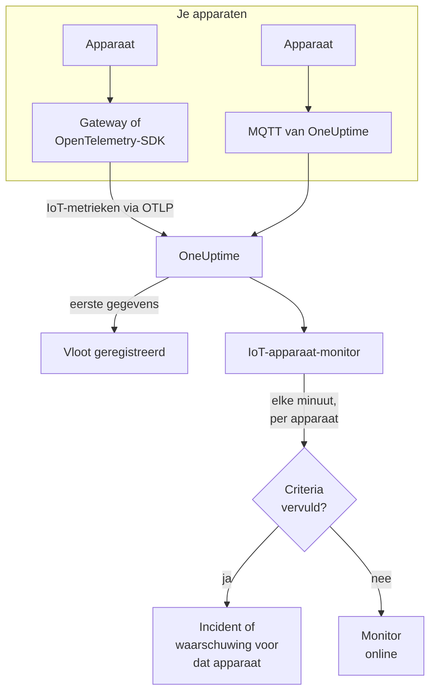

# IoT-apparaat-monitor

Een IoT-apparaat-monitor houdt één vloot apparaten in de gaten en laat je weten wanneer een apparaat offline gaat, de batterij bijna leeg is, het signaal zwakker wordt, het oververhit raakt of de CPU bezet blijft. Hij leest de metrieken `iot_*` die je apparaten via OpenTelemetry of MQTT naar OneUptime sturen, dus er wordt niets van buitenaf gecontroleerd en er komt geen probe aan te pas.

:::cards
- [De monitor maken](#een-iot-apparaat-monitor-maken): Zes stappen in het dashboard.
- [Templates](#kant-en-klare-waarschuwingstemplates): Vijf kant-en-klare waarschuwingen, één incident per apparaat.
- [Offline-detectie](#offline-detectie): Hoe een uitgevallen of stil apparaat wordt opgemerkt.
- [Metrieken](#verzamelde-metrieken): De reeksen `iot_*` die de monitor leest.
:::

## Hoe het werkt

Je apparaten, of de gateway waarmee ze praten, sturen hun metingen naar OneUptime: via OpenTelemetry, of rechtstreeks naar het MQTT-endpoint van OneUptime. Elke meting draagt de naam van de vloot, `iot.fleet.name`, en de eigen ID van het apparaat, `device.id`. De eerste gegevens registreren de vloot.

Een IoT-apparaat-monitor hoort bij één vloot. Elke minuut voert hij zijn query uit op de metrieken van die vloot en vergelijkt hij het resultaat met zijn criteria. De templates groeperen op `device.id`, dus 30 offline sensoren openen 30 incidenten, die elk hun apparaat noemen en elk vanzelf worden opgelost wanneer hun apparaat herstelt.



## Voordat je begint

- **Laat je apparaten gegevens sturen.** De [handleiding voor IoT-apparaten](/docs/telemetry/iot-devices) laat zien hoe je metrieken stuurt met een OpenTelemetry-SDK of -Collector, of via MQTT.
- **Controleer of de vloot geregistreerd is.** Ze verschijnt onder **Producten → Infrastructuur → IoT → All Fleets**, genoemd naar de `iot.fleet.name` die de apparaten sturen.
- **Registreer de apparaten die je verwacht**, in het **Device Registry** van de vloot, om te horen wanneer er een stil wordt: zie [Offline-detectie](#offline-detectie).

## Een IoT-apparaat-monitor maken

:::steps
### Een nieuwe monitor beginnen

Ga naar **Monitoren** en klik op **Monitor maken**.

### IoT Device kiezen

Klik onder **Monitortype** op **Meer monitortypen** en kies **IoT Device** onder **Infrastructuur**, of typ `iot` in het zoekvak. Vul een **Naam** in - die wordt gebruikt in de titels van incidenten en waarschuwingen - en klik op **Volgende**.

### De vloot kiezen

Kies onder **IoT Monitor Configuration** de vloot uit **IoT Fleet**. Elke vloot die gegevens heeft gestuurd, staat in de lijst.

### Kiezen wat je in de gaten houdt

Kies een van de drie tabbladen:

- **Quick Setup** - klik op een [template](#kant-en-klare-waarschuwingstemplates). Dat stelt de metriek, de aggregatie, het tijdsbereik, een groepering op `device.id` en de drempels in, en vervangt de criteria hieronder door de eigen criteria. Het **Tijdsbereik** kun je nog steeds aanpassen.
- **Custom Metric** - kies één metriek uit **IoT Metric** en stel daarna **Aggregatie** en **Tijdsbereik** in. De [filters](#monitorinstellingen) beperken haar tot één apparaat of één apparaattype. Een eigen metriek wordt niet gegroepeerd: ze beoordeelt de vloot als geheel.
- **Geavanceerd** - bouw zelf queries en formules onder **Selecteer metrieken**, ook over eigen metrieknamen, bijvoorbeeld het gebruikte geheugen als percentage van de geheugengrootte van een apparaat. Gebruik **Group by** `device.id` om elk apparaat afzonderlijk te beoordelen.

### De criteria controleren

Open elk criterium onder **Monitorcriteria** en controleer de **Select Metric Variable**, de **Aggregatie**, de **Voorwaarde** en de **Threshold**. Een template vult die in. Met **Custom Metric** of **Geavanceerd** begint de monitor met de [standaardcriteria](#standaardcriteria), die alleen merken dat een metriek naar nul zakt, dus stel je eigen drempel in.

### De monitor maken

Klik op **Monitor maken**. OneUptime opent de pagina van de monitor en evalueert hem elke minuut. Incidenten en waarschuwingen die hij geeft, bereiken je on-callbeleid, Slack, Microsoft Teams, e-mail, sms en webhooks zoals die van elke andere monitor.
:::

> [!TIP]
> Om meerdere templates tegelijk in te stellen, open je de vloot via **Producten → Infrastructuur → IoT** en ga je naar **Recommendations**. Kies de templates die je wilt, kies wie wordt opgeroepen, en OneUptime maakt één monitor per template.

## Monitorinstellingen

| Veld | Tabblad | Wat het doet |
| --- | --- | --- |
| **IoT Fleet** | Alle | Verplicht. Beperkt elke query tot `resource.iot.fleet.name`. |
| **Resourcebereik** | Custom Metric, Geavanceerd | Optioneel. **Apparaat** of **Fleet**: een exacte overeenkomst met het attribuut `iot.scope`. Een metriek kiezen zet het op **Apparaat**. |
| **Device ID** | Custom Metric, Geavanceerd | Optioneel. Eén apparaat, via zijn `device.id`, zoals `sensor-001`. |
| **Device Type** | Custom Metric, Geavanceerd | Optioneel. De apparaten die deze `iot.device.type` melden, zoals `sensor` of `gateway`. |
| **IoT Metric** | Custom Metric | Eén metriek uit de [catalogus](#verzamelde-metrieken). |
| **Aggregatie** | Custom Metric | Hoe monsters worden gecombineerd: **Gemiddelde**, **Maximum**, **Minimum**, **Som** of **Aantal**. Begint bij de gebruikelijke aggregatie van de metriek. |
| **Tijdsbereik** | Alle | Het voortschrijdende venster dat de query leest, van **Past 1 Minute** tot **Past 365 Days**. Een nieuwe monitor begint bij **Past 1 Minute**; templates stellen hun eigen venster in. |
| **Selecteer metrieken** | Geavanceerd | De querybouwer: **Metriek**, **Aggregate by**, **Filter by attributes**, **Group by**, plus **Metriek toevoegen** en **Formule toevoegen** om queries te combineren. |

De filters werken samen: met een **Device ID** en een **Device Type** komt een apparaat van een ander type met niets overeen.

## Kant-en-klare waarschuwingstemplates

**Quick Setup** biedt 5 templates. Elk template bouwt een volledige monitor: de metriekquery, een groepering op `device.id`, een criterium dat afgaat en een dat herstelt. Drempels zijn startpunten die je kunt aanpassen.

Een criterium gaat alleen af als de voorwaarde geldt voor elke minuut van zijn venster - behalve **Device Offline**, dat afgaat bij de eerste meting onder 1. Een drempelcriterium herstelt 10 % voorbij zijn drempel, zodat een waarde die rond de lijn schommelt niet heen en weer springt.

| Template | Categorie | Ernst | Houdt in de gaten | Gaat af als | Herstelt als |
| --- | --- | --- | --- | --- | --- |
| Device Offline | Beschikbaarheid | Kritiek | `iot_device_up`, Min per `device.id`, laatste 30 minuten | Een meting ligt onder 1, of een geregistreerd apparaat stuurt het hele venster niets | Weer op 1 |
| Low Battery | Power | Warning | `iot_battery_percent`, Avg per `device.id`, laatste 5 minuten | Onder 20 % | Op 22 % of hoger |
| Weak Signal | Connectivity | Warning | `iot_signal_strength_dbm`, Avg per `device.id`, laatste 5 minuten | Onder -100 dBm | Op -90 dBm of hoger |
| High Temperature | Omgeving | Kritiek | `iot_temperature_celsius`, Max per `device.id`, laatste 5 minuten | Boven 70 °C | Op 63 °C of lager |
| High CPU Usage | System | Warning | `iot_cpu_usage_ratio`, Avg per `device.id`, laatste 5 minuten | Boven 0.9 (90 % van zijn CPU) | Op 0.81 of lager |

**Ernst** is het label dat de keuzelijst toont. Het incident en de waarschuwing die een template maakt, beginnen op de zwaarste incident- en waarschuwingsernst van je project; wijzig ze in het criterium.

- **Device Offline leest 30 minuten**, zodat een apparaat dat om de paar minuten rapporteert niet tussen twee rapporten als offline wordt gezien. Een apparaat dat minder vaak dan ongeveer elke 15 minuten rapporteert, heeft een langer venster nodig.
- **High Temperature gebruikt Max** in elke minuut, zodat een hete meting niet wordt verborgen door koelere in dezelfde minuut. Hij moet nog steeds elke minuut van het venster heet blijven.
- **High CPU Usage vergelijkt een verhouding:** `iot_cpu_usage_ratio` loopt van 0 tot 1, dus 0.9 is 90 %.

## Offline-detectie

**Device Offline** gaat af wanneer een apparaat `iot_device_up = 0` meldt. Een uitgevallen of stil apparaat zet het op drie manieren in gang:

| Hoe | Wat er gebeurt |
| --- | --- |
| **De gateway meldt het** | De gateway of collector stuurt `iot_device_up = 0` voor een apparaat dat hij niet meer bereikt. |
| **MQTT Last Will** | Een apparaat dat met het MQTT-endpoint van OneUptime verbonden is, registreert een Last Will op zijn topic `status`. Als het apparaat uitvalt, stuurt de broker er `iot_device_up = 0` voor zodra de sessie wegvalt: geen polling, geen wachten op een gemist rapport. Zie [Metrieken via MQTT versturen](/docs/telemetry/iot-devices#metrics-verzenden-via-mqtt). |
| **Het apparaat is geregistreerd** | Een apparaat in het **Device Registry** van de vloot wordt verwacht. Als het het hele venster niets stuurt, behandelt de monitor het alsof het `0` meldt, dus krijgt het een eigen incident, dat vanzelf wordt opgelost als het apparaat weer rapporteert. |

Een geregistreerd apparaat blijft ook als offline in de inventaris van de vloot staan, terwijl een niet-geregistreerd apparaat na 15 minuten stilte wordt verwijderd. Stiltedetectie vereist het beleid **Treat As Zero** voor ontbrekende gegevens op het criterium voor `iot_device_up`, dat Device Offline-monitoren die vanuit het template zijn gemaakt al hebben. Een Device Offline-monitor die is gemaakt voordat apparaatregistratie bestond, moet het met de hand ingesteld krijgen, of opnieuw vanuit het template worden gemaakt.

> [!NOTE]
> Een niet-geregistreerd apparaat dat stil wordt, zonder Last Will of gatewaymelding, stopt alleen met het sturen van gegevens, en een monitor die per apparaat groepeert, kan het er niet uitpikken. Registreer je apparaten, of geef een kritiek apparaat een eigen monitor (**Custom Metric**, met zijn **Device ID**) en stel **Als geen gegevens** in op **Trigger**. Stiltedetectie vereist ook dat ten minste één ander apparaat van de vloot nog rapporteert: een vloot die volledig op zwart gaat, bijvoorbeeld tijdens een gatewaystoring, geeft één incident voor de monitor, niet één per apparaat.

## Verzamelde metrieken

Elke reeks draagt het label `device.id` van het apparaat, en de attributen `iot.scope`, `iot.device.type` en `iot.device.kind`.

| Metriek | Eenheid | Beschrijving |
| --- | --- | --- |
| `iot_device_up` | — | 1 als het apparaat werkt, 0 als het uitgevallen of offline is. |
| `iot_battery_percent` | `%` | Resterende batterijlading, van 0 tot 100. Een dalend niveau betekent dat het apparaat binnenkort stopt met rapporteren. |
| `iot_signal_strength_dbm` | `dBm` | Sterkte van het draadloze signaal. Dichter bij 0 is sterker; een zwak signaal gaat vooraf aan verbroken verbindingen. |
| `iot_temperature_celsius` | `°C` | De temperatuur van het apparaat. Een hoge meting kan wijzen op oververhitte hardware of een probleem in de omgeving. |
| `iot_cpu_usage_ratio` | `ratio` | Gebruikte CPU, van 0 tot 1, waarbij 1 volledig gebruikt is. |
| `iot_memory_usage_bytes` | `bytes` | Gebruikt geheugen. Vergelijk het met de geheugengrootte van het apparaat om geheugendruk te zien. |
| `iot_uptime_seconds` | `s` | Hoe lang het apparaat al draait. Valt terug naar nul als het herstart. |

## Monitoringcriteria

Een criterium vergelijkt een van de queries of formules van de monitor met een drempel. De criteria van een IoT-apparaat-monitor bieden één **Filtertype**, **Metric Value**: elke regel controleert de waarde van de metriek, met deze velden.

| Veld | Wat het doet |
| --- | --- |
| **Filtertype** | Altijd **Metric Value**, de enige controle die deze monitor biedt. |
| **Select Metric Variable** | De query of formule om te controleren, op haar variabelenaam. |
| **Aggregatie** | Hoe de waarden in het venster één antwoord worden: **Gemiddelde**, **Som**, **Maximum Value**, **Minimum Value**, **All Values** (elke waarde moet overeenkomen) of **Any Value** (één is genoeg). |
| **Voorwaarde** | **Greater Than**, **Less Than**, **Greater Than Or Equal To**, **Less Than Or Equal To** of **Equal To** — of een anomalievoorwaarde: **Anomalously High**, **Anomalously Low** of **Anomalous**. |
| **Threshold** | De waarde om mee te vergelijken. Er staat een eenhedenlijst naast als de metriek een eenheid heeft. Niet getoond bij anomalievoorwaarden. |
| **Gevoeligheid** | Alleen bij anomalievoorwaarden. **Laag** (4σ), **Gemiddeld** (3σ, de standaard) of **Hoog** (2σ). |
| **Baseline-venster** | Alleen bij anomalievoorwaarden. 14 dagen (de standaard), 28, 60 of 90 dagen geschiedenis. |
| **Als geen gegevens** | Onder **Meer velden**. Wat er gebeurt als een reeks geen monsters in het venster heeft: **Ignore** (de standaard) slaat haar over, **Treat As Zero** leest haar als `0`, en **Trigger** laat het criterium overeenkomen. |

Anomalievoorwaarden vergelijken elke waarde met hetzelfde uur van de week in de baseline. Ze blijven in de toestand "Learning", en geven niets, tot het baseline-venster genoeg geschiedenis bevat.

### Standaardcriteria

Een monitor die je niet vanuit een template bouwt, begint met twee criteria:

| Volgorde | Criterium | Komt overeen als | Dan |
| --- | --- | --- | --- |
| 1 | Check if _monitor name_ is offline | Een willekeurige waarde van de eerste query `0` is | Markeert de monitor als **Offline** en verklaart het incident "_monitor name_ is offline", dat vanzelf wordt opgelost als de monitor herstelt. |
| 2 | Check if _monitor name_ is online | Een willekeurige waarde boven `0` ligt | Markeert de monitor als **Operationeel**. |

> [!IMPORTANT]
> Stilte komt met geen van beide criteria overeen: een vloot die geen gegevens meer stuurt, laat de monitor zoals hij was. Om te horen wanneer gegevens wegblijven, stel je **Als geen gegevens** bij een criterium in op **Trigger**. Tijd waarin OneUptime zelf niets ontving, telt nooit als ontbrekende gegevens: een controle waarvan het venster die tijd bevat, wacht in plaats daarvan, zoals [Als OneUptime geen gegevens ontvangt](/docs/monitor/when-oneuptime-is-not-receiving) uitlegt.

## Terraform

De [Terraform-provider van OneUptime](/docs/terraform/monitor-steps) draagt de configuratie van een stap van een IoT-apparaat-monitor in het attribuut `iot_monitor`: de ruwe JSON van de configuratie `iotMonitor` (`fleetIdentifier`, `resourceFilters`, `metricViewConfig`, `rollingTime`), geschreven met `jsonencode()`:

```hcl title="main.tf"
monitor_steps = [{
  iot_monitor = jsonencode({
    fleetIdentifier = "building-a-sensors"
    resourceFilters = {}
    rollingTime     = "Past 5 Minutes"
    metricViewConfig = {
      queryConfigs = [{
        metricAliasData = { metricVariable = "battery_percent", title = "Battery", description = "", legend = "" }
        metricQueryData = {
          filterData = {
            metricName     = "iot_battery_percent"
            attributes     = {}
            aggegationType = "Avg"
            aggregateBy    = {}
          }
          groupByAttributeKeys = ["device.id"]
        }
      }]
      formulaConfigs = []
    }
  })
  criteria = [ /* ... */ ]
}]
```

`fleetIdentifier` is de `iot.fleet.name` van de vloot, niet de OneUptime-ID ervan.

## Problemen oplossen

:::details De vloot staat niet in de lijst IoT Fleet
Vloten registreren zichzelf op basis van de gegevens van de apparaten. Controleer of de apparaten `iot.fleet.name` sturen, en volg de [handleiding voor IoT-apparaten](/docs/telemetry/iot-devices) om te bevestigen dat er gegevens binnenkomen.
:::

:::details Er gaat één incident af voor de hele vloot in plaats van één per apparaat
De query is niet gegroepeerd. Monitoren met **Custom Metric** beoordelen de vloot als geheel; gebruik een template, of **Geavanceerd** met **Group by** `device.id`.
:::

:::details Een apparaat viel uit maar Device Offline ging niet af
Het apparaat stuurde geen Last Will en geen gateway meldde het, dus het werd alleen stil. Registreer het in het **Device Registry** van de vloot, en controleer of **Als geen gegevens** van het criterium voor `iot_device_up` op **Treat As Zero** staat. Zie [Offline-detectie](#offline-detectie).
:::

:::details Device Offline gaat af voor apparaten die in orde zijn
Ze rapporteren minder vaak dan het venster van 30 minuten dekt, dus sommige vensters bevatten niets van hen. Verleng het **Tijdsbereik**, of laat de apparaten vaker rapporteren. Houd op het WebSocket-MQTT-endpoint de MQTT-keepalive onder 5 minuten: OneUptime sluit inactieve WebSocket-verbindingen na 300 seconden, wat de Last Will verstuurt.
:::

:::details Een template toont geen gegevens
De templates lezen de metrieknamen `iot_*` exact, en groeperen op het label `device.id`. Vergelijk wat je apparaten sturen, op de pagina **Metrieken** van de vloot, met de [metriekconventies](/docs/telemetry/iot-devices#metric-conventies).
:::

## Volgende stappen

:::cards
- [IoT-apparaten](/docs/telemetry/iot-devices): Apparaatmetrieken sturen via OpenTelemetry of MQTT.
- [Metrics-monitor](/docs/monitor/metrics-monitor): Waarschuwen op elke metriek, niet alleen op IoT-metrieken.
- [Incident- en waarschuwingstemplates](/docs/monitor/incident-alert-templating): De ID van het apparaat in de titels van incidenten zetten.
:::
