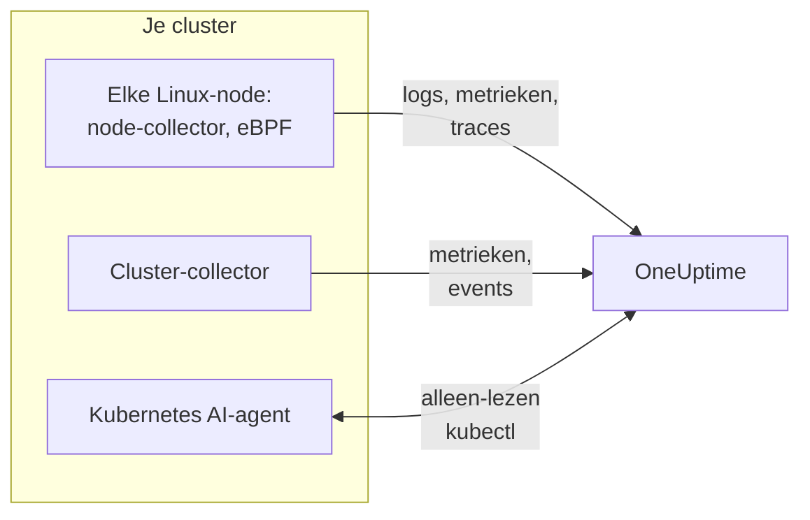

# Kubernetes-agent (Helm-installatie)

De Kubernetes-agent van OneUptime is een Helm-chart die de metrieken, events en podlogs van je cluster, met eBPF vastgelegde applicatietraces en de besturingssysteemmetrieken van elke node verzamelt en naar OneUptime stuurt. Eén `helm install` zet hem neer, zonder codewijzigingen in je apps. [Kubernetes-monitoren](/docs/monitor/kubernetes-monitor) waarschuwen op basis van wat hij stuurt.

:::cards
- [De agent installeren](#de-agent-installeren): Vier stappen met Helm.
- [Een preset kiezen](#een-preset-kiezen): Standaardclusters, GKE Autopilot of EKS Fargate.
- [Veelgebruikte opties](#veelgebruikte-opties): De instellingen die de meeste clusters aanpassen.
- [Problemen oplossen](#problemen-oplossen): Een diagnosescript, en de gebruikelijke problemen.
:::

## Wat de chart installeert

De chart draait een paar workloads in een eigen namespace. Elke workload stuurt wat hij verzamelt via OTLP naar je OneUptime-URL, met de ingestiesleutel die je hem geeft.



| Workload | Soort | Wat hij doet | Standaard aan |
| --- | --- | --- | --- |
| Cluster-collector | Deployment | Clustermetrieken, Kubernetes-events en de volledige specificaties van pods, nodes en workloads, uit de Kubernetes-API. | Ja |
| Node-collector | DaemonSet | Podlogs uit `/var/log/pods`, kubelet- en cAdvisor-metrieken, en de besturingssysteemmetrieken van de node. | Ja |
| eBPF-instrumentatie (OBI) | DaemonSet | HTTP-, gRPC-, SQL- en Redis-traces en verzoekmetrieken van elke pod, en de servicemap. | Ja |
| Kubernetes AI-agent | Deployment | Laat OneUptime AI alleen-lezen `kubectl` uitvoeren terwijl het een incident of waarschuwing op dit cluster onderzoekt. | Ja |
| Log-tailer | Deployment | Podlogs via de Kubernetes-API, waar de node-collector ze niet kan lezen. | Met de presets `gke-autopilot` en `eks-fargate` |
| eBPF-profiler | DaemonSet | Doorlopende CPU-flamegraphs van elk proces. | Nee |
| kube-state-metrics | Deployment | Podfasen, wachtredenen van containers en resourcequota. | Nee |

Elke agent-image is alleen voor Linux, dus elke workload is vastgepind op Linux-nodes.

## Voordat je begint

- **Een ingestiesleutel.** Maak er een in OneUptime onder **Projectinstellingen → Telemetrie & APM → Ingestiesleutels**. De agent stuurt hem als de header `x-oneuptime-token`, dus een project-API-sleutel werkt hier niet.
- **Helm 3** en `kubectl`-toegang tot het cluster. Upgrades gebruiken `--reset-then-reuse-values`, waarvoor Helm 3.14 of later nodig is.
- **Een naam voor het cluster**, uniek in je project. De chart weigert te installeren zonder naam: twee clusters met dezelfde naam zouden als één verschijnen.
- **Uitgaand HTTPS** van het cluster naar je OneUptime-URL.

## De agent installeren

:::steps
### De Helm-repository toevoegen

```bash
helm repo add oneuptime https://helm-chart.oneuptime.com
helm repo update
```

### De chart installeren

Vervang de URL door je OneUptime-URL, en de twee placeholders door je ingestiesleutel en de naam van het cluster:

```bash
helm install oneuptime-agent oneuptime/kubernetes-agent \
  --namespace oneuptime-kubernetes-agent \
  --create-namespace \
  --set oneuptime.url=https://oneuptime.com \
  --set oneuptime.apiKey=<YOUR_API_KEY> \
  --set clusterName=<A_UNIQUE_NAME_FOR_THIS_CLUSTER>
```

Dit gebruikt de preset `standard`. Kies op GKE Autopilot of EKS Fargate [hun preset](#een-preset-kiezen).

### Controleren of de pods draaien

```bash
kubectl get pods -n oneuptime-kubernetes-agent
```

Elke pod zou binnen een minuut of twee `Running` moeten bereiken.

### Het cluster vinden in OneUptime

Open **Producten → Infrastructuur → Kubernetes → Alle clusters**. Het cluster verschijnt binnen een paar minuten onder zijn naam, en zijn nodes, pods en workloads vullen zich.
:::

## Een preset kiezen

Sommige Kubernetes-platforms staan niet toe dat een workload een `hostPath`-volume koppelt of een DaemonSet draait, en dat gebruikt de node-collector. De instelling `preset` kiest wat op het jouwe werkt:

| Preset | Gebruiken voor | Podlogs | Op elke node |
| --- | --- | --- | --- |
| `standard` (standaard) | Zelfbeheerd, **EKS on EC2**, **GKE Standard**, **AKS**, minikube, kind, k3s | De node-collector leest `/var/log/pods` | Kubelet-, cAdvisor- en besturingssysteemmetrieken |
| `gke-autopilot` | **GKE Autopilot** | De log-tailer leest ze via de Kubernetes-API | Kubelet- en cAdvisor-metrieken, zonder `hostPath` |
| `eks-fargate` | **EKS Fargate** | De log-tailer leest ze via de Kubernetes-API | Niets: Fargate draait geen DaemonSets |

Weet je het niet zeker, laat `preset` dan leeg om `standard` te krijgen. Mislukt de installatie met een Pod Security-fout die `hostPath` noemt, installeer dan opnieuw met `gke-autopilot`, of met `eks-fargate` op EKS Fargate.

GKE Autopilot en EKS Fargate weigeren ook geprivilegieerde pods, die de eBPF-instrumentatie en profilering nodig hebben, dus hun presets laten die allebei weg:

:::tabs
@tab Standard
```bash
helm install oneuptime-agent oneuptime/kubernetes-agent \
  --namespace oneuptime-kubernetes-agent --create-namespace \
  --set oneuptime.url=https://oneuptime.com \
  --set oneuptime.apiKey=<YOUR_API_KEY> \
  --set clusterName=prod
```
@tab GKE Autopilot
```bash
helm install oneuptime-agent oneuptime/kubernetes-agent \
  --namespace oneuptime-kubernetes-agent --create-namespace \
  --set oneuptime.url=https://oneuptime.com \
  --set oneuptime.apiKey=<YOUR_API_KEY> \
  --set clusterName=prod-gke-autopilot \
  --set preset=gke-autopilot
```
@tab EKS Fargate
```bash
helm install oneuptime-agent oneuptime/kubernetes-agent \
  --namespace oneuptime-kubernetes-agent --create-namespace \
  --set oneuptime.url=https://oneuptime.com \
  --set oneuptime.apiKey=<YOUR_API_KEY> \
  --set clusterName=prod-eks-fargate \
  --set preset=eks-fargate
```
:::

## Het cluster labelen

Labels die je bij de installatie meegeeft, worden aan het cluster gekoppeld, en aan de services en hosts die deze agent rapporteert. `--set oneuptime.labels.<key>=<value>` wordt een projectlabel met de naam `<key>:<value>`:

```bash
helm install oneuptime-agent oneuptime/kubernetes-agent \
  --namespace oneuptime-kubernetes-agent \
  --create-namespace \
  --set oneuptime.url=https://oneuptime.com \
  --set oneuptime.apiKey=<YOUR_API_KEY> \
  --set clusterName=prod \
  --set oneuptime.labels.team=payments \
  --set oneuptime.labels.env=production \
  --set oneuptime.labels.region=us-east-1
```

Of bewaar ze in een values-bestand:

```yaml title="values.yaml"
oneuptime:
  url: https://oneuptime.com
  apiKey: <YOUR_API_KEY>
  labels:
    team: payments
    env: production
    region: us-east-1
clusterName: prod
```

```bash
helm install oneuptime-agent oneuptime/kubernetes-agent \
  --namespace oneuptime-kubernetes-agent --create-namespace \
  -f values.yaml
```

Elk record dat deze agent stuurt - logs, metrieken, traces en profielen - draagt dan `team:payments`, `env:production` en `region:us-east-1`. Elk label is een resource-attribuut `oneuptime.label.<key>=<value>`, en OneUptime maakt van elk attribuut dat met `oneuptime.label.` begint een label. Labels worden zonder onderscheid tussen hoofd- en kleine letters vergeleken, dus een bestaand label `Production` wordt hergebruikt, niet gedupliceerd. De agent verwijdert nooit een label dat je in OneUptime hebt toegevoegd.

## Podlogs

`preset` stelt `logs.mode` in, wat je ook zelf kunt instellen:

| `logs.mode` | Hoe logs worden gelezen | Sterk punt | Let op |
| --- | --- | --- | --- |
| `daemonset` | Eén node-collector per node volgt de bestanden onder `/var/log/pods`. | Laagste overhead, schaalt met de nodes, geen belasting op de Kubernetes-API-server, volgt logrotatie. | Heeft `hostPath` en DaemonSets nodig. |
| `api` | Eén log-tailer streamt de log van elke container uit de Kubernetes-API, zoals `kubectl logs -f` doet. | Werkt waar `hostPath` geblokkeerd is of de Pod Security Standard `restricted` geldt. | Elke containerstream is een langlevende verbinding met de API-server. Eén replica verwerkt een paar duizend containers. |
| `disabled` | Niets. | Voor apps die hun logs al op een andere manier sturen. | |

Om logverzameling uit te zetten, stel je `--set logs.enabled=false` in en stuur je applicatielogs in plaats daarvan met de [OpenTelemetry](/docs/telemetry/open-telemetry)-SDK's. Metrieken worden niet beïnvloed: de node-collector blijft draaien.

### Clusters met meerdere besturingssystemen (Windows-nodepools)

Windows-nodes draaien nooit een agent-pod. Gegevens op clusterniveau over hen en hun pods komen nog steeds binnen, omdat die uit de Kubernetes-API komen: nodecondities, podfasen, Kubernetes-events en kube-state-metrics. Wat Windows-nodes missen, is wat op de node wordt verzameld: besturingssysteemmetrieken, kubelet- en cAdvisor-metrieken, eBPF-traces, profielen en, in de logmodus `daemonset`, podlogs.

Om ook de logs van pods op Windows-nodes te verzamelen, zet je de hybride modus aan:

```bash
helm upgrade oneuptime-agent oneuptime/kubernetes-agent \
  --namespace oneuptime-kubernetes-agent --reset-then-reuse-values \
  --set logs.windowsPods.enabled=true
```

De log-tailer draait dan naast de node-collectors, alleen voor de pods op Windows-nodes. Linux-pods houden het goedkopere volgen van bestanden, en de twee verdelen de pods op het besturingssysteem van de node, zodat geen logregel twee keer wordt verstuurd.

- **Versie van de tailer-image.** De verdeling die alleen voor Windows geldt, zit ingebouwd in de image `kubernetes-log-tailer`. Een oudere image negeert haar en volgt *elke* pod, waardoor de logs van elke Linux-pod twee keer worden verstuurd. Pin `logs.api.image.tag` niet op een versie die ouder is dan de release van de chart, en als een node een oude `release`-image in de cache kan hebben, voeg dan `--set logs.api.image.pullPolicy=Always` aan de upgrade toe.
- **Filteren op severity.** Met `filters.logs.minSeverity` ingesteld, wordt een regel zonder herkenbare severity op het pad van de node-collector verwijderd maar op dat van de log-tailer bewaard - zie [Filteren op log-severity](/docs/telemetry/kubernetes-agent#filteren-op-log-severity). Windows-pods kunnen dan meer regels zonder niveau sturen dan Linux-pods.

## Applicatietraces met eBPF

De chart draait [OpenTelemetry eBPF Instrumentation (OBI)](https://opentelemetry.io/docs/zero-code/obi/) op elke node. OBI laadt eBPF-programma's in de Linux-kernel en bekijkt het netwerkverkeer van elke pod, zodat het HTTP- en HTTPS-, gRPC-, en SQL- en Redis-aanroepen kan reconstrueren zonder enige wijziging in je apps: geen SDK, geen sidecar. Het stuurt ze naar OneUptime als traces en verzoekmetrieken.

Je services verschijnen binnen een minuut of twee onder **Producten → Traces** en op de servicemap, met `k8s.cluster.name` ingesteld op de naam van het cluster, zodat je op cluster kunt filteren.

### Wanneer je eBPF uitzet

eBPF staat standaard aan. Zet het uit met `--set ebpf.enabled=false` wanneer:

- Het cluster **GKE Autopilot** of **EKS Fargate** is. Hun presets doen dat voor u: die platforms weigeren geprivilegieerde pods, en OBI moet geprivilegieerd zijn om zijn programma's te laden.
- De nodes een kernel ouder dan **Linux 5.8** draaien zonder BTF. Debian 11, Ubuntu 20.10, Fedora 34, RHEL 9 en later zijn in orde.
- Je apps al traces sturen met een OpenTelemetry-SDK, en je ze niet dubbel wilt.

### Wat eBPF stuurt

OBI stuurt verschillende soorten signalen. Elk kan worden uitgezet met `--set ebpf.features.<key>=false`:

| Instelling | Standaard | Wat het toevoegt |
| --- | --- | --- |
| `ebpf.features.httpMetrics` | aan | HTTP- en gRPC-verzoekmetrieken per service: verzoeksnelheid, latentiehistogrammen en fouten. |
| `ebpf.features.spanMetrics` | aan | Spanmetrieken: aanroepen en duur per service, route of operatie, spansoort en status - `traces.span.metrics.calls` en `traces.span.metrics.duration` (seconden). |
| `ebpf.features.serviceGraph` | aan | De snelheid en latentie van elke aanroep van de ene service naar de andere, die de servicemap tekenen. |
| `ebpf.features.networkMetrics` | aan | Bytes en pakketten tussen elk paar pods, over TCP en UDP, met hun Kubernetes-namen. Toont elk paar pods dat met elkaar praat, zelfs via protocollen die OBI niet kan lezen. |
| `ebpf.features.networkInterZoneMetrics` | uit | Hetzelfde tussen zones. Verdubbelt het aantal reeksen: zet het alleen aan als je op zone plant. |
| `ebpf.features.tcpStats` | aan | TCP-statistieken per node: rondreistijden, mislukte verbindingen en hertransmissies. |

### Traces tussen services koppelen

OBI kan de trace ook over een aanroep heen meenemen: wanneer pod A pod B aanroept via HTTP of gRPC, sluit de span aan de kant van B aan bij de trace van A, zonder SDK in een van beide apps. **Dit staat standaard uit.** Zet het aan met `--set ebpf.contextPropagation=true`, nadat je de waarschuwing hieronder hebt gelezen.

| Optie | Standaard | Wat het doet |
| --- | --- | --- |
| `ebpf.contextPropagation` | uit | Schrijft een W3C-`traceparent` in uitgaand verkeer, zodat spans over services heen gekoppeld worden. |
| `ebpf.contextPropagationMode` | `headers` | Hoe: `headers` (HTTP/1.1-verzoekheaders, het smalst), `tcp` (een TCP-optie, via Linux Traffic Control) of `all` (beide). Wordt alleen gelezen als `contextPropagation` aan staat. |
| `ebpf.trackRequestHeaders` | aan | Volgt verzoekheaders in de kernel, zodat de ontvangende kant de `traceparent` ook op gewone HTTP-servers vindt. Heeft alleen effect als `contextPropagation` aan staat. |

> [!WARNING]
> Elke propagatiemodus wijzigt verkeer dat al onderweg is. Voor gewone HTTP vergroot OBI het uitgaande verzoek in de kernel om de header erin te passen; voor TLS en ruwe TCP voegt het een TCP-optie toe vanuit een Traffic Control-hook, waarbij het pakket en zijn checksum worden herschreven. Wordt de bytetelling van de verbinding daarna niet exact gecorrigeerd, dan **raakt de stream uit sync**: overdrachten via een proxy zoals nginx blijven halverwege hangen, zodra een antwoord groter wordt dan ongeveer 64 KB, tot de verbinding een time-out krijgt. Kleine verzoeken blijven werken, dus het lijkt op een bug in de applicatie of de proxy. Geen enkele kernelversie laat de herschrijving verdwijnen. Traces, verzoekmetrieken en de servicemap werken allemaal zonder; een OpenTelemetry-SDK in je services koppelt traces zonder enige herschrijving in de kernel. Zet je het aan, probeer het dan eerst op een cluster dat geen productie is, en controleer grote overdrachten via je proxy.

### Logs aan traces koppelen

**Standaard uit.** Wanneer het aan staat, koppelt OBI een probe aan de systeemaanroep `write()` van elk proces dat het instrumenteert, en:

- Een **JSON-logregel** krijgt de velden `trace_id` en `span_id` (velden die de regel al heeft, blijven behouden). De node-collector verplaatst ze naar de eigen tracevelden van het logrecord, zodat de logs van een span in OneUptime één klik verwijderd zijn, net als de trace van een logregel.
- **Elke andere logregel** wordt ongewijzigd verzameld, zonder de koppeling.

```bash
helm upgrade oneuptime-agent oneuptime/kubernetes-agent \
  --namespace oneuptime-kubernetes-agent --reset-then-reuse-values \
  --set ebpf.logToTraceCorrelation=true
```

| Optie | Standaard | Wat het doet |
| --- | --- | --- |
| `ebpf.logToTraceCorrelation` | `false` | Zet de logverrijker van OBI aan en het overhevelen van `trace_id` door de node-collector. |
| `ebpf.logEnricher.services` | `[{service: [{exe_path: "*"}]}]` | Welke processen de verrijker aanraakt. Elk item is een OBI-selector [GlobAttributes](https://opentelemetry.io/docs/zero-code/obi/configure/options/#service-discovery), met velden zoals `exe_path`, `languages`, `k8s_pod_labels`, `k8s_pod_annotations`, `open_ports` en `cmd_args`. |

#### APM-agents die erdoor crashen

De verrijker herschrijft de uitvoerbuffer van de app **binnen het proces**: wanneer een geselecteerd proces `write()` aanroept, wist OBI de oorspronkelijke bytes en schrijft het een verrijkte kopie. APM-agents die via `LD_PRELOAD` laden en zelf `write()` omwikkelen, overleven dat niet:

| APM-agent | Bibliotheek | Wat er gebeurt |
| --- | --- | --- |
| Dynatrace OneAgent | `liboneagentproc.so` | De app crasht met SIGSEGV (exitcode 139). De eigen `write()` van de Dynatrace-watchdog loopt vast voorbij zijn limiet van 10 seconden en de OneAgent herstart in een lus. |
| New Relic | `libnewrelic*.so` | Dezelfde soort crash. |
| AppDynamics | `libappdynamics*.so` | Dezelfde soort crash. |
| Datadog | `libdd*.so` | Dezelfde soort crash. |
| Instana | `libinstana*.so` | Dezelfde soort crash. |

**.NET-apps lopen het meeste risico:** de .NET-agent van Dynatrace laadt altijd via `LD_PRELOAD`, en de consolelog van Microsoft.Extensions.Logging is niet gebufferd, dus elke regel volgt dat pad. Python- en Go-apps hebben er meestal geen last van.

Om het naast een van deze agents te gebruiken, richt je `logEnricher.services` alleen op de pods zonder zo'n agent. De verrijker kan niets uitsluiten, dus som de pods op die verrijkt moeten worden:

```yaml title="values.yaml"
ebpf:
  logToTraceCorrelation: true
  logEnricher:
    services:
      # Enrich only pods with the apm-agent=none label
      - service:
          - k8s_pod_labels:
              apm-agent: "none"
```

Of kies op runtime. Het laden via `LD_PRELOAD` van Dynatrace richt zich op .NET, dus alleen Python, Go, Ruby en Node.js verrijken vermijdt het:

```yaml title="values.yaml"
ebpf:
  logToTraceCorrelation: true
  logEnricher:
    services:
      - service:
          - languages: "python,go,ruby,nodejs"
```

#### Logs moeten JSON en ongebufferd zijn

- **Alleen JSON-regels krijgen een `trace_id`.** Zet de logger om naar een JSON-formaat: `structlog`, `pino`, `winston`, `serilog`, `logback-json`, klog `--logging-format=json` en dergelijke.
- **Gebufferde uitvoer verbreekt de koppeling**, omdat de `write()` dan op een andere thread gebeurt dan het verzoek. Stel in **Python** `PYTHONUNBUFFERED=1` in. Roep in **.NET** bij het opstarten `Console.SetOut(new StreamWriter(Console.OpenStandardOutput()) { AutoFlush = true })` aan; `AddConsole()` van Microsoft.Extensions.Logging en de asynchrone sinks van Serilog werken niet, de gewone `WriteTo.Console()` van Serilog wel.
- Greenlet, gevent, Tornado en andere eigen asynchrone runtimes vallen erbuiten.

### eBPF afstemmen

| Optie | Standaard | Wat het doet |
| --- | --- | --- |
| `ebpf.enabled` | `true` | Draait de eBPF-DaemonSet. `false` laat hem weg. |
| `ebpf.image.tag` | `v0.14.0` | De OBI-image. OBI zit nog voor 1.0: pin een versie die je hebt getest, en test opnieuw voordat je hem verandert. |
| `ebpf.autoTargetExe` | `*` | Globs van de uitvoerbare bestanden om te instrumenteren, gescheiden door komma's. Beperk het, zoals in `*/python,*/java`, om minder runtimes te instrumenteren. |
| `ebpf.excludeExePaths` | Shells, clusterinfrastructuur, service-mesh-sidecars, CNI-agents, browsers, ClickHouse, collectors en OBI zelf | Globs van uitvoerbare bestanden om over te slaan, gescheiden door komma's. Een brede glob slaat ook je eigen binaries over. |
| `ebpf.logLevel` | `info` | `debug`, `info`, `warn` of `error`. |
| `ebpf.printTraces` | `false` | Print spans ook in de eigen log van OBI, om te controleren wat het vastlegt. |
| `ebpf.resources.*` | `100m` CPU en `512Mi` geheugen aangevraagd, limieten van `2000m` en `2Gi` | Verhoog ze voor nodes met zwaar verkeer of veel kortlevende processen. |

Om te controleren dat OBI draait en verkeer ziet:

```bash
kubectl get pods -n oneuptime-kubernetes-agent -l component=ebpf-instrument
kubectl logs -n oneuptime-kubernetes-agent -l component=ebpf-instrument --tail=200
```

## Doorlopende CPU-profilering

De [OpenTelemetry eBPF Profiler](https://github.com/open-telemetry/opentelemetry-ebpf-profiler) kan ook op elke node draaien, als de image `otel/opentelemetry-collector-ebpf-profiler`. Hij bemonstert wat elk proces uitvoert, 19 keer per seconde, in Go, Java, .NET, Python, Ruby, Node.js, PHP, Perl, C, C++ en Rust, en stuurt de profielen naar OneUptime. Ze verschijnen onder **Producten → Prestatieprofielen**, en als flamegraph op elke tracespan.

**Profilering staat standaard uit:** het kost per node meer CPU en geheugen dan de eBPF-instrumentatie. Zet het aan met `--set profiling.enabled=true`.

Met de eBPF-instrumentatie ook aan (de standaard) draagt elk monster de trace waartoe het behoort, zodat een span een eigen flamegraph heeft. Daarvoor vraagt de chart OBI om de lopende tracecontext beschikbaar te houden (`OTEL_EBPF_BPF_POPULATE_TRACE_CONTEXT=true`), wat geïnstrumenteerde apps bij elke asynchrone contextwissel een beetje kost. Stel `profiling.obiProcessContext=false` in voor flamegraphs zonder de koppeling met spans.

Profilering vereist **Linux 5.10** of later, en een geprivilegieerde pod met de proces-ID's van de node: het kan niet draaien op GKE Autopilot of EKS Fargate, en hun presets laten het uit. Op nodes die zelf containers zijn, zoals kind of k3d, kan het processen niet uit elkaar houden, en wordt bijna geen monster aan een span gekoppeld.

| Optie | Standaard | Wat het doet |
| --- | --- | --- |
| `profiling.enabled` | `false` | Draait de profiler-DaemonSet. |
| `profiling.image.tag` | `0.152.0` | De profiler-image. Die zit nog voor 1.0: pin een versie die je hebt getest. |
| `profiling.samplesPerSecond` | `19` | Hoeveel monsters per seconde. 19 voorkomt dat het samenvalt met gangbare timerfrequenties. |
| `profiling.offCpuThreshold` | `0` | Een waarde boven 0 tot en met 1 profileert ook de tijd buiten de CPU, wat lock-contention en blokkerende I/O laat zien, tegen wat extra kosten. |
| `profiling.tracers` | `""` (elke runtime) | De taaltracers om te laden, gescheiden door komma's, zoals `go,python`. |
| `profiling.obiProcessContext` | `true` | Koppelt monsters aan de traces van OBI, en laat OBI daarvoor de tracecontext beschikbaar houden. |

## Andere gegevensverzameling

| Optie | Standaard | Wat het toevoegt |
| --- | --- | --- |
| `hostMetrics.enabled` | aan | De besturingssysteemmetrieken van elke node uit `/proc` en `/sys`: schijf-I/O-wachtrijen, inodes van bestandssystemen, fouten van netwerkinterfaces, paging en load average. Draait in de node-collector, zonder extra pods. |
| `kubeletstats.utilizationMetrics.enabled` | aan | CPU en geheugen van containers en pods als percentage van hun request en limit, die de CPU- en geheugenverzadigingsmonitoren lezen. Altijd 0 voor een pod zonder request of limit. |
| `kubeletstats.volumeMetrics.enabled` | aan | De vrije en totale ruimte van elke PVC (`k8s.volume.available`, `k8s.volume.capacity`), die de monitor PVC Low Disk Space leest. Eén reeks per PVC per pod. |
| `cadvisor.enabled` | aan | CPU-throttling en OOM-kills uit de `/metrics/cadvisor` van elke kubelet: `container_cpu_cfs_throttled_seconds_total`, `container_cpu_cfs_periods_total` en `container_oom_events_total`, en verder niets. |
| `kubeStateMetrics.enabled` | uit | Podfasen (Pending, Terminating), pods die niet gepland kunnen worden, wachtredenen van containers (CrashLoopBackOff, ImagePullBackOff) en het gebruik van resourcequota, uit kube-state-metrics. `kubeStateMetrics.mode: bundled` (de standaard) draait een kleine kube-state-metrics voor je; `external` leest er een die je al draait, op `kubeStateMetrics.endpoint`. |
| `auditLogs.enabled` | uit | De Kubernetes-auditlog, `/var/log/kubernetes/audit.log`: elk verzoek aan de API, door wie, waarop. Alleen zelfbeheerde clusters: beheerde clusters (EKS, GKE, AKS, DOKS) sturen hem naar de cloudprovider. |
| `csi.enabled` | uit | De metrieken van CSI-opslagdrivers, van pods met het label `app=csi-driver` of `app.kubernetes.io/component=csi-driver`: koppel- en ontkoppeltijden van volumes, provisioningfouten, IOPS. |
| `coreDns.enabled` | uit | De metrieken van CoreDNS op `:9153/metrics`: querysnelheid, latentie, cachehits en fouten. |
| `controlPlane.enabled` | uit | etcd, de API-server, de scheduler en de controller manager. Alleen zelfbeheerde clusters: beheerde clusters stellen ze niet beschikbaar. |
| `cost.enabled` | uit | Wat elke workload kost. Zie [Kubernetes-kostenobservability](/docs/telemetry/kubernetes-cost). |

## Veelgebruikte opties

| Optie | Standaard | Wat het doet |
| --- | --- | --- |
| `oneuptime.url` | (verplicht) | Je OneUptime-URL. |
| `oneuptime.apiKey` | (verplicht) | De ingestiesleutel, uit **Projectinstellingen → Telemetrie & APM → Ingestiesleutels**. Wordt verstuurd als de header `x-oneuptime-token`; een project-API-sleutel werkt niet. |
| `clusterName` | (verplicht) | De naam van het cluster, uniek in het project. Elk record draagt hem als `k8s.cluster.name`. |
| `preset` | (leeg: `standard`) | `standard`, `gke-autopilot` of `eks-fargate`. Zie [Een preset kiezen](#een-preset-kiezen). |
| `oneuptime.labels` | `{}` | Labels voor elk record van deze agent. Zie [Het cluster labelen](#het-cluster-labelen). |
| `namespaceFilters.rules` | Laat `kube-system` buiten `podLogs` en `ebpfDiscovery` | Regels die namespaces in- of uitsluiten, voor `podLogs`, `ebpfDiscovery`, `metrics` en `traces`. Patronen kunnen `*` gebruiken, en uitsluiten wint altijd. |
| `filters.logs.minSeverity` | `""` | Verwijdert podlogregels onder dit niveau: `TRACE`, `DEBUG`, `INFO`, `WARN`, `ERROR` of `FATAL`. |
| `filters.metrics.exclude` | `[]` | Metrieknamen om te verwijderen. |
| `sampling.traces.percentage` | `100` | Het aandeel traces om te bewaren, van 0 tot 100. Traces worden in hun geheel bewaard of verwijderd. |
| `logs.enabled` | `true` | Verzamelt podlogs. |
| `logs.mode` | (uit `preset`) | `daemonset`, `api` of `disabled`. Gaat boven de preset. |
| `logs.windowsPods.enabled` | `false` | Volgt ook pods op Windows-nodes. Zie [Clusters met meerdere besturingssystemen](#clusters-met-meerdere-besturingssystemen-windows-nodepools). |
| `logs.api.replicas` | `1` | Replica's van de log-tailer, in de modus `api`. |
| `ebpf.enabled` | `true` | eBPF-traces en verzoekmetrieken. Zie [Applicatietraces met eBPF](#applicatietraces-met-ebpf). |
| `profiling.enabled` | `false` | CPU-flamegraphs. Zie [Doorlopende CPU-profilering](#doorlopende-cpu-profilering). |
| `kubeStateMetrics.enabled` | `false` | Clusterstatus uit kube-state-metrics. |
| `aiAgent.enabled` | `true` | De Kubernetes AI-agent. Zie [Kubernetes AI-agent](/docs/telemetry/kubernetes-agent#kubernetes-ai-agent) voor wat hij mag doen. |

De [`values.yaml`](https://github.com/OneUptime/oneuptime/blob/master/HelmChart/Public/kubernetes-agent/values.yaml) van de chart somt elke optie op en legt die uit, en [Kubernetes-agent](/docs/telemetry/kubernetes-agent) behandelt filteren, sampling en het beperken van de hoeveelheid gegevens.

## Upgraden

```bash
helm repo update
helm upgrade oneuptime-agent oneuptime/kubernetes-agent \
  --namespace oneuptime-kubernetes-agent \
  --reset-then-reuse-values
```

`--reset-then-reuse-values` (Helm 3.14 en later) behoudt de waarden die je instelde - de preset, de naam van het cluster, filters - en neemt elke andere waarde over van de nieuwe chart. Voeg elke nieuwe `--set` erna toe. Upgrade op Helm 3.13 of eerder in plaats daarvan met de waarden die je instelde:

```bash
helm repo update
helm get values oneuptime-agent --namespace oneuptime-kubernetes-agent -o yaml > values.yaml && \
  helm upgrade oneuptime-agent oneuptime/kubernetes-agent \
  --namespace oneuptime-kubernetes-agent -f values.yaml
```

Upgrade niet met `--reuse-values`: dat behoudt ook de standaardwaarden van de chart waarvan je upgradet, zodat de standaardwaarden van een nieuwere chart, waaronder zijn eBPF-image, nooit van toepassing worden. Wanneer een release draait op de standaardwaarden van een oudere chart, eindigen de notities die Helm na de installatie of upgrade toont met een waarschuwing en het commando dat het oplost.

> [!WARNING]
> **eBPF-spanmetrieken hebben nieuwe namen.** `ebpf.features.spanMetrics` stuurt nu `traces.span.metrics.calls` en `traces.span.metrics.duration` (seconden) in plaats van `traces_spanmetrics_calls_total` en `traces_spanmetrics_latency`: dezelfde reeksen, onder de namen die OBI behoudt (de oude heeft het verouderd verklaard). Een dashboard, grafiek of metriekmonitor op een oude naam krijgt na de upgrade geen nieuwe gegevens, zonder foutmelding - zet hem om naar de nieuwe naam, en werk elk item van `filters.metrics` bij dat een oude naam noemt.

## Verwijderen

```bash
helm uninstall oneuptime-agent --namespace oneuptime-kubernetes-agent
kubectl delete namespace oneuptime-kubernetes-agent
```

## Problemen oplossen

:::details Het cluster toont Disconnected, of er komen geen gegevens binnen
Draai het diagnosescript van de chart. Het controleert de pods, de ingestiesleutel en de weg naar buiten uit het cluster, vraagt OneUptime of de sleutel wordt geaccepteerd, en toont één oordeel. Het leest alleen, en verandert niets:

```bash
curl -fsSL https://raw.githubusercontent.com/OneUptime/oneuptime/master/HelmChart/Public/kubernetes-agent/troubleshoot.sh \
  | bash -s -- -n oneuptime-kubernetes-agent
```

De gebruikelijke oorzaak, vooral na een herinstallatie, is een verkeerde of ingetrokken ingestiesleutel: OneUptime weigert hem, en de collector gooit elke batch weg terwijl zijn pods `Running` blijven.
:::

:::details De installatie mislukt met "hostPath volumes are not allowed"
Het cluster blokkeert `hostPath`. Stap over op een preset die logs via de Kubernetes-API leest; die laat eBPF ook weg:

```bash
helm repo update
helm upgrade oneuptime-agent oneuptime/kubernetes-agent \
  --namespace oneuptime-kubernetes-agent \
  --reset-then-reuse-values \
  --set preset=gke-autopilot
```

Gebruik op EKS Fargate `--set preset=eks-fargate`.
:::

:::details Agent-pods blijven hangen in ImagePullBackOff op Windows-nodes
Oudere charts planden de DaemonSets van de agent op Windows-nodes, waar hun Linux-images nooit gedownload kunnen worden. Draai `helm upgrade`: de huidige chart pint elke workload op Linux-nodes, en de vastgelopen pods verdwijnen. Om de logs van pods op Windows-nodes te verzamelen, zie [Clusters met meerdere besturingssystemen](#clusters-met-meerdere-besturingssystemen-windows-nodepools).
:::

:::details Er komen geen logs binnen in OneUptime
Controleer de pods van de agent en hun logs:

```bash
kubectl get pods -n oneuptime-kubernetes-agent
kubectl logs -n oneuptime-kubernetes-agent -l app.kubernetes.io/part-of=oneuptime --tail=200
```

In de modus `api` antwoordt de log-tailer op `/healthz`, poort 13133, met de status van zijn exports: bereik hem met `kubectl port-forward`.
:::

:::details De eBPF-pods staan in CrashLoopBackOff, of starten niet
Lees de log van OBI:

```bash
kubectl logs -n oneuptime-kubernetes-agent -l component=ebpf-instrument --tail=200
```

- **De kernel is te oud, of heeft geen BTF.** OBI heeft Linux 5.8 of later met BTF nodig; controleer het met `uname -r` op een node. Kun je hem niet upgraden, zet eBPF dan uit met `--set ebpf.enabled=false`.
- **Geprivilegieerde pods worden geweigerd.** Sommige clusters weigeren ze zelfs buiten Autopilot en Fargate. Zet eBPF uit.
- **OBI draait, maar er komen geen traces binnen.** Stel `--set ebpf.printTraces=true` in en lees de log van OBI opnieuw. Spans daar betekenen dat de export naar OneUptime mislukt: controleer de URL en de ingestiesleutel. Geen spans daar kan betekenen dat het verkeer versleuteld is door een TLS-bibliotheek die OBI niet kan lezen, zoals een statisch gelinkte.
:::

:::details Grote overdrachten blijven hangen na het aanzetten van tracekoppeling
Dat is `ebpf.contextPropagation` dat verkeer herschrijft: zie de waarschuwing in [Traces tussen services koppelen](#traces-tussen-services-koppelen). Zet het uit met `--set ebpf.contextPropagation=false`.
:::

:::details Apps crashen met exitcode 139 na het aanzetten van logkoppeling
In dezelfde pods zit een APM-agent die via `LD_PRELOAD` laadt: zie [APM-agents die erdoor crashen](#apm-agents-die-erdoor-crashen). Zet `ebpf.logToTraceCorrelation` uit, of richt `ebpf.logEnricher.services` op pods zonder die agent.
:::

:::details Eén log-tailer is niet genoeg voor het cluster (api-modus)
Verdeel de namespaces over meerdere releases, elk geïnstalleerd met eigen namespaceregels:

```bash
helm install oneuptime-agent-ns-a oneuptime/kubernetes-agent \
  --set preset=gke-autopilot \
  --set-json 'namespaceFilters.rules=[{"action":"include","namespaces":["app-a","app-b"],"scopes":["podLogs"]}]' \
  ...
```

`logs.api.replicas` verhogen voegt tailers toe, maar elke tailer leest elke toegestane namespace, dus je moet de namespaces toch verdelen om duplicaten te voorkomen.
:::

## Volgende stappen

:::cards
- [Kubernetes-monitor](/docs/monitor/kubernetes-monitor): Waarschuwen op wat de agent stuurt.
- [Kubernetes-agent](/docs/telemetry/kubernetes-agent): Filteren, sampling, de AI-agent, en de hoeveelheid gegevens beperken.
- [Kubernetes-kostenobservability](/docs/telemetry/kubernetes-cost): Zien wat elke workload kost.
- [Traces-monitor](/docs/monitor/traces-monitor): Waarschuwen op de traces die eBPF vastlegt.
:::
