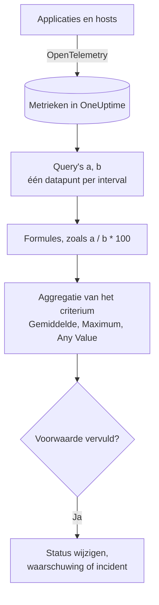

# Metrics-monitor

Een metrics-monitor vraagt de metrieken op die uw applicaties en infrastructuur naar OneUptime sturen, combineert ze met formules wanneer u een verhouding of een totaal nodig hebt, en vergelijkt het resultaat over een voortschrijdend tijdsbereik met uw criteria. Gebruik hem voor aantallen verzoeken, foutverhoudingen, wachtrijdieptes, CPU, geheugen en schijf (elke numerieke reeks), met één waarschuwing per host of per container wanneer u hem groepeert.

:::cards
- [De monitor maken](#een-metrics-monitor-maken): Query's, formules, een tijdsbereik en criteria.
- [Hoe hij wordt geëvalueerd](#hoe-hij-wordt-geëvalueerd): Datapunten, formules en de aggregatie van de criteria.
- [Uitgewerkt voorbeeld](#uitgewerkt-voorbeeld-een-groeiende-wachtrij): Dezelfde gegevens onder elke aggregatie.
- [Waarschuwingen per reeks](#waarschuwingen-per-reeks-group-by): Eén waarschuwing per host, container of koppelpunt.
:::

## Hoe het werkt

Elke minuut voert OneUptime elke metriekquery van de monitor uit over het tijdsbereik ervan. Een query levert één datapunt per tijdsinterval op, en formules combineren de query's interval voor interval. Elk criterium brengt vervolgens de datapunten van de query of formule die het controleert terug tot één uitkomst (hun gemiddelde, hun maximum of een test van elk punt) en vergelijkt die met zijn drempel.

## Voordat u begint

- Uw applicaties of infrastructuur sturen metrieken naar OneUptime via OpenTelemetry. Zie [OpenTelemetry](/docs/telemetry/open-telemetry).
- Ken de naam van de metriek en de attributen waarop u wilt filteren of groeperen. De lijsten **Metriek** en **Groeperen op** bieden alleen namen en attributen die OneUptime al heeft ontvangen.

## Een metrics-monitor maken

:::steps
### Een nieuwe monitor beginnen

Ga naar **Monitoren** en klik op **Monitor maken**. Of bouw in de metriekverkenner de grafiek op die u wilt bewaken en klik op **Monitor maken vanuit deze weergave**: de nieuwe monitor begint met de query's ervan.

### Metrics kiezen

Klik onder **Monitortype** op **Meer monitortypen** en kies **Metrieken** onder **Telemetrie**, of typ `metrics` in het zoekvak. Vul een **Naam** in en klik dan op **Volgende**.

### De metriekquery's toevoegen

Kies in **Te bewaken metriek** een **Metriek** en hoe u die aggregeert met **Aggregate by**. Open **Filters & grouping** om op attributen te filteren of om te groeperen met **Groeperen op**. Klik op **Metriek toevoegen** voor nog een query, of op **Formule toevoegen** om ze te combineren. De grafiek onder de query's toont de afgelopen uren, met de waarde van de regel als rode lijn, zodat u de waarden ziet die de regel gaat controleren.

### Zeggen wanneer er gewaarschuwd wordt

Kies in **Wanneer waarschuwen** bij **Gemeten als** hoe de metriek wordt gemeten, en daarna een **Tijdvenster**, een **Voorwaarde** en een **Waarde**. Heeft de stap meer dan één query of formule, kies dan ook de **Metriek** die de regel leest. De zin eronder zegt de regel in gewone woorden terug.

### Kiezen wat er gebeurt

Kies in **Wat er gebeurt** voor **Een waarschuwing maken**, **Een incident melden** of **Beide**, en geef het een titel en een ernst. Zolang de regel overeenkomt, toont de monitor de status onder **Meer velden**; komt hij niet meer overeen, dan gaat de monitor terug naar zijn standaardstatus en lost de waarschuwing of het incident zichzelf op.

### De monitor maken

Klik op **Monitor maken**. De monitor opent op zijn pagina **Overzicht**, en zijn eerste evaluatie volgt binnen een minuut.
:::

## Wat hij opvraagt

### Metriekquery's

| Veld | Wat het doet | Standaard |
| --- | --- | --- |
| **Metriek** | De metriek die wordt opgevraagd. | Verplicht |
| **Aggregate by** | Hoe de waarden in elk tijdsinterval tot één datapunt worden gecombineerd: Gem., Som, Min, Max, Aantal, of een percentiel (P50, P75, P90, P95 of P99). | Gem. |
| **Filter by attributes** (onder **Filters & grouping**) | Alleen reeksen waarvan de attributen aan deze voorwaarden voldoen. | Geen filter |
| **Groeperen op** (onder **Filters & grouping**) | Eén reeks per unieke waarde van deze attributen (zie [Waarschuwingen per reeks](#waarschuwingen-per-reeks-group-by)). | Eén reeks |

Elke query en formule krijgt een variabele (`a`, `b`, `c` enzovoort), in de volgorde waarin u ze toevoegt.

### Formules

Een formule combineert queryvariabelen met `+`, `-`, `*`, `/`, `%`, `^` en haakjes, interval voor interval. U kunt de variabelen met of zonder een `$` ervoor schrijven:

- `a / b * 100`: het aandeel van `b` dat `a` is, als percentage
- `a + b`: twee metrieken bij elkaar opgeteld
- `a - b`: het verschil ertussen

### Voortschrijdend tijdvenster

Het **Tijdvenster** in **Wanneer waarschuwen** bepaalt hoe ver elke evaluatie terugkijkt: **Laatste 1 minuut**, **Laatste 5 minuten**, **Laatste 10 minuten**, **Laatste 15 minuten**, **Laatste 30 minuten**, **Laatste 1 uur**, **Laatste 2 uur**, **Laatste 3 uur**, **Laatste 6 uur**, **Laatste 12 uur**, **Laatste 24 uur**, **Laatste 2 dagen**, **Laatste 3 dagen**, **Laatste 7 dagen**, **Laatste 14 dagen**, **Laatste 30 dagen**, **Laatste 60 dagen**, **Laatste 90 dagen**, **Laatste 180 dagen** of **Laatste 365 dagen**.

Hoe langer het venster, hoe breder elk tijdsinterval, dus één datapunt staat voor meer tijd:

| Tijdvenster | Eén datapunt per |
| --- | --- |
| Laatste 1 minuut tot Laatste 3 uur | minuut |
| Laatste 6 uur, Laatste 12 uur | 5 minuten |
| Laatste 24 uur | 15 minuten |
| Laatste 2 dagen, Laatste 3 dagen | 30 minuten |
| Laatste 7 dagen | uur |
| Laatste 14 dagen, Laatste 30 dagen | dag |
| Laatste 60 dagen tot Laatste 180 dagen | week |
| Laatste 365 dagen | maand |

## Hoe hij wordt geëvalueerd

- **Elke minuut.** Een metrics-monitor wordt niet door sondes gecontroleerd, dus hij heeft geen interval om in te stellen en geen pagina **Sondes en interval**.
- **Eerst de query's, dan de formules.** Elke query levert één datapunt per tijdsinterval van het tijdsbereik op, volgens zijn **Aggregate by**. Formules worden voor elk interval berekend uit de datapunten van de query's.
- **Dan de maat van de regel.** De regel brengt de datapunten van zijn metriek terug tot wat hij met zijn waarde vergelijkt, zoals **Gemeten als** zegt:

| Gemeten als | In de eigen criteria | De voorwaarde wordt getoetst aan… |
| --- | --- | --- |
| Het gemiddelde | Gemiddelde | het gemiddelde van de datapunten |
| De som | Som | de som van de datapunten |
| De hoogste waarde | Maximum Value | het hoogste datapunt |
| De laagste waarde | Minimum Value | het laagste datapunt |
| Elke waarde (het hele venster) | All Values | elk datapunt: ze moeten allemaal aan de voorwaarde voldoen en het hele tijdsbereik dekken |
| Een willekeurige waarde (op enig moment) | Any Value | elk datapunt: het is genoeg als er één aan de voorwaarde voldoet |

- **Criteria van boven naar beneden.** Bij een monitor zonder Group By beslist het eerste criterium dat overeenkomt, dus zet het ernstigste bovenaan. Een gegroepeerde monitor controleert elk criterium voor elke reeks (zie [De evaluatie van criteria verschilt](#de-evaluatie-van-criteria-verschilt)).
- **Geen gegevens is niet nul.** Wanneer de query in het tijdsbereik geen datapunten oplevert, doet de regel wat **Als er geen gegevens zijn** zegt, onder **Meer velden** in **Wanneer waarschuwen**: **Niets** (de standaard: de regel komt niet overeen), **Als nul tellen** of **Waarschuwen, alsof ze overeenkwam**.
- **Elke waarde heeft het hele tijdsbereik nodig.** Een reeks voldoet pas aan een regel gemeten als **Elke waarde (het hele venster)** als haar datapunten het tijdsbereik dekken, van het begin tot nu, zonder een gat van meer dan één ontbrekend datapunt. Komen alle gegevens van de monitor te laat binnen, zoals die van CloudWatch, dan neemt het nieuwste datapunt de plaats in van nu. Een host, container of deployment die net gegevens begint te sturen, of die een tijd stil was, wacht tot er gegevens voor een heel tijdsbereik zijn, en het evaluatielogboek laat zien hoe ver het is: `Waiting for 15 minutes of data: 2 of 15 minutes so far`. Een reeks waarvan de waarschuwing of het incident al open is, wordt alleen op haar datapunten beoordeeld, zodat een kort gat in haar gegevens het niet oplost. Stuurt de metriek minder vaak gegevens dan het tijdsbereik lang is, dan telt één los datapunt voor het hele bereik zodra het een paar minuten oud is; wilt u beoordelen hoe lang een waarde aanhoudt, maak het tijdsbereik dan minstens twee meldintervallen lang.
- **De onderbreking van OneUptime zelf is geen stilte.** Zolang het tijdsbereik tijd bevat waarin OneUptime zelf geen gegevens ontving (het startte opnieuw, werd geüpgraded of werkte een achterstand weg), wacht de controle: de status verandert niet, en er wordt geen incident of waarschuwing geopend of opgelost, wat **Als er geen gegevens zijn** ook zegt. Zie [Als OneUptime geen gegevens ontvangt](/docs/monitor/when-oneuptime-is-not-receiving).

## Criteria

Deze monitoren evalueren altijd de **Metric Value**: de geaggregeerde waarde van de ingestelde metriekquery of formule. **Wanneer waarschuwen** stelt één criterium in uit **Gemeten als**, **Tijdvenster**, **Voorwaarde** en **Waarde**. Heeft de metriek een eenheid, kies dan de eenheid van de waarde ernaast. De **Voorwaarde** is **Boven**, **Op of boven**, **Onder**, **Op of onder**, **Precies**, **Ongewoon hoog**, **Ongewoon laag** of **Ongewoon hoog of laag**. Voor meerdere criteria, zoals ernstbanden, klikt u op **Bewerken als eigen criteria** onder **Meer velden** in **Wat er gebeurt**: elk criterium daar heeft een **Metriek**, een **Aggregatie**, een **Voorwaarde** en een **Drempel**.

| Voorwaarde | Komt overeen wanneer de waarde… |
| --- | --- |
| **Groter dan** | boven de drempel ligt |
| **Groter dan of gelijk aan** | gelijk is aan de drempel of hoger |
| **Kleiner dan** | onder de drempel ligt |
| **Kleiner dan of gelijk aan** | gelijk is aan de drempel of lager |
| **Gelijk aan** | precies de drempel is |
| **Anomalously High** | boven het verwachte bereik voor dit uur van de week ligt |
| **Anomalously Low** | onder dat bereik ligt |
| **Anomalous** | buiten dat bereik ligt, in welke richting ook |

De anomaliecondities hebben geen drempel. **Wanneer waarschuwen** toont in plaats daarvan **Gevoeligheid** (Laag, Gemiddeld, de standaard, of Hoog), en de eigen criteria ook een **Baseline-venster** (14 dagen, de standaard, 28, 60 of 90), en elk datapunt wordt vergeleken met de baseline voor hetzelfde uur van de week die uit dat venster is opgebouwd. Zolang dat uur van de week te weinig geschiedenis heeft, is het criterium nog aan het leren en levert het geen waarschuwingen op.

Een metrics-monitor die in Monitor maken is aangemaakt, begint met één regel op zijn eerste query: **Het gemiddelde** over **Laatste 5 minuten**, **Boven** de **Waarde** die u invult, en **Een waarschuwing maken**.

Een nieuwe metrics-monitor die via de API of Terraform zonder criteria is aangemaakt, begint met twee criteria op zijn eerste query, allebei met de aggregatie **Any Value**:

| Criterium | Voorwaarde | Effect |
| --- | --- | --- |
| Check if … is offline | **Gelijk aan** `0` | Zet de monitor offline en meldt een incident, dat automatisch wordt opgelost |
| Check if … is online | **Groter dan** `0` | Zet de monitor online |

> [!NOTE]
> Het offline-criterium gaat af op een gerapporteerde waarde van 0, niet op stilte. Om gewaarschuwd te worden wanneer een metriek niet meer binnenkomt, zet u de **Als geen gegevens** ervan op **Trigger**.

## Uitgewerkt voorbeeld: een groeiende wachtrij

U wilt een incident wanneer de checkout-wachtrij diep blijft. Query `a` is de gauge `checkout.queue.depth`, met **Aggregate by** Max, en het **Tijdvenster** is **Laatste 5 minuten**. Eén evaluatie ziet deze vijf datapunten van één minuut:

| Minuut | 10:01 | 10:02 | 10:03 | 10:04 | 10:05 |
| --- | --- | --- | --- | --- | --- |
| `a` | 640 | 980 | 1.500 | 1.620 | 1.100 |

Een regel **Boven** `1000` geeft voor elke keuze bij **Gemeten als** een ander antwoord:

| Gemeten als | Vergeleken met 1.000 | Overeenkomst? |
| --- | --- | --- |
| Het gemiddelde | 1.168 | Ja |
| De som | 5.840 | Ja |
| De hoogste waarde | 1.620 | Ja |
| De laagste waarde | 640 | Nee |
| Elke waarde (het hele venster) | 640, 980, 1.500, 1.620, 1.100 | Nee: twee punten liggen niet boven 1.000 |
| Een willekeurige waarde (op enig moment) | 640, 980, 1.500, 1.620, 1.100 | Ja: 1.500 wel |

**Het gemiddelde** waarschuwt bij een aanhoudende achterstand en negeert één diepe minuut; **Elke waarde (het hele venster)** wacht tot elke minuut in het bereik diep is; **Een willekeurige waarde (op enig moment)** waarschuwt bij de eerste diepe minuut.

## Waarschuwingen per reeks (Group By)

**Groeperen op** op een metriekquery splitst die query op in één reeks per unieke attribuutwaarde (één per host, één per container, één per koppelpunt), en een monitor met Group By evalueert elke reeks afzonderlijk. Die ene instelling is het verschil tussen "de vloot is ongezond" en "`prod-db-01` is ongezond".

### Eén waarschuwing per groep

Met Group By op `host.name` geeft een monitor voor schijfgebruik die vijftig hosts bewaakt **één waarschuwing (of incident) per host die de drempel overschrijdt**. Host A die volloopt, opent een eigen waarschuwing; host B die tien minuten later volloopt, opent er een tweede, afzonderlijke waarschuwing naast.

Zonder Group By is dezelfde monitor één scalair: de query voegt alle hosts samen tot één getal en de monitor geeft **één waarschuwing voor de hele monitor**. Zolang die waarschuwing open is, levert een tweede host die de drempel overschrijdt niets op (de monitor waarschuwt al, dus er is niets nieuws om te melden) en hoort de engineer van dienst nooit van host B. **Group By instellen is de manier om waarschuwingen per host te krijgen.** Wilt u per host, per container of per koppelpunt gewaarschuwd worden, stel het dan in.

### Onafhankelijk oplossen

Elke waarschuwing per groep volgt haar eigen groep. Wanneer host A weer onder de drempel zakt, wordt diens waarschuwing vanzelf opgelost, en de waarschuwing van host B blijft open tot host B herstelt. Het herstel van de ene groep sluit nooit de waarschuwing van een andere.

### De evaluatie van criteria verschilt

- **Gegroepeerde monitoren evalueren elk criterium.** Ernstniveaus kunnen daardoor tegelijk bij verschillende groepen afgaan: met "Critical: groter dan 95" boven "Warning: groter dan 80" opent een host op 96% een kritieke waarschuwing terwijl een host op 85% bij dezelfde controle een gewone waarschuwing opent. Een host die beide niveaus overschrijdt, krijgt nog steeds precies één waarschuwing, van het eerste criterium dat overeenkomt, dus **zet de criteria op volgorde van ernstigst naar minst ernstig**.
- **Niet-gegroepeerde monitoren stoppen bij het eerste criterium dat overeenkomt.** Alleen dat ene criterium gaat af, nog een reden om het waarschuwingscriterium boven het gezonde te zetten: een breed gezond criterium bovenaan komt bij bijna elke controle overeen en zorgt dat het waarschuwingscriterium eronder nooit wordt geëvalueerd.

| Host | Schijf gebruikt | Critical (> 95) | Warning (> 80) | Gegeven waarschuwing |
| --- | --- | --- | --- | --- |
| `prod-db-01` | 96% | Ja | Ja | Critical |
| `prod-db-02` | 85% | Nee | Ja | Warning |
| `prod-db-03` | 40% | Nee | Nee | Geen |

### Een attribuut kiezen om op te groeperen

Groepeer op een attribuut dat echt iets afzonderlijks aanduidt waarvoor u iemand zou oproepen: het host-attribuut voor een hostmetriek van de hele vloot, het container- of pod-attribuut voor een containermetriek, het koppelpunt- of apparaat-attribuut voor een metriek van een bestandssysteem of van schijf-I/O, het interface-attribuut voor een netwerkmetriek. De keuzelijst **Groeperen op** wordt gevuld met de attributen die uw collector echt stuurt, dus kies uit de lijst in plaats van een sleutel met de hand te typen.

Groepeer geen metriek die al één scalair voor het hele systeem is (een leidersvlag voor het hele cluster, een achterstand van de scheduler, of de CPU van één host in een monitor voor één host). Zulke metrieken groeperen levert precies één reeks op en verandert niets behalve de titels van de waarschuwingen.

De waarden van het groeperingsattribuut zijn ook beschikbaar als [templatevariabelen](/docs/monitor/incident-alert-templating) in de titel, de beschrijving en de herstelnotities van de waarschuwing of het incident: groeperen op `host.name` laat de titel `Disk almost full on {{host.name}}` luiden.

## Problemen oplossen

:::details De grafiek toont een overschrijding, maar de monitor waarschuwde niet
Controleer eerst **Gemeten als**: **Elke waarde (het hele venster)** komt alleen overeen wanneer elk datapunt in het tijdsbereik de waarde overschrijdt, en **Het gemiddelde** vlakt een korte piek af. **Elke waarde (het hele venster)** wacht ook tot een reeks gegevens voor het hele tijdsbereik heeft, dus een host of deployment die net gegevens begint te sturen, wordt nog niet beoordeeld. Controleer daarna of de regel de query of formule leest die u bedoelt (`a` is niet de formule `c`), en of de **Waarde** in de eenheid staat die u denkt.
:::

:::details De metriek kwam niet meer binnen en er gebeurde niets
Een tijdsbereik zonder datapunten is geen waarde van 0. Met **Als er geen gegevens zijn** op de standaardwaarde, **Niets**, komt de regel niet overeen. Zet het op **Waarschuwen, alsof ze overeenkwam** onder **Meer velden** in **Wanneer waarschuwen** om gewaarschuwd te worden bij stilte.
:::

:::details Ik krijg één waarschuwing voor de hele vloot
De query heeft geen **Groeperen op**, dus alle hosts worden samengevoegd tot één getal. Groepeer de query op het host-, container- of koppelpunt-attribuut (zie [Waarschuwingen per reeks](#waarschuwingen-per-reeks-group-by)).
:::

:::details Een anomaliecriterium gaat nooit af
Het is nog aan het leren: het uur van de week waarmee het vergelijkt, heeft binnen het **Baseline-venster** nog niet genoeg geschiedenis.
:::

## Volgende stappen

:::cards
- [Incident- en waarschuwingstemplates](/docs/monitor/incident-alert-templating): Zet de host en de waarde in de titels van waarschuwingen.
- [Logs-monitor](/docs/monitor/logs-monitor): Word gewaarschuwd op het volume en de inhoud van logs, per groep.
- [Host-monitor](/docs/monitor/host-monitor): Kant-en-klare controles van CPU, geheugen en schijf voor uw hosts.
- [OpenTelemetry](/docs/telemetry/open-telemetry): Stuur metrieken naar OneUptime.
:::
