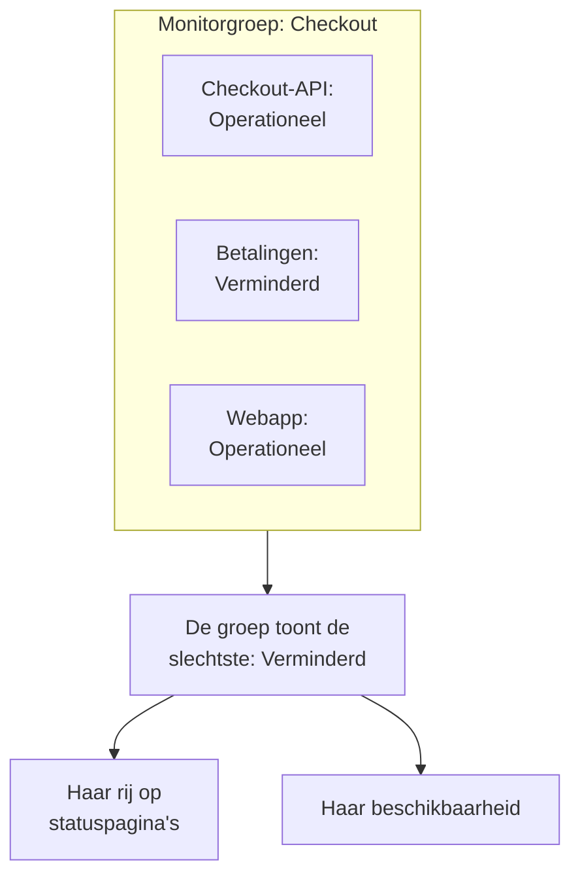

# Monitorgroepen

Een monitorgroep voegt meerdere monitoren samen tot één status. Groepeer de monitoren die samen één dienst vormen, zoals Checkout: de API, de betaaldienst en de webapp ervan. De groep toont de slechtste status onder hen, heeft een eigen beschikbaarheid, en een statuspagina kan de hele groep als één rij tonen.

:::cards
- [Hoe de status van een groep wordt bepaald](#hoe-de-status-van-een-groep-wordt-bepaald): De slechtste status onder haar monitoren.
- [Monitorgroepen inschakelen](#monitorgroepen-inschakelen): Eén schakelaar in de projectinstellingen.
- [Een monitorgroep maken](#een-monitorgroep-maken): Geef haar een naam en wijs haar monitoren toe.
- [Een groep op een statuspagina tonen](#een-groep-op-een-statuspagina-tonen): Eén rij voor de hele groep.
:::

## Hoe de status van een groep wordt bepaald

Een groep begint bij uw operationele status en neemt de slechtste status onder haar monitoren over: de status die het laagst staat in de lijst met monitorstatussen van uw project. Gaat één monitor naar **Verminderd**, dan is de hele groep **Verminderd**; gaat er één naar **Offline**, dan is ze **Offline**.

- **Gearchiveerde monitoren tellen niet mee.** Een gearchiveerde monitor wordt niet gecontroleerd, dus zijn status is bevroren; de groep laat hem weg.
- **Een lege groep is operationeel.** Een groep zonder monitoren, of met alleen gearchiveerde, toont uw operationele status.
- **De volgorde bepaalt u.** Welke status de slechtste is, volgt de volgorde onder **Monitoren → Instellingen → Monitorstatus**. Zie [Monitorstatussen](/docs/monitor/criteria-and-statuses#monitorstatussen).

Een monitorgroep is geen statuspaginagroep. Een statuspaginagroep is een kop op één statuspagina die rijen bevat. Een monitorgroep is één rij die voor meerdere monitoren staat, en elke statuspagina kan haar tonen.

## Voordat u begint

- **Uw abonnement.** In OneUptime Cloud vereisen monitorgroepen het Scale-abonnement.
- **De schakelaar.** Monitorgroepen zijn verborgen tot **Monitorgroepen** voor het project is ingeschakeld (zie hieronder). Inschakelen vereist de rol Project Owner, of een aangepaste rol met de machtiging Edit Project of Manage Billing.
- **Uw rol.** Groepen maken, wijzigen en verwijderen vereist de rol Project Owner, Project Admin, Project Member, Monitor Admin of Monitor Member, of een aangepaste rol met de bijbehorende machtigingen voor monitorgroepen. Een Viewer kan groepen zien, maar niet wijzigen.

## Monitorgroepen inschakelen

:::steps
### Functievlaggen openen

Ga naar **Projectinstellingen → Geavanceerd → Functievlaggen**. **Geavanceerd** is ingeklapt in het zijmenu: klap het eerst uit.

### De schakelaar omzetten

Zet de schakelaar **Monitorgroepen** aan. Hij slaat direct op: **Monitorgroepen** verschijnt in het zijmenu van **Monitoren**, en het item **Monitoren** van elke statuspagina heet nu **Middelen**, waar u een groep kunt toevoegen.
:::

Zet u de schakelaar weer uit, dan verdwijnt **Monitorgroepen** uit het menu. Er wordt geen groep verwijderd.

## Een monitorgroep maken

:::steps
### Monitorgroepen openen

Ga naar **Monitoren → Monitorgroepen**. De kaart **Monitorgroepen** toont elke groep met haar **Huidige status**, labels en eigenaren.

### De groep maken

Klik op **Monitor Groep aanmaken**, vul een **Naam** en, als u wilt, een **Beschrijving** in, en klik onderaan het formulier op **Monitor Groep aanmaken**. De groep begint zonder monitoren.

### Haar monitoren toewijzen

Open de groep en klik in haar zijmenu op **Monitoren**. Klik op **Monitor toewijzen**, kies een monitor onder **Selecteer monitor** en klik op **Toewijzen**. Doe dit voor elke monitor in de groep.

### Haar status controleren

Klik op **Overzicht**. **Huidige status** toont de status van de groep nu, en **Uptime grafiek** toont haar laatste 90 dagen, één balk per dag.
:::

Om een monitor uit de groep te halen, klikt u in **Monitoren in groep** op zijn rij op **Toewijzing opheffen**. De monitor zelf verandert niet. Een monitor kan bij meer dan één groep horen.

## De pagina's van een groep

Open een groep om haar pagina's in het zijmenu te zien:

| Pagina | Wat ze toont |
| --- | --- |
| **Overzicht** | **Details van monitorgroep**, **Huidige status** en **Uptime grafiek** met het beschikbaarheidspercentage van de groep over de laatste 90 dagen. |
| **Eigenaren** | De mensen en teams die verantwoordelijk zijn voor de groep. |
| **Monitoren** | **Monitoren in groep**, met **Monitor toewijzen** en **Toewijzing opheffen**. |
| **Incidenten** | De incidenten op elke monitor in de groep. |
| **Waarschuwingen** | De waarschuwingen op elke monitor in de groep. |
| **Auditlogboeken** | Wie de groep wanneer heeft gewijzigd. Staat onder **Geavanceerd**, dat ingeklapt begint. |
| **Groep verwijderen** | Verwijdert de groep, ook onder **Geavanceerd**. |

De beschikbaarheid in het **Overzicht** telt elke status behalve de operationele als downtime. Een statuspagina telt alleen de statussen in haar eigen lijst **Telt als downtime**: zie [Kiezen wat de pagina toont](/docs/status-pages/index#kiezen-wat-er-op-de-pagina-komt).

De lijst **Monitorgroepen** kan groepen filteren op eigenaar en label, labels en eigenaren voor veel groepen tegelijk instellen, en groepen als JSON exporteren of importeren.

## Een groep op een statuspagina tonen

:::steps
### De middelen van de statuspagina openen

Ga naar **Statuspagina's**, open de pagina en klik in het zijmenu op **Middelen**.

### Het dialoogvenster op een groep zetten

Klik op **Monitor toevoegen**. Klik onder de keuzelijst met monitoren op **Add a Monitor Group instead.** De keuzelijst wordt **Monitor Groep**.

### De groep kiezen en toevoegen

Kies de groep. **Weergavenaam**, de naam die bezoekers lezen, neemt de naam van de groep over tot u er zelf een typt. Klik op **Monitor toevoegen**: de rij verschijnt op de pagina met de status van de groep.
:::

Op de statuspagina staat de rij voor elke monitor in de groep:

- **Haar status.** Dat is die van de groep: de slechtste van haar monitoren.
- **Haar incidenten.** Een incident op elke monitor in de groep verschijnt op de pagina, met de groep genoemd onder de getroffen bronnen.
- **Haar abonnees.** Een abonnee die de groep kiest, hoort over elke monitor erin. Zie [Abonnees bronnen en gebeurtenistypen laten kiezen](/docs/status-pages/subscribers#abonnees-zelf-resources-en-gebeurtenistypen-laten-kiezen).

Voor de overige opties van de rij, zoals haar beschikbaarheid en geschiedenisgrafiek, zie [Statuspagina – bronnen en groepen](/docs/status-pages/resources-and-groups).

> [!WARNING]
> Als u een monitorgroep verwijdert, wordt ook haar rij verwijderd van elke statuspagina die haar toont. De monitoren in de groep, en hun incidenten, worden niet verwijderd.

## API en Terraform

Een groep is `/api/monitor-group`, en elke monitor erin is een rij van `/api/monitor-group-resource` die een `monitorGroupId` aan een `monitorId` koppelt. In Terraform zijn dat `oneuptime_monitor_group` en `oneuptime_monitor_group_resource`: zie [Monitorgroep](/docs/terraform/examples#monitorgroep).

## Problemen oplossen

:::details Monitorgroepen staat niet in het menu Monitoren
De schakelaar **Monitorgroepen** staat uit. Zet hem aan onder **Projectinstellingen → Geavanceerd → Functievlaggen**. In OneUptime Cloud vereisen groepen ook het Scale-abonnement.
:::

:::details De groep toont Offline, maar de meeste monitoren werken
Dat is de regel: de groep toont haar slechtste monitor. Open **Monitoren** in de groep om de uitgevallen monitor te vinden, of hef de toewijzing op van een monitor die niet in de groep hoort.
:::

:::details Een statuspagina kan de groep niet toevoegen
**Add a Monitor Group instead.** verschijnt in het dialoogvenster alleen zolang de schakelaar **Monitorgroepen** voor het project aan staat.
:::

## Volgende stappen

:::cards
- [Monitorcriteria en statussen](/docs/monitor/criteria-and-statuses): Wat de status van elke monitor bepaalt.
- [Statuspagina – bronnen en groepen](/docs/status-pages/resources-and-groups): De rijen van een statuspagina indelen.
- [Abonnees en aankondigingen](/docs/status-pages/subscribers): Klanten informeren over de incidenten van een groep.
:::
