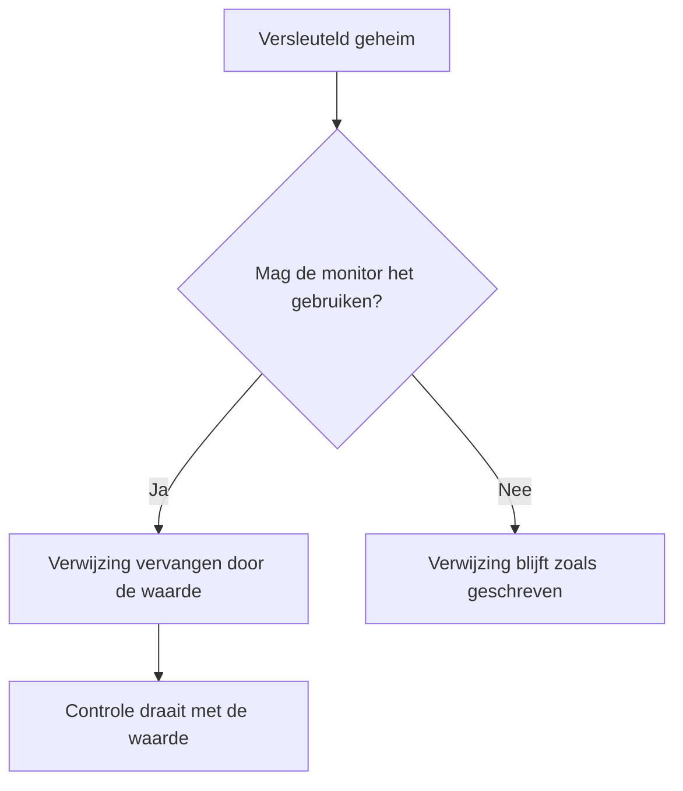

# Monitor-geheimen

Monitorgeheimen houden de wachtwoorden, API-sleutels en tokens die uw monitoren nodig hebben buiten de monitor zelf. U slaat een waarde één keer versleuteld op, kiest welke monitoren haar mogen gebruiken, en verwijst ernaar met `{{monitorSecrets.NAME}}` waar de monitor haar nodig heeft.

:::cards
- [Een geheim toevoegen](#een-geheim-toevoegen): Een waarde opslaan en kiezen wie haar mag gebruiken.
- [De toegang kiezen](#kiezen-welke-monitoren-een-geheim-mogen-gebruiken): Alle monitoren, specifieke monitoren of monitoren met labels.
- [Een geheim gebruiken](#een-geheim-gebruiken): Waar `{{monitorSecrets.NAME}}` werkt.
- [Aanmelden met een eenmalige code](#aanmelden-met-een-eenmalige-code): Een monitor door de tweefactorauthenticatie van een site laten komen.
:::

## Hoe geheimen een monitor bereiken

Een geheim wordt versleuteld opgeslagen en na het opslaan nooit meer getoond. Voordat OneUptime een monitor aan een sonde overdraagt, vervangt het elke verwijzing die de monitor mag gebruiken door de ontsleutelde waarde; een verwijzing die de monitor niet mag gebruiken, blijft staan zoals ze is geschreven. Een geheim voor eenmalige codes is de uitzondering: de sonde maakt de code ervan wanneer de controle draait (zie [Aanmelden met een eenmalige code](#aanmelden-met-een-eenmalige-code)).



De sonde die de controle uitvoert, ontvangt de waarde, dus een monitor die een geheim gebruikt, moet draaien op sondes die u vertrouwt: die van OneUptime, of een [aangepaste sonde](/docs/probe/custom-probe) die u zelf beheert.

## Voordat u begint

- **Het Growth-abonnement of hoger**, op OneUptime Cloud. Zelf gehoste installaties hebben geen abonnementen.
- **Een rol die geheimen mag beheren**: Projecteigenaar, Projectbeheerder, of een aangepaste rol met de machtiging Create Monitor Secret.

## Werken met geheimen

### Een geheim toevoegen

:::steps
1. Ga naar **Monitoren → Instellingen → Geheimen** en klik op **Monitorgeheim aanmaken**.
2. Voer een **Naam** en de **Geheime waarde** in. De naam is waarnaar u verwijst, bijvoorbeeld `ApiKey`. Hij mag alleen letters, cijfers, koppeltekens (`-`) en underscores (`_`) bevatten, en geen twee geheimen in een project mogen dezelfde hebben. Gaat het om de configuratiesleutel voor tweefactorauthenticatie van een site, kies dan eerst **Eenmalige code (TOTP)** (zie [Aanmelden met een eenmalige code](#aanmelden-met-een-eenmalige-code)).
3. Kies bij de stap **Toegang** welke monitoren het mogen gebruiken (zie de volgende sectie) en klik op **Monitorgeheim aanmaken**.
:::

> [!IMPORTANT]
> Geheimen worden versleuteld en veilig opgeslagen. De waarde van het geheim wordt na het opslaan nooit meer getoond — niet in de tabel, niet in het bewerkingsformulier en niet via de API. Raakt u de waarde kwijt, dan moet u haar ophalen waar ze vandaan kwam en opnieuw instellen. Gebruik om een geheim te roteren de knop **Geheime waarde bijwerken** in de rij ervan; u hoeft het niet te verwijderen en opnieuw te maken. Dezelfde knop wijzigt samen met een nieuwe waarde ook wat het geheim bevat, **Tekst** of **Eenmalige code (TOTP)**, en monitoren die het geheim gebruiken, nemen het nieuwe type over bij hun volgende controle.

### Kiezen welke monitoren een geheim mogen gebruiken

Elk geheim heeft een van drie toegangsopties:

| Optie | Welke monitoren het geheim mogen gebruiken | Gebruik het voor |
| --- | --- | --- |
| **Alle monitoren** | Elke monitor in het project, ook monitoren die u later maakt. | Een inloggegeven dat veel monitoren delen. |
| **Specifieke monitoren** | Alleen de monitoren die u kiest. Dit is de standaard, en geheimen die vóór deze opties zijn gemaakt, werken zo. | Een inloggegeven voor één of enkele monitoren. |
| **Monitoren met labels** | Monitoren die minstens een van de labels hebben die u kiest. Een van die labels aan een monitor toevoegen geeft hem toegang, en het label verwijderen neemt de toegang af bij de volgende run van de monitor. | Een inloggegeven voor een groep monitoren die in de loop van de tijd verandert. |

U kunt de optie op elk moment wijzigen met **Bewerken** in de rij van het geheim. Alleen de lijst van de gekozen optie wordt bewaard: overschakelen naar **Alle monitoren** maakt de monitor- en labellijst van het geheim leeg, en wisselen tussen **Specifieke monitoren** en **Monitoren met labels** maakt de lijst leeg waarvan u weggaat.

Een geheim is nooit beschikbaar voor monitoren in een ander project.

> [!WARNING]
> Iedereen die een monitor mag bewerken die een geheim kan gebruiken, kan dat geheim overal naartoe sturen waarmee de monitor verbinding maakt. Met **Alle monitoren** is dat iedereen die in het project monitoren mag maken of bewerken. Met **Monitoren met labels** hoort daar ook iedereen bij die een van die labels aan een monitor mag toevoegen.

Via de API is de toegangsoptie het veld `monitorAccess`: `All Monitors`, `Specific Monitors` of `Monitors With Labels`. De velden `monitors` en `labels` bevatten de lijsten. Een geheim dat zonder `monitorAccess` wordt gemaakt, krijgt `Specific Monitors`.

### Een geheim gebruiken

Om een geheim te gebruiken, schrijft u `{{monitorSecrets.SECRET_NAME}}` in een veld dat geheimen accepteert. Een request-header `Authorization: Bearer {{monitorSecrets.ApiKey}}` stuurt bijvoorbeeld de waarde van het geheim `ApiKey`.

Deze monitortypen en velden accepteren geheimen:

| Monitortype | Velden |
| --- | --- |
| API | De URL, de request-headers en -body, en het clientcertificaat, de privésleutel en de wachtwoordzin (mTLS) |
| Website | De URL, en het clientcertificaat, de privésleutel en de wachtwoordzin (mTLS) |
| Ping, IP, Poort, NTP, SSL-certificaat | De host of URL die wordt gecontroleerd |
| DNS | De domeinnaam en de DNS-server |
| DNSSEC, Domein | De domeinnaam |
| SQL-query | De host, de databasenaam, de gebruikersnaam, het wachtwoord en de query |
| Databasegezondheid | De host, de databasenaam, de gebruikersnaam en het wachtwoord |
| Externe statuspagina | De URL van de statuspagina |
| Synthetische monitor, Aangepaste JavaScript-code | Het script |
| Netwerkapparaat | De SNMP-communitystring, en de authenticatie- en privacysleutels van SNMPv3 |

Geheimen worden ingevuld voordat het script van een monitor van het type Synthetische monitor of Aangepaste JavaScript-code draait, dus een verwijzing zoals `{{monitorSecrets.ApiKey}}` in het script is tijdens het uitvoeren de ontsleutelde waarde.

Verwijst een monitor naar een geheim dat hij niet mag gebruiken, dan blijft de verwijzing staan zoals ze is en wordt ze niet door de waarde vervangen.

Wanneer de controle van een monitor van het type API, Website of Externe statuspagina mislukt, noemt de fout de URL alleen met schema, host en poort, zoals `https://api.example.com`, dus een geheim in de URL wordt nooit getoond.

Wanneer u een monitor test voordat u hem opslaat, worden alleen geheimen ingevuld die beschikbaar zijn voor **Alle monitoren**, omdat een nieuwe monitor op geen enkele lijst staat en nog geen labels heeft. Nadat u de monitor hebt opgeslagen, gebruiken tests elk geheim dat de monitor mag gebruiken.

## Aanmelden met een eenmalige code

Sommige sites vragen bij het aanmelden om een code uit een authenticator-app. Een geheim van het type **Eenmalige code (TOTP)** bevat de configuratiesleutel van die site, zodat een monitor zich kan aanmelden zoals u dat doet: overal waar de monitor het geheim gebruikt, maakt de sonde de huidige code met haar eigen klok, op het moment dat de controle die nodig heeft. De configuratiesleutel wordt versleuteld opgeslagen en nooit meer getoond, zoals elke geheime waarde, en wordt nooit in de monitor geschreven.

1. Schakel tweefactorauthenticatie in voor het account waarmee de monitor zich aanmeldt. Toont de site een QR-code, vraag dan om de sleutel met de hand in te voeren, en kopieer de configuratiesleutel of de `otpauth://`-link.
2. Ga naar **Monitoren → Instellingen → Geheimen**, klik op **Monitorgeheim aanmaken**, kies **Eenmalige code (TOTP)** en plak de sleutel of de link in **Configuratiesleutel**.
3. Controleer of de **Huidige code** eronder overeenkomt met de code die uw authenticator-app nu toont, en kies daarna bij de stap **Toegang** welke monitoren het geheim mogen gebruiken, zoals bij elk geheim.

| Wat u plakt | De codes die de monitor maakt |
| --- | --- |
| Een configuratiesleutel, zoals `JBSW Y3DP EHPK 3PXP` | SHA1, 6 cijfers en elke 30 seconden een nieuwe code: wat elke authenticator-app aanneemt |
| Een `otpauth://totp/`-link | De parameters `algorithm` (`SHA1`, `SHA256` of `SHA512`), `digits` (`6` of `8`) en `period` in seconden (`30` als de link er geen heeft) van de link |

| Monitortype | Waar de code terechtkomt, en wanneer die wordt gemaakt |
| --- | --- |
| API | `{{monitorSecrets.NAME}}` in de URL, een request-header of de request-body, vlak voordat elke poging wordt verstuurd |
| Synthetische monitor, Aangepaste JavaScript-code | `{{monitorSecrets.NAME}}` in het script, wanneer het script start, en `await oneuptime.getTotpCode("NAME")`, wanneer het script erom vraagt |

Elk ander veld houdt `{{monitorSecrets.NAME}}` zoals het is geschreven. Zet de verwijzing in een JSON-request-body tussen aanhalingstekens, zoals in `{"otp": "{{monitorSecrets.LoginCode}}"}`, omdat een code met een nul kan beginnen.

Een aanmelding komt meestal pas een paar pagina's na de start van het script bij de vraag om de code, dus vraag de code op dat punt op. Dit script meldt zich aan met een wachtwoord en een eenmalige code:

```javascript
await page.goto("https://app.example.com/login");
await page.fill("#email", "monitoring@example.com");
await page.fill("#password", "{{monitorSecrets.AppPassword}}");
await page.click("button[type=submit]");

// The code is made now, when the sign-in asks for it.
await page.waitForSelector("#otp");
await page.fill("#otp", await oneuptime.getTotpCode("AppLoginCode"));
await page.click("button[type=submit]");

await page.waitForSelector(".dashboard", { timeout: 10000 });

return {
  data: { signedIn: true },
};
```

De sonde geeft nooit een code af met minder dan vijf seconden over, of minder dan een derde van de periode als de periode korter is: ze wacht dan op de volgende code, hoogstens vijf seconden, en telt die wachttijd niet mee in de uitvoeringstijd van de controle. Elke code die een controle maakt, wordt als sterretjes getoond, zoals `******`, in de logberichten, het resultaat, de fout en de namen van de schermafbeeldingen van die controle. Een schermafbeelding is een afbeelding van de pagina, dus maak die voordat de code wordt getypt of nadat de pagina verder is gegaan.

> [!NOTE]
> De sonde maakt de codes, dus een aangepaste sonde heeft OneUptime 17.1.0 of nieuwer nodig. Op een oudere draait een controle die een code nodig heeft niet, en mislukt ze met een zin die zegt dat u de sonde moet bijwerken; het formulier van de monitor en de pagina van de sonde noemen een sonde die te oud is, en [Een sonde bijwerken](/docs/probe/custom-probe#een-sonde-bijwerken) legt uit hoe. Ook de klok van de sonde moet kloppen, want een sonde die een minuut afwijkt, maakt codes waar de site al voorbij is.

## Problemen oplossen

:::details De monitor stuurt `{{monitorSecrets.NAME}}` letterlijk
De monitor mag het geheim niet gebruiken, of de naam klopt niet. Controleer de toegangsoptie van het geheim met **Bewerken** in de rij ervan, en of de naam in de verwijzing precies de naam van het geheim is.
:::

:::details Bij het testen van een nieuwe monitor wordt het geheim niet ingevuld
Voordat een monitor is opgeslagen, worden alleen geheimen ingevuld die beschikbaar zijn voor **Alle monitoren**. Sla de monitor op en test hem opnieuw.
:::

:::details Een veld negeert het geheim
Alleen de velden in de tabel hierboven accepteren geheimen. In elk ander veld wordt `{{monitorSecrets.NAME}}` verstuurd zoals het is geschreven.
:::

:::details De site weigert de eenmalige code
Controleer of de **Huidige code** overeenkwam met uw authenticator-app toen u het geheim opsloeg, of de klok van de sonde klopt en of een verwijzing in een JSON-request-body tussen aanhalingstekens staat. Duurt het even voordat de aanmelding bij de vraag om de code komt, vraag de code dan op dat punt op met `oneuptime.getTotpCode`.
:::

:::details De controle zegt dat de sonde te oud is om eenmalige codes te maken
De sonde draait een versie ouder dan OneUptime 17.1.0, die geen eenmalige codes kan maken, dus de controle is er niet op uitgevoerd. Werk de sonde bij (zie [Een sonde bijwerken](/docs/probe/custom-probe#een-sonde-bijwerken)), of laat sondes met 17.1.0 of nieuwer de monitor controleren.
:::

## Volgende stappen

:::cards
- [API-monitor](/docs/monitor/api-monitor): Een geheim in een request-header versturen.
- [Synthetische monitor](/docs/monitor/synthetic-monitor): Een geheim in een browserscript gebruiken.
- [SQL-query-monitor](/docs/monitor/sql-monitor): Een databasewachtwoord versleuteld houden.
:::
