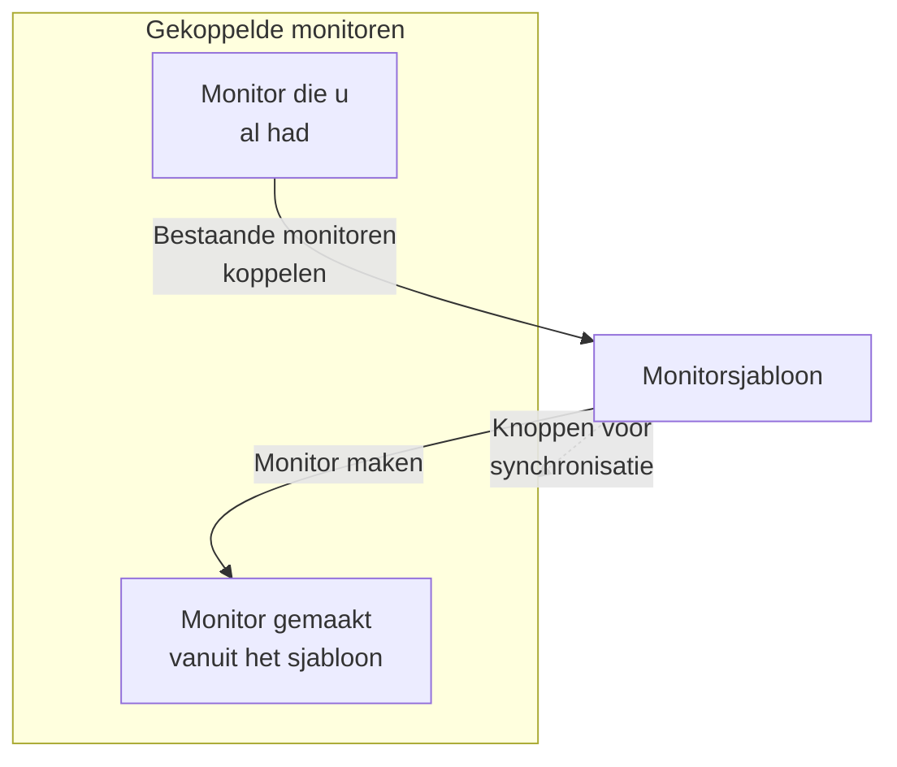

# Monitorsjablonen

Een monitorsjabloon is een opgeslagen monitorconfiguratie (een type, criteria, een interval, labels en standaardwaarden voor aangepaste velden) waaruit u met één klik monitoren maakt. Monitoren die eruit zijn gemaakt, of eraan zijn gekoppeld, blijven verbonden: wijzig het sjabloon en synchroniseer de wijziging daarna naar allemaal. Gebruik sjablonen wanneer veel monitoren zich hetzelfde moeten gedragen, zoals dezelfde gezondheidscontrole op elke service, of dezelfde API-controles in productie en staging.

:::cards
- [Een sjabloon maken](#een-sjabloon-maken): Vier stappen, net als Monitor maken.
- [Monitoren eruit maken](#monitoren-maken-vanuit-een-sjabloon): Eén klik, of koppel monitoren die u al hebt.
- [Wijzigingen synchroniseren](#wijzigingen-synchroniseren-naar-gekoppelde-monitoren): Wat elke synchronisatieknop kopieert.
- [Monitoren naar een ander sjabloon verplaatsen](#monitoren-naar-een-ander-sjabloon-verplaatsen): Een beter sjabloon, en elke monitor behoudt zijn geschiedenis.
- [Waarden per monitor behouden](#waarden-per-monitor-behouden): Een bestemming of headers tegen een synchronisatie beschermen.
:::

## Hoe sjablonen werken

Een sjabloon bewaakt zelf niets. Monitoren worden eruit gemaakt, of eraan gekoppeld, en de pagina van het sjabloon toont ze als **Gekoppelde monitoren**. Wanneer u het sjabloon wijzigt, verandert er niets aan die monitoren totdat u synchroniseert: elke synchronisatieknop kopieert één deel van het sjabloon naar elke gekoppelde monitor, en velden die u beschermt houden de eigen waarde van elke monitor.



## Voordat u begint

- **Een rol die sjablonen mag maken**: Projecteigenaar, Projectbeheerder, Projectlid, Monitorbeheerder of Monitorlid, of een aangepaste rol met de machtiging Create Monitor Template. Een sjabloon wijzigen vraagt dezelfde rollen, of de machtiging Edit Monitor Template.
- **Machtiging om de gekoppelde monitoren bij te werken.** Een synchronisatie schrijft namens u naar elke gekoppelde monitor en slaat de monitoren over die uw machtigingen niet dekken.

## Een sjabloon maken

:::steps
### Sjablonen openen

Ga naar **Monitoren → Instellingen → Sjablonen** en klik op **Monitorsjabloon aanmaken**.

### Het sjabloon een naam geven

Vul onder **Sjablooninformatie** een **Sjabloonnaam** in, zoals `Production API Health`. Een **Sjabloonbeschrijving** is optioneel. Klik dan op **Volgende**.

### De standaardwaarden van de monitor instellen

Kies onder **Standaardinstellingen voor monitor** het **Monitortype**, met dezelfde kiezer als bij Monitor maken. Vul eventueel een **Standaard monitornaam** in; blijft die leeg, dan wordt elke monitor genoemd naar de resource die hij bewaakt. **Standaard monitorbeschrijving** en **Labels** wachten onder **Meer velden**. Klik op **Volgende**.

### De criteria en het interval instellen

Vul onder **Criteria** in wat er gecontroleerd wordt en de criteria, zoals bij [Monitor maken](/docs/monitor/create-monitor#criteria). Met de kaart **Instellingen voor sjabloonsynchronisatie** bovenaan beschermt u velden tegen synchronisaties (zie [Waarden per monitor behouden](#waarden-per-monitor-behouden)). Voor een monitortype dat sondes controleren, vraagt de laatste stap, **Interval**, om het **Bewakingsinterval**. Klik op de laatste stap op **Monitorsjabloon aanmaken**.
:::

Het sjabloon wordt aan de lijst toegevoegd. Open het om de pagina te zien, met een kaart voor elk deel: **Sjablooninformatie**, **Standaardinstellingen voor monitor**, **Criteria**, **Bewakingsinterval** (met **Minimale sonde-overeenstemming**), **Labels**, **Standaardwaarden voor aangepaste velden** (wanneer het project aangepaste monitorvelden heeft) en **Gekoppelde monitoren**. U wijzigt elk deel op zijn eigen kaart, bijvoorbeeld met **Criteria bewerken** of **Interval bewerken**.

## Monitoren maken vanuit een sjabloon

- **Nieuwe monitor.** Klik in de lijst op **Monitor maken** in de rij van het sjabloon, of op **Monitor aanmaken vanaf sjabloon** op de pagina ervan. **Monitor maken** opent met het type en de instellingen van het sjabloon ingevuld; wijzig wat nodig is en maak hem. De nieuwe monitor is aan het sjabloon gekoppeld.
- **Monitoren die u al hebt.** Klik onder **Gekoppelde monitoren** op **Bestaande monitoren koppelen** en kies ze. Staat **Criteria en interval van het sjabloon gebruiken** aan, dan nemen ze bij het koppelen de criteria, het interval en de sonde-overeenstemming van het sjabloon over; staat het uit, dan houden ze hun instellingen totdat u synchroniseert. Een monitor die aan een ander sjabloon is gekoppeld, gaat over naar dit sjabloon.

Waarden die onder **Standaardwaarden voor aangepaste velden** zijn ingesteld, worden naar elke monitor geschreven die vanuit het sjabloon wordt gemaakt, ook naar monitoren die regels voor automatisch importeren en waarschuwingsbeleid ermee maken.

## Wijzigingen synchroniseren naar gekoppelde monitoren

Een sjabloon bewerken wijzigt alleen het sjabloon. Om een wijziging naar de gekoppelde monitoren te kopiëren, gebruikt u de synchronisatieknop op de kaart die u hebt gewijzigd. Elke knop noemt hoeveel monitoren hij bereikt, zoals **Criteria synchroniseren naar 3 gekoppelde monitoren**, en is grijs zolang er niets is gekoppeld. Een synchronisatie kan niet ongedaan worden gemaakt.

| Knop | Kopieert naar elke gekoppelde monitor | Laat ongemoeid |
| --- | --- | --- |
| **Criteria synchroniseren naar gekoppelde monitoren** | De criteria en de stapinstellingen, zoals bestemmingen en aanvraagopties, behalve beschermde velden | Het bewakingsinterval, de minimale sonde-overeenstemming, de naam, de beschrijving, de labels en de waarden van aangepaste velden |
| **Interval synchroniseren naar gekoppelde monitoren** | Het bewakingsinterval en de minimale sonde-overeenstemming | De criteria, de naam, de beschrijving, de labels en de waarden van aangepaste velden |
| **Labels synchroniseren naar gekoppelde monitoren** | De labels, en verder niets | Al het andere |
| **Aangepaste velden synchroniseren naar gekoppelde monitors** | De aangepaste velden waarvoor het sjabloon een standaardwaarde heeft, in plaats van wat elke monitor had | Aangepaste velden die het sjabloon leeg laat, en al het andere |

Om één monitor te synchroniseren, klikt u op **Synchroniseren vanuit sjabloon** in de rij ervan onder **Gekoppelde monitoren**. Dat kopieert de criteria en stapinstellingen (behalve beschermde velden), het bewakingsinterval, de minimale sonde-overeenstemming en de labels, en laat de naam, de beschrijving en de waarden van aangepaste velden van de monitor ongemoeid. Om een monitor los te koppelen, zie [Monitoren ontkoppelen van een sjabloon](#monitoren-ontkoppelen-van-een-sjabloon).

Na een synchronisatie meldt een samenvatting hoeveel monitoren zijn bijgewerkt. **Gedeeltelijk gesynchroniseerd** betekent dat sommige gekoppelde monitoren nog de vorige configuratie hebben, meestal omdat uw machtigingen ze niet dekken.

## Monitoren naar een ander sjabloon verplaatsen

Wanneer een beter sjabloon een ander vervangt, verplaats dan de monitoren ervan naar het nieuwe sjabloon in plaats van ze te verwijderen. Elke monitor behoudt zijn naam, statusgeschiedenis, labels, eigenaren en incidenten, en neemt de criteria van het nieuwe sjabloon over.

:::steps
### De monitoren selecteren

Open het sjabloon waaraan ze nu zijn gekoppeld. Selecteer onder **Gekoppelde monitoren** de monitoren, of allemaal. U kunt ook monitoren selecteren in de lijst Monitoren, gefilterd op elke kolom.

### Ze verplaatsen

Klik onder **Bulkacties** op **Verplaatsen naar ander sjabloon** (in de lijst Monitoren op **Koppelen aan sjabloon**). Kies het sjabloon.

### De instellingen van het sjabloon aan laten

Laat **Criteria en interval van het sjabloon gebruiken** aan staan, zodat elke monitor nu de criteria, stapinstellingen, het interval en de sonde-overeenstemming van het sjabloon overneemt. Staat het uit, dan houdt elke monitor zijn eigen instellingen totdat u synchroniseert. Bevestig daarna.
:::

Wat het verplaatsen doet:

- De criteria, het interval en de sonde-overeenstemming van de monitoren worden vervangen door die van het sjabloon. Een open incident of open waarschuwing die hun oude criteria automatisch zouden oplossen, wordt opgelost, en de nieuwe criteria openen een nieuw incident of een nieuwe waarschuwing als het probleem er nog is. Elke netwerkapparaatmonitor blijft zijn eigen apparaat bewaken, en elke monitor die een adres of URL controleert, blijft het adres van zijn eigen apparaat controleren.
- Namen, beschrijvingen, statusgeschiedenis, labels, eigenaren, waarden van aangepaste velden en koppelingen met incidenten blijven zoals ze zijn.
- Een monitor die een import, een regel voor automatisch importeren of een netwerkwaarschuwingsbeleid heeft gemaakt, behoudt het sjabloon waaruit hij is gemaakt. Die regel maakt hem nooit opnieuw, en een waarschuwingsbeleid laat hem los: het verwijdert of vervangt hem niet meer.
- Een apparaat heeft één monitor van elk sjabloon. Heeft een apparaat al een monitor die er vanuit het nieuwe sjabloon voor is gemaakt, dan wordt zijn andere monitor weggelaten, en de wijziging noemt de monitor die in de weg staat: verwijder een van de twee en verplaats daarna opnieuw.
- Een monitor van een ander type dan het sjabloon wordt weggelaten.

De wijziging wordt op de server uitgevoerd, tot 10.000 monitoren tegelijk, en toont de voortgang: wat is verplaatst, wat is weggelaten en waarom, en de open incidenten en waarschuwingen die ze heeft opgelost. Het venster sluiten stopt de wijziging niet, en de pagina van het sjabloon toont een wijziging die nog loopt. **Stoppen** stopt haar vóór de volgende monitor, en **Opnieuw proberen** probeert de monitoren die zijn mislukt of niet zijn bereikt opnieuw.

> [!TIP]
> Verplaatst u de apparaten van een regel voor automatisch importeren naar een nieuw sjabloon? Verplaats eerst de monitoren en stel daarna de regel in op het nieuwe sjabloon. In de omgekeerde volgorde geeft de regel elk apparaat naast de monitor die het al heeft een tweede monitor, uit het nieuwe sjabloon.

## Monitoren ontkoppelen van een sjabloon

Klik op **Ontkoppelen van sjabloon** in de rij van een monitor onder **Gekoppelde monitoren**, of selecteer daar of in de lijst Monitoren monitoren en gebruik **Ontkoppelen van sjabloon** onder **Bulkacties**. Kies wat de monitoren behouden:

| Keuze | Wat de monitoren daarna doen |
| --- | --- |
| **Hun instellingen behouden** | Ze blijven controleren en waarschuwen met de criteria die ze nu hebben, als zelfstandige monitoren, en krijgen geen updates van het sjabloon meer. |
| **Criteria van het sjabloon wissen** | Ze blijven controleren, maar openen geen incidenten of waarschuwingen en stellen geen status in totdat u ze weer aan een sjabloon koppelt. Een open incident of open waarschuwing die hun criteria automatisch zouden oplossen, wordt opgelost. |

Hoe dan ook behouden ze hun namen, statusgeschiedenis, labels, eigenaren en incidenten, en een regel die ze heeft gemaakt, maakt ze nooit opnieuw.

## Een sjabloon verwijderen

Een sjabloon waaruit een netwerkwaarschuwingsbeleid of een regel voor automatisch importeren monitoren aanmaakt, kan niet worden verwijderd: stel het beleid of de regel eerst in op een ander sjabloon. Zijn er monitoren aan het sjabloon gekoppeld, dan vraagt het verwijderen wat er met ze moet gebeuren:

- **Hun instellingen behouden** (de standaard): het verwijderen ontkoppelt ze, en ze blijven controleren en waarschuwen met de criteria die ze hebben.
- **Criteria van dit sjabloon wissen**: elke monitor wordt ontkoppeld en zijn criteria worden gewist, zoals hierboven, en daarna wordt het sjabloon verwijderd. Blijft een monitor gekoppeld, zoals een monitor die uw machtigingen niet dekken, dan blijft het sjabloon behouden, en het venster zegt hoeveel.

Om de monitoren in plaats daarvan naar een ander sjabloon te verplaatsen, gebruikt u **Verplaatsen naar ander sjabloon** voordat u het sjabloon verwijdert.

## Waarden per monitor behouden

Een criteriasynchronisatie kopieert ook stapinstellingen zoals bestemmingen, aanvraagheaders en time-outs, tenzij u die velden beschermt. Bescherm een veld om elke gekoppelde monitor zijn eigen waarde ervoor te laten houden.

:::steps
### Het sjabloon openen

Ga naar **Monitoren → Instellingen → Sjablonen** en open het sjabloon.

### De criteria bewerken

Klik op de kaart **Criteria** op **Criteria bewerken**.

### De velden beschermen

Vink onder **Instellingen voor sjabloonsynchronisatie** **Dit veld niet synchroniseren** aan naast elk veld dat u op de gekoppelde monitoren wilt behouden.

### Opslaan

Sla uw wijzigingen op. De kaart **Criteria**, en de bevestiging van beide synchronisaties hieronder, tonen de beschermde velden.

### Synchroniseren

Gebruik **Criteria synchroniseren naar gekoppelde monitoren**, of **Synchroniseren vanuit sjabloon** op één gekoppelde monitor.
:::

Bescherm bijvoorbeeld **Monitordoel** en **Aanvraagheaders** op een API-sjabloon. Productie- en stagingmonitoren houden hun eigen URL's en headers, terwijl beide de bijgewerkte criteria van het sjabloon en de andere onbeschermde instellingen krijgen.

Welke opties er zijn, hangt af van het monitortype. Daaronder vallen bestemmingen en poorten, HTTP-aanvraagopties, databaseverbindingen, DNS-instellingen, infrastructuurselectors en telemetriequery's. Samenhangende inloggegevens, zoals een clientcertificaat en de privésleutel ervan, worden samen behouden.

### Hoe uitzonderingen werken

- Aangevinkte velden houden de huidige waarde van elke bestaande monitor, ook een lege of niet-ingestelde waarde. Aanvraagheaders en andere verzamelingen blijven volledig behouden.
- Niet-aangevinkte velden blijven vanuit het sjabloon synchroniseren. Vink een beschermd veld uit en sla op om bij de volgende synchronisatie de sjabloonwaarde te kopiëren.
- Uitzonderingen gelden voor bulk- en losse synchronisaties. Ze worden op het sjabloon opgeslagen, niet per synchronisatie apart gekozen.
- Nieuwe monitoren beginnen nog steeds met de veldwaarden van het sjabloon. Uitzonderingen hebben alleen invloed op het synchroniseren van bestaande monitoren.
- Criteria worden altijd gesynchroniseerd. Een synchronisatie van alleen criteria laat het bewakingsinterval, de labels en andere instellingen op monitorniveau ongemoeid.
- Bestaande sjablonen hebben geen velduitzonderingen totdat u ze instelt. Netwerkapparaatmonitoren behouden hun eigen apparaatkoppeling nog steeds automatisch, en de Ping-, IP-, poort- en NTP-monitoren die een import uit netwerkdetectie voor apparaten heeft gemaakt, blijven het eigen adres van elk apparaat controleren. De Website-, API- en SSL-certificaatmonitoren van zo'n import behouden het adres van elk apparaat als host van hun URL en nemen het protocol, de poort en het pad van het sjabloon over.

Bij sjablonen met meerdere stappen worden beschermde waarden gekoppeld via de stap-ID's. Zelfstandig gemaakte monitoren met één stap kunnen ook een sjabloon met één stap ontvangen. Als een beschermde stap niet kan worden gekoppeld, wordt de synchronisatie geweigerd voordat er een monitor wordt bijgewerkt, zodat een nieuwe of verplaatste stap niet per ongeluk de bestemming of inloggegevens van een andere stap kopieert.

> [!IMPORTANT]
> Verwijder, voordat u het monitortype van een opgeslagen sjabloon wijzigt (met **Standaardwaarden van monitor bewerken**), onder **Criteria bewerken** de uitzonderingen die niet voor het nieuwe type gelden. Alle uitzonderingen van een sjabloon moeten voor het monitortype ervan bestaan.

## Configuratie via de API

Elke sjabloonstap accepteert een array `doNotSyncFields` in zijn object `MonitorStep.value`. Voor een API-monitor beschermt u de bestemming en de hele verzameling headers met:

```json title="monitorSteps (excerpt)"
{
  "_type": "MonitorSteps",
  "value": {
    "monitorStepsInstanceArray": [
      {
        "_type": "MonitorStep",
        "value": {
          "id": "<step id>",
          "doNotSyncFields": ["monitorDestination", "requestHeaders"]
        }
      }
    ]
  }
}
```

Laat de array weg of zet hem op `[]` om elke ondersteunde stapinstelling te synchroniseren. Niet-ondersteunde veldnamen en velden die niet voor het monitortype van het sjabloon gelden, worden geweigerd. De array van het sjabloon stuurt de synchronisatie; zulke metadata op een gekoppelde monitor overschrijven hem niet.

:::details Veldnamen voor doNotSyncFields, per monitortype
| Monitortype | Veldnamen |
| --- | --- |
| Website, API, Ping, IP, Poort, SSL-certificaat, NTP | `monitorDestination`, `requestTimeoutInMs`, `retryCount` |
| Alleen API | `requestHeaders`, `requestType`, `requestBody` |
| Website en API | `doNotFollowRedirects`, `allowSelfSignedCertificates`, `tlsClientAuthentication` (het clientcertificaat, de sleutel en de wachtwoordzin samen) |
| Poort, NTP | `monitorDestinationPort` |
| Synthetische monitor, Aangepaste JavaScript-code | `customCode` |
| Synthetische monitor | `browserTypes`, `screenSizeTypes`, `retryCountOnError` |
| DNS | `dnsMonitor.queryName`, `dnsMonitor.recordType`, `dnsMonitor.resolver` (de DNS-server en de poort samen), `dnsMonitor.timeout`, `dnsMonitor.retries` |
| Domein | `domainMonitor.domainName`, `domainMonitor.lookupMethod`, `domainMonitor.timeout`, `domainMonitor.retries` |
| DNSSEC | `dnssecMonitor.domainName`, `dnssecMonitor.resolvers`, `dnssecMonitor.checkNameserverConsistency`, `dnssecMonitor.signatureExpiryWarningDays`, `dnssecMonitor.timeout`, `dnssecMonitor.retries` |
| SQL-query | `sqlMonitor.connection`, `sqlMonitor.connectionTimeoutInMs`, `sqlMonitor.statementTimeoutInMs`, `sqlMonitor.query`, `sqlMonitor.maxRows` |
| Databasegezondheid | `databaseMonitor.connection`, `databaseMonitor.connectionTimeoutInMs`, `databaseMonitor.statementTimeoutInMs`, `databaseMonitor.enabledMetricGroups` |
| Externe statuspagina | `externalStatusPageMonitor.statusPageUrl`, `externalStatusPageMonitor.provider`, `externalStatusPageMonitor.components`, `externalStatusPageMonitor.timeout`, `externalStatusPageMonitor.retries` |
| Logboeken, Beveiligingsgebeurtenissen, Traces, AI / LLM, Metrieken, Uitzonderingen, Profielen | `logMonitor`, `securityEventsMonitor`, `traceMonitor`, `llmMonitor`, `metricMonitor`, `exceptionMonitor`, `profileMonitor` (de hele configuratie van de monitor) |
| Sondestatus | `probeStatusMonitor.probeIds` |

Infrastructuurmonitoren (Kubernetes, Docker-container, Host, Podman-container, Proxmox, Docker Swarm, Ceph, Opslagarray, IoT-apparaat) bieden hun resourceselector, filters (alle behalve Host), metriekquery's en het tijdvenster van de query. Hun namen staan onder **Instellingen voor sjabloonsynchronisatie** op een sjabloon van dat type.
:::

## Problemen oplossen

:::details Een synchronisatie meldt "Gedeeltelijk gesynchroniseerd"
Sommige gekoppelde monitoren zijn niet bijgewerkt, meestal omdat uw machtigingen ze niet dekken. Vraag iemand die elke gekoppelde monitor mag bijwerken om de synchronisatie opnieuw uit te voeren.
:::

:::details Een synchronisatie mislukt met "a template step cannot be matched to an existing monitor step"
Een beschermd veld kon niet aan een stap van een van de monitoren worden gekoppeld, dus de synchronisatie stopte voordat er een werd gewijzigd. Geef de stappen van het sjabloon dezelfde ID's als de stappen van de monitoren, of gebruik een sjabloon met één stap bij monitoren met één stap.
:::

:::details De synchronisatieknoppen zijn grijs
Er is nog geen monitor aan het sjabloon gekoppeld. Maak er een monitor uit, of klik onder **Gekoppelde monitoren** op **Bestaande monitoren koppelen**.
:::

:::details Een verplaatsing laat een monitor weg: "Het apparaat waarvoor deze monitor is gemaakt, heeft al een monitor die aan dit sjabloon is gekoppeld"
Het apparaat heeft al een monitor die ervoor is gemaakt vanuit het sjabloon waarnaar u verplaatst, meestal omdat een regel voor automatisch importeren vóór het verplaatsen op dat sjabloon is ingesteld. Verwijder de monitor die u niet nodig hebt, de nieuwere heeft de minste geschiedenis, en verplaats daarna opnieuw.
:::

:::details Nadat een regel voor automatisch importeren naar een nieuw sjabloon is overgezet, hebben apparaten twee monitoren
De regel gaf elk apparaat de monitor van het nieuwe sjabloon naast de monitor die het al had. Verwijder de nieuwe monitoren en verplaats daarna de oude naar het nieuwe sjabloon: ze behouden hun geschiedenis, en de regel maakt er geen opnieuw.
:::

:::details Opslaan mislukt met "Unsupported do not sync field"
Een naam in `doNotSyncFields` is geen veld van het monitortype van het sjabloon. Vergelijk hem met de veldnamen hierboven.
:::

## Volgende stappen

:::cards
- [Een monitor maken](/docs/monitor/create-monitor): Het formulier dat een sjabloon invult.
- [API-monitor](/docs/monitor/api-monitor): De instellingen die een API-sjabloon meeneemt.
- [Monitor-geheimen](/docs/monitor/monitor-secrets): Inloggegevens tussen monitoren delen zonder ze te kopiëren.
- [Terraform-monitorstappen](/docs/terraform/monitor-steps): Monitoren en hun stappen als code beheren.
:::
