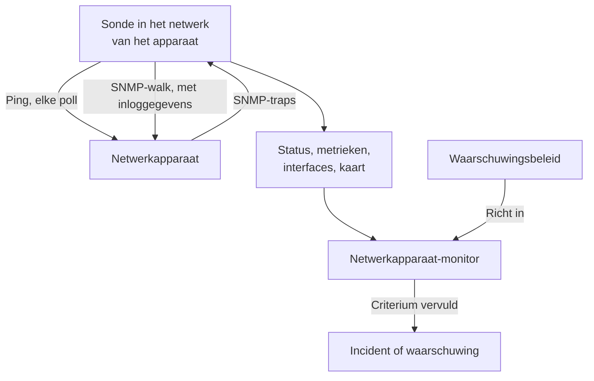
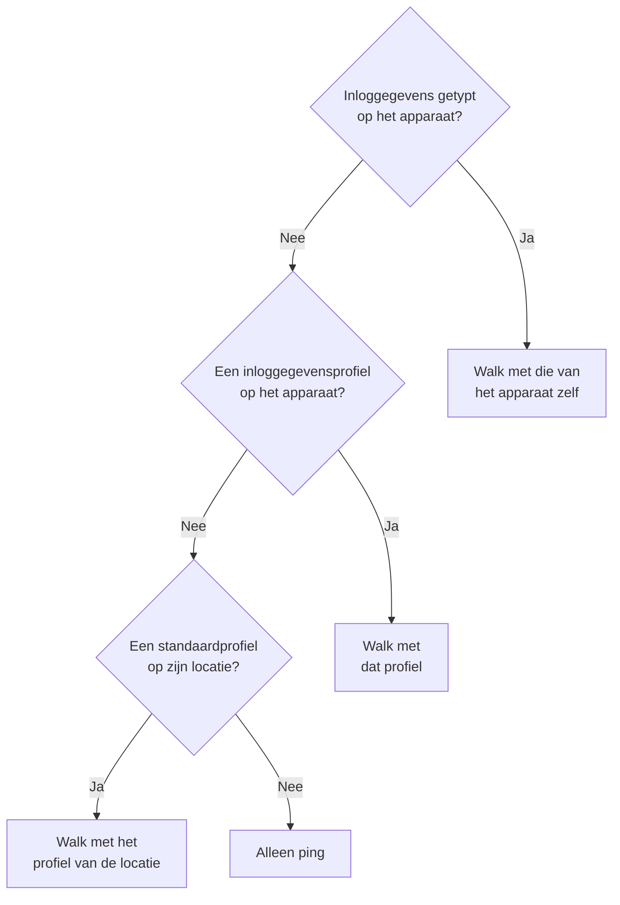
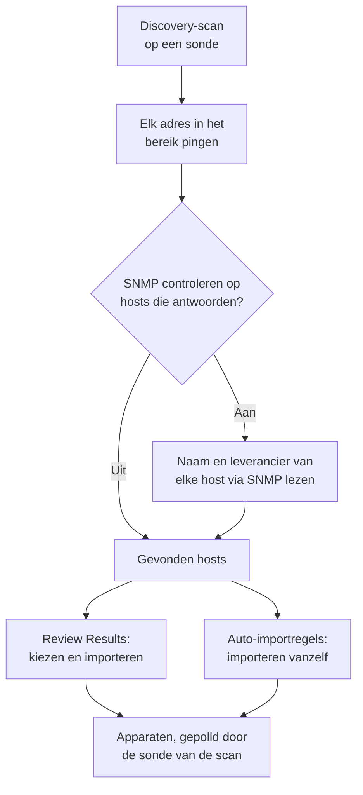
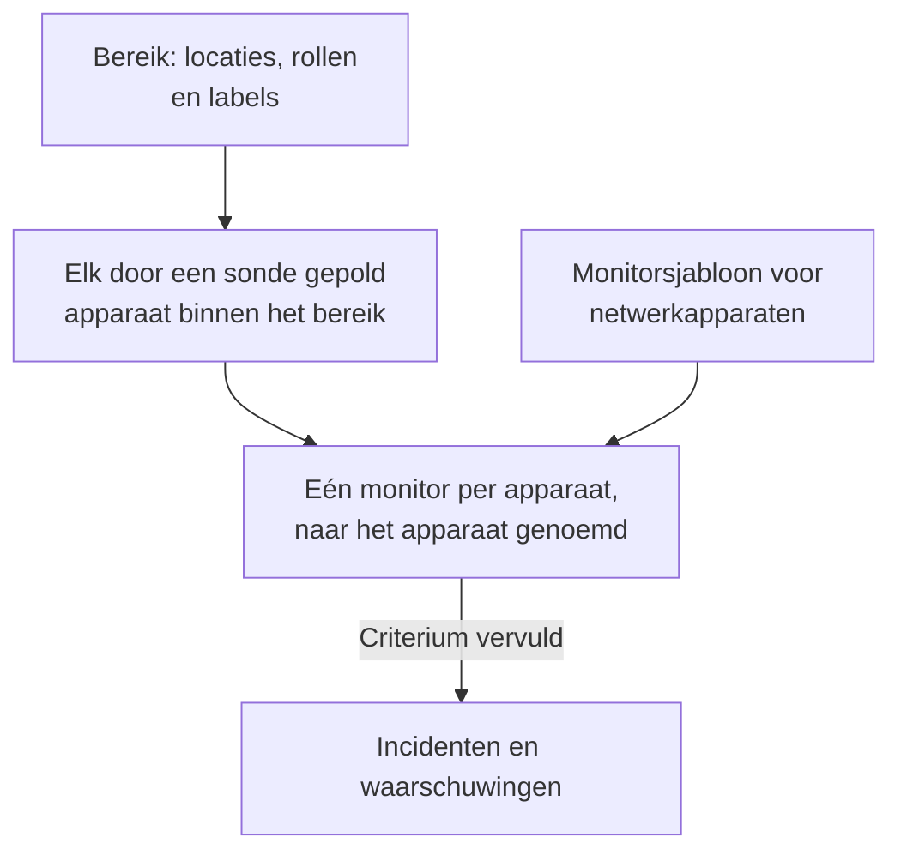
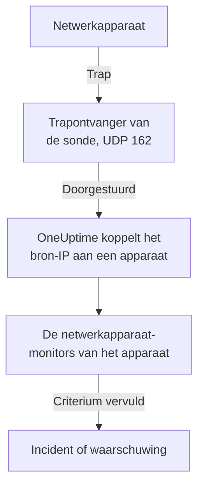

# Netwerkapparaat-monitor

Monitor switches, routers, firewalls, access points, PDU's, camera's en printers: alles met een adres op je netwerk, of het nu SNMP spreekt of niet.

Voeg een apparaat toe met zijn adres en een sonde, en de sonde pingt het volgens een schema: het apparaat krijgt een status bereikbaar of onbereikbaar, een plek op de netwerkkaart en een stem in de gezondheid van zijn locatie. Geef het SNMP-inloggegevens en dezelfde sonde voert er ook een SNMP-walk op uit: interfaces en de optics daarin, hardware-inventaris, LLDP- en CDP-buren en gezondheids-OID's. Voeg een monitor toe, of een waarschuwingsbeleid voor een hele vloot, en de polls en traps ervan openen incidenten en waarschuwingen.

:::cards
- [Een apparaat toevoegen](#een-netwerkapparaat-toevoegen): Het adres en een sonde, op één pagina.
- [Een netwerk ontdekken](#apparaten-ontdekken-met-een-netwerkscan): Scan een adresbereik en importeer wat antwoordt.
- [Apparaten via SNMP uitlezen](#snmp-inloggegevens-en-inloggegevensprofielen): Interfaces, optics, inventaris en gezondheid.
- [Gewaarschuwd worden](#waarschuwingen): Een monitor voor één apparaat, een beleid voor een vloot.
- [De kaart bekijken](#netwerktopologie): Buren live getekend, geëxporteerd als pdf.
- [Een probleem oplossen](#problemen-oplossen): Apparaten in behandeling, mislukte walks, traps die niet aankomen.
:::

## Hoe het werkt



Het apparaat en de monitor doen verschillend werk:

| Onderdeel | Wat het doet | Wanneer je het nodig hebt |
| --- | --- | --- |
| Het apparaat | De sonde pollt het volgens het eigen schema van het apparaat. Elke poll legt bereikbaarheid, ping-rondetijd en pakketverlies vast; een poll met SNMP-inloggegevens leest ook de identiteit, interfaces, buren en gezondheids-OID's van het apparaat. | Altijd: het apparaat is wat je toevoegt. |
| Een monitor | Beoordeelt criteria tegen elk pollresultaat en elke trap van het apparaat, en opent incidenten en waarschuwingen. | Alleen voor incidenten en waarschuwingen. Status, inventaris, grafieken en de kaart hebben geen monitor nodig. |

## Voordat je begint

- **Een sonde die het apparaat kan bereiken.** De sonde pingt en walkt het apparaat vanuit haar eigen netwerk, dus een apparaat op een privéadres heeft een [eigen sonde](/docs/probe/custom-probe) binnen dat netwerk nodig: een sonde op het openbare internet kan het niet bereiken.
- **SNMP, voor meer dan ping.** Optioneel. Een v1- of v2c-community string, of een SNMPv3-gebruiker, ingesteld op het apparaat, met UDP 161 open vanaf de sonde. Zonder dat wordt het apparaat alleen gepingd.
- **Traps, syslog en flows.** Optioneel. De sonde ontvangt SNMP-traps op UDP 162, syslog op UDP 5140 zodra je dat inschakelt, en flowrecords op UDP 2055, 4739 en 6343, dus open die vanaf je apparaten naar de sonde.

## Het netwerkoverzicht

**Netwerk → Overzicht** is waar het Netwerk-gedeelte opent, en het begint met het antwoord: één zin die zegt of je netwerk gezond is en, als dat niet zo is, wat er mis is, het slechtste nieuws eerst.

| Wat er staat | Wanneer |
| --- | --- |
| **3 apparaten zijn onbereikbaar** | De sonde of de monitor van een apparaat kan het niet bereiken. |
| **2 locaties hebben aandacht nodig** | Elk apparaat antwoordt, maar de gezondheid van een locatie is niet operationeel. |
| **5 interfaces zijn uitgevallen** | Elk apparaat antwoordt, maar er zijn poorten uitgevallen. |
| **2 apparaten melden hun details niet** | Ze antwoorden op ping, maar hun SNMP-walk mislukt, dus hun interfaces en gezondheid worden niet ververst: meestal de inloggegevens. |
| **Wachten op de eerste controle** | Er zijn apparaten toegevoegd en hun sonde heeft ze nog niet gecontroleerd. |
| **Alle 40 apparaten zijn bereikbaar** | Elk apparaat antwoordt. Apparaten die nog op hun eerste controle wachten, worden op een eigen regel geteld. |

Daaronder zegt één regel of er iets een incident opent als een apparaat uitvalt: hoeveel [waarschuwingsbeleidsregels](#waarschuwingsbeleid) aan staan, of een link **Set up alerts** als er geen is. De knoppen **Add Device** en **Discover Devices** ernaast openen die formulieren, en de tegels en lijsten eronder geven de details: apparaten en locaties die aandacht nodig hebben, de vloot per leverancier en recente scans.

Zolang er nog niets is toegevoegd, toont het overzicht in plaats daarvan de twee manieren om te beginnen: **Apparaten ontdekken** scant een adresbereik zodat je kunt kiezen wat je toevoegt, het beste voor een heel netwerk of een nieuwe locatie, en **Eén apparaat toevoegen** voegt er één toe op IP-adres of hostnaam.

Het menu Netwerk houdt in beeld wat je elke dag opent: **Overzicht**, **Devices**, **Locaties**, **Map**, **Traffic** en **Discovery**. De rest is ingeklapt in secties, en een sectie klapt vanzelf open op elk van haar pagina's:

| Sectie | Pagina's |
| --- | --- |
| **Topologie** | **Device Topology**, **Endpoints**, **Latency Matrix**, **Site Links**, **Device Links** |
| **Regels** | **Auto Import Rules**, **Site Assignment Rules**, **Eigenaarsregels**, **Labelregels**, **Link Rules** |
| **Instellingen** | **Alert Policies**, **SNMP-inloggegevens**, **Device Roles**, **Site Types**, **OID Collection Templates** |
| **Geavanceerd** | **Archived Devices** |

## Een netwerkapparaat toevoegen

:::steps
### De lijst met apparaten openen
Ga naar **Netwerk → Devices** en klik op **Add Device**. **Add Device** op het Netwerk-**Overzicht** opent hetzelfde formulier.

### Het adres van het apparaat typen
Typ bij **Hostnaam** het IP-adres of de hostnaam. Laat **Naam** leeg om het apparaat naar zijn hostnaam te noemen.

### De locatie en de sonde controleren
Kies de **Site** waar het apparaat staat, als je locaties gebruikt. **Sonde** vult zichzelf in met de standaardsonde van de locatie, of met de enige eigen sonde van het project; controleer dat het een sonde is die het apparaat kan bereiken.

### Het apparaat toevoegen
Klik op **Add Device**. Binnen een paar minuten pingt de sonde het apparaat en wordt de status **Up** of **Down**. Met SNMP-inloggegevens vult ook het overzicht van het apparaat zich met de identiteit, interfaces en gezondheid na de eerste geslaagde walk.
:::

Het formulier is één pagina — de hostnaam, een naam, de locatie en de sonde — met **SNMP** en **Meer velden** eronder ingeklapt. Het vraagt niets over hoe het apparaat gemonitord wordt: elk apparaat dat je toevoegt wordt door zijn sonde gepolld, en de [override met gekoppelde monitor](#de-override-met-gekoppelde-monitor) staat op de pagina **Instellingen** van het apparaat voor de paar apparaten die hem nodig hebben.

De gegevens van een apparaat — naam, beschrijving, rol, locatie, labels en adressen — bewerk je daarna op één plek: de kaart **Device Settings** op de pagina **Instellingen**. De kaart **Apparaatgegevens** op het overzicht toont ze, met een link **Bewerken in Instellingen**.

### Het apparaat

| Veld | Beschrijving | Verplicht |
| --- | --- | --- |
| Hostnaam | Het IP-adres of de hostnaam die de sonde pingt, en via SNMP walkt zodra het apparaat inloggegevens heeft. | Ja |
| Naam | Een herkenbare naam, zoals core-switch-01. Laat het leeg en het apparaat krijgt de naam van zijn hostnaam. De API doet hetzelfde: een apparaat dat zonder naam wordt aangemaakt, krijgt de naam van zijn hostnaam. | Nee |
| Site | De [netwerklocatie](/docs/monitor/network-sites) waar het apparaat staat. De gezondheid van de locatie wordt samengevat uit haar apparaten, en een locatie met een standaardsonde vult de sonde hieronder in. | Nee |
| Sonde | De sonde die dit apparaat pingt, het via SNMP walkt als het inloggegevens heeft, en zijn traps, syslog en [flowrecords](/docs/monitor/network-traffic) ontvangt. Ze moet het apparaat rechtstreeks bereiken: een sonde op het openbare internet kan geen privéadres bereiken. | Ja |

**Sonde** vult zichzelf in waar dat kan: een project met precies één eigen sonde begint met die sonde, en het kiezen van een locatie vervangt haar door de [standaardsonde van de locatie](/docs/monitor/network-sites#monitoringstandaarden). Een sonde die je zelf hebt gekozen, wordt nooit overschreven. Stel een standaardsonde in op je locaties en een apparaat kan met alleen zijn adres worden toegevoegd.

### Meer velden (ingeklapt)

| Veld | Beschrijving | Verplicht |
| --- | --- | --- |
| Beschrijving | Vrije tekst. | Nee |
| Device Role | Core-switch, access-switch, firewall enzovoort. Bepaalt de laag van het apparaat op de kaart en het bereik van waarschuwingsbeleid. | Nee |
| MAC-adres | Het eigen MAC-adres van het apparaat. De kaart gebruikt het om een apparaat dat LLDP noch CDP spreekt op de switchpoort te zetten die het heeft geleerd; zie [Apparaten met alleen ping en hun switchpoort](#apparaten-met-alleen-ping-en-hun-switchpoort). Wordt meestal voor je geleerd uit de ARP-tabel van een router. | Nee |
| Ook een Ping-monitor voor incidenten maken | De sonde pingt het apparaat al en geeft het een status; een Ping-monitor is wat mislukte pings omzet in een incident. Vink het aan en er wordt bij het opslaan een monitor op de hostnaam gemaakt en aan het apparaat gekoppeld. Hij telt mee voor je abonnement, en zijn incidenten blijven uit tot je ze aanzet op de pagina van de monitor. | Nee |

Het aanvinken van de Ping-monitor toont **Ping from probes**, de eigen sondes van de monitor. Die moeten het netwerk van het apparaat bereiken; laat het veld leeg om de standaardsondes van het project te gebruiken. Om voor veel apparaten tegelijk te waarschuwen, gebruik je liever [waarschuwingsbeleid](#waarschuwingsbeleid).

### SNMP (ingeklapt, optioneel)

Laat het ingeklapt en het apparaat wordt alleen gepingd: de ingeklapte sectie zegt dat in één zin. Het apparaat krijgt nog steeds een status vanaf zijn eerste poll en staat nog steeds in zijn locatie en op de kaart, maar heeft geen interfaces, inventaris of gezondheids-OID's tot het inloggegevens heeft. Open de sectie om een community string of een v3-gebruiker te typen, of om een opgeslagen inloggegevensprofiel te kiezen.

:::tabs
@tab SNMP v1 / v2c
| Veld | Beschrijving | Verplicht |
| --- | --- | --- |
| SNMP-versie | V1, V2c of V3. | Ja, begint op V2c |
| SNMP Community String | De v1- of v2c-community string, zoals `public`. | Nee: leeg betekent alleen ping |
| SNMP Port | De UDP-poort waarop de agent luistert. | Nee, standaard 161 |
| SNMP Credential Profile | Een opgeslagen set inloggegevens om te gebruiken in plaats van hier inloggegevens te typen. | Nee |
@tab SNMPv3
| Veld | Beschrijving | Verplicht |
| --- | --- | --- |
| SNMP v3 Security Level | No Auth, No Priv; Auth, No Priv; of Auth, Priv. | Ja |
| SNMP v3 Username | De beveiligingsnaam (gebruiker) die op het apparaat is ingesteld. | Ja: leeg betekent alleen ping |
| SNMP v3 Authentication Protocol | MD5, SHA, SHA-256 of SHA-512. | Met authenticatie |
| SNMP v3 Authentication Key | De wachtwoordzin voor authenticatie. | Met authenticatie |
| SNMP v3 Privacy Protocol | DES, AES of AES-256. | Met privacy |
| SNMP v3 Privacy Key | De wachtwoordzin voor privacy (versleuteling). | Met privacy |
:::

Inloggegevens die op het apparaat zijn getypt, gaan voor een inloggegevensprofiel dat ernaast is gekozen, en de locatie van het apparaat kan ook een standaardprofiel hebben. Inloggegevens in een profiel worden versleuteld opgeslagen. Inloggegevens die op een apparaat zijn getypt, worden door dezelfde leesrechten beschermd maar niet versleuteld opgeslagen: nog een reden om gedeelde inloggegevens in een profiel te bewaren.

## Veel apparaten tegelijk wijzigen

Een discovery-scan van het netwerk van een klant brengt tientallen apparaten binnen die bij één locatie horen, één rol delen en van één leverancier komen. Je opent ze niet een voor een: selecteer ze in de lijst **Devices**, door rijen aan te vinken of alle apparaten te selecteren die aan de filters voldoen, en open **Bulkacties**.

| Actie | Wat ze doet |
| --- | --- |
| **Locatie instellen** / **Locatie wissen** | Verplaatst elk geselecteerd apparaat naar de locatie die je kiest, waar het meetelt voor de gezondheid van de locatie; een apparaat zonder eigen sonde neemt de standaardsonde van de locatie over. **Locatie wissen** haalt ze uit hun locaties. Een apparaat dat aan een locatietoewijzingsregel voldoet, gaat bij zijn volgende poll terug naar de locatie van de regel, dus voeg voor apparaten die discovery blijft vinden liever een regel toe onder **Netwerk → Regels → Site Assignment Rules**; het dialoogvenster **Locatie instellen** linkt ernaar. |
| **Apparaatrol instellen** / **Apparaatrol wissen** | Geeft elk geselecteerd apparaat dezelfde rol, zoals de twintig switches die allemaal "Access Switch" zijn. Rollen zijn die van het project, onder **Netwerk → Instellingen → Device Roles**, waar het dialoogvenster naar linkt. **Apparaatrol wissen** leidt de rol van elk apparaat opnieuw af uit zijn SNMP-identiteit. |
| **Leverancierssjabloon toepassen** | Voegt de gezondheids-OID's en SNMP-tabellen van een [leverancierssjabloon](#gezondheidssjablonen-van-leveranciers) toe aan elk geselecteerd apparaat. **Per apparaat de leverancier herkennen**, de eerste keuze in het dialoogvenster, kiest het sjabloon van elk apparaat op basis van wat zijn SNMP-walk meldt, zodat een gemengde selectie overal het juiste krijgt; of kies één sjabloon voor allemaal. |

Elke actie is één dialoogvenster en één keer opslaan voor de hele selectie, en elk apparaat doorloopt dezelfde controles als een bewerking op zijn eigen pagina Instellingen: rechten, het label- en eigenaarsbereik van je rol, en de limieten voor wat een apparaat mag verzamelen.

**Leverancierssjabloon toepassen** laat zien wat het gaat doen voordat het iets doet: hoeveel apparaten welk sjabloon krijgen, en hoeveel het met rust laat en waarom. Het voegt toe aan wat elk apparaat al verzamelt en verwijdert niets, en een apparaat dat al alles uit het sjabloon heeft, wordt niet opnieuw weggeschreven. Het laat met rust: een apparaat met een gekoppelde monitor (niets pollt het), een apparaat dat gekoppeld is aan een [OID Collection Template](#oid-collection-templates) (het sjabloon bepaalt wat het verzamelt, dus voeg de OID's van de leverancier daar toe) en, bij herkennen, een apparaat dat nog niet via SNMP is gewalkt of waarvan de leverancier geen sjabloon heeft.

Als een actie klaar is, somt ze op hoeveel apparaten zijn gewijzigd, welke mislukten en waarom — een apparaat dat je rol niet mag bewerken, een lijst boven haar limiet — en welke ze niet heeft gewijzigd en waarom: een apparaat dat al in die locatie of rol zat, of een dat het leverancierssjabloon met rust laat.

De andere bulkacties komen aan bod waar ze thuishoren: **Set OID Collection Template** onder [OID Collection Templates](#oid-collection-templates), **Set SNMP Credential Profile**, **Switch to Probe Polling** en **Create Ping Monitors** onder [In bulk](#in-bulk), en **Shorten Names to Hostname** onder [Hoe ontdekte apparaten hun naam krijgen](#hoe-ontdekte-apparaten-hun-naam-krijgen).

## Wat een poll echt doet

Elke poll van een door een sonde gepold apparaat is een ping. Als het apparaat bruikbare SNMP-inloggegevens heeft, voert de sonde ook een volledige SNMP-walk uit. De twee lopen naast elkaar en de walk wacht nooit op de ping, dus SNMP-apparatuur achter een ACL die ICMP laat vallen, meldt nog steeds **Up**.

| Resultaat | Apparaat met alleen ping | Apparaat met SNMP-inloggegevens |
| --- | --- | --- |
| Status (Up of Down) | Uit de ping | Uit de ping of de walk: één van beide die antwoordt is genoeg |
| Ping-rondetijd en pakketverlies | Vastgelegd als apparaatmetrieken | Vastgelegd als apparaatmetrieken |
| SNMP-responstijd | — | De tijd van de walk, nooit die van de ping |
| Interfaces, buren, endpoints | — | Uit een geslaagde walk |
| Systeemidentiteit, leverancier, model, serienummer | — | Uit een geslaagde walk |
| Gezondheids-OID's en SNMP-tabellen | — | Uit een geslaagde walk |

Bruikbare inloggegevens zijn een v1- of v2c-set met een community string, of een v3-set met een gebruikersnaam, gevonden via de [keten van inloggegevens](#snmp-inloggegevens-en-inloggegevensprofielen). Een lege set wordt overgeslagen, dus een apparaat wordt nooit gewalkt met een gegokte standaardcommunity.

Pakketverlies hergebruikt de reeks van de [Ping-monitor](/docs/monitor/ping-monitor), zodat het overal in het product hetzelfde leest. De rondetijd heeft een eigen reeks, `oneuptime.monitor.ping.round.trip.time`, omdat op een netwerkapparaat de gewone responstijd die van de SNMP-walk is. De pagina **Metrieken** van het apparaat toont interfacebenutting en gezondheids-OID's in grafieken; de rondetijd van het laatste uur staat in het zijpaneel van het apparaat op de kaart.

### "SNMP failing" is niet "Down"

Een apparaat dat op ping antwoordt maar waarvan de walk mislukt, is **Up**, gemarkeerd met **SNMP failing**, en beide helften tellen:

- Het is bereikbaar omdat er iets antwoordt op dat adres. Het rood kleuren zou een apparaat dat prima draait in je incidenttelling zetten.
- Het is SNMP failing omdat zijn interfaces, inventaris en gezondheids-OID's niet meer worden ververst, bijna altijd door inloggegevens, een uitgeschakelde SNMP-agent of een ACL. Niets anders op de pagina zou je vertellen dat de getallen bevroren zijn.

Een apparaat waarvan zowel de ping als de walk mislukt, is gewoon **Down**, dus de markering staat altijd naast een groene status.

### De status van een apparaat lezen

Elke plek die een apparaat toont — de lijst Devices, de Devices-pagina van een locatie, het overzicht, de kaart — gebruikt dezelfde drie oordelen en dezelfde toevoegingen ernaast.

| Oordeel | Betekent |
| --- | --- |
| **Up** | De laatste poll (ping of SNMP), of de gekoppelde monitor, heeft het apparaat bereikt. |
| **Down** | De laatste poll (ping of SNMP), of de gekoppelde monitor, kon het apparaat niet bereiken. |
| **In behandeling** | Nog geen oordeel: nooit gepolld, geen sonde toegewezen, of geen monitor gekoppeld. |

| Toevoeging | Verschijnt wanneer | Wat te doen |
| --- | --- | --- |
| **Stale** | Er is al ruim langer dan het interval van het apparaat geen poll geprobeerd. | Controleer of de sonde van het apparaat online is en haar vloot bijhoudt. |
| **No probe** | Het apparaat wordt door een sonde gepolld maar heeft er geen, of het pollen staat uit. | Wijs een sonde toe die het kan bereiken; tot dan pollt niets het. |
| **No monitor** | Het apparaat gebruikt de [override met gekoppelde monitor](#de-override-met-gekoppelde-monitor) en er is niets gekoppeld. | Koppel een monitor, of zet het terug op pollen door de sonde. |
| **SNMP failing** | Bereikbaar via ping, maar de laatste SNMP-walk is mislukt. | Controleer de inloggegevens, de SNMP-agent of een ACL. |

De lijst **Devices** heeft een filter **SNMP** met drie waarden: **OK** (de laatste walk is gelukt), **Failing** (de laatste walk is mislukt) en **Not configured** (alleen ping, geen inloggegevens, of nooit gepolld). "Welke apparaten hebben inloggegevens die niet meer werken" is één klik. De kolom **Interfaces (Up / Down)** van de lijst toont **No SNMP** in plaats van `0 / 0` voor een apparaat dat gepingd en nooit gewalkt wordt: nul werkende poorten zou een andere bewering zijn, en een onjuiste.

## SNMP-inloggegevens en inloggegevensprofielen

Een apparaat wordt gewalkt met de eerste bruikbare set inloggegevens die in deze volgorde wordt gevonden, en het zoeken stopt bij de eerste treffer:



De locatiestap leest de eigen locatie van het apparaat en verder niets: een apparaat in een Unit neemt geen profiel over dat op de Region erboven is ingesteld. De standaardsonde van een locatie reikt wel omlaag in de boom, omdat een sonde één keer naar het apparaat wordt gekopieerd terwijl inloggegevens bij elke poll opnieuw worden gelezen; [Netwerklocaties](/docs/monitor/network-sites#monitoringstandaarden) heeft de details.

### De pagina SNMP-inloggegevens

**Netwerk → Instellingen → SNMP-inloggegevens** bevat de inloggegevensprofielen van het project. Een profiel is één benoemde set — een v1- of v2c-community string, of een v3-gebruiker met zijn beveiligingsniveau, protocollen en sleutels — waar zoveel apparaten en locaties naar verwijzen als je wilt. Er wordt niets naar de apparaten gekopieerd, dus een community string wijzigen is hier één bewerking, en elk apparaat dat het profiel gebruikt, pakt de nieuwe waarde op bij zijn volgende poll.

Geheimen in een profiel worden versleuteld opgeslagen, en alleen rollen die de eigen inloggegevens van een apparaat mogen lezen, mogen ze lezen. Een apparaat of locatie die zijn profiel toont, toont de naam en versie van het profiel, nooit de geheimen.

Een profiel waar een apparaat of locatie nog naar verwijst, kan niet worden verwijderd: het verwijderen wordt geweigerd met een telling van wat in de weg zit. Zet die apparaten en locaties op een ander profiel, of wis het profiel erop, en verwijder het dan.

### Een apparaat terugzetten naar alleen ping

Op de pagina **Instellingen** van het apparaat heeft **Instellingen bewerken** een selectievakje **Ping only — clear this device's own SNMP credentials** in de stap **SNMP-inloggegevens**. Het wist bij het opslaan de eigen community string en v3-gebruikersnaam van het apparaat. Het bestaat omdat het juiste veld leegmaken niet vanzelfsprekend is: een v3-apparaat blijft walkbaar zolang zijn gebruikersnaam blijft bestaan, wat je verder ook leegmaakt.

Het wissen van de eigen inloggegevens van het apparaat wist geen profiel. Als het apparaat of zijn locatie er nog een noemt, wordt het apparaat daar verder mee gewalkt; wis ook het profiel om het apparaat alleen te laten pingen.

### In bulk

Selecteer apparaten in de lijst **Devices** en gebruik:

- **Set SNMP Credential Profile** / **Clear SNMP Credential Profile**: een profiel aan een selectie koppelen, of het eraf halen.
- **Switch to Probe Polling**: voor apparaten met de override met gekoppelde monitor. Kies een sonde, en elk geselecteerd apparaat wordt vanaf dan volgens zijn schema gepingd, en gewalkt zodra het inloggegevens heeft. Een al gekoppelde monitor blijft gekoppeld; de status van het apparaat komt nu van de sonde.
- **Create Ping Monitors**: voor apparaten met de override met gekoppelde monitor; maakt een Ping-monitor op de hostnaam van elk apparaat en koppelt die, zodat het apparaat Up of Down toont.

De pagina **Devices** toont een banner als het project apparaten bevat met de override met gekoppelde monitor waaraan niets is gekoppeld — apparaten die niets pollt en waarover niets rapporteert — en linkt naar de selectie die ze oplost.

## Standaardinstellingen voor monitoring van een locatie

Een [netwerklocatie](/docs/monitor/network-sites#monitoringstandaarden) heeft twee standaarden voor haar apparaten. Haar **Default Probe** wordt gekopieerd naar een apparaat dat in de locatie wordt aangemaakt, of ernaartoe wordt verplaatst, zonder eigen sonde. Haar **Default SNMP Credential Profile** wordt bij elke poll gelezen van een apparaat in de locatie dat geen eigen inloggegevens heeft. Stel beide in op een locatie en een apparaat daar kan met alleen zijn adres worden toegevoegd, en wordt vanaf zijn eerste poll gepingd en gewalkt. De handleiding over locaties vertelt hoe ver elke standaard in de locatieboom omlaag reikt.

## De override met gekoppelde monitor

Sommige apparatuur kan geen sonde bereiken of zinvol pingen: een apparaat achter een NAT, een appliance waarvan de gezondheid beter met een HTTP-controle te beoordelen is, een dienst waarvan het echte signaal een poortcontrole is. Daarvoor heeft **Instellingen bewerken** op de pagina **Instellingen** van het apparaat een **Monitoring Method**:

| Methode | Wat het betekent |
| --- | --- |
| **Sonde** | De standaard. Gepingd door de toegewezen sonde volgens haar schema, en via SNMP gewalkt als het inloggegevens heeft. |
| **Bound monitor** | De status van een bestaande monitor is de status van dit apparaat. |

Een apparaat op **Bound monitor** zetten, stopt het pollen ervan. De sonde, het interval en de pollschakelaar verdwijnen van de kaart **Polling & Data Collection**, de oude pollresultaten van het apparaat worden gewist, en de status komt van de monitor die je koppelt. Er een koppelen is optioneel: tot je dat doet, toont het apparaat **In behandeling**, gemarkeerd met **No monitor**.

Terugzetten naar **Sonde** herstelt het pollen en vraagt om een sonde. Een monitor die gekoppeld was, blijft gekoppeld en blijft waarschuwen; hij bepaalt alleen niet langer de status van het apparaat.

De meeste apparaten hebben dit niet nodig. Elk door een sonde gepold apparaat heeft al een bereikbaarheidsstatus, dus je hoeft geen Ping-monitor te koppelen om er een te krijgen; koppel een monitor als je de incidenten van die monitor wilt.

## Pollen en gegevensverzameling

Pollen staat op de pagina **Instellingen** van het apparaat, op de kaart **Polling & Data Collection** (**Polling bewerken**). De standaarden passen bij een nieuw apparaat, dus dat hoeft niet afgesteld te worden:

| Instelling | Beschrijving | Standaard |
| --- | --- | --- |
| Sonde | De sonde die het apparaat pollt. | Ingesteld bij het toevoegen van het apparaat |
| Polling Enabled | De sonde pollt het apparaat volgens het schema hieronder. Zet het uit om het pollen te pauzeren zonder het apparaat te verwijderen. | Aan |
| Polling Interval (Minutes) | Hoe vaak de sonde het apparaat pollt. Minimaal 1 minuut. | 5 |
| Walk Interfaces | Walkt bij elke poll de interfacetabellen (IF-MIB): status, bandbreedte, benutting en fouten van elke poort, plus LLDP- en CDP-buren voor de kaart. | Aan |
| Collect Connected Endpoints | Walkt ook de ARP- en bridge-forwardingtabellen om te vinden wat op het apparaat is aangesloten: pinautomaten, printers, telefoons, laptops. Vanuit een ARP-tabel vult het ook het MAC-adres in van apparaten die op die adressen zijn geregistreerd. Kost extra walks per poll. | Uit |
| OID Collection Template | Een gedeelde, benoemde OID-lijst die het apparaat verzamelt. Het sjabloon bewerken wijzigt elk gekoppeld apparaat bij zijn volgende poll. | Geen |
| Device-Specific Health OIDs | Extra OID's die alleen dit apparaat verzamelt, bovenop die van zijn sjabloon. | Geen |
| Auto-Apply Vendor Health Template | Als de leverancier van het apparaat wordt herkend en zijn eigen OID-lijst leeg is, vult het de lijst bij de volgende poll met het sjabloon van de leverancier. | Uit; aan voor apparaten die discovery importeert |
| Device-Specific SNMP Tables | Extra [SNMP-tabellen](#snmp-tabellen) die alleen dit apparaat walkt, bovenop die van zijn sjabloon. Een tabel met dezelfde sleutel als een sjabloontabel vervangt die op dit apparaat. | Geen |

Alles vanaf **Walk Interfaces** omlaag heeft SNMP-inloggegevens nodig: op een apparaat met alleen ping worden die instellingen bewaard en is er geen walk om ze op toe te passen.

### Interfaces walken

Met **Walk Interfaces** aan en gevonden inloggegevens volgt elke poll per interface de operationele en administratieve status, bits in en uit, benutting en fouten. Dezelfde walk verzamelt de LLDP- en CDP-buren voor de kaart.

Demp een interface op de pagina **Interfaces** van het apparaat, voor een labpoort of een bewust losgekoppelde verbinding, en hij blijft in de inventaris maar valt buiten waarschuwingen en metrieken. Een mislukte walk wist nooit half wat verzameld was: de laatste momentopname van de interfaces blijft staan, en het apparaat krijgt de markering **SNMP failing** zodat niemand haar voor een actuele aanziet.

### Gezondheidssjablonen van leveranciers

In de editor **Health OIDs** past **Vendor Health Template** een kant-en-klare set OID's toe voor de leverancier van het apparaat. Veel sjablonen leveren ook [SNMP-tabellen](#snmp-tabellen) mee, toegevoegd met **Add a Vendor's Tables** in de editor **SNMP Tables**.

| Leverancierssjabloon | Gezondheids-OID's | SNMP-tabellen |
| --- | --- | --- |
| Generic (Host Resources MIB) | CPU-belasting, totaal en beschikbaar RAM, load average | CPU-kernen (één rij per kern, hoe het platform ze ook nummert) |
| Arista EOS | CPU-belasting, load average, totaal en beschikbaar RAM | — |
| Cambium Networks cnMatrix | CPU, RAM, flash, temperatuur, voedingsspanning | Ventilatoren, PoE-poorten, redundante voeding |
| Cambium Networks Enterprise Wi-Fi (cnPilot, XV, XE, XH) | CPU, vrij geheugen, wifi-clients, verbinding met cnMaestro | Wifi-radio's (band, kanaal, breedte, zendvermogen, clients, ruisvloer, airtime, toestand), SSID's |
| Cisco IOS / IOS-XE | CPU, gebruikt en vrij geheugen, temperatuur, ventilatortoestand, voedingstoestand | — |
| Dell Force10 / OS9 | CPU, geheugen | — |
| Extreme Networks EXOS / Switch Engine | CPU, temperatuur, oververhittingsalarm, voedingstoestand | Voedingen, ventilatoren, geheugen per slot, stackleden |
| Extreme Networks Fabric Engine / VOSS | vIST-sessie, aantal I-SID's | Fabric-adjacencies (IS-IS) genoemd naar de buur, CPU en geheugen per slot, temperatuursensoren, ventilatoren, voedingen |
| Extreme Networks IQ Engine (HiveOS) Access Points | CPU, geheugen, wifi-clients, temperatuur | Wifi-radio's (kanaal, zendvermogen, ruisvloer), SSID's |
| Extreme Networks Wireless Controller (XIQ-C, ExtremeWireless) | Access points, actieve access points, wifi-clients | Access points (toestand, clients, adres, software), wifi-radio's (band, kanaal, breedte, ruisvloer, bezette airtime), WLAN's (SSID, clients) |
| Fortinet FortiGate | CPU, geheugen, schijf | — |
| HPE / Aruba ProCurve | CPU, totaal en vrij geheugen | — |
| HPE Aruba Instant (AOS 8) | Clusternaam, firmwareversie, conductor | Access points (status, model, CPU, geheugen), wifi-radio's genoemd naar het access point (kanaal, zendvermogen, ruisvloer, benutting, clients, toestand), SSID's (clients) |
| HPE Aruba Mobility Controller (AOS 8) | Access points, wifi-clients, rol van de controller | Access points (status, model, AP-groep), wifi-radio's genoemd naar het access point (band, kanaal, zendvermogen, benutting, clients, modus), SSID's (clients, access points bereikbaar en onbereikbaar), processors, geheugen |
| Huawei VRP | CPU, geheugen, temperatuur | — |
| Juniper Junos | CPU, geheugenbuffer, temperatuur | — |
| MikroTik RouterOS | CPU-belasting, temperatuur, spanning | — |
| Palo Alto PAN-OS | Management-CPU, sessiebenutting, actieve sessies | — |
| Sophos Firewall (SFOS / XGS) | Geheugen, schijf, swap, HA-toestand en toestand van de peer, IPsec-dienst, CPU-temperatuur (SFOS v22 en later) | IPsec-tunnels (status vereist SFOS v20 en later), CPU-kernen |
| TP-Link Omada Access Points (EAP) | Wifi-clients | — |
| Ubiquiti EdgeOS / EdgeSwitch / UniFi Switches | CPU-belasting, totaal en beschikbaar RAM | — |
| Ubiquiti UniFi Access Points | Geïsoleerde toestand, load average, totaal en beschikbaar RAM | Wifi-radio's (band, airtime), SSID's (band, kanaal, clients, zendvermogen, verbindingskwaliteit), CPU-kernen |

De OID's van het sjabloon worden naar de eigen lijst van het apparaat gekopieerd, waar je ze kunt inkorten of uitbreiden. Nadat de eerste walk de leverancier heeft herkend, stelt de apparaatpagina het bijbehorende sjabloon voor. Het herkennen leest de `sysObjectID` van het apparaat, en zijn `sysDescr` waar één enterprisenummer twee besturingssystemen huisvest: Extreme Fabric Engine op universele hardware meldt hetzelfde enterprisenummer (1916) als EXOS, en alleen zijn beschrijving (`…-FabricEngine (9.0.4.0)`) onderscheidt ze. UniFi-access points worden op dezelfde manier van de routers van Ubiquiti onderscheiden (`U6-Pro 6.6.50.15098`), ook als oudere firmware antwoordt met de tak van Net-SNMP, en IQ Engine-access points van de Aerohive-switches die hun tak delen (`AP230, HiveOS 8.2r1`).

Apparaten met **Auto-Apply Vendor Health Template** aan krijgen de OID's en tabellen van het sjabloon bij hun eerste poll: apparaten die een auto-importregel binnenbrengt, en apparaten die zijn geïmporteerd vanuit **Review Results** met de schakelaar voor het leverancierssjabloon aan, wat zo is tenzij je hem uitzet. Om veel apparaten tegelijk hun sjabloon te geven, zoals een ontdekte vloot van voor de schakelaar bestond, selecteer je ze in de lijst **Devices** en gebruik je **Leverancierssjabloon toepassen** (zie [Veel apparaten tegelijk wijzigen](#veel-apparaten-tegelijk-wijzigen)).

Een leverancierssjabloon toepassen is een eenmalige kopie, dus niets verspreidt zich als het sjabloon verandert. Gebruik voor alles voorbij één apparaat liever een **OID Collection Template**; de leverancierssjablonen worden als startpunt aangeboden als je er een maakt.

### OID Collection Templates

Een **OID Collection Template** (**Netwerk → Instellingen → OID Collection Templates**) is een benoemde OID-lijst, meestal genoemd naar een apparaattype zoals "Cisco Catalyst 9300", waar zoveel apparaten aan koppelen als je wilt. De koppeling is live, geen kopie: de OID-lijst van een apparaat wordt bij elke poll samengesteld, dus een sjabloon bewerken verandert wat elk gekoppeld apparaat bij zijn volgende poll verzamelt, zonder synchronisatiestap.

Controleer voordat je er een bouwt of je het nodig hebt. Bits in en uit per poort, operationele status, benutting en fouten per seconde worden bij elke poll voor elke poort verzameld zonder enige OID (zie [Interfaces walken](#interfaces-walken)), en zijn al per poort te gebruiken voor waarschuwingen. Sjablonen zijn voor wat niet per poort is: CPU, geheugen, temperatuur, ventilatoren, voedingen, BGP-peers.

Afkomstig van Zabbix:

| Zabbix | OneUptime |
| --- | --- |
| Template | OID Collection Template |
| Item | Een OID op dat sjabloon |
| Discovery-regel "Network interfaces by SNMP" met itemprototypes | Ingebouwd en altijd aan voor de interfacetellers: niets te schrijven |
| Trigger | Monitorcriteria |
| Triggerprototype, één per ontdekte interface | Een criterium met **Interface** op `*`, dat per poort uitwaaiert |
| Discovery-regel over een andere SNMP-tabel (tunnels, radio's, ventilatoren) met itemprototypes | Een [SNMP-tabel](#snmp-tabellen) op het sjabloon |
| Triggerprototype op zo'n tabel | Een criterium SNMP Table Value of SNMP Table Row Is Unhealthy met **Row** op `*` |
| Hostgroep | Labels |
| Actie "Link template on host discovery" | De **OID Collection Template** van een auto-importregel |
| Actie op een hostgroep ("waarschuw op elke switch") | Een [waarschuwingsbeleid](#waarschuwingsbeleid) |

Een OID op een sjabloon wordt verzameld zoals het geschreven staat, dus een OID die één rij van een tabel noemt (`…ifSpeed.3`) verzamelt alleen die rij, wat er ook op index 3 staat op de dag van de poll. Alles wat een lijst is — tunnels, radio's, ventilatoren, buren — hoort in een [SNMP-tabel](#snmp-tabellen), die elke rij walkt en rijen volgt terwijl ze komen en gaan. Interfacegegevens per poort hebben geen van beide nodig: de interfacewalk legt de operationele status, bits in en uit per seconde, benutting en een gecombineerd aantal fouten per seconde vast als reeksen. Fouten per richting, discards, administratieve status en linksnelheid gaan naar de interface-inventaris van het apparaat, maar zijn geen reeksen en kunnen geen waarschuwing opleveren.

Er zijn drie manieren om apparaten te koppelen, en bij een vloot die discovery blijft vinden is de derde het belangrijkst:

- Eén apparaat tegelijk, op de kaart **Polling & Data Collection** van het apparaat.
- In bulk, door apparaten in de lijst **Devices** te selecteren en **Set OID Collection Template** te gebruiken. De kolom **Template** van de lijst toont welke apparaten waaraan gekoppeld zijn.
- Automatisch, door een OID Collection Template in te stellen op een auto-importregel, zodat elk apparaat dat een scan importeert, gekoppeld wordt op het moment dat het wordt aangemaakt.

Een apparaat verzamelt eerst de OID's van zijn sjabloon en daarna zijn eigen **Device-Specific Health OIDs**. Als beide dezelfde OID noemen, wordt die één keer verzameld, met de naam en beschrijving van het apparaat als winnaar, en de sjabloonregels houden hun plek, zodat apparaatspecifieke toevoegingen ze nooit kunnen wegdrukken.

| Limiet | Waarde |
| --- | --- |
| Gezondheids-OID's die een apparaat pollt | 200 |
| OID's op een sjabloon | 150 |
| Eigen OID's van een gekoppeld apparaat | 50 |
| Eigen OID's van een niet-gekoppeld apparaat | 200 |

De limieten tellen op, dus een gekoppeld apparaat kan nooit meer dan 200 OID's pollen. Erover gaan is een validatiefout bij het opslaan, nooit een stille inkorting bij het pollen, en een apparaat koppelen dat al meer dan 50 eigen OID's heeft, wordt geweigerd met een melding die zegt hoeveel je moet verwijderen.

Een sjabloon waar nog apparaten aan gekoppeld zijn, kan niet worden verwijderd. Ontkoppel ze eerst, bijvoorbeeld met de bulkactie **Clear OID Collection Template**, zodat een verwijdering nooit stilletjes de verzameling op een hele vloot stopt.

### Eigen OID's

Voeg alle OID's toe die je bij elke poll wilt verzamelen, op een sjabloon of als apparaatspecifieke toevoegingen:

| Veld | Beschrijving | Verplicht |
| --- | --- | --- |
| OID | De numerieke OID, zoals 1.3.6.1.2.1.1.1.0. | Ja |
| Naam | Een herkenbare naam voor de OID, zoals sysDescr. | Nee |
| Beschrijving | Wat de OID voorstelt. | Nee |

Verzamelde waarden worden in grafieken getoond op de pagina **Metrieken** van het apparaat, en de criteria **SNMP OID Value** en **SNMP OID Exists** waarschuwen erop. De OID-kiezer van die criteria toont de OID's die het gekozen apparaat verzamelt, die van zijn sjabloon en zijn eigen, dus er valt niets te typen.

Lange OID-lijsten worden over meerdere SNMP GET-verzoeken verdeeld, zodat elk in één UDP-datagram past. Als je je OID-lijsten kort hield omdat een oudere versie een apparaat dat `tooBig` antwoordde als offline meldde, hoeft dat niet meer.

### SNMP-tabellen

Een deel van wat een apparaat weet, is een lijst: één rij per IPsec-tunnel, wifi-radio, SSID, fabric-buur, ventilator of voeding. Een SNMP-tabel wordt gedefinieerd door haar kolommen, en elke rij wordt bij elke poll gewalkt, dus een tunnel die wordt toegevoegd, hernoemd of verwijderd, wordt gevolgd zonder dat iemand iets bewerkt.

| Veld | Wat het doet |
| --- | --- |
| Naam en sleutel | Hoe de tabel heet. De sleutel (letters, cijfers en underscores, gemaakt van de naam als hij leeg blijft) is wat criteria, metrieken en sjabloonvariabelen gebruiken, dus een tabel hernoemen breekt nooit een waarschuwing. |
| Soort | Wat de rijen zijn: VPN-tunnels, wifi-access points, wifi-radio's, wifi-SSID's, routeringsburen, hardware of generiek. De wifi-soorten voeden de [Wi-Fi-pagina](#het-tabblad-wi-fi) van het apparaat. |
| Kolommen | De kolom-OID's om te verzamelen (de OID van de tabelentry plus het kolomnummer, zoals `1.3.6.1.4.1.2604.5.1.6.1.1.1.1.9` voor de status van een Sophos-tunnel), elk met een naam en optioneel een eenheid, een rol (status, band, kanaal, kanaalbreedte, zendvermogen, clients, ruisvloer, benutting, SSID), waardelabels en gezonde waarden. |
| Rijnamen | Optionele kolommen waarvan de waarden elke rij een naam geven, zoals de verbindingsnaam van een tunnel. Zonder die kolommen worden rijen naar hun index genoemd. Een naam kan komen uit een zustertabel die de index deelt (Fabric Engine noemt IS-IS-adjacencies naar `rcIsisAdjHostName`), of uit een oudertabel waarvan de index het begin is van die van deze tabel (Aruba Instant noemt elke radio naar zijn access point). Een tabel die op een naam is geïndexeerd (ArubaOS indexeert zijn SSID's op de SSID) wordt genoemd naar haar gedecodeerde index. |
| Rijlimiet | Hoeveel rijen er bewaard blijven: standaard 100, maximaal 250. |

Getallen worden als getallen gelezen, en tekst die met een getal begint, wordt als dat getal gelezen (`"36"`, `"-95 dBm"`, `"80MHz"`), omdat veel leveranciers getallen in strings zetten. Zet het waardetype van een kolom op **Text only** voor waarden die alleen numeriek lijken. **Value labels** maken van codes woorden (`0=inactive, 1=active`): de ruwe waarde blijft wat in grafieken komt en wordt vergeleken, het label is wat wordt getoond. **Healthy values** (`1`) zeggen welke waarden betekenen dat alles goed is: ze kleuren de rij op de pagina **SNMP Tables** van het apparaat en sturen het criterium **SNMP Table Row Is Unhealthy** aan.

Sommige kolommen van leverancierssjablonen **passen** ook het getal aan dat ze lezen, voor MIB's die een waarde in een eigen eenheid bewaren: ArubaOS meldt het zendvermogen verdubbeld (gelezen × 0.5), Aruba Instant de ruisvloer zonder teken (× −1), Aerohive de ruisvloer plus 256 (− 256), en de controller van Extreme de kanaalbreedte in stappen van 20 MHz (× 20). Het aangepaste getal is wat wordt getoond, in grafieken gezet en vergeleken, dus **Noise Floor Greater Than -80** betekent bij elke leverancier hetzelfde, en de tabeleditor toont de berekening onder de kolom.

Tabellen komen van een [OID Collection Template](#oid-collection-templates), gedeeld door elk gekoppeld apparaat (tot 10 tabellen), of van het apparaat zelf onder **Device-Specific SNMP Tables** (tot 10 extra). Ze worden bij elke poll op sleutel samengevoegd, sjabloon eerst, en een apparaattabel met dezelfde sleutel vervangt die van het sjabloon. Beide editors bieden **Add a Vendor's Tables**.

De sonde walkt elke kolom als subboom, binnen een budget van 30 seconden dat alle tabellen op het apparaat delen. Een tabel die niet gewalkt kan worden, zegt waarom en laat de poll nooit mislukken: de pagina **SNMP Tables** van het apparaat houdt haar laatste goede rijen en meldt dat de laatste walk mislukte, terwijl criteria alleen beoordelen wat deze walk opleverde, dus een time-out wordt nooit gelezen als een lege tabel. Elke numerieke cel wordt vastgelegd als de metriek `oneuptime.monitor.snmp.table.value`, met de attributen `snmpTableKey`, `snmpTableName`, `snmpTableColumn`, `snmpTableColumnOid`, `snmpTableRow` en `snmpTableRowIndex`, zodat een dashboard de status van elke tunnel of het zendvermogen van elke radio kan tonen, en een metriekenmonitor kan groeperen op `snmpTableRow`.

### Het tabblad Wi-Fi

Een apparaat waarvan de walk een wifi-tabel bevat — access points, radio's of SSID's, zoals de wifi-leverancierssjablonen ze meebrengen — krijgt een pagina **Wi-Fi**. Die opent met de bereikbare access points (op een controller), de radio's die aan staan, de clients en de SSID's, en somt daarna elk access point op dat een controller beheert met zijn toestand, radio's en clients; elke radio met band, kanaal, frequentie, kanaalbreedte, zendvermogen, clients, ruisvloer en airtime; en elke SSID met zijn band en clients. Kolommen worden op hun rol gevonden, dus de tabellen van elke leverancier die hun kolommen markeren, worden op dezelfde manier getoond.

Leveranciers verdelen deze feiten verschillend, en de pagina zet ze weer bij elkaar:

- De frequentie wordt uit band en kanaal afgeleid met het 802.11-kanaalplan (2.4, 5 en 6 GHz). Een controller die de frequentie meldt waar zijn MIB kanaal zegt (die van Extreme), wordt andersom gelezen.
- Een radio die geen band meldt, wordt op zijn kanaal geplaatst: 1 tot 14 is 2.4 GHz, 32 tot 177 is 5 GHz, en een nummer dat alleen 6 GHz gebruikt (37, 53, 181…) is 6 GHz.
- UniFi meldt kanaal, zendvermogen en clients per SSID: een radio haalt ze uit de SSID's op zijn band.
- Aruba telt clients per radio: de clients van een access point zijn die van zijn radio's.
- Een interface die geen netwerk uitzendt (IQ Engine somt elke interface op, met N/A voor die) wordt niet als SSID getoond.

Op een apparaat dat nog geen wifi meldt, noemt de pagina het sjabloon van zijn leverancier, herkend uit de laatste poll zoals automatisch toepassen het herkent, en past het toe met **Sjabloon toepassen**; de radio's verschijnen na de volgende poll.

### Ondersteunde wifi-leveranciers

Wat elke wifi-leverancier via SNMP meldt, en wat alleen zijn cloud heeft:

| Leverancier | Access points en controllers | Leverancierssjabloon | Gelezen via SNMP | Vereist de cloud-API van de leverancier (niet gebouwd) |
| --- | --- | --- | --- | --- |
| Cambium Networks | Enterprise-wifi-access points (cnPilot, XV, XE, XH) | Cambium Networks Enterprise Wi-Fi (cnPilot, XV, XE, XH) | Band, kanaal, breedte, zendvermogen, clients, ruisvloer, airtime en toestand van elke radio; SSID's; CPU, geheugen | Vlootoverzichten in cnMaestro |
| Ubiquiti UniFi | UniFi-access points (UAP, U6, U7, UK) | Ubiquiti UniFi Access Points | Band en airtime van elke radio; kanaal, clients en zendvermogen van elke SSID; CPU per kern, geheugen | Gegevens per client en overzichten per site in de UniFi Network-applicatie |
| HPE Aruba | Instant-clusters (AOS 8), via hun virtuele controller | HPE Aruba Instant (AOS 8) | Status, CPU en geheugen van elk access point; kanaal, zendvermogen, ruisvloer, benutting, clients en toestand van elke radio; SSID's met clients | — |
| HPE Aruba | Mobility Controllers (AOS 8) | HPE Aruba Mobility Controller (AOS 8) | Status van elk beheerd access point; band, kanaal, zendvermogen, benutting en clients van elke radio; SSID's met clients; CPU en geheugen van de controller | — |
| HPE Aruba | Access points op AOS 10, beheerd door Aruba Central | — | Bereikbaarheid (ping) | Radio's, SSID's en clients: de API van Aruba Central |
| Extreme Networks | IQ Engine-access points (HiveOS) | Extreme Networks IQ Engine (HiveOS) Access Points | Kanaal, zendvermogen en ruisvloer van elke radio; SSID's; CPU, geheugen, clients, temperatuur | Client- en vlootoverzichten in ExtremeCloud IQ |
| Extreme Networks | ExtremeCloud IQ Controller (voorheen Extreme Campus Controller) en ExtremeWireless-controllers | Extreme Networks Wireless Controller (XIQ-C, ExtremeWireless) | Toestand en clients van elk access point; band, kanaal, breedte, ruisvloer en bezette airtime van elke radio; WLAN's met clients | — |
| TP-Link | Omada-access points (EAP) | TP-Link Omada Access Points (EAP) | Het aantal clients, op firmware met de EAP-client-MIB van TP-Link | Radio's, kanalen en SSID's: de API van de Omada Controller |
| Juniper | Mist-access points | — | Bereikbaarheid (ping); access points die op- en neergaan, via de webhooks van Mist | Al het andere: de cloud-API van Mist |

De sjablonen worden herkend aan de `sysObjectID` en `sysDescr` van elk apparaat, dus automatisch toepassen, **Per apparaat de leverancier herkennen** van de bulkactie **Leverancierssjabloon toepassen** en de Wi-Fi-pagina kiezen ze zonder dat je het hoeft te zeggen, behalve dat van TP-Link, dat je zelf toepast. SNMP inschakelen, per leverancier:

- **Cambium**: in cnMaestro wordt SNMP per AP-groep ingesteld (Configuration → Wi-Fi Profiles → AP Groups → Management → SNMP), met een v2c-community of een v3-gebruiker. Voeg elk access point toe.
- **Ubiquiti UniFi**: schakel SNMP in in de UniFi Network-applicatie, die het instelt op de apparaten die ze beheert. Voeg elk access point toe.
- **HPE Aruba Instant**: schakel SNMP in voor het cluster en voeg het adres van de virtuele controller toe als één apparaat; die antwoordt voor elk access point.
- **HPE Aruba Mobility Controller**: voeg de controller toe; campus-access points antwoorden zelf niet op SNMP.
- **Extreme IQ Engine**: schakel SNMP in in het netwerkbeleid dat ExtremeCloud IQ naar de access points stuurt, en voeg elk access point toe.
- **Extreme Wireless Controller**: schakel SNMP in in de beheerinstellingen van de controller en voeg de controller toe.
- **TP-Link Omada**: schakel SNMP in voor de site in de Omada Controller (Network Config → SNMP), voeg de access points toe, en pas het sjabloon toe vanaf hun pagina Instellingen of met **Leverancierssjabloon toepassen**.
- **Juniper Mist**: Mist-access points antwoorden niet op SNMP. Voeg ze toe als apparaten met alleen ping voor de bereikbaarheid, en stuur de webhook `device-updowns` van Mist naar een [monitor voor inkomende verzoeken](/docs/monitor/incoming-request-monitor) om een access point dat offline gaat in een incident te veranderen.

De tabel van een controller bewaart tot 250 rijen: op een controller met meer dan 250 access points of radio's wordt de rest niet getoond, en de tabel meldt dat. Zijn aantallen access points en clients zijn gezondheids-OID's, dus die tellen alles.

### Transceivers

De SFP-, SFP+-, SFP28- en QSFP-optics in de poorten van een apparaat worden gelezen bij elke poll die interfaces walkt: er is niets in te schakelen en geen sjabloon toe te passen. Voor elke optic bewaart OneUptime:

- Wat hij is: leverancier, onderdeelnummer, serienummer, revisie, type en golflengte, zoals de optic ze meldt. Optics van derden (FS.com, FLEXOPTIX, Carritech en de rest) worden net zo gelezen als die van de switchleverancier zelf.
- Zijn metingen: temperatuur, voedingsspanning, laserbiasstroom, en zend- en ontvangstvermogen, uit zijn digitale optische monitoring (DOM, ook DDM genoemd). Een QSFP meldt vermogen en bias per lane.
- De eigen drempels van het apparaat: de lage en hoge waarschuwings- en alarmgrenzen die de switch voor elke meting meldt. Een optic wordt daaraan getoetst en aan niets anders; OneUptime verzint nooit eigen grenzen.
- Een maand ontvangstvermogen: het daggemiddelde van de zwakste lane over de laatste 30 dagen. Een vuile connector, een geknikte vezel of een optic die slijt, is hier weken zichtbaar voordat de verbinding wegvalt.

De pagina **Interfaces** van het apparaat opent met een kaart **Transceivers**: eerst de problemen, dan één rij per optic met zijn poort, wat hij is, een status in woorden en zijn metingen. Een meting voorbij een drempel wordt gekleurd en benoemd (**Alarm laag**, **Waarschuwing hoog**), en een kleine grafiek van het ontvangstvermogen van de maand staat naast de RX-waarde; de rij van een QSFP toont zijn slechtste lane. Klik op een rij voor elke lane tegen elke drempel, het verloop van het ontvangstvermogen met de beste dag, en de identiteit van de optic. Een apparaat dat geen optics meldt, met alleen koperpoorten of een agent die ze niet beschikbaar stelt, toont helemaal geen kaart.

| Status | Betekent |
| --- | --- |
| Gezond | Elke meting waarvoor het apparaat drempels heeft, valt erbinnen. |
| Waarschuwing | Een meting zit op of voorbij een waarschuwingsdrempel. |
| Alarm | Een meting zit op of voorbij een alarmdrempel, of het apparaat meldt signaalverlies of een zenderfout. |
| Niet gedetecteerd | De poort had een optic en meldt er geen meer, terwijl de poort nog ingeschakeld is. De pagina noemt nog wat er zat. |
| Geen drempels | De optic meldt metingen, maar het apparaat meldt geen grenzen om ze aan te toetsen. Waarschuw erop met **SNMP Transceiver Reading**. |
| Gedetecteerd | De optic meldt helemaal geen diagnostiek: gebruikelijk bij koper-SFP's en direct-attach-kabels. |
| Poort uitgeschakeld | De poort is dicht, dus de laser staat bewust uit: de metingen worden getoond maar nooit beoordeeld. |

De `sysObjectID` van het apparaat bepaalt waar de metingen vandaan komen: eerst de eigen tabel van de leverancier, waar die bevat wat de standaardtabel niet heeft, en ENTITY-SENSOR-MIB als terugvaloptie.

| Apparaten | Gelezen uit | Drempels |
| --- | --- | --- |
| Cisco | CISCO-ENTITY-SENSOR-MIB, aan poorten gekoppeld via ENTITY-MIB | Ja |
| Arista | ENTITY-SENSOR-MIB, met drempels uit ARISTA-ENTITY-SENSOR-MIB | Ja |
| Juniper | JUNIPER-DOM-MIB, met metingen per lane voor optics met meerdere lanes | Ja |
| HPE Comware en H3C | HH3C-TRANSCEIVER-INFO-MIB | Ja |
| HPE Aruba ProCurve / ArubaOS-Switch | HP-ICF-TRANSCEIVER-MIB | Ja |
| MikroTik RouterOS | MIKROTIK-MIB (`mtxrOpticalTable`), met vlaggen voor signaalverlies en zenderfout | Nee |
| Cambium Networks cnMatrix (4.5 en later) | CAMBIUM-NETWORKS-TRANSCEIVER-MIB | Nee |
| Elk ander apparaat | ENTITY-SENSOR-MIB (RFC 3433), aan poorten gekoppeld via ENTITY-MIB | Nee |

De eerste poll leest alles. Latere polls lezen alleen wat verandert — de metingen, en de serienummers die een verwisselde optic verraden — en de rest (drempels, identiteit, welke optic in welke poort zit) wordt opnieuw gelezen als een optic wordt geplaatst, verwijderd of verwisseld, en minstens één keer per uur. Een apparaat zonder een van deze MIB's kost één verzoek per geprobeerde MIB. Het lezen heeft een eigen budget van 20 seconden, en een leesactie die een time-out krijgt of wordt afgebroken, houdt de laatste goede optics van het apparaat in plaats van ze als verdwenen te melden.

Een optic die ontbreekt in een ingeschakelde poort, verschijnt meteen als **Niet gedetecteerd** op de pagina, en telt voor waarschuwingen als ontbrekend na twee polls op rij, dus een agent die één keer leeg antwoordt, roept niemand op. Een optic die uit een dichte poort is getrokken, wordt gewoon vergeten, en een gedempte interface houdt haar optic op de pagina maar levert nooit een waarschuwing op.

Elke meting is ook een apparaatmetriek, één reeks per poort en lane, in de eenheden die de pagina toont: `oneuptime.monitor.snmp.transceiver.temperature` (°C), `oneuptime.monitor.snmp.transceiver.voltage` (V), `oneuptime.monitor.snmp.transceiver.bias.current` (mA), `oneuptime.monitor.snmp.transceiver.tx.power` en `oneuptime.monitor.snmp.transceiver.rx.power` (dBm), met de attributen `interfaceName`, `interfaceIndex` en `lane`. Een dashboard kan het licht van een verbinding over maanden tonen, en een metriekenmonitor kan erop waarschuwen.

Een onderzoek door OneUptime AI van een incident of waarschuwing van een netwerkapparaat-monitor begint bij de optics van de betrokken poorten: nog gedetecteerd of niet, elke meting tegen de drempels van het apparaat, en het ontvangstvermogen van de afgelopen weken. De AI kan ook de optics van elk apparaat lezen als je ernaar vraagt.

### Apparaatidentiteit

Na de eerste geslaagde walk leest OneUptime de SNMPv2-systeemgroep en, waar het apparaat dat ondersteunt, ENTITY-MIB, en vult het apparaatrecord in: systeemnaam, beschrijving, locatie, contact, uptime, leverancier, model, serienummer en firmwareversie. De enterprise-OID van de leverancier (`sysObjectID`) is de vingerafdruk van het apparaat: ze noemt de leverancier en kiest het bijbehorende leverancierssjabloon. Dezelfde gegevens verschijnen in de [inventaris](/docs/inventory/cmdb-sync#network-device-asset-attributes) naast al je andere assets.

Een apparaat met alleen ping houdt de naam en het adres die jij, of een discovery-scan, het gaf: er is geen SNMP-agent om om iets beters te vragen.

## Apparaten ontdekken met een netwerkscan

In plaats van apparaten een voor een toe te voegen, scan je een adresbereik vanaf een sonde en importeer je wat antwoordt.



:::steps
### Discovery openen
Ga naar **Netwerk → Discovery** en klik op **Scan starten**. **Discover Devices** op het Netwerk-**Overzicht** opent hetzelfde formulier.

### Zeggen wat er gescand moet worden
Typ in de stap **Scandoel** het bereik, controleer de **Sonde** en beslis of je **Check SNMP on hosts that answer** gebruikt.

### Inloggegevens toevoegen om te proberen
Met SNMP aan vraagt de stap **SNMP-inloggegevens** om de sets inloggegevens die geprobeerd moeten worden. Met SNMP uit is er geen tweede stap: de scan is een [scan met alleen ping](#scans-met-alleen-ping), en **Scan starten** staat op de eerste pagina.

### De scan starten
Klik op **Scan starten**. De sonde scant het bereik en meldt hoeveel hosts ze heeft gescand en hoeveel er antwoordden: hoeveel er op SNMP antwoordden, of, bij een scan met alleen ping, hoeveel er op ping antwoordden.

### Importeren wat er gevonden is
Klik op **Review Results** bij de voltooide scan, selecteer de apparaten die je wilt en klik op **Import Selected**.
:::

| Veld | Beschrijving | Verplicht |
| --- | --- | --- |
| Scandoel | De adressen om te scannen, in [CIDR- of octetbereiknotatie](#notatie-van-het-scandoel). | Ja |
| Sonde | De sonde die de scan uitvoert. Ze moet het bereik rechtstreeks bereiken. Een project met precies één eigen sonde begint met die sonde. | Ja |
| Check SNMP on hosts that answer | Een scan pingt eerst het bereik; dit bepaalt of de hosts die antwoorden daarna via SNMP om hun naam en leverancier worden gevraagd. Zet het uit voor een [scan met alleen ping](#scans-met-alleen-ping). Gekozen bij het aanmaken van de scan en daarna vast. Standaard aan. | Nee |
| SNMP Configs | De tweede stap: de sets inloggegevens om te proberen, op volgorde. Elke host wordt met elke set gevraagd tot er één antwoordt, dus voeg één set toe per groep apparaten die een versie en community of v3-gebruiker delen. | Als SNMP controleren aan staat |

Ingeklapt onder **Meer velden** in de eerste stap, voor de scans die ze nodig hebben:

| Veld | Beschrijving | Standaard |
| --- | --- | --- |
| Naam | Waar de scan voor is, zodat je hem van andere scans kunt onderscheiden. De lijst toont het scandoel als dit leeg is. | Leeg |
| Windows-namen opzoeken (NetBIOS) | Vraagt elke host zonder SNMP-systeemnaam om zijn NetBIOS-naam, zijn Windows-computernaam, via UDP 137. Die naam gaat voor de reverse-DNS-naam van de host. Alleen privéadressen en eigen sondes; zie [Hoe ontdekte apparaten hun naam krijgen](#hoe-ontdekte-apparaten-hun-naam-krijgen). | Aan |
| Name devices by their short hostname | Geeft geïmporteerde apparaten de naam van het eerste deel van een volledig gekwalificeerde hostnaam: `core-sw-01` in plaats van `core-sw-01.corp.example.com`. | Uit |
| Repeat this scan | Voert de scan opnieuw uit met een interval, het **Rescan Interval (Minutes)**, van minstens 15 minuten, om discovery gaande te houden; zie [auto-importregels](#automatisch-importeren-met-auto-importregels). Hosts die een herhaalde scan vindt, wachten op je beoordeling tenzij een auto-importregel erop past. | Uit |

### Notatie van het scandoel

Het scandoel accepteert twee notaties, allebei alleen IPv4. CIDR is één aaneengesloten subnet:

```text
192.168.1.0/24
10.0.5.0/28
```

Het netwerk- en het broadcastadres worden overgeslagen, dus een `/24` scant 254 hosts. `/31` en `/32` hebben geen netwerk- of broadcastadres om over te slaan, dus elk adres daarin wordt gescand.

In een octetbereik mag elk van de vier octetten een inclusief bereik `low-high` zijn in plaats van één getal:

```text
10.16-22.0-255.51-66
10.48-50.0-255.51-66
192.168.1.10-40
10.0.0.5
```

Elk adres in het resultaat wordt gescand, en geen enkel wordt als netwerk- of broadcastadres behandeld, omdat er geen prefixlengte is om dat uit af te leiden: `10.0.0.0-255` omvat `10.0.0.0` en `10.0.0.255`.

- Elk octet is een getal van 0 tot 255, of een bereik waarvan de ondergrens eerst komt. `10.22-16.0.1` wordt geweigerd als omgekeerd bereik in plaats van stilletjes niets te scannen.
- Een los adres (`10.0.0.5`) scant precies die host.
- Eén scan omvat maximaal 32.768 adressen. Een groter doel wordt geweigerd bij het opslaan van de scan: splits het in meerdere scans, of versmal de bereiken.

Doelen worden gecontroleerd bij het opslaan van de scan, dus een typefout verschijnt op het formulier in plaats van minuten later als mislukte scan.

Octetbereiken bestaan voor netwerken die niet de vorm van CIDR-blokken hebben. `10.16-22.0-255.51-66` scant `.51` tot `.66` in elke `/24` van `10.16` tot `10.22`: 28.672 adressen. In CIDR geschreven kost dat 1.792 scans, en het kleinste CIDR-blok dat het bevat (`10.16.0.0/13`) is 512k adressen, waarvan 95% het aftasten niet waard is.

### Wat een scan importeert

Elke host die een scan vindt, wordt geïmporteerd als door een sonde gepold apparaat, met de sonde van de scan toegewezen en pollen aan, zodat het vanaf zijn eerste poll een status heeft. Wat tussen hosts verschilt, is wat ze meebrengen:

- Hosts die op SNMP antwoordden, worden geïmporteerd met het adres dat antwoordde als hostnaam, de naam zoals hieronder gekozen, en de inloggegevens die antwoordden, dus een v3-scan importeert apparaten die klaar zijn voor een v3-walk en meteen interfaces en inventaris beginnen te verzamelen.
- Hosts die op ping antwoordden maar niet op SNMP — elke host die een [scan met alleen ping](#scans-met-alleen-ping) vindt, en de hosts die een SNMP-scan niet kon identificeren — worden zonder inloggegevens geïmporteerd. De sonde pingt ze volgens hun schema; voeg later inloggegevens toe, op het apparaat of als profiel erop of op zijn locatie, en dezelfde sonde begint ze ook te walken.

Apparaten die al geregistreerd zijn, worden gemarkeerd en overgeslagen. Koppel alleen een [Ping](/docs/monitor/ping-monitor)- of [IP](/docs/monitor/ip-monitor)-monitor aan een geïmporteerd apparaat als je de incidenten van die monitor wilt; voor een vloot is een [waarschuwingsbeleid](#waarschuwingsbeleid) meestal het betere antwoord.

Als een scan SNMP-hosts vond, biedt **Review Results** **Leverancierssjabloon van elke SNMP-host toepassen bij de eerste poll (aanbevolen)** aan, standaard aan: elk geïmporteerd SNMP-apparaat krijgt het [leverancierssjabloon](#gezondheidssjablonen-van-leveranciers) voor wat zijn eerste walk meldt, zijn gezondheids-OID's en SNMP-tabellen, net als apparaten die een auto-importregel binnenbrengt. Een apparaat waarvan de leverancier geen sjabloon heeft, blijft zoals het is. Zet de schakelaar uit voor een batch die zonder moet beginnen.

### Hoe ontdekte apparaten hun naam krijgen

Een ontdekte host krijgt de eerste van deze namen die hij heeft:

1. Zijn SNMP-systeemnaam (`sysName`), de naam die het apparaat voor zichzelf meldt. Een plaatshouder zoals `localhost`, of een IP-adres, telt niet.
2. Zijn NetBIOS-naam, de computernaam die een Windows- of Samba-host voor zichzelf meldt, als de scan **Windows-namen opzoeken (NetBIOS)** aan heeft. Die behoudt de hoofdletters zoals de host ze meldt: `WB0024KDS03`.
3. Zijn reverse-DNS-naam, het PTR-record dat de sonde na de scan opzoekt.
4. Zijn IP-adres.

De eigen namen van het apparaat komen eerst omdat het de namen zijn die zijn eigenaren gebruiken: een Windows-host die `WB0024KDS03` heet, houdt die naam ook als zijn reverse-zone hem `wb-0024-kds03.wbhq.com` noemt. De reverse-DNS-naam blijft ook bewaard: **Review Results** toont hem naast het adres, en het apparaat bewaart hem als zijn **DNS Name**. NetBIOS kort een computernaam in tot 15 tekens, dus een NetBIOS-naam die het begin is van een langere reverse-DNS-naam (`WB-0024-KITCHEN` voor `wb-0024-kitchen-display-03.wbhq.com`) wijkt voor de reverse-DNS-naam.

**Review Results** toont de naam die een apparaat krijgt, en het krijgt dezelfde naam of je het daar importeert of een [auto-importregel](#automatisch-importeren-met-auto-importregels) dat doet. De hostnaam van het apparaat is altijd zijn IP-adres. Zolang de naam van een apparaat nog de naam is die discovery het gaf, toont het overzicht waar de naam vandaan kwam als **Naambron**.

**Name devices by their short hostname** kort een volledig gekwalificeerde naam in tot zijn eerste label: `core-sw-01.corp.example.com` wordt geïmporteerd als `core-sw-01`. Het geldt voor een reverse-DNS-naam en voor een `sysName` die een volledig gekwalificeerde hostnaam is; al het andere (`Core Switch`, `ubuntu-22.04`, een IP-adres) blijft zoals het is. Het verandert alleen hoe apparaten heten, dus er is geen nieuwe scan nodig: **Review Results** en auto-importregels gebruiken het de volgende keer dat ze een host een naam geven, en al geïmporteerde apparaten houden hun naam.

Een apparaat dat is geïmporteerd van een host met een reverse-DNS-naam, bewaart de volledige naam als zijn **DNS Name**, of de scan nu korte namen gebruikt of niet. Die wordt getoond op het overzicht van het apparaat, de zoekfunctie van de lijst **Devices** vindt hem, en locatietoewijzingsregels toetsen hostnaampatronen eraan, zodat een regel `*.store-0660.corp.example.com` een apparaat waarvan de naam zijn domein kwijt is, blijft plaatsen. Een NetBIOS-naam wordt nooit als DNS Name opgeslagen: de host meldt hem over zichzelf, en het is geen DNS-record.

> [!WARNING]
> Label- en eigenaarsregels toetsen aan de naam van het apparaat. Een patroon dat voor DNS-namen (`*.wbhq.com`) of volledige namen (`*.corp.example.com`) is geschreven, past niet op een apparaat dat naar zijn eigen naam of zijn korte naam heet. Locatietoewijzingsregels proberen ook de DNS Name, dus die blijven passen.

Om apparaten die je al hebt geïmporteerd in te korten, selecteer je ze in de lijst **Devices** en gebruik je **Shorten Names to Hostname**. De bevestiging toont hoeveel apparaten worden hernoemd, met voorbeelden. Een apparaat zonder DNS Name bewaart zijn volledige naam als DNS Name, tenzij die naam ook zijn SNMP-systeemnaam is of lang genoeg is om bij het importeren te zijn ingekort. Een apparaat wordt overgeslagen als een ander apparaat zijn korte naam al heeft, als twee geselecteerde apparaten dezelfde korte naam zouden krijgen, of als zijn naam is veranderd nadat je het selecteerde. Locatietoewijzingsregels worden opnieuw uitgevoerd voor elk hernoemd apparaat; label- en eigenaarsregels niet, dus gebruik [Run Now](/docs/configuration/run-rules-now) op een regel die apparaatnamen toetst. Bestaande Ping-monitors houden hun naam, en metriekreeksen die met de apparaatnaam zijn gelabeld, beginnen een nieuwe reeks onder de nieuwe naam.

:::details NetBIOS-namen: hoe het opzoeken werkt
Windows- en Samba-hosts hebben vaak geen SNMP-agent, dus zonder dit worden ze getoond met een reverse-DNS-naam die hun eigenaren misschien niet gebruiken, of met hun adres. Met **Windows-namen opzoeken (NetBIOS)** aan vraagt de sonde na de scan elke host zonder SNMP-systeemnaam om zijn NetBIOS-naam, met een NBSTAT-query naar UDP 137, hosts zonder reverse-DNS-naam eerst. De optie staat aan voor nieuwe scans en uit voor scans die zijn gemaakt voordat ze bestond; haar aan- of uitzetten behoudt de resultaten van de scan en werkt vanaf de volgende keer dat de scan draait. Het is naar beste vermogen:

- Alleen hosts op privéadressen (`10.0.0.0/8`, `172.16.0.0/12`, `192.168.0.0/16`) en carrier-grade-NAT-adressen (`100.64.0.0/10`) worden gevraagd. Openbare adressen nooit.
- Globale sondes sturen de query's nooit, wat de scan ook zegt. Voer de scan uit vanaf een [eigen sonde](/docs/probe/custom-probe) binnen het netwerk, en sta UDP 137 toe vanaf de sonde en de antwoorden terug.
- De naam behoudt de hoofdletters zoals de host ze meldt (`FILESRV01`), en wordt alleen gebruikt als hij 1 tot 15 tekens lang is, een geldig hostnaamlabel is en een letter bevat.
- Het opzoeken vraagt maximaal 2.000 hosts per scan en voegt tot ongeveer een minuut toe aan het einde van de scan. Een eigen sonde kan het aantal hosts verhogen met `PROBE_DISCOVERY_NETBIOS_MAX_HOSTS`. Als de limiet of de tijdslimiet het eerder stopt, zegt het statusbericht van de scan hoeveel hosts niet zijn gevraagd, en een host die niet antwoordt, houdt zijn reverse-DNS-naam, of zijn adres, als naam.
- NBSTAT-query's naar veel hosts kunnen regels voor inbraakdetectie laten afgaan. Zet de optie uit bij scans van netwerken waar dat ertoe doet, of laat het je beveiligingsteam vooraf weten.
:::

:::details Als een host geen naam heeft
Een host die in **Review Results** met zijn adres wordt getoond, toont **No name found** en een (i) ernaast. Beweeg de muis over de (i) of geef hem focus om te zien wat elke manier om hem een naam te geven opleverde:

- SNMP: de scan controleerde SNMP niet, de host antwoordde niet, of antwoordde zonder systeemnaam of met een naam die geen naam kan zijn, zoals `localhost` of een IP-adres.
- NetBIOS: de optie staat uit voor de scan, de scan draaide op een globale sonde, het adres werd niet gevraagd (een openbaar adres, of de host- of tijdslimiet was bereikt), of de host antwoordde niet op UDP 137.
- Reverse DNS: de DNS-server van de sonde heeft geen PTR-record voor het adres, gaf er een terug dat geen geldige hostnaam is, antwoordde niet op tijd, faalde (SERVFAIL), weigerde de query of was onbereikbaar; of het adres is nooit opgezocht, omdat de scan geen tijd meer had voor het opzoeken van namen of de DNS-server helemaal niet antwoordde.

De sonde zoekt namen op via haar eigen DNS-servers, die in `/etc/resolv.conf` waar ze draait: die van de host bij de meegeleverde Docker Compose-sondes, de DNS van het cluster bij een sonde in Kubernetes. Dat zijn misschien niet de servers die je werkplek vraagt, dus als een host waarvan je weet dat hij een PTR-record heeft er geen toont, voer dan `nslookup <address>` uit vanuit de container of pod van de sonde om te vergelijken. Een opzoeking die een time-out krijgt of mislukt, wordt één keer opnieuw geprobeerd zolang de tijd van de scan voor het opzoeken van namen duurt, waarbij elke ingestelde nameserver om de beurt wordt gevraagd (tot drie), en alleen het "geen PTR-record" van de eerste nameserver is definitief. Als opzoekingen blijven mislukken, zegt het statusbericht van de scan voor hoeveel hosts, en een nieuwe scan probeert het opnieuw. Namen in `/etc/hosts` van de sonde worden gebruikt voordat DNS wordt gevraagd.
:::

:::details Betere namen die later gevonden worden
Een scan vindt niet altijd de eerste keer de beste naam van een host. De deelresultaten die een lopende scan uploadt, hebben geen namen, omdat reverse-DNS- en NetBIOS-namen één keer worden opgezocht, na de scan, dus een host die daaruit wordt geïmporteerd — door een auto-importregel, of vanuit **Review Results** terwijl de scan nog loopt — krijgt eerst de naam van zijn IP-adres. Een NetBIOS-antwoord kan verloren gaan, en een host kan een SNMP-agent krijgen nadat hij is geïmporteerd.

Daarom onthoudt een apparaat dat door discovery een naam kreeg, waar die naam vandaan kwam. Als een voltooide scan van zijn adres een betere naam vindt — zijn SNMP-systeemnaam of NetBIOS-naam in plaats van zijn reverse-DNS-naam, welke naam dan ook in plaats van zijn IP-adres —, wordt het apparaat hernoemd naar de naam die een import het nu zou geven, en wordt zijn DNS Name ingevuld als het er geen heeft. Als een ander apparaat die naam al heeft, krijgt het apparaat de naam met zijn adres tussen haakjes (`FILESRV01 (10.0.0.5)`), en als die ook bezet is, houdt het zijn naam.

Een naam wordt alleen verbeterd: een apparaat houdt zijn naam als zijn DNS-record verandert, of als een latere scan geen NetBIOS-antwoord krijgt. Een apparaat met een DNS-naam wordt alleen hernoemd door een scan die diezelfde DNS-naam op zijn adres vindt, dus als het adres nu bij een andere machine hoort (een DHCP-lease die is verschoven, bijvoorbeeld), neemt het apparaat de naam van die machine niet over. Een apparaat dat jij hebt hernoemd — op zijn pagina Instellingen, via de API of met **Shorten Names to Hostname** — wordt nooit door een scan hernoemd. Apparaten die zijn geïmporteerd voordat discovery bijhield waar namen vandaan kwamen, houden hun naam, behalve een apparaat dat een nog lopende scan op zijn IP-adres importeerde; dat wordt hernoemd als die scan voltooid is.
:::

### Automatisch importeren met auto-importregels

Elke scan met de hand beoordelen schaalt niet voorbij de eerste paar subnetten. **Netwerk → Regels → Auto Import Rules** is waar je de import één keer vastlegt: een regel zegt welke ontdekte hosts hij claimt (een IP-bereik, en optionele patronen voor systeemnaam, beschrijving en `sysObjectID`) en, optioneel, welk monitorsjabloon en welke [OID Collection Template](#oid-collection-templates) de apparaten krijgen die hij importeert. Een regel die als uitsluiting is gemarkeerd, claimt niets en spreekt een veto uit over de andere: zo worden printers en telefoons uit een brede subnetregel gehaald.

Regels hebben geen eigen schema en hebben er ook geen nodig. Ingeschakelde regels draaien vanzelf tegen de resultaten van elke scan zodra die binnenkomen, inclusief de deelresultaten die een lange scan uploadt terwijl hij nog loopt, dus hosts worden binnen een minuut na het vinden geïmporteerd in plaats van aan het einde van het bereik. Zet **Repeat this scan** aan op een discovery-scan en het paar wordt een vaste afspraak: de scan scant zijn bereik opnieuw met jouw interval, en elke nieuwe host die hij vindt, wordt geïmporteerd zonder dat iemand ergens op drukt.

Een regel opslaan past hem ook toe op resultaten die het project al heeft: een regel die je vandaag schrijft of inschakelt, bereikt binnen ongeveer een minuut de hosts die in de afgelopen 24 uur zijn ontdekt, zodat een regel die na een eenmalige scan is geschreven niet blijft wachten op een scan die nooit meer draait. Oudere resultaten blijven met rust, omdat een omgeving importeren die vorige maand is ontdekt een beslissing is, geen bijwerking van het opslaan van een regel. De twee knoppen van een regel zijn hoe je die beslissing neemt, en ze bereiken elke scan in het project, hoe oud ook:

- **Dry Run** beoordeelt elke voltooide scan en meldt wat de regel zou importeren en monitoren. Er wordt niets weggeschreven, dus het is de veilige manier om te zien wat een regel zou claimen voordat je hem op een productieomgeving inschakelt. Een uitgeschakelde regel kan een Dry Run krijgen; alleen een echte run vereist dat hij is ingeschakeld, daarom begint een regel die in het dashboard is gemaakt met **Ingeschakeld** uit: doe een Dry Run en zet hem dan aan.
- **Run Rule** doet dezelfde beoordeling en voert de import uit.

**Wie een regel mag uitvoeren.** Een run bereikt elke scan van het project, dus op **Dry Run** of **Run Rule** drukken vereist rechten die het hele project bereiken: recht om de regel te bewerken, om netwerkapparaten te maken en - als de regel een monitorsjabloon heeft - om monitors te maken, elk met bereik over alle resources in het project. Een recht dat beperkt is tot labels of tot eigen apparaten is niet genoeg, en een teamblokkade met labels op het maken van apparaten of monitors weigert de run. **Run Now** van een locatietoewijzingsregel of een regel voor apparaatlabels vereist recht om de regel te bewerken en om netwerkapparaten te bewerken, op dezelfde manier met bereik over het hele project (zie [Regels uitvoeren op bestaande resources](/docs/configuration/run-rules-now#voordat-u-begint), dat elk recht noemt).

Grote omgevingen worden in gedoseerde batches geïmporteerd. Een apparaat of monitor maken doorloopt de volledige pipeline — locatietoewijzing, eigenaren, labels en, voor monitors, het abonnement, de status en het werk aan statuspagina's — dus een run maakt er een paar honderd van elk tegelijk in plaats van tienduizenden in één keer. Eén keer op **Run Rule** drukken stuurt zoveel batches aan als de omgeving nodig heeft en meldt het totaal, dus een scan van 900 routers is één druk op de knop. Als een run stopt terwijl er nog werk is, zegt het rapport precies hoeveel ("Stopped at the run cap with 409 active Network Device monitors still to create"), en nogmaals op de knop drukken gaat verder: al geïmporteerde hosts en al gemaakte monitors worden overgeslagen, dus opnieuw uitvoeren voegt nooit dubbel toe.

Apparaten en monitors zijn apart werk met aparte limieten: een regel die een monitorsjabloon krijgt nadat zijn apparaten zijn geïmporteerd, maakt helemaal geen apparaten, alleen monitors, en zijn rapport zegt dat.

### Scans met alleen ping

Zet **Check SNMP on hosts that answer** uit en de scan is een gewone ICMP-scan: hij pingt elk adres in het bereik, meldt welke antwoordden en stuurt helemaal geen SNMP-pakket. De stap SNMP-inloggegevens verdwijnt uit het formulier, dat daardoor één pagina is met **Scan starten** erop, en er wordt geen versie, community string of v3-inloggegeven gevraagd of op de scan opgeslagen.

De keuze wordt gemaakt bij het aanmaken van de scan en kan niet worden gewijzigd: een scan die met alleen ping is gemaakt, blijft alleen ping, ook bij elke run van een herhaalde scan. Om hetzelfde bereik op de andere manier te scannen, maak je een tweede scan.

Grijp naar zo'n scan als:

- Je geen SNMP-inloggegevens hebt voor het bereik: een lab, een netwerk van een tenant, een subnet dat je hebt geërfd. Een scan met alleen ping vertelt je wat daar leeft zonder dat je eerst een community string hoeft te raden.
- Je een inventarisscan wilt in plaats van een identiteitscontrole: wat antwoordt er in dit bereik, niet welk model het is. Hij is ook de snelste van de twee, omdat hij de SNMP-controle en de time-out per host overslaat bij hosts die op ping antwoorden maar geen SNMP met je willen praten.

Twee dingen om te weten voordat je er een uitvoert:

- De sonde heeft een runtime nodig die ICMP toestaat. De scan voert de `ping` van het besturingssysteem uit, dus de container van de sonde heeft de capability `NET_RAW` en het programma nodig. De eigen deployments van OneUptime hebben beide: `docker-compose.base.yml` en de `probeContainerSecurityContext` van de Helm-chart voegen `NET_RAW` toe, en het sonde-image installeert `iputils-ping`. Een fout hier betekent meestal dat een geharde Kubernetes-`securityContext` `NET_RAW` heeft laten vallen, of dat een eigen sonde-image `ping` heeft weggelaten. Een scan met alleen ping heeft dan niets meer om te proberen, dus hij mislukt met een melding die dat zegt, in plaats van een leeg bereik te melden. Als ping halverwege stopt met werken, houdt de scan de hosts die hij al heeft bevestigd en zegt hij dat het bereik niet volledig is gecontroleerd.
- Alles wat hij vindt, wordt geïmporteerd als door een sonde gepold apparaat zonder inloggegevens, dat vanaf zijn eerste poll door de sonde van de scan wordt gepingd. Voeg inloggegevens toe, op het apparaat of als profiel erop of op zijn locatie, wanneer je ze hebt, en de sonde begint het apparaat ook te walken.

Een scan met alleen ping vindt alleen hosts die op ICMP-echo antwoorden. Hosts die ping laten vallen (Windows-hosts standaard, en vaak beheer-VLAN's) blijven er onzichtbaar voor, ook als ze op SNMP antwoorden. Een SNMP-scan dekt dat geval: als zijn pingronde helemaal geen SNMP-responder vindt, gaat hij terug en vraagt hij ook de stille adressen via SNMP. Dus als je beheerde apparaten in een bereik verwacht en een scan met alleen ping leeg terugkomt, scan het dan opnieuw met **Check SNMP on hosts that answer** aan.

## Waarschuwingen

Pollen geeft je status, inventaris en grafieken. Incidenten, waarschuwingen en oproepen hebben een monitor nodig, en er zijn twee manieren om er een te krijgen: een waarschuwingsbeleid dat een monitor bijhoudt op elk apparaat van een set, of een monitor die je voor één apparaat maakt.

### Waarschuwingsbeleid

**Netwerk → Instellingen → Alert Policies** is waar de waarschuwingen van een vloot één keer worden vastgelegd. Een beleid zegt welke apparaten (een bereik van locaties, apparaatrollen en labels) en waarop ze waarschuwen (een monitorsjabloon voor netwerkapparaten), dus "elke magazijnswitch opent een incident als hij onbereikbaar wordt" is één rij in plaats van tweehonderd monitors.



OneUptime houdt dan één netwerkapparaat-monitor bij per apparaat dat past, gemaakt uit het sjabloon, terwijl apparaten worden toegevoegd, tussen locaties worden verplaatst, nieuwe labels krijgen, worden gearchiveerd en worden verwijderd; de tweehonderdeerste switch is gedekt op het moment dat hij wordt ontdekt. Een wijziging aan een paar apparaten wordt meteen toegepast, en een ronde elke vijf minuten brengt grotere wijzigingen binnen, zoals duizend apparaten naar een locatie verplaatsen.

- **Bereik** is EN tussen soorten en OF binnen een soort: een apparaat moet passen op de locaties en de rollen en de labels, waarbij "in locatie A of locatie B" door elk van beide wordt vervuld. Een lege soort past op alles, dus een beleid met elke soort leeg dekt elk apparaat in het project, en de tabel zet er **All devices** bij.
- Alleen door een sonde gepolde apparaten die een sonde hebben, worden gedekt. Een apparaat met de override met gekoppelde monitor heeft al een eigen monitor, en een gearchiveerd apparaat blijft buiten beschouwing.
- Ingerichte monitors worden naar het apparaat genoemd en gelijk gehouden met het sjabloon: bewerk de criteria van het sjabloon en elke monitor volgt; bewerk een ingerichte monitor met de hand en de volgende synchronisatie overschrijft hem. Een beleid uitschakelen zet zijn monitors stil zonder ze te verwijderen; een beleid verwijderen verwijdert de monitors die het heeft ingericht.
- Een sjabloon kan maar één beleid dragen, en kan niet tegelijk door een auto-importregel worden gekozen, omdat een ingerichte monitor bij één apparaat en één sjabloon hoort. Het formulier weigert die keuzes met een zin. Een beleid overleeft zijn sjabloon: het houdt zijn naam en bereik, richt niets in tot er een ander sjabloon wordt gekozen, en staat zonder sjabloon in de tabel.

> [!IMPORTANT]
> Elke monitor die een beleid inricht, telt mee voor je abonnement. Een beleid over een grote omgeving is veel monitors uit één keer opslaan, dus de bevestiging van het aanbevolen beleid noemt het aantal apparaten van het project voordat het iets maakt.

De kolom **Covered Devices** van de tabel toont **Not counted yet** tot de eerste synchronisatie van het beleid, en **Last Sync** zegt wanneer dat was, of waarom het mislukte.

Zolang er nog geen beleid is, biedt de pagina **Create the recommended policy** aan: een monitorsjabloon **Network device alert pack (recommended)**, met het [aanbevolen waarschuwingspakket](#aanbevolen-waarschuwingspakket), en een beleid **Alert on every device** dat het op het hele project toepast. Het sjabloon wordt teruggevonden aan een markering in zijn beschrijving, dus de actie maakt nooit een tweede kopie, en het is een monitorsjabloon dat je ook kunt gebruiken voor monitors die je zelf maakt. Versmal daarna het bereik van het beleid als het hele project te veel is.

### Eén apparaat tegelijk

Open de pagina van het apparaat en klik op **Monitor maken** op de kaart **Monitors alerting on this device**. Het monitorformulier opent met het type Network Device en het apparaat gekozen, en het [aanbevolen waarschuwingspakket](#aanbevolen-waarschuwingspakket) ingevuld: bekijk het, stel ernstniveaus en dienstroosterbeleid in, en sla op.

Om er een te maken vanuit **Monitoren**:

1. Ga naar **Monitoren** en klik op **Monitor maken**.
2. Kies **Network Device** als monitortype.
3. Kies het netwerkapparaat waarop gewaarschuwd moet worden. Alles over het verzamelen van gegevens — hostnaam, inloggegevens, schema, interfacewalks, gezondheids-OID's — komt van het apparaat; de monitor kiest alleen waarop gewaarschuwd wordt, via zijn criteria.

Een netwerkapparaat-monitor heeft geen eigen interval: hij wordt beoordeeld telkens als de pollresultaten van het apparaat binnenkomen, en telkens als er een trap van het apparaat binnenkomt.

### Standaardwaarden voor aangepaste velden

Als je project aangepaste monitorvelden definieert — leverancier, configuratie-item, verantwoordelijke dienst, wat je CMDB ook nodig heeft —, kan een monitorsjabloon ze invullen. Open het sjabloon vanuit **Monitoren → Instellingen → Sjablonen** en stel de **Custom Field Defaults** in.

Elke monitor die daarna uit dat sjabloon wordt gemaakt, krijgt die waarden mee: monitors die je maakt met **Monitor aanmaken vanaf sjabloon**, en monitors die een auto-importregel of een waarschuwingsbeleid maakt als een [discovery-scan](#apparaten-ontdekken-met-een-netwerkscan) duizend apparaten tegelijk binnenbrengt.

- Een veld dat leeg blijft op het sjabloon, is geen standaard: elke monitor blijft het zelf invullen, dus een sjabloon kan de leverancier voor een hele switchvloot instellen terwijl het configuratie-item per apparaat blijft.
- Standaarden gelden bij het maken van een monitor, niet voor monitors die al bestaan. **Sync Custom Fields to Linked Monitors**, op dezelfde kaart, zet ze op de bestaande monitors. Het overschrijft de velden die het sjabloon instelt, ook met de hand getypte waarden, en de bevestiging noemt die velden eerst; velden die het sjabloon leeg laat, worden nooit aangeraakt.

Een gewone **Synchroniseren vanuit sjabloon** laat aangepaste velden met rust: criteria of een interval doorzetten, herschrijft nooit de waarden op je monitors.

## Monitoringcriteria

Criteria controleren elk pollresultaat en elke trap, en openen incidenten of waarschuwingen.

### Beschikbare filtertypen

| Filtertype | Wat het controleert | Bij een poll met alleen ping |
| --- | --- | --- |
| SNMP Device Is Online | Of het apparaat bereikbaar is, via ping of SNMP: hetzelfde oordeel als zijn status. | Beoordeeld |
| SNMP Walk Is Succeeding | Of de laatste SNMP-walk is gelukt. Onwaar is de toestand "SNMP failing": bereikbaar, maar interfaces en inventaris worden niet meer ververst. | Niet beoordeeld |
| SNMP Response Time (in ms) | De responstijd van de walk in milliseconden, nooit die van de ping. | Niet beoordeeld |
| SNMP OID Value | De waarde die één OID teruggaf. | Niet beoordeeld |
| SNMP OID Exists | Of een OID een waarde teruggeeft. | Niet beoordeeld |
| SNMP Interface Is Down | Waar als een administratief ingeschakelde interface operationeel uitgevallen is. | Niet beoordeeld |
| SNMP Interface Utilization (in %) | De linkbenutting van de drukste interface. | Niet beoordeeld |
| SNMP Interface Errors (per second) | Het foutpercentage van de slechtste interface. | Niet beoordeeld |
| SNMP Transceiver Not Detected | Waar als een poort die een optic had, er twee polls op rij geen heeft gemeld, terwijl de poort ingeschakeld is. | Niet beoordeeld |
| SNMP Transceiver Past Alarm Threshold | Waar als een meting van een optic op of voorbij een alarmdrempel zit die het apparaat meldt, of het apparaat signaalverlies of een zenderfout meldt. | Niet beoordeeld |
| SNMP Transceiver Past Warning Threshold | Hetzelfde bij de waarschuwingsdrempels; een optic voorbij een alarmdrempel telt ook. | Niet beoordeeld |
| SNMP Transceiver RX Power Drop (in dB) | Hoeveel het ontvangstvermogen van een optic onder zijn beste daggemiddelde van de laatste 30 dagen ligt. | Niet beoordeeld |
| SNMP Transceiver Reading | Eén meting — RX- of TX-vermogen (dBm), temperatuur (°C), voedingsspanning (V) of biasstroom (mA) — tegen een eigen waarde, voor apparaten die geen drempels melden. Vervuld als een lane van een optic binnen het bereik overeenkomt. | Niet beoordeeld |
| SNMP Table Value | Eén kolom van een [SNMP-tabel](#snmp-tabellen), rij voor rij. Vervuld als een rij binnen het bereik overeenkomt; Row `*` geeft één waarschuwing per rij. | Niet beoordeeld |
| SNMP Table Row Is Unhealthy | Waar als een rij binnen het bereik een status heeft buiten de gezonde waarden van haar kolom. Row `*` geeft één waarschuwing per rij. | Niet beoordeeld |
| SNMP Table Row Count | Hoeveel rijen een tabel, of de rijen binnen het bereik, heeft. | Niet beoordeeld |
| SNMP Trap Received (Trap OID) | Vervuld als er een trap met de opgegeven OID van het apparaat binnenkomt. | Door traps aangestuurd |
| SNMP Trap Varbind Value | De waarden die een trap meedraagt, of één varbind ervan. | Door traps aangestuurd |

Bij een poll waarin geen walk draaide, geven de criteria met "Niet beoordeeld" geen oordeel in plaats van een negatief oordeel. Een criterium dat een incident opent als de SNMP-responstijd te hoog is, kan niet afgaan op een apparaat dat alleen wordt gepingd, dus een apparaat met alleen ping dat door walkgebaseerde criteria wordt bewaakt, geeft nooit vals alarm.

De interfacecontroles hebben **Walk Interfaces** aan nodig in de pollinstellingen van het apparaat, zoals standaard het geval is. De OID-controles lezen de ingestelde gezondheids-OID's van het apparaat. Administratief uitgeschakelde interfaces zijn bewust uitgevallen en tellen nooit als storingen.

Criteria voor SNMP-tabellen kiezen een tabel, een kolom (voor SNMP Table Value) en een rijbereik. Leeg beoordeelt elke rij als één gecombineerde waarschuwing; `*` geeft een aparte waarschuwing voor elke rij, die elk zelfstandig worden opgelost en naar hun rij zijn genoemd; al het andere noemt één rij op naam of index. Getallen worden als getallen vergeleken, en tekst zowel met de ruwe waarde als met haar label, dus Not Equal To `active` en Not Equal To `1` vangen allebei een uitgevallen Sophos-tunnel. Een tabel waarvan de walk bij deze poll mislukte, wordt niet beoordeeld in plaats van als leeg gelezen, en tabelcriteria beoordelen alleen de huidige walk, geen tijdsperiode.

Transceivercriteria hebben een bereik zoals de interfacecontroles: leeg beoordeelt elke optic als één gecombineerde waarschuwing, `*` geeft een aparte waarschuwing voor elke poort met een optic (elk zelfstandig opgelost en naar haar poort genoemd), en al het andere noemt één poort op naam of alias. Ze beoordelen de [transceivers](#transceivers) van het apparaat zoals ze bij deze poll zijn, die hun geschiedenis al meedragen — hoeveel polls een optic al ontbreekt, een maand ontvangstvermogen —, dus ook zij worden niet over een tijdsperiode beoordeeld. Een poll waarvan het lezen van de transceivers mislukte, laat ze de laatste goede meting beoordelen, dus een open waarschuwing wordt niet opgelost bij een poll die niet kon kijken.

### Aanbevolen waarschuwingspakket

Klik op **Add Recommended Alerts** in het criteriaformulier om een kant-en-klare set criteria toe te voegen: de waarschuwingen die de meeste netwerkbeheerders willen, zonder ze elke keer met de hand te bouwen. Het pakket wordt ingevuld als je een monitor maakt vanaf de apparaatpagina, en het is wat het sjabloon van het aanbevolen waarschuwingsbeleid meedraagt.

| Criterium | Gaat af als | Maakt |
| --- | --- | --- |
| Device unreachable | Het apparaat stopt met antwoorden op ping en SNMP. | Incident |
| SNMP walk failing | Het apparaat antwoordt op ping maar zijn SNMP-walk mislukt. | Waarschuwing |
| Interface down | Een administratief ingeschakelde interface valt operationeel uit. | Incident |
| Interface saturated | Een interface draait boven 80% benutting. | Waarschuwing |
| Interface errors | Een interface registreert meer dan 1 fout per seconde. | Waarschuwing |
| Transceiver not detected | Een optic wordt twee polls op rij niet meer gedetecteerd in een poort die nog ingeschakeld is. | Waarschuwing |
| Transceiver past its alarm threshold | Een meting van een optic zit voorbij een alarmdrempel die het apparaat meldt, of het apparaat meldt signaalverlies of een zenderfout. | Waarschuwing |
| Transceiver RX power dropping | Een optic ontvangt minstens 2 dB minder licht dan op zijn beste dag van de laatste 30. | Waarschuwing |

Als het apparaat [SNMP-tabellen](#snmp-tabellen) walkt die gezonde waarden declareren, voegt het pakket ook één criterium **SNMP Table Row Is Unhealthy** toe per zo'n tabel, met Row `*`: een incident per rij voor tunnels, routeringsburen en de access points van een controller ("IPsec Tunnels: row unhealthy", of "Access Points: row unhealthy" voor een access point dat van zijn controller verdwenen is), en een waarschuwing per rij voor hardwaretabellen en radio's.

SNMP walk failing is bewust een waarschuwing en geen incident: het apparaat is niet uitgevallen, dus iemand er om 2 uur 's nachts voor wakker maken zou verkeerd zijn, maar zijn inventaris wordt niet meer ververst en iemand moet de inloggegevens repareren. Het gaat nooit af op een apparaat met alleen ping, omdat het criterium niet wordt beoordeeld als er geen walk draaide.

De drie transceivercriteria geven één waarschuwing per poort (`*`), en zijn om dezelfde reden waarschuwingen en geen incidenten: een donkere optic haalt zijn interface al onderuit, en Interface down roept daarvoor iemand op, terwijl deze zeggen waarom, of waarschuwen voordat het gebeurt. 2 dB is ongeveer een derde van het licht kwijt: ruim voorbij de paar tienden van een dB waarmee een gezonde verbinding van dag tot dag schommelt, en vroeg genoeg om een connector schoon te maken voordat de verbinding haar marge verliest. Geen van de drie kan afgaan op een apparaat dat geen optics meldt.

Kies na het toevoegen van het pakket zoals gewoonlijk ernstniveaus en dienstroosterbeleid voor elk criterium; de drempels zijn te bewerken zoals bij elk criterium dat je zelf bouwt.

## SNMP-traps

Pollen vangt een probleem bij de volgende poll; traps vangen het binnen seconden. Elke sonde draait een SNMP-trapontvanger die v1- en v2c-traps en -informs aanneemt en ze doorstuurt naar OneUptime.



### De trapontvanger inschakelen

De ontvanger staat standaard aan en luistert op UDP 162. Configureer hem op de sonde met omgevingsvariabelen:

| Omgevingsvariabele | Beschrijving | Standaard |
| --- | --- | --- |
| `PROBE_SNMP_TRAP_RECEIVER_ENABLED` | Zet op `false` om de trapontvanger uit te zetten. | `true` |
| `PROBE_SNMP_TRAP_RECEIVER_PORT` | De UDP-poort waarop de ontvanger luistert. | `162` |
| `PROBE_SNMP_TRAP_RATE_LIMIT_PER_MINUTE` | Hoeveel traps hij per minuut doorstuurt voordat hij de rest laat vallen. | `300` |

Als de sonde in Docker draait, publiceer dan de UDP-poort zodat traps haar kunnen bereiken:

```bash
docker run ... -p 162:162/udp oneuptime/probe
```

Buiten Docker heeft een poort onder 1024 verhoogde rechten nodig: draai de sonde daarmee, of zet `PROBE_SNMP_TRAP_RECEIVER_PORT` op een poort boven 1024 en stuur de traps van je apparaten daarheen. Een mislukte bind wordt gelogd en heeft nooit invloed op het pollen.

Richt daarna de trapbestemming van je apparaten op de sonde; op Cisco IOS bijvoorbeeld:

```text
snmp-server host <probe-ip> traps version 2c <community>
```

### Hoe traps aan monitors worden gekoppeld

Traps worden gekoppeld via de apparaatinventaris:

1. Een trap komt aan bij de ontvanger van een sonde en wordt doorgestuurd naar OneUptime.
2. OneUptime zoekt de netwerkapparaten die aan die sonde zijn toegewezen en waarvan de hostnaam, of een van de **Overige adressen**, het bron-IP-adres van de trap is.
3. De trap wordt vastgelegd in de trapgeschiedenis van het apparaat, en elke netwerkapparaat-monitor op een passend apparaat beoordeelt hem tegen zijn criteria, meestal een filter **SNMP Trap Received (Trap OID)**.

Het koppelen gebeurt op adres, niet op inloggegevens, dus ook een apparaat met alleen ping kan traps ontvangen: een apparaat waarvoor je geen leesrechten hebt, kan ze nog steeds sturen. Registreer het apparaat met het adres waarvandaan het traps stuurt, of voeg dat adres toe aan zijn **Overige adressen** op zijn pagina **Instellingen**. Generieke SNMPv1-traps (coldStart, linkDown, linkUp enzovoort) worden omgezet naar hun standaard-SNMPv2-notificatie-OID's, dus linkDown past op trap-OID `1.3.6.1.6.3.1.1.5.3`, welke SNMP-versie ook.

#### Voorbeeld: een incident openen bij linkDown

- **Filtertype**: SNMP Trap Received (Trap OID)
- **Filtervoorwaarde**: Equal To
- **Waarde**: `1.3.6.1.6.3.1.1.5.3`

Het filter biedt ook Contains, Starts With en Ends With, dus één criterium kan een familie enterprise-traps op OID-prefix vangen.

#### Voorbeeld: gebeurtenissen onderscheiden die één trap-OID delen

Sommige leveranciers sturen elke gebeurtenis als dezelfde trap en zetten de gebeurtenis in een tekst-varbind: elke melding van een Sophos Firewall is `sfosNotification` (`1.3.6.1.4.1.2604.5.1.8.1.1`) met het bericht in `sfosTrapMessage` (`1.3.6.1.4.1.2604.5.1.8.1.2`). Combineer de twee in één criterium:

- **SNMP Trap Received (Trap OID)**: Equal To `1.3.6.1.4.1.2604.5.1.8.1.1`
- **SNMP Trap Varbind Value**: varbind-OID `1.3.6.1.4.1.2604.5.1.8.1.2`, Contains `IPSec`

Een negatief filter (Not Contains, Not Equal To, Is Empty) is alleen vervuld als geen enkele varbind binnen het bereik op zijn positieve vorm past. Laat de varbind-OID leeg om in elke varbind te zoeken die de trap meedraagt.

## Sjabloonvariabelen voor waarschuwingen

Incident- en waarschuwingssjablonen op een netwerkapparaat-monitor kunnen deze variabelen gebruiken:

| Variabele | Beschrijving |
| --- | --- |
| `{{isOnline}}` | Of het apparaat bereikbaar is via ping of SNMP (true of false) |
| `{{responseTimeInMs}}` | De tijd van de SNMP-walk in milliseconden |
| `{{failureCause}}` | De foutmelding als de SNMP-walk mislukte |
| `{{isTimeout}}` | Of er bij de SNMP-walk een time-out optrad (true of false) |
| `{{oidResponses}}` | De OID-antwoorden, als array |
| `{{OID_NAME}}` | De waarde van één OID, op naam: `{{sysUpTime}}` |
| `{{sysName}}` | De apparaatnaam uit de SNMP-systeemgroep |
| `{{sysDescr}}` | De apparaatbeschrijving uit de SNMP-systeemgroep |
| `{{sysObjectId}}` | De enterprise-OID van de leverancier (de vingerafdruk van het apparaat) |
| `{{sysLocation}}` | De apparaatlocatie uit de SNMP-systeemgroep |
| `{{downInterfaces}}` | De interfaces die administratief aan maar operationeel uitgevallen zijn, elk met `name`, `alias` en `interfaceIndex` |
| `{{interfacesTotal}}` | Hoeveel interfaces er zijn gewalkt |
| `{{interfacesUp}}` | Interfaces die administratief en operationeel aan zijn |
| `{{interfacesDown}}` | Interfaces die administratief aan maar operationeel uitgevallen zijn |
| `{{interfaceWalkFailure}}` | De foutmelding als de interfacewalk mislukte |
| `{{trapOid}}` | De trap-OID, bij controles die een trap heeft aangestuurd |
| `{{trapSourceIp}}` | Het adres waar de trap vandaan kwam, bij controles die een trap heeft aangestuurd |
| `{{trapVarbinds}}` | De varbinds die de trap meedroeg, elk met `oid` en `value` |
| `{{tables.<key>.rowCount}}` | De gewalkte rijen in een [SNMP-tabel](#snmp-tabellen), op haar sleutel: `{{tables.ipsec_tunnels.rowCount}}` |
| `{{tables.<key>.unhealthyRowCount}}` / `{{tables.<key>.unhealthyRows}}` | De rijen met een status buiten hun gezonde waarden, elk met `name`, `index` en `values.<column>` |
| `{{tables.<key>.rows}}` | Elke rij (tot 50), elk met `name`, `index` en `values.<column>`, met kolomnamen in kleine letters en spaties als `_` |
| `{{snmpTable}}` / `{{snmpTableRow}}` | Bij een waarschuwing per rij (Row `*`), de tabel en de rij waar het om gaat |

`{{isOnline}}` wordt bij elke poll ingevuld. Elke andere variabele komt uit de SNMP-walk, dus bij een poll met alleen ping zijn ze allemaal leeg: schrijf sjablonen die beginnen met `{{isOnline}}` en de naam van het apparaat als het bereik van een beleid apparaten zonder inloggegevens kan bevatten. De interface- en systeemvariabelen hebben ook de interfacewalk aan nodig, en de trapvariabelen worden alleen gezet als een trap de controle aanstuurde. Een incidenttitel zoals deze:

```text
{{downInterfaces.0.name}} on {{sysName}} is down
```

leest als "Gi0/1 on core-switch-01 is down". [Sjablonen voor incidenten en waarschuwingen](/docs/monitor/incident-alert-templating) legt sjablonen in het algemeen uit.

## Netwerktopologie

**Netwerk → Topologie → Device Topology** is een live kaart van je netwerk, opgebouwd uit de LLDP-buren die interfacewalks verzamelen, aangevuld met CDP in Cisco-omgevingen. Beheerde apparaten zijn gevuld en onbeheerde LLDP-peers zijn hol; de kleur van een knooppunt is de status van zijn apparaat, en klikken op een beheerd apparaat opent het.

Om de kaart te laten vollopen:

- Geef de apparaten SNMP-inloggegevens. Burentabellen komen uit de walk, dus een apparaat met alleen ping verschijnt op de kaart maar meldt geen eigen buren.
- Houd **Walk Interfaces** aan in de pollinstellingen van de apparaten: de burentabellen worden samen met de interfaces gewalkt.
- Zet LLDP aan, of CDP op Cisco-apparaten, op de apparaten zelf.

Klik op een onbeheerde peer en **Add to Monitoring** registreert hem als door een sonde gepold apparaat. Hij neemt de sonde waarover zijn buren het eens zijn, dus hij wordt vanaf zijn eerste poll gepingd, en je kunt later inloggegevens toevoegen als hij SNMP blijkt te hebben.

### De kaart als pdf exporteren

**PDF exporteren**, bovenaan de kaart, downloadt de kaart die je bekijkt als een pdf die je aan een assessment, een wijzigingsverzoek of een incidentreview kunt toevoegen, of offline kunt lezen. Elke weergave van de apparaatkaart heeft het: **Device Topology**, een locatie op de **Map**, en het tabblad **Netwerk** van **Topologie**.

De pdf bevat:

- De hele kaart, niet alleen het deel op het scherm, in vectoren getekend zodat hij bij elke zoom scherp blijft. Elk apparaat heeft zijn naam, de vorm van zijn type en de kleur van zijn status (Up, Down of Unknown). Elke verbinding is in haar toestand getekend, en apparaten zonder verbindingen zijn gegroepeerd onder **Not linked to anything**.
- Jouw weergave ervan: de indeling die je koos, de apparaten die je versleepte, en je filters — verborgen knooppunttypen, de endpoint-VLAN, een gezondheidsfilter of een zoekopdracht, die de apparaten die niet passen vervaagt. De koptekst zegt welke filters aan stonden.
- De legenda, en een koptekst met het project, de locatie en het tijdstip van de export.
- Twee tabellen: elk apparaat (type, soort, status, leverancier en model, adres, interfaces en aantal verbindingen), en elke verbinding (de poort aan elk uiteinde, haar toestand, haar benutting en hoe ze is gevonden).

Een kleine locatie past op één A4-pagina. Een groter netwerk krijgt een grotere eerste pagina, zodat apparaatnamen leesbaar blijven als je inzoomt, en de tabellen volgen op A4-pagina's. De pdf is altijd licht, welk thema je ook gebruikt, en wordt in je browser gemaakt van de kaart op het scherm. De tekst is in het Engels: namen in schriften die het ingebouwde lettertype niet kan tekenen, zoals Chinees, Japans of Cyrillisch, worden vervangen, en de pdf zegt dat.

### Ping en traceroute vanaf de kaart

Klikken op een beheerd apparaat op de kaart opent zijn zijpaneel, en de sectie **Connectivity** van het paneel beantwoordt de twee vragen die meestal volgen op "is het bereikbaar?": hoe is het gegaan, en kan ik het nu bereiken.

- **Round-trip time, past hour** is een kleine grafiek van de ping-rondetijd van het apparaat uit zijn eigen polls, met de huidige, gemiddelde en piekwaarde eronder en het slechtste pakketverlies van het uur ernaast. **Open metrics** opent de pagina **Metrieken** van het apparaat. Een apparaat dat het laatste uur niet is gepingd, toont **No ping data in the last hour.**
- **Ping** stuurt vijf ICMP-echoverzoeken naar het apparaat en meldt of het antwoordde, de minimale, gemiddelde en maximale rondetijd, de jitter en het pakketverlies. Een apparaat dat op een deel ervan antwoordt, wordt als bereikbaar gemeld, met pakketverlies.
- **Traceroute** meldt het pad van de sonde naar het apparaat hop voor hop — het hopnummer, de host die antwoordde en zijn rondetijd —, met hops zonder antwoord gemarkeerd als `* * *` en, als de route het apparaat niet bereikte, de hop waarop ze brak.

Beide draaien vanaf de toegewezen sonde van het apparaat, niet vanaf de OneUptime-server, dus het antwoord is het zicht vanaf de plek waar het apparaat echt gemonitord wordt. De sonde pakt het verzoek binnen ongeveer tien seconden op en het resultaat verschijnt zodra ze terugmeldt. Als de sonde na twee minuten niet heeft geantwoord, zegt het paneel dat en stelt het voor te controleren of de sonde online is en een versie draait die diagnostiek ondersteunt. Een apparaat zonder sonde toont in plaats van de knoppen een notitie die naar zijn pagina **Instellingen** verwijst. Een diagnose uitvoeren vereist het recht **Create Network Device Diagnostic**, dat projectleden hebben; zonder dat recht zijn de knoppen verborgen, maar wordt de rondetijdgrafiek nog steeds getoond.

Resultaten worden twee dagen bewaard en daarna verwijderd. Dezelfde hulpmiddelen staan op het overzicht van het apparaat, op de kaart **Connectivity tools**, voor als je bij het apparaat uitkomt in plaats van bij de kaart.

### Apparaten met alleen ping en hun switchpoort

Een kassa, een handset, een kiosk of een camera spreekt LLDP noch CDP, dus niets wat het meldt, kan het op de kaart plaatsen. Zijn switch weet het wel: elke gewalkte switch meldt zijn forwardingtabel, welk MAC-adres hij op welke poort heeft geleerd, en de kaart gebruikt dat om de kabel van het apparaat te tekenen, van de switch naar het eigen knooppunt van het apparaat, met de poort en VLAN waarop het is geleerd. De verbinding wordt telkens bij het laden van de kaart uit de laatste walk afgeleid, dus als het apparaat naar een andere poort of switch gaat, volgt de kaart bij de volgende poll.

Daarvoor moet de kaart weten welk geleerd MAC-adres dat van het apparaat is. Er zijn twee manieren, en je hebt zelden een van beide met de hand nodig:

- Vanuit een ARP-tabel: als een router op de locatie, of een gewalkt apparaat waarvan de walk een ARP-tabel teruggeeft, **Collect Connected Endpoints** aan heeft, koppelt de tabel elk adres aan een MAC-adres, en een geregistreerd apparaat waarvan de hostnaam dat adres is, krijgt zijn **MAC-adres** ingevuld. Een MAC-adres dat zo is geleerd, wordt gecorrigeerd als een latere walk het adres aan een ander MAC-adres koppelt; een MAC-adres dat jij hebt getypt, wordt nooit aangeraakt. Apparaten die op IP-adres zijn geregistreerd, zoals discovery ze importeert, hebben verder niets nodig.
- Door het te typen: stel **MAC-adres** in op het apparaat, op zijn pagina **Instellingen** of op de overzichtskaart, als zijn hostnaam een DNS-naam is of er op de locatie geen router wordt gewalkt. Elke gangbare schrijfwijze wordt geaccepteerd.

De switch waaraan het apparaat hangt, heeft ook **Collect Connected Endpoints** aan nodig: daar komt de poort vandaan. Adressen worden binnen de locatie van het apparaat gekoppeld, aangezien elk filiaal een `10.0.0.5` heeft; een MAC-adres past ongeacht de locatie.

Het overzicht van het apparaat heeft een kaart **Connected to** die de switch, de poort en de VLAN noemt. Op de kaart toont het zijpaneel van het apparaat hetzelfde onder **Connected to**, en het paneel van de verbinding zegt dat ze is geleerd uit de forwardingtabel van de switch. De Parent-Child-weergave tekent het apparaat onder zijn switch. Een verbinding die je met de hand onder **Device Links** voor hetzelfde paar hebt getekend, gaat op in de geleerde in plaats van haar te verdubbelen: de geleerde poort vervangt een verkeerd getypte, en een ouder die je op de handgetekende verbinding hebt ingesteld, blijft behouden.


## Aanbevolen werkwijzen

- **Registreer alles, voeg inloggegevens toe waar je kunt.** Een apparaat zonder SNMP-inloggegevens heeft nog steeds een status, een locatie en een plek op de kaart, dus laat niets weg terwijl je naar een community string zoekt.
- **Stel standaarden voor monitoring in op je locaties.** Een standaardsonde en een standaard-inloggegevensprofiel per locatie betekenen dat een nieuw apparaat met alleen zijn adres kan worden toegevoegd, en dat het wijzigen van inloggegevens voor een hele locatie één bewerking is.
- **Geef de voorkeur aan inloggegevensprofielen boven inloggegevens per apparaat, en aan SNMPv3 boven v2c.** Een community string wijzigen raakt dan één profiel in plaats van honderden apparaten, en v3 voegt authenticatie en versleuteling toe.
- **Ontdek, importeer dan.** Een discovery-scan is sneller en minder foutgevoelig dan apparaten met de hand toevoegen, en alles wat hij vindt, wordt gepolld vanaf het moment dat het is geïmporteerd.
- **Leg de waarschuwingen van een vloot vast als beleid.** Een beleid dekt de apparaten die je nog gaat ontdekken én die je al hebt; met de hand gebouwde monitors dekken alleen de apparaten die je had.
- **Registreer apparaten met het adres waarvandaan ze traps sturen**, of zet dat adres onder **Overige adressen**: traps worden op bron-IP gekoppeld.
- **Houd het walken van interfaces aan voor switches en routers, en zet Collect Connected Endpoints aan op de switches en de router van elke locatie.** De interfacewalk voedt interfacewaarschuwingen, benutting en de kaart; de endpointwalks plaatsen elk apparaat met alleen ping op de poort waarin het is gestoken.
- **Bewaar de override met gekoppelde monitor voor apparatuur die geen sonde kan bereiken.** Hij zet het pollen uit, en daarmee de interfaces, de inventaris en de eigen metrieken van het apparaat.

## Problemen oplossen

:::details Een apparaat blijft In behandeling
Een apparaat toont **In behandeling** zolang er nog niets over is gerapporteerd. Lees de toevoeging naast de status:

- **No probe**: wijs een sonde toe, of zet **Polling Enabled** weer aan. Tot je dat doet, pollt niets het apparaat.
- **No monitor**: het apparaat staat op de [override met gekoppelde monitor](#de-override-met-gekoppelde-monitor) zonder dat er iets is gekoppeld. Koppel een monitor, of gebruik **Switch to Probe Polling** om zijn sonde het te laten pingen.
- Helemaal geen toevoeging: het apparaat heeft een sonde en wacht op zijn eerste poll. Bij een grote vloot deelt een sonde per cyclus een beperkt aantal apparaten uit, dus de eerste poll kan langer duren dan het interval van het apparaat.

Als een apparaat met alleen ping urenlang In behandeling blijft terwijl apparaten met inloggegevens op dezelfde sonde in orde zijn, controleer dan de versie van die sonde. Een sonde van vóór het pollen met ping eerst kan een apparaat niet pingen, en haar een apparaat zonder inloggegevens geven, zou haar laten walken met een standaardcommunity en een gezond apparaat als Down laten melden. Daarom houdt de server apparaten met alleen ping achter voor een oude sonde en logt hij één waarschuwing per batch met de naam van de sonde en hoeveel apparaten hij achterhield. Die apparaten blijven In behandeling, zichtbaar wachtend en nooit ten onrechte Down, tot de sonde is bijgewerkt; dan rapporteren ze bij de volgende cyclus zonder dat er verder iets hoeft te gebeuren.
:::

:::details Een apparaat is Up maar gemarkeerd met "SNMP failing"
Het apparaat antwoordt op ping en zijn SNMP-walk niet. In volgorde van waarschijnlijkheid:

- De inloggegevens zijn onjuist of zijn gewijzigd. Controleer de [keten van inloggegevens](#snmp-inloggegevens-en-inloggegevensprofielen): de eigen inloggegevens van het apparaat gaan voor zijn profiel, dat voor dat van zijn locatie gaat.
- SNMP is niet ingeschakeld op het apparaat, of de agent is gestopt.
- Een ACL of firewall blokkeert UDP 161 vanaf de sonde.
- Bij v3 komen de gebruikersnaam, het authenticatieprotocol of de sleutel, het privacyprotocol of de sleutel, of het beveiligingsniveau niet overeen met het apparaat.

Het apparaat houdt intussen zijn laatste interfaces en inventaris: die zijn bevroren, niet gewist, en dat is precies wat de markering je vertelt.
:::

:::details De kolom Interfaces toont "No SNMP"
Het apparaat is gepolld en er is geen walk geprobeerd, omdat nergens in zijn keten bruikbare inloggegevens zijn gevonden. Voeg inloggegevens toe op het apparaat, laat het naar een inloggegevensprofiel verwijzen, of stel een standaardprofiel in op zijn locatie. Het is een normale toestand voor een telefoon, een camera of een PDU: niet elk apparaat hoeft gewalkt te worden.
:::

:::details Interfaces verschijnen niet op een apparaat met inloggegevens
- Controleer of **Walk Interfaces** aan staat in de pollinstellingen van het apparaat.
- Controleer de sjabloonvariabele `{{interfaceWalkFailure}}` en de logs van de monitor: het apparaat beperkt misschien de IF-MIB-subboom voor je inloggegevens.
:::

:::details Een apparaat met alleen ping is niet aan zijn switch gekoppeld
De kaart tekent de kabel van een apparaat met alleen ping uit de forwardingtabel van zijn switch, en daarvoor moeten drie dingen kloppen:

- De switch verzamelt endpoints: **Collect Connected Endpoints** aan in zijn pollinstellingen, met inloggegevens waarmee de walk slaagt. Het overzicht van het apparaat toont een kaart **Connected to** zodra een switch het heeft geleerd.
- Het MAC-adres van het apparaat is bekend: zijn **MAC-adres** is ingesteld, of een router op de locatie verzamelt endpoints en de hostnaam van het apparaat is het adres dat de ARP-tabel van die router koppelt. Een apparaat dat op DNS-naam is geregistreerd zonder MAC-adres, kan niet worden gekoppeld, dus typ het MAC-adres in.
- Dezelfde locatie: een adres wordt alleen gekoppeld aan een apparaat in dezelfde locatie als de switch die het leerde. Een apparaat zonder locatie wordt alleen op adres gekoppeld als die switch ook geen locatie heeft; als de switch in een locatie zit, zet het apparaat dan in dezelfde. Een MAC-adres past ongeacht de locatie.

Als het apparaat achter een onbeheerde switch of een hub zit, leert de beheerde switch elk MAC-adres daarachter op één poort, en dat is de poort die de kaart tekent: de fysieke werkelijkheid zoals de beheerde switch haar ziet.
:::

:::details Maar een deel van de ontdekte apparaten is geïmporteerd
Het rapport van de run beantwoordt dit, in het dialoogvenster dat opent als een run klaar is, niet in een log. Een run die stopte bij zijn batchlimiet, zegt dat en noemt wat er nog over is: druk opnieuw op **Run Rule** en hij gaat verder waar hij stopte. Een run die klaar is maar minder hosts claimde dan je verwachtte, zegt waar de rest bleef: tegengehouden door een uitsluitingsregel, al geregistreerd op dat adres, of niet passend op de criteria van de regel.

Als de apparaten er allemaal zijn maar de monitors niet: apparaten en monitors zijn apart werk, dus een regel die zijn monitorsjabloon kreeg nadat zijn apparaten waren geïmporteerd, meldt geen geïmporteerde apparaten en alleen gemaakte monitors. Dat is de regel die precies het werk doet dat er nog lag, geen mislukte import; zie [Automatisch importeren met auto-importregels](#automatisch-importeren-met-auto-importregels).
:::

:::details Een SNMP-tabel toont geen rijen
- Het apparaat gaf niets terug onder die kolom-OID's. Walk er een vanuit het netwerk van de sonde (`snmpwalk -v2c -c <community> <device> <column OID>`): een kolom die het apparaat niet implementeert, heeft geen rijen.
- De SNMP-view die je inloggegevens gebruiken, bevat die subboom misschien niet; een beperkte v3-gebruiker ziet vaak alleen de systeemgroep en IF-MIB.
- De tunnelstatus van Sophos vereist SFOS v20 of later; de clienttellingen van Cambium staan op 0 vóór firmware 6.5.3.
- Een wifi-tabel blijft leeg tot SNMP is ingeschakeld waar de leverancier het instelt (zie [Ondersteunde wifi-leveranciers](#ondersteunde-wifi-leveranciers)); Juniper Mist-access points en de AOS 10-access points van Aruba Central antwoorden helemaal niet op SNMP.
- Een tabel die onder **Waiting for the first walk** staat, is nog niet gewalkt; ze verschijnt na de volgende geslaagde SNMP-poll van het apparaat.
:::

:::details De kaart Transceivers verschijnt niet
- Het apparaat meldt geen optics, of geen die het via SNMP beschikbaar stelt. Walk ENTITY-SENSOR-MIB vanuit het netwerk van de sonde (`snmpwalk -v2c -c <community> <device> 1.3.6.1.2.1.99.1.1.1.1`): geen rijen betekent dat de agent sensoren niet op die manier meldt.
- **Walk Interfaces** staat uit in de pollinstellingen van het apparaat: transceivers worden met de interfacewalk gelezen en gekoppeld aan de poorten die hij vindt.
- De SNMP-view die je inloggegevens gebruiken, bevat misschien ENTITY-MIB of de transceivertabel van de leverancier niet; een beperkte v3-gebruiker ziet vaak alleen de systeemgroep en IF-MIB.
- Een Cambium cnMatrix-switch meldt zijn transceivers vanaf firmware 4.5.
:::

:::details Traps komen niet aan
- Publiceer en sta UDP 162 toe tot aan de sonde, of de poort in `PROBE_SNMP_TRAP_RECEIVER_PORT`.
- Controleer of de hostnaam van het apparaat, of een van zijn **Overige adressen**, het adres is waarvandaan het traps stuurt: zo worden traps aan apparaten gekoppeld.
- Controleer de logs van de sonde op bindfouten: de poort al in gebruik, of geen rechten voor een poort onder 1024.
:::

:::details SNMP testen vanuit het netwerk van de sonde
Test inloggegevens, voordat je ze aan een apparaat toevoegt, met de commandoregeltools vanuit het eigen netwerk van de sonde:

:::tabs
@tab SNMP v2c
```bash
snmpget -v2c -c public 192.168.1.1 1.3.6.1.2.1.1.1.0
```
@tab SNMPv3
```bash
snmpget -v3 -u username -l authPriv -a SHA -A authpassword -x AES -X privpassword 192.168.1.1 1.3.6.1.2.1.1.1.0
```
:::

Een antwoord met de beschrijving van het apparaat betekent dat de sonde het met die inloggegevens kan walken.
:::

## Volgende stappen

:::cards
- [Netwerklocaties](/docs/monitor/network-sites): Groepeer apparaten in plaatsen en vat hun gezondheid samen in de boom.
- [Netwerkverkeer](/docs/monitor/network-traffic): Zie wie met wie praat uit de flowrecords van je apparaten.
- [Handleidingen per netwerkleverancier](/docs/monitor/network-vendor-guides): Sophos, Extreme en Cambium, van begin tot eind.
- [Pakketcapture](/docs/probe/packet-capture): Leg pakketten vast op de sonde van een apparaat voor Wireshark.
:::
