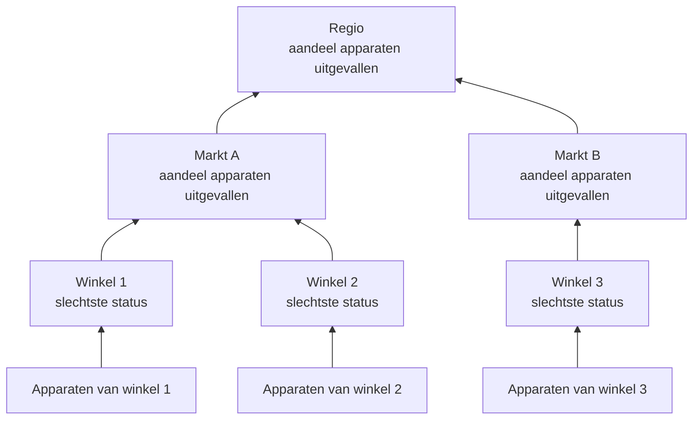

# Netwerklocaties (gezondheidsoverzicht en uptime)

Een netwerklocatie is een plaats: een regio, een markt, een franchisenemer, een distributiecentrum, één winkel. Locaties liggen in elkaar genest, netwerkapparaten hangen eraan, en OneUptime vat de gezondheid van de apparaten samen omhoog in de boom, zodat één status op een regio antwoord geeft op "is er daarbuiten iets mis?".

Je vindt ze onder **Netwerk → Locaties**, en op een kaart onder **Netwerk → Map**. Deze pagina legt vast hoe de status van een locatie wordt bepaald uit wat eronder hangt, wat haar uptime betekent en hoe gepland onderhoud allebei verandert.

:::cards
- [Een locatie toevoegen](#een-locatie-toevoegen): Drie stappen, of een CSV-bestand voor een hele omgeving.
- [Monitoringstandaarden instellen](#monitoringstandaarden): Een sonde en inloggegevens voor elk apparaat in een locatie.
- [Kiezen hoe gezondheid wordt samengevat](#hoe-de-gezondheid-van-de-ouder-wordt-berekend): De slechtste status voor een winkel, een aandeel voor een regio.
- [Uptime lezen](#uptime): Wat de percentages tellen, dag voor dag.
:::

## Hoe het werkt



De status van elke locatie komt van elk apparaat in haar subboom, beoordeeld volgens het eigen [overzichtsbeleid](#hoe-de-gezondheid-van-de-ouder-wordt-berekend) van de locatie. De uptime van een locatie komt uit haar eigen statustijdlijn, en een [onderhoudsvenster](#gepland-onderhoud-voor-netwerklocaties) op een locatie haalt haar apparaten uit de stemming daarboven.

## De hiërarchie

Locaties vormen een boom. Elke locatie heeft een **Site Type** en optioneel een bovenliggende locatie. Locatietypen zijn de eigen lijst van het project, onder **Netwerk → Instellingen → Site Types**, en een nieuw project begint met Account Type, Region, Franchisee, Market en Unit, in die volgorde van boven af, plus Data Center en Other. Typen vormen een eigen hiërarchie (**Parent Site Type**), die bepaalt welke locaties de ouder van een locatie kunnen zijn. Een type gemarkeerd als **Is Unit Level** is het onderste niveau van je omgeving, de afzonderlijke winkel of vestiging: de locaties ervan bevatten apparaten, geen andere locaties.

Het type, de naam, de beschrijving, de ouder en de ligging van een locatie bewerk je op één plek: de kaart **Site Settings** op de pagina **Instellingen** van de locatie. Het overzicht van de locatie toont ze met een link **Bewerken in Instellingen**, en de lijst **Locaties** voegt locaties toe maar bewerkt ze niet.

Elk apparaat hangt aan één locatie. De subboom van een locatie is de locatie zelf plus elke locatie eronder, en de apparaten van de subboom zijn waaruit haar gezondheid wordt samengevat, dus een regio zonder eigen apparaten heeft toch een status, omdat de units eronder die hebben.

> [!NOTE]
> Een samenvatting wordt opnieuw berekend als de status van een apparaat verandert, als een apparaat naar een andere locatie verhuist, als een locatie in de boom verschuift, en door een ronde elke vijf minuten die de gevallen oppikt waarin alleen het verstrijken van de tijd het antwoord veranderde.

## Een locatie toevoegen

:::steps
### Een nieuwe locatie beginnen
Ga naar **Netwerk → Locaties** en klik op **Site toevoegen**.

### Zeggen wat de locatie is
Kies in de stap **Site Details** het **Site Type** (wat voor plaats het is: een regio, een winkel, een datacenter) en typ een **Naam**. De beschrijving, het adres, en de breedte- en lengtegraad die de locatie op de kaart vastzetten, zijn ingeklapt onder **Meer velden**: vul ze nu of later in.

### Haar in de boom plaatsen
Kies in de stap **Hierarchy** de **Parent Site** als de locatie onder een andere valt. Laat het leeg om de locatie op het hoogste niveau te houden.

### Haar standaarden instellen
Kies in de stap **Monitoring Defaults** de [standaardsonde en het standaard-inloggegevensprofiel](#monitoringstandaarden) voor apparaten die aan de locatie worden toegevoegd, en klik op **Site toevoegen**.
:::

Op de pagina **Child Sites** van een locatie vraagt **Onderliggende locatie toevoegen** alleen het type en de naam, op één pagina met de ligging ingeklapt, en plaatst de nieuwe locatie onder die locatie.

### Locaties importeren uit een CSV-bestand

Om een hele omgeving in één keer binnen te halen, open je het menu bovenaan de lijst **Locaties** en klik je op **Import from CSV**. Het bestand heeft een kopregel nodig; de kolommen mogen in elke volgorde staan en hun namen zijn niet hoofdlettergevoelig:

```csv title="sites.csv"
name,siteType,parentName,address,latitude,longitude
North,Region,,,,
Leeds,Market,North,,,
Store 0660,Unit,Leeds,"1 High Street, Leeds",53.7997,-1.5492
```

- `name` en `siteType` zijn verplicht. `siteType` moet een van de locatietypen van het project zijn.
- `parentName` noemt de bovenliggende locatie, die in hetzelfde bestand mag staan: rijen zonder ouder, of met een ouder die al bestaat, gaan eerst, daarna hun kinderen. Laat het leeg voor een locatie op het hoogste niveau.
- Een rij waarvan de ouder niet gevonden wordt, wordt overgeslagen, en de resultaten noemen haar. **Preview Import** laat zien wat het bestand gaat maken voordat er iets wordt weggeschreven.

## De kaart

**Netwerk → Map** toont je locaties op een kaart, ingekaderd waar ze ook liggen; klik op een locatie om in te zoomen. Een locatie met locaties eronder toont die, op de kaart en als een graaf van de verbindingen ertussen. Een locatie zonder locaties eronder maar met eigen apparaten, of een locatie waarvan het type op unitniveau ligt, opent de live topologie van die apparaten.

Een project dat nog geen locaties heeft, heeft toch een kaart: de Map toont dan de topologie van zijn apparaten, en apparaten in locaties groeperen zet ze op ligging op de kaart.

## Monitoringstandaarden

Een locatie is ook waar je één keer zegt hoe de apparaten erin worden gemonitord. **Instellingen bewerken** op de kaart **Site Settings** heeft een stap **Monitoring Defaults** met twee velden:

| Instelling | Effect |
| --- | --- |
| **Default Probe** | De sonde die apparaten in deze locatie pingt, en ze via SNMP walkt als ze inloggegevens hebben. Een apparaat dat in de locatie wordt aangemaakt zonder eigen sonde, neemt haar over, en dat doet ook een apparaat dat zonder sonde naar de locatie wordt verplaatst. |
| **Default SNMP Credential Profile** | Het [inloggegevensprofiel](/docs/monitor/network-device-monitor#snmp-inloggegevens-en-inloggegevensprofielen) waarmee apparaten in deze locatie worden gewalkt als noch het apparaat noch zijn eigen profiel inloggegevens heeft. |

Stel beide in op een locatie en een nieuw apparaat daar kan met alleen zijn adres worden toegevoegd: het wordt vanaf zijn eerste poll gepingd en vanaf zijn eerste poll gewalkt.

De twee gedragen zich bewust verschillend:

- De sonde wordt naar het apparaat gekopieerd als het apparaat in de locatie wordt aangemaakt of ernaartoe wordt verplaatst. De standaardsonde van een locatie later wijzigen, verplaatst geen apparaten die er al een hebben: welke sonde een apparaat kan bereiken, is een feit over het netwerk, geen voorkeur om in bulk te herschrijven vanuit een locatieformulier.
- Het inloggegevensprofiel wordt live gelezen, bij elke poll. Stel er een in op een locatie en elk apparaat daarin zonder inloggegevens wordt bij zijn volgende poll gewalkt, zonder bewerking per apparaat; wis het en ze worden weer alleen gepingd.

Ze reiken ook verschillend ver omlaag in de boom:

- De sonde reikt door de hele boom. Een apparaat dat in een locatie zonder standaardsonde belandt, neemt die van de dichtstbijzijnde bovenliggende locatie, dus één sonde op een regio dekt elke markt en unit eronder, en een markt die een eigen sonde noemt, vervangt die voor haar subboom.
- Het inloggegevensprofiel wordt alleen van de eigen locatie van het apparaat gelezen. Een apparaat in een unit neemt geen profiel over dat op zijn regio is ingesteld, dus stel het in op de locaties waar de apparaten echt aan hangen.

## Hoe de gezondheid van de ouder wordt berekend

Elke locatie kiest een van twee soorten overzichtsbeleid, op de kaart **Health Rollup** van haar pagina **Instellingen** (**Rollup Policy**).

### Slechtste status van een apparaat (standaard)

De slechtste status die een apparaat in de subboom meldt, wordt de status van de locatie. Hoe erg een status is, volgt uit zijn prioriteit als monitorstatus: de statussen van een nieuw project zijn Operational (1), Degraded (2) en Offline (3), en hoger is erger. Eén offline apparaat maakt de locatie offline, hoeveel gezonde apparaten er ook naast staan.

Dat is het juiste antwoord voor een unit. Vier switches en een firewall in één gebouw zijn niet onafhankelijk: als er één uitvalt, is dat een probleem op dat adres, en het wegmiddelen verbergt een echte storing.

Voor een regio boven vierhonderd winkels is het meestal het verkeerde antwoord. Eén uitgevallen switch in winkel 12.000 kleurt de hele regio Offline: waar in de engste zin, en nutteloos in elke praktische zin, omdat de regio dan rood is zodra er ergens een winkel een probleem heeft, en je niets meer vertelt.

### Percentage uitgevallen apparaten

De status van de locatie wordt bepaald door het aandeel van de meldende apparaten in de subboom dat niet in een operationele status is:

| Aandeel uitgevallen apparaten | Locatiestatus |
| --- | --- |
| 0% | Operational |
| Boven 0%, onder de drempel | Degraded: de status van het project die operationeel noch offline is, of Offline als het project er geen heeft |
| Op of boven de drempel | Offline |

De drempel wordt per locatie ingesteld, als **Offline Threshold (%)**, en is standaard 50.

Niets uitgevallen is Operational, hoe laag de drempel ook staat: een drempel van 0 betekent "elk uitgevallen apparaat maakt dit offline", niet "een gezonde regio is offline".

### Welke apparaten stemmen

Beide soorten beleid zijn het hierover eens, en het doet er meer toe dan het lijkt:

- Gearchiveerde apparaten stemmen nooit. Ze zijn buiten gebruik gesteld: ze houden hun locatie maar blijven buiten beschouwing.
- Apparaten die nog nooit iets hebben gemeld, stemmen nooit. Een apparaat dat op zijn eerste poll wacht, is geen bewijs van een storing, dus het blijft buiten beide kanten van het aandeel, en een regio die halverwege de onboarding is, wordt beoordeeld op de helft die heeft geantwoord.
- Een door een sonde gepold apparaat, de normale soort, stemt met de uitkomst van zijn laatste poll: bereikbaar via ping of SNMP, niet hoe lang geleden het voor het laatst slaagde. Een apparaat dat op ping antwoordt terwijl zijn SNMP-walk mislukt, is bereikbaar en stemt zo; de locatie zegt dat het werkt, en de rij van het apparaat zegt **SNMP failing** zodat iemand de inloggegevens repareert.
- Een apparaat met een gekoppelde monitor, een dat op zijn pagina Instellingen naar de override met gekoppelde monitor is gezet, stemt met de status van de monitor die eraan gekoppeld is, omdat niets het pollt. Zonder gekoppelde monitor heeft het nooit gemeld, dus stemt het helemaal niet.

Een netwerkapparaat-monitor op een door een sonde gepold apparaat verandert niet hoe het apparaat stemt. Een monitor met een criterium "interface uitgevallen, dus Offline" zou Offline stempelen op een switch die op elke ping antwoordt, en één donkere poort zou een hele locatie rood maken terwijl elke apparaatrij eronder Up toont: de locatie zou het oneens zijn met de lijst die ze samenvat. Voor een gepold apparaat is de poll de bron van zijn gezondheid; de monitor is er om incidenten te openen.

### Een beleid kiezen

Een redelijk begin voor een franchiseomgeving:

| Niveau | Beleid | Waarom |
| --- | --- | --- |
| Unit of winkel | Slechtste status | Eén uitgevallen apparaat is één locatie in de problemen. |
| Markt | Percentage, drempel rond 50% | Een markt waarvan de helft van de winkels is uitgevallen, is uitgevallen. |
| Regio | Percentage, drempel 25% tot 50% | Een storing in één winkel maakt de regio Degraded, niet Offline, en ze wordt Offline als er iets systemisch gebeurt. |

Het beleid wordt per locatie ingesteld, dus je kunt de regiorijen het percentagebeleid geven en alles eronder op de standaard laten.

## Uptime

Elke locatie heeft een statustijdlijn: één rij per wijziging van haar samengevatte status, geopend als de status verandert en gesloten als hij opnieuw verandert. Uptime wordt daaruit berekend:

- Tijd in een status die niet als operationeel is gemarkeerd, is downtime.
- Overlappende rijen worden samengevoegd, dus geen seconde telt twee keer.
- Tijd die door geen enkele rij wordt gedekt, telt als up. De tijdlijn krijgt pas rijen als er een samenvatting heeft gedraaid, en geen bewijs is geen storing.
- Een rij die nog open is, loopt door tot het einde van het gemeten venster.

Degraded is niet operationeel, dus het telt ook als down. Onder beide soorten beleid is de uptime van een locatie dus het aandeel van de tijd waarin geen enkel meldend apparaat eronder was uitgevallen: het beleid verandert welke status een gedeeltelijke storing toont, Degraded of Offline, niet of ze meetelt.

Een locatie zonder enige tijdlijnrij toont `—` in plaats van 100%: een locatie waarover nooit iets is samengevat, is niet gemonitord, niet perfect.

### Dagelijkse uptime

Naast het cijfer over 30 dagen toont het overzicht van elke locatie **Uptime (24h)**, en haar pagina **Statustijdlijn** toont de laatste 24 uur, 7, 30 en 90 dagen, en een balk per dag voor de laatste 30.

Een gemiddelde over 30 dagen kan geen slechte dag laten zien. Een volle dag storing in een venster van 30 dagen kost 3,3 punt, dus een locatie die een hele dinsdag donker was, meldt nog steeds 96,7% voor de maand, een getal dat leest als een afronding. De dagbalken zetten dezelfde gegevens neer waar één slechte dag één slechte balk is.

Dagen zijn voortschuivende stukken van 24 uur die nu eindigen, geen kalenderdagen: de apparaten, de kijker en de server kunnen elk in een andere tijdzone zitten, en er is geen enkele "dag" waarover ze het eens zouden zijn.

### De uptime van een ouder is geen gemiddelde van de uptime van de kinderen

De uptime van een ouder komt uit de eigen tijdlijn van de ouder, die zijn overzichtsbeleid heeft opgeleverd, niet uit het gemiddelde van de percentages van zijn kinderen.

Een gemiddelde over kinderen weegt een winkel met twee apparaten even zwaar als een distributiecentrum met tweehonderd. De eigen tijdlijn van een ouder geeft in plaats daarvan een uitkomst die je in één zin kunt zeggen: het aandeel van de tijd waarin helemaal niets in de regio was uitgevallen. Ze is bewust streng, dus lees haar op een grote regio samen met de dagbalken, en met de status, die zegt of een gedeeltelijke storing Degraded of Offline was.

## Gepland onderhoud voor netwerklocaties

Koppel locaties aan een gepland onderhoud onder **Andere getroffen resources**, in de stap **Getroffen middelen** van de gebeurtenis, zoals je met een host zou doen. De eigen pagina **Geplande onderhoud** van een locatie somt de gebeurtenissen op die eraan gekoppeld zijn, en haar **Geplande onderhoudsgebeurtenis aanmaken** opent het formulier met de locatie al gekozen.

Een venster op een ouder dekt alles eronder: een venster op een regio dekt elke markt en unit erin, inclusief locaties die zijn aangemaakt nadat het venster was gepland, dus een regionale overstap van provider hoeft geen vierhonderd winkels op te sommen.

Dekking reikt alleen omlaag. Een venster op één unit zet haar regio niet in onderhoud: van de regio wordt nog steeds verwacht dat ze werkt, en een echte storing in een andere unit in dezelfde uren telt nog steeds tegen haar.

### Wat een onderhoudsvenster verandert

| Tijdens het venster | Wat er gebeurt |
| --- | --- |
| De live status van de locatie | Ongewijzigd. Een unit die voor gepland werk uit staat, toont nog steeds Offline op de kaart en in de boom, met een badge "In onderhoud" ernaast: wie ernaar kijkt, moet weten dat ze uit staat. |
| De uptime van de locatie | Het venster wordt uit zowel de downtime als de gemeten periode gehaald. Twee uur onderhoud maakt de dag 22 uur lang, en niets binnen die twee uur telt in welke richting dan ook. |
| Het gezondheidsoverzicht van haar bovenliggende locaties | De apparaten van de subboom in onderhoud stemmen niet meer, dus de regio wordt niet rood door een overstap die in de agenda stond. |
| De uptime van haar bovenliggende locaties | Niet beïnvloed, zonder iets te corrigeren, omdat de geplande storing hun tijdlijnen nooit heeft bereikt. |

Die laatste rij is waarom bovenliggende locaties worden behandeld door stemmen achter te houden in plaats van het venster uit hun uptime te halen: het uit de periode van de regio halen, zou ook een echte storing elders in de regio in dezelfde uren wissen.

Uptime wordt gecorrigeerd met de opgegeven begin- en eindtijd van de gebeurtenis, niet met het moment waarop een proces haar tussen toestanden verplaatste, dus het getal kan met de hand tegen de agenda worden gecontroleerd. Een dag die helemaal binnen een venster valt, wordt in de dagbalken als onderhoud getekend in plaats van als perfecte dag, en draagt niets bij aan het gemiddelde.

### Samenspel met monitors

Een monitor aan dezelfde gebeurtenis koppelen, doet nog steeds wat het altijd deed: actieve monitoring van die monitor pauzeert tijdens het venster. De twee staan los van elkaar: koppel de locatie om haar buiten het overzicht en haar uptime te houden, en koppel de monitors om ze te laten stoppen met waarschuwen.

## Waarschuwen op een locatie

De kaart **Alerting** op de pagina **Instellingen** van een locatie heeft **Alert When Unhealthy**: er opent een waarschuwing als het overzicht van de locatie naar een status gaat die niet operationeel is, en die lost zichzelf op als de locatie herstelt. **Ernst van waarschuwing** stelt de ernst in; leeg gelaten is het de zwaarste van het project.

Er wordt alleen op de wijziging gewaarschuwd: het aanzetten voor een locatie die al ongezond is, wacht op de volgende wijziging in plaats van over het verleden te waarschuwen. Degraded is niet operationeel, dus een locatie met het percentagebeleid waarschuwt zodra een van haar meldende apparaten uitvalt, net als een locatie met het beleid van de slechtste status; de waarschuwing blijft open, zonder een tweede, terwijl de locatie tussen Degraded en Offline wisselt, en haar titel noemt de status die de locatie als eerste bereikte.

## Problemen oplossen

:::details Een regio is altijd rood
De locatie staat op het beleid van de slechtste status, dus één offline apparaat ergens eronder maakt haar offline. Zet de regio op **Percentage of devices down** op haar kaart **Health Rollup**, met een drempel die past bij hoeveel van de regio uitgevallen moet zijn voordat je haar uitgevallen noemt.
:::

:::details Een locatie toont — in plaats van een uptime
Er heeft nog nooit een samenvatting gedraaid voor de locatie, dus ze heeft geen tijdlijnrijen: ze is niet gemonitord, niet perfect. Voeg apparaten toe aan de locatie, of aan de locaties eronder, en de volgende samenvatting start haar tijdlijn.
:::

:::details Een apparaat telt niet mee voor zijn locatie
Gearchiveerde apparaten, en apparaten die nog niet hebben gemeld, stemmen nooit. Een apparaat met een gekoppelde monitor waaraan geen monitor is gekoppeld, heeft ook nooit gemeld. Controleer de status van het apparaat: een apparaat **In behandeling** begint te stemmen na zijn eerste poll.
:::

:::details De waarschuwing van een locatie ging niet af
**Alert When Unhealthy** gaat af bij een overgang van een operationele status naar een andere, dus een locatie die al ongezond was toen je het aanzette, waarschuwt bij haar volgende wijziging, nadat ze hersteld is. Controleer ook of haar apparaten stemmen: gearchiveerde apparaten en apparaten die op hun eerste poll wachten doen dat nooit, en de apparaten van een locatie in onderhoud stemmen niet mee in de samenvattingen daarboven.
:::

## Volgende stappen

:::cards
- [Netwerkapparaat-monitor](/docs/monitor/network-device-monitor): Voeg de apparaten die aan deze locaties hangen toe, poll ze en waarschuw erop.
- [Netwerkverkeer](/docs/monitor/network-traffic): Bekijk het verkeer van een locatie uit de flowrecords van haar apparaten.
- [Inventaris](/docs/inventory/overview): Netwerkapparaten naast al je andere assets.
:::
