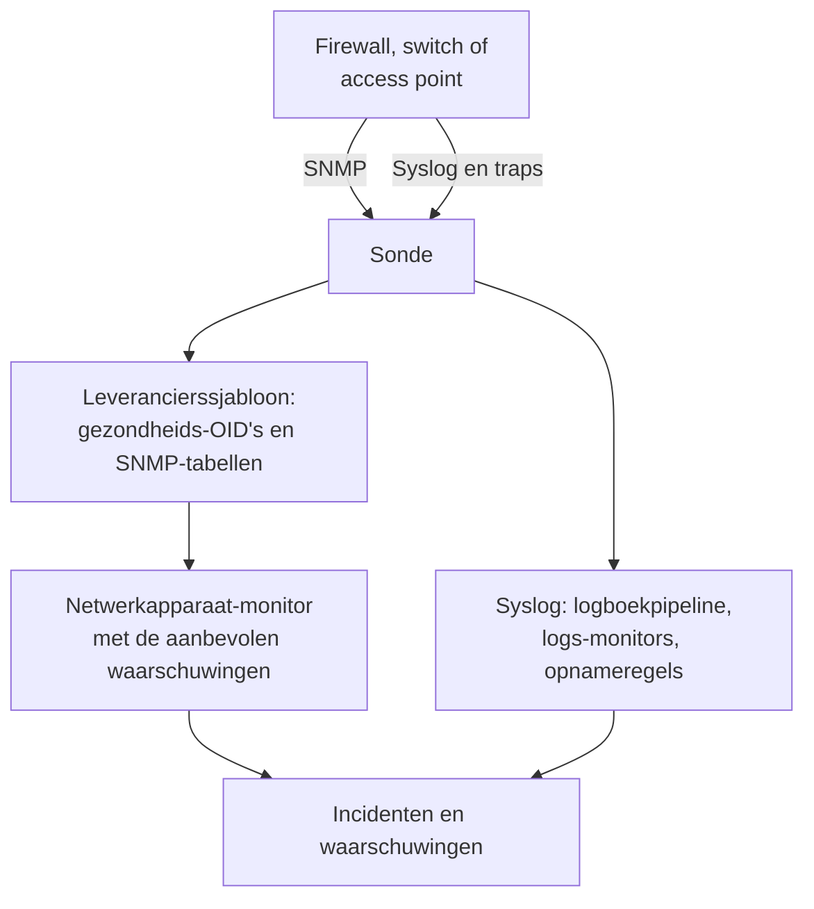

# Handleidingen per netwerkleverancier (Sophos, Extreme, Cambium)

Hoe je drie veelvoorkomende omgevingen van begin tot eind monitort met OneUptime: een Sophos Firewall (XGS, SFOS) met zijn IPsec-tunnels, WAN-verbindingen en SD-WAN; Extreme Networks-switches (EXOS / Switch Engine en Fabric Engine / VOSS) met hun fabric; en Cambium Networks cnMatrix-switches en Enterprise Wi-Fi-access points, tot op het kanaal en zendvermogen van elke radio.

:::cards
- [Sophos Firewall](#sophos-firewall-xgs-sfos): Tunnels, WAN-verbindingen, gateways en SD-WAN.
- [Extreme Networks](#extreme-networks-exos-switch-engine-en-fabric-engine-voss): Switches, de fabric en de hardware ervan.
- [Cambium Networks](#cambium-networks-enterprise-wi-fi-en-cnmatrix): Access points tot op elke radio, en cnMatrix-switches.
:::

## Hoe het werkt

Elke handleiding gebruikt dezelfde onderdelen:

- Een [netwerkapparaat](/docs/monitor/network-device-monitor) per kast, gepolld door een sonde die het kan bereiken, met een leverancierssjabloon dat de juiste gezondheids-OID's en [SNMP-tabellen](/docs/monitor/network-device-monitor#snmp-tabellen) meebrengt.
- Een netwerkapparaat-monitor per apparaat voor de waarschuwingen. Maak hem vanaf de pagina van het apparaat zodat de [aanbevolen waarschuwingen](/docs/monitor/network-device-monitor#aanbevolen-waarschuwingspakket), inclusief één waarschuwing per rij voor elke tabel die weet hoe gezond eruitziet, voor je worden ingevuld. Voor een vloot houdt een [waarschuwingsbeleid](/docs/monitor/network-device-monitor#waarschuwingsbeleid) er een bij op elk apparaat.
- Voor wat een leverancier alleen in zijn logs meldt: syslog naar de sonde, een [logboekpipeline](/docs/telemetry/log-pipelines) om elke regel in attributen om te zetten, [logs-monitors met Group By](/docs/monitor/logs-monitor#waarschuwingen-per-groep-group-by) om één keer per tunnel of gateway te waarschuwen, en [opnameregels voor logboeken](/docs/telemetry/log-recording-rules) om de getallen in die logs in grafieken te zetten.

## Sophos Firewall (XGS / SFOS)

| Wat je wilt zien | Waar het vandaan komt |
| --- | --- |
| Gezondheid van de firewall: geheugen, schijf, swap, HA-toestand, IPsec-dienst, CPU per kern | SNMP, met het leverancierssjabloon **Sophos Firewall (SFOS / XGS)** |
| De status van elke IPsec-tunnel, op naam | De SNMP-tabel `ipsec_tunnels` (SFOS v20 en later) |
| De status, doorvoer, benutting en fouten van elke WAN-verbinding | De interfacewalk van de WAN-poorten |
| De latentie, het pakketverlies en de jitter van elke WAN-verbinding | Ping-monitors en apparaatpolls vanaf OneUptime-sondes |
| Gateway bereikbaar en onbereikbaar, SD-WAN-SLA gehaald of niet, wijzigingen in SD-WAN-routes | De syslog van de firewall |
| SD-WAN-latentie, -jitter en -pakketverlies per gateway, als grafieken | Opnameregels voor logboeken over de SD-WAN-SLA-logs |

Sophos meldt de gezondheid van gateways of SD-WAN niet via SNMP, in geen enkele SFOS-versie: die bestaat alleen in de logs van de firewall, en in de waarschuwingen van Sophos Central, en daarom gaan de laatste drie rijen via syslog.

### De firewall registreren

:::steps
1. Zet op de firewall SNMP aan onder **Administration → SNMP**: voeg een SNMPv3-gebruiker toe, of een v2c-community, en sta het adres van de sonde toe om hem te bevragen.
2. Ga in OneUptime naar **Netwerk → Devices** en klik op **Add Device**. Typ het beheeradres van de firewall, kies een sonde die hem kan bereiken, en voeg de SNMP-inloggegevens toe onder **SNMP**.
3. Pas op de pagina **Instellingen** van het apparaat, onder **Polling & Data Collection**, het sjabloon **Sophos Firewall (SFOS / XGS)** toe vanuit **Vendor Health Template** en voeg de tabellen ervan toe vanuit **Add a Vendor's Tables**. Of zet **Auto-Apply Vendor Health Template** aan, en de eerste poll doet beide.
:::

Na de volgende poll somt de pagina **SNMP Tables** van het apparaat elke IPsec-verbinding op met haar status (active, inactive, partially active), en de CPU-kernen. SFOS nummert zijn kernen vanaf 196608, en daarom komt de CPU uit een tabel in plaats van uit één `hrProcessorLoad.1`.

### Waarschuwen op elke IPsec-tunnel

Klik op de pagina van het apparaat op **Monitor maken**. De aanbevolen waarschuwingen bevatten **IPsec Tunnels: row unhealthy**, een criterium **SNMP Table Row Is Unhealthy** op de tabel `ipsec_tunnels` met Row `*`: het opent één incident per tunnel die niet actief is, genoemd naar de tunnel, en lost elk op als zijn tunnel terugkomt.

Bij een tunnel die Sophos als actief meldt, zijn alleen de security associations opgebouwd. Om te bewijzen dat er verkeer doorheen gaat, voeg je een [Ping-monitor](/docs/monitor/ping-monitor) toe vanaf een sonde op de ene locatie naar een host aan de andere kant van elke tunnel, en teken je de tunnel als locatieverbinding onder **Netwerk → Topologie → Site Links** tussen de twee [locaties](/docs/monitor/network-sites), gekoppeld aan die monitor: de verbinding op de kaart neemt dan de kleur van de monitor over.

### WAN-verbindingen

- **Poortgezondheid.** De interfacewalk meet al de status, bits in en uit, benutting en fouten van elke WAN-poort. Op de monitor van de firewall waarschuwt een criterium **SNMP Interface Is Down** of **SNMP Interface Utilization (in %)** met **Interface** ingesteld op de naam van de WAN-poort, of `*` voor elke poort, per verbinding.
- **Kwaliteit van het pad.** De latentie, het pakketverlies en de jitter van elke verbinding worden van buiten de firewall gemeten: een Ping-monitor vanaf de cloudsondes van OneUptime naar het openbare adres van elke WAN-verbinding, en een Ping-monitor vanaf een sonde op de locatie naar de gateway van elke provider. Criteria voor pakketverlies en jitter op die monitors waarschuwen per verbinding, en **Netwerk → Topologie → Latency Matrix** toont in één oogopslag elke sonde tegen elke monitor.
- **Verkeer.** SFOS exporteert NetFlow v5. Stuur het naar de sonde op UDP 2055, waar de flowcollector van de sonde standaard luistert, en de pagina **Traffic** van het apparaat laat zien wie met wie praat over elke WAN-verbinding; [Netwerkverkeer](/docs/monitor/network-traffic) heeft de details.

### Gateways en SD-WAN uit syslog

:::steps
1. Zet de syslog-ontvanger van de sonde aan: stel `PROBE_SYSLOG_RECEIVER_ENABLED=true` in op de sonde. Hij luistert standaard op UDP 5140 (`PROBE_SYSLOG_RECEIVER_PORT` verandert dat); publiceer de poort als de sonde in Docker draait. Berichten worden gekoppeld aan het netwerkapparaat waarvan de hostnaam, of een van de **Overige adressen**, het adres van de afzender is, en verschijnen op de pagina **Logboeken** van het apparaat.
2. Voeg op de firewall, onder **System services → Log settings**, een syslog-server toe die naar de sonde en die poort wijst, en vink de logtypen **Event** voor IPsec en gateways en het logtype **SD-WAN** aan: de SLA-logs blijven uit tot dat is aangevinkt.
3. Maak onder **Logboeken → Instellingen → Pipelines** een pipeline waarvan het filter op de logs van de firewall past, zoals `attributes.networkDevice.name = 'hq-firewall'`, en voeg een **Key=Value Parser** toe met **Target Prefix** `sophos`. Plak een regel van de firewall in de tester ervan om de exacte attribuutnamen te zien die jouw SFOS-versie oplevert; [het Sophos-voorbeeld](/docs/telemetry/log-pipelines#voorbeeld-sophos-xgs-firewall) loopt het door.
4. Maak [logs-monitors](/docs/monitor/logs-monitor) op de logs van de firewall, elk met **Group by Attributes** zodat elke tunnel of gateway op zichzelf waarschuwt, en het criterium **Log Count** **Greater Than** `0` over een paar minuten. De rijen hieronder zijn de drie om mee te beginnen.
5. Zet de SD-WAN-kwaliteit in grafieken: met SD-WAN-logging aan schrijft de firewall een SLA-samenvatting per profiel en gateway (`latency`, `jitter`, `packet_loss`). Maak onder **Logboeken → Instellingen → Opnameregels** één regel per getal, zoals het gemiddelde van `sophos.latency` gegroepeerd op `sophos.gw_name` en `sophos.profile_name`, en zet de resultaten daarna in grafieken, of waarschuw erop met een [metriekenmonitor](/docs/monitor/metrics-monitor) die op gateway groepeert. [Opnameregels voor logboeken](/docs/telemetry/log-recording-rules) loopt dit voorbeeld door.
:::

| Waarschuwing | Te tellen logs | Groeperen op |
| --- | --- | --- |
| IPsec-tunnel beëindigd | Attribuut `sophos.log_component` = `IPSec`, body bevat `terminated` | `sophos.con_name` |
| Gateway onbereikbaar | Attribuut `sophos.log_component` = `Gateway`, body bevat `is Down` | `sophos.gatewayname` |
| SD-WAN-SLA niet gehaald | Attribuut `sophos.log_type` = `SD-WAN`, body bevat `SLA not met` | `sophos.gw_name` |

De syslog-gebeurtenissen vullen de SNMP-tabel aan: ze komen binnen op het moment dat een tunnel wegvalt, terwijl de tabel ook een tunnel vangt die nooit is opgekomen.

### Traps

Elke Sophos-melding is dezelfde trap, `sfosNotification` (`1.3.6.1.4.1.2604.5.1.8.1.1`), met de gebeurtenis als tekst in `sfosTrapMessage` (`1.3.6.1.4.1.2604.5.1.8.1.2`). Om op één soort gebeurtenis te waarschuwen, combineer je **SNMP Trap Received (Trap OID)** Equal To `1.3.6.1.4.1.2604.5.1.8.1.1` met **SNMP Trap Varbind Value** op die varbind, Contains `IPSec` bijvoorbeeld. Zet de trapbestemming van de firewall op SNMP v2c: de trapontvanger van de sonde neemt v1- en v2c-traps aan.

## Extreme Networks (EXOS / Switch Engine en Fabric Engine / VOSS)

| Wat je wilt zien | Waar het vandaan komt |
| --- | --- |
| EXOS: CPU, temperatuur en het alarm ervan, voedingstoestand, voedingen, ventilatoren, geheugen per slot, stackleden | Het sjabloon **Extreme Networks EXOS / Switch Engine** |
| Fabric Engine: CPU en geheugen per slot, temperatuursensoren, ventilatoren, voedingen, vIST-sessie, aantal I-SID's | Het sjabloon **Extreme Networks Fabric Engine / VOSS** |
| Elke Fabric Connect-adjacency (IS-IS), genoemd naar de buur | De tabel `isis_adjacencies` van het Fabric Engine-sjabloon |
| Poorten, LLDP-buren, de netwerkkaart | De interfacewalk, op allebei |

### Welk sjabloon

Fabric Engine op de universele hardware van Extreme (de series 5000 en 7000) meldt hetzelfde enterprisenummer als EXOS: alleen zijn systeembeschrijving (`7520-48Y-8C-FabricEngine (9.0.4.0)`) zegt welk besturingssysteem draait. OneUptime leest beide, dus automatisch toepassen en de suggestie op de apparaatpagina kiezen het juiste sjabloon, en oudere VSP-switches melden de Avaya/Nortel-tak en worden direct als Fabric Engine herkend.

### Waarschuwingen voor fabric en hardware

De aanbevolen waarschuwingen op een Fabric Engine-switch bevatten **Fabric Adjacencies (IS-IS): row unhealthy**, een incident per buur waarvan de adjacency niet actief is. Fabric Engine stuurt ook een trap als een adjacency verandert, `rcnIsisPlsbAdjStateTrap` (`1.3.6.1.4.1.2272.1.21.0.281`), en een criterium **SNMP Trap Received (Trap OID)** daarop waarschuwt binnen seconden, vóór de volgende poll.

Voedingen, ventilatoren, temperatuursensoren en stackleden zijn tabellen die hun gezonde waarden declareren, dus elk krijgt een waarschuwing per rij in de aanbevolen waarschuwingen.

### Flows en wifi

EXOS en Fabric Engine exporteren flows als sFlow en IPFIX. Stuur sFlow naar de sonde op UDP 6343, of IPFIX op UDP 4739, en de pagina **Traffic** van het apparaat toont het verkeer; zie [Netwerkverkeer](/docs/monitor/network-traffic).

IQ Engine-access points (HiveOS) en ExtremeCloud IQ Controller hebben eigen leverancierssjablonen, die de pagina **Wi-Fi** van het apparaat vullen. [Ondersteunde wifi-leveranciers](/docs/monitor/network-device-monitor#ondersteunde-wifi-leveranciers) behandelt ze, samen met Ubiquiti UniFi, HPE Aruba, TP-Link Omada en Juniper Mist.

## Cambium Networks (Enterprise Wi-Fi en cnMatrix)

### Access points

:::steps
1. Zet SNMP aan op de access points. In cnMaestro wordt SNMP per AP-groep ingesteld: **Configuration → Wi-Fi Profiles → AP Groups → Management → SNMP**. Zet het aan met een v2c-leescommunity of een SNMPv3-gebruiker.
2. Voeg elk access point toe met zijn beheeradres en die inloggegevens, en pas het sjabloon **Cambium Networks Enterprise Wi-Fi (cnPilot, XV, XE, XH)** toe, of zet automatisch toepassen aan.
3. Open de pagina **Wi-Fi** van het apparaat. Die toont hoeveel radio's aan staan, de clients en SSID's, dan van elke radio de band, het kanaal, de frequentie, de kanaalbreedte, het zendvermogen, de clients, de ruisvloer en de airtime, en elke SSID met zijn clients. De frequentie wordt afgeleid uit de band en het kanaal; het access point meldt haar niet.
:::

Nuttige waarschuwingen, allemaal op de tabel `wifi_radios` met Row `*`, zodat elke radio op zichzelf waarschuwt:

| Waarschuwing | Criterium |
| --- | --- |
| Een radio uitgezet | **SNMP Table Row Is Unhealthy**, onderdeel van de aanbevolen waarschuwingen |
| Zendvermogen gewijzigd | **SNMP Table Value**, kolom TX Power, Not Equal To je geplande vermogen |
| Een drukke radio | **SNMP Table Value**, kolom Clients, Greater Than je limiet |
| Een kanaal met veel ruis | **SNMP Table Value**, kolom Noise Floor, Greater Than `-80` |

Elke numerieke radiowaarde is ook een metriek (`oneuptime.monitor.snmp.table.value`, één reeks per radio en kolom), dus kanaal, vermogen en clients kunnen in de loop van de tijd op een dashboard in grafieken worden gezet; een kanaal dat steeds verandert, is DFS aan het werk.

Cambium meldt het totale aantal clients pas vanaf firmware 6.5.3; eerdere firmware geeft 0 terug.

### cnMatrix-switches

Het sjabloon **Cambium Networks cnMatrix** verzamelt CPU, RAM, flash, temperatuur en voedingsspanning, en als tabellen de ventilatoren, de redundante voeding en het PoE-verbruik van elke poort. Poorten en LLDP-buren komen uit de interfacewalk, zoals bij elke switch.

### cnMaestro-alarmen

cnMaestro kan zijn alarmen, zoals een access point dat offline gaat, naar een HTTPS-webhook sturen. Richt die op een [monitor voor inkomende verzoeken](/docs/monitor/incoming-request-monitor) om die alarmen in OneUptime-incidenten te veranderen naast de SNMP-gegevens.

## Problemen oplossen

:::details De tabel IPsec Tunnels heeft geen status
De tunnelstatus vereist SFOS v20 of later. Controleer ook of de SNMP-view van je inloggegevens de enterprise-boom van Sophos (`1.3.6.1.4.1.2604`) bevat: een beperkte v3-gebruiker ziet vaak alleen de systeemgroep en IF-MIB.
:::

:::details Er komt geen syslog van de firewall binnen
De syslog-ontvanger van de sonde staat standaard uit: stel `PROBE_SYSLOG_RECEIVER_ENABLED=true` in en publiceer UDP 5140, of je `PROBE_SYSLOG_RECEIVER_PORT`, naar de sonde. Berichten worden op het adres van de afzender aan een apparaat gekoppeld, dus de hostnaam van de firewall in OneUptime, of een van zijn **Overige adressen**, moet het adres zijn waarvandaan hij syslog stuurt.
:::

:::details Een Fabric Engine-switch kreeg het EXOS-sjabloon
Het sjabloon wordt gekozen op basis van de systeembeschrijving van de switch. Controleer of het overzicht van het apparaat een beschrijving toont die Fabric Engine noemt (zoals `7520-48Y-8C-FabricEngine (9.0.4.0)`); als dat zo is, verwijder dan de OID's en tabellen van EXOS en pas **Extreme Networks Fabric Engine / VOSS** toe vanuit **Vendor Health Template**.
:::

:::details Cambium-access points melden 0 clients
Het totale aantal clients vereist firmware 6.5.3 of later. Op oudere firmware melden de radio's nog steeds hun kanaal, vermogen en ruisvloer.
:::

## Volgende stappen

:::cards
- [Netwerkapparaat-monitor](/docs/monitor/network-device-monitor): Alles wat een apparaat verzamelt, en elk criterium waarop het kan waarschuwen.
- [Logboekpipelines](/docs/telemetry/log-pipelines): Firewall-logs in attributen opsplitsen.
- [Logs-monitor](/docs/monitor/logs-monitor): Eén keer per tunnel of gateway waarschuwen.
:::
