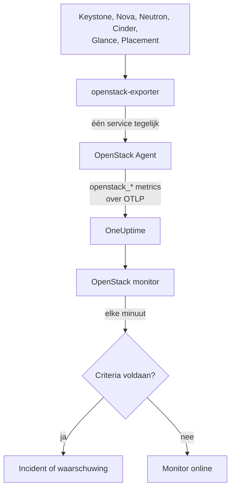

# OpenStack-monitor

Een OpenStack-monitor bewaakt één cloud: de API's, de workers erachter, hypervisors, instances, netwerken, opslagpools en projectquota. Hij meldt het wanneer een API niet meer antwoordt, een worker uitvalt, een hypervisor geen ruimte meer heeft of een pool volloopt. De monitor leest de `openstack_*`-reeksen die de OneUptime OpenStack Agent uit openstack-exporter verzamelt, of die een sonde uit de API's van de cloud verzamelt.

:::cards
- [De monitor maken](#een-openstack-monitor-maken): Zes stappen in het dashboard.
- [Sjablonen](#kant-en-klare-waarschuwingssjablonen): Kant-en-klare waarschuwingen, één incident per worker, instance, netwerk of regio.
- [Controles van buitenaf](#controles-van-buitenaf): Kan iemand daadwerkelijk een instance starten, gemeten vanaf een probe buiten de cloud.
- [Identiteitsattributen](#identiteitsattributen): Zo richt u zich op één regio, host of project.
- [Metrieken](#verzamelde-metrieken): Alle reeksen waarop de monitor kan waarschuwen.
:::

## Hoe het werkt

De agent is een OpenTelemetry Collector met een openstack-exporter, die u draait op een machine die de API's van de cloud kan bereiken. Hij leest elke OpenStack-service in een eigen verzameling, zodat een falende Nova alleen de reeksen van Nova kost. Hij leest ook rustig: compute, netwerk, volume en placement elke 2 minuten, identity en image elke 5.

Elke reeks krijgt de naam van de cloud mee, `openstack.cloud.name`, en elk datapunt `openstack.region.name` en `openstack_service`. Een cloud is één Keystone, en een OpenStack-monitor is aan één cloud gekoppeld. Elke minuut voert hij zijn query uit over de metrieken van die cloud en vergelijkt hij het resultaat met zijn criteria.



## Voordat u begint

- **Verzamel de metrieken van de cloud** met de OpenStack Agent, of [een sonde](/docs/telemetry/openstack-agentless). **Documentatie**, onder **Producten → Infrastructuur → OpenStack**, leidt u door de installatie van de agent.
- **Controleer of de cloud is geregistreerd.** Na de eerste verzameling verschijnt hij onder **Producten → Infrastructuur → OpenStack**, met de naam uit `OPENSTACK_CLOUD_NAME` van de agent.

## Een OpenStack-monitor maken

:::steps
### Begin een nieuwe monitor

Ga naar **Monitoren** en klik op **Monitor maken**.

### Kies OpenStack

Klik onder **Monitortype** op **Meer monitortypen** en kies **OpenStack** onder **Infrastructuur**, of typ `openstack` in het zoekvak. Vul een **Naam** in (die komt in de titels van incidenten en waarschuwingen) en klik op **Volgende**.

### Kies de cloud

Kies onder **OpenStack Monitor Configuration** de cloud bij **OpenStack-cloud**. Elke cloud die gegevens heeft verstuurd, staat in de lijst. Na uw keuze meldt een regel onder het veld of er gegevens binnenkomen.

### Kies wat u wilt bewaken

Een nieuwe monitor begint bij **Cloud Stopped Reporting**, onder **Waarover te waarschuwen**. Om iets anders te bewaken:

- **Wijzigen** - kies een ander [sjabloon](#kant-en-klare-waarschuwingssjablonen). Dat stelt de metriek, de attribuutfilters, de aggregatie, het tijdsbereik, het groeperen en de drempels in, en vervangt de criteria hieronder door die van het sjabloon. U kunt het **Tijdsbereik** nog steeds aanpassen.
- **Custom Metric** (onder **Meer velden**) - kies één metriek bij **OpenStack-metriek**, stel daarna **Aggregatie** en **Tijdsbereik** in en beperk de selectie met de [filters](#monitorinstellingen).
- **Geavanceerd** (onder **Meer velden**) - bouw zelf queries en formules onder **Selecteer metrieken**, met filters op attributen zoals `status`, `adminState` of `resourcetype`. Gebruik **Groeperen op** met een [identiteitsattribuut](#identiteitsattributen) om elk onderdeel afzonderlijk te beoordelen.

### Controleer de criteria

Open elk criterium onder **Criteria** en controleer de **Metriek**, **Aggregatie**, **Voorwaarde** en **Drempel**. Een sjabloon vult deze in. Bij **Custom Metric** of **Geavanceerd** start de monitor met de standaardcriteria, die alleen merken dat de metriek geen gegevens meer stuurt. Stel dus uw eigen drempel in.

### Maak de monitor

Klik op **Monitor maken**. OneUptime opent de pagina van de monitor en beoordeelt hem elke minuut. Incidenten en waarschuwingen die hij aanmaakt, staan ook op de pagina's **Incidenten** en **Waarschuwingen** van de cloud.
:::

> [!TIP]
> Om meerdere sjablonen in één keer in te stellen, opent u de cloud via **Producten → Infrastructuur → OpenStack** en gaat u naar **Aanbevelingen**. Kies de sjablonen die u wilt, bepaal wie een melding krijgt, en OneUptime maakt per sjabloon één monitor.

## Monitorinstellingen

| Veld | Tabblad | Wat het doet |
| --- | --- | --- |
| **OpenStack-cloud** | Alle | Verplicht. Beperkt elke query tot `resource.openstack.cloud.name`. |
| **Regio** | Custom Metric, Geavanceerd | Optioneel. Eén regio: `openstack.region.name`. Elke reeks heeft dit attribuut. |
| **Beschikbaarheidszone** | Custom Metric, Geavanceerd | Optioneel. Eén zone: `availability_zone` bij hypervisors, instances, volumes en Neutron-agents, `zone` bij de workers van Nova en Cinder. |
| **Hypervisor** | Custom Metric, Geavanceerd | Optioneel. Eén host: `hostname` bij workers, hypervisors en Placement, `hypervisor_hostname` bij instances. De workers van Nova geven de korte naam van de host, hypervisors, Placement en instances de volledige naam. Gebruik dus de naam die de reeks aangeeft. |
| **Service** | Custom Metric, Geavanceerd | Optioneel. De binary van één worker, zoals `nova-compute`: `service`. |
| **Project-ID** | Custom Metric, Geavanceerd | Optioneel. Eén project: `tenant_id` bij de reeksen van Nova en Cinder en bij netwerken en subnetten, `project_id` bij floating IP's, routers en adresbeschikbaarheid. |
| **OpenStack-metriek** | Custom Metric | Eén metriek uit de [catalogus](#verzamelde-metrieken). |
| **Aggregatie** | Custom Metric | Hoe samples worden gecombineerd: **Gemiddelde**, **Maximum**, **Minimum**, **Som** of **Aantal**. Begint bij de gebruikelijke aggregatie van de metriek. |
| **Tijdsbereik** | Alle | Het voortschrijdende venster dat de query leest, van **Past 1 Minute** tot **Past 365 Days**. Een nieuwe monitor begint bij **Afgelopen 15 minuten**; sjablonen stellen hun eigen waarde in. |
| **Selecteer metrieken** | Geavanceerd | De querybouwer: **Metriek**, **Aggregate by**, **Filter by attributes**, **Groeperen op**, plus **Metriek toevoegen** en **Formule toevoegen** om queries te combineren. |

Een filter beperkt alleen een reeks die het bijbehorende label draagt: `openstack_nova_up` heeft geen project, dus een projectfilter laat die reeks ongemoeid.

Houd het venster op minstens drie verzamelingen van wat u leest: 6 minuten voor compute, netwerk, volume en placement, 15 voor identity en image. Een korter venster bevat te weinig verzamelingen om **Alle waarden** een duur te laten betekenen.

## Identiteitsattributen

Elke reeks draagt `openstack.cloud.name` als **resource-attribuut**, en `openstack.region.name` en `openstack_service` als datapuntattributen. De eigen labels van de exporter geven de rest aan:

| Onderdeel | Reeks | Labels die het identificeren |
| --- | --- | --- |
| API | `openstack_*_up` | `openstack.region.name`, `openstack_service` |
| Worker | `openstack_nova_agent_state`, `openstack_neutron_agent_state`, `openstack_cinder_agent_state` | `hostname`, `service`. `adminState` geeft aan of een operator hem aan heeft laten staan. Groepeer bij Cinder nooit op `uuid`: de exporter verzint er bij elke verzameling een |
| Hypervisor | `openstack_placement_resource_*`, `openstack_nova_vcpus_*` | `hostname` (de volledige naam), `resourcetype` bij Placement |
| Instance | `openstack_nova_server_status` | `uuid`, `name`, `tenant_id`, `hypervisor_hostname`, `status`. De waarde is een code: filter op het woord in `status` |
| Volume | `openstack_cinder_volume_gb` | `id`, `name`, `tenant_id`, `status` |
| Opslagpool | `openstack_cinder_pool_capacity_*` | `name`, `volume_backend_name` |
| Netwerk | `openstack_neutron_network_ip_availabilities_*` | `network_id`, `network_name`, `cidr`, `ip_version` |
| Router | `openstack_neutron_l3_agent_of_router` | `router_id`, `agent_host`, `ha_state`, `agent_alive`, `agent_admin_up` |
| Project | `openstack_nova_limits_*`, `openstack_cinder_limits_*` | `tenant_id`, `tenant` |

In monitorfilters en group-by-sleutels begint een resource-attribuut met `resource.` (`resource.openstack.cloud.name`) en een datapuntattribuut niet (`openstack.region.name`, `hostname`, `status`). Een leeg label bereikt OneUptime niet, dus `disabledReason` staat er alleen bij een worker die iemand heeft uitgeschakeld.

## Kant-en-klare waarschuwingssjablonen

OneUptime levert 120 sjablonen voor veelvoorkomende OpenStack-problemen, en de lijst **Waarover te waarschuwen** biedt ze aan. De pagina Aanbevelingen van een cloud biedt een sjabloon voor Heat, Magnum, Ironic, Manila, Octavia, Trove, Designate, Gnocchi of Swift alleen aan een cloud die die service draait, een sjabloon over een reeks die alleen een probe verstuurt alleen aan een cloud die een probe verzamelt, en een sjabloon over een [controle van buitenaf](#controles-van-buitenaf) alleen aan een cloud waarop die controle aan staat: op elke andere cloud bestaan de reeksen niet, dus het sjabloon zou nooit afgaan. Elk sjabloon bouwt een complete monitor: de metriekquery, de attribuutfilters, een groepering op waar één incident over gaat, een criterium dat afgaat en een dat herstelt. De drempels zijn dezelfde lijnen die de eigen pagina's van de cloud tekenen, en zijn beginwaarden die u kunt aanpassen.

Elk sjabloon leest minstens drie verzamelingen van wat het bewaakt en gaat alleen af als de voorwaarde het hele venster geldt. Een drempel op een aandeel herstelt 10% voorbij zijn lijn, zodat een waarde die daar rond blijft hangen niet heen en weer klapt.

| Sjabloon | Categorie | Ernst | Bewaakt | Gaat af wanneer | Herstelt wanneer |
| --- | --- | --- | --- | --- | --- |
| Cloud Stopped Reporting | Beschikbaarheid | Kritiek | `openstack_identity_up`, Aantal over de hele cloud, **afgelopen 15 minuten** | Geen gegevens gedurende het hele venster: de agent is gestopt of kan OneUptime niet bereiken, of de exporter kan niet inloggen bij Keystone | Er komen weer gegevens binnen |
| Identity API Down | Beschikbaarheid | Kritiek | `openstack_identity_up` en `scrape_samples_scraped` voor `identity`, Min per regio, **afgelopen 15 minuten** | Elke aanroep mislukte, of de verzameling kwam leeg terug omdat de exporter niet kon inloggen | Beide staan op 1 of hoger |
| Compute API Down | Beschikbaarheid | Kritiek | `openstack_nova_up` en `scrape_samples_scraped` voor `compute`, Min per regio, **afgelopen 10 minuten** | Elke aanroep mislukte, of de verzameling kwam leeg terug omdat de exporter de API van Nova niet kon bereiken | Beide staan op 1 of hoger |
| Network API Down | Beschikbaarheid | Kritiek | `openstack_neutron_up` en `up` voor `network`, Min per regio, **afgelopen 10 minuten** | Elke aanroep mislukte, of de exporter antwoordde niet | Beide staan op 1 |
| Block Storage API Down | Beschikbaarheid | Kritiek | `openstack_cinder_up` en `up` voor `volume`, Min per regio, **afgelopen 10 minuten** | Elke aanroep mislukte, of de exporter antwoordde niet | Beide staan op 1 |
| Image API Down | Beschikbaarheid | Kritiek | `openstack_glance_up` en `up` voor `image`, Min per regio, **afgelopen 15 minuten** | Elke aanroep mislukte, of de exporter antwoordde niet | Beide staan op 1 |
| Placement API Down | Beschikbaarheid | Kritiek | `openstack_placement_up` en `up` voor `placement`, Min per regio, **afgelopen 10 minuten** | Elke aanroep mislukte, of de exporter antwoordde niet | Beide staan op 1 |
| Compute Service Down | Control plane | Kritiek | `openstack_nova_agent_state` gefilterd op `service = nova-compute` en `adminState = enabled`, Min per host, **afgelopen 10 minuten** | Onder 1: een ingeschakelde nova-compute is uitgevallen. Eén die iemand heeft uitgeschakeld gaat nooit af | Actief, of uitgeschakeld |
| Compute Service Disabled | Control plane | Waarschuwing | `openstack_nova_agent_state` gefilterd op `service = nova-compute` en `adminState = disabled`, een Aantal per host, **afgelopen 10 minuten** | Boven 0: een `nova-compute` is uitgeschakeld, en geen lopend onderhoudsevenement dekt zijn host, zijn beschikbaarheidszone of de cloud. Eén die zichzelf uitschakelde omdat libvirt wegviel (de reden begint met `AUTO:`) blijft stil zolang libvirt Service Down open staat. Projecten krijgen hier geen melding van | Hij is weer ingeschakeld, of een evenement dekt hem |
| Scheduler or Conductor Down | Control plane | Waarschuwing | `openstack_nova_agent_state` gefilterd op `nova-scheduler` of `nova-conductor` en `adminState = enabled`, Min per host en binary, **afgelopen 10 minuten** | Onder 1. De andere draaien door zolang er nog een over is | Actief, of uitgeschakeld |
| Every Scheduler or Conductor Down | Control plane | Kritiek | Hetzelfde, Max per regio en binary, **afgelopen 10 minuten** | Onder 1: geen enkele is actief, dus er kan niets nieuws starten | Er is er één actief |
| Network Agent Down | Control plane | Kritiek | `openstack_neutron_agent_state` gefilterd op `adminState = up`, Min per host en binary, **afgelopen 10 minuten** | Onder 1: een agent die aan staat is niet actief. Eén die iemand uit heeft gezet gaat nooit af | Actief, of uitgezet |
| Block Storage Service Down | Control plane | Kritiek | `openstack_cinder_agent_state` gefilterd op `adminState = enabled`, Min per host en binary, **afgelopen 10 minuten** | Onder 1: een ingeschakelde Cinder-service is uitgevallen. Eén die iemand heeft uitgeschakeld gaat nooit af | Actief, of uitgeschakeld |
| vCPU Allocation High | Compute | Waarschuwing | `openstack_placement_resource_*` gefilterd op `resourcetype = VCPU`, gebruik / ((totaal - gereserveerd) x ratio), per hypervisor, **afgelopen 10 minuten** | Boven 90%: toewijzing, geen belasting | Op of onder 81% |
| Memory Allocation High | Compute | Waarschuwing | Hetzelfde, `resourcetype = MEMORY_MB` | Boven 90% | Op of onder 81% |
| Local Disk Allocation High | Compute | Waarschuwing | Hetzelfde, `resourcetype = DISK_GB` | Boven 90% | Op of onder 81% |
| Hypervisor CPU Saturated | Compute | Waarschuwing | `openstack.hypervisor.instances.cpu.utilization`, per hypervisor, **afgelopen 15 minuten**. Vereist de exporter van libvirt of Ceilometer | Boven 90% van zijn CPU-threads: belasting, geen toewijzing. Zijn pagina noemt de instances die het veroorzaken | Op of onder 81% |
| Hypervisor Memory Pressure | Compute | Waarschuwing | `openstack.hypervisor.instances.memory.utilization`, per hypervisor, **afgelopen 15 minuten**. Vereist de exporter van libvirt, of het pollen van `memory.resident` door Ceilometer | Boven 90% van zijn geheugen: in gebruik, niet beloofd | Op of onder 81% |
| Instance CPU Saturated | Compute | Waarschuwing | `openstack.instance.cpu.utilization`, Max per instance, **afgelopen 15 minuten**. Vereist de exporter van libvirt of Ceilometer | Boven 95% van zijn vCPU's | Op of onder 85,5% |
| Instance Disk Latency High | Compute | Waarschuwing | `openstack.instance.disk.read.latency` en `openstack.instance.disk.write.latency`, Max per instance en schijf, **afgelopen 15 minuten**. Vereist de exporter van libvirt, of het pollen van `disk.device.read.latency` en `disk.device.write.latency` door Ceilometer | Boven 50 ms per verzoek. Een schijf zonder verzoeken heeft geen latency, dus een inactieve gaat nooit af | Op of onder 45 ms, of hij wordt niet meer gebruikt |
| Instances in Error | Compute | Waarschuwing | `openstack_nova_server_status` gefilterd op `status = ERROR`, Aantal per regio, **afgelopen 10 minuten** | Boven 0 | Er is er geen meer |
| Instance Stuck Building | Compute | Waarschuwing | `openstack_nova_server_status` gefilterd op `status = BUILD` of `BUILD(spawning)`, Max per instance, **afgelopen 1 uur** | Bij elke verzameling een uur lang in die status | Hij is eruit |
| Instance Stuck Transitioning | Compute | Waarschuwing | Hetzelfde voor `REBUILD`, `RESIZE`, `REVERT_RESIZE`, `MIGRATING`, `REBOOT`, `HARD_REBOOT` en `PASSWORD`, **afgelopen 1 uur** | Bij elke verzameling een uur lang in een van die statussen | Hij is eruit |
| Instance Stuck in Verify Resize | Compute | Waarschuwing | Hetzelfde voor `VERIFY_RESIZE`, **afgelopen 1 uur** | Wacht een uur lang tot iemand bevestigt of terugdraait | Bevestigd of teruggedraaid |
| Router Not Active | Netwerk | Waarschuwing | `openstack_neutron_routers_not_active`, Max per regio, **afgelopen 10 minuten** | Boven 0 | Op 0 |
| Floating IP Not Active | Netwerk | Waarschuwing | `openstack_neutron_floating_ips_associated_not_active`, Max per regio, **afgelopen 10 minuten** | Boven 0: een in gebruik zijnde is niet ACTIVE. Een reserve-exemplaar hoort uit te staan | Op 0 |
| External IP Pool Nearly Full | Netwerk | Waarschuwing | `openstack_neutron_network_ip_availabilities_*` voor `ip_version = 4`, naast `is_external = true` op `openstack_neutron_network`, per netwerk, **afgelopen 10 minuten** | Boven 90% van de IPv4-adressen van een extern netwerk. Het netwerk van een tenant gaat nooit af | Op of onder 81% |
| Network Out of IPs | Netwerk | Kritiek | Hetzelfde | Op 100%: geen adres meer over | Onder 90% |
| Router Without Active Agent | Netwerk | Kritiek | `openstack_neutron_l3_agent_of_router` gefilterd op `agent_admin_up = true`, Max per router, **afgelopen 10 minuten** | Onder 1: geen enkele agent die hem houdt is actief. Stil bij OVN, dat zulke agents niet heeft | Er is er één actief |
| Router With Two Active Agents | Netwerk | Kritiek | Hetzelfde, gefilterd op `ha_state = active` en `agent_alive = true`, Aantal per router, **afgelopen 10 minuten** | Boven 1: een split brain. Stil bij OVN | Op of onder 1 |
| Storage Pool Warning | Opslag | Waarschuwing | `openstack_cinder_pool_capacity_*`, (totaal - vrij) / totaal, per pool, **afgelopen 10 minuten** | Boven 85% | Op of onder 76,5% |
| Storage Pool Critical | Opslag | Kritiek | Hetzelfde | Boven 95% | Op of onder 85,5% |
| Volumes in Error | Opslag | Waarschuwing | `openstack_cinder_volume_status_counter` voor elk foutwoord, Max per regio en woord, **afgelopen 10 minuten** | Boven 0 | Op 0 |
| Volume Stuck | Opslag | Waarschuwing | `openstack_cinder_volume_gb` voor elk doorlopend statuswoord, Max per volume, **afgelopen 30 minuten** | Bij elke verzameling 30 minuten lang in die status | Hij is eruit |
| Image Stuck | Opslag | Waarschuwing | `openstack_glance_image_created_at` voor elk doorlopend statuswoord, Max per image, **afgelopen 1 uur** | Bij elke verzameling een uur lang in die status | Hij is eruit, of is verwijderd |
| Orchestration API Down | Beschikbaarheid | Kritiek | `openstack_heat_up` en `up` voor `orchestration`, Min per regio, **afgelopen 15 minuten** | Elke aanroep mislukte, wat ook is hoe een gestopte `heat-engine` zich voordoet, of de exporter antwoordde niet | Beide staan op 1 |
| Kubernetes Clusters API Down | Beschikbaarheid | Kritiek | `openstack_container_infra_up` en `up` voor `container-infra`, Min per regio, **afgelopen 15 minuten** | Elke aanroep mislukte, of de exporter antwoordde niet | Beide staan op 1 |
| Rating API Down | Beschikbaarheid | Kritiek | `openstack_cloudkitty_up` en `up` voor `rating`, Min per regio, **afgelopen 15 minuten**. Alleen een probe verstuurt dit | De API van CloudKitty antwoordt niet, dus wat per project is gewaardeerd beweegt niet meer | Beide staan op 1 |
| Heat Engine Down | Control plane | Waarschuwing | `openstack_heat_agent_state`, Min per host, **afgelopen 15 minuten**. Alleen een probe verstuurt dit | Heat meldt een `heat-engine` als uitgevallen. Als alle engines gestopt zijn kan Heat ze niet meer opsommen, en gaat in plaats daarvan Orchestration API Down af | Hij staat op 1, of Heat laat zijn record vallen |
| Magnum Conductor Down | Control plane | Kritiek | `openstack_container_infra_agent_state` met `adminState=enabled`, Min per host, **afgelopen 15 minuten**. Alleen een probe verstuurt dit | Magnum meldt een ingeschakelde `magnum-conductor` als uitgevallen. De API van Magnum blijft antwoorden, dus niets anders meldt dit | Hij staat op 1, of iemand schakelt hem uit |
| Stack Failed | Orkestratie | Waarschuwing | `openstack_heat_stack_status` met elke `*_FAILED`-status, per stack, **afgelopen 15 minuten** | Een stack heeft het hele venster een mislukte status | Hij wordt bijgewerkt of verwijderd |
| Stack Stuck In Progress | Orkestratie | Waarschuwing | `openstack_heat_stack_status` met elke `*_IN_PROGRESS`-status, per stack, **afgelopen 2 uur** | Een stack heeft het hele venster een status die bezig is, langer dan het uur dat Heat toestaat tenzij iemand een langere tijd koos | Hij bereikt zijn volgende status, of wordt verwijderd |
| Kubernetes Cluster Failed | Orkestratie | Waarschuwing | `openstack_container_infra_cluster_status` met elke `*_FAILED`-status, per cluster, **afgelopen 15 minuten** | Een cluster heeft het hele venster een mislukte status | Het wordt bijgewerkt of verwijderd |
| Kubernetes Cluster Stuck | Orkestratie | Waarschuwing | `openstack_container_infra_cluster_status` met elke `*_IN_PROGRESS`-status, per cluster, **afgelopen 2 uur** | Een cluster heeft het hele venster een status die bezig is. Alleen de conductor van Magnum zet er een verder | Het bereikt zijn volgende status, of wordt verwijderd |
| Shared File Systems API Down | Beschikbaarheid | Kritiek | `openstack_sharev2_up` en `up` voor `sharev2`, Min per regio, **afgelopen 15 minuten** | Elke aanroep mislukte, of de exporter antwoordde niet. Elke inloggegevens waarmee inloggen lukt staan op 1, dus dit kan geen geweigerde inloggegevens zijn | Beide staan op 1 |
| Manila Service Down | Control plane | Waarschuwing | `openstack_sharev2_agent_state` met `adminState=enabled`, Min per host en service, **afgelopen 15 minuten**. Alleen een probe verstuurt dit | Manila meldt een ingeschakelde service als gestopt of uitgevallen. De API blijft antwoorden, dus niets anders meldt dit | Hij staat op 1, of iemand schakelt hem uit |
| Share in Error | Opslag | Waarschuwing | `openstack_sharev2_share_gb` met elke foutstatus, per share, **afgelopen 15 minuten** | Een share heeft het hele venster een foutstatus | Hij is hersteld of verwijderd |
| Share Stuck | Opslag | Waarschuwing | `openstack_sharev2_share_gb` met elke doorlopende status, per share, **afgelopen 1 uur** | Een share heeft het hele venster een doorlopende status. Manila heeft geen eigen time-out voor een trage backend. Eén die migreert of wordt geback-upt wordt niet bewaakt | Hij bereikt zijn volgende status, of wordt verwijderd |
| Load Balancers API Down | Load balancers | Kritiek | `openstack_loadbalancer_up`, Min per regio, **afgelopen 15 minuten** | Onder 1. Een gestopte Octavia-API geeft de exporter van de agent een leeg antwoord in plaats van een 0, net als een cloud zonder Octavia. Op de cloud van een agent blijft dit dus stil, en de pagina's van de cloud melden wanneer Octavia het laatst van zich liet horen | Staat op 1, of is verdwenen |
| Load Balancer in Error | Load balancers | Kritiek | `openstack_loadbalancer_loadbalancer_status` met `provisioning_status=ERROR`, Aantal per load balancer, **afgelopen 15 minuten** | Een load balancer heeft het hele venster provisioning ERROR. Octavia probeert er geen opnieuw | Hij staat weer op ACTIVE, of is verwijderd |
| Load Balancer Stuck Pending | Load balancers | Waarschuwing | `openstack_loadbalancer_loadbalancer_status` met elke `PENDING_*`-provisioningstatus, Aantal per load balancer, **afgelopen 1 uur** | Een load balancer heeft het hele venster een PENDING-status: de worker van Octavia is gestopt, of raakte het verzoek kwijt | Hij bereikt ACTIVE of ERROR, of wordt verwijderd |
| Load Balancer With Two Masters | Load balancers | Kritiek | `openstack_loadbalancer_amphora_status` met `role=MASTER` en `status=ALLOCATED`, Aantal per load balancer, **afgelopen 15 minuten**. Vereist inloggegevens die amphorae mogen opsommen | Meer dan één toegewezen amphora meldt MASTER voor één load balancer | Nog maar één doet dat |
| Amphora in Error | Load balancers | Kritiek | `openstack_loadbalancer_amphora_status` met `status=ERROR`, Aantal per amphora, **afgelopen 15 minuten**. Vereist inloggegevens die amphorae mogen opsommen | Een amphora heeft het hele venster ERROR: de health manager kon hem niet vervangen | Hij is vervangen |
| Pool Has No Healthy Members | Load balancers | Kritiek | `openstack_loadbalancer_pool_status` met `operating_status=ERROR`, Aantal per pool, **afgelopen 15 minuten** | Elk lid van een pool faalt voor zijn health check, terwijl de pool en zijn load balancer nog steeds ACTIVE provisionen | Een lid is weer gezond |
| DNS API Down | Beschikbaarheid | Kritiek | `openstack_designate_up`, Min per regio, **afgelopen 15 minuten**. Alleen een probe biedt dit aan | Onder 1. Een gestopte Designate geeft de exporter van de agent een leeg antwoord, net als een cloud zonder Designate, dus een cloud die de agent verzamelt kan alleen melden dat hij stil werd | Staat op 1 |
| DNS Zone in Error | Netwerk | Waarschuwing | Een aantal van `openstack_designate_zone_status` met `status=ERROR`, per zone, **afgelopen 15 minuten** | Een zone meldt het hele venster `ERROR`: zijn worker gaf het schrijven naar een DNS-server op | Hij meldt iets anders |
| DNS Zone Stuck Pending | Netwerk | Waarschuwing | Een aantal van `openstack_designate_zone_status` met `status=PENDING`, per zone, **afgelopen 30 minuten** | Een zone meldt het hele venster `PENDING`. Zijn worker geeft na enkele minuten op, dus niemand werkt eraan | Hij meldt iets anders |
| DNS Recordset in Error | Netwerk | Waarschuwing | Een aantal van `openstack_designate_recordsets_status` met `status=ERROR` en elk type waar iemand om vraagt, per zone, **afgelopen 15 minuten** | Een recordset anders dan de eigen SOA en NS van een zone meldt `ERROR`. Die twee melden `ERROR` samen met hun zone, dus DNS Zone in Error meldt dat | Hij meldt iets anders |
| Metrics API Down | Beschikbaarheid | Kritiek | `openstack_gnocchi_up` en `up` voor `gnocchi`, Min per regio, **afgelopen 15 minuten** | Het lezen van Gnocchi door de exporter mislukte, of de exporter antwoordde niet. Inloggegevens die Gnocchi weigert geven hetzelfde beeld, dus een cloud waarvan de inloggegevens Gnocchi nooit hebben gelezen krijgt dit niet aangeboden | Beide staan op 1 |
| Gnocchi No Processors | Metrieken | Kritiek | `openstack_gnocchi_status_metricd_processors`, Max per regio, **afgelopen 15 minuten** | De status van Gnocchi noemt geen processor. De API blijft antwoorden en metingen aannemen, dus **Metrics API Down** meldt hier niets van | Hij noemt er één |
| Gnocchi Backlog Growing | Metrieken | Waarschuwing | `openstack_gnocchi_status_measures_to_process`, een lijn door de **afgelopen 2 uur** | De lijn passeert binnen het komende uur 10.000 metingen. Een achterstand daarboven die afneemt gaat niet af | De lijn komt niet meer op 9.000 |
| Object Storage API Down | Beschikbaarheid | Kritiek | `openstack_object_store_up` en `up` voor `object-store`, Min per regio, **afgelopen 15 minuten** | Het lezen van Swift door de exporter mislukte, of de exporter antwoordde niet. Inloggegevens die Swift weigert geven hetzelfde beeld, dus een cloud waarvan de inloggegevens Swift nooit hebben gelezen krijgt dit niet aangeboden | Beide staan op 1 |
| Object Container Growth Forecast | Opslag | Waarschuwing | `openstack_object_store_bytes`, een lijn door de **afgelopen 7 dagen**, per container | De lijn passeert binnen de komende week 1 TiB. Pas het aan naar wat uw cloud moet melden | De lijn komt niet meer op 90% daarvan |
| Key Manager API Down | Beschikbaarheid | Kritiek | `openstack_barbican_up`, Min per regio, **afgelopen 15 minuten**. Alleen een probe biedt dit aan | Onder 1. De exporter heeft helemaal geen reader voor Barbican | Staat op 1 |
| Swift Storage Server Not Answering | Opslag | Waarschuwing | `openstack_object_store_recon_up`, Min per server, **afgelopen 15 minuten**. Alleen een probe biedt dit aan, waar de instellingen van de cloud zijn opslagservers noemen | De server antwoordt niet op `/recon`. De proxy van Swift blijft zonder hem antwoorden | Hij antwoordt |
| Swift Rings Differ | Opslag | Waarschuwing | `openstack_object_store_recon_rings_differ`, Min per ring, **afgelopen 15 minuten**. Alleen een probe biedt dit aan | De genoemde servers melden verschillende checksums voor een ring | Ze komen overeen |
| Swift Replication Stale | Opslag | Waarschuwing | `openstack_object_store_recon_replication_age_seconds`, Min per server en ring, **afgelopen 15 minuten**. Alleen een probe biedt dit aan | Een server voltooide een ronde het laatst meer dan 6 uur geleden | Eén voltooit er een |
| Databases API Down | Beschikbaarheid | Kritiek | `openstack_trove_up` en `up` voor `database`, Min per regio, **afgelopen 15 minuten** | Het lezen van Trove door de exporter mislukte, of de exporter antwoordde niet. Hij leest de mgmt-API van Trove, dus geweigerde inloggegevens geven hetzelfde beeld als een gestopte API, en een cloud waarvan de inloggegevens Trove nooit hebben gelezen krijgt dit niet aangeboden | Beide staan op 1 |
| Database Instance in Error | Databases | Waarschuwing | Een aantal van `openstack_trove_instance_status` met elke foutstatus, per instance, **afgelopen 15 minuten** | Een instance heeft het hele venster een foutstatus | Hij is hersteld of verwijderd |
| Database Instance Stuck | Databases | Waarschuwing | Een aantal van `openstack_trove_instance_status` met elke doorlopende status, per instance, **afgelopen 1 uur** | Een instance heeft het hele venster een doorlopende status. Trove heeft geen lijst van zijn workers, dus dit is wat meldt dat `trove-taskmanager` is gestopt | Hij bereikt zijn volgende status, of wordt verwijderd |
| Database Volume Nearly Full | Databases | Waarschuwing | `openstack_trove_instance_volume_used_gb` gedeeld door `openstack_trove_instance_volume_size_gb`, per instance, **afgelopen 15 minuten** | Op of boven 85%. Een instance die niet draait meldt 0 in gebruik. Geen opname bevat een draaiende | Hij is vergroot, of krimpt |
| Bare Metal API Down | Bare metal | Kritiek | `openstack_ironic_up`, Min per regio, **afgelopen 15 minuten** | Onder 1. Spreekt alleen waar een lezing van Ironic dat kan zeggen: een probe, of exporter 1.7.0. Een gestopte Ironic geeft de exporter van de agent niets om te lezen, net als een cloud zonder Ironic, dus daar blijft dit stil en de pagina's van de cloud melden wanneer Ironic het laatst van zich liet horen | Staat op 1, of is verdwenen |
| Bare Metal Conductor Down | Bare metal | Waarschuwing | `openstack_ironic_agent_state`, Min per host, **afgelopen 15 minuten**. Alleen een probe verstuurt dit, en alleen waar het beleid van de cloud zijn inloggegevens de conductors van Ironic laat lezen: standaard weigert het die van een project | Ironic meldt een conductor als niet actief. De API blijft antwoorden en elk node meldt zich als eerder, dus niets anders meldt dit | Hij staat op 1, of Ironic laat zijn record vallen |
| Bare Metal Node in Error | Bare metal | Waarschuwing | `openstack_ironic_node` voor elke mislukte `provision_state`, Max per node, **afgelopen 15 minuten** | Bij elke verzameling 15 minuten lang in die staat, in onderhoud of niet | Hij is eruit, of is verwijderd |
| Bare Metal Node Stuck Transitioning | Bare metal | Waarschuwing | `openstack_ironic_node` voor elke doorlopende `provision_state` met `maintenance = false`, Max per node, **afgelopen 2 uur** | Bij elke verzameling 2 uur lang in die staat. Een lange schijfwisbewerking kan werkelijk zo lang duren, wat de pagina van een node kan vertellen en dit niet | Hij is eruit, of is verwijderd |
| Bare Metal Node in Maintenance Too Long | Bare metal | Waarschuwing | `openstack_ironic_node` met `maintenance = true`, Max per node, **afgelopen 7 dagen** | Bij elke verzameling 7 dagen lang in onderhoud. Vereist dat uw metrieken zo lang bewaard blijven | Uit onderhoud, of is verwijderd |
| Bare Metal Power State Unexpected | Bare metal | Waarschuwing | `openstack_ironic_node` met `provision_state = active`, `power_state = power off` en `maintenance = false`, Max per node, **afgelopen 15 minuten** | Bij elke verzameling 15 minuten lang. Een instance die zijn eigenaar stopte meldt hetzelfde, wat de pagina van een node kan vertellen en dit niet | Ingeschakeld, of niet langer uitgerold |
| Project Quota Nearly Reached | Projecten | Waarschuwing | `openstack_nova_limits_*` en `openstack_cinder_limits_volume_*`, gebruikt / max per project, **afgelopen 3 uur** | Boven 90% van zijn quotum voor vCPU's, geheugen, instances of volumes. Vereist dat de [limits-reeksen aan staan](#de-limits-reeksen-aanzetten) | Op of onder 81% |
| Token Issue Failing | Beschikbaarheid | Kritiek | `openstack_check_token_success`, Min per regio, **afgelopen 5 minuten**. Vereist dat API-controles aan staan | Onder 1: Keystone gaf de probe geen token | Er wordt een token uitgegeven |
| Service API Check Failing | Beschikbaarheid | Kritiek | `openstack_check_api_success`, Min per regio en `service_type`, **afgelopen 5 minuten**. Vereist dat API-controles aan staan | Onder 1: die service antwoordde niet, voor elke service in de catalogus | Hij antwoordt, of verlaat de catalogus |
| Public Certificate Expiring in 30 Days | Beschikbaarheid | Waarschuwing | `openstack_check_certificate_expiry_days`, Min per regio, host en poort, **afgelopen 5 minuten**. Vereist dat API-controles aan staan | Minder dan 30 dagen over | 33 dagen of meer over, of het endpoint verlaat de catalogus |
| Public Certificate Expiring in 7 Days | Beschikbaarheid | Kritiek | Hetzelfde | Minder dan 7 dagen over | 7,7 dagen of meer over, of het endpoint verlaat de catalogus |
| Instance Boot Failing | Compute | Kritiek | `openstack_check_lifecycle_phase_success` gefilterd op `phase = boot`, Min per regio, **afgelopen 5 minuten**. Vereist dat de lifecycle-controle aan staat | Onder 1: de laatste run kon geen instance starten | Een run start er een |
| Instance Boot Slow | Compute | Waarschuwing | `openstack_check_lifecycle_step_duration_seconds` gefilterd op `step = server_active`, Max per regio, **afgelopen 5 minuten**. Vereist dat de lifecycle-controle aan staat | Boven 300 seconden, de eigen `build_timeout` van Tempest | Op of onder 270 seconden, of een run die niet startte, waarvoor Instance Boot Failing spreekt |
| Volume Attach Failing | Opslag | Kritiek | `openstack_check_lifecycle_phase_success` gefilterd op `phase = volume`, Min per regio, **afgelopen 5 minuten**. Vereist dat het volumedeel van de controle aan staat | Onder 1: de laatste run kon geen volume maken of koppelen | Een run koppelt er een |
| Floating IP Unreachable | Netwerk | Kritiek | `openstack_check_lifecycle_phase_success` gefilterd op `phase = floating_ip`, Min per regio, **afgelopen 5 minuten**. Vereist dat het floating-IP-deel van de controle aan staat | Onder 1: de laatste run kon zijn server niet bereiken via een floating IP | Een run bereikt er een |
| Flavor Can No Longer Be Placed | Capaciteit | Waarschuwing | `openstack_capacity_flavor_fits`, **per flavor per regio** | Geen enkele host heeft ruimte voor er nog één, gedurende 10 minuten. Alleen flavors waar iemand om kan vragen, en nooit een flavor die te groot is voor elke host, of waarvan de enige ruimte op een door iemand uitgeschakelde host zit | Een host heeft ruimte, of de flavor wordt niet meer bewaakt |
| Capacity Forecast Under 14 Days | Capaciteit | Waarschuwing | `openstack_capacity_days_until_full`, **per zone en resourceklasse, extern netwerk of opslagpool** | Minder dan 14 dagen tot vol bij de groei van de afgelopen week, gedurende 10 minuten. Stil bij minder dan een dag aan geschiedenis, of wanneer het niet groeit | Meer dan 15,4 dagen, of geen voorspelling meer |
| Reserved Headroom Gone | Capaciteit | Waarschuwing | `openstack_capacity_can_lose_a_host`, **per zone** | Het kon zijn grootste host niet verliezen en toch passen wat erop draait, gedurende 10 minuten. Stil bij een zone met één host, of met een door iemand uitgeschakelde host | Het kon dat wel, of de zone wordt niet meer beoordeeld |

**Ernst** is het label dat de kiezer toont. Het incident en de waarschuwing die een sjabloon aanmaakt, beginnen op de ernstigste incident- en waarschuwingsernst van uw project. Pas ze aan in de criteria.

- **Reeksen voor up, alive en state gebruiken Min**, zodat elke uitgevallen waarde 0 geeft. **Reeksen met aantallen en info gebruiken Max.** Niets gebruikt Sum, omdat een monitor buckets van een minuut leest over reeksen en scrapes heen, en een Sum die bij elkaar optelt.
- **Elk sjabloon behalve Cloud Stopped Reporting groepeert op waar één incident over gaat:** de host en binary van een worker, de regio van een API, een instance, een router, een netwerk, een pool, een project. Het incident noemt dat, samen met de [opdrachten om daarna uit te voeren](#opdrachten-om-daarna-uit-te-voeren).
- **De waarde van een statusreeks is een code**, geen aantal: `openstack_nova_server_status` geeft 4 voor een instance in ERROR. Sjablonen filteren op het woord in `status`.
- **Een reeks die net is verschenen wacht een heel venster af,** zodat een instance, volume of image dat één keer is gezien op weg naar iets anders niets veroorzaakt. Elk sjabloon weet hoe vaak zijn service wordt verzameld uit de eigen `_up`-reeks van die service.
- **Een reeks die verdwijnt telt als hersteld:** een worker die iemand uitschakelde, de laatste instance in ERROR die is verwijderd, een pool die is weggehaald. Elk sjabloon leest de `_up`-reeks van zijn service naast zijn eigen reeks, zodat het een onderdeel dat verdween kan onderscheiden van een cloud die stil werd. Als er helemaal niets binnenkomt, blijven de incidenten open en spreekt **Cloud Stopped Reporting**.
- **Als een API uitvalt, verdwijnen ook zijn eigen reeksen**, zodat de andere sjablonen van die service worden opgelost en een venster nadat de API terug is weer afgaan als de fout er nog is. Als elke API tegelijk als uitgevallen wordt gemeld, kijk dan eerst naar de exporter.
- **Een cloud zonder zo'n service blijft stil.** De exporter antwoordt met niets voor een service die niet in de catalogus van de cloud staat, en **Netwerk**, **Block Storage**, **Afbeelding** en **Placement API Down** lezen dat niet als een storing. **Identiteit** en **Compute API Down** wel, want zo meldt de exporter ook dat Keystone of de API van Nova helemaal is gestopt, en elke cloud heeft ze.

### Wanneer er een afgaat

Als `nova-compute` is gestopt, gaat zijn rij op de pagina **Services** van de cloud binnen enkele minuten naar uitgevallen:


Zodra dat het hele venster van het sjabloon heeft geduurd, opent **Compute Service Down** één incident, dat de host noemt en vanzelf wordt opgelost zodra de service terug is:


### Wat de services zeggen

Zeven andere sjablonen lezen de logs van een cloud in plaats van de metrieken, dus het zijn Logs-monitoren, en ze hebben het [logprofiel](/docs/telemetry/openstack#servicelogboeken) van de agent nodig. Elk leest alleen de logs van deze cloud, telt waar het naar zoekt en wordt vanzelf opgelost zodra het aantal daalt.

| Sjabloon | Categorie | Ernst | Leest | Gaat af wanneer | Herstelt wanneer |
| --- | --- | --- | --- | --- | --- |
| No Valid Host | Servicelogs | Waarschuwing | Regels die een service op `WARNING` of erger schreef met `No valid host was found`, **afgelopen 15 minuten** | Een of meer | Er zijn er geen meer in het venster |
| RabbitMQ Connection Lost | Servicelogs | Kritiek | `AMQP server on <host> is unreachable`, `Unable to connect to AMQP server`, `Connection failed` of `MessagingTimeout` van oslo.messaging, **afgelopen 5 minuten** | 5 of meer | Minder dan 5 |
| Database Connection Lost | Servicelogs | Kritiek | `DBConnectionError`, `SQL connection failed`, of `Lost connection` en `Can't connect` van MySQL, **afgelopen 5 minuten** | 5 of meer | Minder dan 5 |
| Too Many Errors from a Service | Servicelogs | Waarschuwing | Regels met `ERROR` en `CRITICAL`, per service en machine, **afgelopen 5 minuten** | 50 of meer | Minder dan 50 |
| Token Validation Failing | Servicelogs | Kritiek | `Authorization failed for token` van een service, **afgelopen 5 minuten** | 10 of meer. Eén is iemands verlopen sessie. Een controller waarvan de Fernet-sleutels verschillen van de andere geeft dit beeld en geen regel zegt meer, dus vergelijk `/etc/keystone/fernet-keys` op elke controller | Minder dan 10 |
| Instance Action Failed | Evenementen | Waarschuwing | `compute.exception` en elke `instance.*.error`, per instance, evenement en reden, **afgelopen 15 minuten**. Vereist [notificaties](/docs/telemetry/openstack#notificaties-aanzetten) of een probe | Een of meer | Er zijn er geen meer in het venster |
| Scheduling Failed | Evenementen | Waarschuwing | Een fout van een compute-taak met `NoValidHost`, zoals `compute_task.build_instances.error`, wat Nova verstuurt. Ook `scheduler.create_volume` van Cinder, en `scheduler.select_destinations.error`, dat de documentatie van Nova noemt en onze testclouds nooit verstuurden. Per instance, evenement en reden, **afgelopen 15 minuten**. Vereist hetzelfde | Een of meer | Er zijn er geen meer in het venster |

### Waar de cloud op rust

Deze lezen wat [de agent onder de cloud leest](/docs/telemetry/openstack#waarop-de-cloud-steunt), zodra u het een naam hebt gegeven. Een venster leest minstens drie verzamelingen. Niets gebruikt Sum, en een reeks die verdwijnt telt als hersteld. Elk is geschreven op basis van wat echte clusters meldden toen ze met opzet werden stukgemaakt.

| Sjabloon | Ernst | Bewaakt | Gaat af wanneer | Eén incident per |
| --- | --- | --- | --- | --- |
| RabbitMQ Down | Kritiek | `up`, **afgelopen 5 minuten** | Geen enkel node antwoordt | Regio |
| RabbitMQ Node Down | Waarschuwing | `up`, **afgelopen 10 minuten** | Een node antwoordt niet | Machine |
| RabbitMQ Partition Detected | Kritiek | `erlang_vm_dist_node_state`, **afgelopen 5 minuten** | Elk node antwoordt, en een verbinding tussen twee is niet up | Regio |
| RabbitMQ Memory Alarm | Kritiek | `rabbitmq_alarms_memory_used_watermark`, **afgelopen 5 minuten** | Boven 0: hij neemt geen berichten meer aan | Machine |
| RabbitMQ Disk Alarm | Kritiek | `rabbitmq_alarms_free_disk_space_watermark`, **afgelopen 5 minuten** | Boven 0: hij neemt geen berichten meer aan | Machine |
| RabbitMQ File Descriptors High | Waarschuwing | Open ten opzichte van toegestaan, **afgelopen 5 minuten** | Boven 90% | Machine |
| RabbitMQ Messages Unacknowledged | Waarschuwing | `rabbitmq_queue_messages_unacked`, **afgelopen 10 minuten** | Boven 1000 | Machine |
| RabbitMQ Queue Without Consumers | Waarschuwing | Elke queue uit `/metrics/detailed`, **afgelopen 10 minuten** | Berichten staan klaar en niemand leest. Een reply- of fanout-queue blijft buiten beschouwing | Queue |
| MariaDB Cluster Down | Kritiek | `up`, `mysql_up` en `wsrep_cluster_status`, **afgelopen 5 minuten** | Geen enkel node antwoordt, of geen enkel node zit in de Primary-component | Regio |
| Galera Cluster Size Dropped | Waarschuwing | Gelezen nodes ten opzichte van `wsrep_cluster_size`, **afgelopen 10 minuten** | Galera telt minder nodes dan u opgaf | Regio |
| Galera Node Not Ready | Waarschuwing | `wsrep_ready`, **afgelopen 10 minuten** | Onder 1 met Galera aan | Machine |
| Galera Node Out of Sync | Waarschuwing | `wsrep_local_state`, **afgelopen 10 minuten** | Niet Synced, tenzij `wsrep_desync` aangeeft dat iemand daarom vroeg, zoals bij een back-up | Machine |
| MariaDB Too Many Connections | Waarschuwing | Verbonden ten opzichte van toegestaan, **afgelopen 5 minuten** | Boven 80% | Machine |
| MariaDB Slow Queries | Waarschuwing | `mysql_slow_queries_increase`, **afgelopen 10 minuten** | Boven 10 per minuut | Machine |
| Memcached Cluster Down | Waarschuwing | `memcached_up`, **afgelopen 5 minuten** | Geen enkele antwoordt. Er stopt niets, en de API's worden trager | Regio |
| Memcached No Connections | Waarschuwing | `memcached_current_connections` en commando's, **afgelopen 15 minuten** | Minder dan 10 verbindingen en niemand vraagt iets. Het staat nooit op 0: zijn eigen listeners en de exporter houden er enkele vast | Regio |
| Memcached Evictions High | Waarschuwing | `memcached_items_evicted_increase`, **afgelopen 10 minuten** | Boven 100 per minuut | Machine |
| HAProxy Down | Kritiek | `up`, **afgelopen 5 minuten** | Geen enkele antwoordt | Regio |
| HAProxy Backend Down | Kritiek | `haproxy_backend_status` voor `DOWN`, **afgelopen 5 minuten** | Down op elke load balancer die antwoordt | Backend |
| HAProxy Server Down | Waarschuwing | `haproxy_server_status` voor `DOWN`, **afgelopen 10 minuten** | Een server is down en zijn backend heeft er andere | Backend |
| API 5xx Rate High | Kritiek | `haproxy_backend_http_responses_increase`, **afgelopen 5 minuten** | Boven 5%, met servers die nog kunnen antwoorden | Backend |
| API 4xx Rate High | Waarschuwing | Hetzelfde, **afgelopen 5 minuten** | Boven 25%. HAProxy telt per klasse, dus hier zie je een uitbarsting van 401's | Backend |
| OVN Controller Not Running | Kritiek | `ovnc_encap_ip` en `ovnc_rconn_queued`, **afgelopen 5 minuten** | Een chassis dat er een had, heeft er geen meer | Machine |
| Northbound or Southbound Database Without a Leader | Kritiek | `ovn_raft_cluster_leader`, **afgelopen 5 minuten** | Geen enkel lid zegt dat het leidt | Database |
| OVN Northd Not Active | Kritiek | `ovn_northd_status`, **afgelopen 10 minuten** | Geen enkele is actief, wat ook is hoe het stoppen van alle databases van OVN zich voordoet | Regio |
| Geneve Transmit Errors | Waarschuwing | `ovs_interface_tx_errors_increase` voor `type = geneve`, **afgelopen 10 minuten** | Fouten in elke minuut | Machine |
| Open vSwitch Service Down | Kritiek | `ovs_memory_rules_total`, **afgelopen 5 minuten** | Verdwenen van een machine die het had, terwijl de exporter antwoordt | Machine |
| Exporter Lost Open vSwitch's Database | Waarschuwing | `ovs_build_info`, **afgelopen 10 minuten** | Verdwenen van een machine die het had, terwijl Open vSwitch antwoordt. Herstart de exporter | Machine |
| Network Exporter Target Down | Waarschuwing | `up`, **afgelopen 10 minuten** | openstack-network-exporter antwoordt niet | Machine |
| libvirt Service Down | Kritiek | `libvirt_up`, **afgelopen 5 minuten** | Onder 1. nova-compute schakelt zichzelf uit, dus Compute Service Down en Compute Service Disabled blijven stil | Machine |
| libvirt Exporter Target Down | Waarschuwing | `up`, **afgelopen 10 minuten** | prometheus-libvirt-exporter antwoordt niet | Machine |

**Eén storing opent één incident.** Een gestopte RabbitMQ neemt `nova-compute` en, op ML2/OVS, de agents van Neutron mee, elk met een eigen sjabloon. Wat met iets meegaat, wacht daarom langer dan dat iets zelf, en zijn monitor is gekoppeld aan degene waarop hij wacht: een monitorafhankelijkheid, die voor u wordt gemaakt als beide uit deze sjablonen komen, welke u ook als eerste maakt. Zolang RabbitMQ Down in een regio open staat, opent wat ervan afhangt daar niets, en het staat op zijn eigen pagina als uitgevallen. Het blijft nog 10 minuten wachten nadat RabbitMQ Down is opgelost, omdat de agent die workers elke 2 tot 5 minuten leest, en een worker die daarna nog steeds uitgevallen is, heeft iets anders aan de hand.

| Wat uitvalt | Wat erop wacht |
| --- | --- |
| RabbitMQ Down | RabbitMQ Node Down, elk worker- en API-sjabloon, en de logsjablonen RabbitMQ Connection Lost en Too Many Errors from a Service |
| MariaDB Cluster Down | De node- en groottesjablonen van Galera, elk worker- en API-sjabloon, Cloud Stopped Reporting, en de logsjablonen Database Connection Lost, Token Validation Failing en Too Many Errors from a Service |
| HAProxy Down | De andere sjablonen van HAProxy, elk API-sjabloon en Cloud Stopped Reporting |
| OVN Controller Not Running, Open vSwitch Service Down | Network Agent Down, voor `ovn-controller`, `neutron-ovn-agent` en `neutron-openvswitch-agent` en geen andere, in die regio |
| Northbound or Southbound Database Without a Leader | OVN Northd Not Active |

Een exporter noemt een machine bij het adres waarop hij die bereikt en Neutron bij zijn hostnaam, dus die twee kunnen niet per machine worden gekoppeld. Zolang de ovn-controller van een machine uitgevallen is, wacht een uitgevallen `ovn-controller`-agent op een andere machine in de regio daarmee mee.

Het incident meldt wat het meeneemt, en een waarschuwing over een worker terwijl zijn afhankelijkheid uitgevallen is, meldt waardoor die waarschijnlijk wordt veroorzaakt.

### De limits-reeksen aanzetten

De drie **Capaciteit**-sjablonen lezen reeksen die OneUptime zelf schrijft op basis van de inventaris van de cloud, elke twee minuten zolang de cloud rapporteert. Geen enkele exporterreeks bevat een zone of het aantal van een flavor. Zie [Capaciteit](/docs/telemetry/openstack#capaciteit) voor wat ze betekenen. Alle drie gaan over toewijzing, wat is beloofd, en geen enkele over belasting.

**Project Quota Nearly Reached** leest `openstack_nova_limits_*` en `openstack_cinder_limits_*`, die standaard uit staan omdat ze per project API-aanroepen kosten. Het sjabloon blijft stil totdat u ze aanzet: voer `install.sh` van de agent opnieuw uit met `OPENSTACK_COLLECT_QUOTAS=true`. Een tweede exporter leest ze dan één keer per uur, en het sjabloon wacht op drie van die metingen. Zet bij een cloud die een probe leest **Projectlimieten** aan onder **Gegevensverzameling** op de pagina **Instellingen** van de cloud.

### Opdrachten om daarna uit te voeren

Een incident dat een sjabloon opent, meldt wat u moet uitvoeren voor het onderdeel dat het noemt, altijd alleen-lezen en voor de eigen regio. Bijvoorbeeld:

| Het incident noemt | Het stelt voor |
| --- | --- |
| Een nova-compute | `openstack compute service list --host <host> --service nova-compute --long`, `openstack server list --all-projects --host <host>` |
| Een Neutron-agent | `openstack network agent list --host <host> --long` |
| Een Cinder-service | `openstack volume service list --host <host> --service <binary> --long` |
| Een hypervisor | `openstack hypervisor show <hypervisor>` |
| Een instance | `openstack server show <instance>`, `openstack server event list <instance> --long` |
| Een router | `openstack router show <router>`, `openstack network agent list --router <router> --long` |
| Een netwerk | `openstack ip availability show <network>`, `openstack floating ip list --network <network> --long` |
| Een project | `openstack limits show --absolute --project <project>` |
| Een bare-metal-node | `openstack baremetal node show <node>`, `openstack baremetal node maintenance unset <node>` zodra het klaar is |

## Verzamelde metrieken

De onderstaande metrieken vormen de catalogus die het monitorformulier aanbiedt. **Leesacties** is de gebruikelijke aggregatie, waarop een formulier begint. Afmetingen in GiB en MiB zijn wat de eigen velden `_gb` en `_mb` van OpenStack bevatten.

### Beschikbaarheid

| Metriek | Eenheid | Leesacties | Beschrijving |
| --- | --- | --- | --- |
| `up` | - | Min | Of de exporter deze verzameling überhaupt beantwoordde (1) of niet (0): hij was gestopt, kreeg een time-out of antwoordde met een fout. 1 zegt niets over de API zelf, omdat de exporter ook antwoordt als hij de API niet kon bereiken. Gerapporteerd door de collector van de agent, één reeks per service per regio. |
| `scrape_samples_scraped` | `count` | Min | Met hoeveel reeksen de exporter een verzameling beantwoordde. 0 betekent dat hij niets te melden had: hij kon niet inloggen bij Keystone, of kon de API van Nova niet bereiken om een microversie af te spreken, en die fouten laten helemaal geen reeksen van de exporter achter. Gerapporteerd door de collector van de agent, één reeks per service per regio. |
| `openstack_identity_up` | - | Min | Of de API van Keystone de aanroepen van de exporter beantwoordde (1) of elke aanroep mislukte (0). Als er helemaal niet bij Keystone kan worden ingelogd, antwoordt de exporter met niets, dus deze reeks verdwijnt in plaats van 0 te geven. |
| `openstack_nova_up` | - | Min | Of de API van Nova de aanroepen van de exporter beantwoordde (1) of elke aanroep mislukte (0). Als de API van Nova helemaal niet bereikt kan worden, antwoordt de exporter met niets, dus deze reeks verdwijnt in plaats van 0 te geven. |
| `openstack_neutron_up` | - | Min | Of de API van Neutron de aanroepen van de exporter beantwoordde (1) of elke aanroep mislukte (0). |
| `openstack_cinder_up` | - | Min | Of de API van Cinder de aanroepen van de exporter beantwoordde (1) of elke aanroep mislukte (0). |
| `openstack_glance_up` | - | Min | Of de API van Glance de aanroepen van de exporter beantwoordde (1) of elke aanroep mislukte (0). |
| `openstack_placement_up` | - | Min | Of de API van Placement de aanroepen van de exporter beantwoordde (1) of elke aanroep mislukte (0). |

### Control plane

| Metriek | Eenheid | Leesacties | Beschrijving |
| --- | --- | --- | --- |
| `openstack_nova_agent_state` | - | Min | Of een Nova-worker (nova-compute, nova-scheduler, nova-conductor) actief is (1) of uitgevallen (0), één reeks per worker. adminState geeft enabled of disabled aan, en een uitgeschakelde is gepland werk, met de reden in disabledReason. hostname is de korte hostnaam van Nova, waar de reeksen van hypervisor en Placement de volledige naam geven. forced_down geeft aan dat een operator Nova heeft verteld dat hij is uitgevallen: alleen een probe verstuurt dit. |
| `openstack_neutron_agent_state` | - | Min | Of een Neutron-agent alive is (1) of niet (0), één reeks per host en binary. adminState geeft up of down aan, en een die is uitgezet is gepland werk. dhcp_network_count geeft aan hoeveel netwerken een DHCP-agent bedient: alleen een probe verstuurt dit. |
| `openstack_cinder_agent_state` | - | Min | Of een Cinder-service (cinder-volume, cinder-scheduler, cinder-backup) actief is (1) of uitgevallen (0), één reeks per host en binary. adminState geeft enabled of disabled aan, en een uitgeschakelde is gepland werk. Het label uuid wordt bij elke verzameling opnieuw verzonnen, dus groepeer er nooit op. |

### RabbitMQ

| Metriek | Eenheid | Leesacties | Beschrijving |
| --- | --- | --- | --- |
| `erlang_vm_dist_node_state` | - | Min | De status van de verbinding van dit node met een ander: 3 is up, 1 is pending, wat een peer die door een partitie is afgesneden meldt. Een peer die is gestopt heeft helemaal geen reeks. |
| `rabbitmq_alarms_memory_used_watermark` | - | Max | 1 zolang dit node zijn geheugenwatermark heeft overschreden. RabbitMQ stopt zolang dat duurt elke publisher in het cluster. |
| `rabbitmq_alarms_free_disk_space_watermark` | - | Max | 1 zolang dit node minder vrije schijfruimte heeft dan zijn limiet. RabbitMQ stopt zolang dat duurt elke publisher in het cluster. |
| `rabbitmq_process_open_fds` | `count` | Max | File descriptors die dit node open heeft. Elke verbinding houdt er één vast. |
| `rabbitmq_process_max_fds` | `count` | Max | Hoeveel file descriptors dit node mag openen. |
| `rabbitmq_queue_messages_unacked` | `count` | Max | Berichten die de queues van dit node hebben afgeleverd en waarvan de ontvangst niet is bevestigd. Een aantal dat alleen stijgt, is een consumer die is opgehouden met werken zonder los te laten. |
| `rabbitmq_queue_messages` | `count` | Max | Berichten in de queues van dit node, klaar of niet bevestigd. |
| `rabbitmq_connections` | `count` | Max | Verbindingen die dit node vasthoudt. |
| `rabbitmq_detailed_queue_messages_ready` | `count` | Max | Berichten die in één queue wachten, uit het detailendpoint van RabbitMQ. Reply- en fanout-queues blijven buiten beschouwing. |
| `rabbitmq_detailed_queue_consumers` | `count` | Max | Consumers op één queue, uit het detailendpoint van RabbitMQ. Reply- en fanout-queues blijven buiten beschouwing. |

### MariaDB en Galera

| Metriek | Eenheid | Leesacties | Beschrijving |
| --- | --- | --- | --- |
| `mysql_up` | - | Min | Of MariaDB zijn exporter beantwoordde (1) of niet (0). De exporter staat ernaast, dus een gestopte MariaDB laat dit op 0 staan in plaats van te verdwijnen. |
| `mysql_global_status_wsrep_cluster_status` | - | Max | 1 zolang dit node in de Primary-component zit, anders 0. Een MariaDB die niemand heeft geclusterd geeft ook 0, dus lees dit naast Galera On. |
| `mysql_global_variables_wsrep_on` | - | Max | 1 waar Galera aan staat. De pakketten van MariaDB bouwen Galera erin, dus een server die niemand heeft geclusterd rapporteert ook de rest van deze reeksen, met dit op 0. |
| `mysql_global_status_wsrep_cluster_size` | `count` | Min | Hoeveel nodes dit node zegt dat het cluster heeft. |
| `mysql_global_status_wsrep_ready` | - | Min | 1 zolang dit node queries aanneemt, 0 zolang het ze weigert. |
| `mysql_global_status_wsrep_local_state` | - | Min | Waar dit node staat, als code en niet als hoeveelheid: 4 is Synced, 3 Joined, 2 Donor of Desynced, 1 Joining, en 0 buiten de Primary-component. |
| `mysql_global_variables_wsrep_desync` | - | Max | 1 zolang iemand dit node heeft opgedragen uit de pas te lopen, meestal voor een back-up. Dat is gepland werk, en er gaat geen waarschuwing voor af. |
| `mysql_global_status_threads_connected` | `count` | Max | Verbindingen die dit node vasthoudt. |
| `mysql_global_variables_max_connections` | `count` | Max | Hoeveel verbindingen dit node aanneemt. |
| `mysql_slow_queries_increase` | `count` | Max | Hoeveel queries boven long_query_time dit node sinds de vorige verzameling telde: hoeveel mysql_global_status_slow_queries groeide. |

### Memcached

| Metriek | Eenheid | Leesacties | Beschrijving |
| --- | --- | --- | --- |
| `memcached_up` | - | Min | Of Memcached zijn exporter beantwoordde (1) of niet (0). De exporter staat ernaast, dus een gestopte Memcached laat dit op 0 staan in plaats van te verdwijnen. |
| `memcached_current_connections` | `count` | Max | Verbindingen die deze Memcached vasthoudt. Het staat nooit op 0, omdat zijn eigen listeners en de exporter er enkele vasthouden. |
| `memcached_commands_increase` | `count` | Max | Hoe vaak deze Memcached sinds de vorige verzameling om elk ding werd gevraagd: hoeveel memcached_commands_total groeide. |
| `memcached_items_evicted_increase` | `count` | Max | Hoeveel items deze Memcached sinds de vorige verzameling vroegtijdig weggooide om ruimte te maken: hoeveel memcached_items_evicted_total groeide. |

### HAProxy

| Metriek | Eenheid | Leesacties | Beschrijving |
| --- | --- | --- | --- |
| `haproxy_backend_status` | - | Max | Eén reeks per status waarin een backend kan verkeren, met 1 op de status waarin hij zit. Het label state is het woord. |
| `haproxy_server_status` | - | Max | Eén reeks per status waarin de server van een backend kan verkeren, met 1 op de status waarin hij zit. Het label state is het woord. Maintenance telt als niet up en niet down. |
| `haproxy_backend_active_servers` | `count` | Min | Hoeveel servers elke backend up heeft. Een sectie zonder servers staat eeuwig op 0, dus dit alleen zegt nooit dat een backend down is. |
| `haproxy_backend_http_responses_increase` | `count` | Max | Hoeveel antwoorden elke backend sinds de vorige verzameling gaf, per klasse: 2xx, 3xx, 4xx en 5xx. HAProxy telt ze niet fijner, dus een 401 is een 4xx. |

### OVN en Open vSwitch

| Metriek | Eenheid | Leesacties | Beschrijving |
| --- | --- | --- | --- |
| `ovnc_encap_ip` | - | Min | 1 op een machine die als OVN-chassis is ingericht, gelabeld met zijn tunneladres. Het wordt uit Open vSwitch gelezen, dus het blijft staan terwijl ovn-controller is gestopt en verdwijnt samen met Open vSwitch. |
| `ovnc_rconn_queued` | `count` | Max | Hoeveel OpenFlow-berichten ovn-controller sinds zijn start in de wachtrij heeft gezet. Alleen een draaiende ovn-controller heeft deze reeks, en daarvoor wordt hij hier gelezen. |
| `ovn_raft_cluster_leader` | - | Max | 1 op het lid van een OVN-database dat hem leidt, en 0 op de andere. openstack-network-exporter leest Southbound op een machine met de sockets van beide databases, dus Northbound verschijnt alleen waar een machine geen Southbound heeft om te lezen. |
| `ovn_northd_status` | - | Max | 1 op de ovn-northd die actief is, en 0 op een standby. Het geeft overal 0 als de databases van OVN zijn gestopt. |
| `ovs_memory_rules_total` | `count` | Max | Hoeveel OpenFlow-regels ovs-vswitchd vasthoudt. Het wordt opgevraagd via de eigen socket van ovs-vswitchd, dus dit verdwijnt als hij stopt en komt direct terug als hij start. |
| `ovs_build_info` | - | Max | 1 zolang openstack-network-exporter de database van Open vSwitch kan lezen, gelabeld met de versie. Versie 0.3.0 verbindt slechts één keer met die database, dus nadat Open vSwitch herstart blijft dit weg totdat ook de exporter herstart. |
| `ovs_interface_tx_errors_increase` | `count` | Max | Hoeveel verzendfouten de Geneve-tunnels van een machine sinds de vorige verzameling meldden. De agent houdt de interfaces van Geneve en geen van de andere, omdat een machine één interface per poort heeft. |

### libvirt

| Metriek | Eenheid | Leesacties | Beschrijving |
| --- | --- | --- | --- |
| `libvirt_up` | - | Min | Of libvirt zijn exporter beantwoordde (1) of niet (0). De exporter staat ernaast, dus een gestopte libvirt laat hem antwoorden met dit op 0. |

### Compute

| Metriek | Eenheid | Leesacties | Beschrijving |
| --- | --- | --- | --- |
| `openstack_placement_resource_total` | - | Max | Hoeveel van een resource een hypervisor heeft, vóór enige allocatieratio: vCPU's voor VCPU, MiB voor MEMORY_MB, GiB voor DISK_GB, volgens het label resourcetype. hostname is de volledige naam van de hypervisor. |
| `openstack_placement_resource_reserved` | - | Max | Hoeveel van een resource Placement op een hypervisor achterhoudt voor instances, in dezelfde eenheden als de capaciteit van Placement. |
| `openstack_placement_resource_allocation_ratio` | `ratio` | Max | Hoeveel keer Placement de resource van een hypervisor overbelooft. Wat het belooft is (capaciteit - gereserveerd) x deze ratio. |
| `openstack_placement_resource_usage` | - | Max | Hoeveel van een resource Placement aan instances op een hypervisor heeft beloofd. Dit is toewijzing, geen belasting: een inactieve instance houdt er alles van vast. |
| `openstack_placement_resource_generation` | `count` | Max | Hoe vaak de inventaris van een hypervisor is gewijzigd, zoals Placement telt. Het stijgt bij elke wijziging, dus het zegt dát er iets veranderde, niet wat. |
| `openstack_placement_resource_provider_allocations` | - | Max | Hoeveel van een resource één consumer, zijn uuid, op een hypervisor vasthoudt. |
| `openstack_placement_flavor_fits` | `count` | Max | Hoeveel er nog van een flavor zouden passen volgens Placement, host voor host geteld, via `GET /allocation_candidates`: één reeks voor de regio en één voor elke zone en aggregate. Wordt om de beurt gelezen, een paar flavors per verzameling, en tussendoor verstuurd zoals het laatst gelezen was. Alleen een probe vraagt dit. |
| `openstack_nova_vcpus_available` | `count` | Max | De vCPU's die een hypervisor heeft, wat de naam ook zegt, vóór enige allocatieratio. Nova stopte met het rapporteren hiervan bij microversie 2.88, dus de reeksen van Placement zijn degene om op te vertrouwen. |
| `openstack_nova_vcpus_used` | `count` | Max | De vCPU's die Nova aan instances op een hypervisor heeft beloofd. Toewijzing, geen belasting. |
| `openstack_nova_memory_available_bytes` | `bytes` | Max | Het geheugen dat een hypervisor heeft, wat de naam ook zegt, vóór enige allocatieratio. |
| `openstack_nova_memory_used_bytes` | `bytes` | Max | Het geheugen dat Nova aan instances op een hypervisor heeft beloofd. Toewijzing, geen belasting. |
| `openstack_nova_local_storage_available_bytes` | `bytes` | Max | De lokale schijf die een hypervisor heeft, wat de naam ook zegt, vóór enige allocatieratio. |
| `openstack_nova_local_storage_used_bytes` | `bytes` | Max | De lokale schijf die Nova aan instances op een hypervisor heeft beloofd. Toewijzing, geen gebruik. |
| `openstack_nova_free_disk_bytes` | `bytes` | Min | De lokale schijf die Nova op een hypervisor als vrij telt. Het kan negatief worden als een hypervisor meer heeft beloofd dan hij heeft. |
| `openstack_nova_current_workload` | `count` | Max | Hoeveel build-, resize-, snapshot-, migrate- en rescue-bewerkingen er op een hypervisor draaien. Het is geen CPU-belasting. |
| `openstack_nova_running_vms` | `count` | Max | Hoeveel ACTIVE-instances een hypervisor heeft. hostname is de volledige naam van de hypervisor. |
| `openstack_nova_server_status` | - | Max | Eén reeks per instance, waarvan de waarde een numerieke code voor zijn status is: ACTIVE is 0, BUILD is 1, ERROR is 4. Lees het woord uit het label status en filter daarop: de code is geen aantal en geen ernst. De exporter van de agent laat address_ipv4 en address_ipv6 leeg op een echte cloud, en een probe vult ze in met de adressen die Nova opsomt. hypervisor_hostname, host_id en availability_zone zijn leeg totdat de instance is ingepland. image_id noemt de image waarvan hij startte: alleen een probe verstuurt dit, en niet voor een instance die vanaf een volume startte. network_names somt de netwerken op waarop hij een adres heeft, als JSON-array van hun namen: alleen een probe verstuurt dit. |
| `openstack_nova_server_local_gb` | `GiB` | Max | De lokale schijf die één instance vasthoudt. _Standaard uit:_ verwijder `--disable-metric=nova-server_local_gb` uit de exporter. |
| `openstack_nova_total_vms` | `count` | Max | Hoeveel instances de regio heeft, in elke status. |
| `openstack_nova_instances_by_status` | `count` | Max | Hoeveel instances er in elke status zijn, één reeks per status in elke regio. Een cloud boven de samenvattingsgrootte houdt dit aan in plaats van een reeks per instance. Andere clouds sturen het niet. |
| `openstack_nova_instances_by_project` | `count` | Max | Hoeveel instances elk project heeft, één reeks per project in elke regio. Een cloud boven de samenvattingsgrootte houdt dit aan in plaats van een reeks per instance. Andere clouds sturen het niet. |
| `openstack_nova_flavors` | `count` | Max | Hoeveel flavors de regio heeft. |
| `openstack_nova_flavor` | `count` | Max | Eén reeks per flavor, altijd 1, met zijn grootte in de labels vcpus, ram (MiB) en disk (GiB). |
| `openstack_nova_availability_zones` | `count` | Max | Hoeveel beschikbaarheidszones Nova in de regio heeft. |
| `openstack_nova_security_groups` | `count` | Max | Hoeveel security groups Nova in de regio meldt. De agent laat het weg met `--disable-metric=nova-security_groups`, omdat Nova deze route niet meer heeft. |
| `openstack.instance.cpu.usage` | `{cpu}` | Max | Hoeveel van de CPU-threads van zijn hypervisor deze instance gebruikt, berekend uit zijn cumulatieve CPU-tijd. Alleen gerapporteerd waar de exporter van libvirt of Ceilometer wordt gelezen. |
| `openstack.instance.cpu.utilization` | `%` | Max | Die CPU als aandeel van de eigen vCPU's van de instance. 100 betekent dat elke vCPU bezig is, en het kan boven 100 uitkomen terwijl de eigen threads van QEMU voor hem werken. Alleen gerapporteerd waar de exporter van libvirt of Ceilometer wordt gelezen. |
| `openstack.instance.cpu.contention` | `%` | Max | Hoeveel van de tijd de vCPU's van de instance wilden draaien en de hypervisor ze liet wachten, als aandeel van zijn vCPU's: de guest noemt dit steal. Het zegt dat een buur het probleem is en niet de instance. Van de exporter van libvirt. Geen enkele uitgebrachte Ceilometer heeft nog zijn meter `cpu.delay`, en hij wordt gelezen zodra er een is. |
| `openstack.instance.memory.usage` | `By` | Max | Wat de guest zegt te gebruiken, volgens zijn balloon-driver. Een guest zonder driver heeft zo'n meting niet. Alleen gerapporteerd waar de exporter van libvirt of Ceilometer wordt gelezen. |
| `openstack.instance.memory.resident` | `By` | Max | Wat de instance werkelijk van het geheugen van zijn hypervisor vasthoudt, wat de guest ook zegt te gebruiken, en dat is meer dan de grootte van zijn flavor omdat QEMU zelf erin zit. Gerapporteerd waar de exporter van libvirt wordt gelezen, of Ceilometer `memory.resident` pollt. |
| `openstack.instance.disk.read.rate` | `By/s` | Max | Bytes per seconde die deze instance van één schijf leest, zijn `device`. Alleen gerapporteerd waar de exporter van libvirt of Ceilometer wordt gelezen. |
| `openstack.instance.disk.write.rate` | `By/s` | Max | Bytes per seconde die deze instance naar één schijf schrijft. Alleen gerapporteerd waar de exporter van libvirt of Ceilometer wordt gelezen. |
| `openstack.instance.disk.read.operations` | `{operation}/s` | Max | Leesverzoeken per seconde op één schijf van deze instance. Alleen gerapporteerd waar de exporter van libvirt of Ceilometer wordt gelezen. |
| `openstack.instance.disk.write.operations` | `{operation}/s` | Max | Schrijfverzoeken per seconde op één schijf van deze instance. Alleen gerapporteerd waar de exporter van libvirt of Ceilometer wordt gelezen. |
| `openstack.instance.disk.read.latency` | `ms` | Max | Hoe lang een leesactie gemiddeld duurde op één schijf van deze instance. Een schijf zonder leesacties heeft geen meting, in plaats van 0. Alleen gerapporteerd waar de exporter van libvirt of Ceilometer wordt gelezen. |
| `openstack.instance.disk.write.latency` | `ms` | Max | Hoe lang een schrijfactie gemiddeld duurde op één schijf van deze instance. Een schijf zonder schrijfacties heeft geen meting, in plaats van 0. Alleen gerapporteerd waar de exporter van libvirt of Ceilometer wordt gelezen. |
| `openstack.instance.network.receive.rate` | `By/s` | Max | Bytes per seconde die deze instance bereiken op één netwerkinterface, zijn `device`. Alleen gerapporteerd waar de exporter van libvirt of Ceilometer wordt gelezen. |
| `openstack.instance.network.transmit.rate` | `By/s` | Max | Bytes per seconde die deze instance verlaten op één netwerkinterface. Alleen gerapporteerd waar de exporter van libvirt of Ceilometer wordt gelezen. |
| `openstack.hypervisor.instances.cpu.usage` | `{cpu}` | Max | Hoeveel van de CPU-threads van deze hypervisor zijn instances samen gebruiken. De eigen processen van de host zitten hier niet in: het product Host heeft ze, waar de agent van OneUptime erop draait. Alleen gerapporteerd waar de exporter van libvirt of Ceilometer wordt gelezen. |
| `openstack.hypervisor.instances.cpu.utilization` | `%` | Max | Dat als aandeel van de CPU-threads die deze hypervisor heeft, vóór enige allocatieratio. 100 betekent dat elke thread bezig is. Alleen gerapporteerd waar de exporter van libvirt of Ceilometer wordt gelezen, en zodra de inventaris weet wat de hypervisor heeft. |
| `openstack.hypervisor.instances.memory.resident` | `By` | Max | Wat de instances van deze hypervisor werkelijk samen van zijn geheugen vasthouden, wat hun ook is beloofd. Alleen gerapporteerd waar de exporter van libvirt of Ceilometer wordt gelezen. |
| `openstack.hypervisor.instances.memory.utilization` | `%` | Max | Dat als aandeel van het geheugen dat deze hypervisor heeft, vóór enige allocatieratio. Alleen gerapporteerd waar de exporter van libvirt of Ceilometer wordt gelezen, en zodra de inventaris weet wat de hypervisor heeft. |
| `openstack.hypervisor.instances.reporting` | `{instance}` | Max | Hoeveel instances die reeksen optellen, zodat een totaal te onderscheiden is van een totaal waarvan er enkele ontbreken. Alleen gerapporteerd waar de exporter van libvirt of Ceilometer wordt gelezen. |

### Netwerk

| Metriek | Eenheid | Leesacties | Beschrijving |
| --- | --- | --- | --- |
| `openstack_neutron_routers_not_active` | `count` | Max | Hoeveel routers in de regio een andere status hebben dan ACTIVE. Geeft 0 als alles goed is. |
| `openstack_neutron_floating_ips_associated_not_active` | `count` | Max | Hoeveel floating IP's in de regio aan iets zijn gekoppeld en niet ACTIVE zijn. Een reserve-exemplaar hoort uit te staan, dus telt hier niet mee. Geeft 0 als alles goed is. |
| `openstack_neutron_l3_agent_of_router` | - | Max | Eén reeks per router en L3-agent die hem vasthoudt: 1 zolang de agent alive is, 0 als dat niet zo is, met de labels ha_state (active of standby) en agent_admin_up. Een router is in orde zolang een agent alive is, dus lees hem met Max per router. Een cloud op OVN heeft zulke agents niet, en dus ook geen zulke reeks. |
| `openstack_neutron_network_ip_availabilities_total` | `count` | Max | Hoeveel adressen een subnet heeft, één reeks per subnet van elk netwerk. |
| `openstack_neutron_network_ip_availabilities_used` | `count` | Max | Hoeveel van de adressen van een subnet in gebruik zijn, één reeks per subnet van elk netwerk. |
| `openstack_neutron_network` | - | Max | Eén reeks per netwerk, waarvan de waarde een numerieke code voor zijn status is: ACTIVE is 0, BUILD is 1, DOWN is 2, ERROR is 3. Of het extern is, staat in het label is_external. |
| `openstack_neutron_networks` | `count` | Max | Hoeveel netwerken de regio heeft. |
| `openstack_neutron_subnet` | `count` | Max | Eén reeks per subnet, altijd 1, met de details in labels. |
| `openstack_neutron_subnets` | `count` | Max | Hoeveel subnetten de regio heeft. |
| `openstack_neutron_subnets_total` | `count` | Max | Hoeveel subnetten van een prefixlengte een subnetpool in totaal kan bevatten. _Standaard uit:_ verwijder `--disable-metric=neutron-subnets_total` uit de exporter. |
| `openstack_neutron_subnets_used` | `count` | Max | Hoeveel subnetten van een prefixlengte een subnetpool heeft uitgegeven. _Standaard uit:_ verwijder `--disable-metric=neutron-subnets_total` uit de exporter. |
| `openstack_neutron_subnets_free` | `count` | Min | Hoeveel subnetten van een prefixlengte een subnetpool nog te geven heeft. _Standaard uit:_ verwijder `--disable-metric=neutron-subnets_total` uit de exporter. |
| `openstack_neutron_router` | `count` | Max | Eén reeks per router, altijd 1, met de labels status en admin_state_up. |
| `openstack_neutron_routers` | `count` | Max | Hoeveel routers de regio heeft. |
| `openstack_neutron_floating_ip` | `count` | Max | Eén reeks per floating IP, altijd 1, met in labels zijn status en de router waarlangs hij loopt. Een reserve-exemplaar geeft DOWN zonder router_id. |
| `openstack_neutron_floating_ips` | `count` | Max | Hoeveel floating IP's de regio heeft. |
| `openstack_neutron_security_groups` | `count` | Max | Hoeveel security groups Neutron in de regio heeft. |
| `openstack_neutron_port` | `count` | Max | Eén reeks per poort, altijd 1, met de labels status en binding_vif_type. De agent houdt hem uit, omdat het opsommen van elke poort met een admin-credential Neutron op een grote cloud kan verzadigen. _Standaard uit:_ verwijder `--disable-metric=neutron-port` uit de exporter. |
| `openstack_neutron_ports` | `count` | Max | Hoeveel poorten de regio heeft. De agent houdt hem uit, omdat het opsommen van elke poort met een admin-credential Neutron op een grote cloud kan verzadigen. _Standaard uit:_ verwijder `--disable-metric=neutron-ports` uit de exporter. |
| `openstack_neutron_ports_no_ips` | `count` | Max | Hoeveel ACTIVE-poorten geen adres hebben. De agent houdt hem uit, samen met de andere poortreeksen. _Standaard uit:_ verwijder `--disable-metric=neutron-ports_no_ips` uit de exporter. |
| `openstack_neutron_ports_lb_not_active` | `count` | Max | Hoeveel load-balancerpoorten niet ACTIVE zijn. De agent houdt hem uit, samen met de andere poortreeksen. _Standaard uit:_ verwijder `--disable-metric=neutron-ports_lb_not_active` uit de exporter. |
| `openstack_neutron_vpn_endpoint_groups` | `count` | Max | Hoeveel VPN-endpointgroepen de regio heeft. |
| `openstack_neutron_vpn_ike_policies` | `count` | Max | Hoeveel VPN-IKE-beleidsregels de regio heeft. |
| `openstack_neutron_vpn_ipsec_policies` | `count` | Max | Hoeveel VPN-IPsec-beleidsregels de regio heeft. |
| `openstack_neutron_vpn_services` | `count` | Max | Hoeveel VPN-services de regio heeft. |
| `openstack_neutron_vpn_service` | - | Max | Eén reeks per VPN-service, waarvan de waarde een numerieke code voor zijn status is: ACTIVE is 0, DOWN is 1, BUILD is 2, ERROR is 3. |
| `openstack_neutron_vpn_siteconnections` | `count` | Max | Hoeveel VPN-siteverbindingen de regio heeft. |
| `openstack_neutron_vpn_siteconnection` | - | Max | Eén reeks per VPN-siteverbinding, waarvan de waarde een numerieke code voor zijn status is: ACTIVE is 0, DOWN is 1, BUILD is 2, ERROR is 3. |

### Opslag

| Metriek | Eenheid | Leesacties | Beschrijving |
| --- | --- | --- | --- |
| `openstack_cinder_pool_capacity_total_gb` | `GiB` | Max | Hoeveel een Cinder-opslagpool bevat, volgens zijn backend. |
| `openstack_cinder_pool_capacity_free_gb` | `GiB` | Min | Hoeveel van een Cinder-opslagpool vrij is, volgens zijn backend. |
| `openstack_cinder_volume_status_counter` | `count` | Max | Hoeveel volumes er in elke status zijn, één reeks per statuswoord in het label status. Een bekende status zonder volumes geeft 0. |
| `openstack_cinder_volume_gb` | `GiB` | Max | Eén reeks per volume, waarvan de waarde zijn grootte is, met zijn statuswoord in het label status. Op een cloud die een probe verzamelt, geeft het label pool aan welke pool het bevat, voor een credential die Cinder als admin behandelt. |
| `openstack_cinder_volume_status` | - | Max | Eén reeks per volume, waarvan de waarde een numerieke code voor zijn status is. De exporter heeft hem verouderd verklaard: lees het label status van Volume Size, of Volumes by Status. |
| `openstack_cinder_volumes` | `count` | Max | Hoeveel volumes de regio heeft. |
| `openstack_cinder_snapshots` | `count` | Max | Hoeveel volumesnapshots de regio heeft. |
| `openstack_cinder_snapshot_gb` | `GiB` | Max | Eén reeks per volumesnapshot, waarvan de waarde zijn grootte is, met zijn statuswoord in het label status. Alleen een probe verstuurt dit: de exporter van de agent telt alleen snapshots. |
| `openstack_cinder_backup_gb` | `GiB` | Max | Eén reeks per volumeback-up, waarvan de waarde zijn grootte is, met zijn statuswoord in het label status, zodat een back-up die blijft mislukken zichtbaar is. Alleen een probe verstuurt dit: de exporter van de agent kent geen back-ups. |

### Capaciteit

OneUptime schrijft deze zelf, op basis van de inventaris van de cloud, elke twee minuten zolang de cloud rapporteert. Niets verzamelt ze. Elk is toewijzing, wat is beloofd, en geen ervan is belasting.

| Metriek | Eenheid | Leesacties | Wat het bevat |
| --- | --- | --- | --- |
| `openstack_capacity_allocated` | - | Max | Wat is toegewezen van iets dat volloopt: de resourceklasse van een zone, de IPv4-adressen van een extern netwerk of de bytes van een opslagpool. `capacity_scope`, `capacity_name` en `resourcetype` geven aan welke. Telt mee wat verloren en uitgeschakelde hosts vasthouden, omdat die instances bestaan. |
| `openstack_capacity_total` | - | Max | Wat ervan toegewezen kan worden, vanaf de hosts die kunnen geven: (totaal - gereserveerd) x allocatieratio, voor een zone. |
| `openstack_capacity_days_until_full` | `d` | Max | Hoeveel dagen tot hij vol is, bij zijn groei van de afgelopen week, en 0 als hij dat is. Geen reeks bij minder dan een dag aan geschiedenis, of wanneer hij niet groeit. |
| `openstack_capacity_flavor_fits` | `count` | Max | Hoeveel er nog van een flavor passen, host voor host geteld, in elke regio. `source` geeft aan of Placement antwoordde of inventarissen bij elkaar zijn opgeteld. Alleen flavors waar iemand om kan vragen, en geen die te groot is voor elke host. |
| `openstack_capacity_can_lose_a_host` | - | Min | 1 als een zone zijn grootste host kan verliezen en toch past wat erop draait, en 0 als dat niet kan, per resourceklasse. Geen reeks voor een zone met één host, of met een door iemand uitgeschakelde host. |

### Images

| Metriek | Eenheid | Leesacties | Beschrijving |
| --- | --- | --- | --- |
| `openstack_glance_images` | `count` | Max | Hoeveel images de regio heeft. |
| `openstack_glance_image_bytes` | `bytes` | Max | Eén reeks per image, waarvan de waarde zijn grootte is. |
| `openstack_glance_image_created_at` | `seconds` | Max | Eén reeks per image, waarvan de waarde het moment van aanmaken is, als Unix-tijd. |

### Identiteit

| Metriek | Eenheid | Leesacties | Beschrijving |
| --- | --- | --- | --- |
| `openstack_identity_project_info` | `count` | Max | Eén reeks per project, altijd 1, met de labels name, domain en enabled. |
| `openstack_identity_projects` | `count` | Max | Hoeveel projecten de cloud heeft. |
| `openstack_identity_domain_info` | `count` | Max | Eén reeks per domein, altijd 1, met de labels name en enabled. |
| `openstack_identity_domains` | `count` | Max | Hoeveel domeinen de cloud heeft. |
| `openstack_identity_users` | `count` | Max | Hoeveel gebruikers de cloud heeft. |
| `openstack_identity_groups` | `count` | Max | Hoeveel groepen de cloud heeft. |
| `openstack_identity_regions` | `count` | Max | Hoeveel regio's Keystone kent. |

### Orkestratie

Een cloud die Heat of Magnum draait, heeft deze. Een cloud die dat niet doet, heeft ze niet, en geen van zijn pagina's of aanbevelingen noemt ze.

| Metriek | Eenheid | Leesacties | Beschrijving |
| --- | --- | --- | --- |
| `openstack_heat_up` | | Min | Of de API van Heat antwoordde. Een gestopte `heat-engine` geeft ook 0, omdat de API van Heat een engine om zijn lijsten vraagt. |
| `openstack_heat_stack_status` | | Max | Eén reeks per stack, met `id`, `name`, `project_id` en `status`. De waarde is een code, dus lees het label `status`. `project_id` is leeg voor alles onder een admin. |
| `openstack_heat_stack_status_counter` | `count` | Max | Hoeveel stacks elke status hebben, per regio. |
| `openstack_heat_agent_state` | | Min | Of Heat elke `heat-engine` als up opsomt. Alleen een probe verstuurt dit. |
| `openstack_container_infra_up` | | Min | Of de API van Magnum antwoordde. Een gestopte `magnum-conductor` laat dit op 1 staan. |
| `openstack_cloudkitty_up` | | Min | Of de API van CloudKitty antwoordde, op een cloud die hem draait. Alleen een probe verstuurt dit. |
| `openstack_cloudkitty_rated` | | Max | Wat CloudKitty een project voor een maand waardeerde, eens per uur, per project en maand. Een getal, in de eenheid van de tarieven. Alleen een probe verstuurt dit. |
| `openstack_container_infra_total_clusters` | `count` | Max | Hoeveel clusters Magnum voor deze credential opsomde. |
| `openstack_container_infra_cluster_status` | | Max | Eén reeks per cluster, met `uuid`, `name`, `stack_id`, `status`, `node_count`, `master_count` en `project_id`. De waarde is een code, dus lees het label `status`. `project_id` is leeg vanuit de exporter. |
| `openstack_container_infra_cluster_masters` | `count` | Max | Voor hoeveel control-plane-nodes elk cluster is aangevraagd. |
| `openstack_container_infra_cluster_nodes` | `count` | Max | Voor hoeveel worker-nodes elk cluster is aangevraagd. |
| `openstack_container_infra_agent_state` | | Min | Of Magnum elke `magnum-conductor` als up opsomt. Alleen een probe verstuurt dit. |

### Shared File Systems

Alleen een cloud die Manila draait, verstuurt deze, en een cloud zonder Manila toont er geen spoor van.

| Metriek | Eenheid | Leesacties | Beschrijving |
| --- | --- | --- | --- |
| `openstack_sharev2_up` | | Min | Of de API van Manila antwoordde. Een gestopte API geeft 0, en elke credential waarmee inloggen lukt geeft 1. Een gestopte `manila-share` laat dit op 1 staan. |
| `openstack_sharev2_share_gb` | `GiB` | Max | Eén reeks per share, met `id`, `name`, `project_id`, `availability_zone`, `share_proto`, `share_type` en `status`. De waarde is nooit 0, dus het zegt dat een share een tijdje een status heeft. |
| `openstack_sharev2_share_status` | | Max | Eén reeks per share. De waarde is een code, en die van `creating` is 0, dus lees het label `status`. |
| `openstack_sharev2_share_status_counter` | `count` | Max | Hoeveel shares elke status hebben, per regio. |
| `openstack_sharev2_shares_counter` | `count` | Max | Hoeveel shares Manila voor deze credential opsomde, per regio. |
| `openstack_sharev2_agent_state` | | Min | Of Manila elke service als up opsomt, waarbij `state` `stopped` zegt voor een service die netjes afsloot en `down` voor een die crashte. Alleen een probe verstuurt dit. |

### Load balancers

Alleen een cloud die Octavia draait, verstuurt deze, en een cloud zonder Octavia toont er geen spoor van. De reeksen van Octavia dragen hun status in labels en een code in hun waarde, en de code van een gezonde is 0, dus een sjabloon leest welke reeksen er zijn en nooit de waarde.

| Metriek | Eenheid | Leesacties | Beschrijving |
| --- | --- | --- | --- |
| `openstack_loadbalancer_up` | | Min | Of een lezing van Octavia ver genoeg kwam om het te kunnen zeggen. Een gestopte API geeft geen 0, alleen een leeg antwoord. |
| `openstack_loadbalancer_loadbalancer_status` | | Max | Eén reeks per load balancer, met `provisioning_status`, `operating_status`, `provider`, `vip_address` en `project_id`. De waarde is een code voor de operating status: lees de woorden. |
| `openstack_loadbalancer_pool_status` | | Max | Eén reeks per pool, met `provisioning_status`, `operating_status`, `protocol` en `lb_algorithm`. Een pool waarvan alle leden down zijn, geeft nog steeds 0: lees `operating_status`. |
| `openstack_loadbalancer_amphora_status` | | Max | Eén reeks per amphora, met `status`, `role`, `compute_id`, `loadbalancer_id` en `cert_expiration`, een tekst en geen getal. Alleen een admin mag amphorae opsommen. |
| `openstack_loadbalancer_listener_status` | | Max | Eén reeks per listener, altijd 1, met `provisioning_status`, `operating_status`, `protocol`, `protocol_port` en `loadbalancer_id`. Alleen een probe verstuurt dit. |
| `openstack_loadbalancer_member_status` | | Max | Eén reeks per poolmember, altijd 1, met bovenal `operating_status`, `pool_id`, `address`, `protocol_port` en `weight`. Alleen een probe verstuurt dit. |
| `openstack_loadbalancer_stats_active_connections` | `{connection}` | Max | Verbindingen die open zijn op het moment van de lezing, per load balancer. Alleen een probe verstuurt dit: hij leest de API van Octavia. |
| `openstack_loadbalancer_stats_connections_per_second` | `{connection}/s` | Max | Verbindingen die elke seconde worden geopend, per load balancer, tussen twee lezingen. Alleen een probe verstuurt dit. |
| `openstack_loadbalancer_stats_bytes_in_per_second` | `By/s` | Max | Bytes die elke seconde binnenkwamen, per load balancer. Alleen een probe verstuurt dit. |
| `openstack_loadbalancer_stats_bytes_out_per_second` | `By/s` | Max | Bytes die elke seconde werden verstuurd, per load balancer. Alleen een probe verstuurt dit. |
| `openstack_loadbalancer_stats_request_errors_per_second` | `{request}/s` | Max | Verzoeken die elke seconde mislukten, per load balancer. Alleen een probe verstuurt dit. |
| `openstack_loadbalancer_listener_stats_active_connections` | `{connection}` | Max | Hetzelfde, per listener. Alleen een probe verstuurt dit. |
| `openstack_loadbalancer_listener_stats_connections_per_second` | `{connection}/s` | Max | Hetzelfde, per listener. Alleen een probe verstuurt dit. |
| `openstack_loadbalancer_listener_stats_bytes_in_per_second` | `By/s` | Max | Hetzelfde, per listener. Alleen een probe verstuurt dit. |
| `openstack_loadbalancer_listener_stats_bytes_out_per_second` | `By/s` | Max | Hetzelfde, per listener. Alleen een probe verstuurt dit. |
| `openstack_loadbalancer_listener_stats_request_errors_per_second` | `{request}/s` | Max | Hetzelfde, per listener. Alleen een probe verstuurt dit. |
| `openstack_loadbalancer_total_loadbalancers` | `count` | Max | Hoeveel load balancers Octavia voor deze credential opsomde, per regio. |
| `openstack_loadbalancer_total_pools` | `count` | Max | Hoeveel pools Octavia voor deze credential opsomde, per regio. |
| `openstack_loadbalancer_total_amphorae` | `count` | Max | Hoeveel amphorae Octavia voor deze credential opsomde, per regio. |

### DNS

Alleen een cloud die Designate draait, verstuurt deze, en een cloud zonder Designate toont er geen spoor van.

| Metriek | Eenheid | Leesacties | Beschrijving |
| --- | --- | --- | --- |
| `openstack_designate_up` | | Min | 1 als de exporter de zones van Designate las. Een gestopte API zegt helemaal niets, dus dit wordt stil in plaats van 0 te geven. 0 betekent dus dat Designate antwoordde en de zones weigerde, wat elke credential onder die van een admin krijgt. |
| `openstack_designate_zones` | `count` | Max | Hoeveel zones Designate opsomde, per regio. |
| `openstack_designate_zone_status` | | Max | Eén reeks per zone, met `id`, `name`, `tenant_id`, `type` en `status`. De waarde is een code, en die van `PENDING` is 0, dus lees het label `status`. |
| `openstack_designate_recordsets` | `count` | Max | Hoeveel recordsets elke zone bevat. De exporter doet hiervoor bij elke scrape één aanroep per zone. |
| `openstack_designate_recordsets_status` | | Max | Eén reeks per recordset, met `id`, `name`, `type`, `zone_id`, `zone_name` en `status`. De waarde is een code, en die van `PENDING` is 0, dus lees het label `status`. |
| `openstack_designate_agent_state` | | Min | Of Designate elk van zijn services als up opsomt. Alleen een probe verstuurt dit. |

### Metrieken

Alleen een cloud die Gnocchi draait, verstuurt deze, en een cloud zonder Gnocchi toont er geen spoor van.

| Metriek | Eenheid | Leesacties | Beschrijving |
| --- | --- | --- | --- |
| `openstack_gnocchi_up` | | Min | Of de lezing van Gnocchi door de exporter antwoordde. Hij leest de status van Gnocchi, wat alleen een admin mag, dus elke credential daaronder geeft 0, net als een gestopte API. |
| `openstack_gnocchi_status_measures_to_process` | `count` | Max | Hoeveel measures `gnocchi-metricd` nog moet verwerken. |
| `openstack_gnocchi_status_metric_having_measures_to_process` | `count` | Max | Hoeveel metrieken measures hebben die wachten. |
| `openstack_gnocchi_status_metricd_processors` | `count` | Max | Hoeveel processors de status van Gnocchi noemt. |

### Objectopslag

Alleen een cloud die Swift draait, verstuurt deze, en een cloud zonder Swift toont er geen spoor van.

| Metriek | Eenheid | Leesacties | Beschrijving |
| --- | --- | --- | --- |
| `openstack_object_store_up` | | Min | Of de lezing van Swift door de exporter antwoordde. Een credential die Swift weigert geeft 0, net als een gestopte proxy. |
| `openstack_object_store_bytes` | `bytes` | Max | Hoeveel een container bevat, met `container_name`. Alleen die van het eigen project van de credential, zonder projectlabel. |
| `openstack_object_store_recon_servers` | `count` | Max | Hoeveel van de opslagservers van Swift de instellingen van de cloud noemen voor `/recon`. Alleen een probe verstuurt dit. |
| `openstack_object_store_recon_up` | | Min | Of een genoemde server `/recon` beantwoordde, met `address`. Alleen een probe verstuurt dit. |
| `openstack_object_store_recon_servers_not_answering` | `count` | Max | Hoeveel van de genoemde servers niet antwoorden. Alleen een probe verstuurt dit. |
| `openstack_object_store_recon_replication_age_seconds` | `s` | Min | Hoe lang geleden een server voor het laatst een replicatieronde voltooide, met `address` en `ring`. Alleen een probe verstuurt dit. |
| `openstack_object_store_recon_replication_failures` | `count` | Max | Hoeveel pogingen van die ronde mislukten, met `address` en `ring`. Alleen een probe verstuurt dit. |
| `openstack_object_store_recon_oldest_replication_seconds` | `s` | Max | De langste wachttijd van die allemaal. Alleen een probe verstuurt dit. |
| `openstack_object_store_recon_unmounted_drives` | `count` | Max | Hoeveel drives een server zegt dat niet zijn gemount, met `address`. Alleen een probe verstuurt dit. |
| `openstack_object_store_recon_rings_differ` | | Min | Of de genoemde servers verschillende checksums voor een ring melden, met `ring`. Alleen een probe verstuurt dit. |
| `openstack_object_store_recon_rings_differing` | `count` | Max | Voor hoeveel rings ze dat doen. Alleen een probe verstuurt dit. |
| `openstack_object_store_objects` | `count` | Max | Hoeveel objecten een container bevat, met `container_name`. Alleen die van het eigen project van de credential, zonder projectlabel. |

### Key manager

Alleen een probe verstuurt deze, op een cloud waarvan de catalogus Barbican noemt: de exporter heeft er geen reader voor. Een cloud zonder Barbican toont er geen spoor van, en een cloud die de agent verzamelt evenmin.

| Metriek | Eenheid | Leesacties | Beschrijving |
| --- | --- | --- | --- |
| `openstack_barbican_up` | | Min | Of de API van Barbican antwoordde. Een credential die hij weigert geeft 1, omdat hij antwoordde. Alleen een probe verstuurt dit. |
| `openstack_barbican_secrets` | `count` | Max | Hoeveel secrets het eigen project van deze credential bevat. Alleen een probe verstuurt dit. |
| `openstack_barbican_orders` | `count` | Max | Hoeveel orders het eigen project van deze credential bevat. Alleen een probe verstuurt dit. |
| `openstack_barbican_containers` | `count` | Max | Hoeveel secretcontainers het eigen project van deze credential bevat. Alleen een probe verstuurt dit. |

### Databases

Alleen een cloud die Trove draait, verstuurt deze, en een cloud zonder Trove toont er geen spoor van.

| Metriek | Eenheid | Leesacties | Beschrijving |
| --- | --- | --- | --- |
| `openstack_trove_up` | | Min | Of de lezing van Trove door de exporter antwoordde. Hij leest de mgmt-API van Trove, wat alleen een admin mag, dus elke credential daaronder geeft 0, net als een gestopte API. Een gestopte `trove-taskmanager` laat dit op 1 staan. |
| `openstack_trove_total_instances` | `count` | Max | Hoeveel database-instances Trove opsomde, per regio. |
| `openstack_trove_instance_status` | | Max | Eén reeks per instance, met `id`, `name`, `tenant_id`, `datastore_type`, `datastore_version` en `status`. De waarde is een code, dus lees het label `status`. |
| `openstack_trove_instance_volume_size_gb` | `GiB` | Max | Hoeveel GiB het volume van elke instance bevat. |
| `openstack_trove_instance_volume_used_gb` | `GiB` | Max | Hoeveel GiB van het volume van elke instance zijn database heeft gebruikt. Een instance die niet draait geeft 0, wat hij ook bevat. |

### Bare metal

Alleen een cloud die Ironic draait, verstuurt deze, en een cloud zonder Ironic toont er geen spoor van.

| Metriek | Eenheid | Leesacties | Beschrijving |
| --- | --- | --- | --- |
| `openstack_ironic_up` | | Min | 1 als een lezing van Ironic ver genoeg kwam om het te kunnen zeggen. Als Ironic is gestopt, antwoordt de exporter die de OpenStack Agent draait met een lege 200, zoals bij een cloud zonder Ironic, dus deze reeks wordt stil in plaats van 0 te geven: een probe en exporter 1.7.0 kunnen 0 melden. |
| `openstack_ironic_node` | | Max | Eén reeks per node die Ironic aan deze credential toont, altijd 1: wat hij zegt staat in zijn labels, zijn provisioning-status, power-status en of hij in onderhoud is. Ironic toont een project alleen de nodes die het bezit. |
| `openstack_ironic_node_provision_updated_at` | `seconds` | Max | Wanneer Ironic de provisioning-status van deze node het laatst zag veranderen, als Unix-tijd. De heartbeats van een deploy-agent verzetten hem ook, dus een lange wisbewerking is geen vastgelopen node. Een node die nooit is verzet, heeft zo'n reeks niet. |
| `openstack_ironic_node_updated_at` | `seconds` | Max | Wanneer het record van deze node het laatst veranderde, als Unix-tijd. Een node die nooit is gewijzigd, heeft zo'n reeks niet. |
| `openstack_ironic_agent_state` | | Min | 1 zolang Ironic een conductor alive noemt, 0 zodra zijn heartbeat is verouderd. Alleen een probe verstuurt dit: de exporter heeft zo'n reeks niet, en een credential die tot een project is beperkt, krijgt de lijst geweigerd. |

### Projecten

| Metriek | Eenheid | Leesacties | Beschrijving |
| --- | --- | --- | --- |
| `openstack_nova_limits_vcpus_max` | `count` | Max | Hoeveel vCPU's een project mag gebruiken, en -1 voor geen limiet. _Standaard uit:_ voer `install.sh` van de agent uit met `OPENSTACK_COLLECT_QUOTAS=true` om het eens per uur te lezen. |
| `openstack_nova_limits_vcpus_used` | `count` | Max | Hoeveel vCPU's de instances van een project vasthouden. _Standaard uit:_ voer `install.sh` van de agent uit met `OPENSTACK_COLLECT_QUOTAS=true` om het eens per uur te lezen. |
| `openstack_nova_limits_memory_max` | `MiB` | Max | Hoeveel geheugen, in MiB, een project mag gebruiken, en -1 voor geen limiet. _Standaard uit:_ voer `install.sh` van de agent uit met `OPENSTACK_COLLECT_QUOTAS=true` om het eens per uur te lezen. |
| `openstack_nova_limits_memory_used` | `MiB` | Max | Hoeveel geheugen, in MiB, de instances van een project vasthouden. _Standaard uit:_ voer `install.sh` van de agent uit met `OPENSTACK_COLLECT_QUOTAS=true` om het eens per uur te lezen. |
| `openstack_nova_limits_instances_max` | `count` | Max | Hoeveel instances een project mag hebben, en -1 voor geen limiet. _Standaard uit:_ voer `install.sh` van de agent uit met `OPENSTACK_COLLECT_QUOTAS=true` om het eens per uur te lezen. |
| `openstack_nova_limits_instances_used` | `count` | Max | Hoeveel instances een project heeft. _Standaard uit:_ voer `install.sh` van de agent uit met `OPENSTACK_COLLECT_QUOTAS=true` om het eens per uur te lezen. |
| `openstack_cinder_limits_volume_max_gb` | `GiB` | Max | Hoeveel volumeruimte een project mag gebruiken, en -1 voor geen limiet. _Standaard uit:_ voer `install.sh` van de agent uit met `OPENSTACK_COLLECT_QUOTAS=true` om het eens per uur te lezen. |
| `openstack_cinder_limits_volume_used_gb` | `GiB` | Max | Hoeveel volumeruimte een project vasthoudt. _Standaard uit:_ voer `install.sh` van de agent uit met `OPENSTACK_COLLECT_QUOTAS=true` om het eens per uur te lezen. |
| `openstack_cinder_limits_backup_max_gb` | `GiB` | Max | Hoeveel back-upruimte een project mag gebruiken, en -1 voor geen limiet. _Standaard uit:_ voer `install.sh` van de agent uit met `OPENSTACK_COLLECT_QUOTAS=true` om het eens per uur te lezen. |
| `openstack_cinder_limits_backup_used_gb` | `GiB` | Max | Hoeveel back-upruimte een project vasthoudt. _Standaard uit:_ voer `install.sh` van de agent uit met `OPENSTACK_COLLECT_QUOTAS=true` om het eens per uur te lezen. |
| `openstack_cinder_volume_type_quota_gigabytes` | `GiB` | Max | Hoeveel van één volumetype een project mag gebruiken. _Standaard uit:_ voer `install.sh` van de agent uit met `OPENSTACK_COLLECT_QUOTAS=true` om het eens per uur te lezen. |
| `openstack_nova_quota_cores` | `count` | Max | Het vCPU-quotum van een project. Het label type geeft aan welk getal het is: in_use, reserved of limit. _Standaard uit:_ verwijder `--disable-metric=nova-quota_cores` uit de exporter. |
| `openstack_nova_quota_instances` | `count` | Max | Het instancequotum van een project. Het label type geeft aan welk getal het is: in_use, reserved of limit. _Standaard uit:_ verwijder `--disable-metric=nova-quota_cores` uit de exporter. |
| `openstack_nova_quota_ram` | `MiB` | Max | Het geheugenquotum van een project in MiB. Het label type geeft aan welk getal het is: in_use, reserved of limit. _Standaard uit:_ verwijder `--disable-metric=nova-quota_cores` uit de exporter. |
| `openstack_nova_quota_key_pairs` | `count` | Max | Het quotum voor sleutelparen van een project. Het label type geeft aan welk getal het is: in_use, reserved of limit. _Standaard uit:_ verwijder `--disable-metric=nova-quota_cores` uit de exporter. |
| `openstack_nova_quota_metadata_items` | `count` | Max | Het quotum van een project voor metadata-items per instance. Het label type geeft aan welk getal het is: in_use, reserved of limit. _Standaard uit:_ verwijder `--disable-metric=nova-quota_cores` uit de exporter. |
| `openstack_nova_quota_server_groups` | `count` | Max | Het quotum voor servergroepen van een project. Het label type geeft aan welk getal het is: in_use, reserved of limit. _Standaard uit:_ verwijder `--disable-metric=nova-quota_cores` uit de exporter. |
| `openstack_nova_quota_server_group_members` | `count` | Max | Het quotum van een project voor leden per servergroep. Het label type geeft aan welk getal het is: in_use, reserved of limit. _Standaard uit:_ verwijder `--disable-metric=nova-quota_cores` uit de exporter. |
| `openstack_nova_quota_fixed_ips` | `count` | Max | Het quotum voor vaste IP's van een project in Nova, dat moderne clouds aan Neutron overlaten. Het label type geeft aan welk getal het is: in_use, reserved of limit. _Standaard uit:_ verwijder `--disable-metric=nova-quota_cores` uit de exporter. |
| `openstack_nova_quota_floating_ips` | `count` | Max | Het quotum voor floating IP's van een project in Nova, dat moderne clouds aan Neutron overlaten. Het label type geeft aan welk getal het is: in_use, reserved of limit. _Standaard uit:_ verwijder `--disable-metric=nova-quota_cores` uit de exporter. |
| `openstack_nova_quota_security_groups` | `count` | Max | Het quotum voor security groups van een project in Nova, dat moderne clouds aan Neutron overlaten. Het label type geeft aan welk getal het is: in_use, reserved of limit. _Standaard uit:_ verwijder `--disable-metric=nova-quota_cores` uit de exporter. |
| `openstack_nova_quota_security_group_rules` | `count` | Max | Het quotum voor security-grouprules van een project in Nova, dat moderne clouds aan Neutron overlaten. Het label type geeft aan welk getal het is: in_use, reserved of limit. _Standaard uit:_ verwijder `--disable-metric=nova-quota_cores` uit de exporter. |
| `openstack_nova_quota_injected_files` | `count` | Max | Het quotum van een project voor geïnjecteerde bestanden per instance. Het label type geeft aan welk getal het is: in_use, reserved of limit. _Standaard uit:_ verwijder `--disable-metric=nova-quota_cores` uit de exporter. |
| `openstack_nova_quota_injected_file_content_bytes` | `bytes` | Max | Het quotum van een project voor de grootte van een geïnjecteerd bestand. Het label type geeft aan welk getal het is: in_use, reserved of limit. _Standaard uit:_ verwijder `--disable-metric=nova-quota_cores` uit de exporter. |
| `openstack_nova_quota_injected_file_path_bytes` | `bytes` | Max | Het quotum van een project voor de lengte van het pad van een geïnjecteerd bestand. Het label type geeft aan welk getal het is: in_use, reserved of limit. _Standaard uit:_ verwijder `--disable-metric=nova-quota_cores` uit de exporter. |
| `openstack_neutron_quota_network` | `count` | Max | Het netwerkquotum van een project. Het label type geeft aan welk getal het is: used, reserved of limit. _Standaard uit:_ voer `install.sh` van de agent uit met `OPENSTACK_COLLECT_QUOTAS=true` om het eens per uur te lezen. |
| `openstack_neutron_quota_subnet` | `count` | Max | Het subnetquotum van een project. Het label type geeft aan welk getal het is: used, reserved of limit. _Standaard uit:_ voer `install.sh` van de agent uit met `OPENSTACK_COLLECT_QUOTAS=true` om het eens per uur te lezen. |
| `openstack_neutron_quota_subnetpool` | `count` | Max | Het quotum voor subnetpools van een project. Het label type geeft aan welk getal het is: used, reserved of limit. _Standaard uit:_ voer `install.sh` van de agent uit met `OPENSTACK_COLLECT_QUOTAS=true` om het eens per uur te lezen. |
| `openstack_neutron_quota_port` | `count` | Max | Het poortquotum van een project. Het label type geeft aan welk getal het is: used, reserved of limit. _Standaard uit:_ voer `install.sh` van de agent uit met `OPENSTACK_COLLECT_QUOTAS=true` om het eens per uur te lezen. |
| `openstack_neutron_quota_router` | `count` | Max | Het routerquotum van een project. Het label type geeft aan welk getal het is: used, reserved of limit. _Standaard uit:_ voer `install.sh` van de agent uit met `OPENSTACK_COLLECT_QUOTAS=true` om het eens per uur te lezen. |
| `openstack_neutron_quota_floatingip` | `count` | Max | Het quotum voor floating IP's van een project. Het label type geeft aan welk getal het is: used, reserved of limit. _Standaard uit:_ voer `install.sh` van de agent uit met `OPENSTACK_COLLECT_QUOTAS=true` om het eens per uur te lezen. |
| `openstack_neutron_quota_security_group` | `count` | Max | Het quotum voor security groups van een project. Het label type geeft aan welk getal het is: used, reserved of limit. _Standaard uit:_ voer `install.sh` van de agent uit met `OPENSTACK_COLLECT_QUOTAS=true` om het eens per uur te lezen. |
| `openstack_neutron_quota_security_group_rule` | `count` | Max | Het quotum voor security-grouprules van een project. Het label type geeft aan welk getal het is: used, reserved of limit. _Standaard uit:_ voer `install.sh` van de agent uit met `OPENSTACK_COLLECT_QUOTAS=true` om het eens per uur te lezen. |
| `openstack_neutron_quota_rbac_policy` | `count` | Max | Het quotum voor RBAC-beleidsregels van een project. Het label type geeft aan welk getal het is: used, reserved of limit. _Standaard uit:_ voer `install.sh` van de agent uit met `OPENSTACK_COLLECT_QUOTAS=true` om het eens per uur te lezen. |

### Controles

Wat een probe van buiten de cloud vindt: zie [Controles van buitenaf](#controles-van-buitenaf). Niets verzamelt deze, dus ze zijn leeg totdat iemand de controles aanzet. Elke reeks draagt `openstack.region.name`.

| Metriek | Eenheid | Leesacties | Beschrijving |
| --- | --- | --- | --- |
| `openstack_check_token_success` | - | Min | Of Keystone een token uitgaf aan de probe die deze cloud van buitenaf controleert: 1 als dat zo was, 0 als niet. |
| `openstack_check_token_duration_seconds` | `s` | Max | Hoe lang Keystone erover deed om dat token uit te geven. |
| `openstack_check_api_success` | - | Min | Of een service in de catalogus een leesactie van één rij beantwoordde: 1 als hij antwoordde, of deze credential weigerde, want dan werkt zijn API, en 0 als hij mislukte, een time-out kreeg of niet bereikt kon worden. Labels `service_type`, `service_name`, `outcome`. |
| `openstack_check_api_duration_seconds` | `s` | Max | Hoe lang die service erover deed om te antwoorden. Labels `service_type`, `service_name`. |
| `openstack_check_certificate_expiry_days` | `d` | Min | Dagen tot het certificaat van een endpoint dat de catalogus noemt verloopt, negatief zodra het verlopen is. Labels `host`, `port`. |
| `openstack_check_lifecycle_success` | - | Min | Of de laatste lifecycle-run die in een regio klaar was elke stap doorstond: 1 of 0. Elke minuut herhaald totdat de volgende run klaar is, dus het gemiddelde over een maand is hoeveel van die maand iemand een instance had kunnen starten. |
| `openstack_check_lifecycle_phase_success` | - | Min | Waar elk onderdeel van de lifecycle-controle het laatst op uitkwam: label `phase`, een van `credential`, `boot`, `floating_ip`, `volume` en `cleanup`. Een onderdeel dat een run niet bereikte, behoudt waar het het laatst op uitkwam. |
| `openstack_check_lifecycle_step_success` | - | Min | Of elke stap van de laatste run slaagde: label `step`. Stappen die niet bereikt zijn, hebben geen reeks. |
| `openstack_check_lifecycle_step_duration_seconds` | `s` | Max | Hoe lang elke stap van de laatste run duurde, voor de stappen die slaagden: label `step`. `server_active` is het starten zelf. |
| `openstack_check_lifecycle_run_duration_seconds` | `s` | Max | Hoe lang de laatste run duurde, van zijn eerste verzoek tot zijn laatste. |
| `openstack_check_lifecycle_run_age_seconds` | `s` | Max | Hoe lang geleden de laatste run klaar was. |
| `openstack_check_lifecycle_leftovers` | `count` | Max | Hoeveel dingen de laatste run niet kon verwijderen. |
| `openstack_check_lifecycle_janitor_removed` | `count` | Max | Hoeveel dingen de janitor aan het begin van de laatste run verwijderde: wat een run die crashte achterliet. |
| `openstack_check_lifecycle_refused` | - | Max | 1 zolang de controle weigert te schrijven met zijn credential, zodat geen enkele run een oordeel heeft. |

## Controles van buitenaf

Elke service kan gezond melden terwijl niemand een instance kan starten. De `/healthcheck` van `oslo.middleware` laat alleen zien dat een service bereikbaar is, dus de betrouwbaarste test is doen wat gebruikers doen. Een probe doet dat van buiten de cloud, want een controle binnen een uitgevallen cloud zegt niets. Zet ze aan via de pagina **Controles** van de cloud. [De handleiding](/docs/telemetry/openstack#de-cloud-van-buitenaf-controleren) legt uit hoe, en wat de lifecycle-controle precies aanmaakt en mag aanraken.

- **API-controles** draaien standaard elke minuut en lezen alleen. Keystone geeft een token uit, elke service in de catalogus beantwoordt een geauthenticeerde leesactie van één rij, en het certificaat van elk endpoint wordt gelezen om te zien wanneer het verloopt. Er is geen lijst bij te houden: een service die iemand aan de catalogus toevoegt, wordt vanaf dat moment gecontroleerd.
- **De lifecycle-controle** draait standaard elke 30 minuten, en alleen als u zich aanmeldt. In een project dat hij voor zichzelf heeft: een server maken, wachten op `ACTIVE`, optioneel een floating IP koppelen en pingen, optioneel een volume maken en koppelen, en daarna alles verwijderen. De duur van elke stap is een reeks.

### Eén incident per regio, van een mislukte run tot een goede

Een lifecycle-run rapporteert eens per 30 minuten, en een sjabloon leest meerdere verzamelingen. Wat de laatste run vond, wordt dus bij elke API-controle van elke minuut herhaald, zolang het de laatste is. Een incident opent binnen enkele minuten na een mislukte run, en sluit binnen enkele minuten na de volgende run die slaagt, wat het interval ook is. Het incident van een mislukte run noemt de stap en de fout die Nova of Cinder gaf, gelezen uit wat de run rapporteerde. Een fout is vrije tekst, dus geen label: een start die de volgende keer op een andere manier mislukt, is nog steeds hetzelfde incident.

Stilte is geen herstel. Een oordeel ouder dan twee en een half interval wordt niet meer herhaald, en ook niets meer zodra de probe stopt, zodat een open incident open blijft in plaats van als opgelost te gelden.

### Voortbouwen op deze reeksen

Deze namen en labels zijn stabiel, en SLO's en statuspagina's kunnen erop rusten.

- `openstack_check_lifecycle_success` is het betrouwbaarste signaal dat een regio werkt. Op elk moment geeft het aan of de laatste run slaagde, dus het gemiddelde over een maand is het aandeel van die maand waarin iemand een instance had kunnen starten.
- `openstack_check_api_success` en `openstack_check_token_success` geven hetzelfde antwoord per API, eens per minuut.
- Een controle die zijn eigen credential weigert, of werd overgeslagen omdat misschien een andere run bezig is, zegt niets over de cloud en laat deze reeksen zoals ze waren.

## Monitorcriteria

Een criterium vergelijkt een van de queries of formules van de monitor met een drempel. De criteria van een OpenStack-monitor hebben geen **Filtertype**: elke regel controleert de metriekwaarde, met deze velden.

| Veld | Wat het doet |
| --- | --- |
| **Metriek** | De query of formule om te controleren, op zijn variabelenaam. |
| **Aggregatie** | Hoe de waarden in het venster één antwoord worden: **Gemiddelde**, **Som**, **Maximale waarde**, **Minimale waarde**, **Alle waarden** (elke waarde moet overeenkomen, over het hele venster) of **Willekeurige waarde** (één is genoeg). |
| **Voorwaarde** | **Groter dan**, **Kleiner dan**, **Groter dan of gelijk aan**, **Kleiner dan of gelijk aan** of **Gelijk aan** — of een anomalievoorwaarde: **Afwijkend hoog**, **Afwijkend laag** of **Afwijkend**. **Geen gegevens** komt overeen als de query niets stuurde in het venster, **Gegevens aanwezig** als hij iets stuurde. **Verwacht boven** en **Verwacht onder** komen overeen als de trend van de metriek over het venster aan het einde van **Termijn** voorbij de drempel zal zijn. |
| **Drempel** | De waarde om mee te vergelijken. Een eenhedenlijst staat ernaast als de metriek een eenheid heeft. Niet getoond bij anomalievoorwaarden. |
| **Gevoeligheid** | Alleen anomalievoorwaarden. **Laag** (4σ), **Gemiddeld** (3σ, de standaard) of **Hoog** (2σ). |
| **Baseline-venster** | Alleen anomalievoorwaarden. 14 dagen (de standaard), 28, 60 of 90 dagen aan geschiedenis. |
| **Als geen gegevens** | Onder **Meer velden**. Wat er gebeurt als het venster geen samples heeft: **Ignore** (de standaard), **Treat As Zero** of **Trigger**. |

Anomalievoorwaarden vergelijken elke waarde met hetzelfde uur van de week in de baseline. Ze blijven in de status "Leren" en veroorzaken niets totdat het baseline-venster genoeg geschiedenis bevat. Deze monitor filtert zijn queries op attributen, dus elke query, en elke reeks van een gegroepeerde, wordt vergeleken met zijn eigen geschiedenis, zo ver terug als uw metrieken worden bewaard. Als dat minder dan twee weken is, blijft een Som, een Aantal of een query op een histogram voorgoed in die status, en wordt al het andere vergeleken met elke reeks van de metriek. Een percentiel van een histogram blijft altijd in die status.

Enkele criteria om mee te beginnen:

- **De nova-compute van een zone is uitgevallen:** `openstack_nova_agent_state` gefilterd op `service = nova-compute`, `adminState = enabled` en `zone = nova`, Minimum, gegroepeerd op `hostname`, **Kleiner dan** `1`, over de afgelopen 10 minuten.
- **Een host draagt te veel instances:** `openstack_nova_running_vms`, Maximum, gegroepeerd op `hostname`, **Groter dan** het aantal dat een host hoort te dragen.
- **Een opslagpool heeft weinig ruimte over:** `openstack_cinder_pool_capacity_free_gb`, Minimum, gegroepeerd op `name`, **Kleiner dan** `100`.
- **Te veel instances worden tegelijk gebouwd:** `openstack_nova_server_status` gefilterd op `status = BUILD`, Aantal, gegroepeerd op `openstack.region.name`, **Groter dan** `20`.

### Standaardcriteria

Een monitor die u niet vanuit een sjabloon bouwt, begint met twee criteria:

| Volgorde | Criteria | Komt overeen wanneer | Dan |
| --- | --- | --- | --- |
| 1 | Check if _monitor name_ is offline | De eerste query heeft het hele venster geen gegevens | Zet de monitor op **Offline** en meldt het incident "_monitor name_ is offline", dat vanzelf wordt opgelost zodra de monitor herstelt. |
| 2 | Check if _monitor name_ is online | De eerste query heeft gegevens | Zet de monitor op **Operationeel**. |

> [!IMPORTANT]
> Een waarde van `0` is gegevens, dus een metriek die vaak nul is, zoals herstarts of fouten, maakt de monitor niet offline. Om op een waarde te waarschuwen, begint u vanuit een sjabloon of voegt u een criterium met een drempel toe. Als er helemaal geen gegevens binnenkomen en geen criterium overeenkomt, behoudt de monitor zijn status en blijven open incidenten open: stilte is geen herstel. Tijd waarin OneUptime zelf niets ontving, is nooit "geen gegevens": een controle waarvan het venster die tijd bevat, wacht in plaats daarvan, zoals [Wanneer OneUptime geen gegevens ontvangt](/docs/monitor/when-oneuptime-is-not-receiving) uitlegt.

## Terraform

De [OneUptime Terraform-provider](/docs/terraform/monitor-steps) draagt de configuratie van een OpenStack-monitorstap in het attribuut `openstack_monitor`: de ruwe JSON van de configuratie `openstackMonitor` (`cloudIdentifier`, `resourceFilters`, `metricViewConfig`, `rollingTime`).

```hcl title="main.tf"
monitor_steps = [{
  openstack_monitor = jsonencode({
    cloudIdentifier = "production"
    resourceFilters = { regionName = "RegionOne" }
    rollingTime     = "Past 10 Minutes"
    metricViewConfig = {
      queryConfigs = [{
        metricAliasData = { metricVariable = "compute_service_up", title = "Compute Service", description = "", legend = "" }
        metricQueryData = {
          filterData = {
            metricName     = "openstack_nova_agent_state"
            attributes     = { service = "nova-compute", adminState = "enabled" }
            aggegationType = "Min"
            aggregateBy    = {}
          }
          groupByAttributeKeys = ["openstack.region.name", "hostname", "service"]
        }
      }]
      formulaConfigs = []
    }
  })
  criteria = [ /* ... */ ]
}]
```

`cloudIdentifier` is de `openstack.cloud.name` van de cloud - de `OPENSTACK_CLOUD_NAME` waarmee de agent is gestart - niet zijn OneUptime-ID.

## Probleemoplossing

:::details De cloud staat niet in de cloudlijst
Een cloud registreert zichzelf op basis van de gegevens van de agent. Controleer of de containers van de agent draaien en of hij OneUptime met zijn token kan bereiken.
:::

:::details Project Quota Nearly Reached gaat nooit af
De reeksen staan standaard uit. Zie [De limits-reeksen aanzetten](#de-limits-reeksen-aanzetten).
:::

:::details Router Without Active Agent gaat nooit af
Een cloud op OVN heeft geen L3-agents, dus `openstack_neutron_l3_agent_of_router` bestaat daar niet, en de twee sjablonen voor routeragents blijven stil.
:::

:::details Block Storage API Down ging niet af toen Keystone uitviel
Zonder Keystone kan de exporter niets lezen, voor geen enkele service, en beantwoordt hij elke verzameling met niets. **Identity API Down** en **Cloud Stopped Reporting** zijn degene die afgaan.
:::

:::details Een worker die ik heb uitgeschakeld staat nog op een grafiek
Sjablonen filteren een worker op `adminState`, dus een die iemand heeft uitgeschakeld gaat nooit af, maar een grafiek zonder filter tekent hem nog wel. Zijn `disabledReason` zegt waarom hij is uitgeschakeld.
:::

:::details Een filter op een host komt met niets overeen
De workers van Nova geven de korte naam van de host in `hostname`, terwijl hypervisors, Placement en instances de volledige naam geven. Gebruik de naam die de reeks aangeeft.
:::

## Volgende stappen

:::cards
- [Proxmox-monitor](/docs/monitor/proxmox-monitor): Hetzelfde soort monitor voor Proxmox VE.
- [VMware-monitor](/docs/monitor/vmware-monitor): Hetzelfde soort monitor voor vCenter.
- [Incidenten](/docs/incidents/index): Wat er gebeurt nadat een criterium een incident meldt.
:::
