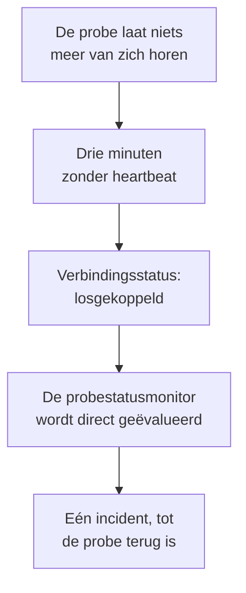

# Probestatusmonitor

Een probestatusmonitor laat u weten wanneer een probe niets meer van zich laat horen: één incident wanneer de verbinding wegvalt, dat zichzelf oplost zodra de probe terug is. Richt hem op uw aangepaste probes of, bij een zelf gehoste OneUptime, op de globale probe waarop elke monitor draait, zodat een stille probe zijn monitors nooit ongemerkt ongecontroleerd laat.

:::cards
- [Er een maken](#een-probestatusmonitor-maken): Kies de probes en houd de standaardcriteria aan.
- [Criteria](#criteria): Tel de verbonden of losgekoppelde probes, nu of over een tijdvenster.
- [Metrieken](#metrieken): Hoeveel probes verbonden waren, minuut voor minuut.
:::

## Hoe het werkt

OneUptime evalueert elke probestatusmonitor eens per minuut, en opnieuw op het moment dat een van zijn probes verbinding maakt of verliest. Het leest de verbindingsstatus van elke probe, die ook de pagina van de probe toont: een probe is losgekoppeld als er drie minuten niets van gehoord is. Nadat OneUptime zelf plat lag of niets ontving, wacht het drie volle minuten voordat het een probe losgekoppeld noemt, zodat een upgrade van OneUptime nooit een incident opent.

Een probe die plat blijft, is één incident, niet één per minuut. De monitor blijft offline, met zijn incident open, totdat elke probe die hij bewaakt weer verbonden is; dan lost het incident zichzelf op.

Een monitor kan de probes van zijn eigen project en de globale probes bewaken. Een verwijderde probe telt in geen enkele richting mee. Als er geen van de bewaakte probes meer over is, houdt de monitor zijn status, en zijn overzicht meldt dat na een dag.

## Een probestatusmonitor maken

:::steps
### Een nieuwe monitor beginnen

Ga naar **Monitoren** en klik op **Monitor maken**.

### Probestatus kiezen

Klik onder **Monitortype** op **Meer monitortypen** en kies **Sondestatus** onder **Overig**. Vul de **Naam** in en klik op **Volgende**.

### De probes kiezen

Kies onder **Te bewaken probes** de probes. Een nieuwe monitor begint met de eigen probes van uw project. Een zelf gehoste OneUptime zonder eigen probe begint met zijn globale probes; op OneUptime Cloud worden de globale probes door OneUptime beheerd, dus een project kiest ze zelf als het ze wil bewaken.

### De monitor maken

Houd de standaardcriteria aan, hieronder beschreven, en klik op **Monitor maken**. De monitor wordt direct geëvalueerd, en zijn overzicht toont elke probe met wanneer er voor het laatst iets van gehoord is.
:::

> [!TIP]
> **Deze probe bewaken**, op de pagina van een probe en in het menu van zijn rij onder **Monitoren → Instellingen → Sondes**, opent **Monitor maken** met een probestatusmonitor die die probe bewaakt en naar hem genoemd is.

## Criteria

De filters van een probestatusmonitor tellen probes:

| Filter | Wat hij telt |
| --- | --- |
| **Disconnected Probes** | De bewaakte probes die losgekoppeld zijn. |
| **Connected Probes** | De bewaakte probes die verbonden zijn. |

Beide zijn gehele getallen, vergeleken met **Groter dan**, **Kleiner dan**, **Gelijk aan** en de andere vergelijkingen. Een nieuwe monitor begint met twee criteria:

| Criterium | Filter | Wat het doet |
| --- | --- | --- |
| Check if a probe is disconnected | **Disconnected Probes** groter dan `0` | Zet de monitor offline en meldt een incident met de titel `Probe disconnected: {{disconnectedProbeNames}}`, dat zichzelf oplost. |
| Check if every probe is connected | **Disconnected Probes** gelijk aan `0` | Zet de monitor op operationeel. |

**Connected Probes** past bij een monitor die meerdere probes bewaakt en er een kan missen: **Connected Probes** kleiner dan `2` meldt pas een incident als er minder dan twee over zijn.

### Langer wachten voor een incident

Een probe is pas losgekoppeld na drie minuten stilte, dus een snelle herstart opent niets. Om langer te wachten, vinkt u onder het filter **Evalueer deze criteria over een bepaalde periode** aan, kiest u **All Values** onder **Evalueren** en een venster onder **Voor de laatste (in minuten)**. Met vijf minuten moet een probe nog vijf minuten losgekoppeld blijven voordat het incident wordt gemeld.

## Metrieken

Elke evaluatie legt twee reeksen vast op de monitor: `oneuptime.monitor.probes.connected` en `oneuptime.monitor.probes.disconnected`, het aantal bewaakte probes dat verbonden en losgekoppeld was. Ze staan in grafieken op de pagina **Metrieken** van de monitor, en een dashboard of een metriekenmonitor leest ze zoals elke andere reeks.

## Sjabloonvariabelen

De incident- en waarschuwingssjablonen van een probestatusmonitor kunnen deze variabelen gebruiken, naast die van elke monitor:

| Variabele | Waarde |
| --- | --- |
| `{{disconnectedProbeNames}}` | De namen van de losgekoppelde probes, gescheiden door komma's. |
| `{{disconnectedProbeCount}}` | Hoeveel van de probes losgekoppeld zijn. |
| `{{connectedProbeNames}}` | De namen van de verbonden probes, gescheiden door komma's. |
| `{{connectedProbeCount}}` | Hoeveel van de probes verbonden zijn. |
| `{{probeStatusSummary}}` | Eén zin die de losgekoppelde probes noemt, zoals `1 of 3 probes is disconnected: EU Probe.`, of zegt dat alle probes verbonden zijn. |
| `{{probes}}` | Elke probe, met `probeName`, `isConnected`, `isGlobalProbe` en `lastAliveAt`. |

## Problemen oplossen

:::details De monitor zegt dat hij op gegevens wacht
Een nieuwe monitor toont zijn eerste evaluatie binnen een à twee minuten. Bewaakt hij geen enkele probe, dan toont hij in plaats daarvan **Not set up**: kies de probes onder **Criteria**.
:::

:::details Een probe viel weg en er werd geen incident gemeld
Een probe is losgekoppeld na drie minuten zonder heartbeat, en nog later nadat OneUptime zelf plat lag. Controleer dat de monitor niet uitgeschakeld is of in een onderhoudsvenster zit, en dat zijn criteria nog steeds een incident melden.
:::

## Volgende stappen

:::cards
- [Aangepaste probes](/docs/probe/custom-probe): Draai een probe in uw eigen netwerk.
- [Monitorcriteria en statussen](/docs/monitor/criteria-and-statuses): Hoe criteria de status van een monitor bepalen.
- [Incident- en waarschuwingssjablonen](/docs/monitor/incident-alert-templating): Formuleer het incident dat een monitor meldt.
:::
