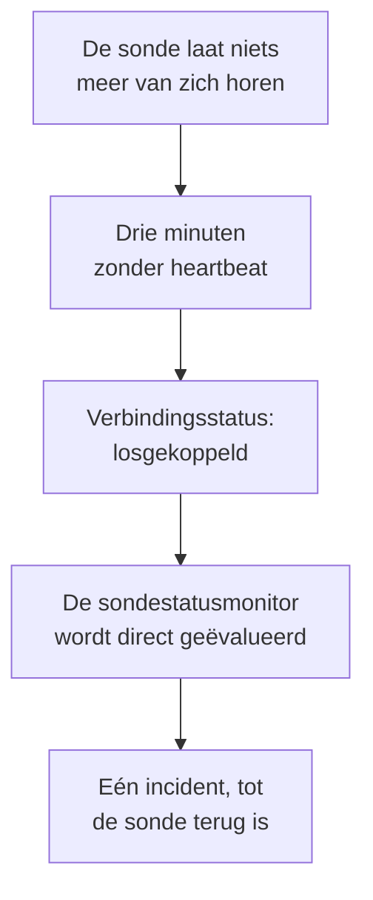

# Sondestatusmonitor

Een sondestatusmonitor laat u weten wanneer een sonde niets meer van zich laat horen: één incident wanneer de verbinding wegvalt, dat zichzelf oplost zodra de sonde terug is. Richt hem op uw aangepaste sondes of, bij een zelf gehoste OneUptime, op de globale sonde waarop elke monitor draait, zodat een stille sonde zijn monitors nooit ongemerkt ongecontroleerd laat. Een nieuwe monitor geeft ook een waarschuwing als een van zijn sondes achterloopt en haar monitoren minder vaak worden gecontroleerd, of haar netwerkapparaten minder vaak worden bevraagd, dan ingesteld.

:::cards
- [Er een maken](#een-sondestatusmonitor-maken): Kies de sondes en houd de standaardcriteria aan.
- [Criteria](#criteria): Tel de verbonden, losgekoppelde of achterlopende sondes, nu of over een tijdvenster.
- [Metrieken](#metrieken): Hoeveel sondes verbonden waren, minuut voor minuut.
:::

## Hoe het werkt

OneUptime evalueert elke sondestatusmonitor eens per minuut, en opnieuw op het moment dat een van zijn sondes verbinding maakt of verliest. Het leest de verbindingsstatus van elke sonde, die ook de pagina van de sonde toont: een sonde is losgekoppeld als er drie minuten niets van gehoord is. Nadat OneUptime zelf plat lag of niets ontving, wacht het drie volle minuten voordat het een sonde losgekoppeld noemt, zodat een upgrade van OneUptime nooit een incident opent. Het leest ook of elke verbonden sonde achterloopt, zoals de pagina van de sonde het zegt ([Een sonde loopt achter](/docs/probe/custom-probe#een-sonde-loopt-achter)), en evalueert de monitor opnieuw zodra er een achter raakt of bijkomt.

Een sonde die plat blijft, is één incident, niet één per minuut. De monitor blijft offline, met zijn incident open, totdat elke sonde die hij bewaakt weer verbonden is; dan lost het incident zichzelf op.

Een monitor kan de sondes van zijn eigen project en de globale sondes bewaken. Een verwijderde sonde telt in geen enkele richting mee. Als er geen van de bewaakte sondes meer over is, houdt de monitor zijn status, en zijn overzicht meldt dat na een dag.

## Een sondestatusmonitor maken

:::steps
### Een nieuwe monitor beginnen

Ga naar **Monitoren** en klik op **Monitor maken**.

### Sondestatus kiezen

Klik onder **Monitortype** op **Meer monitortypen** en kies **Sondestatus** onder **Overig**. Vul de **Naam** in en klik op **Volgende**.

### De sondes kiezen

Kies onder **Te bewaken sondes** de sondes. Een nieuwe monitor begint met de eigen sondes van uw project. Een zelf gehoste OneUptime zonder eigen sonde begint met zijn globale sondes; op OneUptime Cloud worden de globale sondes door OneUptime beheerd, dus een project kiest ze zelf als het ze wil bewaken.

### De monitor maken

Houd de standaardcriteria aan, hieronder beschreven, en klik op **Monitor maken**. De monitor wordt direct geëvalueerd, en zijn overzicht toont elke sonde die hij bewaakt, losgekoppelde eerst.
:::

> [!TIP]
> **Deze sonde bewaken**, op de pagina van een sonde en in het menu van zijn rij onder **Monitoren → Instellingen → Sondes**, opent **Monitor maken** met een sondestatusmonitor die die sonde bewaakt en naar hem genoemd is.

## Criteria

De filters van een sondestatusmonitor tellen sondes:

| Filter | Wat hij telt |
| --- | --- |
| **Losgekoppelde sondes** | De bewaakte sondes die losgekoppeld zijn. |
| **Verbonden sondes** | De bewaakte sondes die verbonden zijn. |
| **Achterlopende sondes** | De bewaakte sondes die verbonden zijn maar achterlopen: hun monitoren worden minder vaak gecontroleerd, of hun netwerkapparaten minder vaak bevraagd, dan ingesteld. |

Alle drie zijn gehele getallen, vergeleken met **Groter dan**, **Kleiner dan**, **Gelijk aan** en de andere vergelijkingen. Een nieuwe monitor begint met drie criteria:

| Criterium | Filter | Wat het doet |
| --- | --- | --- |
| Controleer of een sonde losgekoppeld is | **Losgekoppelde sondes** groter dan `0` | Zet de monitor offline en meldt een incident met de titel "Sonde losgekoppeld: {{disconnectedProbeNames}}", dat zichzelf oplost. |
| Controleer of een sonde achterloopt | **Achterlopende sondes** groter dan `0` | Geeft een waarschuwing met de titel "Sonde loopt achter: {{behindProbeNames}}", die zichzelf oplost. Ze laat de status van de monitor ongemoeid en meldt geen incident: de sonde laat nog van zich horen. |
| Controleer of alle sondes verbonden zijn | **Losgekoppelde sondes** gelijk aan `0` | Zet de monitor op operationeel. |

Een monitor die is aangemaakt voordat **Achterlopende sondes** bestond, houdt zijn criteria, en hoort dus niet dat een sonde achterloopt tot u de controle aan zijn criteria toevoegt.

De filter **Verbonden sondes** past bij een monitor die meerdere sondes bewaakt en er een kan missen: **Verbonden sondes** kleiner dan `2` meldt pas een incident als er minder dan twee over zijn.

### Langer wachten voor een incident

Een sonde is pas losgekoppeld na drie minuten stilte, dus een snelle herstart opent niets. Om langer te wachten, vinkt u onder het filter **Evalueer deze criteria over een bepaalde periode** aan, kiest u **Alle waarden** onder **Evalueren** en een venster onder **Voor de laatste**. Met vijf minuten moet een sonde nog vijf minuten losgekoppeld blijven voordat het incident wordt gemeld.

## Metrieken

Elke evaluatie legt drie reeksen vast op de monitor: `oneuptime.monitor.probes.connected`, `oneuptime.monitor.probes.disconnected` en `oneuptime.monitor.probes.behind`, het aantal bewaakte sondes dat verbonden, losgekoppeld en achter was. Ze staan in grafieken op de pagina **Metrieken** van de monitor, en een dashboard of een metriekenmonitor leest ze zoals elke andere reeks.

## Sjabloonvariabelen

De incident- en waarschuwingssjablonen van een sondestatusmonitor kunnen deze variabelen gebruiken, naast die van elke monitor:

| Variabele | Waarde |
| --- | --- |
| `{{disconnectedProbeNames}}` | De namen van de losgekoppelde sondes, gescheiden door komma's. |
| `{{disconnectedProbeCount}}` | Hoeveel van de sondes losgekoppeld zijn. |
| `{{connectedProbeNames}}` | De namen van de verbonden sondes, gescheiden door komma's. |
| `{{connectedProbeCount}}` | Hoeveel van de sondes verbonden zijn. |
| `{{behindProbeNames}}` | De namen van de verbonden sondes die achterlopen, gescheiden door komma's. |
| `{{behindProbeCount}}` | Hoeveel van de sondes achterlopen. |
| `{{probeStatusSummary}}` | Eén zin die de losgekoppelde sondes noemt, zoals `1 of 3 probes is disconnected: EU Probe.`, anders de achterlopende, of zegt dat alle sondes verbonden zijn. |
| `{{probes}}` | Elke sonde, met `probeName`, `isConnected`, `isBehind`, `isGlobalProbe` en `lastAliveAt`. |

## Problemen oplossen

:::details De monitor zegt dat hij op gegevens wacht
Een nieuwe monitor toont zijn eerste evaluatie binnen een à twee minuten. Bewaakt hij geen enkele sonde, dan toont hij in plaats daarvan **Niet ingesteld**: kies de sondes onder **Criteria**.
:::

:::details Een sonde viel weg en er werd geen incident gemeld
Een sonde is losgekoppeld na drie minuten zonder heartbeat, en nog later nadat OneUptime zelf plat lag. Controleer dat de monitor niet uitgeschakeld is of in een onderhoudsvenster zit, en dat zijn criteria nog steeds een incident melden.
:::

## Volgende stappen

:::cards
- [Aangepaste sondes](/docs/probe/custom-probe): Draai een sonde in uw eigen netwerk.
- [Criteria en statussen](/docs/monitor/criteria-and-statuses): Hoe criteria de status van een monitor bepalen.
- [Incident- en waarschuwingssjablonen](/docs/monitor/incident-alert-templating): Formuleer het incident dat een monitor meldt.
:::
