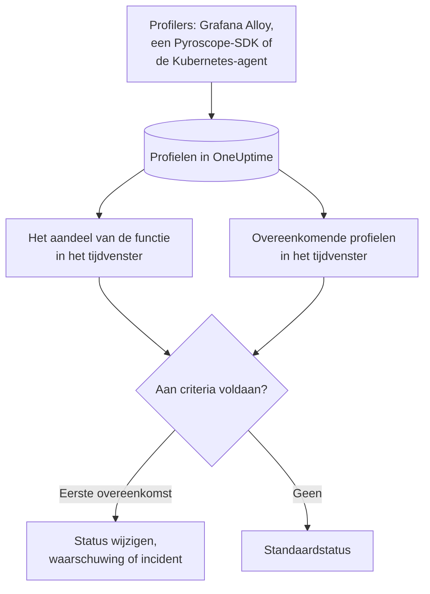

# Profielen-monitor

Een profielen-monitor leest de continue profielen die uw services naar OneUptime sturen en waarschuwt bij twee dingen: een functie die een groter aandeel van de tijd inneemt dan zou moeten, zoals een parser die na een deploy zwaarder is geworden, en profielen die niet meer binnenkomen van een service. Elke minuut meet hij hoeveel van zijn tijdvenster door de functie liep die u noemt, telt hij de profielen die aan zijn filters voldoen, en wijzigt hij de status van de monitor, maakt hij een waarschuwing of meldt hij een incident wanneer aan uw criteria is voldaan.

:::cards
- [De monitor maken](#een-profielen-monitor-maken): Vanuit een functie in de Profiler, of via Monitor maken.
- [Wat hij opvraagt](#wat-hij-opvraagt): De functie, het soort profiel, de services en het venster.
- [Criteria](#criteria): Het aandeel van een functie in het venster, of het aantal profielen.
- [Een functie wordt zwaarder](#uitgewerkt-voorbeeld-een-functie-wordt-zwaarder): Word gewaarschuwd wanneer het aandeel van een functie omhoogschiet.
:::

## Hoe het werkt



Elke minuut leest OneUptime de profielen die aan de filters van de monitor voldoen en binnen zijn tijdvenster zijn begonnen. Het telt ze en meet, wanneer de monitor een functie noemt, het aandeel van de tijd in dat venster dat door de functie liep. Het toetst deze getallen van boven naar beneden aan de criteria van de monitor, en het eerste criterium dat overeenkomt, beslist wat er gebeurt. Komt er geen overeen, dan keert de monitor terug naar zijn standaardstatus.

## Voordat u begint

- Uw services sturen continue profileringsgegevens naar OneUptime, via Grafana Alloy (eBPF), een Pyroscope-SDK of de Kubernetes-agent van OneUptime. Zie [Continue profilering](/docs/telemetry/profiles).
- Om een functie te volgen, kent u haar naam, of een deel van het pad van haar bestand of pakket, zoals de Profiler het toont.

## Een profielen-monitor maken

:::steps
### Beginnen vanuit de Profiler, of via Monitor maken

Het snelst gaat het vanuit de functie zelf: open in **Prestatieprofielen** de functie en klik op de link die een waarschuwing op haar aandeel aanbiedt. **Monitor maken** opent met de monitor ingevuld voor die functie en haar service, met een drempel boven wat ze vandaag inneemt, zoals beschreven in [Uitgewerkt voorbeeld: een functie wordt zwaarder](#uitgewerkt-voorbeeld-een-functie-wordt-zwaarder). Ga anders naar **Monitoren** en klik op **Monitor maken**.

### Profiles kiezen

Klik onder **Monitortype** op **Meer monitortypen** en kies **Profielen** onder **Telemetrie**, of typ `profiles` in het zoekvak. Voer een **Naam** in en klik daarna op **Volgende**.

### Kiezen wat hij leest

Stel in **Configuratie van de profielmonitor** het veld **Functie** in op de functie die u wilt volgen, **Wat analyseren** op het soort profiel en **Profielen bewaken gedurende (tijd)** op het venster. Een nieuwe monitor leest **CPU-tijd** over de **Laatste 5 minuten**. **Wat deze monitor nu leest**, onder de velden, toont hoeveel profielen overeenkomen en hoeveel van het venster de functie vandaag inneemt, zodat u de drempel daarboven kunt zetten. Open **Meer velden** om te filteren op telemetrieservice of infrastructuurentiteit.

### De criteria instellen

Een monitor die via **Monitor maken** is gestart, heeft twee criteria: offline, met een incident, wanneer het **Aantal profielen** 0 is, en online wanneer het boven 0 ligt. Om op de functie te waarschuwen, voegt u een filter **Functieaandeel (in %)** toe: zie [Criteria](#criteria).

### De monitor maken

Klik op **Monitor maken**. De monitor opent op zijn pagina **Overzicht**, en zijn eerste evaluatie wordt binnen een minuut uitgevoerd.
:::

### Hem maken via de API of Terraform

De stap van een monitor bevat dezelfde instellingen als zijn configuratie `profileMonitor`. Deze volgt `parseOrder` in de CPU-profielen van één service over de laatste vijf minuten:

```json
{
  "profileMonitor": {
    "telemetryServiceIds": [],
    "profileTypes": ["cpu"],
    "profileType": "",
    "functionName": "parseOrder",
    "attributes": {},
    "lastXSecondsOfProfiles": 300
  }
}
```

Zet de ID van de service in `telemetryServiceIds`, of laat de lijst leeg om profielen van elke service te lezen, en laat `functionName` leeg om alleen profielen te tellen. Maak via de [API](/docs/api-reference/api-reference) of [Terraform](/docs/terraform/monitor-steps) een monitor met het monitortype `Profiles` en een stap die deze configuratie en minstens één criterium bevat. Geef in Terraform de configuratie door als het attribuut `profile_monitor` van de stap, geschreven met `jsonencode()`.

## Wat hij opvraagt

| Veld | Waarmee het overeenkomt | Standaard |
| --- | --- | --- |
| `profileTypes` | Profielen van een van deze typen, exact vergeleken, zoals `cpu`. | Leeg: elk type |
| `profileType` | Profielen waarvan het type deze tekst bevat, ongeacht hoofdletters. Als dit is ingesteld, wordt `profileTypes` genegeerd. | Leeg |
| `functionName` | De code waarvan **Functieaandeel (in %)** het aandeel meet: stackframes waarvan de functienaam of het bestandspad deze tekst bevat, ongeacht hoofdletters. | Leeg: er wordt geen aandeel gemeten |
| `telemetryServiceIds` | Profielen van een van deze telemetrieservices. | Leeg: elke service |
| `entityKeys` | Profielen van een van deze hosts, pods, containers en andere infrastructuurentiteiten. | Leeg: elke entiteit |
| `attributes` | Profielen waarvan de attributen deze waarden hebben. | Leeg: geen voorwaarde |
| `lastXSecondsOfProfiles` | Profielen die binnen dit aantal seconden vóór de evaluatie zijn begonnen. | Geen: stel het altijd in, anders wordt elk opgeslagen profiel geteld en zakt het aantal nooit naar 0 |

Alle filters die u instelt, moeten overeenkomen voordat een profiel wordt gelezen. In het formulier stelt **Functie** `functionName` in, **Wat analyseren** stelt `profileTypes` in (**Elk soort profiel** laat het leeg), **Profielen bewaken gedurende (tijd)** stelt `lastXSecondsOfProfiles` in, en **Filteren op telemetrieservice** en **Filteren op infrastructuurentiteit** stellen `telemetryServiceIds` en `entityKeys` in.

## Hoe hij wordt geëvalueerd

- **Elke minuut.** Een profielen-monitor wordt niet door sondes gecontroleerd, dus hij heeft geen interval om in te stellen en geen pagina **Sondes en interval**.
- **Twee getallen per evaluatie.** De monitor telt de profielen die aan elk filter voldoen en binnen `lastXSecondsOfProfiles` zijn begonnen, en meet het aandeel van de functie in diezelfde profielen. Een profiler uploadt met een vaste tussenpoos, dus geef het venster ruimte voor meerdere uploads.
- **Eén eenheid tegelijk.** Een aandeel telt samples van één eenheid op: wanneer de gelezen soorten eenheden mengen, zoals CPU-tijd in nanoseconden uit een SDK en aantallen samples uit eBPF, leest hij de eenheid met de meeste samples in het venster.
- **Geen profielen is een aantal van 0 en geen aandeel.** Een service waarvan de profiler niet meer uploadt, levert een aantal van 0 op, en een criterium **Functieaandeel (in %)** komt niet overeen met een venster waarin niets zit: waarschuw op het **Aantal profielen** om te weten dat het profileren is gestopt.
- **De onderbreking van OneUptime zelf is geen stilte.** Zolang het tijdvenster tijd bevat waarin OneUptime zelf geen gegevens ontving (het startte opnieuw, werd geüpgraded of werkte een achterstand weg), wacht de controle: de status verandert niet, en er wordt geen incident of waarschuwing geopend of opgelost. Zie [Als OneUptime geen gegevens ontvangt](/docs/monitor/when-oneuptime-is-not-receiving).
- **Criteria van boven naar beneden.** Het eerste criterium dat overeenkomt, beslist, dus zet het ernstigste bovenaan.

Elke statuswijziging wordt, met de reden ervan, vastgelegd op de **Statustijdlijn** van de monitor.

## Criteria

De criteria van een profielen-monitor vergelijken een van twee getallen met een waarde.

**Functieaandeel (in %)** is het aandeel van de tijd in het venster, van 0 tot 100, dat door de functie van de monitor liep: elke stack met een frame dat overeenkomt met `functionName` telt één keer, op welke diepte ook, zodat zowel de eigen code van de functie als alles wat ze aanroept erin zit.

| Filtervoorwaarde | Komt overeen wanneer het aandeel van de functie… |
| --- | --- |
| **Groter dan** | boven de waarde ligt |
| **Groter dan of gelijk aan** | de waarde is of erboven ligt |
| **Kleiner dan** | onder de waarde ligt |
| **Kleiner dan of gelijk aan** | de waarde is of eronder ligt |

Het **Aantal profielen** is het aantal profielen dat in het venster overeenkwam:

| Filtervoorwaarde | Komt overeen wanneer het aantal profielen… |
| --- | --- |
| **Groter dan** | boven de waarde ligt |
| **Groter dan of gelijk aan** | de waarde is of erboven ligt |
| **Kleiner dan** | onder de waarde ligt |
| **Kleiner dan of gelijk aan** | de waarde is of eronder ligt |
| **Gelijk aan** | precies de waarde is |
| **Niet gelijk aan** | alles behalve de waarde is |

Aantallen profielen hebben geen anomaliecondities: er is geen baseline om ze mee te vergelijken.

## Uitgewerkt voorbeeld: een functie wordt zwaarder

In de checkout-service neemt `parseOrder` 18% van de CPU-tijd in. Een deploy die een grotere payload parset, mag niet onopgemerkt blijven:

1. Kies in **Prestatieprofielen** de checkout-service en open `parseOrder`.
2. Klik op de link die een waarschuwing op haar aandeel aanbiedt. De Profiler stelt 30% voor: de helft boven het aandeel van vandaag, minstens 10 punten meer, naar boven afgerond op een veelvoud van 5.
3. **Monitor maken** opent met een profielen-monitor van de checkout-service die **CPU-tijd** over de **Laatste 5 minuten** leest, met twee criteria: **Functieaandeel (in %)** **Groter dan** `30` geeft een waarschuwing, die zichzelf oplost, en zet de monitor op verminderd; **Kleiner dan of gelijk aan** `30` zet hem op operationeel. Het incident is ingevuld maar uitgeschakeld: schakel het in om iemand op te roepen.
4. Klik op **Monitor maken**.

Wanneer de deploy `parseOrder` 45% van de CPU-tijd laat innemen, geeft de volgende evaluatie de waarschuwing. Wanneer een oplossing het aandeel weer onder 30% brengt, lost de waarschuwing zichzelf op.

## Uitgewerkt voorbeeld: profielen komen niet meer binnen

De checkout-service draait een Pyroscope-SDK die CPU-profielen uploadt. U wilt een incident wanneer die vijf minuten lang uitblijven:

- `profileTypes`: `["cpu"]`, `telemetryServiceIds`: de checkout-service, `lastXSecondsOfProfiles`: `300`
- Criterium 1: **Aantal profielen** **Gelijk aan** `0`: de monitor offline zetten en een incident melden
- Criterium 2: **Aantal profielen** **Groter dan** `0`: de monitor online zetten

Zolang de SDK uploadt, telt elke evaluatie enkele profielen en houdt criterium 2 de monitor online. Wanneer de service zonder de SDK wordt uitgerold, zakt het aantal vijf minuten na de laatste upload naar 0, komt criterium 1 overeen en wordt het incident gemeld. De eerste upload na de oplossing brengt het aantal weer boven 0, en het incident lost zichzelf op als **Incident automatisch oplossen** ervoor aan staat.

## Problemen oplossen

:::details De monitor telt 0, maar er verschijnen wel profielen in OneUptime
Vergelijk de filters met de profielen die u ziet: `profileTypes` moet precies met het type overeenkomen, en `telemetryServiceIds` moet de juiste service-ID's bevatten. Een korte `lastXSecondsOfProfiles` kan ook tussen twee uploads vallen.
:::

:::details Het aandeel van de functie blijft op 0%
Geen enkel frame in het venster bevat de functietekst. Open de functie in de Profiler en kopieer haar naam zoals die daar staat; een deel van de naam werkt, en hoofdletters doen er niet toe. Controleer daarna of de service het soort profiel stuurt dat **Wat analyseren** leest.
:::

## Volgende stappen

:::cards
- [Continue profilering](/docs/telemetry/profiles): Stuur profielen en lees ze in de Profiler.
- [Monitorstappen](/docs/terraform/monitor-steps): Geef de configuratie van de stap door vanuit Terraform.
- [Traces-monitor](/docs/monitor/traces-monitor): Word gewaarschuwd voor mislukte spans.
- [Metrics-monitor](/docs/monitor/metrics-monitor): Word gewaarschuwd op CPU, geheugen en andere metrieken.
:::
