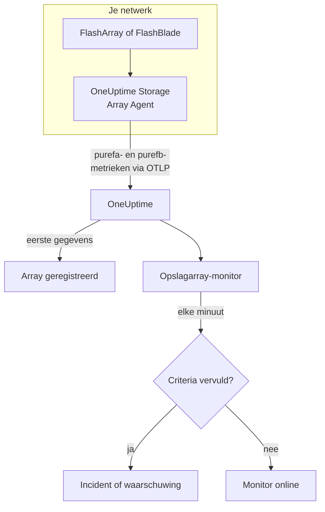

# Opslagarray-monitor

Een opslagarray-monitor houdt één opslagarray in de gaten en laat je weten wanneer de array een eigen waarschuwing geeft, zonder ruimte komt, trager wordt, hardware of een hostpad verliest, of achterloopt met replicatie. Hij werkt met Pure Storage FlashArray, Pure Storage FlashBlade en NetApp ONTAP (Amazon FSx for NetApp ONTAP inbegrepen), en leest de metrieken die de OneUptime Storage Array Agent verzamelt: de reeksen `purefa_*` en `purefb_*` van Pure, en de reeksen `netapp_*` die NetApp Harvest uit een ONTAP-cluster leest.

Hij werkt ook met Dell PowerStore (`dell.powerstore`), op basis van de reeksen `powerstore_*` van Dell.

Hij werkt ook met Dell PowerScale (`dell.powerscale`), op basis van de reeksen `powerscale_*` van Dell.

:::cards
- [De monitor maken](#een-opslagarray-monitor-maken): Zes stappen in het dashboard.
- [Templates](#kant-en-klare-waarschuwingstemplates): Kant-en-klare waarschuwingen, één incident per volume, host, appliance of component.
- [Hoe de reeksen van Pure werken](#hoe-de-reeksen-van-pure-zijn-opgebouwd): Eén metrieknaam, veel waarden. Die van ONTAP [hebben een eigen sectie](#hoe-de-reeksen-van-ontap-zijn-opgebouwd).
- [Metrieken](#verzamelde-metrieken): Elke reeks waarop de monitor kan waarschuwen.
:::

## Hoe het werkt

De OneUptime Storage Array Agent draait op een machine die de beheerinterface van de array kan bereiken. Hij leest de metrieken van de array met een alleen-lezen API-token (die van een PowerScale via SNMP, met een alleen-lezen-community of een SNMPv3-gebruiker), labelt ze met de naam van de array, `storage.array.name`, en het platform ervan, `storage.system`, en stuurt ze via OTLP naar OneUptime. De eerste gegevens registreren de array.

Een Dell PowerMax (`dell.powermax`) heeft geen agent nodig: een OneUptime-sonde meldt zich elke 5 minuten met een alleen-lezenaccount aan bij Unisphere for PowerMax en stuurt elke array die deze beheert op dezelfde manier, genoemd naar zijn Symmetrix ID totdat je hem hernoemt ([Dell PowerMax](/docs/telemetry/storage-arrays#dell-powermax)).

Een opslagarray-monitor hoort bij één array. Elke minuut voert hij zijn query uit op de metrieken van die array en vergelijkt hij het resultaat met zijn criteria.



## Voordat je begint

- **Installeer de Storage Array Agent** waar hij de array via HTTPS kan bereiken, met het API-token van een gebruiker die de rol **readonly** van de array heeft. De [handleiding van de Storage Array Agent](/docs/telemetry/storage-arrays) behandelt de gebruiker, het token en de installatie, via `ONEUPTIME_URL`, `ONEUPTIME_TELEMETRY_INGESTION_KEY`, `STORAGE_ARRAY_NAME`, en het adres en het token van de array (`PURE_FA_ENDPOINT` en `PURE_FA_API_TOKEN`, of `PURE_FB_ENDPOINT` en `PURE_FB_API_TOKEN`), of voor ONTAP het adres van het cluster en een alleen-lezen REST-gebruiker (`NETAPP_ONTAP_ENDPOINT`, `NETAPP_ONTAP_USERNAME` en `NETAPP_ONTAP_PASSWORD`).
- **Controleer of de array geregistreerd is.** Hij verschijnt onder **Producten → Infrastructuur → Opslagarrays → Alle opslagarrays**, genoemd naar de `STORAGE_ARRAY_NAME` van de agent, ongeveer een minuut na de eerste uitlezing.
- **Voor een Dell PowerMax** verbind je in plaats daarvan de Unisphere for PowerMax die hem beheert onder **Producten → Infrastructuur → Opslagarrays → Verbindingen**, zoals [Dell PowerMax](/docs/telemetry/storage-arrays#dell-powermax) uitlegt.

## Een opslagarray-monitor maken

:::steps
### Een nieuwe monitor beginnen

Ga naar **Monitoren** en klik op **Monitor maken**.

### Opslagarray kiezen

Klik onder **Monitortype** op **Meer monitortypen** en kies **Opslagarray** onder **Infrastructuur**, of typ `storage` in het zoekvak. Vul een **Naam** in - die wordt gebruikt in de titels van incidenten en waarschuwingen - en klik op **Volgende**.

### De array kiezen

Kies onder **Storage Array Monitor Configuration** de array uit **Opslagarray**. Elke array die gegevens heeft gestuurd, staat in de lijst. Het platform ervan bepaalt welke metrieken en templates het formulier aanbiedt. Na de keuze toont een regel onder het veld of er gegevens binnenkomen. **Opslagarray toevoegen** opent installatiestappen met je sleutels al ingevuld, die op de eerste gegevens wachten.

### Kiezen wat je in de gaten houdt

Een nieuwe monitor begint met **Array Stopped Reporting**, onder **Waarover te waarschuwen**. Om iets anders te bewaken:

- **Wijzigen** - kies een andere [template](#kant-en-klare-waarschuwingstemplates). Dat stelt de metriek, de labelfilters, de aggregatie, het tijdsbereik en de drempels in, en vervangt de criteria hieronder door de eigen criteria. Het **Tijdsbereik** kun je nog steeds aanpassen.
- **Custom Metric** (onder **Meer velden**) - kies één metriek uit **Storage Array Metric** en stel daarna **Aggregatie** en **Tijdsbereik** in. De [filters](#monitorinstellingen) beperken haar tot één volume, host, pod, component, bestandssysteem of bucket.
- **Geavanceerd** (onder **Meer velden**) - bouw zelf queries en formules onder **Selecteer metrieken**, bijvoorbeeld de gebruikte capaciteit als `purefa_array_space_bytes` gefilterd op `space=capacity` min dezelfde metriek gefilterd op `space=empty`. Gebruik **Groeperen op** met het label van een object om elk object afzonderlijk te beoordelen.

### De criteria controleren

Open elk criterium onder **Criteria** en controleer de **Metriek**, de **Aggregatie**, de **Voorwaarde** en de **Drempel**. Een template vult die in. Met **Custom Metric** of **Geavanceerd** begint de monitor met de [standaardcriteria](#standaardcriteria), die alleen merken dat de metriek geen gegevens stuurt, dus stel je eigen drempel in.

### De monitor maken

Klik op **Monitor maken**. OneUptime opent de pagina van de monitor en evalueert hem elke minuut. Incidenten en waarschuwingen die hij geeft, staan ook op de pagina's **Incidenten** en **Waarschuwingen** van de array.
:::

> [!TIP]
> Om meerdere templates tegelijk in te stellen, open je de array via **Producten → Infrastructuur → Opslagarrays** en ga je naar **Aanbevelingen**. Kies de templates die je wilt, kies wie wordt opgeroepen, en OneUptime maakt één monitor per template.

## Monitorinstellingen

| Veld | Tabblad | Wat het doet |
| --- | --- | --- |
| **Opslagarray** | Alle | Verplicht. Beperkt elke query tot `resource.storage.array.name`, zodat twee arrays die allebei een volume `vol-01` hebben nooit door elkaar lopen. |
| **Volume** | Custom Metric, Geavanceerd | Eén volume: op een FlashArray via het label `name`, zoals `vol-db-01` (een volume in een pod of een volumegroep heet `pod::volume` of `group/volume`); op ONTAP via het label `volume`, dat twee SVM's kunnen delen; op een PowerMax via het label `volume`, zijn apparaat-ID, zoals `00847`. |
| **Host** | Custom Metric, Geavanceerd | Alleen FlashArray. Eén host zoals de array hem kent, via het label `host`, zoals `esxi-01`. |
| **Pod** | Custom Metric, Geavanceerd | Alleen FlashArray. Eén ActiveCluster- of ActiveDR-pod, via het label `name`, of `local_pod` op reeksen van replicakoppelingen. |
| **Hardwarecomponent** | Custom Metric, Geavanceerd | Eén hardwarecomponent, zoals `CH0.BAY1` of `CT0`: het label `component_name` op een FlashArray, `name` op een FlashBlade, op ONTAP het label waarmee de reeks het component benoemt (`node`, `disk`, `shelf` of `port`), en `component` op een PowerMax, een director zoals `FA-1D` of een poort zoals `FA-1D:4`. Op een PowerScale een node via het label `node`, zoals `ps-prod-2`. |
| **Bestandssysteem** | Custom Metric, Geavanceerd | FlashBlade en PowerScale. Eén bestandssysteem via het label `name` op een FlashBlade; één quotum via het label `quota` op een PowerScale, zoals `/ifs/data/home`. |
| **Bucket** | Custom Metric, Geavanceerd | Alleen FlashBlade. Eén objectopslagbucket, via het label `name`. |
| **Storage Array Metric** | Custom Metric | Eén metriek uit de [catalogus](#verzamelde-metrieken). Het formulier voegt het labelfilter toe dat haar betekenis geeft, en groepeert haar op het object dat ze beschrijft, zodat elk volume, elke host of elk component afzonderlijk wordt beoordeeld. |
| **Aggregatie** | Custom Metric | Hoe monsters worden gecombineerd: **Gemiddelde**, **Maximum**, **Minimum**, **Som** of **Aantal**. Begint bij de gebruikelijke aggregatie van de metriek. |
| **Tijdsbereik** | Alle | Het voortschrijdende venster dat de query leest, van **Past 1 Minute** tot **Past 365 Days**. Een nieuwe monitor begint bij **Afgelopen 5 minuten**; een eigen metriek van een bestandssysteem of bucket bij **Afgelopen 15 minuten**; templates stellen hun eigen venster in. |
| **Selecteer metrieken** | Geavanceerd | De querybouwer: **Metriek**, **Aggregeren op**, **Filteren op attributen**, **Groeperen op**, plus **Metriek toevoegen** en **Formule toevoegen** om queries te combineren. |

De agent leest het array-endpoint elke 60 seconden, en volumes, hosts en pods elke 2 minuten, dus een venster van 5 minuten bevat altijd een monster. De bestandssystemen en buckets van een FlashBlade leest hij elke 5 minuten, vandaar 15, en FlashArray-mappen elke 30 minuten: geef een mapmonitor een venster van 60 minuten. Op ONTAP leest Harvest de prestaties van het cluster elke minuut en de configuratie, status en EMS-gebeurtenissen elke 3 minuten, dus een venster van 5 minuten bevat altijd een monster. Een PowerScale-cluster en elk van zijn nodes bevraagt hij elke 60 seconden, en zijn quota elke 5 minuten: geef een quotummonitor een venster van 15 minuten.

Hij leest een PowerStore elke 5 minuten, en de toestand van zijn cluster elke 60 seconden: geef een PowerStore-monitor een venster van 15 minuten.

## Hoe de reeksen van Pure zijn opgebouwd

Pure zet meerdere waarden op **één** metrieknaam en onderscheidt ze met een label:

- **`dimension`** op de prestatiereeksen. `purefa_array_performance_latency_usec` draagt de leeslatentie (`usec_per_read_op`), de schrijflatentie (`usec_per_write_op`), de latentie van gespiegelde schrijfacties, en de SAN-, wachtrij-, QoS- en servicetijd van elk. Filter altijd op één `dimension`: een gemiddelde over alle mengt een leeslatentie van 200 µs met een wachtrijwaarde.
- **`space`** op de capaciteitsreeksen: `capacity`, `empty`, `snapshots`, `total_provisioned`, `total_physical`, `available_ratio` en meer.

Verschillende reeksen dragen hun toestand in een **label**, met een waarde die altijd 1 is:

| Reeks | Toestandslabel | Eén reeks per |
| --- | --- | --- |
| `purefa_alerts_open` | `severity`, met `summary`, `code` en `component_type` | Openstaande waarschuwing |
| `purefa_hw_component_status` | `component_status` | Hardwarecomponent |
| `purefa_host_connectivity_info` | `status`, met `details` | Host |
| `purefa_drive_capacity_bytes` | `component_status` (de waarde is de capaciteit van de schijf) | Schijf |

Een reeks die gefilterd is op een slechte toestand bestaat alleen zolang iets in die toestand is, dus geen reeks betekent gezond. Daarom is **Max boven 0 gaat af en 0 herstelt** de juiste vorm ervoor, en zo zijn de templates gebouwd: hun herstelcriteria tellen een ontbrekende reeks als nul. Als er helemaal geen reeks meer over is, herstelt zo'n template alleen als `purefa_info`, `purefb_info` of `powermax_array_info` in hetzelfde venster is binnengekomen, zodat een array die niet meer rapporteert niets sluit.

De reeksen van een PowerMax bevatten elk één waarde en zijn ernaar genoemd: `powermax_array_response_time_usec` onderscheidt leesacties van schrijfacties met `operation`. Zijn toestandsreeksen bestaan op dezelfde manier alleen zolang er iets mis is: `powermax_alert_open` zolang Unisphere een waarschuwing open heeft, `powermax_director_offline` zolang een director niet online is, `powermax_port_offline` zolang een poort waarop iemand vertrouwt uitgevallen is, en `powermax_srdf_group_not_healthy` zolang een SRDF-groep onderbroken of offline is.

In monitorfilters en groeperingssleutels beginnen de attributen van de agent met `resource.` (`resource.storage.array.name`, `resource.storage.system`), terwijl de eigen labels van Pure dat niet doen (`name`, `host`, `component_name`, `dimension`, `space`, `severity`), en die van PowerMax evenmin (`storage_group`, `volume`, `director`, `port_id`, `srdf_group`), en die van PowerScale evenmin (`node`, `quota`, `drive`, `protocol`).

## Hoe de reeksen van PowerStore zijn opgebouwd

De exporter van Dell schrijft één waarde per metrieknaam, dus een PowerStore-reeks heeft geen labelfilter nodig. Zijn labels noemen het object: `appliance_id` een appliance, `name` een onderdeel, volume of bestandssysteem, en `volume_id`, `fc_port_id`, `eth_port_id`, `nas_id` of `volume_group_id` het object van een prestatiereeks. Zijn toestandsreeksen zijn 1 zolang alles gezond is en anders 0, dus de templates gaan af onder 1. Zijn eigen waarschuwingen komen per syslog binnen, en hun templates, logboekmonitors, staan na zijn tabel hieronder.

## Hoe de reeksen van ONTAP zijn opgebouwd

NetApp Harvest noemt elke reeks `netapp_<object>_<counter>` en benoemt het object met zijn labels: een volume met `volume` binnen zijn `svm`, een aggregaat met `aggr`, een LUN met `lun` binnen zijn `volume` en `svm`, een node met `node`, een schijf met `disk`, een shelf met `shelf`, een SnapMirror-relatie met `destination_location`. Latenties zijn microseconden per operatie, `_ops` operaties per seconde, `_data` bytes per seconde.

De toestanden van ONTAP komen op drie manieren:

| Reeks | Toestand | Eén reeks per |
| --- | --- | --- |
| `netapp_*_new_status` | 1 gezond, online, up of actief, 0 zo niet | Object, bij elke opvraging |
| `netapp_health_*_alerts` | Waarde 1, met `severity` (`error` of `warning`) en de reden in de labels | Openstaand probleem: een kapotte schijf, een shelf-fout, een node die zijn partner niet kan overnemen, een poort die offline is, een systeemgezondheidswaarschuwing |
| `netapp_ems_events` | Waarde 1, met `message`, `severity` en de parameters van de gebeurtenis | EMS-gebeurtenis, voor de ene opvraging die haar verzamelde; wanneer een gekoppelde gebeurtenis wordt opgeheven, wordt ze nog één keer als 0 geëxporteerd |

Een toestand als getal gaat af wanneer elke meting in het venster onder 1 ligt, en herstelt zodra een meting weer 1 is. Een openstaand probleem gaat af zolang zijn reeks er is en herstelt zodra die weg is, zolang `netapp_cluster_new_status` blijft binnenkomen, zodat een gestopte agent niets sluit. Een EMS-gebeurtenis gaat af bij haar ene meting en blijft open zolang ze binnen het uur van het template valt; ze herstelt wanneer er een uur voorbijgaat zonder nieuwe.

## Kant-en-klare waarschuwingstemplates

OneUptime levert 93 templates — 12 voor FlashArray, 8 voor FlashBlade, 16 voor PowerStore, 31 voor ONTAP, 13 voor PowerMax en 13 voor PowerScale — en de lijst onder **Waarover te waarschuwen** biedt die voor het platform van de array aan. Elk template bouwt een volledige monitor: de metriekquery, de labelfilters, een groepering op het eigen label van het object, een criterium dat afgaat en een dat herstelt. Drempels zijn startpunten die je kunt aanpassen.

Een criterium gaat alleen af als de voorwaarde geldt voor **elke** waarde in zijn venster, behalve bij een EMS-template van ONTAP: Harvest exporteert een gebeurtenis voor één opvraging, dus één meting is genoeg. Een monitor die afging op een drempel voor capaciteit, latentie, achterstand of verhouding herstelt pas 10 % voorbij die drempel, zodat een waarde die rond de drempel schommelt niet heen en weer springt. De templates voor waarschuwingen, hardware en connectiviteit gaan af zodra een toestand hun hele venster van 5 minuten zichtbaar was, en herstellen ongeveer 5 minuten nadat die verdwenen is.

### FlashArray

| Template                       | Categorie    | Ernst    | Houdt in de gaten                                                                               | Gaat af als                                                                                                                                      |
| ------------------------------ | ------------ | -------- | ----------------------------------------------------------------------------------------------- | ------------------------------------------------------------------------------------------------------------------------------------------------ |
| Array Stopped Reporting        | Beschikbaarheid | Kritiek  | `purefa_info`, Count, laatste 10 minuten                                                        | Geen gegevens gedurende het hele venster — de Storage Array Agent is gestopt, is zijn route naar OneUptime kwijtgeraakt of zijn token is ingetrokken, of de array antwoordt hem niet meer; herstelt als er weer gegevens binnenkomen |
| Critical Array Alert           | Arraygezondheid | Kritiek  | `purefa_alerts_open` gefilterd op `severity=critical`, Max per `summary`, laatste 5 minuten     | > 0 — de array heeft een openstaande kritieke waarschuwing (een defect component, een capaciteitsnoodgeval, een replicatiefout). Eén incident per waarschuwing; herstelt als de waarschuwing sluit |
| Warning Array Alert            | Arraygezondheid | Waarschuwing  | `purefa_alerts_open` gefilterd op `severity=warning`, Max per `summary`, laatste 5 minuten      | > 0 — de array heeft een openstaande waarschuwing van niveau warning. Eén incident per waarschuwing; herstelt als de waarschuwing sluit          |
| Capacity Above 80%             | Capaciteit   | Waarschuwing  | `purefa_array_space_utilization`, Max, laatste 15 minuten                                       | > 80 — de eerste capaciteitsdrempel van Pure zelf; herstelt bij ≤ 72                                                                             |
| Capacity Above 90%             | Capaciteit   | Kritiek  | `purefa_array_space_utilization`, Max, laatste 5 minuten                                        | > 90 — de array staat op het punt schrijfacties te weigeren; herstelt bij ≤ 81                                                                   |
| High Read Latency              | Prestaties   | Waarschuwing  | `purefa_array_performance_latency_usec` gefilterd op `dimension=usec_per_read_op`, Avg, laatste 10 minuten  | > 5000 µs (5 ms) — leesacties van een FlashArray zijn normaal ruim binnen 1 ms klaar; herstelt bij ≤ 4500                            |
| High Write Latency             | Prestaties   | Waarschuwing  | `purefa_array_performance_latency_usec` gefilterd op `dimension=usec_per_write_op`, Avg, laatste 10 minuten | > 5000 µs (5 ms); herstelt bij ≤ 4500                                                                                                  |
| Hardware Component Failed      | Hardware     | Kritiek  | `purefa_hw_component_status` gefilterd op `component_status=critical`, Max per `component_name`, laatste 5 minuten | > 0 — een controller, voeding, ventilator, bay of poort is kritiek en de redundantie is weg. Eén incident per component; herstelt als het ok meldt |
| Hardware Component Degraded    | Hardware     | Waarschuwing  | `purefa_hw_component_status` gefilterd op `component_status=degraded`, Max per `component_name`, laatste 5 minuten | > 0 — een component is gedegradeerd. Eén incident per component; herstelt als het ok meldt                                     |
| Drive Failed                   | Hardware     | Kritiek  | `purefa_drive_capacity_bytes` gefilterd op `component_status=failed`, Max per `component_name`, laatste 5 minuten | > 0 — een DirectFlash-module of SSD is uitgevallen en de array herbouwt op de andere. Eén incident per schijf; herstelt als hij is vervangen |
| Host Lost Redundant Paths      | Hosts        | Waarschuwing  | `purefa_host_connectivity_info` gefilterd op `status=critical`, Max per `host`, laatste 5 minuten | > 0 — de host bereikt de array via één controller of geen; een controller-failover zou zijn opslag offline halen. Eén incident per host; herstelt als zijn paden terug zijn |
| Replication Lag Above 1 Minute | Replicatie  | Waarschuwing  | `purefa_pod_replica_links_lag_max_msec`, Max per `local_pod`, laatste 10 minuten                | > 60000 ms (60 s) — een failover nu zou meer recente schrijfacties verliezen dan gepland. Eén incident per pod; herstelt bij ≤ 54000             |

### FlashBlade

| Template                     | Categorie    | Ernst    | Houdt in de gaten                                                                                              | Gaat af als                                                                                                         |
| ---------------------------- | ------------ | -------- | -------------------------------------------------------------------------------------------------------------- | ------------------------------------------------------------------------------------------------------------------- |
| Array Stopped Reporting      | Beschikbaarheid | Kritiek  | `purefb_info`, Count, laatste 10 minuten                                                                       | Geen gegevens gedurende het hele venster — de agent, zijn exporter of de FlashBlade antwoordt niet meer; herstelt als er weer gegevens binnenkomen |
| Critical Array Alert         | Arraygezondheid | Kritiek  | `purefb_alerts_open` gefilterd op `severity=critical`, Max per `summary`, laatste 5 minuten                    | > 0 — de FlashBlade heeft een openstaande kritieke waarschuwing. Eén incident per waarschuwing; herstelt als de waarschuwing sluit |
| Warning Array Alert          | Arraygezondheid | Waarschuwing  | `purefb_alerts_open` gefilterd op `severity=warning`, Max per `summary`, laatste 5 minuten                     | > 0 — de FlashBlade heeft een openstaande waarschuwing van niveau warning. Eén incident per waarschuwing; herstelt als de waarschuwing sluit |
| Capacity Above 80%           | Capaciteit   | Waarschuwing  | `purefb_array_space_utilization` gefilterd op `type=array`, Max, laatste 15 minuten                            | > 80; herstelt bij ≤ 72                                                                                             |
| Capacity Above 90%           | Capaciteit   | Kritiek  | `purefb_array_space_utilization` gefilterd op `type=array`, Max, laatste 5 minuten                             | > 90 — schrijfacties mislukken voor elke client als hij vol raakt; herstelt bij ≤ 81                                |
| Hardware Component Unhealthy | Hardware     | Kritiek  | `purefb_hardware_health`, Min per `name`, laatste 5 minuten                                                    | < 1 — een blade, fabric-module, voeding of ventilator is niet gezond (een ongebruikt slot meldt 2). Eén incident per component; herstelt bij ≥ 1 |
| High Read Latency            | Prestaties   | Waarschuwing  | `purefb_array_performance_latency_usec` gefilterd op `dimension=usec_per_read_op` en `protocol=all`, Avg, laatste 10 minuten | > 10000 µs (10 ms) over alle protocollen; herstelt bij ≤ 9000                                         |
| File System Near Full        | Bestandssystemen | Waarschuwing  | `purefb_file_systems_space_bytes` gefilterd op `space=available_ratio`, Min per `name`, laatste 15 minuten     | < 0.1 — er is minder dan 10 % over van de toegewezen grootte van een bestandssysteem. Eén incident per bestandssysteem; herstelt bij ≥ 0.11 |

### PowerStore

| Template                     | Categorie    | Ernst    | Houdt in de gaten                                                                                              | Gaat af als                                                                                                         |
| --- | --- | --- | --- | --- |
| Array Stopped Reporting | Beschikbaarheid | Kritiek | `powerstore_cluster`, Count, laatste 10 minuten | Geen gegevens gedurende het hele venster — de agent, de exporter van Dell of het cluster antwoordt niet meer; herstelt zodra er weer gegevens binnenkomen |
| Capacity Above 80% | Capaciteit | Waarschuwing | `powerstore_cap_physical_used_percent`, Max per `appliance_id`, laatste 15 minuten | > 80 — de capaciteit van een appliance raakt vol; herstelt bij ≤ 72 |
| Capacity Above 90% | Capaciteit | Kritiek | `powerstore_cap_physical_used_percent`, Max per `appliance_id`, laatste 15 minuten | > 90 — een appliance weigert binnenkort schrijfbewerkingen; herstelt bij ≤ 81 |
| High Read Latency | Prestaties | Waarschuwing | `powerstore_perf_avg_read_latency`, Avg per `appliance_id`, laatste 15 minuten | > 5000 µs (5 ms); herstelt bij ≤ 4500 |
| High Write Latency | Prestaties | Waarschuwing | `powerstore_perf_avg_write_latency`, Avg per `appliance_id`, laatste 15 minuten | > 5000 µs (5 ms); herstelt bij ≤ 4500 |
| Drive Failed | Hardware | Kritiek | `powerstore_hardware_Drive_state`, Min per `name`, laatste 10 minuten | < 1 — een schijf is defect of verwijderd; herstelt bij ≥ 1 |
| Node Unhealthy | Hardware | Kritiek | `powerstore_hardware_node_state`, Min per `name`, laatste 10 minuten | < 1 — een knooppunt is niet Healthy; herstelt bij ≥ 1 |
| Power Supply Unhealthy | Hardware | Waarschuwing | `powerstore_hardware_Power_Supply_state`, Min per `name`, laatste 10 minuten | < 1 — een voeding is defect of zonder stroom; herstelt bij ≥ 1 |
| Fan Unhealthy | Hardware | Waarschuwing | `powerstore_hardware_Fan_state`, Min per `name`, laatste 10 minuten | < 1 — een ventilator is defect; herstelt bij ≥ 1 |
| Battery Unhealthy | Hardware | Waarschuwing | `powerstore_hardware_Battery_state`, Min per `name`, laatste 10 minuten | < 1 — een back-upbatterijmodule heeft een storing; herstelt bij ≥ 1 |
| Drive Wearing Out | Hardware | Waarschuwing | `powerstore_wear_metrics_by_drive`, Min per `name`, laatste 15 minuten | < 10 — een schijf heeft nog minder dan 10% van zijn duurzaamheid; herstelt bij ≥ 11 |
| NAS Server Not Started | Bestandssystemen | Waarschuwing | `powerstore_nas_server_operational_status`, Max per `name`, laatste 10 minuten | < 1 — een NAS-server is gestopt of gedegradeerd; herstelt bij ≥ 1 |
| Volume Not Ready | Arraygezondheid | Waarschuwing | `powerstore_volume_state`, Max per `name`, laatste 15 minuten | < 1 — een volume is offline; herstelt bij ≥ 1 |
| File System Near Full | Bestandssystemen | Waarschuwing | `powerstore_filesystem_logical_used_percent`, Max per `name`, laatste 15 minuten | > 90 — een bestandssysteem is bijna vol; herstelt bij ≤ 81 |
| Cluster Not Configured | Arraygezondheid | Waarschuwing | `powerstore_cluster`, Max, laatste 10 minuten | < 1 — het cluster is niet Configured; herstelt bij ≥ 1 |
| Metro Witness Not Connected | Replicatie | Waarschuwing | `powerstore_metro_witness_status`, Min per `name`, laatste 10 minuten | > 0 — een Metro-witness is niet verbonden; herstelt zodra die weer OK is |

### PowerStore-waarschuwingen, per syslog

De eigen waarschuwingen van een PowerStore komen als logboeken binnen, dus hun templates zijn monitors van het type **Logboeken**, aangeboden op de pagina **Aanbevelingen** van de array onder **Arraywaarschuwingen**. Elk opent één waarschuwing per PowerStore-waarschuwing, gegroepeerd op `powerstore.resource.name` en `powerstore.alert.id`, en lost die op wanneer de PowerStore die waarschuwing opheft:

| Template | Ernst | Opent bij een regel met | Lost op bij |
| --- | --- | --- | --- |
| Critical Array Alert | Kritiek | `powerstore.alert.severity=Critical` | `powerstore.alert.state=Cleared` |
| Major Array Alert | Waarschuwing | `powerstore.alert.severity=Major` | `powerstore.alert.state=Cleared` |
| Port Link Down | Waarschuwing | `powerstore.event.code=0x00307404` | `powerstore.alert.state=Cleared` |

### ONTAP

| Template | Categorie | Ernst | Houdt in de gaten | Gaat af als |
| --- | --- | --- | --- | --- |
| Array Stopped Reporting | Beschikbaarheid | Kritiek | `netapp_cluster_new_status`, Count, laatste 10 minuten | Geen gegevens gedurende het hele venster — de agent of Harvest is gestopt, of het cluster antwoordt Harvest niet meer; herstelt als er weer gegevens binnenkomen |
| Cluster Not Healthy | Arraygezondheid | Waarschuwing | `netapp_cluster_new_status`, Max, laatste 10 minuten | < 1 — ONTAP meldt het cluster als niet gezond; herstelt bij ≥ 1 |
| System Health Alert | Arraygezondheid | Waarschuwing | `netapp_health_support_alerts`, Max per `name`, laatste 5 minuten | > 0 — de systeemgezondheidsmonitor van ONTAP gaf een waarschuwing (een ontbrekend pad naar een shelf, een connectiviteitsprobleem van een node). Eén incident per waarschuwing; herstelt als ONTAP haar opheft |
| Emergency EMS Event | Arraygezondheid | Kritiek | `netapp_ems_events` gefilterd op `severity=emergency`, Max per `message`, venster van 1 uur, elke meting | > 0 — ONTAP registreerde een noodgebeurtenis. Eén incident per gebeurtenis; herstelt als er een uur voorbijgaat zonder nieuwe |
| Alert EMS Event | Arraygezondheid | Kritiek | `netapp_ems_events` gefilterd op `severity=alert`, Max per `message`, venster van 1 uur, elke meting | > 0 — ONTAP registreerde een alert-gebeurtenis (een ventilator viel uit); herstelt als er een uur voorbijgaat zonder nieuwe |
| Disk Out of Service | Hardware | Waarschuwing | `netapp_ems_events` gefilterd op `message=disk.outOfService`, Max per `disk`, venster van 1 uur, elke meting | > 0 — ONTAP haalde een schijf buiten dienst; herstelt als er een uur voorbijgaat zonder nieuwe |
| Node Panic | Hardware | Kritiek | `netapp_ems_events` gefilterd op `message=sk.panic`, Max per `node`, venster van 1 uur, elke meting | > 0 — een node kreeg een panic en startte opnieuw op, en zijn partner nam zijn opslag over; herstelt als er een uur voorbijgaat zonder nieuwe |
| Aggregate Above 80% | Capaciteit | Waarschuwing | `netapp_aggr_space_used_percent`, Max per `aggr`, laatste 15 minuten | > 80; herstelt bij ≤ 72 |
| Aggregate Above 90% | Capaciteit | Kritiek | `netapp_aggr_space_used_percent`, Max per `aggr`, laatste 5 minuten | > 90 — de volumes erop kunnen niet meer groeien; herstelt bij ≤ 81 |
| Volume Above 90% | Capaciteit | Waarschuwing | `netapp_volume_size_used_percent`, Max per `volume` en `svm`, laatste 15 minuten | > 90; herstelt bij ≤ 81 |
| Volume Above 98% | Capaciteit | Kritiek | `netapp_volume_size_used_percent`, Max per `volume` en `svm`, laatste 5 minuten | > 98 — clients krijgen fouten wegens ruimtegebrek, en een LUN erin kan offline gaan; herstelt bij ≤ 88.2 |
| High Read Latency | Prestaties | Waarschuwing | `netapp_cluster_read_latency`, Avg, laatste 15 minuten | > 10000 µs (10 ms); herstelt bij ≤ 9000 |
| High Write Latency | Prestaties | Waarschuwing | `netapp_cluster_write_latency`, Avg, laatste 15 minuten | > 10000 µs (10 ms); herstelt bij ≤ 9000 |
| Volume Latency Above 20 ms | Prestaties | Waarschuwing | `netapp_volume_read_latency`, Avg per `volume` en `svm`, laatste 15 minuten | > 20000 µs; herstelt bij ≤ 18000 |
| Node Not Healthy | Hardware | Kritiek | `netapp_node_new_status`, Max per `node`, laatste 10 minuten | < 1 — ONTAP meldt de node als niet gezond; herstelt bij ≥ 1 |
| Takeover Not Possible | Hardware | Kritiek | `netapp_health_ha_alerts`, Max per `node`, laatste 5 minuten | > 0 — een node kan zijn HA-partner niet overnemen, dus een storing zou de opslag van die partner offline halen; herstelt als dat weer kan |
| Disk Failed | Hardware | Kritiek | `netapp_health_disk_alerts` gefilterd op `container_type=broken`, Max per `disk`, laatste 5 minuten | > 0 — een schijf is kapot; herstelt als hij is vervangen |
| Shelf Fault | Hardware | Kritiek | `netapp_health_shelf_alerts` gefilterd op `severity=error`, Max per `shelf`, laatste 5 minuten | > 0 — ONTAP meldt een fout op een shelf (een voeding, een module, een pad); herstelt als ONTAP de fout opheft |
| Node Fan Failed | Hardware | Waarschuwing | `netapp_node_failed_fan`, Max per `node`, laatste 10 minuten | > 0 defecte ventilatoren; herstelt bij ≤ 0 |
| Node Power Supply Failed | Hardware | Kritiek | `netapp_node_failed_power`, Max per `node`, laatste 10 minuten | > 0 defecte voedingen; herstelt bij ≤ 0 |
| Shelf Power Supply Failed | Hardware | Kritiek | `netapp_shelf_psu_status`, Max per `shelf`, laatste 10 minuten | < 1 — een voeding van een shelf is niet normaal; herstelt bij ≥ 1 |
| Shelf Fan Failed | Hardware | Waarschuwing | `netapp_shelf_fan_status`, Max per `shelf`, laatste 10 minuten | < 1 — een ventilator van een shelf is niet normaal; herstelt bij ≥ 1 |
| Ethernet Port Down | Hardware | Waarschuwing | `netapp_health_network_ethernet_port_alerts`, Max per `port` en `node`, laatste 5 minuten | > 0 — een ingeschakelde Ethernet-poort is offline; herstelt als zijn link weer up is |
| FC Port Link Failures | Hardware | Waarschuwing | `netapp_fcp_link_failure`, Max per `port` en `node`, laatste 15 minuten | > 0 — de link van een Fibre Channel-poort viel uit in het venster; herstelt bij ≤ 0 |
| SnapMirror Behind Schedule | Replicatie | Waarschuwing | `netapp_snapmirror_lag_time` gedeeld door `netapp_snapmirror_schedule_seconds`, Max per `destination_location`, laatste 15 minuten | > 1.5 — een relatie loopt meer dan anderhalf schema-interval achter (bij een uurlijks schema 90 minuten); herstelt bij ≤ 1.35 |
| SnapMirror Relationship Unhealthy | Replicatie | Kritiek | `netapp_snapmirror_labels` gefilterd op `healthy=false`, Max per `destination_location`, laatste 5 minuten | > 0 — ONTAP meldt de relatie als ongezond, met de reden in het label `unhealthy_reason`; herstelt als ONTAP haar als gezond meldt |
| SnapMirror Lag Above 1 Day | Replicatie | Waarschuwing | `netapp_snapmirror_lag_time`, Max per `destination_location`, laatste 15 minuten | > 86400 s, ongeacht het schema; herstelt bij ≤ 77760 |
| Aggregate Offline | Beschikbaarheid | Kritiek | `netapp_aggr_new_status`, Max per `aggr`, laatste 10 minuten | < 1 — een aggregaat is niet online, dus geen van zijn volumes is bereikbaar; herstelt bij ≥ 1 |
| Volume Offline | Beschikbaarheid | Waarschuwing | `netapp_volume_new_status`, Max per `volume` en `svm`, laatste 10 minuten | < 1 — een volume is niet online; herstelt bij ≥ 1 |
| LUN Offline | Beschikbaarheid | Kritiek | `netapp_lun_new_status`, Max per `lun`, `volume` en `svm`, laatste 10 minuten | < 1 — een LUN is niet online, en zijn hosts zijn de schijf kwijt; herstelt bij ≥ 1 |
| SVM Stopped | Beschikbaarheid | Waarschuwing | `netapp_svm_labels` gefilterd op `state=stopped` en `type=data`, Max per `svm`, laatste 10 minuten | > 0 — een data-SVM is gestopt; herstelt als hij weer draait. De SVM's die ONTAP voor zichzelf houdt, worden nooit bewaakt |

### PowerMax

| Template | Categorie | Ernst | Houdt in de gaten | Gaat af als |
| --- | --- | --- | --- | --- |
| Array Stopped Reporting | Beschikbaarheid | Kritiek | `powermax_array_info`, Count, laatste 10 minuten | Geen gegevens gedurende het hele venster — de sonde verzamelt de array niet meer: de verbinding ervan mislukt (de pagina ervan onder **Verbindingen** zegt waarom), de sonde is niet verbonden, of Unisphere beheert de array niet meer; herstelt als er weer gegevens binnenkomen |
| Critical Unisphere Alert | Arraygezondheid | Kritiek | `powermax_alert_open` gefilterd op `severity=critical`, Max per `description`, laatste 10 minuten | > 0 — Unisphere heeft voor de array een openstaande waarschuwing met ernst Critical of Fatal. Eén incident per waarschuwing; herstelt als de waarschuwing in Unisphere wordt bevestigd of gewist |
| Warning Unisphere Alert | Arraygezondheid | Waarschuwing | `powermax_alert_open` gefilterd op `severity=warning`, Max per `description`, laatste 10 minuten | > 0 — Unisphere heeft een openstaande waarschuwing met ernst Warning of Minor. Eén incident per waarschuwing; herstelt als de waarschuwing wordt bevestigd of gewist |
| Performance Collection Off | Arraygezondheid | Waarschuwing | `powermax_array_performance_collection`, Min, laatste 15 minuten | < 1 — Unisphere verzamelt de 5-minutenprestaties van de array niet, dus voor responstijd, IOPS en doorvoer worden geen grafieken of waarschuwingen gemaakt; herstelt bij ≥ 1 |
| Storage Resource Pool Above 80% | Capaciteit | Waarschuwing | `powermax_srp_capacity_used_percent`, Max per `srp`, laatste 15 minuten | > 80 — de opslaggroepen van de pool nemen geen nieuwe schrijfacties meer aan als hij vol raakt. Eén incident per pool; herstelt bij ≤ 72 |
| Storage Resource Pool Above 90% | Capaciteit | Kritiek | `powermax_srp_capacity_used_percent`, Max per `srp`, laatste 15 minuten | > 90 — schrijfacties naar zijn opslaggroepen mislukken zodra hij vol is. Eén incident per pool; herstelt bij ≤ 81 |
| Storage Group Response Time Above 5 ms | Prestaties | Waarschuwing | `powermax_storage_group_response_time_usec`, Avg per `storage_group`, laatste 15 minuten | > 5000 µs (5 ms) — een PowerMax antwoordt normaal ruim binnen een milliseconde. Eén incident per opslaggroep; herstelt bij ≤ 4500 |
| High Read Response Time | Prestaties | Waarschuwing | `powermax_array_response_time_usec` gefilterd op `operation=read`, Avg, laatste 15 minuten | > 3000 µs (3 ms); herstelt bij ≤ 2700 |
| High Write Response Time | Prestaties | Waarschuwing | `powermax_array_response_time_usec` gefilterd op `operation=write`, Avg, laatste 15 minuten | > 3000 µs (3 ms) — synchrone SRDF voegt aan elke schrijfactie de rondreis naar de externe array toe; herstelt bij ≤ 2700 |
| Director Not Online | Hardware | Kritiek | `powermax_director_offline`, Max per `component`, laatste 10 minuten | > 0 — een director is niet online en de array draait op de andere. Eén incident per director; herstelt als hij weer online is |
| Port Down | Hardware | Waarschuwing | `powermax_port_offline`, Max per `component`, laatste 10 minuten | > 0 — een poort in een port group, masking view of SRDF-groep is niet actief. Eén incident per poort; herstelt als hij weer actief is |
| SRDF Group Suspended or Offline | Replicatie | Kritiek | `powermax_srdf_group_not_healthy`, Max per `srdf_group`, laatste 10 minuten | > 0 — de link van de groep is offline of de paren zijn onderbroken, gesplitst of overgeschakeld (failover), zodat de externe kopie niet actueel blijft. Eén incident per groep; herstelt als hij weer synchroon is |
| SRDF/A Lag Above 2 Minutes | Replicatie | Waarschuwing | `powermax_srdf_group_lag_seconds`, Avg per `srdf_group`, laatste 15 minuten | > 120 (2 minuten) — een failover nu zou meer recente schrijfacties verliezen dan gepland. Eén incident per groep; herstelt bij ≤ 108 |

### PowerScale

| Template | Categorie | Ernst | Houdt in de gaten | Gaat af als |
| --- | --- | --- | --- | --- |
| Array Stopped Reporting | Beschikbaarheid | Kritiek | `powerscale_cluster_health`, Count, laatste 10 minuten | Geen gegevens gedurende het hele venster — de Storage Array Agent is gestopt, is zijn route naar OneUptime kwijtgeraakt of zijn token is ingetrokken, of het cluster antwoordt niet meer op zijn bevragingen; herstelt als er weer gegevens binnenkomen |
| Cluster Needs Attention | Arraygezondheid | Waarschuwing | `powerscale_cluster_health`, Max, laatste 5 minuten | > 0 — OneFS meldt dat het cluster aandacht vraagt, uitgevallen of ongeldig is, en `isi event groups list` zegt waarom; herstelt bij ≤ 0 |
| Cluster Down | Arraygezondheid | Kritiek | `powerscale_cluster_health`, Max, laatste 5 minuten | ≥ 2 — OneFS meldt het cluster als uitgevallen of ongeldig; herstelt bij < 2 |
| Node Offline | Hardware | Kritiek | `powerscale_cluster_offline_nodes`, Max, laatste 5 minuten | > 0 — een node van het cluster is offline, en `offline_nodes` noemt welke; herstelt bij ≤ 0 |
| Node Needs Attention | Hardware | Waarschuwing | `powerscale_node_health`, Max per `node`, laatste 5 minuten | > 0 — een node meldt dat hij aandacht vraagt, uitgevallen of ongeldig is. Eén incident per node; herstelt bij ≤ 0 |
| Node Read-Only | Hardware | Waarschuwing | `powerscale_node_read_only`, Max per `node`, laatste 5 minuten | > 0 — een node staat in alleen-lezenmodus, en clients die ermee verbonden zijn, kunnen niet schrijven. Eén incident per node; herstelt bij ≤ 0 |
| Drive Failed | Hardware | Kritiek | `powerscale_drive_size_bytes` gefilterd op `status=DEAD`, Count per `drive`, laatste 5 minuten | > 0 — een schijf is dood, en OneFS beschermt zijn gegevens opnieuw op de andere. Eén incident per schijf; herstelt als hij een andere status meldt |
| Drive Smartfailed | Hardware | Waarschuwing | `powerscale_drive_size_bytes` gefilterd op `status=SMARTFAIL`, Count per `drive`, laatste 5 minuten | > 0 — OneFS verplaatst de gegevens van een falende schijf voordat die wordt vervangen. Eén incident per schijf; herstelt als hij een andere status meldt |
| Capacity Above 80% | Capaciteit | Waarschuwing | `powerscale_ifs_used_percent`, Max, laatste 15 minuten | > 80, inclusief de ruimte die voor virtuele hot spares wordt achtergehouden; herstelt bij ≤ 72 |
| Capacity Above 90% | Capaciteit | Kritiek | `powerscale_ifs_used_percent`, Max, laatste 5 minuten | > 90 — het cluster staat op het punt schrijfacties te weigeren; herstelt bij ≤ 81 |
| Quota Near Its Limit | Capaciteit | Waarschuwing | `powerscale_quota_used_percent`, Max per `quota`, laatste 15 minuten | > 90 van zijn harde limiet, of van zijn zachte limiet als het er geen heeft. Eén incident per quotum; herstelt bij ≤ 81 |
| Quota Full | Capaciteit | Kritiek | `powerscale_quota_used_percent`, Max per `quota`, laatste 5 minuten | ≥ 100 — schrijfacties onder het pad van het quotum mislukken bij een harde limiet. Eén incident per quotum; herstelt bij < 90 |
| High Protocol Latency | Prestaties | Waarschuwing | `powerscale_protocol_latency_microseconds`, Max per `protocol`, laatste 10 minuten | > 20000 µs (20 ms) op de traagste node. Eén incident per protocol; herstelt bij ≤ 18000 |

**Ernst** is het label dat de keuzelijst toont. Het incident en de waarschuwing die een template maakt, beginnen op de zwaarste incident- en waarschuwingsernst van je project; wijzig ze in het criterium.

- **Array Stopped Reporting** telt de identiteitsreeks van het platform (`purefa_info` of `purefb_info`, die elk endpoint dat de agent uitleest bij elke uitlezing exporteert, of `powermax_array_info`, dat elke PowerMax-verzameling schrijft); die van een PowerScale is `powerscale_cluster_health`, die de bevraging van het cluster door de agent elke minuut stuurt. Als er geen gegevens meer komen, hebben de andere templates niets om te vergelijken en houden ze hun laatste status, dus dit is het template dat het je laat weten.
- **Openstaande waarschuwingen en hardwaretoestanden gebruiken Max** van een reeks die alleen bestaat zolang de waarschuwing open is of het component in die toestand is, dus de toestand overschrijdt de drempel zodra die het hele venster van 5 minuten zichtbaar was.
- **Elk template per object groepeert op het eigen label van het object** (`summary`, `component_name`, `host`, `local_pod`, `name` en op een PowerMax `description`, `component`, `srp`, `srdf_group` en `storage_group`, en bij een PowerScale `node`, `drive`, `quota` en `protocol`), dus er gaat één incident af per getroffen object, en het incident noemt het.
- **Latentietemplates gebruiken Avg** van het eigen gemiddelde per operatie van de array, en capaciteitstemplates **Max.** van het eigen bezettingspercentage. Latenties staan vast in microseconden en capaciteit in procenten.
- **Hardware Component Unhealthy gebruikt Min** per component: de gezondheid is 1 als het gezond is en zakt naar 0 als dat niet zo is.

Er is geen FlashArray-template voor de latentie van elk volume, omdat de juiste drempel van de workload afhangt: bouw het uit de catalogus met een groepering op `name`. Capaciteitsvoorspelling vraagt een groeitrend in plaats van een drempel, en voor slijtage van schijven bestaat geen reeks om op te waarschuwen.

## Verzamelde metrieken

De agent stuurt alles wat de array exporteert, en een sonde alles wat ze van een PowerMax leest, in dezelfde eenheden (de milliseconden van Unisphere als microseconden, zijn MB per seconde als bytes per seconde); de reeksen hieronder vormen de catalogus die het monitorformulier aanbiedt. Elke waarde is een gauge die de array zelf berekent - latenties zijn microseconden per operatie en doorvoer is per seconde -, dus er is geen rekenwerk met snelheden nodig. **Filter** is het labelfilter dat de reeks de betekenis geeft die haar rij noemt; het formulier past het voor je toe.

### Arraygezondheid

| Metriek              | Filter | Platform   | Eenheid | Beschrijving                                                                                                                                                      |
| -------------------- | ------ | ---------- | ------- | ----------------------------------------------------------------------------------------------------------------------------------------------------------------- |
| `purefa_alerts_open` | —      | FlashArray | `count` | Eén reeks per openstaande waarschuwing op de array (waarde 1), met de labels `severity` (`critical`, `warning`, `info`, `hidden`), `category`, `code`, `component_type` en `summary` |
| `purefb_alerts_open` | —      | FlashBlade | `count` | Eén reeks per openstaande waarschuwing op de FlashBlade (waarde 1), met de labels `severity` (`info`, `warning`, `critical`), `code`, `component_name`, `component_type`, `summary` en `kburl` (het kennisbankartikel van Pure) |
| `powerstore_cluster` | — | PowerStore | `count` | 1 zolang het PowerStore-cluster Configured is (gevormd en in bedrijf), 0 in elke andere toestand: Configuring, Expanding, Removing, Clustering_Failed of Unconfigured. |
| `netapp_cluster_new_status` | — | ONTAP | — | 1 zolang ONTAP het cluster als gezond meldt; ook de reeks die aangeeft dat de agent het nog leest |
| `netapp_cluster_subsystem_outstanding_alerts` | — | ONTAP | `count` | Openstaande waarschuwingen in elk gezondheidssubsysteem van ONTAP, per `subsystem` |
| `netapp_health_support_alerts` | — | ONTAP | `count` | Eén reeks per waarschuwing die de systeemgezondheidsmonitor van ONTAP open heeft, zolang ze open is |
| `netapp_ems_events` | — | ONTAP | `count` | Eén reeks per EMS-gebeurtenis, voor de opvraging die haar verzamelde; wanneer een gekoppelde gebeurtenis wordt opgeheven, wordt ze nog één keer als 0 geëxporteerd |
| `powermax_alert_open` | — | PowerMax | `count` | Eén reeks per waarschuwing die Unisphere voor de array open heeft (waarde 1): niet bevestigd, niet gewist en Minor of erger. Het label severity is critical (Critical en Fatal) of warning (Warning en Minor); de labels alert_type, object en description zeggen waar het om gaat. Bevestig de waarschuwing in Unisphere en de reeks verdwijnt |
| `powermax_array_health_score` | — | PowerMax | `score` | De gezondheidsscore van de array volgens Unisphere, van 0 tot 100, per health_metric: totaal, en voor elk gebied dat hij beoordeelt (capaciteit, configuratie, prestaties, naleving van het serviceniveau) |
| `powermax_array_performance_collection` | — | PowerMax | `count` | 1 zolang Unisphere prestatiegegevens per 5 minuten voor de array verzamelt, 0 zolang dat niet gebeurt. Staat het uit, dan toont OneUptime nog steeds de inventaris en waarschuwingen van de array, maar geen prestatiegrafieken. Zet het aan in Unisphere via Settings > Performance > System Registrations |
| `powerscale_cluster_health` | — | PowerScale | — | De gezondheid die OneFS voor het cluster meldt: 0 is OK, 1 vraagt aandacht, 2 is uitgevallen en 3 is ongeldig. Neem het maximum om elke verandering te zien |
| `powerscale_cluster_offline_nodes` | — | PowerScale | `count` | Hoeveel nodes van het cluster offline zijn; het label `offline_nodes` somt hun logische nodenummers op |

### Capaciteit

| Metriek                                   | Filter                       | Platform   | Eenheid | Beschrijving                                                                                                                          |
| ----------------------------------------- | ---------------------------- | ---------- | ------- | ------------------------------------------------------------------------------------------------------------------------------------- |
| `purefa_array_space_utilization`          | —                            | FlashArray | `%`     | Aandeel van de bruikbare capaciteit van de array dat in gebruik is. Pure geeft eigen capaciteitswaarschuwingen bij 80 %, 90 % en 100 % |
| `purefa_array_space_bytes`                | `space=capacity`             | FlashArray | `bytes` | Bruikbare capaciteit van de array                                                                                                     |
| `purefa_array_space_bytes`                | `space=empty`                | FlashArray | `bytes` | Ongebruikte capaciteit — volg de trend om te voorspellen wanneer de array vol raakt                                                  |
| `purefa_array_space_bytes`                | `space=snapshots`            | FlashArray | `bytes` | Fysieke ruimte die alleen snapshots innemen; een snelle stijging betekent meestal dat een beschermingsgroep meer snapshots bewaart dan gepland |
| `purefa_array_space_data_reduction_ratio` | —                            | FlashArray | `ratio` | Deduplicatie en compressie over de hele array, bijv. 4.2 voor 4.2:1. Een aanhoudende daling betekent dat nieuwe gegevens slecht te reduceren zijn |
| `purefb_array_space_utilization`          | `type=array`                 | FlashBlade | `%`     | Aandeel van de bruikbare capaciteit van de FlashBlade dat in gebruik is                                                               |
| `purefb_array_space_bytes`                | `type=array`, `space=empty`  | FlashBlade | `bytes` | Ongebruikte capaciteit van de FlashBlade                                                                                              |
| `purefb_array_space_data_reduction_ratio` | `type=array`                 | FlashBlade | `ratio` | Gegevensreductie over de hele FlashBlade                                                                                              |
| `powerstore_cap_physical_used_percent` | — | PowerStore | `%` | Aandeel van de fysieke capaciteit van elke appliance dat in gebruik is, in procenten: de fysiek gebruikte ruimte gedeeld door het fysieke totaal, uit de dagelijkse ruimteoverzichten van PowerStore. PowerStore geeft zelf capaciteitswaarschuwingen vanaf 70%. Groepeer op appliance_id. |
| `powerstore_cap_last_physical_total` | — | PowerStore | `bytes` | Bruikbare fysieke capaciteit van elke appliance in bytes. |
| `powerstore_cap_last_physical_used` | — | PowerStore | `bytes` | Fysieke capaciteit die elke appliance gebruikt, in bytes, na deduplicatie en compressie. Volg de trend om te voorspellen wanneer een appliance vol raakt. |
| `powerstore_cap_last_logical_provisioned` | — | PowerStore | `bytes` | Logische capaciteit die op elke appliance is toegewezen, in bytes: de grootte van elk volume, bestandssysteem en vVol erop, die ver boven de fysieke capaciteit kan liggen. |
| `powerstore_cap_last_logical_used` | — | PowerStore | `bytes` | Gegevens die hosts naar elke appliance hebben geschreven in bytes, vóór deduplicatie en compressie. |
| `powerstore_cap_last_data_reduction` | — | PowerStore | `ratio` | Deduplicatie en compressie op elke appliance, bijvoorbeeld 3.4 voor 3.4:1. Een aanhoudende daling betekent dat nieuw geschreven gegevens slecht te reduceren zijn: versleutelde of al gecomprimeerde gegevens. |
| `powerstore_cap_last_efficiency_ratio` | — | PowerStore | `ratio` | Totale efficiëntie van elke appliance: de gegevensreductie samen met de besparingen van snapshots en thin provisioning. |
| `netapp_aggr_space_used_percent` | — | ONTAP | `%` | Aandeel van de bruikbare ruimte van elk aggregaat dat in gebruik is — groepeer op `aggr` |
| `netapp_aggr_space_total` | — | ONTAP | `bytes` | Bruikbare ruimte van elk aggregaat; de capaciteit van het cluster is hun som |
| `netapp_aggr_space_used` | — | ONTAP | `bytes` | Ruimte die elk aggregaat in gebruik of gereserveerd heeft |
| `netapp_aggr_space_available` | — | ONTAP | `bytes` | Ruimte die nog vrij is op elk aggregaat — volg de trend om te voorspellen wanneer het vol raakt |
| `netapp_aggr_inode_used_percent` | — | ONTAP | `%` | Aandeel van de bestanden (inodes) van elk aggregaat dat in gebruik is |
| `netapp_aggr_new_status` | — | ONTAP | — | 1 zolang een aggregaat online is |
| `netapp_aggr_logical_used_wo_snapshots_flexclones` | — | ONTAP | `bytes` | Wat de gegevens van elk aggregaat zonder opslagefficiëntie zouden innemen, snapshots en FlexClones niet meegerekend |
| `netapp_aggr_physical_used_wo_snapshots_flexclones` | — | ONTAP | `bytes` | Wat de gegevens van elk aggregaat na opslagefficiëntie op schijf innemen |
| `powermax_array_capacity_used_percent` | — | PowerMax | `%` | Aandeel van de bruikbare capaciteit van de array dat in gebruik is, in procenten, over al zijn opslagresourcepools |
| `powermax_array_capacity_usable_bytes` | — | PowerMax | `bytes` | De bruikbare capaciteit van de array, in bytes, zoals Unisphere die meldt |
| `powermax_array_capacity_used_bytes` | — | PowerMax | `bytes` | De gebruikte bruikbare capaciteit van de array, in bytes |
| `powermax_array_capacity_subscribed_bytes` | — | PowerMax | `bytes` | De capaciteit van alle thin volumes op de array, in bytes: wat aan hosts is toegezegd, wat de bruikbare capaciteit kan overschrijden |
| `powermax_array_data_reduction_ratio` | — | PowerMax | `ratio` | Hoeveel keer groter de gegevens die hosts schreven zijn dan de ruimte die ze na compressie en deduplicatie innemen, zoals Unisphere meldt |
| `powermax_srp_capacity_used_percent` | — | PowerMax | `%` | Aandeel van de bruikbare capaciteit van elke opslagresourcepool dat in gebruik is, in procenten, op het label srp. Een volle pool neemt voor geen enkele opslaggroep erin nog nieuwe schrijfacties aan |
| `powermax_srp_capacity_used_bytes` | — | PowerMax | `bytes` | Gebruikte bruikbare capaciteit van elke opslagresourcepool, in bytes, op het label srp |
| `powerscale_ifs_used_percent` | — | PowerScale | `%` | Aandeel van de capaciteit van het cluster dat niet meer beschikbaar is voor schrijfbewerkingen: wat in gebruik is, plus de ruimte die OneFS achterhoudt voor virtuele hot spares |
| `powerscale_ifs_available_bytes` | — | PowerScale | `bytes` | Ruimte die nog beschikbaar is voor schrijfbewerkingen op `/ifs` |
| `powerscale_ifs_used_bytes` | — | PowerScale | `bytes` | Ruimte in gebruik op `/ifs`, zoals OneFS die telt |
| `powerscale_ifs_total_bytes` | — | PowerScale | `bytes` | De grootte van `/ifs` over het hele cluster |
| `powerscale_quota_used_percent` | — | PowerScale | `%` | Het gebruik van elk quotum als aandeel van zijn harde limiet, of van zijn zachte limiet als het geen harde heeft (het label `limit` zegt welke) — groepeer op `quota` |
| `powerscale_quota_usage_bytes` | — | PowerScale | `bytes` | Wat elk quotum bevat, zoals OneFS het aan het quotum toerekent |

### Prestaties

| Metriek                                    | Filter                                         | Platform   | Eenheid   | Beschrijving                                                                                                 |
| ------------------------------------------ | ---------------------------------------------- | ---------- | --------- | ------------------------------------------------------------------------------------------------------------ |
| `purefa_array_performance_latency_usec`    | `dimension=usec_per_read_op`                   | FlashArray | `µs`      | Gemiddelde latentie van een leesactie zoals hosts die zien; leesacties van een FlashArray zijn meestal ruim binnen 1 ms klaar |
| `purefa_array_performance_latency_usec`    | `dimension=usec_per_write_op`                  | FlashArray | `µs`      | Gemiddelde latentie van een schrijfactie zoals hosts die zien                                                |
| `purefa_array_performance_latency_usec`    | `dimension=usec_per_mirrored_write_op`         | FlashArray | `µs`      | Gemiddelde latentie van een schrijfactie naar een uitgerekte ActiveCluster-pod, inclusief de rondreis naar de partnerarray |
| `purefa_array_performance_latency_usec`    | `dimension=san_usec_per_read_op`               | FlashArray | `µs`      | Tijd die een leesactie in het SAN doorbrengt; hoge SAN-latentie met lage servicelatentie wijst naar de fabric of de host |
| `purefa_array_performance_throughput_iops` | `dimension=reads_per_sec`                      | FlashArray | `ops/s`   | Leesoperaties per seconde                                                                                    |
| `purefa_array_performance_throughput_iops` | `dimension=writes_per_sec`                     | FlashArray | `ops/s`   | Schrijfoperaties per seconde                                                                                 |
| `purefa_array_performance_bandwidth_bytes` | `dimension=read_bytes_per_sec`                 | FlashArray | `bytes/s` | Gelezen bytes per seconde                                                                                    |
| `purefa_array_performance_bandwidth_bytes` | `dimension=write_bytes_per_sec`                | FlashArray | `bytes/s` | Geschreven bytes per seconde                                                                                 |
| `purefa_array_performance_queue_depth_ops` | —                                              | FlashArray | `ops`     | Operaties in de wachtrij op de array; een groeiende wachtrij met stijgende latentie betekent dat hosts meer sturen dan hij kan verwerken |
| `purefa_array_performance_average_bytes`   | `dimension=bytes_per_op`                       | FlashArray | `bytes`   | Gemiddelde grootte van een operatie — grote I/O verhoogt de latentie zonder dat er iets mis is              |
| `purefb_array_performance_latency_usec`    | `dimension=usec_per_read_op`, `protocol=all`   | FlashBlade | `µs`      | Gemiddelde leeslatentie over alle protocollen                                                                |
| `purefb_array_performance_latency_usec`    | `dimension=usec_per_write_op`, `protocol=all`  | FlashBlade | `µs`      | Gemiddelde schrijflatentie over alle protocollen                                                             |
| `purefb_array_performance_throughput_iops` | `dimension=reads_per_sec`, `protocol=all`      | FlashBlade | `ops/s`   | Leesoperaties per seconde over alle protocollen                                                              |
| `purefb_array_performance_throughput_iops` | `dimension=writes_per_sec`, `protocol=all`     | FlashBlade | `ops/s`   | Schrijfoperaties per seconde over alle protocollen                                                           |
| `purefb_array_performance_bandwidth_bytes` | `dimension=read_bytes_per_sec`, `protocol=all` | FlashBlade | `bytes/s` | Gelezen bytes per seconde over alle protocollen                                                              |
| `purefb_array_performance_bandwidth_bytes` | `dimension=write_bytes_per_sec`, `protocol=all` | FlashBlade | `bytes/s` | Geschreven bytes per seconde over alle protocollen                                                          |
| `powerstore_perf_avg_read_latency` | — | PowerStore | `µs` | Gemiddelde latentie van een leesbewerking op elke appliance, in microseconden, over de laatste steekproef van vijf minuten van PowerStore. Leesbewerkingen op PowerStore zijn meestal ruim onder 1 ms klaar. |
| `powerstore_perf_avg_write_latency` | — | PowerStore | `µs` | Gemiddelde latentie van een schrijfbewerking op elke appliance, in microseconden. |
| `powerstore_perf_avg_read_iops` | — | PowerStore | `ops/s` | Leesbewerkingen per seconde op elke appliance. |
| `powerstore_perf_avg_write_iops` | — | PowerStore | `ops/s` | Schrijfbewerkingen per seconde op elke appliance. |
| `powerstore_perf_avg_read_bandwidth` | — | PowerStore | `bytes/s` | Bytes per seconde gelezen op elke appliance. |
| `powerstore_perf_avg_write_bandwidth` | — | PowerStore | `bytes/s` | Bytes per seconde geschreven op elke appliance. |
| `powerstore_perf_avg_io_workload_cpu_utilization` | — | PowerStore | `%` | Aandeel van de CPU-kernen die elke appliance aan opslag-I/O toewijst dat bezet is, in procenten. Aanhoudend hoge waarden betekenen dat de appliance dicht bij de belasting zit die hij aankan. |
| `netapp_cluster_read_latency` | — | ONTAP | `µs` | Gemiddelde latentie van een leesactie over het hele cluster |
| `netapp_cluster_write_latency` | — | ONTAP | `µs` | Gemiddelde latentie van een schrijfactie over het hele cluster |
| `netapp_cluster_read_ops` | — | ONTAP | `ops/s` | Leesoperaties per seconde over het hele cluster |
| `netapp_cluster_write_ops` | — | ONTAP | `ops/s` | Schrijfoperaties per seconde over het hele cluster |
| `netapp_cluster_total_ops` | — | ONTAP | `ops/s` | Alle operaties per seconde over het hele cluster, metadata inbegrepen |
| `netapp_cluster_read_data` | — | ONTAP | `bytes/s` | Gelezen bytes per seconde over het hele cluster |
| `netapp_cluster_write_data` | — | ONTAP | `bytes/s` | Geschreven bytes per seconde over het hele cluster |
| `netapp_aggr_read_latency` | — | ONTAP | `µs` | Gemiddelde latentie van een leesactie op elk aggregaat |
| `netapp_aggr_write_latency` | — | ONTAP | `µs` | Gemiddelde latentie van een schrijfactie op elk aggregaat |
| `netapp_aggr_read_ops` | — | ONTAP | `ops/s` | Leesoperaties per seconde op elk aggregaat |
| `netapp_aggr_write_ops` | — | ONTAP | `ops/s` | Schrijfoperaties per seconde op elk aggregaat |
| `netapp_svm_vol_read_latency` | — | ONTAP | `µs` | Gemiddelde latentie van een leesactie op de volumes van elke SVM |
| `netapp_svm_vol_write_latency` | — | ONTAP | `µs` | Gemiddelde latentie van een schrijfactie op de volumes van elke SVM |
| `netapp_svm_vol_read_ops` | — | ONTAP | `ops/s` | Leesoperaties per seconde op de volumes van elke SVM |
| `netapp_svm_vol_write_ops` | — | ONTAP | `ops/s` | Schrijfoperaties per seconde op de volumes van elke SVM |
| `netapp_svm_vol_read_data` | — | ONTAP | `bytes/s` | Bytes per seconde gelezen uit de volumes van elke SVM |
| `netapp_svm_vol_write_data` | — | ONTAP | `bytes/s` | Bytes per seconde geschreven naar de volumes van elke SVM |
| `powermax_array_response_time_usec` | `operation=read` | PowerMax | `µs` | Gemiddelde tijd van een leesactie van een host op de array, in microseconden, over het laatste interval van 5 minuten van Unisphere (operation read) |
| `powermax_array_response_time_usec` | `operation=write` | PowerMax | `µs` | Gemiddelde tijd van een schrijfactie van een host op de array, in microseconden, over het laatste interval van 5 minuten van Unisphere (operation write) |
| `powermax_array_read_iops` | — | PowerMax | `ops/s` | Leesacties van hosts per seconde op de array: de host-IO's van Unisphere maal hun aandeel leesacties |
| `powermax_array_write_iops` | — | PowerMax | `ops/s` | Schrijfacties van hosts per seconde op de array: de host-IO's van Unisphere maal hun aandeel schrijfacties |
| `powermax_array_read_throughput_bytes` | — | PowerMax | `bytes/s` | Bytes per seconde die hosts van de array lezen |
| `powermax_array_write_throughput_bytes` | — | PowerMax | `bytes/s` | Bytes per seconde die hosts naar de array schrijven |
| `powermax_array_cache_hit_percent` | — | PowerMax | `%` | Aandeel van de host-I/O dat de array vanuit de cache beantwoordde, in procenten |
| `powermax_array_write_pending_percent` | — | PowerMax | `%` | Aandeel van de cache van de array met schrijfacties die nog niet naar de schijven zijn weggeschreven, in procenten. Dicht bij zijn limiet vertraagt de array de schrijfacties van hosts |
| `powermax_array_frontend_busy_percent` | — | PowerMax | `%` | Hoe bezet de directors zijn die hosts bedienen, in procenten |
| `powermax_array_backend_busy_percent` | — | PowerMax | `%` | Hoe bezet de directors zijn die de schijven bedienen, in procenten |
| `powermax_array_srdf_busy_percent` | — | PowerMax | `%` | Hoe bezet de directors zijn die naar andere arrays repliceren, in procenten |
| `powermax_srp_response_time_usec` | — | PowerMax | `µs` | Gemiddelde tijd van een I/O in elke opslagresourcepool, in microseconden, op het label srp |
| `powerscale_cluster_ifs_read_bytes_per_second` | — | PowerScale | `bytes/s` | Bytes per seconde die uit `/ifs` worden gelezen, over het hele cluster |
| `powerscale_cluster_ifs_write_bytes_per_second` | — | PowerScale | `bytes/s` | Bytes per seconde die naar `/ifs` worden geschreven, over het hele cluster |
| `powerscale_cluster_network_in_bytes_per_second` | — | PowerScale | `bytes/s` | Bytes per seconde die de front-endpoorten van het cluster ontvangen |
| `powerscale_cluster_network_out_bytes_per_second` | — | PowerScale | `bytes/s` | Bytes per seconde die de front-endpoorten van het cluster versturen |
| `powerscale_cluster_cpu_busy_percent` | — | PowerScale | `%` | Aandeel van de CPU-tijd in gebruik, gemiddeld over de nodes van het cluster |
| `powerscale_protocol_latency_microseconds` | — | PowerScale | `µs` | Gemiddelde duur van een bewerking per protocol (NFS, SMB, HDFS, ...) op elke node; het maximum is de traagste node — groepeer op `protocol` of `node` |
| `powerscale_protocol_latency_max_microseconds` | — | PowerScale | `µs` | De traagste afzonderlijke bewerking per protocol op elke node |
| `powerscale_protocol_operations_per_second` | — | PowerScale | `ops/s` | Bewerkingen per seconde per protocol op elke node; het maximum is de drukste node |
| `powerscale_protocol_in_bytes_per_second` | — | PowerScale | `bytes/s` | Bytes per seconde die clients via elk protocol naar elke node sturen: schrijfbewerkingen en verzoeken |
| `powerscale_protocol_out_bytes_per_second` | — | PowerScale | `bytes/s` | Bytes per seconde die elke node via elk protocol naar clients stuurt: leesbewerkingen en antwoorden |

### Volumes

| Metriek                                     | Filter                           | Platform   | Eenheid   | Beschrijving                                                  |
| ------------------------------------------- | -------------------------------- | ---------- | --------- | ------------------------------------------------------------- |
| `purefa_volume_performance_latency_usec`    | `dimension=usec_per_read_op`     | FlashArray | `µs`      | Gemiddelde leeslatentie van elk volume — groepeer op `name`   |
| `purefa_volume_performance_latency_usec`    | `dimension=usec_per_write_op`    | FlashArray | `µs`      | Gemiddelde schrijflatentie van elk volume                     |
| `purefa_volume_performance_throughput_iops` | `dimension=reads_per_sec`        | FlashArray | `ops/s`   | Leesoperaties per seconde van elk volume                      |
| `purefa_volume_performance_throughput_iops` | `dimension=writes_per_sec`       | FlashArray | `ops/s`   | Schrijfoperaties per seconde van elk volume                   |
| `purefa_volume_performance_bandwidth_bytes` | `dimension=read_bytes_per_sec`   | FlashArray | `bytes/s` | Bytes per seconde gelezen uit elk volume                      |
| `purefa_volume_performance_bandwidth_bytes` | `dimension=write_bytes_per_sec`  | FlashArray | `bytes/s` | Bytes per seconde geschreven naar elk volume                  |
| `purefa_volume_space_bytes`                 | `space=total_provisioned`        | FlashArray | `bytes`   | Grootte van elk volume zoals hosts die zien                   |
| `purefa_volume_space_bytes`                 | `space=total_physical`           | FlashArray | `bytes`   | Fysieke ruimte die elk volume na gegevensreductie gebruikt    |
| `purefa_volume_space_data_reduction_ratio`  | —                                | FlashArray | `ratio`   | Gegevensreductieverhouding van elk volume                     |
| `powerstore_volume_state` | — | PowerStore | `count` | 1 zolang een volume Ready is, 0 zolang het Initializing of Offline is of verwijderd wordt. Groepeer op name om het volume te vinden dat hosts niet bereiken. |
| `powerstore_volume_size` | — | PowerStore | `bytes` | Grootte van elk volume zoals hosts die zien, in bytes. |
| `powerstore_volume_logical_used` | — | PowerStore | `bytes` | Gegevens die hosts naar elk volume hebben geschreven in bytes, vóór deduplicatie en compressie. |
| `powerstore_metricVolume_avg_read_latency` | — | PowerStore | `µs` | Gemiddelde leeslatentie van elk volume in microseconden. Groepeer op volume_id, dat de naam van het volume bevat, om het trage volume te vinden. |
| `powerstore_metricVolume_avg_write_latency` | — | PowerStore | `µs` | Gemiddelde schrijflatentie van elk volume in microseconden. |
| `powerstore_metricVolume_avg_read_iops` | — | PowerStore | `ops/s` | Leesbewerkingen per seconde van elk volume. |
| `powerstore_metricVolume_avg_write_iops` | — | PowerStore | `ops/s` | Schrijfbewerkingen per seconde van elk volume. |
| `powerstore_metricVolume_avg_read_bandwidth` | — | PowerStore | `bytes/s` | Bytes per seconde gelezen uit elk volume. |
| `powerstore_metricVolume_avg_write_bandwidth` | — | PowerStore | `bytes/s` | Bytes per seconde geschreven naar elk volume. |
| `powerstore_volumegroup_logical_provisioned` | — | PowerStore | `bytes` | Capaciteit die aan de volumes van elke volumegroep is toegewezen, in bytes. Groepeer op name. |
| `powerstore_volumegroup_logical_used` | — | PowerStore | `bytes` | Gegevens die hosts naar de volumes van elke volumegroep hebben geschreven in bytes, vóór deduplicatie en compressie. |
| `powerstore_metricVg_avg_read_latency` | — | PowerStore | `µs` | Gemiddelde leeslatentie over de volumes van elke volumegroep, in microseconden. Groepeer op volume_group_id, dat de naam van de groep bevat. |
| `powerstore_metricVg_avg_write_latency` | — | PowerStore | `µs` | Gemiddelde schrijflatentie over de volumes van elke volumegroep, in microseconden. |
| `powerstore_metricVg_avg_total_iops` | — | PowerStore | `ops/s` | Lees- en schrijfbewerkingen per seconde over de volumes van elke volumegroep. |
| `netapp_svm_new_status` | — | ONTAP | — | 1 zolang een SVM actief is — groepeer op `svm` |
| `netapp_svm_labels` | `state=stopped`, `type=data` | ONTAP | — | Eén reeks per data-SVM die gestopt is |
| `netapp_volume_size_used_percent` | — | ONTAP | `%` | Aandeel van de ruimte van elk volume dat in gebruik is, zoals `volume show` het meldt — groepeer op `volume` en `svm` |
| `netapp_volume_size_total` | — | ONTAP | `bytes` | De bruikbare grootte van elk volume, de snapshotreserve niet meegerekend |
| `netapp_volume_size_used` | — | ONTAP | `bytes` | Ruimte die elk volume in gebruik heeft |
| `netapp_volume_size_available` | — | ONTAP | `bytes` | Ruimte die nog vrij is in elk volume |
| `netapp_volume_snapshots_size_used` | — | ONTAP | `bytes` | Ruimte die de snapshots van elk volume gebruiken |
| `netapp_volume_inode_used_percent` | — | ONTAP | `%` | Aandeel van de bestanden (inodes) van elk volume dat in gebruik is |
| `netapp_volume_sis_total_saved_percent` | — | ONTAP | `%` | Aandeel van de gegevens van elk volume dat deduplicatie en compressie besparen |
| `netapp_volume_new_status` | — | ONTAP | — | 1 zolang een volume online is |
| `netapp_volume_read_latency` | — | ONTAP | `µs` | Gemiddelde latentie van een leesactie op elk volume |
| `netapp_volume_write_latency` | — | ONTAP | `µs` | Gemiddelde latentie van een schrijfactie op elk volume |
| `netapp_volume_read_ops` | — | ONTAP | `ops/s` | Leesoperaties per seconde op elk volume |
| `netapp_volume_write_ops` | — | ONTAP | `ops/s` | Schrijfoperaties per seconde op elk volume |
| `netapp_volume_read_data` | — | ONTAP | `bytes/s` | Bytes per seconde gelezen uit elk volume |
| `netapp_volume_write_data` | — | ONTAP | `bytes/s` | Bytes per seconde geschreven naar elk volume |
| `netapp_lun_size_used_percent` | — | ONTAP | `%` | Aandeel van de grootte van elke LUN dat de host heeft beschreven |
| `netapp_lun_size` | — | ONTAP | `bytes` | De grootte die elke LUN aan zijn hosts presenteert |
| `netapp_lun_size_used` | — | ONTAP | `bytes` | Ruimte die elke LUN in zijn volume gebruikt |
| `netapp_lun_new_status` | — | ONTAP | — | 1 zolang een LUN online is |
| `netapp_lun_avg_read_latency` | — | ONTAP | `µs` | Gemiddelde latentie van een leesactie op elke LUN |
| `netapp_lun_avg_write_latency` | — | ONTAP | `µs` | Gemiddelde latentie van een schrijfactie op elke LUN |
| `netapp_lun_read_ops` | — | ONTAP | `ops/s` | Leesoperaties per seconde op elke LUN |
| `netapp_lun_write_ops` | — | ONTAP | `ops/s` | Schrijfoperaties per seconde op elke LUN |
| `netapp_lun_read_data` | — | ONTAP | `bytes/s` | Bytes per seconde gelezen uit elke LUN |
| `netapp_lun_write_data` | — | ONTAP | `bytes/s` | Bytes per seconde geschreven naar elke LUN |
| `powermax_storage_group_response_time_usec` | — | PowerMax | `µs` | Gemiddelde tijd van een I/O per opslaggroep, in microseconden, op het label storage_group, over het laatste interval van 5 minuten van Unisphere |
| `powermax_storage_group_read_response_time_usec` | — | PowerMax | `µs` | Gemiddelde tijd van een leesactie per opslaggroep, in microseconden, op het label storage_group |
| `powermax_storage_group_write_response_time_usec` | — | PowerMax | `µs` | Gemiddelde tijd van een schrijfactie per opslaggroep, in microseconden, op het label storage_group |
| `powermax_storage_group_iops` | — | PowerMax | `ops/s` | Host-I/O's per seconde per opslaggroep, op het label storage_group |
| `powermax_storage_group_throughput_bytes` | — | PowerMax | `bytes/s` | Bytes per seconde die hosts per opslaggroep lezen en schrijven, op het label storage_group |
| `powermax_storage_group_used_bytes` | — | PowerMax | `bytes` | De capaciteit die de volumes van elke opslaggroep gebruiken, in bytes, op het label storage_group |
| `powermax_storage_group_host_io_limit_exceeded_percent` | — | PowerMax | `%` | Aandeel van het interval waarin elke opslaggroep werd afgeremd door zijn host-I/O-limiet, in procenten. Alleen opslaggroepen met een ingestelde limiet melden dit |
| `powermax_storage_group_realtime_read_response_time_usec` | — | PowerMax | `µs` | Leesresponstijd van de opslaggroepen die in Unisphere voor realtime verzameling zijn geregistreerd, in microseconden, elke 5 seconden. Per array kunnen tot 100 opslaggroepen worden geregistreerd |
| `powermax_storage_group_realtime_write_response_time_usec` | — | PowerMax | `µs` | Schrijfresponstijd van de opslaggroepen die in Unisphere voor realtime verzameling zijn geregistreerd, in microseconden, elke 5 seconden |
| `powermax_storage_group_realtime_iops` | — | PowerMax | `ops/s` | Host-I/O's per seconde van de opslaggroepen die voor realtime verzameling zijn geregistreerd, elke 5 seconden |
| `powermax_storage_group_realtime_throughput_bytes` | — | PowerMax | `bytes/s` | Bytes per seconde van de opslaggroepen die voor realtime verzameling zijn geregistreerd, elke 5 seconden |
| `powermax_volume_response_time_usec` | — | PowerMax | `µs` | Gemiddelde tijd van een I/O per volume, in microseconden, op het label volume. Unisphere meldt dit alleen voor volumes van opslaggroepen die voor realtime verzameling zijn geregistreerd |
| `powermax_volume_iops` | — | PowerMax | `ops/s` | Host-I/O's per seconde per volume, op het label volume, voor volumes van opslaggroepen die voor realtime verzameling zijn geregistreerd |
| `powermax_volume_used_bytes` | — | PowerMax | `bytes` | De capaciteit die elk volume gebruikt, in bytes, op het label volume |

### Hosts

| Metriek                                   | Filter                        | Platform   | Eenheid | Beschrijving                                                                                                                                   |
| ----------------------------------------- | ----------------------------- | ---------- | ------- | ---------------------------------------------------------------------------------------------------------------------------------------------- |
| `purefa_host_connectivity_info`           | —                             | FlashArray | `count` | Eén reeks per host (waarde 1) met het label van zijn connectiviteit `status` (`healthy`, `critical`, `unused`) en `details` (`Redundant`, `Single Controller`, `None`, ...) |
| `purefa_host_performance_latency_usec`    | `dimension=usec_per_read_op`  | FlashArray | `µs`    | Gemiddelde leeslatentie die elke host ziet — groepeer op `host`                                                                                |
| `purefa_host_performance_latency_usec`    | `dimension=usec_per_write_op` | FlashArray | `µs`    | Gemiddelde schrijflatentie die elke host ziet                                                                                                  |
| `purefa_host_performance_throughput_iops` | `dimension=reads_per_sec`     | FlashArray | `ops/s` | Leesoperaties per seconde van elke host                                                                                                        |
| `purefa_host_performance_throughput_iops` | `dimension=writes_per_sec`    | FlashArray | `ops/s` | Schrijfoperaties per seconde van elke host                                                                                                     |

### Replicatie

| Metriek                                              | Filter                                 | Platform   | Eenheid   | Beschrijving                                                                                                                                                 |
| ---------------------------------------------------- | -------------------------------------- | ---------- | --------- | ------------------------------------------------------------------------------------------------------------------------------------------------------------ |
| `purefa_pod_replica_links_lag_max_msec`              | —                                      | FlashArray | `ms`      | Grootste replicatieachterstand van elke podreplicakoppeling (ActiveDR / asynchroon), met de labels `local_pod`, `remote_pod`, `remote`, `direction` en `status` — groepeer op `local_pod` |
| `purefa_pod_replica_links_lag_average_msec`          | —                                      | FlashArray | `ms`      | Gemiddelde replicatieachterstand van elke podreplicakoppeling                                                                                                |
| `purefa_pod_performance_replication_bandwidth_bytes` | `direction=total`                      | FlashArray | `bytes/s` | Replicatieverkeer van elke pod, met de labels `direction` en `dimension`                                                                                     |
| `purefa_pod_performance_latency_usec`                | `dimension=usec_per_mirrored_write_op` | FlashArray | `µs`      | Gemiddelde latentie van gespiegelde schrijfacties van elke ActiveCluster-pod                                                                                 |
| `powerstore_metro_witness_status` | — | PowerStore | `count` | Toestand van elke Metro-witness: 0 OK, 1 gedeeltelijk verbonden, 2 verbroken, 3 wordt verwijderd, 4 wordt geïnitialiseerd. Boven 0 schakelt een Metro-sessie mogelijk niet zelf over. |
| `netapp_snapmirror_lag_time` | — | ONTAP | `s` | Hoe ver de bestemming van elke SnapMirror-relatie achterloopt op de bron |
| `netapp_snapmirror_schedule_seconds` | — | ONTAP | `s` | Hoe vaak het schema van elke relatie overdraagt; de agent schrijft deze reeks op basis van de naam van het schema |
| `netapp_snapmirror_last_transfer_duration` | — | ONTAP | `s` | Hoe lang de laatste overdracht van elke relatie duurde |
| `netapp_snapmirror_last_transfer_size` | — | ONTAP | `bytes` | Hoeveel de laatste overdracht van elke relatie heeft verstuurd |
| `netapp_snapmirror_update_failed_count` | — | ONTAP | `count` | Hoeveel updates van elke relatie zijn mislukt; de teller stijgt alleen |
| `netapp_snapmirror_labels` | `healthy=false` | ONTAP | — | Eén reeks per relatie die ONTAP als ongezond meldt, met de reden in `unhealthy_reason` |
| `powermax_srdf_group_not_healthy` | — | PowerMax | `count` | Eén reeks per SRDF-groep waarvan de link offline is of waarvan de paren onderbroken, gepartitioneerd, gesplitst, overgeschakeld (failover) of ongeldig zijn (waarde 1), met de labels srdf_group, state en remote_symmetrix_id. De reeks ontbreekt zolang de groep repliceert |
| `powermax_srdf_group_lag_seconds` | — | PowerMax | `s` | Hoe ver de externe kopie van elke asynchrone SRDF-groep achterloopt, in seconden, op het label srdf_group. Een failover nu zou de schrijfacties van die tijd verliezen |
| `powermax_srdf_group_throughput_bytes` | — | PowerMax | `bytes/s` | Bytes per seconde die elke SRDF-groep naar zijn externe array verzendt, op het label srdf_group |
| `powermax_srdf_group_response_time_usec` | — | PowerMax | `µs` | Gemiddelde tijd die een gerepliceerde schrijfactie nodig heeft om de externe array te bereiken, per SRDF-groep, in microseconden, op het label srdf_group |

### Hardware

| Metriek                                       | Filter                           | Platform   | Eenheid    | Beschrijving                                                                                                                                                                                                 |
| --------------------------------------------- | -------------------------------- | ---------- | ---------- | ------------------------------------------------------------------------------------------------------------------------------------------------------------------------------------------------------------ |
| `purefa_hw_component_status`                  | —                                | FlashArray | `count`    | Eén reeks per hardwarecomponent (waarde 1) — chassis, controllers, schijf- en NVRAM-bays, voedingen, ventilatoren, temperatuursensoren, Ethernet- en Fibre Channel-poorten — met het label `component_status` (`ok`, `critical`, `degraded`, `device_off`, `identifying`, `not_installed`, `unknown`) |
| `purefa_hw_component_temperature_celsius`     | —                                | FlashArray | `°C`       | Temperatuur van elke sensor — groepeer op `component_name`                                                                                                                                                   |
| `purefa_drive_capacity_bytes`                 | —                                | FlashArray | `bytes`    | Ruwe capaciteit van elke schijf, met het label van zijn `component_status` (`healthy`, `failed`, `missing`, `recovering`, `unhealthy`, `empty`, ...) en type                                                  |
| `purefa_network_interface_performance_errors` | `dimension=total_errors_per_sec` | FlashArray | `errors/s` | Fouten per seconde op elke Ethernet- en Fibre Channel-interface — aanhoudende fouten betekenen meestal een slechte kabel, optiek of switchpoort                                                               |
| `purefb_hardware_health`                      | —                                | FlashBlade | —          | Gezondheid van elk hardwarecomponent (blades, fabric-modules, voedingen, ventilatoren, ...): 1 = gezond, 2 = ongebruikt, 0 = ongezond. Neem het minimum per `name`                                             |
| `powerstore_hardware_node_state` | — | PowerStore | `count` | 1 zolang een knooppunt van een appliance Healthy is, 0 in elke andere toestand, die zijn label state noemt (Failed, Disconnected, Initializing...). Groepeer op name en appliance_id. |
| `powerstore_hardware_Drive_state` | — | PowerStore | `count` | 1 zolang een schijf Healthy is, 0 wanneer hij defect is, verwijderd is of niet gereed is. Groepeer op name om één incident per schijf te openen. |
| `powerstore_wear_metrics_by_drive` | — | PowerStore | `%` | Aandeel van de schrijfduurzaamheid dat elke schijf nog heeft, in procenten. Een schijf bij 0 is bijna aan het einde van zijn levensduur: plan de vervanging. |
| `powerstore_hardware_Fan_state` | — | PowerStore | `count` | 1 zolang de ventilatormodule van een knooppunt Healthy is, 0 wanneer die defect is of verwijderd is. |
| `powerstore_hardware_Power_Supply_state` | — | PowerStore | `count` | 1 zolang de voeding van een knooppunt Healthy is, 0 wanneer die defect is, geen ingangsstroom meer heeft of losgekoppeld is. |
| `powerstore_hardware_Battery_state` | — | PowerStore | `count` | 1 zolang de back-upbatterijmodule van een knooppunt Healthy is, 0 wanneer die een storing heeft of losgekoppeld is. |
| `powerstore_fc_port_is_link_up` | — | PowerStore | `count` | 1 zolang de verbinding van een Fibre Channel-poort actief is, 0 zolang die verbroken is, wat een poort zonder kabel altijd is. Groepeer op fc_port_id, dat de naam van de poort bevat. |
| `powerstore_eth_port_is_link_up` | — | PowerStore | `count` | 1 zolang de verbinding van een Ethernet-poort actief is, 0 zolang die verbroken is. Groepeer op eth_port_id, dat de naam van de poort bevat. |
| `powerstore_metricFcPort_avg_read_latency` | — | PowerStore | `µs` | Gemiddelde latentie van een leesbewerking via elke Fibre Channel-poort, in microseconden. |
| `powerstore_metricFcPort_avg_write_latency` | — | PowerStore | `µs` | Gemiddelde latentie van een schrijfbewerking via elke Fibre Channel-poort, in microseconden. |
| `powerstore_metricFcPort_avg_total_iops` | — | PowerStore | `ops/s` | Lees- en schrijfbewerkingen per seconde via elke Fibre Channel-poort. |
| `powerstore_metricFcPort_avg_total_bandwidth` | — | PowerStore | `bytes/s` | Bytes per seconde gelezen en geschreven via elke Fibre Channel-poort. |
| `powerstore_metricFcPort_avg_invalid_crc_count_ps` | — | PowerStore | `errors/s` | Frames met een ongeldige CRC die per seconde op elke Fibre Channel-poort binnenkomen. Aanhoudende fouten wijzen meestal op een defecte kabel, optiek of switchpoort. |
| `powerstore_metricFcPort_avg_link_failure_count_ps` | — | PowerStore | `errors/s` | Verbindingsstoringen per seconde op elke Fibre Channel-poort. Elke storing is een blik waard op de kabel, de optiek en de switch van de poort. |
| `powerstore_metricEthPort_avg_bytes_rx_ps` | — | PowerStore | `bytes/s` | Bytes per seconde ontvangen op elke Ethernet-poort. |
| `powerstore_metricEthPort_avg_bytes_tx_ps` | — | PowerStore | `bytes/s` | Bytes per seconde verzonden op elke Ethernet-poort. |
| `powerstore_metricEthPort_avg_pkt_rx_crc_error_ps` | — | PowerStore | `errors/s` | Pakketten met een CRC-fout die per seconde op elke Ethernet-poort binnenkomen. Aanhoudende fouten wijzen meestal op een defecte kabel, optiek of switchpoort. |
| `netapp_node_new_status` | — | ONTAP | — | 1 zolang ONTAP een node als gezond meldt — groepeer op `node` |
| `netapp_node_avg_processor_busy` | — | ONTAP | `%` | Hoe druk de processors van elke node zijn |
| `netapp_node_failed_fan` | — | ONTAP | `count` | Defecte ventilatoren van elke node |
| `netapp_node_failed_power` | — | ONTAP | `count` | Defecte voedingen van elke node |
| `netapp_node_uptime` | — | ONTAP | `s` | Hoe lang elke node al draait; een daling is een herstart of een giveback |
| `netapp_disk_new_status` | — | ONTAP | — | 1 zolang een schijf geen storing meldt — groepeer op `disk` |
| `netapp_health_disk_alerts` | — | ONTAP | `count` | Eén reeks per schijf die ONTAP als kapot of niet toegewezen meldt, zolang dat zo is |
| `netapp_shelf_new_status` | — | ONTAP | — | 1 zolang een shelf online is |
| `netapp_health_shelf_alerts` | — | ONTAP | `count` | Eén reeks per fout die ONTAP op een shelf meldt, zolang die duurt |
| `netapp_shelf_psu_status` | — | ONTAP | — | 1 zolang een voeding van een shelf normaal is |
| `netapp_shelf_fan_status` | — | ONTAP | — | 1 zolang een ventilator van een shelf normaal is |
| `netapp_shelf_temperature_status` | — | ONTAP | — | 1 zolang een temperatuursensor van een shelf binnen zijn drempels blijft |
| `netapp_shelf_temperature_reading` | — | ONTAP | `°C` | Wat elke temperatuursensor van een shelf meet |
| `netapp_environment_sensor_status` | — | ONTAP | — | 1 zolang een omgevingssensor van een node binnen zijn drempels blijft |
| `netapp_health_node_alerts` | — | ONTAP | `count` | Eén reeks per node die ONTAP als ongezond meldt, zolang dat zo is |
| `netapp_health_ha_alerts` | — | ONTAP | `count` | Eén reeks per node die zijn HA-partner niet kan overnemen, zolang dat niet kan |
| `netapp_net_port_status` | — | ONTAP | — | 1 zolang de link van een Ethernet-poort up is |
| `netapp_health_network_ethernet_port_alerts` | — | ONTAP | `count` | Eén reeks per ingeschakelde Ethernet-poort die offline is, zolang dat zo is |
| `netapp_nic_rx_bytes` | — | ONTAP | `bytes/s` | Bytes die elke Ethernet-poort per seconde ontvangt |
| `netapp_nic_tx_bytes` | — | ONTAP | `bytes/s` | Bytes die elke Ethernet-poort per seconde verstuurt |
| `netapp_nic_util_percent` | — | ONTAP | `%` | Hoeveel van de snelheid van elke Ethernet-poort in gebruik is |
| `netapp_nic_rx_total_errors` | — | ONTAP | `count` | Ontvangstfouten die elke Ethernet-poort in de laatste minuut heeft geteld |
| `netapp_fcp_read_data` | — | ONTAP | `bytes/s` | Bytes per seconde gelezen via elke Fibre Channel-poort |
| `netapp_fcp_write_data` | — | ONTAP | `bytes/s` | Bytes per seconde geschreven via elke Fibre Channel-poort |
| `netapp_fcp_util_percent` | — | ONTAP | `%` | Hoeveel van de snelheid van elke Fibre Channel-poort in gebruik is |
| `netapp_fcp_link_failure` | — | ONTAP | `count` | Linkfouten die elke Fibre Channel-poort in de laatste minuut heeft geteld |
| `powermax_director_offline` | — | PowerMax | `count` | Eén reeks per director die niet online is (waarde 1), met de labels director, role en status. De reeks ontbreekt zolang elke director online is |
| `powermax_director_busy_percent` | — | PowerMax | `%` | Hoe bezet elke director is, in procenten, op het label component (zoals FA-1D) |
| `powermax_port_offline` | — | PowerMax | `count` | Eén reeks per poort die hosts of SRDF bedient (in een port group, een masking view of een SRDF-groep) maar niet actief is (waarde 1), met de labels component, protocol en status. Poorten die niemand gebruikt, worden weggelaten: ze staan misschien met opzet uit |
| `powermax_port_busy_percent` | — | PowerMax | `%` | Hoe bezet elke poort is, in procenten, op het label component (zoals FA-1D:4) |
| `powermax_port_read_throughput_bytes` | — | PowerMax | `bytes/s` | Bytes per seconde die via elke poort worden gelezen, op het label component |
| `powermax_port_rx_power_milliwatts` | — | PowerMax | `mW` | Het lichtvermogen dat elke optische poort ontvangt, in milliwatt, op het label component. Een dalende waarde wijst op een optiek of kabel die slechter wordt. Vereist Unisphere 10.3 of nieuwer |
| `powerscale_node_health` | — | PowerScale | — | De gezondheid die elke node meldt: 0 is OK, 1 vraagt aandacht, 2 is uitgevallen en 3 is ongeldig — groepeer op `node` |
| `powerscale_node_read_only` | — | PowerScale | — | 1 zolang een node in alleen-lezenmodus staat, anders 0 — groepeer op `node` |
| `powerscale_node_cpu_busy_percent` | — | PowerScale | `%` | Aandeel van de CPU-tijd van elke node in gebruik — groepeer op `node` |
| `powerscale_node_ifs_read_bytes_per_second` | — | PowerScale | `bytes/s` | Bytes per seconde die via elke node uit `/ifs` worden gelezen |
| `powerscale_node_ifs_write_bytes_per_second` | — | PowerScale | `bytes/s` | Bytes per seconde die via elke node naar `/ifs` worden geschreven |
| `powerscale_drive_size_bytes` | — | PowerScale | `bytes` | Eén reeks per schijfslot, met de grootte van de schijf als waarde en de labels `status` (`HEALTHY`, `SMARTFAIL`, `DEAD`, ...), `model` en `serial` |
| `powerscale_drive_operations_per_second` | — | PowerScale | `ops/s` | Bewerkingen per seconde die elke schijf afhandelt — groepeer op `drive` |
| `powerscale_temperature_celsius` | — | PowerScale | `°C` | De meetwaarde van elke temperatuursensor op elke node; het maximum per node is de heetste sensor |
| `powerscale_fan_speed_rpm` | — | PowerScale | `rpm` | De snelheid van elke ventilator op elke node; het minimum vindt een ventilator die vertraagt |
| `powerscale_interface_status` | — | PowerScale | — | De toestand van elke nodepoort: 1 is actief, 2 is inactief, 7 is inactief onder de poort (geen link); `admin_status` is 1 voor een poort die actief hoort te zijn |

### Bestandssystemen

| Metriek                                        | Filter                        | Platform   | Eenheid | Beschrijving                                                                                 |
| ---------------------------------------------- | ----------------------------- | ---------- | ------- | -------------------------------------------------------------------------------------------- |
| `purefb_file_systems_performance_latency_usec` | `dimension=usec_per_read_op`  | FlashBlade | `µs`    | Gemiddelde leeslatentie van elk bestandssysteem — groepeer op `name`                         |
| `purefb_file_systems_performance_latency_usec` | `dimension=usec_per_write_op` | FlashBlade | `µs`    | Gemiddelde schrijflatentie van elk bestandssysteem                                           |
| `purefb_file_systems_space_bytes`              | `space=total_physical`        | FlashBlade | `bytes` | Fysieke ruimte die elk bestandssysteem gebruikt                                              |
| `purefb_file_systems_space_bytes`              | `space=available_ratio`       | FlashBlade | `ratio` | Aandeel van de toegewezen grootte van elk bestandssysteem dat nog beschikbaar is, 0 tot 1 — dicht bij 0 staat het op het punt zijn quotum te vullen |
| `powerstore_nas_server_operational_status` | — | PowerStore | `count` | 1 zolang een NAS-server Started is, 0 zolang hij Stopped, Starting, Stopping, overgenomen of Degraded is (hij draait zonder zijn reserveknooppunt). Groepeer op name. |
| `powerstore_metricNas_avg_read_latency` | — | PowerStore | `µs` | Gemiddelde latentie van een leesbewerking die elke NAS-server bedient, in microseconden. Groepeer op nas_id, dat de naam van de server bevat. |
| `powerstore_metricNas_avg_write_latency` | — | PowerStore | `µs` | Gemiddelde latentie van een schrijfbewerking die elke NAS-server bedient, in microseconden. |
| `powerstore_metricNas_avg_total_iops` | — | PowerStore | `ops/s` | Lees- en schrijfbewerkingen per seconde die elke NAS-server bedient. |
| `powerstore_filesystem_logical_used_percent` | — | PowerStore | `%` | Aandeel van de grootte van elk bestandssysteem dat in gebruik is, in procenten: de logisch gebruikte ruimte gedeeld door de toegewezen grootte. Groepeer op name. |
| `powerstore_filesystem_logical_provisioned` | — | PowerStore | `bytes` | Grootte van elk bestandssysteem zoals clients die zien, in bytes. |
| `powerstore_filesystem_logical_used` | — | PowerStore | `bytes` | Gegevens die clients naar elk bestandssysteem hebben geschreven, in bytes. |
| `powerstore_metricFilesystem_avg_read_latency` | — | PowerStore | `µs` | Gemiddelde latentie van een leesbewerking uit elk bestandssysteem, in microseconden. Groepeer op name. |
| `powerstore_metricFilesystem_avg_write_latency` | — | PowerStore | `µs` | Gemiddelde latentie van een schrijfbewerking naar elk bestandssysteem, in microseconden. |
| `powerstore_metricFilesystem_avg_read_iops` | — | PowerStore | `ops/s` | Leesbewerkingen per seconde van elk bestandssysteem. |
| `powerstore_metricFilesystem_avg_write_iops` | — | PowerStore | `ops/s` | Schrijfbewerkingen per seconde van elk bestandssysteem. |

### Buckets

| Metriek                                   | Filter                       | Platform   | Eenheid | Beschrijving                                          |
| ----------------------------------------- | ---------------------------- | ---------- | ------- | ----------------------------------------------------- |
| `purefb_buckets_performance_latency_usec` | `dimension=usec_per_read_op` | FlashBlade | `µs`    | Gemiddelde leeslatentie van elke bucket — groepeer op `name` |
| `purefb_buckets_space_bytes`              | `space=total_physical`       | FlashBlade | `bytes` | Fysieke ruimte die elke bucket gebruikt               |
| `purefb_buckets_object_count`             | —                            | FlashBlade | `count` | Aantal objecten in elke bucket                        |

## Monitoringcriteria

Een criterium vergelijkt een van de queries of formules van de monitor met een drempel. De criteria van een opslagarray-monitor hebben geen **Filtertype**: elke regel controleert de waarde van de metriek, met deze velden.

| Veld | Wat het doet |
| --- | --- |
| **Metriek** | De query of formule om te controleren, op haar variabelenaam. |
| **Aggregatie** | Hoe de waarden in het venster één antwoord worden: **Gemiddelde**, **Som**, **Maximale waarde**, **Minimale waarde**, **Alle waarden** (elke waarde moet overeenkomen, over het hele venster) of **Willekeurige waarde** (één is genoeg). |
| **Voorwaarde** | **Groter dan**, **Kleiner dan**, **Groter dan of gelijk aan**, **Kleiner dan of gelijk aan**, **Gelijk aan** of **Niet gelijk aan** — of een anomalievoorwaarde: **Afwijkend hoog**, **Afwijkend laag** of **Afwijkend**. **Geen gegevens** klopt als de query in het venster niets opleverde, **Gegevens aanwezig** als hij iets opleverde. **Verwacht boven** en **Verwacht onder** komen overeen wanneer de trend van de metriek in het venster aan het eind van **Termijn** voorbij de drempel is. |
| **Drempel** | De waarde om mee te vergelijken. Er staat een eenhedenlijst naast als de metriek een eenheid heeft. Niet getoond bij anomalievoorwaarden. |
| **Gevoeligheid** | Alleen bij anomalievoorwaarden. **Laag** (4σ), **Gemiddeld** (3σ, de standaard) of **Hoog** (2σ). |
| **Baseline-venster** | Alleen bij anomalievoorwaarden. 14 dagen (de standaard), 28, 60 of 90 dagen geschiedenis. |
| **Als geen gegevens** | Onder **Meer velden**. Wat er gebeurt als het venster geen monsters heeft: **Ignore** (de standaard), **Treat As Zero** of **Trigger**. |

Anomalievoorwaarden vergelijken elke waarde met hetzelfde uur van de week in de baseline. Ze blijven in de toestand "Learning", en geven niets, tot het baseline-venster genoeg geschiedenis bevat. Deze monitor filtert zijn query's op attributen, dus elke query, en elke reeks van een gegroepeerde query, wordt vergeleken met zijn eigen geschiedenis, zo ver terug als de metrics worden bewaard. Is dat minder dan twee weken, dan blijft een som, een telling of een query op een histogram voorgoed in die toestand, en wordt al het andere vergeleken met alle reeksen van de metric. Een percentiel van een histogram blijft altijd in die toestand.

Enkele criteria om mee te beginnen:

- **Een volume is traag:** `purefa_volume_performance_latency_usec` gefilterd op `dimension=usec_per_read_op`, Gemiddelde, gegroepeerd op `name`, **Groter dan** `2000`, over de laatste 10 minuten.
- **De array raakt vol:** `purefa_array_space_utilization`, Maximum, **Groter dan** `85`, over de laatste 15 minuten.
- **Een host draait op één controller:** `purefa_host_connectivity_info` gefilterd op `status=critical`, Maximum, gegroepeerd op `host`, **Groter dan** `0`.
- **Een FlashBlade-bestandssysteem is bijna vol:** `purefb_file_systems_space_bytes` gefilterd op `space=available_ratio`, Minimum, gegroepeerd op `name`, **Kleiner dan** `0.05`.

### Standaardcriteria

Een monitor die je niet vanuit een template bouwt, begint met twee criteria:

| Volgorde | Criterium | Komt overeen als | Dan |
| --- | --- | --- | --- |
| 1 | Controleer of _monitornaam_ offline is | De eerste query heeft in het hele venster geen gegevens | Markeert de monitor als **Offline** en verklaart het incident "_monitornaam_ is offline", dat vanzelf wordt opgelost als de monitor herstelt. |
| 2 | Controleer of _monitornaam_ online is | De eerste query heeft gegevens | Markeert de monitor als **Operationeel**. |

> [!IMPORTANT]
> Een waarde van `0` is ook data: een metric die vaak nul is, zoals herstarts of fouten, zet de monitor niet offline. Wilt u een melding bij een waarde, begin dan met een sjabloon of voeg een criterium met een drempel toe. Komt er helemaal geen data binnen en past geen enkel criterium, dan houdt de monitor zijn status en blijven open incidenten open: stilte is geen herstel. Tijd waarin OneUptime zelf geen data ontving, telt nooit als geen data: een controle waarvan het venster zulke tijd bevat, wacht in plaats daarvan, zoals [Als OneUptime geen gegevens ontvangt](/docs/monitor/when-oneuptime-is-not-receiving) uitlegt.

## Terraform

De [Terraform-provider van OneUptime](/docs/terraform/monitor-steps) draagt de configuratie van een stap van een opslagarray-monitor in het attribuut `storage_array_monitor`: de ruwe JSON van de configuratie `storageArrayMonitor` (`arrayIdentifier`, `storageSystem`, `resourceFilters`, `metricViewConfig`, `rollingTime`), geschreven met `jsonencode()`:

```hcl title="main.tf"
monitor_steps = [{
  storage_array_monitor = jsonencode({
    arrayIdentifier = "my-storage-array"
    storageSystem   = "purestorage.flasharray"
    resourceFilters = {}
    rollingTime     = "Past 15 Minutes"
    metricViewConfig = {
      queryConfigs = [{
        metricAliasData = { metricVariable = "capacity_used_percent", title = "Capacity Used", description = "", legend = "" }
        metricQueryData = {
          filterData = {
            metricName     = "purefa_array_space_utilization"
            attributes     = {}
            aggegationType = "Max"
            aggregateBy    = {}
          }
        }
      }]
      formulaConfigs = []
    }
  })
  criteria = [ /* ... */ ]
}]
```

`arrayIdentifier` is de `storage.array.name` van de array - de `STORAGE_ARRAY_NAME` waarmee de agent werd gestart -, niet de OneUptime-ID ervan. `storageSystem` is `purestorage.flasharray`, `purestorage.flashblade` of `netapp.ontap`. Het bepaalt welke catalogus en templates het formulier toont, en welk label een volume- of hardwarefilter leest.

## Problemen oplossen

:::details De array staat niet in de lijst Opslagarray
Arrays registreren zichzelf op basis van de gegevens van de agent. Controleer of de agent draait en gegevens stuurt (zie de [handleiding van de Storage Array Agent](/docs/telemetry/storage-arrays)), en of `STORAGE_ARRAY_NAME` is ingesteld.
:::

:::details Een waarschuwings- of hardwaretemplate gaat nooit af
Dat is het gezonde geval. `purefa_alerts_open`, `purefa_hw_component_status`, `purefa_drive_capacity_bytes` en `purefa_host_connectivity_info` dragen hun toestand in een label, en een reeks gefilterd op een slechte toestand (`severity=critical`, `component_status=failed`) bestaat alleen zolang iets in die toestand is. Om de reeks achter een template te zien, voer je de query ervan zonder het filter uit op de pagina **Metrieken**.
:::

:::details Een latentiemonitor toont verkeerde waarden
Pure zet lees-, schrijf-, gespiegelde-schrijf-, SAN-, wachtrij- en QoS-waarden op één metrieknaam, alleen onderscheiden door het label `dimension`, en een query zonder `dimension`-filter neemt er het gemiddelde van. Filter op één dimensie, zoals de templates en de catalogus van het formulier doen. Reeksen per volume en per host bewaren alleen `usec_per_read_op`, `usec_per_write_op` en `usec_per_mirrored_write_op`: de agent gooit de rest weg om reeksen te besparen, en alleen `purefa_array_performance_latency_usec` voor de hele array bewaart ze allemaal.
:::

:::details Een ONTAP-template voor een EMS-gebeurtenis gaat nooit af
Een EMS-template gaat alleen af zolang een gebeurtenis van zijn soort in zijn venster valt: Harvest exporteert een gebeurtenis één keer, voor de opvraging die haar verzamelde. Controleer of de Harvest van de agent de collector `Ems` draait (zoals geleverd doet hij dat), en of de gebeurtenis in de standaardlijst van Harvest staat: `sk.panic`, `disk.outOfService` en de alert- en emergency-gebeurtenissen staan erin. Een ONTAP-fout die aanhoudt (een kapotte schijf, een shelf-fout, een node die zijn partner niet kan overnemen) wordt ook bewaakt door het bijbehorende template voor openstaande problemen, dat open blijft tot ONTAP de fout opheft.
:::

:::details Een venster van 1 minuut toont geen gegevens
De agent leest volumes, hosts en pods elke 2 minuten, de bestandssystemen en buckets van een FlashBlade elke 5, en FlashArray-mappen elke 30, dus een venster van 1 minuut bevat mogelijk geen monster. Gebruik 5 minuten of meer: 15 voor bestandssystemen en buckets, 60 voor mappen.
:::

:::details Een PowerMax-monitor toont geen gegevens
Een sonde leest een PowerMax elke 5 minuten, dus gebruik een venster van 10 minuten of meer. Responstijden, IOPS en doorvoer vereisen de prestatieverzameling van Unisphere, die het template **Performance Collection Off** in de gaten houdt, en de waarden van een volume vereisen dat zijn opslaggroep in Unisphere voor realtime is geregistreerd. De pagina van de verbinding onder **Producten → Infrastructuur → Opslagarrays → Verbindingen** zegt wat de laatste verzameling niet kon lezen.
:::

:::details Incidenten gaan één keer af voor de hele array in plaats van één keer per volume
Groepeer de query op het label van het object: `name` voor volumes, pods, mappen, bestandssystemen en buckets, `host` voor hosts, en `component_name` voor FlashArray-hardware; op een PowerMax `storage_group`, `volume`, `component` of `srdf_group`. De labels van Pure en PowerMax hebben geen voorvoegsel, dus `resource.name` komt met niets overeen.
:::

## Volgende stappen

:::cards
- [Opslagarray-agent](/docs/telemetry/storage-arrays): De agent installeren die de metrieken stuurt.
- [Ceph-monitor](/docs/monitor/ceph-monitor): Hetzelfde soort monitor voor Ceph-opslagclusters.
- [Metrics-monitor](/docs/monitor/metrics-monitor): Waarschuwen op elke metriek, uit elke bron.
- [Incidenten – Overzicht](/docs/incidents/index): Wat er gebeurt nadat een criterium een incident verklaart.
:::
