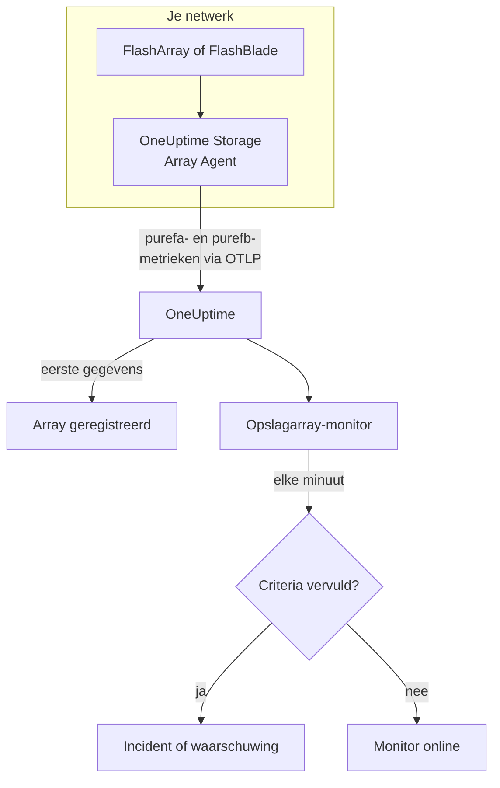

# Opslagarray-monitor

Een opslagarray-monitor houdt één opslagarray in de gaten en laat je weten wanneer de array een eigen waarschuwing geeft, zonder ruimte komt, trager wordt, hardware of een hostpad verliest, of achterloopt met replicatie. Hij werkt met Pure Storage FlashArray en Pure Storage FlashBlade, en leest de metrieken die de array zelf exporteert - de reeksen `purefa_*` en `purefb_*` van Pure -, die de OneUptime Storage Array Agent verzamelt.

:::cards
- [De monitor maken](#een-opslagarray-monitor-maken): Zes stappen in het dashboard.
- [Templates](#kant-en-klare-waarschuwingstemplates): Achttien kant-en-klare waarschuwingen, één incident per volume, host of component.
- [Hoe de reeksen van Pure werken](#hoe-de-reeksen-van-pure-zijn-opgebouwd): Eén metrieknaam, veel waarden.
- [Metrieken](#verzamelde-metrieken): Elke reeks waarop de monitor kan waarschuwen.
:::

## Hoe het werkt

De OneUptime Storage Array Agent draait op een machine die de beheerinterface van de array kan bereiken. Hij leest de metrieken van de array met een alleen-lezen API-token, labelt ze met de naam van de array, `storage.array.name`, en het platform ervan, `storage.system`, en stuurt ze via OTLP naar OneUptime. De eerste gegevens registreren de array.

Een opslagarray-monitor hoort bij één array. Elke minuut voert hij zijn query uit op de metrieken van die array en vergelijkt hij het resultaat met zijn criteria.



## Voordat je begint

- **Installeer de Storage Array Agent** waar hij de array via HTTPS kan bereiken, met het API-token van een gebruiker die de rol **readonly** van de array heeft. De [handleiding van de Storage Array Agent](/docs/telemetry/storage-arrays) behandelt de gebruiker, het token en de installatie, via `ONEUPTIME_URL`, `ONEUPTIME_TELEMETRY_INGESTION_KEY`, `STORAGE_ARRAY_NAME`, en het adres en het token van de array (`PURE_FA_ENDPOINT` en `PURE_FA_API_TOKEN`, of `PURE_FB_ENDPOINT` en `PURE_FB_API_TOKEN`).
- **Controleer of de array geregistreerd is.** Hij verschijnt onder **Producten → Infrastructuur → Storage Arrays → All Storage Arrays**, genoemd naar de `STORAGE_ARRAY_NAME` van de agent, ongeveer een minuut na de eerste uitlezing.

## Een opslagarray-monitor maken

:::steps
### Een nieuwe monitor beginnen

Ga naar **Monitoren** en klik op **Monitor maken**.

### Opslagarray kiezen

Klik onder **Monitortype** op **Meer monitortypen** en kies **Opslagarray** onder **Infrastructuur**, of typ `storage` in het zoekvak. Vul een **Naam** in - die wordt gebruikt in de titels van incidenten en waarschuwingen - en klik op **Volgende**.

### De array kiezen

Kies onder **Storage Array Monitor Configuration** de array uit **Opslagarray**. Elke array die gegevens heeft gestuurd, staat in de lijst. Het platform ervan bepaalt welke metrieken en templates het formulier aanbiedt.

### Kiezen wat je in de gaten houdt

Kies een van de drie tabbladen:

- **Quick Setup** - klik op een [template](#kant-en-klare-waarschuwingstemplates). Dat stelt de metriek, de labelfilters, de aggregatie, het tijdsbereik en de drempels in, en vervangt de criteria hieronder door de eigen criteria. Het **Tijdsbereik** kun je nog steeds aanpassen.
- **Custom Metric** - kies één metriek uit **Storage Array Metric** en stel daarna **Aggregatie** en **Tijdsbereik** in. De [filters](#monitorinstellingen) beperken haar tot één volume, host, pod, component, bestandssysteem of bucket.
- **Geavanceerd** - bouw zelf queries en formules onder **Selecteer metrieken**, bijvoorbeeld de gebruikte capaciteit als `purefa_array_space_bytes` gefilterd op `space=capacity` min dezelfde metriek gefilterd op `space=empty`. Gebruik **Group by** met het label van een object om elk object afzonderlijk te beoordelen.

### De criteria controleren

Open elk criterium onder **Monitorcriteria** en controleer de **Metriek**, de **Aggregatie**, de **Voorwaarde** en de **Threshold**. Een template vult die in. Met **Custom Metric** of **Geavanceerd** begint de monitor met de [standaardcriteria](#standaardcriteria), die alleen merken dat een metriek naar nul zakt, dus stel je eigen drempel in.

### De monitor maken

Klik op **Monitor maken**. OneUptime opent de pagina van de monitor en evalueert hem elke minuut. Incidenten en waarschuwingen die hij geeft, staan ook op de pagina's **Incidenten** en **Waarschuwingen** van de array.
:::

> [!TIP]
> Om meerdere templates tegelijk in te stellen, open je de array via **Producten → Infrastructuur → Storage Arrays** en ga je naar **Recommendations**. Kies de templates die je wilt, kies wie wordt opgeroepen, en OneUptime maakt één monitor per template.

## Monitorinstellingen

| Veld | Tabblad | Wat het doet |
| --- | --- | --- |
| **Opslagarray** | Alle | Verplicht. Beperkt elke query tot `resource.storage.array.name`, zodat twee arrays die allebei een volume `vol-01` hebben nooit door elkaar lopen. |
| **Volume** | Custom Metric, Geavanceerd | Alleen FlashArray. Eén volume, via het label `name`, zoals `vol-db-01`. Een volume in een pod of een volumegroep heet `pod::volume` of `group/volume`. |
| **Host** | Custom Metric, Geavanceerd | Alleen FlashArray. Eén host zoals de array hem kent, via het label `host`, zoals `esxi-01`. |
| **Pod** | Custom Metric, Geavanceerd | Alleen FlashArray. Eén ActiveCluster- of ActiveDR-pod, via het label `name`, of `local_pod` op reeksen van replicakoppelingen. |
| **Hardware Component** | Custom Metric, Geavanceerd | Eén hardwarecomponent, zoals `CH0.BAY1` of `CT0`: het label `component_name` op een FlashArray, `name` op een FlashBlade. |
| **File System** | Custom Metric, Geavanceerd | Alleen FlashBlade. Eén bestandssysteem, via het label `name`. |
| **Bucket** | Custom Metric, Geavanceerd | Alleen FlashBlade. Eén objectopslagbucket, via het label `name`. |
| **Storage Array Metric** | Custom Metric | Eén metriek uit de [catalogus](#verzamelde-metrieken). Het formulier voegt het labelfilter toe dat haar betekenis geeft, en groepeert haar op het object dat ze beschrijft, zodat elk volume, elke host of elk component afzonderlijk wordt beoordeeld. |
| **Aggregatie** | Custom Metric | Hoe monsters worden gecombineerd: **Gemiddelde**, **Maximum**, **Minimum**, **Som** of **Aantal**. Begint bij de gebruikelijke aggregatie van de metriek. |
| **Tijdsbereik** | Alle | Het voortschrijdende venster dat de query leest, van **Past 1 Minute** tot **Past 365 Days**. Een nieuwe monitor begint bij **Past 5 Minutes**; een eigen metriek van een bestandssysteem of bucket bij **Past 15 Minutes**; templates stellen hun eigen venster in. |
| **Selecteer metrieken** | Geavanceerd | De querybouwer: **Metriek**, **Aggregate by**, **Filter by attributes**, **Group by**, plus **Metriek toevoegen** en **Formule toevoegen** om queries te combineren. |

De agent leest het array-endpoint elke 60 seconden, en volumes, hosts en pods elke 2 minuten, dus een venster van 5 minuten bevat altijd een monster. De bestandssystemen en buckets van een FlashBlade leest hij elke 5 minuten, vandaar 15, en FlashArray-mappen elke 30 minuten: geef een mapmonitor een venster van 60 minuten.

## Hoe de reeksen van Pure zijn opgebouwd

Pure zet meerdere waarden op **één** metrieknaam en onderscheidt ze met een label:

- **`dimension`** op de prestatiereeksen. `purefa_array_performance_latency_usec` draagt de leeslatentie (`usec_per_read_op`), de schrijflatentie (`usec_per_write_op`), de latentie van gespiegelde schrijfacties, en de SAN-, wachtrij-, QoS- en servicetijd van elk. Filter altijd op één `dimension`: een gemiddelde over alle mengt een leeslatentie van 200 µs met een wachtrijwaarde.
- **`space`** op de capaciteitsreeksen: `capacity`, `empty`, `snapshots`, `total_provisioned`, `total_physical`, `available_ratio` en meer.

Verschillende reeksen dragen hun toestand in een **label**, met een waarde die altijd 1 is:

| Reeks | Toestandslabel | Eén reeks per |
| --- | --- | --- |
| `purefa_alerts_open` | `severity`, met `summary`, `code` en `component_type` | Openstaande waarschuwing |
| `purefa_hw_component_status` | `component_status` | Hardwarecomponent |
| `purefa_host_connectivity_info` | `status`, met `details` | Host |
| `purefa_drive_capacity_bytes` | `component_status` (de waarde is de capaciteit van de schijf) | Schijf |

Een reeks die gefilterd is op een slechte toestand bestaat alleen zolang iets in die toestand is, dus geen reeks betekent gezond. Daarom is **Max boven 0 gaat af en 0 herstelt** de juiste vorm ervoor, en zo zijn de templates gebouwd: hun herstelcriteria tellen een ontbrekende reeks als nul.

In monitorfilters en groeperingssleutels beginnen de attributen van de agent met `resource.` (`resource.storage.array.name`, `resource.storage.system`), terwijl de eigen labels van Pure dat niet doen (`name`, `host`, `component_name`, `dimension`, `space`, `severity`).

## Kant-en-klare waarschuwingstemplates

OneUptime levert 18 templates — 11 voor FlashArray en 7 voor FlashBlade — en **Quick Setup** biedt die voor het platform van de array aan. Elk template bouwt een volledige monitor: de metriekquery, de labelfilters, een groepering op het eigen label van het object, een criterium dat afgaat en een dat herstelt. Drempels zijn startpunten die je kunt aanpassen.

Een criterium gaat alleen af als de voorwaarde geldt voor **elke** waarde in zijn venster. Een monitor die afging op een drempel voor capaciteit, latentie, achterstand of verhouding herstelt pas 10 % voorbij die drempel, zodat een waarde die rond de drempel schommelt niet heen en weer springt; de templates voor waarschuwingen en hardware herstellen zodra de toestand verdwijnt.

### FlashArray

| Template                       | Categorie    | Ernst    | Houdt in de gaten                                                                               | Gaat af als                                                                                                                                      |
| ------------------------------ | ------------ | -------- | ----------------------------------------------------------------------------------------------- | ------------------------------------------------------------------------------------------------------------------------------------------------ |
| Critical Array Alert           | Array Health | Kritiek  | `purefa_alerts_open` gefilterd op `severity=critical`, Max per `summary`, laatste 5 minuten     | > 0 — de array heeft een openstaande kritieke waarschuwing (een defect component, een capaciteitsnoodgeval, een replicatiefout). Eén incident per waarschuwing; herstelt als de waarschuwing sluit |
| Warning Array Alert            | Array Health | Warning  | `purefa_alerts_open` gefilterd op `severity=warning`, Max per `summary`, laatste 5 minuten      | > 0 — de array heeft een openstaande waarschuwing van niveau warning. Eén incident per waarschuwing; herstelt als de waarschuwing sluit          |
| Capacity Above 80%             | Capaciteit   | Warning  | `purefa_array_space_utilization`, Max, laatste 15 minuten                                       | > 80 — de eerste capaciteitsdrempel van Pure zelf; herstelt bij ≤ 72                                                                             |
| Capacity Above 90%             | Capaciteit   | Kritiek  | `purefa_array_space_utilization`, Max, laatste 5 minuten                                        | > 90 — de array staat op het punt schrijfacties te weigeren; herstelt bij ≤ 81                                                                   |
| High Read Latency              | Performance  | Warning  | `purefa_array_performance_latency_usec` gefilterd op `dimension=usec_per_read_op`, Avg, laatste 10 minuten  | > 5000 µs (5 ms) — leesacties van een FlashArray zijn normaal ruim binnen 1 ms klaar; herstelt bij ≤ 4500                            |
| High Write Latency             | Performance  | Warning  | `purefa_array_performance_latency_usec` gefilterd op `dimension=usec_per_write_op`, Avg, laatste 10 minuten | > 5000 µs (5 ms); herstelt bij ≤ 4500                                                                                                  |
| Hardware Component Failed      | Hardware     | Kritiek  | `purefa_hw_component_status` gefilterd op `component_status=critical`, Max per `component_name`, laatste 5 minuten | > 0 — een controller, voeding, ventilator, bay of poort is kritiek en de redundantie is weg. Eén incident per component; herstelt als het ok meldt |
| Hardware Component Degraded    | Hardware     | Warning  | `purefa_hw_component_status` gefilterd op `component_status=degraded`, Max per `component_name`, laatste 5 minuten | > 0 — een component is gedegradeerd. Eén incident per component; herstelt als het ok meldt                                     |
| Drive Failed                   | Hardware     | Kritiek  | `purefa_drive_capacity_bytes` gefilterd op `component_status=failed`, Max per `component_name`, laatste 5 minuten | > 0 — een DirectFlash-module of SSD is uitgevallen en de array herbouwt op de andere. Eén incident per schijf; herstelt als hij is vervangen |
| Host Lost Redundant Paths      | Hosts        | Warning  | `purefa_host_connectivity_info` gefilterd op `status=critical`, Max per `host`, laatste 5 minuten | > 0 — de host bereikt de array via één controller of geen; een controller-failover zou zijn opslag offline halen. Eén incident per host; herstelt als zijn paden terug zijn |
| Replication Lag Above 1 Minute | Replication  | Warning  | `purefa_pod_replica_links_lag_max_msec`, Max per `local_pod`, laatste 10 minuten                | > 60000 ms (60 s) — een failover nu zou meer recente schrijfacties verliezen dan gepland. Eén incident per pod; herstelt bij ≤ 54000             |

### FlashBlade

| Template                     | Categorie    | Ernst    | Houdt in de gaten                                                                                              | Gaat af als                                                                                                         |
| ---------------------------- | ------------ | -------- | -------------------------------------------------------------------------------------------------------------- | ------------------------------------------------------------------------------------------------------------------- |
| Critical Array Alert         | Array Health | Kritiek  | `purefb_alerts_open` gefilterd op `severity=critical`, Max per `summary`, laatste 5 minuten                    | > 0 — de FlashBlade heeft een openstaande kritieke waarschuwing. Eén incident per waarschuwing; herstelt als de waarschuwing sluit |
| Warning Array Alert          | Array Health | Warning  | `purefb_alerts_open` gefilterd op `severity=warning`, Max per `summary`, laatste 5 minuten                     | > 0 — de FlashBlade heeft een openstaande waarschuwing van niveau warning. Eén incident per waarschuwing; herstelt als de waarschuwing sluit |
| Capacity Above 80%           | Capaciteit   | Warning  | `purefb_array_space_utilization` gefilterd op `type=array`, Max, laatste 15 minuten                            | > 80; herstelt bij ≤ 72                                                                                             |
| Capacity Above 90%           | Capaciteit   | Kritiek  | `purefb_array_space_utilization` gefilterd op `type=array`, Max, laatste 5 minuten                             | > 90 — schrijfacties mislukken voor elke client als hij vol raakt; herstelt bij ≤ 81                                |
| Hardware Component Unhealthy | Hardware     | Kritiek  | `purefb_hardware_health`, Min per `name`, laatste 5 minuten                                                    | < 1 — een blade, fabric-module, voeding of ventilator is niet gezond (een ongebruikt slot meldt 2). Eén incident per component; herstelt bij ≥ 1 |
| High Read Latency            | Performance  | Warning  | `purefb_array_performance_latency_usec` gefilterd op `dimension=usec_per_read_op` en `protocol=all`, Avg, laatste 10 minuten | > 10000 µs (10 ms) over alle protocollen; herstelt bij ≤ 9000                                         |
| File System Near Full        | File Systems | Warning  | `purefb_file_systems_space_bytes` gefilterd op `space=available_ratio`, Min per `name`, laatste 15 minuten     | < 0.1 — er is minder dan 10 % over van de toegewezen grootte van een bestandssysteem. Eén incident per bestandssysteem; herstelt bij ≥ 0.11 |

**Ernst** is het label dat de keuzelijst toont. Het incident en de waarschuwing die een template maakt, beginnen op de zwaarste incident- en waarschuwingsernst van je project; wijzig ze in het criterium.

- **Openstaande waarschuwingen en hardwaretoestanden gebruiken Max** van een reeks die alleen bestaat zolang de waarschuwing open is of het component in die toestand is, dus één uitlezing die haar toont overschrijdt de drempel.
- **Elk template per object groepeert op het eigen label van het object** (`summary`, `component_name`, `host`, `local_pod`, `name`), dus er gaat één incident af per getroffen object, en het incident noemt het.
- **Latentietemplates gebruiken Avg** van het eigen gemiddelde per operatie van de array, en capaciteitstemplates **Max** van het eigen bezettingspercentage. Latenties staan vast in microseconden en capaciteit in procenten.
- **Hardware Component Unhealthy gebruikt Min** per component: de gezondheid is 1 als het gezond is en zakt naar 0 als dat niet zo is.

Er is geen template voor de latentie van elk volume, omdat de juiste drempel van de workload afhangt: bouw het uit de catalogus met een groepering op `name`. Capaciteitsvoorspelling vraagt een groeitrend in plaats van een drempel, en voor slijtage van schijven bestaat geen reeks om op te waarschuwen.

## Verzamelde metrieken

De agent stuurt alles wat de array exporteert; de reeksen hieronder vormen de catalogus die het monitorformulier aanbiedt. Elke waarde is een gauge die de array zelf berekent - latenties zijn microseconden per operatie en doorvoer is per seconde -, dus er is geen rekenwerk met snelheden nodig. **Filter** is het labelfilter dat de reeks de betekenis geeft die haar rij noemt; het formulier past het voor je toe.

### Array Health

| Metriek              | Filter | Platform   | Eenheid | Beschrijving                                                                                                                                                      |
| -------------------- | ------ | ---------- | ------- | ----------------------------------------------------------------------------------------------------------------------------------------------------------------- |
| `purefa_alerts_open` | —      | FlashArray | `count` | Eén reeks per openstaande waarschuwing op de array (waarde 1), met de labels `severity` (`critical`, `warning`, `info`, `hidden`), `category`, `code`, `component_type` en `summary` |
| `purefb_alerts_open` | —      | FlashBlade | `count` | Eén reeks per openstaande waarschuwing op de FlashBlade (waarde 1), met de labels `severity` (`info`, `warning`, `critical`), `code`, `component_name`, `component_type`, `summary` en `kburl` (het kennisbankartikel van Pure) |

### Capacity

| Metriek                                   | Filter                       | Platform   | Eenheid | Beschrijving                                                                                                                          |
| ----------------------------------------- | ---------------------------- | ---------- | ------- | ------------------------------------------------------------------------------------------------------------------------------------- |
| `purefa_array_space_utilization`          | —                            | FlashArray | `%`     | Aandeel van de bruikbare capaciteit van de array dat in gebruik is. Pure geeft eigen capaciteitswaarschuwingen bij 80 %, 90 % en 100 % |
| `purefa_array_space_bytes`                | `space=capacity`             | FlashArray | `bytes` | Bruikbare capaciteit van de array                                                                                                     |
| `purefa_array_space_bytes`                | `space=empty`                | FlashArray | `bytes` | Ongebruikte capaciteit — volg de trend om te voorspellen wanneer de array vol raakt                                                  |
| `purefa_array_space_bytes`                | `space=snapshots`            | FlashArray | `bytes` | Fysieke ruimte die alleen snapshots innemen; een snelle stijging betekent meestal dat een beschermingsgroep meer snapshots bewaart dan gepland |
| `purefa_array_space_data_reduction_ratio` | —                            | FlashArray | `ratio` | Deduplicatie en compressie over de hele array, bijv. 4.2 voor 4.2:1. Een aanhoudende daling betekent dat nieuwe gegevens slecht te reduceren zijn |
| `purefb_array_space_utilization`          | `type=array`                 | FlashBlade | `%`     | Aandeel van de bruikbare capaciteit van de FlashBlade dat in gebruik is                                                               |
| `purefb_array_space_bytes`                | `type=array`, `space=empty`  | FlashBlade | `bytes` | Ongebruikte capaciteit van de FlashBlade                                                                                              |
| `purefb_array_space_data_reduction_ratio` | `type=array`                 | FlashBlade | `ratio` | Gegevensreductie over de hele FlashBlade                                                                                              |

### Performance

| Metriek                                    | Filter                                         | Platform   | Eenheid   | Beschrijving                                                                                                 |
| ------------------------------------------ | ---------------------------------------------- | ---------- | --------- | ------------------------------------------------------------------------------------------------------------ |
| `purefa_array_performance_latency_usec`    | `dimension=usec_per_read_op`                   | FlashArray | `µs`      | Gemiddelde latentie van een leesactie zoals hosts die zien; leesacties van een FlashArray zijn meestal ruim binnen 1 ms klaar |
| `purefa_array_performance_latency_usec`    | `dimension=usec_per_write_op`                  | FlashArray | `µs`      | Gemiddelde latentie van een schrijfactie zoals hosts die zien                                                |
| `purefa_array_performance_latency_usec`    | `dimension=usec_per_mirrored_write_op`         | FlashArray | `µs`      | Gemiddelde latentie van een schrijfactie naar een uitgerekte ActiveCluster-pod, inclusief de rondreis naar de partnerarray |
| `purefa_array_performance_latency_usec`    | `dimension=san_usec_per_read_op`               | FlashArray | `µs`      | Tijd die een leesactie in het SAN doorbrengt; hoge SAN-latentie met lage servicelatentie wijst naar de fabric of de host |
| `purefa_array_performance_throughput_iops` | `dimension=reads_per_sec`                      | FlashArray | `ops/s`   | Leesoperaties per seconde                                                                                    |
| `purefa_array_performance_throughput_iops` | `dimension=writes_per_sec`                     | FlashArray | `ops/s`   | Schrijfoperaties per seconde                                                                                 |
| `purefa_array_performance_bandwidth_bytes` | `dimension=read_bytes_per_sec`                 | FlashArray | `bytes/s` | Gelezen bytes per seconde                                                                                    |
| `purefa_array_performance_bandwidth_bytes` | `dimension=write_bytes_per_sec`                | FlashArray | `bytes/s` | Geschreven bytes per seconde                                                                                 |
| `purefa_array_performance_queue_depth_ops` | —                                              | FlashArray | `ops`     | Operaties in de wachtrij op de array; een groeiende wachtrij met stijgende latentie betekent dat hosts meer sturen dan hij kan verwerken |
| `purefa_array_performance_average_bytes`   | `dimension=bytes_per_op`                       | FlashArray | `bytes`   | Gemiddelde grootte van een operatie — grote I/O verhoogt de latentie zonder dat er iets mis is              |
| `purefb_array_performance_latency_usec`    | `dimension=usec_per_read_op`, `protocol=all`   | FlashBlade | `µs`      | Gemiddelde leeslatentie over alle protocollen                                                                |
| `purefb_array_performance_latency_usec`    | `dimension=usec_per_write_op`, `protocol=all`  | FlashBlade | `µs`      | Gemiddelde schrijflatentie over alle protocollen                                                             |
| `purefb_array_performance_throughput_iops` | `dimension=reads_per_sec`, `protocol=all`      | FlashBlade | `ops/s`   | Leesoperaties per seconde over alle protocollen                                                              |
| `purefb_array_performance_throughput_iops` | `dimension=writes_per_sec`, `protocol=all`     | FlashBlade | `ops/s`   | Schrijfoperaties per seconde over alle protocollen                                                           |
| `purefb_array_performance_bandwidth_bytes` | `dimension=read_bytes_per_sec`, `protocol=all` | FlashBlade | `bytes/s` | Gelezen bytes per seconde over alle protocollen                                                              |
| `purefb_array_performance_bandwidth_bytes` | `dimension=write_bytes_per_sec`, `protocol=all` | FlashBlade | `bytes/s` | Geschreven bytes per seconde over alle protocollen                                                          |

### Volumes

| Metriek                                     | Filter                           | Platform   | Eenheid   | Beschrijving                                                  |
| ------------------------------------------- | -------------------------------- | ---------- | --------- | ------------------------------------------------------------- |
| `purefa_volume_performance_latency_usec`    | `dimension=usec_per_read_op`     | FlashArray | `µs`      | Gemiddelde leeslatentie van elk volume — groepeer op `name`   |
| `purefa_volume_performance_latency_usec`    | `dimension=usec_per_write_op`    | FlashArray | `µs`      | Gemiddelde schrijflatentie van elk volume                     |
| `purefa_volume_performance_throughput_iops` | `dimension=reads_per_sec`        | FlashArray | `ops/s`   | Leesoperaties per seconde van elk volume                      |
| `purefa_volume_performance_throughput_iops` | `dimension=writes_per_sec`       | FlashArray | `ops/s`   | Schrijfoperaties per seconde van elk volume                   |
| `purefa_volume_performance_bandwidth_bytes` | `dimension=read_bytes_per_sec`   | FlashArray | `bytes/s` | Bytes per seconde gelezen uit elk volume                      |
| `purefa_volume_performance_bandwidth_bytes` | `dimension=write_bytes_per_sec`  | FlashArray | `bytes/s` | Bytes per seconde geschreven naar elk volume                  |
| `purefa_volume_space_bytes`                 | `space=total_provisioned`        | FlashArray | `bytes`   | Grootte van elk volume zoals hosts die zien                   |
| `purefa_volume_space_bytes`                 | `space=total_physical`           | FlashArray | `bytes`   | Fysieke ruimte die elk volume na gegevensreductie gebruikt    |
| `purefa_volume_space_data_reduction_ratio`  | —                                | FlashArray | `ratio`   | Gegevensreductieverhouding van elk volume                     |

### Hosts

| Metriek                                   | Filter                        | Platform   | Eenheid | Beschrijving                                                                                                                                   |
| ----------------------------------------- | ----------------------------- | ---------- | ------- | ---------------------------------------------------------------------------------------------------------------------------------------------- |
| `purefa_host_connectivity_info`           | —                             | FlashArray | `count` | Eén reeks per host (waarde 1) met het label van zijn connectiviteit `status` (`healthy`, `critical`, `unused`) en `details` (`Redundant`, `Single Controller`, `None`, ...) |
| `purefa_host_performance_latency_usec`    | `dimension=usec_per_read_op`  | FlashArray | `µs`    | Gemiddelde leeslatentie die elke host ziet — groepeer op `host`                                                                                |
| `purefa_host_performance_latency_usec`    | `dimension=usec_per_write_op` | FlashArray | `µs`    | Gemiddelde schrijflatentie die elke host ziet                                                                                                  |
| `purefa_host_performance_throughput_iops` | `dimension=reads_per_sec`     | FlashArray | `ops/s` | Leesoperaties per seconde van elke host                                                                                                        |
| `purefa_host_performance_throughput_iops` | `dimension=writes_per_sec`    | FlashArray | `ops/s` | Schrijfoperaties per seconde van elke host                                                                                                     |

### Replication

| Metriek                                              | Filter                                 | Platform   | Eenheid   | Beschrijving                                                                                                                                                 |
| ---------------------------------------------------- | -------------------------------------- | ---------- | --------- | ------------------------------------------------------------------------------------------------------------------------------------------------------------ |
| `purefa_pod_replica_links_lag_max_msec`              | —                                      | FlashArray | `ms`      | Grootste replicatieachterstand van elke podreplicakoppeling (ActiveDR / asynchroon), met de labels `local_pod`, `remote_pod`, `remote`, `direction` en `status` — groepeer op `local_pod` |
| `purefa_pod_replica_links_lag_average_msec`          | —                                      | FlashArray | `ms`      | Gemiddelde replicatieachterstand van elke podreplicakoppeling                                                                                                |
| `purefa_pod_performance_replication_bandwidth_bytes` | —                                      | FlashArray | `bytes/s` | Replicatieverkeer van elke pod, met de labels `direction` en `dimension`                                                                                     |
| `purefa_pod_performance_latency_usec`                | `dimension=usec_per_mirrored_write_op` | FlashArray | `µs`      | Gemiddelde latentie van gespiegelde schrijfacties van elke ActiveCluster-pod                                                                                 |

### Hardware

| Metriek                                       | Filter                           | Platform   | Eenheid    | Beschrijving                                                                                                                                                                                                 |
| --------------------------------------------- | -------------------------------- | ---------- | ---------- | ------------------------------------------------------------------------------------------------------------------------------------------------------------------------------------------------------------ |
| `purefa_hw_component_status`                  | —                                | FlashArray | `count`    | Eén reeks per hardwarecomponent (waarde 1) — chassis, controllers, schijf- en NVRAM-bays, voedingen, ventilatoren, temperatuursensoren, Ethernet- en Fibre Channel-poorten — met het label `component_status` (`ok`, `critical`, `degraded`, `device_off`, `identifying`, `not_installed`, `unknown`) |
| `purefa_hw_component_temperature_celsius`     | —                                | FlashArray | `°C`       | Temperatuur van elke sensor — groepeer op `component_name`                                                                                                                                                   |
| `purefa_drive_capacity_bytes`                 | —                                | FlashArray | `bytes`    | Ruwe capaciteit van elke schijf, met het label van zijn `component_status` (`healthy`, `failed`, `missing`, `recovering`, `unhealthy`, `empty`, ...) en type                                                  |
| `purefa_network_interface_performance_errors` | `dimension=total_errors_per_sec` | FlashArray | `errors/s` | Fouten per seconde op elke Ethernet- en Fibre Channel-interface — aanhoudende fouten betekenen meestal een slechte kabel, optiek of switchpoort                                                               |
| `purefb_hardware_health`                      | —                                | FlashBlade | —          | Gezondheid van elk hardwarecomponent (blades, fabric-modules, voedingen, ventilatoren, ...): 1 = gezond, 2 = ongebruikt, 0 = ongezond. Neem het minimum per `name`                                             |

### File Systems

| Metriek                                        | Filter                        | Platform   | Eenheid | Beschrijving                                                                                 |
| ---------------------------------------------- | ----------------------------- | ---------- | ------- | -------------------------------------------------------------------------------------------- |
| `purefb_file_systems_performance_latency_usec` | `dimension=usec_per_read_op`  | FlashBlade | `µs`    | Gemiddelde leeslatentie van elk bestandssysteem — groepeer op `name`                         |
| `purefb_file_systems_performance_latency_usec` | `dimension=usec_per_write_op` | FlashBlade | `µs`    | Gemiddelde schrijflatentie van elk bestandssysteem                                           |
| `purefb_file_systems_space_bytes`              | `space=total_physical`        | FlashBlade | `bytes` | Fysieke ruimte die elk bestandssysteem gebruikt                                              |
| `purefb_file_systems_space_bytes`              | `space=available_ratio`       | FlashBlade | `ratio` | Aandeel van de toegewezen grootte van elk bestandssysteem dat nog beschikbaar is, 0 tot 1 — dicht bij 0 staat het op het punt zijn quotum te vullen |

### Buckets

| Metriek                                   | Filter                       | Platform   | Eenheid | Beschrijving                                          |
| ----------------------------------------- | ---------------------------- | ---------- | ------- | ----------------------------------------------------- |
| `purefb_buckets_performance_latency_usec` | `dimension=usec_per_read_op` | FlashBlade | `µs`    | Gemiddelde leeslatentie van elke bucket — groepeer op `name` |
| `purefb_buckets_space_bytes`              | `space=total_physical`       | FlashBlade | `bytes` | Fysieke ruimte die elke bucket gebruikt               |
| `purefb_buckets_object_count`             | —                            | FlashBlade | `count` | Aantal objecten in elke bucket                        |

## Monitoringcriteria

Een criterium vergelijkt een van de queries of formules van de monitor met een drempel. De criteria van een opslagarray-monitor hebben geen **Filtertype**: elke regel controleert de waarde van de metriek, met deze velden.

| Veld | Wat het doet |
| --- | --- |
| **Metriek** | De query of formule om te controleren, op haar variabelenaam. |
| **Aggregatie** | Hoe de waarden in het venster één antwoord worden: **Gemiddelde**, **Som**, **Maximum Value**, **Minimum Value**, **All Values** (elke waarde moet overeenkomen) of **Any Value** (één is genoeg). |
| **Voorwaarde** | **Greater Than**, **Less Than**, **Greater Than Or Equal To**, **Less Than Or Equal To** of **Equal To** — of een anomalievoorwaarde: **Anomalously High**, **Anomalously Low** of **Anomalous**. |
| **Threshold** | De waarde om mee te vergelijken. Er staat een eenhedenlijst naast als de metriek een eenheid heeft. Niet getoond bij anomalievoorwaarden. |
| **Gevoeligheid** | Alleen bij anomalievoorwaarden. **Laag** (4σ), **Gemiddeld** (3σ, de standaard) of **Hoog** (2σ). |
| **Baseline-venster** | Alleen bij anomalievoorwaarden. 14 dagen (de standaard), 28, 60 of 90 dagen geschiedenis. |
| **Als geen gegevens** | Onder **Meer velden**. Wat er gebeurt als het venster geen monsters heeft: **Ignore** (de standaard), **Treat As Zero** of **Trigger**. |

Anomalievoorwaarden vergelijken elke waarde met hetzelfde uur van de week in de baseline. Ze blijven in de toestand "Learning", en geven niets, tot het baseline-venster genoeg geschiedenis bevat.

Enkele criteria om mee te beginnen:

- **Een volume is traag:** `purefa_volume_performance_latency_usec` gefilterd op `dimension=usec_per_read_op`, Gemiddelde, gegroepeerd op `name`, **Greater Than** `2000`, over de laatste 10 minuten.
- **De array raakt vol:** `purefa_array_space_utilization`, Maximum, **Greater Than** `85`, over de laatste 15 minuten.
- **Een host draait op één controller:** `purefa_host_connectivity_info` gefilterd op `status=critical`, Maximum, gegroepeerd op `host`, **Greater Than** `0`.
- **Een FlashBlade-bestandssysteem is bijna vol:** `purefb_file_systems_space_bytes` gefilterd op `space=available_ratio`, Minimum, gegroepeerd op `name`, **Less Than** `0.05`.

### Standaardcriteria

Een monitor die je niet vanuit een template bouwt, begint met twee criteria:

| Volgorde | Criterium | Komt overeen als | Dan |
| --- | --- | --- | --- |
| 1 | Check if _monitor name_ is offline | Een willekeurige waarde van de eerste query `0` is | Markeert de monitor als **Offline** en verklaart het incident "_monitor name_ is offline", dat vanzelf wordt opgelost als de monitor herstelt. |
| 2 | Check if _monitor name_ is online | Een willekeurige waarde boven `0` ligt | Markeert de monitor als **Operationeel**. |

> [!IMPORTANT]
> Stilte komt met geen van beide criteria overeen: een array die geen gegevens meer stuurt, laat de monitor zoals hij was. Om te horen wanneer gegevens wegblijven, stel je **Als geen gegevens** bij een criterium in op **Trigger**. Tijd waarin OneUptime zelf niets ontving, telt nooit als ontbrekende gegevens: een controle waarvan het venster die tijd bevat, wacht in plaats daarvan, zoals [Als OneUptime geen gegevens ontvangt](/docs/monitor/when-oneuptime-is-not-receiving) uitlegt.

## Terraform

De [Terraform-provider van OneUptime](/docs/terraform/monitor-steps) draagt de configuratie van een stap van een opslagarray-monitor in het attribuut `storage_array_monitor`: de ruwe JSON van de configuratie `storageArrayMonitor` (`arrayIdentifier`, `storageSystem`, `resourceFilters`, `metricViewConfig`, `rollingTime`), geschreven met `jsonencode()`:

```hcl title="main.tf"
monitor_steps = [{
  storage_array_monitor = jsonencode({
    arrayIdentifier = "my-storage-array"
    storageSystem   = "purestorage.flasharray"
    resourceFilters = {}
    rollingTime     = "Past 15 Minutes"
    metricViewConfig = {
      queryConfigs = [{
        metricAliasData = { metricVariable = "capacity_used_percent", title = "Capacity Used", description = "", legend = "" }
        metricQueryData = {
          filterData = {
            metricName     = "purefa_array_space_utilization"
            attributes     = {}
            aggegationType = "Max"
            aggregateBy    = {}
          }
        }
      }]
      formulaConfigs = []
    }
  })
  criteria = [ /* ... */ ]
}]
```

`arrayIdentifier` is de `storage.array.name` van de array - de `STORAGE_ARRAY_NAME` waarmee de agent werd gestart -, niet de OneUptime-ID ervan. `storageSystem` is `purestorage.flasharray` of `purestorage.flashblade`. Het bepaalt welke catalogus en templates het formulier toont, en of een hardwarefilter `component_name` of `name` leest.

## Problemen oplossen

:::details De array staat niet in de lijst Opslagarray
Arrays registreren zichzelf op basis van de gegevens van de agent. Controleer of de agent draait en gegevens stuurt (zie de [handleiding van de Storage Array Agent](/docs/telemetry/storage-arrays)), en of `STORAGE_ARRAY_NAME` is ingesteld.
:::

:::details Een waarschuwings- of hardwaretemplate gaat nooit af
Dat is het gezonde geval. `purefa_alerts_open`, `purefa_hw_component_status`, `purefa_drive_capacity_bytes` en `purefa_host_connectivity_info` dragen hun toestand in een label, en een reeks gefilterd op een slechte toestand (`severity=critical`, `component_status=failed`) bestaat alleen zolang iets in die toestand is. Om de reeks achter een template te zien, voer je de query ervan zonder het filter uit op de pagina **Metrieken**.
:::

:::details Een latentiemonitor toont verkeerde waarden
Pure zet lees-, schrijf-, gespiegelde-schrijf-, SAN-, wachtrij- en QoS-waarden op één metrieknaam, alleen onderscheiden door het label `dimension`, en een query zonder `dimension`-filter neemt er het gemiddelde van. Filter op één dimensie, zoals de templates en de catalogus van het formulier doen. Reeksen per volume en per host bewaren alleen `usec_per_read_op`, `usec_per_write_op` en `usec_per_mirrored_write_op`: de agent gooit de rest weg om reeksen te besparen, en alleen `purefa_array_performance_latency_usec` voor de hele array bewaart ze allemaal.
:::

:::details Een venster van 1 minuut toont geen gegevens
De agent leest volumes, hosts en pods elke 2 minuten, de bestandssystemen en buckets van een FlashBlade elke 5, en FlashArray-mappen elke 30, dus een venster van 1 minuut bevat mogelijk geen monster. Gebruik 5 minuten of meer: 15 voor bestandssystemen en buckets, 60 voor mappen.
:::

:::details Incidenten gaan één keer af voor de hele array in plaats van één keer per volume
Groepeer de query op het label van het object: `name` voor volumes, pods, mappen, bestandssystemen en buckets, `host` voor hosts, en `component_name` voor FlashArray-hardware. De labels van Pure hebben geen voorvoegsel, dus `resource.name` komt met niets overeen.
:::

## Volgende stappen

:::cards
- [Opslagarray-agent](/docs/telemetry/storage-arrays): De agent installeren die de metrieken stuurt.
- [Ceph-monitor](/docs/monitor/ceph-monitor): Hetzelfde soort monitor voor Ceph-opslagclusters.
- [Metrics-monitor](/docs/monitor/metrics-monitor): Waarschuwen op elke metriek, uit elke bron.
- [Incidenten – Overzicht](/docs/incidents/index): Wat er gebeurt nadat een criterium een incident verklaart.
:::
