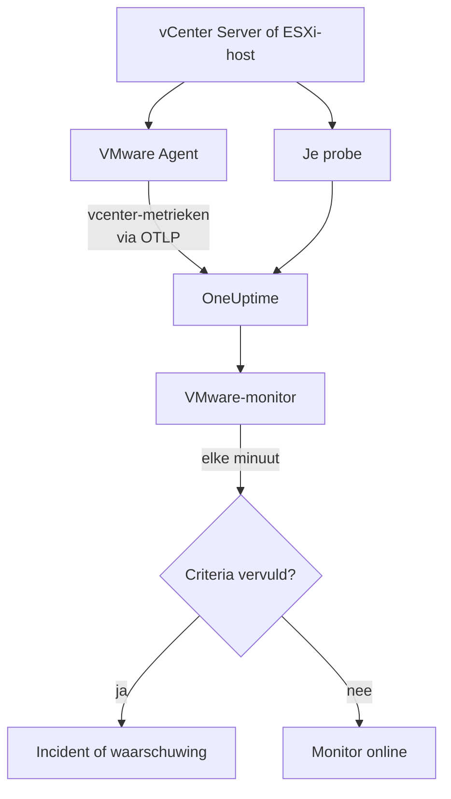

# VMware-monitor

Een VMware-monitor houdt één vCenter in de gaten - de datacenters, clusters, ESXi-hosts, virtuele machines, datastores, resourcepools en vSAN ervan - en laat je weten wanneer een host verzadigd raakt, een VM te weinig CPU of geheugen krijgt, een datastore volloopt of vSphere een alarm geeft. Hij leest de metrieken `vcenter.*` die de OneUptime VMware Agent verzamelt, of die een van je probes zonder agent verzamelt.

:::cards
- [De monitor maken](#een-vmware-monitor-maken): Zes stappen in het dashboard.
- [Templates](#kant-en-klare-waarschuwingstemplates): Drieëntwintig kant-en-klare waarschuwingen, één incident per host, VM of datastore.
- [Identiteitsattributen](#identiteitsattributen): Hoe je één host, VM of datastore aanwijst.
- [Metrieken](#verzamelde-metrieken): Elke reeks `vcenter.*` waarop de monitor kan waarschuwen.
:::

## Hoe het werkt

De metrieken komen uit de API van vCenter, gelezen met een alleen-lezen account, op een van twee manieren:

- **De VMware Agent**, een OpenTelemetry Collector met zijn receiver `vcenter`, die je draait op een machine die vCenter kan bereiken. Zie [VMware-agent](/docs/telemetry/vmware).
- **Een probe**, zonder iets te installeren: je koppelt het vCenter in OneUptime en kiest de probe die het bereikt. Zie [VMware zonder agent](/docs/telemetry/vmware-agentless).

Beide sturen elk verzamelinterval (standaard 2 minuten) dezelfde reeksen, voorzien van de naam van het vCenter, `vmware.vcenter.name`. Een vCenter is één vSphere-endpoint: een vCenter Server of een losse ESXi-host. Een VMware-monitor hoort bij één vCenter. Elke minuut voert hij zijn query uit op de metrieken van dat vCenter en vergelijkt hij het resultaat met zijn criteria.



## Voordat je begint

- **Verzamel de metrieken van het vCenter**, met de [VMware Agent](/docs/telemetry/vmware) of [zonder agent](/docs/telemetry/vmware-agentless). Beide gebruiken een vSphere-gebruiker met de rol **Read-Only** op het hoogste vCenter-object, met **Propagate to children** aangevinkt. De agent leest `ONEUPTIME_URL`, `ONEUPTIME_TELEMETRY_INGESTION_KEY`, `VMWARE_VCENTER_NAME`, `VCENTER_ENDPOINT`, `VCENTER_USERNAME` en `VCENTER_PASSWORD`.
- **Controleer of het vCenter geregistreerd is.** Het verschijnt onder **Producten → Infrastructuur → VMware → Alle vCenters**: via de agent, genoemd naar zijn `VMWARE_VCENTER_NAME`, na zijn eerste volledige verzameling; zonder agent vanaf het moment dat je het koppelt.

## Een VMware-monitor maken

:::steps
### Een nieuwe monitor beginnen

Ga naar **Monitoren** en klik op **Monitor maken**.

### VMware kiezen

Klik onder **Monitortype** op **Meer monitortypen** en kies **VMware** onder **Infrastructuur**, of typ `vmware` in het zoekvak. Vul een **Naam** in - die wordt gebruikt in de titels van incidenten en waarschuwingen - en klik op **Volgende**.

### Het vCenter kiezen

Kies onder **VMware Monitor Configuration** het vCenter uit **vCenter**. Elk vCenter dat gegevens heeft gestuurd, of dat je zonder agent hebt gekoppeld, staat in de lijst.

### Kiezen wat je in de gaten houdt

Kies een van de drie tabbladen:

- **Quick Setup** - klik op een [template](#kant-en-klare-waarschuwingstemplates). Dat stelt de metriek, de attribuutfilters, de aggregatie, het tijdsbereik, de groepering en de drempels in, en vervangt de criteria hieronder door de eigen criteria. Het **Tijdsbereik** kun je nog steeds aanpassen.
- **Custom Metric** - kies één metriek uit **VMware Metric** en stel daarna **Aggregatie** en **Tijdsbereik** in. Het formulier groepeert haar op het object dat ze beschrijft, zodat elke host, VM of datastore afzonderlijk wordt beoordeeld, en de [filters](#monitorinstellingen) beperken haar tot één datacenter, cluster, host, VM, datastore of resourcepool.
- **Geavanceerd** - bouw zelf queries en formules onder **Selecteer metrieken**, met filters op attributen zoals `disk_state`, `power_state` of `status`. Gebruik **Group by** met een [identiteitsattribuut](#identiteitsattributen) om elk object afzonderlijk te beoordelen.

### De criteria controleren

Open elk criterium onder **Monitorcriteria** en controleer de **Metriek**, de **Aggregatie**, de **Voorwaarde** en de **Threshold**. Een template vult die in. Met **Custom Metric** of **Geavanceerd** begint de monitor met de [standaardcriteria](#standaardcriteria), die alleen merken dat een metriek naar nul zakt, dus stel je eigen drempel in.

### De monitor maken

Klik op **Monitor maken**. OneUptime opent de pagina van de monitor en evalueert hem elke minuut. Incidenten en waarschuwingen die hij geeft, staan ook op de pagina's **Incidenten** en **Waarschuwingen** van het vCenter.
:::

> [!TIP]
> Om meerdere templates tegelijk in te stellen, open je het vCenter via **Producten → Infrastructuur → VMware** en ga je naar **Recommendations**. Kies de templates die je wilt, kies wie wordt opgeroepen, en OneUptime maakt één monitor per template.

## Monitorinstellingen

| Veld | Tabblad | Wat het doet |
| --- | --- | --- |
| **vCenter** | Alle | Verplicht. Beperkt elke query tot `resource.vmware.vcenter.name`. |
| **Datacenter** | Custom Metric, Geavanceerd | Optioneel. Eén datacenter: `resource.vcenter.datacenter.name`. Elke reeks draagt het. |
| **Cluster** | Custom Metric, Geavanceerd | Optioneel. Eén cluster: `resource.vcenter.cluster.name`. Komt overeen met de eigen reeksen van het cluster en die van de hosts, VM's en resourcepools erin; een losse ESXi-host heeft er geen. |
| **ESXi Host** | Custom Metric, Geavanceerd | Optioneel. Eén ESXi-host: `resource.vcenter.host.name`. Komt overeen met de eigen reeksen van de host **en** die van elke VM die hij draait, omdat een VM de naam van haar host draagt. |
| **Virtual Machine** | Custom Metric, Geavanceerd | Optioneel. Eén VM: `resource.vcenter.vm.name`. VM-namen hoeven niet uniek te zijn: voeg een host of een cluster toe als twee VM's dezelfde naam hebben. |
| **Datastore** | Custom Metric, Geavanceerd | Optioneel. Eén datastore: `resource.vcenter.datastore.name`. |
| **Resource Pool Path** | Custom Metric, Geavanceerd | Optioneel. Eén resourcepool, via zijn inventarispad (`/DC/host/Cluster/Resources/pool`): `resource.vcenter.resource_pool.inventory_path`. Een pad, omdat poolnamen alleen binnen hun bovenliggende object uniek zijn. |
| **VMware Metric** | Custom Metric | Eén metriek uit de [catalogus](#verzamelde-metrieken). |
| **Aggregatie** | Custom Metric | Hoe monsters worden gecombineerd: **Gemiddelde**, **Maximum**, **Minimum**, **Som** of **Aantal**. Begint bij de gebruikelijke aggregatie van de metriek. |
| **Tijdsbereik** | Alle | Het voortschrijdende venster dat de query leest, van **Past 1 Minute** tot **Past 365 Days**. Een nieuwe monitor begint bij **Past 5 Minutes**; templates stellen hun eigen venster in. |
| **Selecteer metrieken** | Geavanceerd | De querybouwer: **Metriek**, **Aggregate by**, **Filter by attributes**, **Group by**, plus **Metriek toevoegen** en **Formule toevoegen** om queries te combineren. |

vCenter wordt één keer per verzamelinterval gelezen, standaard 2 minuten, dus een venster van 1 minuut bevat mogelijk helemaal geen monster. Houd het venster op 5 minuten of meer, en langer als je het verzamelinterval voor een grote inventaris hebt verhoogd.

## Identiteitsattributen

De receiver `vcenter` stuurt één OpenTelemetry-resource per vSphere-object, en benoemt die met **resource-attributen**. Welke een reeks draagt, vertelt je wat voor soort object ze beschrijft:

| vSphere-object      | Identiteitsattributen van de resource                                                                                          |
| ------------------- | ------------------------------------------------------------------------------------------------------------------------------ |
| Datacenter          | `vcenter.datacenter.name`                                                                                                      |
| Cluster             | `vcenter.datacenter.name`, `vcenter.cluster.name`                                                                              |
| ESXi-host           | `vcenter.datacenter.name`, `vcenter.host.name` (+ `vcenter.cluster.name` als hij in een cluster zit)                           |
| Virtuele machine    | `vcenter.datacenter.name`, `vcenter.host.name`, `vcenter.vm.name`, `vcenter.vm.id` (+ `vcenter.cluster.name`; `vcenter.resource_pool.*` of `vcenter.virtual_app.*`) |
| VM-sjabloon         | `vcenter.datacenter.name`, `vcenter.host.name`, `vcenter.vm_template.name`, `vcenter.vm_template.id`                           |
| Datastore           | `vcenter.datacenter.name`, `vcenter.datastore.name`                                                                            |
| Resourcepool        | `vcenter.datacenter.name`, `vcenter.resource_pool.name`, `vcenter.resource_pool.inventory_path` (+ `vcenter.cluster.name` of `vcenter.host.name`) |

In monitorfilters en groeperingssleutels beginnen resource-attributen met `resource.` (`resource.vcenter.host.name`), terwijl datapuntattributen dat niet doen (`disk_state`, `power_state`, `status`, `effective`, `direction`, `object`, `type`). Het booleaanse attribuut `effective` wordt opgeslagen als de tekst `"true"` of `"false"`, dus filter het met de tekst. Filter op een identiteitsattribuut om één object aan te wijzen, en groepeer erop om elk object afzonderlijk te beoordelen.

## Kant-en-klare waarschuwingstemplates

OneUptime levert 23 templates voor veelvoorkomende VMware-problemen, en **Quick Setup** biedt ze allemaal aan. Elk template bouwt een volledige monitor: de metriekquery, de attribuutfilters, een groepering op het eigen identiteitsattribuut van het object, een criterium dat afgaat en een dat herstelt. Drempels zijn startpunten die je kunt aanpassen.

Templates lezen de laatste 5 minuten, tenzij de tabel iets anders zegt. Een criterium gaat alleen af als de voorwaarde geldt voor elke minuut van zijn venster, en een drempelcriterium herstelt 10 % voorbij zijn drempel, zodat een waarde die rond de lijn schommelt niet heen en weer springt.

| Template | Categorie | Ernst | Houdt in de gaten | Gaat af als | Herstelt als |
| --- | --- | --- | --- | --- | --- |
| Host CPU Saturation | Host | Warning | `vcenter.host.cpu.utilization`, Avg per `resource.vcenter.host.name` | Boven 90 %: elke VM op de host concurreert om cores en toont CPU-ready-tijd | Op 81 % of lager |
| Host Memory Saturation | Host | Warning | `vcenter.host.memory.utilization`, Avg per host | Boven 90 %: de host begint geheugen terug te nemen via ballooning, compressie en swapping | Op 81 % of lager |
| Host Disk Latency High | Host | Warning | `vcenter.host.disk.latency.max`, Max per host | Boven 50 ms: elke VM waarvan de schijven op dat pad liggen, wacht op opslag. Vereist prestatietellerniveau 3 | Op 45 ms of lager |
| Host Network Packet Errors | Host | Warning | `vcenter.host.network.packet.error.rate`, Max per host | Boven 0: bijna altijd een defecte kabel, SFP of switchpoort | Op 0 |
| Host Network Packet Drops | Host | Warning | `vcenter.host.network.packet.drop.rate`, Max per host | Boven 0: een overbelaste uplink, of ringbuffers van de NIC die overlopen | Op 0 |
| VM CPU Saturation | Virtual Machine | Warning | `vcenter.vm.cpu.utilization`, Avg per `resource.vcenter.vm.name`, **laatste 15 minuten** | Boven 90 % van de vCPU's van de VM gedurende alle 15 minuten: een VM mag gebruiken wat ze kreeg, dus alleen een VM die nooit zakt, roept op | Op 81 % of lager |
| VM CPU Ready Contention | Virtual Machine | Warning | `vcenter.vm.cpu.readiness`, Avg per VM | Boven 10 %: de VM was klaar om te draaien, maar de host had geen fysieke core voor haar. Onzichtbaar vanuit de guest | Op 9 % of lager |
| VM Memory Saturation | Virtual Machine | Warning | `vcenter.vm.memory.utilization`, Avg per VM | Boven 90 % van haar geheugen: de guest staat op het punt te pagen | Op 81 % of lager |
| VM Memory Ballooning | Virtual Machine | Warning | `vcenter.vm.memory.ballooned`, Max per VM | Boven 0: de host komt geheugen tekort en neemt het terug van deze guest | Op 0 |
| VM Memory Swapping | Virtual Machine | Kritiek | `vcenter.vm.memory.swapped`, Max per VM | Boven 0: de host swapt het geheugen van de VM, het laatste redmiddel na ballooning en compressie | Op 0 |
| VM Disk Latency High | Virtual Machine | Warning | `vcenter.vm.disk.latency.max`, Max per VM | Boven 50 ms: applicaties in de guest krijgen time-outs op I/O | Op 45 ms of lager |
| VM Disk Usage High | Virtual Machine | Warning | `vcenter.vm.disk.utilization`, Avg per VM | Boven 90 % van haar toegewezen opslag vastgelegd: een thin-provisioned VM staat op het punt haar volledige grootte op te eisen | Op 81 % of lager |
| Datastore Capacity Warning | Datastore | Warning | `vcenter.datastore.disk.utilization`, Avg per `resource.vcenter.datastore.name` | Boven 80 %: een vroege waarschuwing, omdat thin disks en snapshots de rest snel opmaken | Op 72 % of lager |
| Datastore Capacity Critical | Datastore | Kritiek | `vcenter.datastore.disk.utilization`, Avg per datastore | Boven 90 %: een volle datastore pauzeert elke VM met een schijf erop | Op 81 % of lager |
| Cluster Host Not Effective | Cluster | Kritiek | `vcenter.cluster.host.count` gefilterd op `effective = false`, Max per `resource.vcenter.cluster.name` | Boven 0: een host staat in onderhoudsmodus, is losgekoppeld of reageert niet, dus het cluster draait met minder capaciteit dan waarvoor het is ontworpen | Op 0 |
| Datacenter Hosts Unhealthy | Datacenter | Kritiek | `vcenter.datacenter.host.count` gefilterd op `status = red`, Max per `resource.vcenter.datacenter.name` | Boven 0: een host heeft een kritiek alarm, zoals een hardwaresensor, een verloren opslagpad of een fout van de HA-agent | Op 0 |
| Datacenter Hosts Degraded | Datacenter | Warning | `vcenter.datacenter.host.count` gefilterd op `status = yellow`, Max per datacenter | Boven 0: een host heeft een waarschuwingsalarm | Op 0 |
| Datacenter Hosts Powered Off | Datacenter | Warning | `vcenter.datacenter.host.count` gefilterd op `power_state = off`, Max per datacenter | Boven 0: een host staat uit - hij crashte, verloor stroom, of werd door DPM in stand-by gezet | Op 0 |
| Datacenter VMs Unhealthy | Datacenter | Warning | `vcenter.datacenter.vm.count` gefilterd op `status = red`, Max per datacenter | Boven 0: een VM heeft een kritiek alarm, zoals een mislukte HA-herstart, een verloren datastore of een verloren Tools-heartbeat | Op 0 |
| Datacenter Clusters Unhealthy | Datacenter | Kritiek | `vcenter.datacenter.cluster.count` gefilterd op `status = red`, Max per datacenter | Boven 0: een cluster heeft een kritiek alarm, zoals te weinig HA-failoverbronnen, een mislukte HA-verkiezing of een kritieke vSAN-statuscontrole | Op 0 |
| vSAN Latency High | vSAN | Warning | `vcenter.cluster.vsan.latency.avg`, Avg per cluster | Boven 20 000 µs (20 ms): opslag wordt trager voor elke VM op de vSAN-datastore. Stil op clusters zonder vSAN | Op 18 000 µs of lager |
| vSAN Congestion | vSAN | Warning | `vcenter.cluster.vsan.congestions`, Max per cluster | Boven 0: een schijfgroep kan het niet bijhouden, en vSAN remt de I/O van zijn clients af | Op 0 |
| Resource Pool Memory Swapped | Cluster | Warning | `vcenter.resource_pool.memory.swapped`, Max per `resource.vcenter.resource_pool.inventory_path` | Boven 0: de VM's van de pool halen geheugen uit de swap van de host, meestal omdat de geheugenlimiet of de shares van de pool te laag zijn | Op 0 |

**Ernst** is het label dat de keuzelijst toont. Het incident en de waarschuwing die een template maakt, beginnen op de zwaarste incident- en waarschuwingsernst van je project; wijzig ze in het criterium.

- **Bezettingstemplates gebruiken Avg:** de receiver meldt voor elk object een echt percentage van 0 tot 100, dus het gemiddelde in een minuut is de aanhoudende bezetting.
- **Latentietemplates gebruiken Max:** de metriek is al de slechtste latentie over de schijven van het object, dus het hoogste monster is het eerlijke.
- **Tel- en toestandstemplates gebruiken Max**, zodat één verzameling die de toestand toont ze laat afgaan: pakketfouten, ballooning, swapping, rode en gele status, hosts die niet effectief zijn, congestie.
- **Elk template groepeert op het eigen identiteitsattribuut van het object**, dus er gaat één incident af per getroffen object, en het incident noemt het.
- **Drempels staan vast in hun eenheid** (`%`, `ms`, `us`), zodat ze hun betekenis houden welke eenheid een grafiek ook toont.

## Verzamelde metrieken

De metrieken hieronder vormen de catalogus die het monitorformulier aanbiedt. De eenheden zijn die van de receiver zelf: `MHz`, `%`, `MiBy` (mebibytes), `By` (bytes), `KiBy`, `ms`, `us` (microseconden), `{KiBy/s}`, `By/s` en aantallen. Een metriek die gemarkeerd is als _standaard uit_ wordt pas verzameld als je haar aanzet in de `otel-collector-config.yaml` van de agent; de meegeleverde configuratie zet `vcenter.host.memory.capacity` al aan.

### Datacenter

| Metriek                              | Eenheid             | Beschrijving                                                                                                                                                   |
| ------------------------------------ | ------------------- | -------------------------------------------------------------------------------------------------------------------------------------------------------------- |
| `vcenter.datacenter.cluster.count`   | `{clusters}`        | Clusters in het datacenter, uitgesplitst naar `status` (`red` / `yellow` / `green` / `gray`). Tel op voor het totaal; filter `status = red` voor clusters met een kritiek alarm |
| `vcenter.datacenter.cpu.limit`       | `MHz`               | Totale CPU die het datacenter over alle ESXi-hosts beschikbaar heeft                                                                                           |
| `vcenter.datacenter.datastore.count` | `{datastores}`      | Datastores in het datacenter                                                                                                                                   |
| `vcenter.datacenter.disk.space`      | `By`                | Datastoreruimte over het hele datacenter, uitgesplitst naar `disk_state` (`used` / `available`). used ÷ (used + available) is de opslagbezetting van het hele datacenter |
| `vcenter.datacenter.host.count`      | `{hosts}`           | ESXi-hosts in het datacenter, uitgesplitst naar `status` en `power_state` (`on` / `off` / `standby` / `unknown`). Filter `status = red` of `power_state = off` |
| `vcenter.datacenter.memory.limit`    | `By`                | Totaal fysiek geheugen dat het datacenter over alle ESXi-hosts beschikbaar heeft                                                                               |
| `vcenter.datacenter.vm.count`        | `{virtual_machines}` | Virtuele machines in het datacenter, uitgesplitst naar `status` en `power_state` (`on` / `off` / `suspended` / `unknown`). Filter `power_state = on` voor draaiende VM's |

### Cluster

| Metriek                             | Eenheid                       | Beschrijving                                                                                                                                                 |
| ----------------------------------- | ----------------------------- | ------------------------------------------------------------------------------------------------------------------------------------------------------------ |
| `vcenter.cluster.cpu.effective`     | `MHz`                         | CPU die het cluster echt kan inplannen — zonder hosts in onderhoudsmodus of die niet reageren. Vergelijk met `vcenter.cluster.cpu.limit` voor capaciteit die buiten gebruik is |
| `vcenter.cluster.cpu.limit`         | `MHz`                         | Totale CPU van elke ESXi-host in het cluster, ongeacht de toestand van de host                                                                               |
| `vcenter.cluster.host.count`        | `{hosts}`                     | ESXi-hosts in het cluster, uitgesplitst naar `effective` (`"true"` / `"false"`). Een host is niet effectief zolang hij in onderhoudsmodus staat, losgekoppeld is of niet reageert |
| `vcenter.cluster.memory.effective`  | `By`                          | Geheugen dat het cluster echt aan VM's kan toewijzen — zonder hosts in onderhoudsmodus of die niet reageren, en zonder het eigen gereserveerde geheugen van ESXi |
| `vcenter.cluster.memory.limit`      | `By`                          | Totaal fysiek geheugen van elke ESXi-host in het cluster                                                                                                     |
| `vcenter.cluster.vm.count`          | `{virtual_machines}`          | Virtuele machines in het cluster, uitgesplitst naar `power_state`. Tel op voor het totaal; filter `power_state = on` voor draaiende VM's                      |
| `vcenter.cluster.vm_template.count` | `{virtual_machine_templates}` | VM-sjablonen in het cluster                                                                                                                                  |

### Host (ESXi)

| Metriek                                  | Eenheid       | Beschrijving                                                                                                                                                      |
| ---------------------------------------- | ------------- | ----------------------------------------------------------------------------------------------------------------------------------------------------------------- |
| `vcenter.host.cpu.capacity`              | `MHz`         | Totale CPU-capaciteit van de ESXi-host (cores × kloksnelheid) — de noemer van `vcenter.host.cpu.usage`                                                            |
| `vcenter.host.cpu.reserved`              | `MHz`         | CPU gereserveerd voor virtuele machines, uitgesplitst naar `cpu_reservation_type` (`total` / `used`). Een `used` dat `total` nadert, betekent dat nieuwe reserveringen door de toegangscontrole worden geweigerd |
| `vcenter.host.cpu.usage`                 | `MHz`         | CPU die momenteel op de host wordt verbruikt door alle VM's en de hypervisor zelf                                                                                 |
| `vcenter.host.cpu.utilization`           | `%`           | CPU-bezetting van de host als percentage (0–100) van zijn capaciteit                                                                                              |
| `vcenter.host.disk.latency.avg`          | `ms`          | Gemiddelde schijflatentie (apparaat- + kerneltijd), uitgesplitst naar `direction` (`read` / `write`) en `object` (schijfapparaat). Vereist prestatietellerniveau 2 |
| `vcenter.host.disk.latency.max`          | `ms`          | Hoogste latentie die over alle schijven van de host is gezien, per `object`, over het laatste interval van 20 s. Vereist prestatietellerniveau 3                  |
| `vcenter.host.disk.throughput`           | `{KiBy/s}`    | Kilobytes per seconde gelezen van of geschreven naar de schijven van de host, per `direction` en `object`. Vereist prestatietellerniveau 4                         |
| `vcenter.host.memory.active`             | `MiBy`        | Geheugen dat de ingeschakelde VM's van de host actief aanspreken. _Standaard uit_ — zet `vcenter.host.memory.active` aan in de agentconfiguratie                  |
| `vcenter.host.memory.ballooned`          | `MiBy`        | Guestgeheugen dat de balloon-driver van de VM's van de host heeft teruggehaald; boven 0 betekent geheugendruk op de host. _Standaard uit_                         |
| `vcenter.host.memory.capacity`           | `MiBy`        | Totaal fysiek geheugen van de host — de noemer van `vcenter.host.memory.usage`. Upstream standaard uit; de meegeleverde agentconfiguratie zet haar aan            |
| `vcenter.host.memory.granted`            | `MiBy`        | Machinegeheugen dat aan de ingeschakelde VM's op de host is toegekend. _Standaard uit_                                                                            |
| `vcenter.host.memory.usage`              | `MiBy`        | Geheugen dat momenteel op de host wordt verbruikt, inclusief de eigen overhead van de hypervisor                                                                  |
| `vcenter.host.memory.utilization`        | `%`           | Geheugenbezetting van de host als percentage (0–100) van zijn fysieke capaciteit                                                                                  |
| `vcenter.host.network.packet.drop.rate`  | `{packets/s}` | Pakketten per seconde die op elke fysieke NIC worden weggegooid, per `direction` (`transmitted` / `received`) en `object` (bijv. `vmnic0`) — een overbelaste uplink of een falende NIC |
| `vcenter.host.network.packet.error.rate` | `{errors/s}`  | Pakketfouten per seconde op de fysieke NIC's van de host, per `direction` en `object` — bijna altijd een defecte kabel, SFP of switchpoort                         |
| `vcenter.host.network.packet.rate`       | `{packets/s}` | Pakketten per seconde verzonden of ontvangen op elke fysieke NIC, per `direction` en `object`                                                                    |
| `vcenter.host.network.throughput`        | `{KiBy/s}`    | Kilobytes per seconde verzonden of ontvangen door de host, per `direction` en `object`                                                                           |
| `vcenter.host.network.usage`             | `{KiBy/s}`    | Gecombineerde verzend- en ontvangstsnelheid over de NIC's van de host, per `object`                                                                               |

### Virtuele machine

| Metriek                                    | Eenheid       | Beschrijving                                                                                                                                                                  |
| ------------------------------------------ | ------------- | ----------------------------------------------------------------------------------------------------------------------------------------------------------------------------- |
| `vcenter.vm.cpu.readiness`                 | `%`           | Percentage van de tijd dat de VM klaar was om te draaien maar niet op een fysieke CPU kon worden ingepland (CPU ready). Boven 5 % voelt de guest traag; boven 10 % is de host overbelast. Alleen ingeschakelde VM's |
| `vcenter.vm.cpu.time`                      | `%`           | Tijd die de vCPU's van de VM in elke toestand doorbrachten, per `cpu_state` (`idle` / `ready` / `wait`) en `object` (vCPU). _Standaard uit_ — zet `vcenter.vm.cpu.time` aan     |
| `vcenter.vm.cpu.usage`                     | `MHz`         | CPU die de VM verbruikt. Alleen ingeschakelde VM's — aan haar aanwezigheid leidt OneUptime de aan/uit-toestand van een VM af                                                  |
| `vcenter.vm.cpu.utilization`               | `%`           | CPU-bezetting van de VM als percentage (0–100) van haar geconfigureerde vCPU's. Alleen ingeschakelde VM's                                                                     |
| `vcenter.vm.disk.latency.avg`              | `ms`          | Gemiddelde schijflatentie, per `direction` (`read` / `write`), `disk_type` (`virtual` / `physical`) en `object` (virtuele schijf). Vereist prestatietellerniveau 2            |
| `vcenter.vm.disk.latency.max`              | `ms`          | Hoogste totale latentie (apparaat- + kerneltijd) die de VM op een schijf zag in een interval van 20 s, per `object`                                                           |
| `vcenter.vm.disk.throughput`               | `{KiBy/s}`    | Kilobytes per seconde gelezen van of geschreven naar de schijven van de VM, per `direction` en `object`. Vereist prestatietellerniveau 2                                       |
| `vcenter.vm.disk.usage`                    | `By`          | Datastoreruimte die de bestanden van de VM innemen, uitgesplitst naar `disk_state` (`used` / `available`). Ook verstuurd voor VM-sjablonen. Filter `disk_state = used` voor de vastgelegde grootte |
| `vcenter.vm.disk.utilization`              | `%`           | Percentage (0–100) van de toegewezen opslag van de VM dat op de datastore is vastgelegd — een thin-provisioned VM die 100 % nadert, staat op het punt haar volledige grootte op te eisen |
| `vcenter.vm.memory.ballooned`              | `MiBy`        | Guestgeheugen dat de balloon-driver (VMware Tools) van de VM heeft teruggehaald. Boven 0 betekent dat de ESXi-host geheugen tekortkomt                                        |
| `vcenter.vm.memory.granted`                | `MiBy`        | Machinegeheugen dat de host aan de VM heeft toegekend. _Standaard uit_ — zet `vcenter.vm.memory.granted` aan                                                                  |
| `vcenter.vm.memory.swapped`                | `MiBy`        | Geheugen dat de VM uit het swapbestand van de host krijgt — het laatste redmiddel na ballooning en compressie; elke waarde boven 0 betekent dat de VM voor RAM met schijflatentie betaalt |
| `vcenter.vm.memory.swapped_ssd`            | `KiBy`        | Geheugen van de VM dat naar de flash-swapcache van de host is geswapt — minder pijnlijk dan het swapbestand, maar nog steeds geheugendruk                                      |
| `vcenter.vm.memory.usage`                  | `MiBy`        | Geheugen dat de guest van de VM actief gebruikt. Verstuurd voor ingeschakelde en uitgeschakelde VM's (0 als ze uit staat)                                                     |
| `vcenter.vm.memory.utilization`            | `%`           | Geheugenbezetting van de VM als percentage (0–100) van haar geconfigureerde geheugen                                                                                           |
| `vcenter.vm.network.broadcast.packet.rate` | `{packets/s}` | Broadcastpakketten per seconde per vNIC, per `direction` en `object`. _Standaard uit_                                                                                         |
| `vcenter.vm.network.multicast.packet.rate` | `{packets/s}` | Multicastpakketten per seconde per vNIC, per `direction` en `object`. _Standaard uit_                                                                                         |
| `vcenter.vm.network.packet.drop.rate`      | `{packets/s}` | Pakketten per seconde die elke vNIC weggooit, per `direction` en `object`. Wegvallen aan de ontvangstkant betekent meestal dat de guest zijn ringbuffer niet snel genoeg leegt |
| `vcenter.vm.network.packet.rate`           | `{packets/s}` | Pakketten per seconde verzonden of ontvangen door elke vNIC, per `direction` en `object`                                                                                     |
| `vcenter.vm.network.throughput`            | `By/s`        | Bytes per seconde verzonden of ontvangen over het netwerk van de VM, per `direction` en `object`                                                                             |
| `vcenter.vm.network.usage`                 | `{KiBy/s}`    | Gecombineerde verzend- en ontvangstsnelheid van de VM, per `object`                                                                                                            |

### Datastore

| Metriek                              | Eenheid | Beschrijving                                                                                                                              |
| ------------------------------------ | ------- | ----------------------------------------------------------------------------------------------------------------------------------------- |
| `vcenter.datastore.disk.usage`       | `By`    | Ruimte op de datastore, uitgesplitst naar `disk_state` (`used` / `available`). used + available is de capaciteit van de datastore        |
| `vcenter.datastore.disk.utilization` | `%`     | Percentage (0–100) van de capaciteit van de datastore dat in gebruik is. Een volle datastore pauzeert elke VM die erop schrijft, dus waarschuw ruim vóór 100 % |

### Resourcepool

| Metriek                                  | Eenheid    | Beschrijving                                                                                                                                                             |
| ---------------------------------------- | ---------- | ------------------------------------------------------------------------------------------------------------------------------------------------------------------------ |
| `vcenter.resource_pool.cpu.shares`       | `{shares}` | CPU-shares die op de pool zijn ingesteld — zijn relatieve prioriteit tegenover zusterpools als het bovenliggende object onder druk staat                                   |
| `vcenter.resource_pool.cpu.usage`        | `MHz`      | CPU verbruikt door elke VM in de pool (en zijn onderliggende pools)                                                                                                      |
| `vcenter.resource_pool.memory.ballooned` | `MiBy`     | Geheugen dat de balloon-driver over alle VM's in de pool heeft teruggehaald                                                                                              |
| `vcenter.resource_pool.memory.granted`   | `MiBy`     | Hostgeheugen toegekend aan de VM's van de pool, uitgesplitst naar `type` (`private` / `shared` — gedeelde pagina's worden gededupliceerd door transparent page sharing)  |
| `vcenter.resource_pool.memory.shares`    | `{shares}` | Geheugenshares die op de pool zijn ingesteld                                                                                                                             |
| `vcenter.resource_pool.memory.swapped`   | `MiBy`     | Geheugen dat de VM's van de pool uit de swapruimte van de ESXi-hosts krijgen — elke waarde boven 0 betekent dat ten minste één VM in de pool door de host wordt geswapt |
| `vcenter.resource_pool.memory.usage`     | `MiBy`     | Geheugen dat de pool gebruikt, uitgesplitst naar `type` (`guest` / `host` / `overhead`) op recente collector-builds; oudere builds sturen één reeks zonder type. Filter `type = guest` |

### vSAN

Alleen verstuurd voor clusters met vSAN, de hosts erin, en de VM's op een vSAN-datastore. Latenties zijn in **microseconden** (`us`), anders dan de latenties in milliseconden van hosts en VM's:

| Metriek                             | Eenheid           | Beschrijving                                                                                                                                    |
| ----------------------------------- | ----------------- | ----------------------------------------------------------------------------------------------------------------------------------------------- |
| `vcenter.cluster.vsan.congestions`  | `{congestions/s}` | Congestie-events per seconde tegen I/O van elke vSAN-client in het cluster — het eigen tegendruksignaal van vSAN                               |
| `vcenter.cluster.vsan.latency.avg`  | `us`              | Gemiddelde latentie die het cluster ziet bij toegang tot vSAN-opslag, per `type` (`read` / `write`). 20 000 µs = 20 ms                          |
| `vcenter.cluster.vsan.operations`   | `{operations/s}`  | vSAN-I/O-operaties per seconde over het cluster, per `type` (`read` / `write` / `unmap`)                                                        |
| `vcenter.cluster.vsan.throughput`   | `By/s`            | vSAN-doorvoer van het cluster, per `direction` (`read` / `write`)                                                                               |
| `vcenter.host.vsan.cache.hit_rate`  | `%`               | Percentage van de vSAN-lees-I/O van de host dat in het laatste interval van 5 min uit zijn lokale clientcache werd bediend — een dalende ratio betekent dat leesacties de capaciteitslaag raken |
| `vcenter.host.vsan.congestions`     | `{congestions/s}` | Congestie-events per seconde tegen vSAN-I/O van de host                                                                                         |
| `vcenter.host.vsan.latency.avg`     | `us`              | Gemiddelde latentie die de host ziet bij toegang tot vSAN-opslag, per `type`                                                                    |
| `vcenter.host.vsan.operations`      | `{operations/s}`  | vSAN-I/O-operaties per seconde die de host uitvoert, per `type`                                                                                 |
| `vcenter.host.vsan.throughput`      | `By/s`            | vSAN-doorvoer van de host, per `direction`                                                                                                      |
| `vcenter.vm.vsan.latency.avg`       | `us`              | Gemiddelde latentie die de VM ziet bij toegang tot vSAN-opslag, per `type`                                                                      |
| `vcenter.vm.vsan.operations`        | `{operations/s}`  | vSAN-I/O-operaties per seconde die de VM uitvoert, per `type`                                                                                   |
| `vcenter.vm.vsan.throughput`        | `By/s`            | vSAN-doorvoer van de VM, per `direction`                                                                                                        |

> [!NOTE]
> De aan/uit-toestand van een VM is geen metriek. De receiver stuurt `vcenter.vm.cpu.*` alleen voor ingeschakelde VM's, dus OneUptime onderscheidt **Powered on** van **Powered off** aan de hand van of er CPU-gegevens binnenkwamen in dezelfde verzameling als de geheugen- en schijfgegevens van de VM; de pagina **Virtual Machines** van het vCenter toont het resultaat. Om te waarschuwen op uitgeschakelde hosts of op hoeveel VM's draaien, gebruik je het attribuut `power_state` van `vcenter.datacenter.host.count`, `vcenter.datacenter.vm.count` of `vcenter.cluster.vm.count`.

## Monitoringcriteria

Een criterium vergelijkt een van de queries of formules van de monitor met een drempel. De criteria van een VMware-monitor hebben geen **Filtertype**: elke regel controleert de waarde van de metriek, met deze velden.

| Veld | Wat het doet |
| --- | --- |
| **Metriek** | De query of formule om te controleren, op haar variabelenaam. |
| **Aggregatie** | Hoe de waarden in het venster één antwoord worden: **Gemiddelde**, **Som**, **Maximum Value**, **Minimum Value**, **All Values** (elke waarde moet overeenkomen) of **Any Value** (één is genoeg). |
| **Voorwaarde** | **Greater Than**, **Less Than**, **Greater Than Or Equal To**, **Less Than Or Equal To** of **Equal To** — of een anomalievoorwaarde: **Anomalously High**, **Anomalously Low** of **Anomalous**. |
| **Threshold** | De waarde om mee te vergelijken. Er staat een eenhedenlijst naast als de metriek een eenheid heeft. Niet getoond bij anomalievoorwaarden. |
| **Gevoeligheid** | Alleen bij anomalievoorwaarden. **Laag** (4σ), **Gemiddeld** (3σ, de standaard) of **Hoog** (2σ). |
| **Baseline-venster** | Alleen bij anomalievoorwaarden. 14 dagen (de standaard), 28, 60 of 90 dagen geschiedenis. |
| **Als geen gegevens** | Onder **Meer velden**. Wat er gebeurt als het venster geen monsters heeft: **Ignore** (de standaard), **Treat As Zero** of **Trigger**. |

Anomalievoorwaarden vergelijken elke waarde met hetzelfde uur van de week in de baseline. Ze blijven in de toestand "Learning", en geven niets, tot het baseline-venster genoeg geschiedenis bevat.

Enkele criteria om mee te beginnen:

- **Een host is verzadigd:** `vcenter.host.cpu.utilization`, Gemiddelde, gegroepeerd op `resource.vcenter.host.name`, **Greater Than** `90`, over de laatste 5 minuten.
- **Een datastore loopt vol:** `vcenter.datastore.disk.utilization`, Gemiddelde, gegroepeerd op `resource.vcenter.datastore.name`, **Greater Than** `80`.
- **Een cluster verloor een host:** `vcenter.cluster.host.count` gefilterd op `effective = false`, Maximum, gegroepeerd op `resource.vcenter.cluster.name`, **Greater Than** `0`.
- **Er draaien minder VM's dan verwacht:** `vcenter.cluster.vm.count` gefilterd op `power_state = on` en `resource.vcenter.cluster.name = Production`, Som, **Less Than** het aantal dat je verwacht.
- **Een VM wordt door de host geswapt:** `vcenter.vm.memory.swapped`, Maximum, gegroepeerd op `resource.vcenter.vm.name`, **Greater Than** `0`.

### Standaardcriteria

Een monitor die je niet vanuit een template bouwt, begint met twee criteria:

| Volgorde | Criterium | Komt overeen als | Dan |
| --- | --- | --- | --- |
| 1 | Check if _monitor name_ is offline | Een willekeurige waarde van de eerste query `0` is | Markeert de monitor als **Offline** en verklaart het incident "_monitor name_ is offline", dat vanzelf wordt opgelost als de monitor herstelt. |
| 2 | Check if _monitor name_ is online | Een willekeurige waarde boven `0` ligt | Markeert de monitor als **Operationeel**. |

> [!IMPORTANT]
> Stilte komt met geen van beide criteria overeen: een vCenter dat geen gegevens meer stuurt, laat de monitor zoals hij was. Om te horen wanneer gegevens wegblijven, stel je **Als geen gegevens** bij een criterium in op **Trigger**. Tijd waarin OneUptime zelf niets ontving, telt nooit als ontbrekende gegevens: een controle waarvan het venster die tijd bevat, wacht in plaats daarvan, zoals [Als OneUptime geen gegevens ontvangt](/docs/monitor/when-oneuptime-is-not-receiving) uitlegt.

## Terraform

De [Terraform-provider van OneUptime](/docs/terraform/monitor-steps) draagt de configuratie van een stap van een VMware-monitor in het attribuut `vmware_monitor`: de ruwe JSON van de configuratie `vmwareMonitor` (`vcenterIdentifier`, `resourceFilters`, `metricViewConfig`, `rollingTime`), geschreven met `jsonencode()`:

```hcl title="main.tf"
monitor_steps = [{
  vmware_monitor = jsonencode({
    vcenterIdentifier = "prod-vcenter"
    resourceFilters   = { clusterName = "Production" }
    rollingTime       = "Past 5 Minutes"
    metricViewConfig = {
      queryConfigs = [{
        metricAliasData = { metricVariable = "host_cpu", title = "Host CPU", description = "", legend = "" }
        metricQueryData = {
          filterData = {
            metricName     = "vcenter.host.cpu.utilization"
            attributes     = {}
            aggegationType = "Avg"
            aggregateBy    = {}
          }
          groupByAttributeKeys = ["resource.vcenter.host.name"]
        }
      }]
      formulaConfigs = []
    }
  })
  criteria = [ /* ... */ ]
}]
```

`vcenterIdentifier` is de `vmware.vcenter.name` van het vCenter - de `VMWARE_VCENTER_NAME` waarmee de agent werd gestart -, niet de OneUptime-ID ervan.

## Problemen oplossen

:::details Het vCenter staat niet in de lijst vCenter
Een vCenter dat de agent verzamelt, registreert zichzelf op basis van de gegevens van de agent. Controleer of de agent draait en gegevens stuurt (zie [De installatie controleren](/docs/telemetry/vmware#verify-the-installation)), of `VMWARE_VCENTER_NAME` is ingesteld, en of er een verzamelinterval voorbij is: er wordt niets verstuurd voordat de eerste volledige doorloop van de inventaris klaar is.
:::

:::details Hosts hebben metrieken, maar VM's, datastores of clusters niet
De alleen-lezen vSphere-gebruiker kreeg zijn rol zonder **Propagate to children**, of op een object onder de root van het vCenter. Objecten die de gebruiker niet kan zien, ontbreken gewoon in de metrieken. Stel de machtiging in op het hoogste vCenter-object, met propagatie aangevinkt.
:::

:::details Host CPU Saturation gaat nooit af
Het template neemt het gemiddelde van `vcenter.host.cpu.utilization` per `resource.vcenter.host.name`, zodat elke host afzonderlijk wordt gecontroleerd. Als je je eigen query bouwde, groepeer die dan op het identiteitsattribuut met het voorvoegsel `resource.`: de kale `vcenter.host.name` komt met niets overeen, en een gemiddelde over alle hosts wordt omlaag getrokken door de inactieve.
:::

:::details De vSAN-templates gaan nooit af
`vcenter.cluster.vsan.*`, `vcenter.host.vsan.*` en `vcenter.vm.vsan.*` worden alleen verstuurd voor clusters met vSAN, de hosts erin, en de VM's op een vSAN-datastore. Zonder vSAN bestaan de reeksen niet, en blijven de templates stil.
:::

:::details Een criterium gefilterd op effective komt met niets overeen
Het booleaanse attribuut `effective` van de receiver wordt opgeslagen als de tekst `"true"` of `"false"`. Filter het met de tekst, niet met een boolean.
:::

:::details Metrieken voor schijflatentie of doorvoer ontbreken
`vcenter.host.disk.latency.avg` en `vcenter.vm.disk.*` vereisen statistiekniveau 2 van vCenter, `vcenter.host.disk.latency.max` vereist niveau 3, en `vcenter.host.disk.throughput` niveau 4. Verhoog het statistiekniveau van het interval van 5 minuten onder _vCenter → Configure → General → Statistics_.
:::

:::details Een venster van 1 minuut toont geen gegevens
vCenter wordt één keer per verzamelinterval gelezen, standaard 2 minuten en vaak langer bij een grote inventaris, dus een venster van 1 minuut bevat mogelijk geen monster. Gebruik 5 minuten of meer.
:::

## Volgende stappen

:::cards
- [VMware-agent](/docs/telemetry/vmware): De agent installeren die uit vCenter verzamelt.
- [VMware zonder agent](/docs/telemetry/vmware-agentless): Laat in plaats daarvan een probe verzamelen.
- [Proxmox-monitor](/docs/monitor/proxmox-monitor): Hetzelfde soort monitor voor Proxmox VE.
- [Incidenten – Overzicht](/docs/incidents/index): Wat er gebeurt nadat een criterium een incident verklaart.
:::
