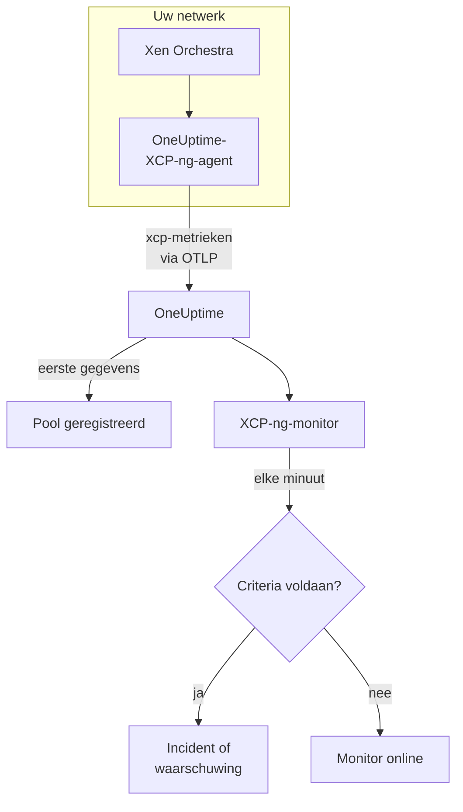

# XCP-ng-monitor

Een XCP-ng-monitor bewaakt één XCP-ng-pool – zijn hosts, VM's, opslagrepository's en virtuele schijven – en laat u weten wanneer Xen Orchestra de pool kwijtraakt, een host offline gaat of uitgeschakeld blijft, een VM die draaide stopt of te weinig CPU krijgt, of een opslagrepository volloopt of traag wordt. Hij leest de reeksen `xcp_*` van de OpenMetrics-plug-in van Xen Orchestra, die de OneUptime-XCP-ng-agent verzamelt, en de gezondheidsreeksen die OneUptime ervan afleidt, dus er wordt niets van buitenaf gepeild.

:::cards
- [De monitor maken](#een-xcp-ng-monitor-maken): Zes stappen in het dashboard.
- [Sjablonen](#kant-en-klare-waarschuwingssjablonen): Tien kant-en-klare waarschuwingen, één incident per host, VM of opslagrepository.
- [Resource-identiteit](#resource-identiteit): Hoe u één host, VM of opslagrepository target.
- [Metrieken](#verzamelde-metrieken): Elke reeks waarop de monitor kan waarschuwen.
:::

## Hoe het werkt

De OneUptime-XCP-ng-agent draait op een machine die Xen Orchestra kan bereiken. Elke 60 seconden leest hij de OpenMetrics-plug-in van Xen Orchestra uit, die elke host leest van elke pool die Xen Orchestra beheert, en stuurt hij de reeksen via OTLP naar OneUptime, één resource per pool, voorzien van de UUID van de pool, `xcp_ng.pool.id`. De eerste gegevens registreren elke pool.

Een XCP-ng-monitor is aan één pool gebonden. Elke minuut voert hij zijn query uit over de metrieken van die pool en vergelijkt hij het resultaat met zijn criteria.



## Voordat u begint

- **Installeer de XCP-ng-agent** op een plek waar hij Xen Orchestra bereikt, met het geheim van de OpenMetrics-plug-in van Xen Orchestra. De [handleiding voor de XCP-ng-agent](/docs/telemetry/xcp-ng) behandelt de plug-in, het certificaat van Xen Orchestra en de installatie.
- **Controleer of de pool is geregistreerd.** Hij verschijnt ongeveer een minuut na de eerste uitlezing onder **Producten → Infrastructuur → XCP-ng → Alle pools**, genoemd zoals Xen Orchestra hem noemt.

## Een XCP-ng-monitor maken

:::steps
### Een nieuwe monitor beginnen

Ga naar **Monitoren** en klik op **Monitor maken**.

### XCP-ng kiezen

Klik onder **Monitortype** op **Meer monitortypen** en kies **XCP-ng** onder **Infrastructuur**, of typ `xcp` in het zoekvak. Vul een **Naam** in – die wordt gebruikt in de titels van incidenten en waarschuwingen – en klik op **Volgende**.

### De pool kiezen

Kies onder **XCP-ng Monitor Configuration** de pool in **XCP-ng-pool**. Elke pool die gegevens heeft verstuurd, staat in de lijst. Na de keuze toont een regel onder het veld of er gegevens binnenkomen. **XCP-ng-pool toevoegen** opent installatiestappen met uw sleutels al ingevuld, die op de eerste gegevens wachten.

### Kiezen wat u bewaakt

Een nieuwe monitor begint met **Pool Disconnected**, onder **Waarover te waarschuwen**. Om iets anders te bewaken:

- **Wijzigen** – kies een ander [sjabloon](#kant-en-klare-waarschuwingssjablonen). Het stelt de metrieken, filters, de aggregatie, het tijdsbereik en de drempels in, en vervangt de criteria hieronder door die van het sjabloon. Het **Tijdsbereik** kunt u nog wijzigen.
- **Custom Metric** (onder **Meer velden**) – kies één metriek in **XCP-ng Metric** en stel dan **Aggregatie** en **Tijdsbereik** in. De [filters](#monitorinstellingen) beperken hem tot een soort object of tot één object.
- **Geavanceerd** (onder **Meer velden**) – bouw zelf query's en formules onder **Selecteer metrieken**, bijvoorbeeld het gebruikte aandeel van een opslagrepository uit `xcp_sr_physical_usage_bytes / xcp_sr_physical_size_bytes`. Gebruik **Groeperen op** `xcp_ng.id` om elk object afzonderlijk te beoordelen.

### De criteria controleren

Open elk criterium onder **Criteria** en controleer de **Metriek**, **Aggregatie**, **Voorwaarde** en **Drempel**. Een sjabloon vult deze in. Met **Custom Metric** of **Geavanceerd** begint de monitor met de [standaardcriteria](#standaardcriteria), die alleen opmerken dat de metriek geen gegevens stuurt; stel daarom uw eigen drempel in.

### De monitor maken

Klik op **Monitor maken**. OneUptime opent de pagina van de monitor en evalueert hem elke minuut. Incidenten en waarschuwingen die hij opent, staan ook op de pagina's **Incidenten** en **Waarschuwingen** van de pool.
:::

> [!TIP]
> Om meerdere sjablonen tegelijk in te stellen, opent u de pool via **Producten → Infrastructuur → XCP-ng** en gaat u naar **Aanbevelingen**. Kies de sjablonen die u wilt en wie wordt opgeroepen, en OneUptime maakt één monitor per sjabloon.

## Monitorinstellingen

| Veld | Tabblad | Wat het doet |
| --- | --- | --- |
| **XCP-ng-pool** | Alle | Verplicht. Beperkt elke query tot `resource.xcp_ng.pool.id`, de UUID van de pool, zodat twee pools met dezelfde naam nooit door elkaar lopen. |
| **Resourcebereik** | Custom Metric, Geavanceerd | Optioneel. **Host**, **VM**, **Opslagrepository**, **Virtuele schijf**, **XOSTOR** of **XCP-ng-pool** – een exacte overeenkomst met `xcp_ng.scope`. |
| **UUID** | Custom Metric, Geavanceerd | Optioneel. Exacte overeenkomst met `xcp_ng.id`: de UUID van één host, VM, opslagrepository of virtuele schijf, zoals Xen Orchestra hem toont. Combineer het met een bereik om één object te targeten. |
| **Naam van de host** | Custom Metric, Geavanceerd | Optioneel. Exacte overeenkomst met het label `host_name` van Xen Orchestra: de eigen reeksen van de host en die van de VM's die erop draaien. |
| **XCP-ng Metric** | Custom Metric | Eén metriek uit de [catalogus](#verzamelde-metrieken). |
| **Aggregatie** | Custom Metric | Hoe metingen worden gecombineerd: **Gemiddelde**, **Maximum**, **Minimum**, **Som** of **Aantal**. Begint bij de gebruikelijke aggregatie van de metriek. |
| **Tijdsbereik** | Alle | Het schuivende venster dat de query leest, van **Past 1 Minute** tot **Past 365 Days**. Een nieuwe monitor begint bij **Past 1 Minute**; sjablonen stellen hun eigen in. |
| **Selecteer metrieken** | Geavanceerd | De querybouwer: **Metriek**, **Aggregeren op**, **Filteren op attributen**, **Groeperen op**, plus **Metriek toevoegen** en **Formule toevoegen** om query's te combineren. |

De agent leest Xen Orchestra elke 60 seconden uit, en Xen Orchestra leest zijn hosts met een resolutie van 60 seconden, dus een venster van 1 minuut bevat ongeveer één meting; de sjablonen lezen 5 minuten of meer.

## Resource-identiteit

Xen Orchestra noemt een host of een VM via zijn label `uuid`, een opslagrepository via `sr_uuid` en een virtuele schijf via `vdi_uuid`. OneUptime zet bij aankomst twee attributen op elk datapunt, zodat één filter elke reeks van een object leest, welk label het ook noemde. De sjablonen steunen erop:

| Attribuut | Waarden | Voor een VM |
| --- | --- | --- |
| `xcp_ng.scope` | `pool`, `host`, `vm`, `sr` (een opslagrepository), `vdi` (een virtuele schijf), `xostor` | `vm` |
| `xcp_ng.id` | De UUID van het object, in kleine letters: de `uuid` van een host of VM, de `sr_uuid` van een opslagrepository of een XOSTOR-cluster, de `vdi_uuid` van een virtuele schijf, en de eigen UUID van de pool op de reeksen van de pool | `5c6d7e8f-1a2b-4c3d-9e8f-0a1b2c3d4e5f` |

Filter op `xcp_ng.scope` voor één soort object, op `xcp_ng.id` voor één object, en groepeer op `xcp_ng.id` om elk object afzonderlijk te beoordelen. De eigen labels van Xen Orchestra blijven zoals het ze verstuurt: `host_name` noemt een host op zijn reeksen en de host van een VM op die van de VM, `vm_name`, `sr_name` en `vdi_name` noemen de rest, `power_state` en `enabled` dragen de status van een host of een VM op de statusreeksen, en `is_control_domain` is `true` op de VM-reeksen van een controledomein.

De pool zelf is de resource waarop de reeksen binnenkomen, dus zijn attributen krijgen in filters en groeperingssleutels het voorvoegsel `resource.`: `resource.xcp_ng.pool.id` (zijn UUID), `resource.xcp_ng.pool.name` (zijn naam in Xen Orchestra) en `resource.xen_orchestra.name` (de Xen Orchestra waaruit hij gelezen wordt).

## Kant-en-klare waarschuwingssjablonen

De lijst onder **Waarover te waarschuwen** biedt 12 sjablonen. Elk bouwt een complete monitor – query's, attribuutfilters, een groepering, een criterium dat afgaat en een dat herstelt. De meeste groeperen op `xcp_ng.id`, zodat elke host, VM of opslagrepository een eigen incident en een eigen waarschuwing krijgt. De drempels zijn uitgangspunten die u kunt aanpassen.

Een criterium gaat alleen af als de voorwaarde elke minuut van zijn venster geldt, en een drempelcriterium herstelt 10% voorbij zijn drempel, zodat een waarde die rond de grens schommelt niet heen en weer springt. Een 0/1-reeks herstelt op de andere waarde.

| Sjabloon | Categorie | Ernst | Bewaakt | Gaat af als | Herstelt als |
| --- | --- | --- | --- | --- | --- |
| Pool Disconnected | Beschikbaarheid | Kritiek | `xcp_pool_connected`, Count over de hele pool, laatste 10 minuten | Geen gegevens gedurende het hele venster | Er komen weer gegevens binnen |
| Host Offline | Beschikbaarheid | Kritiek | `xcp_ng.host.running` voor `xcp_ng.scope = host`, Min per `xcp_ng.id`, laatste 5 minuten | Onder 1 | Op 1 |
| HA Cannot Tolerate a Host Failure | Beschikbaarheid | Kritiek | `xcp_ng.pool.ha.can_tolerate_host_failure` voor `xcp_ng.scope = pool`, Max over de hele pool, laatste 5 minuten | Onder 1 | Op 1 |
| VM Stopped | VM | Waarschuwing | `xcp_ng.vm.stopped_after_running` voor `xcp_ng.scope = vm`, Min per `xcp_ng.id`, laatste 5 minuten | Boven 0 | Op 0 |
| VM Not Backed Up | VM | Waarschuwing | `xcp_ng.vm.backup_overdue` voor `xcp_ng.scope = vm`, Min per `xcp_ng.id`, laatste 10 minuten | Boven 0 | Op 0 |
| Storage Repository Near Full | Opslag | Kritiek | `xcp_sr_physical_usage_bytes` ÷ `xcp_sr_physical_size_bytes` × 100 voor `xcp_ng.scope = sr` (beide Som), per `xcp_ng.id`, laatste 5 minuten | Boven 90% | Op of onder 81% |
| Host Disabled | Host | Waarschuwing | `xcp_ng.host.enabled` voor `xcp_ng.scope = host`, Max per `xcp_ng.id`, laatste 30 minuten | Onder 1 | Op 1 |
| Host Restarted | Host | Waarschuwing | `xcp_host_uptime_seconds` en `xcp_ng.host.running` voor `xcp_ng.scope = host`, Min per `xcp_ng.id`, laatste 5 minuten | `xcp_host_uptime_seconds` ligt onder 900 (15 minuten) terwijl `xcp_ng.host.running` 1 is | `xcp_host_uptime_seconds` staat op 990 of meer, of `xcp_ng.host.running` is 0 |
| High Host CPU Usage | Host | Waarschuwing | `xcp_host_cpu_average` voor `xcp_ng.scope = host`, Avg per `xcp_ng.id`, laatste 10 minuten | Boven 0,9 (90% van de CPU van de host) | Op of onder 0,81 |
| High Host Memory Usage | Host | Waarschuwing | (`xcp_host_memory_total_bytes` − `xcp_host_memory_free_bytes`) ÷ `xcp_host_memory_total_bytes` × 100 voor `xcp_ng.scope = host` (beide Som), per `xcp_ng.id`, laatste 10 minuten | Boven 95% | Op of onder 85,5% |
| VM Starved of CPU | VM | Waarschuwing | `xcp_vm_runstate_full_contention` voor `xcp_ng.scope = vm`, Avg per `xcp_ng.id`, laatste 15 minuten | Boven 0,1 (10% van de tijd) | Op of onder 0,09 |
| Storage Repository Slow | Opslag | Waarschuwing | `xcp_host_disk_latency_seconds` voor `xcp_ng.scope = host`, Avg per `sr`, laatste 15 minuten | Boven 0,05 (50 ms) | Op of onder 0,045 |

**Ernst** is het label dat de keuzelijst toont. Het incident en de waarschuwing die een sjabloon maakt, beginnen op het zwaarste incident- en waarschuwingsernstniveau van uw project; wijzig ze in de criteria.

- **Pool Disconnected** gaat af als `xcp_pool_connected` tien minuten lang niet meer binnenkomt. Xen Orchestra verstuurt de reeks bij elke uitlezing zolang het met de pool verbonden is, en stopt ermee, in plaats van 0 te sturen, wanneer het de master van de pool kwijtraakt; ze stopt ook wanneer Xen Orchestra, zijn plug-in of de XCP-ng-agent stopt, of de agent zijn route naar OneUptime kwijtraakt. Het wordt opgelost zodra de reeks terugkomt. Als er geen gegevens meer komen, hebben de andere sjablonen niets om te vergelijken en houden ze hun laatste status, dus dit sjabloon is het dat het u laat weten.
- **Host Offline** leest `xcp_ng.host.running`, dat OneUptime afleidt uit `xcp_host_status`: 0 zolang Xen Orchestra de host als Halted meldt, of zijn status als Unknown omdat de pool-master het contact ermee verloor. De VM's die op de host draaiden, liggen ook plat, tenzij HA ze elders herstartte.
- **HA Cannot Tolerate a Host Failure** leest `xcp_ng.pool.ha.can_tolerate_host_failure`. Rechtstreeks uit XAPI gelezen is dat het eigen plan van HA: overboekt, of het dekt minder hostuitvallen dan HA moet verdragen. Via Xen Orchestra gelezen, waarvan de REST-API het plan niet meldt, zijn er minder dan twee hosts die draaien en ingeschakeld zijn om VM's op te herstarten, dus één host uitschakelen in een HA-pool van twee hosts is al genoeg. Zolang HA uit staat, gaat hij nooit af.
- **VM Stopped** leest `xcp_ng.vm.stopped_after_running`: 1 zolang een VM die de afgelopen 24 uur draaide, Halted of Paused is. Een VM die meer dan een dag uit staat, telt als bewust uitgezet en waarschuwt niet meer, een geschorste VM waarschuwt nooit, en controledomeinen en VM-sjablonen blijven buiten beschouwing.
- **VM Not Backed Up** leest `xcp_ng.vm.backup_overdue`, uit de back-uplogboeken van Xen Orchestra: 1 zolang een VM die een geplande back-uptaak omvat binnen zijn interval, de langste tussenpoos tussen twee runs van de schema's van zijn taken, plus een kwart daarvan, minstens een uur, geen geslaagde back-up heeft gehad. De VM van een nachtelijke taak laat hem na 30 uur afgaan, en een VM die geen geplande taak omvat nooit.
- **Host Disabled** gaat af voor een host die 30 minuten uitgeschakeld blijft: in onderhoudsmodus, of uitgeschakeld achtergelaten door een evacuatie. XAPI start er geen VM op en HA kan er niet naar uitwijken. Dertig minuten laten een geplande herstart of update passeren zonder iemand op te roepen.
- **Host Restarted** gaat af voor een host die draait, maar nog geen 15 minuten: hij is herstart, of hij is gecrasht en teruggekomen. Het wordt opgelost zodra de host 16,5 minuten draait, 10% voorbij de drempel; een host die uitgevallen is, laat in plaats daarvan **Host Offline** afgaan.
- **Verhoudingsformules** nemen aan beide kanten de **Som**. Beide komen uit dezelfde uitlezing, dus het resultaat is een echt percentage. Een opslagrepository die een grootte van 0 meldt, zoals sommige ISO-bibliotheken en verwisselbare media doen, gaat nooit af.
- **VM Starved of CPU** leest de volledige concurrentie: het aandeel van de tijd waarin alle vCPU's van een VM klaar waren om te draaien, maar op een fysieke CPU wachtten. Zijn host heeft meer uitvoerbare vCPU's dan CPU-threads, dus de VM draait trager dan zijn eigen CPU-gebruik doet vermoeden.
- **Storage Repository Slow** groepeert op `sr`, de korte id van Xen Orchestra voor een opslagrepository op elke schijfreeks van een host, zodat elke opslagrepository één incident krijgt, met zijn latentie gemiddeld over de hosts die erop lezen en schrijven.

**HA Cannot Tolerate a Host Failure** en **VM Not Backed Up** lezen reeksen die het lezen van de pool door een sonde toevoegt, dus ze hebben een pool nodig die vanuit een sonde is gekoppeld: de plugin die de XCP-ng-agent leest, meldt geen HA-status en geen back-ups. Een pool die een sonde leest, kan ook waarschuwen bij zijn XAPI-berichten en alarmen, zoals een gecrashte VM of een host die HA is kwijtgeraakt, en bij mislukte back-uptaken: zet die sjablonen aan vanuit de **Aanbevelingen** van de pool, zoals [XCP-ng zonder agent](/docs/telemetry/xcp-ng-agentless) uitlegt.

## Verzamelde metrieken

De agent leest elke reeks van de OpenMetrics-plug-in van Xen Orchestra elke 60 seconden; de reeksen hieronder zijn de catalogus die het monitorformulier aanbiedt. Xen Orchestra zet de KiB, MiB/s en microseconden van XAPI al om in bytes, bytes per seconde en seconden. Acht reeksen die het `_total` noemt en als tellers typeert, bevatten snelheden per seconde, en OneUptime slaat ze op als de snelheden die ze zijn, zoals de [handleiding voor de XCP-ng-agent](/docs/telemetry/xcp-ng#wat-de-agent-verzamelt) uitlegt. De reeksen `xcp_ng.*` zijn van OneUptime zelf: vier bij aankomst afgeleid uit de statusreeksen van Xen Orchestra en zes uit wat een sonde naast de metrieken leest, die een pool die alleen de XCP-ng-agent leest niet heeft.

### Beschikbaarheid

| Metriek | Eenheid | Beschrijving |
| --- | --- | --- |
| `xcp_pool_connected` | — | 1 zolang Xen Orchestra met de pool verbonden is. Xen Orchestra stopt met het versturen ervan wanneer het de pool kwijtraakt, in plaats van 0 te sturen: let erop dat hij stopt. |
| `xcp_ng.host.running` | — | 1 zolang Xen Orchestra een host als Running meldt, 0 zolang hij Halted is of zijn status Unknown. Door OneUptime afgeleid uit de status van de host. |
| `xcp_ng.host.enabled` | — | 1 zolang een host ingeschakeld is, 0 zolang hij in onderhoudsmodus staat of geëvacueerd wordt, wanneer XAPI er geen VM op start. Door OneUptime afgeleid uit de status van de host. |
| `xcp_ng.vm.running` | — | 1 zolang een VM Running is, 0 zolang hij Halted, Paused of Suspended is. Controledomeinen blijven buiten beschouwing. Door OneUptime afgeleid uit de status van de VM. |
| `xcp_ng.vm.stopped_after_running` | — | 1 zolang een VM die de afgelopen 24 uur draaide, Halted of Paused is, anders 0. Een VM die niemand een dag lang zag draaien, telt als bewust uitgezet, en een geschorste VM telt nooit mee. Door OneUptime afgeleid. |
| `xcp_ng.pool.ha.enabled` | — | 1 zolang de hoge beschikbaarheid van de pool aan staat, anders 0. Gelezen door een sonde via de REST-API van Xen Orchestra of rechtstreeks uit XAPI; de XCP-ng-agent leest het niet. |
| `xcp_ng.pool.ha.can_tolerate_host_failure` | — | Zolang HA aan staat: 1 zolang het een hostuitval nog kan doorstaan, 0 zodra niet meer. Rechtstreeks uit XAPI is het het eigen plan van HA; via Xen Orchestra, dat het plan niet meldt, of er naast de uitvallende host een andere actieve en ingeschakelde host is. Door OneUptime afgeleid. |
| `xcp_ng.pool.ha.host_failures_to_tolerate` | — | Hoeveel hostuitvallen HA moet verdragen. Alleen rechtstreeks uit XAPI gelezen: de REST-API van Xen Orchestra meldt het niet. |
| `xcp_ng.pool.ha.plan_exists_for` | — | Hoeveel hostuitvallen het HA-plan nog kan doorstaan als elke beschermde VM opnieuw wordt gestart. Alleen rechtstreeks uit XAPI gelezen. |
| `xcp_host_status` | count | Altijd 1 voor elke host, draaiend of niet; de status van de host staat in de labels `power_state` (Running, Halted, Unknown) en `enabled`. |
| `xcp_vm_status` | count | Altijd 1 voor elke VM behalve controledomeinen en VM-sjablonen; de status van de VM staat in het label `power_state` (Running, Halted, Paused, Suspended). |
| `xcp_host_uptime_seconds` | seconds | Hoe lang een host draait sinds hij is opgestart. |
| `xcp_vm_uptime_seconds` | seconds | Hoe lang een draaiende VM draait sinds hij is gestart. Alleen gemeld zolang de VM draait. |

### Host

| Metriek | Eenheid | Beschrijving |
| --- | --- | --- |
| `xcp_ng.host.missing_patches` | — | Hoeveel patches een host mist, zoals Xen Orchestra ze het laatst opsomde (elke zes uur gecontroleerd). |
| `xcp_host_cpu_average` | ratio | Het CPU-gebruik van een host, gemiddeld over zijn kernen, als verhouding van 0 tot 1. |
| `xcp_host_cpu_core_usage` | ratio | Het gebruik van één CPU-thread op een host, als verhouding van 0 tot 1; het label `core` zegt welke. |
| `xcp_host_load` | — | De vCPU's die op een host draaien of wachten om te draaien, per fysieke CPU. Boven 1 wachten VM's op een CPU. |
| `xcp_host_load_average` | — | Het load average van het controledomein (dom0) van een host. |
| `xcp_host_memory_total_bytes` | bytes | Het fysieke geheugen van een host. |
| `xcp_host_memory_free_bytes` | bytes | Het geheugen van een host dat aan geen enkele VM is gegeven. Vergelijk het met `xcp_host_memory_total_bytes` om te zien hoe vol de host is. |
| `xcp_host_memory_reclaimed_bytes` | bytes | Geheugen dat dynamisch geheugenbeheer van de VM's van een host heeft teruggewonnen. |
| `xcp_host_memory_reclaimed_max_bytes` | bytes | Het meeste geheugen dat dynamisch geheugenbeheer van de VM's van een host kon terugwinnen. |
| `xcp_host_running_vcpus` | count | De vCPU's van de VM's die op een host draaien, opgeteld. |
| `xcp_host_power_consumption_watts` | W | Het stroomverbruik van een host, gelezen van zijn DCMI-sensor. Waar Xen Orchestra het in plaats daarvan via IPMI leest, verstuurt het die meting zonder zijn pool, dus de agent bewaart haar niet; het geschatte aandeel van elke VM erin blijft bewaard. |

### VM

| Metriek | Eenheid | Beschrijving |
| --- | --- | --- |
| `xcp_ng.vm.backup_overdue` | — | Voor een VM in een geplande back-uptaak van Xen Orchestra: 1 zolang hij binnen het interval van zijn taken plus een kwart daarvan (minstens een uur) geen geslaagde back-up heeft gehad, anders 0. Door OneUptime afgeleid uit de back-uplogboeken. |
| `xcp_vm_cpu_usage` | ratio | Het CPU-gebruik van een VM, gemiddeld over zijn vCPU's, als verhouding van 0 tot 1. |
| `xcp_vm_cpu_core_usage` | ratio | Het gebruik van één vCPU, als verhouding van 0 tot 1; het label `core` zegt welke. |
| `xcp_vm_runstate_full_contention` | ratio | Het aandeel van de tijd waarin alle vCPU's van een VM klaar waren om te draaien, maar op een fysieke CPU wachtten, van 0 tot 1. Een hoge waarde betekent dat de VM door zijn buren te weinig CPU krijgt. |
| `xcp_vm_runstate_partial_contention` | ratio | Het aandeel van de tijd waarin een deel van de vCPU's van een VM op een fysieke CPU wachtte terwijl de rest geblokkeerd was, van 0 tot 1. |
| `xcp_vm_runstate_concurrency_hazard` | ratio | Het aandeel van de tijd waarin een deel van de vCPU's van een VM draaide terwijl andere op een fysieke CPU wachtten, van 0 tot 1. |
| `xcp_vm_runstate_fullrun` | ratio | Het aandeel van de tijd waarin alle vCPU's van een VM draaiden, van 0 tot 1. |
| `xcp_vm_runstate_partial_run` | ratio | Het aandeel van de tijd waarin een deel van de vCPU's van een VM draaide en de rest geblokkeerd was, van 0 tot 1. |
| `xcp_vm_runstate_blocked` | ratio | Het aandeel van de tijd waarin alle vCPU's van een VM geblokkeerd waren, zonder werk of wachtend op I/O, van 0 tot 1. |
| `xcp_vm_memory_bytes` | bytes | Het geheugen dat een VM heeft gekregen. |
| `xcp_vm_memory_target_bytes` | bytes | Het geheugen dat dynamisch geheugenbeheer een VM wil geven. |
| `xcp_vm_memory_internal_free_bytes` | bytes | Het geheugen dat de gast als vrij meldt. Vereist de gasttools in de VM. |
| `xcp_vm_power_consumption_watts` | W | De schatting van Xen Orchestra van het aandeel van een VM in het stroomverbruik van zijn host, verdeeld naar CPU-belasting. Zijn label `data_complete` is `false` wanneer de CPU-meting van de VM ontbrak. |

### Opslag

| Metriek | Eenheid | Beschrijving |
| --- | --- | --- |
| `xcp_sr_physical_size_bytes` | bytes | De fysieke grootte van een opslagrepository. Sommige ISO-bibliotheken en verwisselbare media melden 0. |
| `xcp_sr_physical_usage_bytes` | bytes | De gebruikte ruimte op een opslagrepository. Deel haar door de grootte om te zien hoe vol hij is. |
| `xcp_sr_virtual_size_bytes` | bytes | De virtuele grootte van elke schijf op een opslagrepository, opgeteld. Ligt die boven zijn grootte, dan is de repository via thin provisioning verder toegewezen dan hij kan bevatten. |
| `xcp_vdi_virtual_size_bytes` | bytes | De grootte van een virtuele schijf zoals zijn VM hem ziet. |
| `xcp_vdi_physical_usage_bytes` | bytes | De ruimte die een virtuele schijf op zijn opslagrepository inneemt. |
| `xcp_host_disk_iops_read` | ops/s | Leesbewerkingen per seconde van een host naar een opslagrepository; het label `sr_name` zegt welke. |
| `xcp_host_disk_iops_write` | ops/s | Schrijfbewerkingen per seconde van een host naar een opslagrepository. |
| `xcp_host_disk_iops_total` | ops/s | Lees- en schrijfbewerkingen per seconde van een host naar een opslagrepository. |
| `xcp_host_disk_throughput_read_bytes` | bytes/s | Bytes per seconde die een host van een opslagrepository leest. |
| `xcp_host_disk_throughput_write_bytes` | bytes/s | Bytes per seconde die een host naar een opslagrepository schrijft. |
| `xcp_host_disk_throughput_total_bytes` | bytes/s | Bytes per seconde die een host van een opslagrepository leest en ernaar schrijft. |
| `xcp_host_disk_read_latency_seconds` | seconds | Hoe lang de leesbewerkingen van een host op een opslagrepository duren. |
| `xcp_host_disk_write_latency_seconds` | seconds | Hoe lang de schrijfbewerkingen van een host op een opslagrepository duren. |
| `xcp_host_disk_latency_seconds` | seconds | Hoe lang de lees- en schrijfbewerkingen van een host op een opslagrepository duren. |
| `xcp_host_disk_iowait` | ratio | Het aandeel van de tijd waarin een host op een opslagrepository wachtte, van 0 tot 1. |
| `xcp_vm_disk_read_bytes_total` | bytes/s | Bytes per seconde die een VM van een van zijn schijven leest; het label `device` zegt welke. Een snelheid, hoewel Xen Orchestra haar `_total` noemt en als teller typeert. |
| `xcp_vm_disk_write_bytes_total` | bytes/s | Bytes per seconde die een VM naar een van zijn schijven schrijft. Een snelheid, hoewel Xen Orchestra haar `_total` noemt en als teller typeert. |
| `xcp_vm_disk_iops_read` | ops/s | Leesbewerkingen per seconde op een schijf van een VM. |
| `xcp_vm_disk_iops_write` | ops/s | Schrijfbewerkingen per seconde op een schijf van een VM. |
| `xcp_vm_disk_iops_total` | ops/s | Lees- en schrijfbewerkingen per seconde op een schijf van een VM. |
| `xcp_vm_disk_throughput_read_bytes` | bytes/s | Bytes per seconde gelezen van een schijf van een VM. |
| `xcp_vm_disk_throughput_write_bytes` | bytes/s | Bytes per seconde geschreven naar een schijf van een VM. |
| `xcp_vm_disk_throughput_total_bytes` | bytes/s | Bytes per seconde gelezen van en geschreven naar een schijf van een VM. |
| `xcp_vm_disk_read_latency_seconds` | seconds | Hoe lang leesbewerkingen van een schijf van een VM duren. |
| `xcp_vm_disk_write_latency_seconds` | seconds | Hoe lang schrijfbewerkingen naar een schijf van een VM duren. |
| `xcp_vm_disk_latency_seconds` | seconds | Hoe lang lees- en schrijfbewerkingen op een schijf van een VM gemiddeld duren. |
| `xcp_vm_disk_iowait` | ratio | Het aandeel van de tijd waarin een VM op een van zijn schijven wachtte, van 0 tot 1. |
| `xcp_vm_disk_inflight` | count | De verzoeken op een schijf van een VM die nog niet beantwoord zijn. |
| `xcp_vm_disk_queue_size` | count | De gemiddelde wachtrij van verzoeken op een schijf van een VM. |

### Netwerk

| Metriek | Eenheid | Beschrijving |
| --- | --- | --- |
| `xcp_host_network_receive_bytes_total` | bytes/s | Bytes per seconde die een host op één fysieke interface ontvangt; het label `interface` zegt welke. Een snelheid, hoewel Xen Orchestra haar `_total` noemt en als teller typeert. |
| `xcp_host_network_transmit_bytes_total` | bytes/s | Bytes per seconde die een host op één fysieke interface verstuurt. Een snelheid, hoewel Xen Orchestra haar `_total` noemt en als teller typeert. |
| `xcp_host_network_aggregated_receive_bytes` | bytes/s | Bytes per seconde die een host op al zijn fysieke interfaces ontvangt. |
| `xcp_host_network_aggregated_transmit_bytes` | bytes/s | Bytes per seconde die een host op al zijn fysieke interfaces verstuurt. |
| `xcp_vm_network_receive_bytes_total` | bytes/s | Bytes per seconde die een VM op een van zijn netwerkinterfaces ontvangt; het label `vif` zegt welke. Een snelheid, hoewel Xen Orchestra haar `_total` noemt en als teller typeert. |
| `xcp_vm_network_transmit_bytes_total` | bytes/s | Bytes per seconde die een VM op een van zijn netwerkinterfaces verstuurt. Een snelheid, hoewel Xen Orchestra haar `_total` noemt en als teller typeert. |
| `xcp_vm_network_receive_errors_total` | errors/s | Ontvangstfouten per seconde op een van de netwerkinterfaces van een VM. Een snelheid, hoewel Xen Orchestra haar als teller typeert. |
| `xcp_vm_network_transmit_errors_total` | errors/s | Verzendfouten per seconde op een van de netwerkinterfaces van een VM. Een snelheid, hoewel Xen Orchestra haar als teller typeert. |

### XOSTOR

Alleen verstuurd voor pools die XOSTOR draaien, de gerepliceerde opslag van Vates op basis van LINSTOR.

| Metriek | Eenheid | Beschrijving |
| --- | --- | --- |
| `xcp_xostor_up` | — | 1 wanneer Xen Orchestra de gezondheid van een XOSTOR-cluster kon lezen, 0 wanneer dat niet lukte. |
| `xcp_xostor_node_status` | count | Altijd 1 voor elke node van een XOSTOR-cluster; zijn rol en status staan in de labels `role` en `state`. |
| `xcp_xostor_resource_total` | count | De LINSTOR-resources die een XOSTOR-cluster definieert. |
| `xcp_xostor_resource_state_count` | count | De resourcereplica's van een XOSTOR-cluster in elke schijfstatus; het label `state` zegt welke. |
| `xcp_xostor_alarms_up` | — | 1 wanneer Xen Orchestra de alarmen van een XOSTOR-cluster kon lezen, 0 wanneer dat niet lukte. |
| `xcp_xostor_alarms_count` | count | Actieve XAPI-alarmen op een XOSTOR-opslagrepository of zijn hosts, per `alarm_name` en `target_type`. Afwezig als er geen is. |
| `xcp_xostor_smart_up` | — | 1 wanneer Xen Orchestra de SMART-gegevens van een host voor XOSTOR kon lezen, 0 wanneer dat niet lukte. |
| `xcp_xostor_disk_smart_status` | count | Altijd 1 voor elke schijf van een XOSTOR-host; zijn SMART-gezondheid staat in het label `status`. |
| `xcp_xostor_updates_up` | — | 1 wanneer de XOSTOR-updatecontrole van een host antwoordde, 0 wanneer die mislukte. |
| `xcp_xostor_package_update_available` | count | 1 voor elk XOSTOR-pakket waarvoor een update op een host klaarstaat; het label `package` zegt welk. |

## Bewakingscriteria

Een criterium vergelijkt een van de query's of formules van de monitor met een drempel. De criteria van een XCP-ng-monitor hebben geen **Filtertype**: elke regel controleert de metriekwaarde, met deze velden.

| Veld | Wat het doet |
| --- | --- |
| **Metriek** | De query of formule die wordt gecontroleerd, op naam van de variabele. |
| **Aggregatie** | Hoe de waarden in het venster één antwoord worden: **Gemiddelde**, **Som**, **Maximale waarde**, **Minimale waarde**, **Alle waarden** (elke waarde moet overeenkomen, over het hele venster) of **Willekeurige waarde** (één is genoeg). |
| **Voorwaarde** | **Groter dan**, **Kleiner dan**, **Groter dan of gelijk aan**, **Kleiner dan of gelijk aan**, **Gelijk aan** of **Niet gelijk aan** – of een anomalievoorwaarde: **Afwijkend hoog**, **Afwijkend laag** of **Afwijkend**. **Geen gegevens** klopt als de query in het venster niets opleverde, **Gegevens aanwezig** als hij iets opleverde. **Verwacht boven** en **Verwacht onder** komen overeen wanneer de trend van de metriek in het venster aan het eind van **Termijn** voorbij de drempel is. |
| **Drempel** | De waarde waarmee wordt vergeleken. Ernaast staat een lijst met eenheden als de metriek een eenheid heeft. Niet getoond bij anomalievoorwaarden. |
| **Gevoeligheid** | Alleen bij anomalievoorwaarden. **Laag** (4σ), **Gemiddeld** (3σ, de standaard) of **Hoog** (2σ). |
| **Baseline-venster** | Alleen bij anomalievoorwaarden. 14 dagen (de standaard), 28, 60 of 90 dagen geschiedenis. |
| **Als geen gegevens** | Onder **Meer velden**. Wat er gebeurt als het venster geen metingen bevat: **Ignore** (de standaard), **Treat As Zero** of **Trigger**. |

Anomalievoorwaarden vergelijken elke waarde met hetzelfde uur van de week in de baseline. Ze blijven in een "Learning"-status, en geven niets, tot het baseline-venster genoeg geschiedenis bevat. Deze monitor filtert zijn query's op attributen, dus elke query, en elke reeks van een gegroepeerde query, wordt vergeleken met zijn eigen geschiedenis, zo ver terug als de metrics worden bewaard. Is dat minder dan twee weken, dan blijft een som, een telling of een query op een histogram voorgoed in die toestand, en wordt al het andere vergeleken met alle reeksen van de metric. Een percentiel van een histogram blijft altijd in die toestand.

Elk criterium zegt ook wat er moet gebeuren als het overeenkomt: de monitorstatus wijzigen, een waarschuwing maken of een incident melden. Criteria worden van boven naar beneden gecontroleerd, en het eerste dat overeenkomt, beslist.

### Standaardcriteria

Een monitor die u niet vanuit een sjabloon maakt, begint met twee criteria:

| Volgorde | Criterium | Komt overeen als | Dan |
| --- | --- | --- | --- |
| 1 | Controleer of _monitornaam_ offline is | De eerste query heeft in het hele venster geen gegevens | Markeert de monitor als **Offline** en meldt het incident "_monitornaam_ is offline", dat zichzelf oplost als de monitor herstelt. |
| 2 | Controleer of _monitornaam_ online is | De eerste query heeft gegevens | Markeert de monitor als **Operationeel**. |

> [!IMPORTANT]
> Een waarde van `0` is ook data: een metric die vaak nul is, zoals de netwerkfouten van een VM, zet de monitor niet offline. Wilt u een melding bij een waarde, begin dan met een sjabloon of voeg een criterium met een drempel toe. Komt er helemaal geen data binnen en past geen enkel criterium, dan houdt de monitor zijn status en blijven open incidenten open: stilte is geen herstel. Tijd waarin OneUptime zelf geen data ontving, telt nooit als geen data: een controle waarvan het venster zulke tijd bevat, wacht in plaats daarvan, zoals [Als OneUptime geen gegevens ontvangt](/docs/monitor/when-oneuptime-is-not-receiving) uitlegt.

## Terraform

De [Terraform-provider van OneUptime](/docs/terraform/monitor-steps) draagt de configuratie van een stap van een XCP-ng-monitor in het attribuut `xcp_ng_monitor`: de ruwe JSON van de configuratie `xcpNgMonitor` (`poolIdentifier`, `resourceFilters`, `metricViewConfig`, `rollingTime`), geschreven met `jsonencode()`:

```hcl title="main.tf"
monitor_steps = [{
  xcp_ng_monitor = jsonencode({
    poolIdentifier  = "b7569d99-30f8-178a-7d94-801de3e29b5b"
    resourceFilters = { scope = "host" }
    rollingTime     = "Past 10 Minutes"
    metricViewConfig = {
      queryConfigs = [{
        metricAliasData = { metricVariable = "host_cpu", title = "Host CPU", description = "", legend = "" }
        metricQueryData = {
          filterData = {
            metricName     = "xcp_host_cpu_average"
            attributes     = {}
            aggegationType = "Avg"
            aggregateBy    = {}
          }
          groupByAttributeKeys = ["xcp_ng.id"]
        }
      }]
      formulaConfigs = []
    }
  })
  criteria = [ /* ... */ ]
}]
```

`poolIdentifier` is de UUID van de pool, zijn `xcp_ng.pool.id` zoals de **Instellingen** van de pool hem tonen, niet zijn OneUptime-ID. `resourceFilters` bevat de [filters](#monitorinstellingen) die het formulier **Resourcebereik**, **UUID** en **Naam van de host** noemt: `scope` (`host`, `vm`, `sr`, `vdi`, `xostor` of `pool`), `xcpNgId` en `hostName`.

## Problemen oplossen

:::details De pool staat niet in de lijst XCP-ng-pool
Pools registreren zichzelf uit de gegevens van de agent. Controleer of de agent draait en gegevens verstuurt (zie de [handleiding voor de XCP-ng-agent](/docs/telemetry/xcp-ng)), en of Xen Orchestra met de pool verbonden is: een pool die Xen Orchestra niet meldt, bereikt OneUptime nooit.
:::

:::details Host Offline of VM Stopped gaat nooit af
Ze lezen `xcp_ng.host.running` en `xcp_ng.vm.stopped_after_running`, die OneUptime afleidt uit `xcp_host_status` en `xcp_vm_status`. Beide statusreeksen komen uit de OpenMetrics-plug-in van Xen Orchestra 6.9 of later: upgrade een oudere Xen Orchestra. **VM Stopped** blijft ook stil voor een VM die niemand de afgelopen 24 uur zag draaien, en voor een geschorste.
:::

:::details Incidenten gaan één keer af voor de hele pool in plaats van één keer per host
Groepeer de query op `xcp_ng.id`, zoals de sjablonen doen. Zonder groepering leest de query elke host, VM of opslagrepository van de pool als één reeks, en een gemiddelde erover verbergt degene die in de problemen zit.
:::

:::details Een doorvoergrafiek leest veel te hoog, of zakt onder nul
De acht reeksen `_total` die snelheden bevatten, worden opgeslagen als gauges in bytes of fouten per seconde, de waarden die Xen Orchestra levert. Lees ze zoals ze zijn, met **Gemiddelde** of **Maximum**: **Omzetten naar snelheid per seconde** in de querybouwer zou een snelheid van een snelheid nemen. Een collector die u zelf hebt geconfigureerd, moet er ook gauges van maken, zoals de processor `transform/xcp-ng-rates` van de agent doet; OneUptime zet ook elke reeks om die nog als teller binnenkomt.
:::

:::details Pool Disconnected gaat af voor elke pool van een Xen Orchestra tegelijk
De agent, Xen Orchestra of zijn OpenMetrics-plug-in is gestopt, of de agent is zijn route naar OneUptime kwijtgeraakt: elke pool van die Xen Orchestra viel tegelijk stil. Het `troubleshoot.sh` van de agent noemt de stap die faalt, zoals de [handleiding voor de XCP-ng-agent](/docs/telemetry/xcp-ng#problemen-oplossen) uitlegt.
:::

## Volgende stappen

:::cards
- [XCP-ng-agent](/docs/telemetry/xcp-ng): De agent installeren die de metrieken verstuurt.
- [Proxmox-monitor](/docs/monitor/proxmox-monitor): Hetzelfde soort monitor voor Proxmox VE.
- [VMware-monitor](/docs/monitor/vmware-monitor): Hetzelfde soort monitor voor vSphere.
- [Incidenten – Overzicht](/docs/incidents/index): Wat er gebeurt nadat een criterium een incident heeft gemeld.
:::
