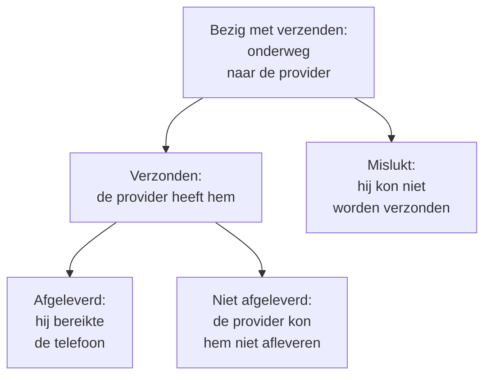

# Meldingslogboeken

Meldingslogboeken tonen elk bericht dat OneUptime voor je project heeft verzonden, met een tabblad per kanaal, en wat er van elk bericht is geworden: of het is vertrokken, of het is aangekomen en, zo niet, waarom. Open ze via **Projectinstellingen → Meldingen → Meldingslogboeken**, of via **Meldingslogboeken** bij een incident, een waarschuwing, een onderhoudsgebeurtenis, een statuspagina of een bereikbaarheidsbeleid, voor wat erover is verzonden.

:::cards
- [Een status lezen](#een-status-lezen): De kleur zegt waar het bericht is, en wie ernaar wijst, ziet wat het betekent.
- [Sms](#sms): Bezig met verzenden, dan Verzonden, dan Afgeleverd, zoals de provider het meldt.
- [Gesprekken](#gesprekken): Bezig met bellen, en dan hoe het gesprek eindigde.
- [WhatsApp en Telegram](#whatsapp-en-telegram): Wat elke app meldt nadat die een bericht heeft aangenomen.
- [E-mail, push, webhooks en werkruimten](#e-mail-push-webhooks-en-werkruimten): Succes, of Fout en waarom.
- [Als een sms op Verzonden blijft staan](#als-een-sms-op-verzonden-blijft-staan): Providers die nooit terugmelden, en meldingen die nooit aankomen.
:::

## Een status lezen

Elke status is een label waarvan de kleur zegt waar het bericht is:

| Kleur | Waar het bericht is |
| --- | --- |
| Grijs | Overgedragen, en er is nog niets teruggekomen, zoals **Bezig met verzenden**. |
| Blauw | De provider heeft het, en moet nog zeggen hoe het afliep, zoals **Verzonden** bij een sms of **Bezig met bellen** bij een gesprek. |
| Groen | Het heeft de persoon bereikt, zoals **Afgeleverd**, of dit is de laatste status die het krijgt. |
| Geel | Het heeft de telefoon bereikt en niemand nam op, zoals **Gemiste oproep**, of het ging met een waarschuwing. |
| Rood | Het heeft de persoon niet bereikt, zoals **Niet afgeleverd**, **Mislukt**, **Fout** of **Saldo te laag**. |

Wijs een status aan, tik erop of ga er met de Tab-toets naartoe, en hij zegt wat hij betekent en wat er daarna komt. **Statusbericht bekijken**, in het menu van de rij, toont wat de provider antwoordde, zoals de ID van het bericht of waarom het mislukte. Het filter **Status** van elk tabblad toont elke status die het tabblad kan laten zien, in de volgorde waarin een bericht ze doorloopt.

## Sms

| Status | Wat het betekent |
| --- | --- |
| **Bezig met verzenden** | OneUptime heeft de sms aan Twilio overgedragen, dat hem doorgeeft aan de provider. |
| **Verzonden** | De provider heeft de sms geaccepteerd. Hij gaat naar **Afgeleverd** of **Niet afgeleverd** zodra de provider terugmeldt. |
| **Afgeleverd** | De provider heeft bevestigd dat de sms de telefoon heeft bereikt. Dit is de laatste status van een sms die is aangekomen. |
| **Niet afgeleverd** | De provider kon hem niet afleveren. **Foutcode** vertelt waarom: `30003` is een telefoon die uit staat of onbereikbaar is, `30005` een nummer dat niet bestaat, `30006` een vaste lijn, en `30007` een bericht dat de provider heeft gefilterd. |
| **Mislukt** | Twilio kon hem niet verzenden. **Foutcode** vertelt waarom. |
| **Fout** | Hij is niet verzonden, bijvoorbeeld omdat sms uit staat voor het project, of omdat Twilio het nummer weigerde. **Statusbericht bekijken** vertelt waarom. |
| **Saldo te laag** | Hij is niet verzonden: het saldo van het project was te laag om ervoor te betalen. |
| **Succes** | Hij is verzonden voordat OneUptime de aflevering volgde, en Twilio heeft hem geaccepteerd. |

Een sms die de eigen sms- en belgateway van de server heeft aangenomen, blijft op **Verzonden** staan, in het groen: de gateway meldt geen aflevering, dus dat is zijn laatste status.

Twilio meldt elke wijziging aan OneUptime zodra die gebeurt, ondertekend met het auth-token van het account waarmee de sms is verzonden, en OneUptime weigert elke melding die niet van Twilio komt. Daarvoor moet Twilio je server kunnen bereiken: zie [Twilio-integratie](/docs/self-hosted/twilio-integration).

## Gesprekken

| Status | Wat het betekent |
| --- | --- |
| **Bezig met bellen** | Twilio heeft het gesprek gestart. Dit verandert zodra Twilio meldt hoe het gesprek is geëindigd. |
| **Succes** | Het gesprek is beantwoord, en **Statusbericht bekijken** vertelt hoe lang het duurde. Een gesprek dat de eigen sms- en belgateway van de server heeft aangenomen, staat op **Succes** zodra de gateway het accepteert. |
| **Gemiste oproep** | De telefoon ging over zonder antwoord: niemand nam op. |
| **Bezet** | De lijn was bezet, of de oproep werd geweigerd. |
| **Voicemail** | De voicemail heeft een bereikbaarheidsoproep aangenomen. **Statusbericht bekijken** vertelt of er een bericht is achtergelaten. |
| **Fout** | Het gesprek kon niet worden gestart of verbonden. |
| **Saldo te laag** | Het is niet gestart: het saldo van het project was te laag om ervoor te betalen. |

## WhatsApp en Telegram

Een WhatsApp-bericht staat **In de wachtrij** terwijl OneUptime het overdraagt, op **Verzonden** zodra WhatsApp het accepteert, op **Afgeleverd** zodra het de telefoon bereikt, en op **Gelezen** zodra het wordt geopend, als de persoon leesbevestigingen deelt. **Mislukt** is een bericht dat WhatsApp niet kon afleveren, en **Waarschuwing** een bericht dat het met een waarschuwing verzond: **Statusbericht bekijken** vertelt wat WhatsApp meldde. **Fout** en **Saldo te laag** betekenen dat het niet is verzonden, net als bij een sms.

Telegram meldt niets meer nadat het een bericht heeft aangenomen, dus **Verzonden** is bij een Telegram-bericht groen: Telegram heeft het in de chat geplaatst, en dat is zijn laatste status.

## E-mail, push, webhooks en werkruimten

Deze tabbladen tonen **Succes** of **Fout**. **Succes** is de laatste status: de mailserver heeft de e-mail geaccepteerd, de pushdienst de melding, het adres van de webhook heeft geantwoord dat het het verzoek heeft aangenomen, of de werkruimte heeft gedaan wat er werd gevraagd. OneUptime volgt een e-mail niet meer nadat de mailserver hem heeft geaccepteerd, en een pushmelding gaat naar **Fout** als de pushdienst later meldt dat hij niet is afgeleverd. **Statusbericht bekijken** vertelt waarom een bericht op **Fout** staat, zoals **Reden** dat doet op het tabblad **Werkruimte**.

## Als een sms op Verzonden blijft staan

**Verzonden** betekent dat de provider de sms heeft en nog niet heeft teruggemeld. De meeste providers melden binnen seconden of minuten terug, maar sommige nooit: dan houdt ook Twilio de sms op `sent`, zoals zijn berichtenlogboeken tonen, en kan OneUptime niet weten of hij is aangekomen.

Een sms die op **Bezig met verzenden** blijft staan, is iets anders: de meldingen van Twilio bereiken OneUptime niet. Controleer of Twilio je server kan bereiken, en zoek in het logboek van de server naar regels die beginnen met `Twilio callback refused`: zie [Twilio-integratie](/docs/self-hosted/twilio-integration).

## Volgende stappen

:::cards
- [Twilio-integratie](/docs/self-hosted/twilio-integration): Verbind Twilio, en laat zijn afleveringsmeldingen OneUptime bereiken.
- [Sms- en belgateway](/docs/self-hosted/sms-and-call-gateway): Verzend sms en gesprekken via een eigen gateway.
- [Metrics voor de bezorging van meldingen](/docs/self-hosted/notification-delivery-metrics): Tel wat er in de hele installatie is afgeleverd.
:::
