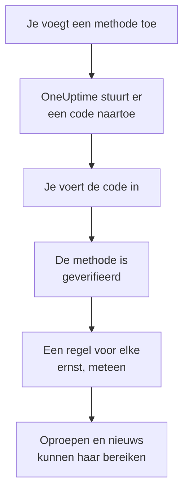

# Meldingsmethoden

Een meldingsmethode is een adres waarop OneUptime je in één project mag bereiken: een e-mailadres, een telefoonnummer voor sms of oproepen, een WhatsApp-nummer, een Telegram-account, je Slack- of Microsoft Teams-account, een telefoon of browser voor pushmeldingen, of een webhook. Je voegt ze toe onder **Gebruikersinstellingen → Meldingsmethoden**, verifieert ze, en OneUptime gebruikt ze meteen voor je oproepen.

:::cards
- [Een methode kiezen](#een-methode-kiezen): Wat elke methode nodig heeft, en hoe ze wordt geverifieerd.
- [Een methode toevoegen en verifiëren](#een-methode-toevoegen-en-verifiëren): E-mail, sms, oproepen en WhatsApp, met een code van 6 cijfers.
- [Webhooks](#webhooks): Stuur oproepen naar je eigen endpoint, ondertekend als je wilt.
- [Een kanaal aanzetten voor je project](#een-kanaal-aanzetten-voor-je-project): Waarom sms, oproepen, WhatsApp of Telegram kunnen ontbreken.
:::

## Hoe een methode actief wordt



Een methode die je niet hebt geverifieerd, wordt nooit gebruikt. Pushapparaten, Slack, Microsoft Teams en webhooks hebben geen code nodig: een apparaat registreren of je account koppelen bewijst dat het van jou is, en een webhook heeft geen bewijs nodig. Een methode verifiëren voegt meteen je [standaardregels](/docs/notifications/on-call-rules#de-regels-waarmee-je-begint) ervoor toe, dus een nieuw telefoonnummer roept je op voor elke ernst tot je de regels ervan wijzigt.

## Een methode kiezen

Elk tabblad van **Meldingsmethoden** bevat een of meer kaarten, één per soort methode:

| Kaart | Tabblad | Wat je toevoegt | Hoe ze wordt geverifieerd |
| --- | --- | --- | --- |
| **E-mails voor meldingen** | **Direct Contact** | Een e-mailadres | Een code per e-mail |
| **Telefoonnummers voor SMS-meldingen** | **Direct Contact** | Een telefoonnummer | Een code per sms |
| **Telefoonnummers voor oproepmeldingen** | **Direct Contact** | Een telefoonnummer | Een code die in een gesprek wordt voorgelezen, of geen voor een nummer dat voor sms is geverifieerd |
| **WhatsApp-nummers voor meldingen** | **Direct Contact** | Een WhatsApp-nummer | Een code via WhatsApp |
| **Telegram-accounts voor meldingen** | **Direct Contact** | Je Telegram-account | Een bericht aan de OneUptime-bot |
| **Slack Account for Notifications** | **Workspace Apps** | Je Slack-account | Je account koppelen aan de werkruimte van het project |
| **Microsoft Teams Account for Notifications** | **Workspace Apps** | Je Microsoft Teams-account | Je account koppelen aan de werkruimte van het project |
| **Apparaten voor pushmeldingen** | **Push Notifications** | Een telefoon met de app OneUptime On-Call, of een browser | Het apparaat registreren |
| **Webhooks voor meldingen** | **Webhooks** | Een eigen HTTPS-endpoint | Geen |

**Workspace Apps** verschijnt alleen als het project Slack of Microsoft Teams heeft gekoppeld, en bevat alleen de gekoppelde. Sms, oproepen, WhatsApp en Telegram kunnen voor het hele project uitstaan; zie [Een kanaal aanzetten voor je project](#een-kanaal-aanzetten-voor-je-project).

## Een methode toevoegen en verifiëren

E-mailadressen, sms-nummers, oproepnummers en WhatsApp-nummers worden geverifieerd met een code van 6 cijfers.

:::steps
### Je methoden openen

Ga naar **Gebruikersinstellingen → Meldingsmethoden**. **Direct Contact** is het eerste tabblad.

### Het adres toevoegen

Klik in de kaart van de methode op de knop om toe te voegen, bijvoorbeeld **Telefoonnummer voor SMS-meldingen toevoegen**. Vul het **E-mail** in, of het **Telefoonnummer** in internationaal formaat, bijvoorbeeld `+11234567890`, en sla op.

### De code invoeren

Het verificatievenster opent vanzelf, en zegt waar de code naartoe ging en tot wanneer hij geldig is. Typ de code in **Verificatiecode** en klik op **Verifiëren**.

### De rij controleren

De rij staat nu op **Geverifieerd**. Het venster te vroeg gesloten? Klik op **Verifiëren** in de rij om het opnieuw te openen.
:::

- Een code is 15 minuten geldig. Vijf foute pogingen maken hem ongeldig, en dan heb je een nieuwe nodig.
- **Send a new code**, of **Call me with a new code** voor een oproepnummer, staat in het venster. Je kunt een nieuwe vragen een minuut na de vorige.
- Een nummer dat je voor sms hebt geverifieerd, is ook voor oproepen geverifieerd. Het toevoegen onder **Telefoonnummers voor oproepmeldingen** vraagt geen code, en een sms-nummer verifiëren verifieert ook het oproepnummer dat je ervoor hebt toegevoegd.
- Je aanmeld-e-mailadres staat er al, geverifieerd, sinds de dag dat je lid werd van het project.

## Telegram koppelen

:::steps
### Het account toevoegen

Klik in **Telegram-accounts voor meldingen** op **Telegram-account toevoegen**. **Telegram-handle (optioneel)** is alleen een label voor jezelf, en mag leeg blijven.

### De bot een bericht sturen

Klik op **Verifiëren** in de nieuwe rij. Het venster **Telegram-account verifiëren** geeft je drie manieren om de OneUptime-bot te bereiken: scan de QR-code met je telefoon, klik op **Open in Telegram**, of zoek de bot in Telegram en stuur hem het `/start`-commando dat het venster toont.

### Bevestigen

Klik terug in OneUptime op **I've sent the message — check**. Zodra de bot je bericht heeft, is het account geverifieerd.
:::

**Code roteren** maakt een nieuwe code voor een account dat nog niet geverifieerd is. De QR-code en de link die je eerder opende, werken dan niet meer. In een zelfgehoste OneUptime koppelt de beheerder van de server een Telegram-bot voordat iemand een account kan koppelen.

## Slack en Microsoft Teams

1. Koppel je eigen account aan de werkruimte van het project: **Gebruikersinstellingen → Werkruimte → Slack**, of **Microsoft Teams**. Zie [Slack](/docs/workspace-connections/slack) en [Microsoft Teams](/docs/workspace-connections/microsoft-teams).
2. Klik op het tabblad **Workspace Apps** op **Add Slack Account** of **Add Microsoft Teams Account**. Het account is geverifieerd zodra het is toegevoegd.
3. Klik op **Send Test Message** in de rij ervan. Oproepen komen binnen als directe berichten van de OneUptime-app.

## Pushmeldingen

Het tabblad **Push Notifications** toont je **Apparaten voor pushmeldingen**.

- **Een telefoon.** Installeer de app OneUptime On-Call, verbind hem met je OneUptime, meld je aan en sta meldingen toe: de telefoon zet zichzelf in deze lijst. Zie [Apps – Overzicht](/docs/mobile-desktop-apps/index).
- **Deze browser.** Klik op **Apparaat registreren**, vul een **Apparaatnaam** in, en sta meldingen toe wanneer de browser erom vraagt.
- **Testmelding** in de rij van een apparaat stuurt er meteen een pushmelding naartoe.
- **Kritieke waarschuwingen** geeft aan of de oproepen van de telefoon door de stille modus en Niet storen heen gaan. Dat zet je aan in de app, nooit hier, en een browser kan het niet. Zie [Kritieke bereikbaarheidswaarschuwingen](/docs/self-hosted/push-notifications#kritieke-dienstmeldingen-stille-modus-doorbreken).
- Naar een apparaat met de markering **Ontvangt geen meldingen** wordt niets gestuurd. Open de app op die telefoon, of registreer de browser opnieuw, en het doet weer mee.

## Webhooks

Een webhook stuurt elke oproep als JSON naar een HTTPS-endpoint van jou, zodat een eigen tool ermee aan de slag kan.

:::steps
### De webhook toevoegen

Klik op het tabblad **Webhooks** op **Webhook toevoegen**. Vul bij **Naam** iets in dat je herkent, dan **Webhook-URL** en **Ondertekeningsgeheim (optioneel)**.

### Een test sturen

Klik op **Test verzenden** in de rij ervan. Je endpoint ontvangt een gebeurtenis waarvan de `eventType` `test` is.

### Controleren wat er binnenkomt

Een oproep is een JSON-`POST` zoals hieronder. Antwoord binnen 10 seconden met een willekeurige `2xx`-status; omleidingen worden niet gevolgd.
:::

```json title="A page, as your endpoint receives it"
{
  "eventType": "on-call.incident.created",
  "timestamp": "2026-10-15T09:30:00.000Z",
  "projectId": "6a3f0d2e-1c4b-4e8a-9b7d-2f5c8e1a0b3c",
  "userId": "0c9e8d7f-6b5a-4c3d-8e2f-1a0b9c8d7e6f",
  "incident": {
    "id": "5b4a3c2d-1e0f-4a9b-8c7d-6e5f4a3b2c1d",
    "title": "Checkout API is down",
    "description": "Health check failed from 3 probes.",
    "incidentNumber": 42,
    "incidentNumberWithPrefix": "INC-42",
    "severity": "Critical Incident",
    "state": "Identified"
  },
  "onCallPolicyId": "7d6c5b4a-3e2f-4d1c-9b8a-7f6e5d4c3b2a",
  "onCallPolicyEscalationRuleId": "8e7d6c5b-4a3f-4e2d-8c1b-9a8f7e6d5c4b"
}
```

| `eventType` | Verzonden voor | De sleutel van het item |
| --- | --- | --- |
| `on-call.incident.created` | Een incident | `incident` |
| `on-call.alert.created` | Een waarschuwing | `alert` |
| `on-call.incidentEpisode.created` | Een incidentepisode | `incidentEpisode` |
| `on-call.alertEpisode.created` | Een waarschuwingsepisode | `alertEpisode` |

Het nieuws dat je in **Meldingsinstellingen** voor Webhook aanzet, komt binnen op hetzelfde endpoint, met de gebeurtenis van de instelling in `eventType` en een korte samenvatting in `subject` en `message`.

Elk verzoek bevat `X-OneUptime-Event`, het type gebeurtenis. Met een ondertekeningsgeheim bevat het ook `X-OneUptime-Signature`: `sha256=` gevolgd door de HMAC-SHA256 van de ruwe body, in hex. Controleer die voordat je het verzoek vertrouwt:

```javascript title="verify-signature.js"
const crypto = require("crypto");

// rawBody: the request body exactly as it arrived, before any JSON parsing.
function isFromOneUptime(rawBody, signatureHeader, secret) {
  const expected =
    "sha256=" + crypto.createHmac("sha256", secret).update(rawBody).digest("hex");
  const received = Buffer.from(signatureHeader || "");
  const wanted = Buffer.from(expected);
  return received.length === wanted.length && crypto.timingSafeEqual(received, wanted);
}
```

Een webhook heeft geen verificatie nodig, dus toevoegen voegt meteen de regels ervan toe. Privé- en interne adressen worden geweigerd, tenzij de beheerder van een zelfgehoste server ze toestaat: zie [Toegang tot privénetwerk](/docs/self-hosted/private-network-access#webhooks-en-workflows).

## Een kanaal aanzetten voor je project

**SMS**, **Telefoonoproepen**, **WhatsApp** en **Telegram** staan in elk nieuw project uit, omdat elk bericht geld kost: in OneUptime Cloud wordt het betaald uit het tegoed van het project, en sms en oproepen lopen in plaats daarvan via het eigen Twilio-account van het project als het standaardaccount ze verstuurt. E-mail, push, Slack, Microsoft Teams en webhooks staan altijd aan.

Zolang een kanaal uitstaat, kan niemand in het project er een methode op toevoegen: de kaart ervan heeft geen knop om toe te voegen, en zegt wie het kan aanzetten. Een projecteigenaar, een **Factureringsbeheerder** of iemand met **Manage Billing** zet het aan, in de kaart **Meldingskanalen** onder **Projectinstellingen → Meldingen → Meldingsinstellingen**. Een projectbeheerder kan dat niet. In een zelfgehoste OneUptime hebben sms en oproepen ook een Twilio-account nodig, en Telegram een bot die de beheerder van de server koppelt; zie [Twilio-integratie](/docs/self-hosted/twilio-integration).

## Een methode verwijderen

Klik op **Verwijderen** in de rij van de methode. Een methode verwijderen verwijdert elke bereikbaarheidsregel die haar gebruikt, dus het venster telt eerst die regels en noemt elke ernst die door het verwijderen helemaal zonder regel zou blijven.

## Probleemoplossing

:::details Een kaart heeft geen knop om toe te voegen
Dat kanaal staat in dit project uit. De kaart zegt wie het kan aanzetten; zie [Een kanaal aanzetten voor je project](#een-kanaal-aanzetten-voor-je-project).
:::

:::details De code kwam nooit aan
E-mails kunnen een paar minuten duren, en komen soms in de spam terecht; sms'jes kunnen een minuut duren. Wacht een minuut en klik dan in het venster op **Send a new code**. **Projectinstellingen → Meldingen → Meldingslogboeken** laat zien wat er met het bericht is gebeurd.
:::

:::details Mijn Slack-account toevoegen mislukt
Koppel eerst je account onder **Gebruikersinstellingen → Werkruimte → Slack**, en klik dan opnieuw op **Add Slack Account**. Het foutvenster heeft een knop die je erheen brengt.
:::

:::details Mijn telefoon krijgt geen pushmeldingen
Controleer of de telefoon onder **Apparaten voor pushmeldingen** staat, en stuur hem een **Testmelding**. Zie [Veelgestelde vragen en probleemoplossing](/docs/mobile-desktop-apps/faq-troubleshooting#meldingen).
:::

## Volgende stappen

:::cards
- [Persoonlijke bereikbaarheidsregels](/docs/notifications/on-call-rules): Bepaal welke methode elke oproep probeert, en wanneer.
- [Meldingsinstellingen](/docs/notifications/notification-settings): Kies het nieuws waarover je hoort, en via welke kanalen.
- [Apps – Overzicht](/docs/mobile-desktop-apps/index): Ontvang oproepen op je telefoon of desktop.
- [Hoe OneUptime je bereikt](/docs/notifications/index): Hoe methoden, regels en instellingen samenhangen.
:::
