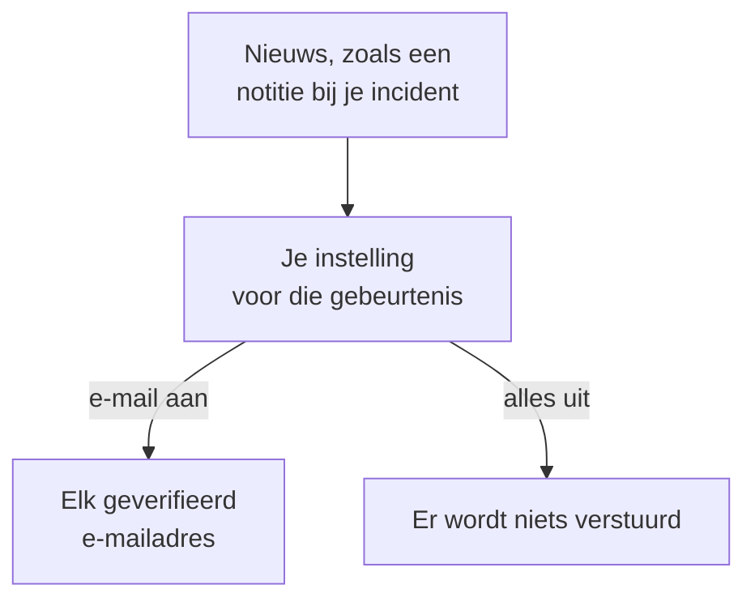

# Meldingsinstellingen

Meldingsinstellingen bepalen welk nieuws je bereikt over de items die van jou zijn, zoals een incident, een monitor of een statuspagina, en over je eigen bereikbaarheidsdiensten, en via welke kanalen. Ze roepen je nooit op: oproepen is de taak van je bereikbaarheidsregels. Je stelt ze in onder **Gebruikersinstellingen → Meldingsinstellingen**, met één schakelaar per gebeurtenis en kanaal.

:::cards
- [Hoe de instellingen werken](#hoe-de-instellingen-werken): Eén schakelaar per gebeurtenis en kanaal, verstuurd naar elke geverifieerde methode.
- [Een instelling wijzigen](#een-instelling-wijzigen): Drie klikken, meteen opgeslagen.
- [Wat er aanstaat voor een nieuw lid](#wat-er-aanstaat-voor-een-nieuw-lid): De standaardinstellingen, tabblad voor tabblad.
- [Minder e-mails](#minder-e-mails): Bundel de golven, of laat de routinemails weg.
:::

## Hoe de instellingen werken

- Elke rij is een gebeurtenis, en elke kolom een kanaal: E-mail, SMS, Oproep, Push, WhatsApp, Telegram, Slack, Microsoft Teams, Mattermost en Webhook. Slack, Microsoft Teams en Mattermost zijn alleen kolommen als het project ze heeft gekoppeld. Een kanaal dat u nog niet hebt ingesteld, is geen kolom: het staat boven de tabbladen onder **Kanalen die nog niet zijn ingesteld**, als link om het in te stellen.
- WhatsApp bezorgt alleen berichten die Meta heeft goedgekeurd, en OneUptime heeft die voor updates over incidenten, waarschuwingen, episodes, monitoren, sondes, AI-agents, statuspagina's, onderhoudsgebeurtenissen en de meeste diensten. Andere updates, zoals de status van een SLO, een gemiste oproep, een beveiligingszaak of eigenaar worden van een service, hebben geen WhatsApp-schakelaar, en hun kaart zegt dat WhatsApp niet beschikbaar is. Ze bereiken je via je andere kanalen.
- Een kanaal dat aanstaat, stuurt naar elke geverifieerde methode die je erop hebt in dit project, niet naar één.
- Een kanaal dat aanstaat zonder geverifieerde methode erachter, stuurt niets. Zijn kolom toont **Instellen** onder de naam, en zijn schakelaars kunnen alleen uit. **Your setup checklist** meldt dat ook, onder **Staying informed**.
- Nieuws gaat naar de eigenaren van het item: de mensen die als eigenaar zijn genoemd, en de leden van de eigenaarsteams ervan. Heeft een item geen eigenaren, dan gaat het in plaats daarvan naar de Projecteigenaren. Wie al door de dienstoproep van een nieuw incident, een nieuwe waarschuwing of een nieuwe episode is bereikt, krijgt geen tweede melding dat het item is aangemaakt. Een gebeurtenis over het toegevoegd worden als eigenaar gaat alleen naar de toegevoegde persoon. Stopt OneUptime terwijl het nieuws naar de eigenaren van een item verstuurt, dan krijgen de mensen bij wie het nog niet was aangekomen het zodra OneUptime terug is, een paar minuten later, en niemand krijgt het twee keer.
- Beveiligingszaken hebben geen eigenaren. Een nieuwe zaak gaat naar iedereen die de zaken van het project kan zien, op de prioriteit die ieder van hen kiest, en een toegewezen zaak naar de mensen aan wie ze is toegewezen. Zie [Beveiligingszaken](/docs/telemetry/security-cases#meldingen).
- Elke e-mail aan eigenaren eindigt met een link "Manage notification preferences" die terugleidt naar deze pagina.

## Een instelling wijzigen

:::steps
### Je instellingen openen

Ga naar **Gebruikersinstellingen → Meldingsinstellingen**. De tabbladen zijn **Incidenten**, **Waarschuwingen**, **Bewaking**, **Statuspagina's**, **Gepland onderhoud**, **Bereikbaarheid** en **Beveiliging**.

### De gebeurtenis vinden

Elk tabblad bevat een of meer kaarten, zoals **Incidentepisodes** op het tabblad **Incidenten**. Elke rij is een gebeurtenis, met een regel die zegt wanneer ze wordt verstuurd. Boven de kaarten zegt het tabblad over hoeveel van zijn gebeurtenissen u hoort, en via welke kanalen.

### Op een kanaal klikken

Klik op de schakelaar van een kanaal om het aan te zetten, en nog eens om het uit te zetten. De eerste rij van een kaart, **Alle gebeurtenissen**, zet een kanaal aan of uit voor elke gebeurtenis van de kaart. Elke wijziging wordt meteen opgeslagen, en de kaart toont **Opgeslagen**.
:::

## Wat er aanstaat voor een nieuw lid

Wanneer je lid wordt van een project, staan deze gebeurtenissen aan, per e-mail. Al het andere begint uit, en stuurt niets tot je een kanaal aanzet.

| Tabblad | Aan per e-mail | Uit tot je ze aanzet |
| --- | --- | --- |
| **Incidenten** | **Incident aangemaakt**, **Incidentstatus gewijzigd**, **Incidentherinnering**, **SLA van incident geschonden**, **Incidentepisode aangemaakt**, **Status van incidentepisode gewijzigd**, **Incident toegevoegd aan incidentepisode** | **Incidentnotitie geplaatst**, **Toegevoegd als eigenaar van incident**, **Toegewezen aan een incident**, **Notitie bij incidentepisode geplaatst**, **Toegevoegd als eigenaar van incidentepisode** |
| **Waarschuwingen** | **Waarschuwing aangemaakt**, **Status van waarschuwing gewijzigd**, **Waarschuwingsherinnering**, **Waarschuwingsepisode aangemaakt**, **Status van waarschuwingsepisode gewijzigd**, **Waarschuwing toegevoegd aan waarschuwingsepisode** | **Notitie bij waarschuwing geplaatst**, **Toegevoegd als eigenaar van waarschuwing**, **Notitie bij waarschuwingsepisode geplaatst**, **Toegevoegd als eigenaar van waarschuwingsepisode** |
| **Bewaking** | **Sondestatus gewijzigd voor uw monitor**, **Monitor heeft geen actieve sondes**, **SLO-status gewijzigd**, **Toegevoegd als eigenaar van SLO**, **Uitzondering aan mij toegewezen**, **Sondestatus gewijzigd**, **Toegevoegd als eigenaar van sonde**, **Toegevoegd als eigenaar van tabel**, **Toegevoegd als eigenaar van pipeline**, **Toegevoegd als eigenaar van service of infrastructuur**, **Toegevoegd als eigenaar van dashboard**, **Toegevoegd als eigenaar van workflow**, **Toegevoegd als eigenaar van runbook**, **Toegevoegd als eigenaar van monitorgroep**, **Toegevoegd als eigenaar van Runner** | **Monitor aangemaakt**, **Monitorstatus gewijzigd**, **Toegevoegd als eigenaar van monitor**, **Status van AI-agent gewijzigd**, **Toegevoegd als eigenaar van AI-agent** |
| **Statuspagina's** | **Mijn openbare notitie goedgekeurd of afgewezen**, en ook per push: **Openbare notitie wacht op mijn goedkeuring** | **Statuspagina aangemaakt**, **Statuspagina-aankondiging geplaatst**, **Toegevoegd als eigenaar van statuspagina** |
| **Gepland onderhoud** | **Onderhoudsherinnering** | **Onderhoudsgebeurtenis aangemaakt**, **Onderhoudsstatus gewijzigd**, **Onderhoudsnotitie geplaatst**, **Toegevoegd als eigenaar van onderhoud** |
| **Bereikbaarheid** | **U gaat in bereikbaarheid**, **U bent de volgende voor bereikbaarheid**, **U gaat uit bereikbaarheid**, **Toegevoegd aan bereikbaarheidsbeleid**, **Verwijderd uit bereikbaarheidsbeleid**, **Gemiste oproep**, **Toegevoegd als eigenaar van bereikbaarheidsbeleid**, **Toegevoegd als eigenaar van bereikbaarheidsschema**, **Toegevoegd als eigenaar van beleid inkomend gesprek**, en ook per push: **Voordat mijn oproepdienst begint**, **Mijn komende oproepdienst wordt opnieuw toegewezen** | Geen |
| **Beveiliging** | **Toegevoegd als eigenaar van gegevensopslag**, en ook per push: **Nieuwe beveiligingszaak** (zaken met prioriteit High en Kritiek), **Beveiligingszaak aan mij toegewezen**, **Playbookstap wacht op mijn goedkeuring**, **Reactiedoel van een beveiligingszaak**, **Aan mij toegewezen taak van een beveiligingszaak**, **Hunt heeft beveiligingsgebeurtenissen gevonden** | Geen |

> [!IMPORTANT]
> **Monitorstatus gewijzigd** begint uit. Wil je horen wanneer een monitor van jou uitvalt of terugkomt, zet het dan aan op het tabblad **Bewaking**.

**Toegevoegd als eigenaar van service of infrastructuur**, op de kaart **Services en infrastructuur**, is één schakelaar voor elke service, RUM-applicatie, database, wachtrij, host, cluster, cloud-resource en elk ander stuk infrastructuur waarvan je eigenaar wordt. Het bericht zegt welke het is.

**Toegevoegd als eigenaar van monitorgroep**, op de kaart **Monitoren**, en **Toegevoegd als eigenaar van Runner**, op de kaart **Dashboards & automatisering**, laten je weten wanneer iemand je toevoegt als eigenaar van een monitorgroep of een Runner.

## Je diensten

Het tabblad **Bereikbaarheid** gaat over jou, en over de bereikbaarheidsitems van jou:

- **U gaat in bereikbaarheid**, **U bent de volgende voor bereikbaarheid** en **U gaat uit bereikbaarheid** volgen je beurten in de bereikbaarheidsroosters waarin je zit.
- **Toegevoegd aan bereikbaarheidsbeleid** en **Verwijderd uit bereikbaarheidsbeleid** vertellen je wanneer een bereikbaarheidsbeleid je begint of ophoudt op te roepen: wanneer een van zijn escalatieregels je noemt of je niet meer noemt, wanneer je lid wordt van het project, en wanneer je lid wordt van een team dat een van zijn regels noemt of het verlaat. Lid worden of vertrekken vertelt het je één keer per beleid, met elke regel ervan die veranderde, en vertrekken vertelt het je pas wanneer niets anders in dat beleid je nog oproept. Er wordt niets verzonden voordat je lid wordt van een project, of wanneer je eruit wordt verwijderd.
- **Voordat mijn oproepdienst begint** stuurt herinneringen op de momenten die je kiest onder **Gebruikersinstellingen → Profiel en agenda → Agendafeed**, en **Mijn komende oproepdienst wordt opnieuw toegewezen** vertelt je wanneer iemand anders een dienst overneemt waarvoor je een herinnering kreeg. Zie [Agendafeeds](/docs/on-call/calendar-feeds#herinneringen-en-meldingen-over-hertoewijzing).
- **Gemiste oproep**, op de kaart **Beleid inkomende gesprekken**, vertelt de eigenaren van een beleid voor inkomende gesprekken dat een beller niemand bereikte. Zie [Beleid voor inkomende oproepen](/docs/on-call/incoming-call-policy#gemiste-oproepen).
- **Toegevoegd als eigenaar van bereikbaarheidsbeleid**, **Toegevoegd als eigenaar van bereikbaarheidsschema** en **Toegevoegd als eigenaar van beleid inkomend gesprek** vertellen je wanneer je eigenaar van een ervan wordt, door een eigenaarsregel of door iemand op de pagina Eigenaren ervan.

## Beveiligingszaken

Het tabblad **Beveiliging** gaat over de beveiligingszaken die je kunt zien:

- **Nieuwe beveiligingszaak** heeft een prioriteit onder de naam: de laagste prioriteit die een zaak moet hebben om je een melding te geven. Die is **Hoog en hoger**, tenzij je **Alleen Kritiek**, **Gemiddeld en hoger**, **Laag en hoger** of **Elke zaak** kiest.
- **Beveiligingszaak aan mij toegewezen** volgt de zaken die aan jou zijn toegewezen, en aan de teams waarin je zit.
- **Playbookstap wacht op mijn goedkeuring** vraagt je een playbookstap goed te keuren of af te wijzen op een zaak waarop je stappen mag goedkeuren.

Zie [Beveiligingszaken](/docs/telemetry/security-cases#meldingen).

## Goedkeuring van openbare notities

De kaart **Goedkeuring van openbare notities**, op het tabblad **Statuspagina's**, gaat over openbare notities die op goedkeuring wachten voordat ze worden gepubliceerd, in een project dat daarom vraagt:

- **Openbare notitie wacht op mijn goedkeuring** vertelt je dat een openbare notitie, of een bewerking ervan, wacht op een stap die jij goedkeurt, bij naam of via een team. Je wordt niet gevraagd naar een notitie die je zelf verstuurde, of naar een stap na een stap die je goedkeurde. Naar elke stap word je één keer gevraagd: wanneer de notitie die stap bereikt, of wanneer je een van de goedkeurders ervan wordt terwijl de notitie wacht, omdat de goedkeuringsstappen veranderden of je lid werd van een team dat een stap noemt. Hij staat bij het begin aan per e-mail en per push, en **Email Rollup** houdt hem nooit tegen: de klanten voor wie de notitie is geschreven, wachten erop.
- **Mijn openbare notitie goedgekeurd of afgewezen** vertelt je dat een notitie die je ter goedkeuring verstuurde, is goedgekeurd en gepubliceerd, of afgewezen, met de reden. Hij staat bij het begin aan per e-mail.

Zie [Goedkeuring van openbare notities](/docs/incidents/notes-owners-and-feed#goedkeuring-van-openbare-notities).

## Minder e-mails

Deze schakelaars bepalen welk nieuws je bereikt, niet hoeveel e-mails het oplevert. **Gebruikersinstellingen → E-mailvoorkeuren** heeft daar twee kaarten voor, allebei alleen voor jou, in dit project:

- **Email Rollup** bundelt een golf nieuws in één e-mail: de eerste berichten komen nog één voor één, de rest samen een paar minuten later.
- **Fewer routine emails** zet met **Reduce routine emails** de e-mails uit over notities, nieuwe eigenaren, nieuwe monitors en statuspagina's, toevoegingen aan episodes en wijzigingen in bereikbaarheidsbeleid.

Zie [Meldingsoverzicht](/docs/emails/notification-rollup).

## Probleemoplossing

:::details Een schakelaar staat aan, maar er komt niets aan
Controleer of je een geverifieerde methode op dat kanaal hebt onder **Gebruikersinstellingen → Meldingsmethoden**. Voor sms, oproepen, WhatsApp en Telegram moet het project het kanaal ook hebben aangezet.
:::

:::details Er is geen WhatsApp-schakelaar voor een update
WhatsApp bezorgt alleen berichten die Meta heeft goedgekeurd, en OneUptime heeft er geen voor die update, dus zegt de kaart dat WhatsApp niet beschikbaar is. Kies er een ander kanaal voor, zoals sms of Push.
:::

:::details Ik ben eigenaar van een monitor, maar hoor nooit wanneer hij uitvalt
**Monitorstatus gewijzigd** begint uit. Zet er een kanaal voor aan, op het tabblad **Bewaking**.
:::

:::details Ik krijg nog steeds e-mails terwijl ik alles heb uitgezet
Oproepen volgen je bereikbaarheidsregels, niet deze schakelaars, en e-mails over aanmelden, beveiliging en facturering zijn geen nieuws over items. Elk project heeft eigen instellingen, dus controleer het project waar de e-mail vandaan kwam. Zie [Hoe ik bereikbaar ben](/docs/notifications/on-call-rules).
:::

## Volgende stappen

:::cards
- [Meldingsmethoden](/docs/notifications/notification-methods): Voeg de methoden toe waar je instellingen naartoe sturen.
- [Hoe ik bereikbaar ben](/docs/notifications/on-call-rules): Bepaal hoe een oproep je bereikt.
- [Meldingsoverzicht](/docs/emails/notification-rollup): Minder, vollere e-mails tijdens een golf.
- [Hoe OneUptime je bereikt](/docs/notifications/index): Hoe methoden, regels en instellingen samenhangen.
:::
