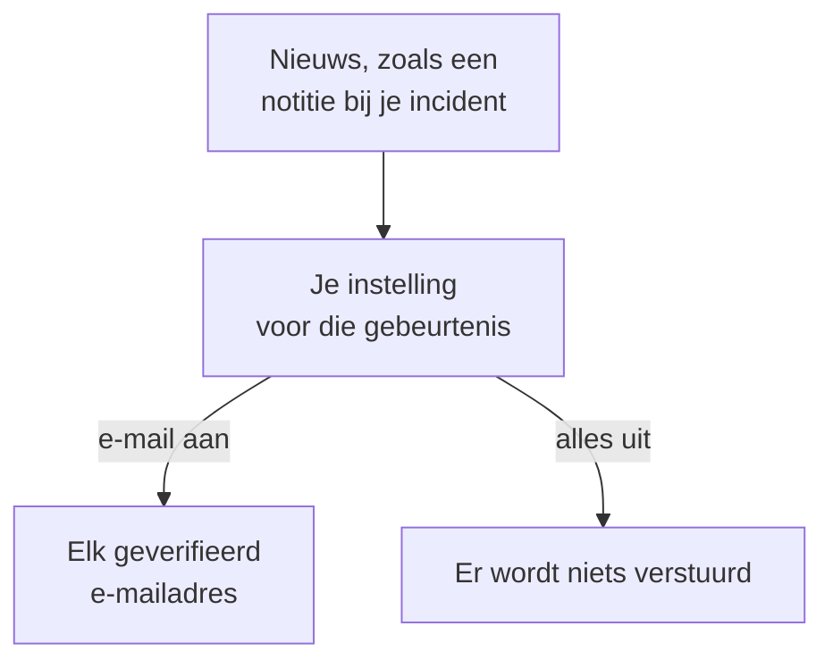

# Meldingsinstellingen

Meldingsinstellingen bepalen welk nieuws je bereikt over de items die van jou zijn, zoals een incident, een monitor of een statuspagina, en over je eigen bereikbaarheidsdiensten, en via welke kanalen. Ze roepen je nooit op: oproepen is de taak van je bereikbaarheidsregels. Je stelt ze in onder **Gebruikersinstellingen → Meldingsinstellingen**, met één schakelaar per gebeurtenis en kanaal.

:::cards
- [Hoe de instellingen werken](#hoe-de-instellingen-werken): Eén schakelaar per gebeurtenis en kanaal, verstuurd naar elke geverifieerde methode.
- [Een instelling wijzigen](#een-instelling-wijzigen): Drie klikken, meteen opgeslagen.
- [Wat er aanstaat voor een nieuw lid](#wat-er-aanstaat-voor-een-nieuw-lid): De standaardinstellingen, tabblad voor tabblad.
- [Minder e-mails](#minder-e-mails): Bundel de golven, of laat de routinemails weg.
:::

## Hoe de instellingen werken

- Elke rij is een gebeurtenis, en elke kolom een kanaal: E-mail, SMS, Oproep, Push, WhatsApp, Telegram, Slack en Microsoft Teams, en Webhook. Slack en Microsoft Teams zijn alleen kolommen als het project ze heeft gekoppeld.
- Een kanaal dat aanstaat, stuurt naar elke geverifieerde methode die je erop hebt in dit project, niet naar één.
- Een kanaal dat aanstaat zonder geverifieerde methode erachter, stuurt niets. **Your setup checklist** meldt dat onder **Staying informed**.
- Nieuws gaat naar de eigenaren van het item: de mensen die als eigenaar zijn genoemd, en de leden van de eigenaarsteams ervan. Heeft een item geen eigenaren, dan gaat het in plaats daarvan naar de eigenaren van het project. Een gebeurtenis over het toegevoegd worden als eigenaar gaat alleen naar de toegevoegde persoon.
- Beveiligingszaken hebben geen eigenaren. Een nieuwe zaak gaat naar iedereen die de zaken van het project kan zien, op de prioriteit die ieder van hen kiest, en een toegewezen zaak naar de mensen aan wie ze is toegewezen. Zie [Beveiligingszaken](/docs/telemetry/security-cases#meldingen).
- Elke e-mail aan eigenaren eindigt met een link "Manage notification preferences" die terugleidt naar deze pagina.

## Een instelling wijzigen

:::steps
### Je instellingen openen

Ga naar **Gebruikersinstellingen → Meldingsinstellingen**. De tabbladen zijn **Incidenten**, **Waarschuwingen**, **Bewaking**, **Statuspagina's**, **Geplande onderhoud**, **Bereikbaarheid** en **Beveiliging**.

### De gebeurtenis vinden

Elk tabblad bevat een of meer kaarten, zoals **Incidentepisodes** op het tabblad **Incidenten**. Elke rij is een gebeurtenis, met een regel die zegt wanneer ze wordt verstuurd.

### Op een kanaal klikken

Klik op de cirkel van een kanaal om het aan te zetten, en nog eens om het uit te zetten. Een vinkje betekent aan. Wijzigingen worden automatisch opgeslagen.
:::

## Wat er aanstaat voor een nieuw lid

Wanneer je lid wordt van een project, staan deze gebeurtenissen aan, per e-mail. Al het andere begint uit, en stuurt niets tot je een kanaal aanzet.

| Tabblad | Aan per e-mail | Uit tot je ze aanzet |
| --- | --- | --- |
| **Incidenten** | **Incident aangemaakt**, **Incidentstatus gewijzigd**, **Incident reminder**, **SLA van incident geschonden**, **Incidentepisode aangemaakt**, **Status van incidentepisode gewijzigd**, **Incident toegevoegd aan incidentepisode** | **Incidentnotitie geplaatst**, **Toegevoegd als eigenaar van incident**, **Toegewezen aan een incident**, **Notitie bij incidentepisode geplaatst**, **Toegevoegd als eigenaar van incidentepisode** |
| **Waarschuwingen** | **Waarschuwing aangemaakt**, **Status van waarschuwing gewijzigd**, **Alert reminder**, **Waarschuwingsepisode aangemaakt**, **Status van waarschuwingsepisode gewijzigd**, **Waarschuwing toegevoegd aan waarschuwingsepisode** | **Notitie bij waarschuwing geplaatst**, **Toegevoegd als eigenaar van waarschuwing**, **Notitie bij waarschuwingsepisode geplaatst**, **Toegevoegd als eigenaar van waarschuwingsepisode** |
| **Bewaking** | **Sondestatus gewijzigd voor uw monitor**, **Monitor heeft geen actieve sondes**, **SLO status changed**, **Added as SLO owner**, **Sondestatus gewijzigd**, **Toegevoegd als eigenaar van sonde** | **Monitor aangemaakt**, **Monitorstatus gewijzigd**, **Toegevoegd als eigenaar van monitor**, **Status van AI-agent gewijzigd**, **Toegevoegd als eigenaar van AI-agent** |
| **Statuspagina's** | Geen | **Statuspagina aangemaakt**, **Statuspagina-aankondiging geplaatst**, **Toegevoegd als eigenaar van statuspagina** |
| **Geplande onderhoud** | **Maintenance reminder** | **Onderhoudsgebeurtenis aangemaakt**, **Onderhoudsstatus gewijzigd**, **Onderhoudsnotitie geplaatst**, **Toegevoegd als eigenaar van onderhoud** |
| **Bereikbaarheid** | **U gaat in bereikbaarheid**, **U bent de volgende voor bereikbaarheid**, **U gaat uit bereikbaarheid**, **Toegevoegd aan bereikbaarheidsbeleid**, **Verwijderd uit bereikbaarheidsbeleid**, **Gemiste oproep**, en ook per push: **Voordat mijn oproepdienst begint**, **Mijn komende oproepdienst wordt opnieuw toegewezen** | Geen |
| **Beveiliging** | Ook per push: **Nieuwe beveiligingszaak** (zaken met prioriteit High en Kritiek), **Beveiligingszaak aan mij toegewezen**, **Playbookstap wacht op mijn goedkeuring**, **Reactiedoel van een beveiligingszaak**, **Aan mij toegewezen taak van een beveiligingszaak** | Geen |

> [!IMPORTANT]
> **Monitorstatus gewijzigd** begint uit. Wil je horen wanneer een monitor van jou uitvalt of terugkomt, zet het dan aan op het tabblad **Bewaking**.

## Je diensten

Het tabblad **Bereikbaarheid** gaat over jou, niet over items van jou:

- **U gaat in bereikbaarheid**, **U bent de volgende voor bereikbaarheid** en **U gaat uit bereikbaarheid** volgen je beurten in de bereikbaarheidsroosters waarin je zit.
- **Toegevoegd aan bereikbaarheidsbeleid** en **Verwijderd uit bereikbaarheidsbeleid** vertellen je wanneer een bereikbaarheidsbeleid je begint of ophoudt te noemen.
- **Voordat mijn oproepdienst begint** stuurt herinneringen op de momenten die je kiest onder **Gebruikersinstellingen → Agenda → Agendafeed**, en **Mijn komende oproepdienst wordt opnieuw toegewezen** vertelt je wanneer iemand anders een dienst overneemt waarvoor je een herinnering kreeg. Zie [Agendafeeds](/docs/on-call/calendar-feeds#herinneringen-en-meldingen-over-hertoewijzing).
- **Gemiste oproep**, op de kaart **Beleid inkomende gesprekken**, vertelt de eigenaren van een beleid voor inkomende gesprekken dat een beller niemand bereikte. Zie [Beleid voor inkomende oproepen](/docs/on-call/incoming-call-policy#gemiste-oproepen).

## Beveiligingszaken

Het tabblad **Beveiliging** gaat over de beveiligingszaken die je kunt zien:

- **Nieuwe beveiligingszaak** heeft een prioriteit onder de naam: de laagste prioriteit die een zaak moet hebben om je een melding te geven. Die is **Hoog en hoger**, tenzij je **Alleen Kritiek**, **Gemiddeld en hoger**, **Laag en hoger** of **Elke zaak** kiest.
- **Beveiligingszaak aan mij toegewezen** volgt de zaken die aan jou zijn toegewezen, en aan de teams waarin je zit.
- **Playbookstap wacht op mijn goedkeuring** vraagt je een playbookstap goed te keuren of af te wijzen op een zaak waarop je stappen mag goedkeuren.

Zie [Beveiligingszaken](/docs/telemetry/security-cases#meldingen).

## Minder e-mails

Deze schakelaars bepalen welk nieuws je bereikt, niet hoeveel e-mails het oplevert. **Gebruikersinstellingen → E-mailvoorkeuren** heeft daar twee kaarten voor, allebei alleen voor jou, in dit project:

- **Email Rollup** bundelt een golf nieuws in één e-mail: de eerste berichten komen nog één voor één, de rest samen een paar minuten later.
- **Fewer routine emails** zet met **Reduce routine emails** de e-mails uit over notities, nieuwe eigenaren, nieuwe monitors en statuspagina's, toevoegingen aan episodes en wijzigingen in bereikbaarheidsbeleid.

Zie [Meldingsoverzicht](/docs/emails/notification-rollup).

## Probleemoplossing

:::details Een schakelaar staat aan, maar er komt niets aan
Controleer of je een geverifieerde methode op dat kanaal hebt onder **Gebruikersinstellingen → Meldingsmethoden**. Voor sms, oproepen, WhatsApp en Telegram moet het project het kanaal ook hebben aangezet.
:::

:::details Ik ben eigenaar van een monitor, maar hoor nooit wanneer hij uitvalt
**Monitorstatus gewijzigd** begint uit. Zet er een kanaal voor aan, op het tabblad **Bewaking**.
:::

:::details Ik krijg nog steeds e-mails terwijl ik alles heb uitgezet
Oproepen volgen je bereikbaarheidsregels, niet deze schakelaars, en e-mails over aanmelden, beveiliging en facturering zijn geen nieuws over items. Elk project heeft eigen instellingen, dus controleer het project waar de e-mail vandaan kwam. Zie [Persoonlijke bereikbaarheidsregels](/docs/notifications/on-call-rules).
:::

## Volgende stappen

:::cards
- [Meldingsmethoden](/docs/notifications/notification-methods): Voeg de methoden toe waar je instellingen naartoe sturen.
- [Persoonlijke bereikbaarheidsregels](/docs/notifications/on-call-rules): Bepaal hoe een oproep je bereikt.
- [Meldingsoverzicht](/docs/emails/notification-rollup): Minder, vollere e-mails tijdens een golf.
- [Hoe OneUptime je bereikt](/docs/notifications/index): Hoe methoden, regels en instellingen samenhangen.
:::
