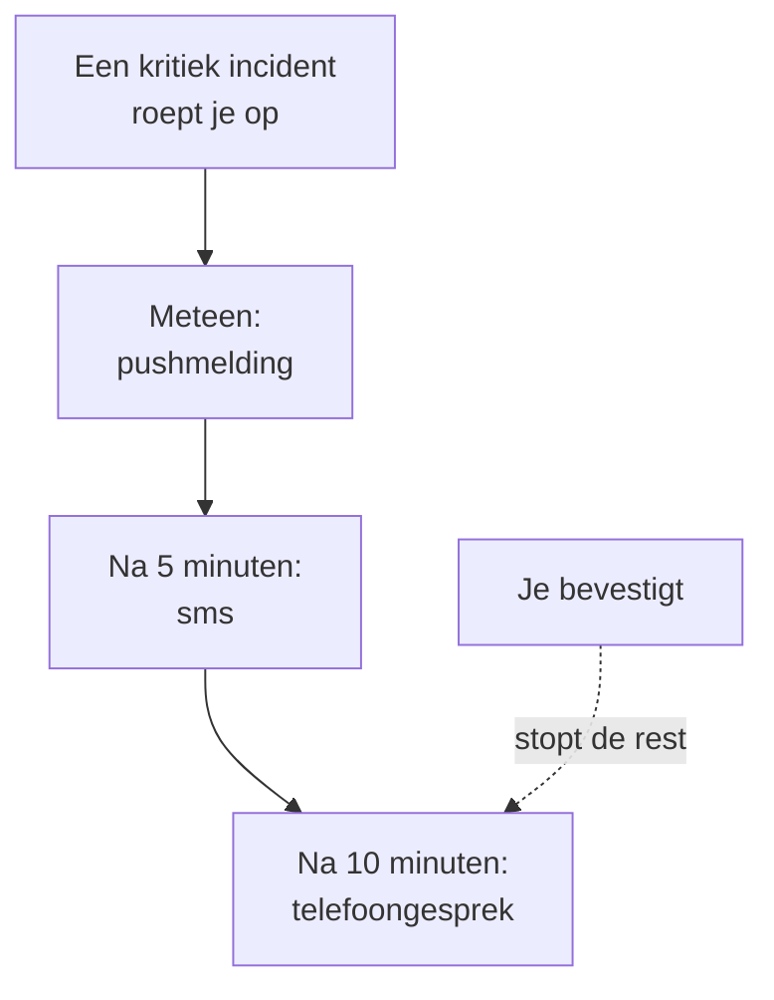

# Hoe ik bereikbaar ben

Je bereikbaarheidsregels bepalen hoe een oproep je bereikt: welke van je meldingsmethoden OneUptime probeert, en hoe lang na het begin van de oproep. Elk soort oproep heeft eigen regels, één set per ernst, zodat een kritiek incident je meteen kan bellen terwijl een lichte waarschuwing op een e-mail wacht. Je stelt ze in onder **Gebruikersinstellingen → Hoe ik bereikbaar ben**.

> [!NOTE]
> Deze regels zijn alleen van jou. De **Bereikbaarheidsregels** onder **Incidenten → Regels** en **Waarschuwingen → Regels** zijn iets anders: die bepalen welk bereikbaarheidsbeleid een nieuw incident of een nieuwe waarschuwing uitvoert.

:::cards
- [Hoe een oproep je bereikt](#hoe-een-oproep-je-bereikt): Je regels voor één oproep, stap voor stap.
- [Eén reeks voor alles](#eén-reeks-voor-alles): De stappen die elke oproep probeert, één keer ingesteld.
- [De regels waarmee je begint](#de-regels-waarmee-je-begint): Wat elke geverifieerde methode toevoegt, en hoe je het inkort.
- [Een regel toevoegen](#een-regel-toevoegen): Een methode en een wachttijd voor één ernst.
- [Pushregels](#pushregels): Door de stille modus heen klinken, en herhalen tot iemand bevestigt.
:::

## Hoe een oproep je bereikt

Een bereikbaarheidsbeleid roept je op wanneer een van zijn escalatieregels jou noemt, een team waar je in zit, of een rooster waarin je dienst hebt. OneUptime werkt dan je regels af voor dat soort oproep en de ernst ervan: elke regel gaat af via zijn eigen methode zodra zijn wachttijd sinds het begin van de oproep voorbij is. Het incident of de waarschuwing bevestigen, vanuit elk bericht of in OneUptime, stopt elke regel die nog niet is afgegaan.

De meeste berichten kunnen de oproep bevestigen: e-mails, sms'jes en berichten via WhatsApp, Telegram, Slack, Microsoft Teams en Mattermost bevatten een bevestigingslink, en een telefoongesprek vraagt je op 1 te drukken. Kun je een oproep niet aannemen, dan kun je hem via dezelfde berichten escaleren, en een telefoongesprek vraagt je op 2 te drukken: het beleid roept meteen het volgende niveau op, en je wordt er niet meer over opgeroepen. Zie [Een oproep escaleren](/docs/on-call/escalation-rules#een-oproep-escaleren). Elke oproep die je krijgt, staat onder **Gebruikersinstellingen → Bereikbaarheidslogboeken**, waar **Tijdlijn bekijken** elk verzonden bericht toont en of het is afgeleverd.

## Eén reeks voor alles

**Gebruikersinstellingen → Hoe ik bereikbaar ben** opent met uw reeks: genummerde stappen die elke oproep op volgorde probeert, voor incidenten, waarschuwingen en episodes van elk ernstniveau. Elke stap is een moment, zoals meteen of na 5 minuten, met de geverifieerde methoden die dan samen uitgaan. Een latere stap gaat alleen uit als niemand de oproep tegen die tijd heeft bevestigd.

:::steps
### Een manier toevoegen om u te bereiken

Klik bij een stap op **Toevoegen** om een van uw geverifieerde methoden op het moment van die stap te sturen, of op **Stap toevoegen** om na de laatste stap een nieuwe te beginnen. Een nummer of adres dat nog op zijn code wacht, staat onder **Nog niet geverifieerd**, met **Verifiëren**. Zonder de pagina te verlaten stuurt **Je telefoon toevoegen** onder de stappen een code naar uw nummer, en zodra het geverifieerd is, roept het nummer u op per sms en per telefoongesprek; **Deze browser gebruiken** en **Download de app** voegen push op dezelfde manier toe.

### Kiezen wanneer die wordt gebruikt

Klik op het moment van een stap, zoals **Meteen**, en kies een ander, tot een uur: de hele stap verschuift. Een push-stap zegt ook hoe die klinkt en of die herhaalt: zie [Pushregels](#pushregels).

### Opslaan

Klik op **Wijzigingen opslaan**, dat verschijnt zodra er iets is veranderd. Dat schrijft dezelfde regels in elke kaart van elk tabblad: de regels die u met de hand aan elke kaart zou toevoegen.
:::

**Test uw oproepen**, onderaan de pagina, stuurt u een testoproep via deze regels.

Als je server nu geen e-mail, sms of telefoonoproepen kan versturen, is een stap van die soort gemarkeerd met **Wordt nu niet verstuurd**, en de pagina zegt één keer wie het kan inrichten.

Verdient een ernstniveau iets anders, dan opent **Anders voor sommige ernstniveaus**, de knop naast de titel, de tabbladen en kaarten die hieronder staan beschreven. Een kaart die van uw reeks afwijkt, is gemarkeerd met **Wijkt af van de reeks**. De pagina opent nog steeds op uw stappen en vermeldt daaronder elke kaart die afwijkt en wat die in plaats daarvan doet. **Wijzigingen opslaan** laat die kaarten zoals ze zijn; **Deze reeks voor elk ernstniveau gebruiken**, aan het eind van die lijst, geeft ook hun uw reeks, nadat het de kaarten heeft genoemd die hun afwijking verliezen. Een ernstniveau dat uw project heeft gearchiveerd, houdt zijn eigen regels.

Een dienstbeleid bepaalt wie wordt opgeroepen en wanneer het volgende niveau komt. Hoe u wordt bereikt, is deze reeks, voor elk beleid dat u oproept.

## De vier tabbladen

**Gebruikersinstellingen → Hoe ik bereikbaar ben** heeft een tabblad voor elk soort oproep. Elk tabblad heeft een kaart per ernst, met de naam en de kleur die je project eraan gaf:

| Tabblad | Oproepen voor | Kaarten voor |
| --- | --- | --- |
| **Incidenten** | Incidenten | Ernstniveaus van incidenten |
| **Incidentepisodes** | Episodes die incidenten bundelen | Ernstniveaus van incidenten |
| **Waarschuwingen** | Waarschuwingen | Ernstniveaus van waarschuwingen |
| **Waarschuwingsepisodes** | Episodes die waarschuwingen bundelen | Ernstniveaus van waarschuwingen |

Een episode roept je op via zijn eigen bereikbaarheidsbeleid, los van de incidenten of waarschuwingen erin, daarom staan zijn regels op een eigen tabblad. Het adres van de pagina noemt het geopende tabblad, bijvoorbeeld `/dashboard/{projectId}/user-settings/on-call-rules?type=alerts`; de andere waarden zijn `incident-episodes` en `alert-episodes`, en zonder `type` opent de pagina op **Incidenten**.

Een ernst die uw project heeft gearchiveerd, staat na de andere, gemarkeerd met **Gearchiveerd**, zolang u er regels voor hebt: incidenten en waarschuwingen die deze ernst nog hebben, roepen u volgens die regels op. U kunt die regels wijzigen of verwijderen, maar geen nieuwe toevoegen.

## De regels waarmee je begint

Elke methode die je verifieert, krijgt een regel op elke kaart van elk tabblad, verstuurd zodra je wordt opgeroepen. Je aanmeld-e-mailadres heeft ze sinds de dag dat je lid werd, zodat een oproep je altijd bereikt. Verifieer een telefoonnummer voor sms, en elke oproep stuurt je ook een sms. Als je project een standaardreeks heeft, volgt een methode die je verifieert die in plaats daarvan: zie [De standaardreeks](#de-standaardreeks).

Dat is een veilig begin, en meestal te veel. Kort het in tot wat elke ernst verdient:

| Ernst | Een verstandige set |
| --- | --- |
| Kritiek | Meteen push, na 5 minuten een telefoongesprek |
| Groot | Meteen push, na 10 minuten een sms |
| Klein of laag | Meteen een e-mail |

Je eigen regels hebben geen stille uren: houd lage ernstniveaus op e-mail, of op een pushregel ingesteld op **Normaal**, zodat ze je nooit wakker maken. Om de oproep voor een laag ernstniveau voor iedereen op werktijden te laten wachten, zet je de bereikbaarheidsregel die oproept op **Alleen tijdens werktijden**: zie [Bereikbaarheidsregels](/docs/alerts/settings#bereikbaarheidsregels).

## De standaardreeks

Een project kan een standaardreeks hebben: hoe een lid wordt opgeroepen zodra het een manier verifieert om bereikt te worden. Een Projecteigenaar of Projectbeheerder stelt die in bij **Standaardreeks voor nieuwe leden**, ingeklapt onder **Meer instellingen** op **Projectinstellingen → Meldingen → Meldingskanalen**, met kanalen in plaats van iemands eigen apparaten: bijvoorbeeld meteen een push en na 5 minuten een telefoongesprek.

Met een standaardreeks krijgt een methode die je verifieert een regel bij elke stap van haar kanaal, op elke kaart van elk tabblad, en een kanaal dat de reeks weglaat krijgt er geen. Regels die je al hebt, veranderen nooit, en een oproep die geen regel vindt, valt nog steeds terug op je geverifieerde methoden.

Om hem te geven aan leden die al regels hebben, gebruikt een beheerder **Standaardreeks toepassen** op de pagina Gereedheid: zie [De standaardreeks toepassen](/docs/on-call/readiness#de-standaardreeks-toepassen). Ieder van hen krijgt één e-mail.

Om hem zelf te volgen, klik je op **Beginnen met de standaardreeks**, naast **Anders voor sommige ernstniveaus**. Je stappen worden die van de reeks, met je eigen geverifieerde methoden: een manier die je niet hebt geverifieerd, wordt weggelaten en genoemd, en je houdt in plaats daarvan je eigen stappen. Er verandert niets tot je op **Wijzigingen opslaan** klikt.

**Telefoon voor mensen met dienst**, ernaast, vraagt iedereen met dienst om een geverifieerd nummer voor sms, telefoongesprekken of WhatsApp. Zolang je er geen hebt, zegt deze pagina dat boven **Je telefoon toevoegen**, en Gereedheid en Inrichtingsstatus noemen je. Niemand wordt buitengesloten.

## Een regel toevoegen

:::steps
### De kaart openen

Ga naar **Gebruikersinstellingen → Hoe ik bereikbaar ben**, open het tabblad voor het soort oproep en zoek de kaart van de ernst.

### De methode kiezen

Klik op **Meldingsregel toevoegen**. Kies bij **Meldingsmethode** een van je geverifieerde methoden; een methode die je niet hebt geverifieerd, wordt niet aangeboden.

### Kiezen hoe een push klinkt

Kies voor een telefoon bij **Pushmelding** **Kritieke waarschuwing** of **Normaal**. Kies voor elk pushapparaat **Herhalen tot bevestiging**. Zie [Pushregels](#pushregels).

### De wachttijd instellen

Kies **Stel mij op de hoogte na**: **Onmiddellijk**, **5 minuten**, **10 minuten**, **15 minuten**, **30 minuten** of **1 uur**. Klik dan in het venster op **Meldingsregel toevoegen**.
:::

De kaart toont haar regels in volgorde van wachttijd, met **Meldingsmethode** en **Op de hoogte stellen na** voor elke regel.

## Een regel wijzigen of verwijderen

- **Bewerken** in de rij van een regel wijzigt de wachttijd ervan. Om een regel naar een andere methode te sturen, verwijder je hem en voeg je een nieuwe toe.
- Klik bij een pushregel op het label onder de methode om te wisselen tussen **Kritieke waarschuwing** en **Normaal**, of om te wijzigen hoe vaak hij herhaalt. Dat wordt meteen opgeslagen.
- **Verwijderen** vraagt eerst om bevestiging, en zegt of de ernst zonder regel achterblijft. Een ernst zonder regel valt terug op je geverifieerde methoden; zie [Als een ernst geen regel heeft](#als-een-ernst-geen-regel-heeft).

## Pushregels

Een regel die een telefoon oproept, bepaalt hoe zijn push klinkt:

| Keuze | Wat de telefoon doet |
| --- | --- |
| **Kritieke waarschuwing** | Gaat af, ook als de telefoon op stil staat of Niet storen aan is, zodra Critical On-Call Alerts in de app OneUptime On-Call aanstaat. Een nieuwe telefoonregel begint hier. |
| **Normaal** | Volgt de geluids-, stilte- en Niet storen-instellingen van de telefoon. |

Een pushregel, voor een telefoon of een browser, kan zijn push ook herhalen tot iemand bevestigt: **Niet herhalen**, de standaard, of **Elke minuut**, **Elke 2 minuten**, **Elke 3 minuten**, **Elke 5 minuten**, **Elke 10 minuten**, **Elke 15 minuten** of **Elke 30 minuten**. Hij herhaalt tot 10 keer extra, en stopt zodra het incident, de waarschuwing of de episode is bevestigd. Een oproep die na een bevestiging doorgaat, zoals een nieuwe oproep, herhaalt tot iemand die hij opriep antwoordt of het incident, de waarschuwing of de episode is opgelost: [Als meerdere beleidsregels oproepen](/docs/on-call/policies#als-meerdere-beleidsregels-oproepen) noemt ze. Zie [Kritieke bereikbaarheidswaarschuwingen](/docs/self-hosted/push-notifications#kritieke-dienstmeldingen-stille-modus-doorbreken).

## Als een ernst geen regel heeft

Een ernst die je project later toevoegt, krijgt binnen een paar minuten regels, gemaakt uit de keuzes die je op dat tabblad al hebt gemaakt: dezelfde methoden, na dezelfde wachttijden, en een push die net zo klinkt en net zo herhaalt. Had je op dat tabblad geen regels, dan krijgt hij je geverifieerde e-mailadres, meteen. Als je project een standaardreeks heeft, volgt je e-mailadres die in plaats daarvan: zie [De standaardreeks](#de-standaardreeks).

Een oproep die toch geen regel vindt, gaat alsnog naar je geverifieerde methoden, en je krijgt er een e-mail over; zie [Als geen regel past](/docs/notifications/index#als-geen-regel-past).

:::details Een ernst bewust uitzetten
De API kan een afmeldregel opslaan, met `isOptOut` ingesteld en zonder methode: je wordt dan helemaal niet opgeroepen voor dat soort oproep en die ernst, en er springt niets in. De rij toont **Gedempt – meldingen uitgeschakeld voor deze regel**, en hem verwijderen zet de oproepen weer aan. Een later toegevoegde ernst blijft ook stil wanneer elke regel die je op dat tabblad hebt, een afmeldregel is.
:::

:::details De terugval voor een heel project uitzetten
Een Projecteigenaar, of iemand met **Manage Billing**, kan via de API `disableOnCallNotificationFallback` van het project instellen. Een oproep die geen regel vindt, wordt dan niet afgeleverd, en het logboek ervan zegt dat de gebruiker regels moet toevoegen onder **Gebruikersinstellingen → Hoe ik bereikbaar ben**.
:::

## Regels van een teamgenoot

Projecteigenaren en Projectbeheerders kunnen dezelfde pagina voor iedereen in het project bekijken en wijzigen: onder **Gebruikers** openen ze de persoon, en dan **Hoe ik bereikbaar ben** in de sectie **Bereikbaarheid**. **Gereedheid**, ernaast, toont of elke ernst die persoon bereikt. Wanneer iemand anders je regels toevoegt, wijzigt of verwijdert, krijg je daarover een e-mail, en elke wijziging staat in het auditlogboek van het project.

## Probleemoplossing

:::details Mijn telefoon bleef stil bij een kritieke oproep
Controleer of de push van de regel **Kritieke waarschuwing** is en niet **Normaal**, en of **Kritieke waarschuwingen** aanstaat voor de telefoon onder **Gebruikersinstellingen → Meldingsmethoden**, op het tabblad **Pushmeldingen**.
:::

:::details Ik word voor elk incident twee keer opgeroepen
Elke geverifieerde methode heeft een regel voor elke ernst, die meteen wordt verstuurd. Verwijder de regels die je niet wilt, of geef ze een wachttijd. Een incident in een episode kan je één keer voor het incident en één keer voor de episode oproepen, via twee beleidsregels.
:::

:::details Ik kreeg een e-mail terwijl mijn regel sms zegt
De oproep vond geen regel voor zijn soort of ernst, en viel terug op je gratis methoden: voeg de regel toe op het juiste tabblad en de juiste kaart. Of de e-mail was nieuws over een item van jou, en dat volgt **Meldingsinstellingen**, niet je regels. Je **Bereikbaarheidslogboeken** tonen alleen oproepen.
:::

## Volgende stappen

:::cards
- [Meldingsmethoden](/docs/notifications/notification-methods): Voeg de methoden toe waar je regels naar wijzen, en verifieer ze.
- [Escalatieregels](/docs/on-call/escalation-rules): Hoe een bereikbaarheidsbeleid mensen niveau voor niveau oproept.
- [Pushmeldingen](/docs/self-hosted/push-notifications): Kritieke waarschuwingen, alarmgeluiden en herhalingen op telefoons.
- [Hoe OneUptime je bereikt](/docs/notifications/index): Hoe methoden, regels en instellingen samenhangen.
:::
