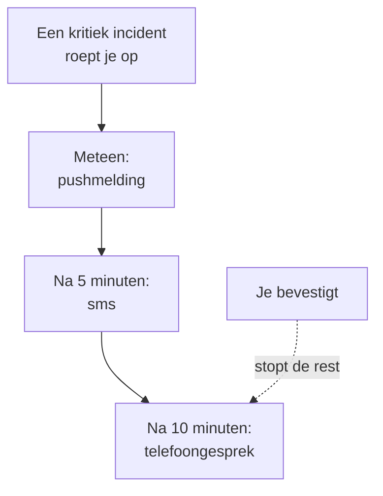

# Persoonlijke bereikbaarheidsregels

Je bereikbaarheidsregels bepalen hoe een oproep je bereikt: welke van je meldingsmethoden OneUptime probeert, en hoe lang na het begin van de oproep. Elk soort oproep heeft eigen regels, één set per ernst, zodat een kritiek incident je meteen kan bellen terwijl een lichte waarschuwing op een e-mail wacht. Je stelt ze in onder **Gebruikersinstellingen → Bereikbaarheidsregels**.

> [!NOTE]
> Deze regels zijn alleen van jou. De **Bereikbaarheidsregels** onder **Incidenten → Regels** en **Waarschuwingen → Regels** zijn iets anders: die bepalen welk bereikbaarheidsbeleid een nieuw incident of een nieuwe waarschuwing uitvoert.

:::cards
- [Hoe een oproep je bereikt](#hoe-een-oproep-je-bereikt): Je regels voor één oproep, stap voor stap.
- [De regels waarmee je begint](#de-regels-waarmee-je-begint): Wat elke geverifieerde methode toevoegt, en hoe je het inkort.
- [Een regel toevoegen](#een-regel-toevoegen): Een methode en een wachttijd voor één ernst.
- [Pushregels](#pushregels): Door de stille modus heen klinken, en herhalen tot iemand bevestigt.
:::

## Hoe een oproep je bereikt

Een bereikbaarheidsbeleid roept je op wanneer een van zijn escalatieregels jou noemt, een team waar je in zit, of een rooster waarin je dienst hebt. OneUptime werkt dan je regels af voor dat soort oproep en de ernst ervan: elke regel gaat af via zijn eigen methode zodra zijn wachttijd sinds het begin van de oproep voorbij is. Het incident of de waarschuwing bevestigen, vanuit elk bericht of in OneUptime, stopt elke regel die nog niet is afgegaan.

De meeste berichten kunnen de oproep bevestigen: e-mails, sms'jes en berichten via WhatsApp, Telegram, Slack en Microsoft Teams bevatten een bevestigingslink, en een telefoongesprek vraagt je op 1 te drukken. Kun je een oproep niet aannemen, dan kun je hem via dezelfde berichten escaleren, en een telefoongesprek vraagt je op 2 te drukken: het beleid roept meteen het volgende niveau op, en je wordt er niet meer over opgeroepen. Zie [Een oproep escaleren](/docs/on-call/escalation-rules#een-oproep-escaleren). Elke oproep die je krijgt, staat onder **Gebruikersinstellingen → Bereikbaarheidslogboeken**, waar **Tijdlijn bekijken** elk verzonden bericht toont en of het is afgeleverd.

## De vier tabbladen

**Gebruikersinstellingen → Bereikbaarheidsregels** heeft een tabblad voor elk soort oproep. Elk tabblad heeft een kaart per ernst, met de naam en de kleur die je project eraan gaf:

| Tabblad | Oproepen voor | Kaarten voor |
| --- | --- | --- |
| **Incidenten** | Incidenten | Ernstniveaus van incidenten |
| **Incidentepisodes** | Episodes die incidenten bundelen | Ernstniveaus van incidenten |
| **Waarschuwingen** | Waarschuwingen | Ernstniveaus van waarschuwingen |
| **Waarschuwing Episodes** | Episodes die waarschuwingen bundelen | Ernstniveaus van waarschuwingen |

Een episode roept je op via zijn eigen bereikbaarheidsbeleid, los van de incidenten of waarschuwingen erin, daarom staan zijn regels op een eigen tabblad. Het adres van de pagina noemt het geopende tabblad, bijvoorbeeld `/dashboard/{projectId}/user-settings/on-call-rules?type=alerts`; de andere waarden zijn `incident-episodes` en `alert-episodes`, en zonder `type` opent de pagina op **Incidenten**.

Een ernst die uw project heeft gearchiveerd, staat na de andere, gemarkeerd met **Gearchiveerd**, zolang u er regels voor hebt: incidenten en waarschuwingen die deze ernst nog hebben, roepen u volgens die regels op. U kunt die regels wijzigen of verwijderen, maar geen nieuwe toevoegen.

## De regels waarmee je begint

Elke methode die je verifieert, krijgt een regel op elke kaart van elk tabblad, verstuurd zodra je wordt opgeroepen. Je aanmeld-e-mailadres heeft ze sinds de dag dat je lid werd, zodat een oproep je altijd bereikt. Verifieer een telefoonnummer voor sms, en elke oproep stuurt je ook een sms.

Dat is een veilig begin, en meestal te veel. Kort het in tot wat elke ernst verdient:

| Ernst | Een verstandige set |
| --- | --- |
| Kritiek | Meteen push, na 5 minuten een telefoongesprek |
| Groot | Meteen push, na 10 minuten een sms |
| Klein of laag | Meteen een e-mail |

Je eigen regels hebben geen stille uren: houd lage ernstniveaus op e-mail, of op een pushregel ingesteld op **Normaal**, zodat ze je nooit wakker maken. Om de oproep voor een laag ernstniveau voor iedereen op werktijden te laten wachten, zet je de bereikbaarheidsregel die oproept op **Alleen tijdens werktijden**: zie [Bereikbaarheidsregels](/docs/alerts/settings#bereikbaarheidsregels).

## Een regel toevoegen

:::steps
### De kaart openen

Ga naar **Gebruikersinstellingen → Bereikbaarheidsregels**, open het tabblad voor het soort oproep en zoek de kaart van de ernst.

### De methode kiezen

Klik op **Melding Regel toevoegen**. Kies bij **Meldingsmethode** een van je geverifieerde methoden; een methode die je niet hebt geverifieerd, wordt niet aangeboden.

### Kiezen hoe een push klinkt

Kies voor een telefoon bij **Pushmelding** **Kritieke waarschuwing** of **Normaal**. Kies voor elk pushapparaat **Herhalen tot bevestiging**. Zie [Pushregels](#pushregels).

### De wachttijd instellen

Kies **Stel mij op de hoogte na**: **Onmiddellijk**, **5 minuten**, **10 minuten**, **15 minuten**, **30 minuten** of **1 uur**. Klik dan in het venster op **Melding Regel toevoegen**.
:::

De kaart toont haar regels in volgorde van wachttijd, met **Meldingsmethode** en **Op de hoogte stellen na** voor elke regel.

## Een regel wijzigen of verwijderen

- **Bewerken** in de rij van een regel wijzigt de wachttijd ervan. Om een regel naar een andere methode te sturen, verwijder je hem en voeg je een nieuwe toe.
- Klik bij een pushregel op het label onder de methode om te wisselen tussen **Kritieke waarschuwing** en **Normaal**, of om te wijzigen hoe vaak hij herhaalt. Dat wordt meteen opgeslagen.
- **Verwijderen** vraagt eerst om bevestiging, en zegt of de ernst zonder regel achterblijft. Een ernst zonder regel valt terug op je geverifieerde methoden; zie [Als een ernst geen regel heeft](#als-een-ernst-geen-regel-heeft).

## Pushregels

Een regel die een telefoon oproept, bepaalt hoe zijn push klinkt:

| Keuze | Wat de telefoon doet |
| --- | --- |
| **Kritieke waarschuwing** | Gaat af, ook als de telefoon op stil staat of Niet storen aan is, zodra Critical On-Call Alerts in de app OneUptime On-Call aanstaat. Een nieuwe telefoonregel begint hier. |
| **Normaal** | Volgt de geluids-, stilte- en Niet storen-instellingen van de telefoon. |

Een pushregel, voor een telefoon of een browser, kan zijn push ook herhalen tot iemand bevestigt: **Niet herhalen**, de standaard, of **Elke minuut**, **Elke 2 minuten**, **Elke 3 minuten**, **Elke 5 minuten**, **Elke 10 minuten**, **Elke 15 minuten** of **Elke 30 minuten**. Hij herhaalt tot 10 keer extra, en stopt zodra het incident, de waarschuwing of de episode is bevestigd. Zie [Kritieke bereikbaarheidswaarschuwingen](/docs/self-hosted/push-notifications#kritieke-dienstmeldingen-stille-modus-doorbreken).

## Als een ernst geen regel heeft

Een ernst die je project later toevoegt, krijgt binnen een paar minuten regels, gemaakt uit de keuzes die je op dat tabblad al hebt gemaakt: dezelfde methoden, na dezelfde wachttijden. Had je op dat tabblad geen regels, dan krijgt hij je geverifieerde e-mailadres, meteen.

Een oproep die toch geen regel vindt, gaat alsnog naar je geverifieerde methoden, en je krijgt er een e-mail over; zie [Als geen regel past](/docs/notifications/index#als-geen-regel-past).

:::details Een ernst bewust uitzetten
De API kan een afmeldregel opslaan, met `isOptOut` ingesteld en zonder methode: je wordt dan helemaal niet opgeroepen voor dat soort oproep en die ernst, en er springt niets in. De rij toont **Muted - notifications turned off for this rule**, en hem verwijderen zet de oproepen weer aan. Een later toegevoegde ernst blijft ook stil wanneer elke regel die je op dat tabblad hebt, een afmeldregel is.
:::

:::details De terugval voor een heel project uitzetten
Een projecteigenaar, of iemand met **Manage Billing**, kan via de API `disableOnCallNotificationFallback` van het project instellen. Een oproep die geen regel vindt, wordt dan niet afgeleverd, en het logboek ervan zegt dat de gebruiker regels moet toevoegen onder **Gebruikersinstellingen → Bereikbaarheidsregels**.
:::

## Regels van een teamgenoot

Projecteigenaren en -beheerders kunnen dezelfde pagina voor iedereen in het project bekijken en wijzigen: onder **Gebruikers** openen ze de persoon, en dan **Bereikbaarheidsregels** in de sectie **Bereikbaarheid**. **Gereedheid**, ernaast, toont of elke ernst die persoon bereikt. Wanneer iemand anders je regels toevoegt, wijzigt of verwijdert, krijg je daarover een e-mail, en elke wijziging staat in het auditlogboek van het project.

## Probleemoplossing

:::details Mijn telefoon bleef stil bij een kritieke oproep
Controleer of de push van de regel **Kritieke waarschuwing** is en niet **Normaal**, en of **Kritieke waarschuwingen** aanstaat voor de telefoon onder **Gebruikersinstellingen → Meldingsmethoden**, op het tabblad **Push Notifications**.
:::

:::details Ik word voor elk incident twee keer opgeroepen
Elke geverifieerde methode heeft een regel voor elke ernst, die meteen wordt verstuurd. Verwijder de regels die je niet wilt, of geef ze een wachttijd. Een incident in een episode kan je één keer voor het incident en één keer voor de episode oproepen, via twee beleidsregels.
:::

:::details Ik kreeg een e-mail terwijl mijn regel sms zegt
De oproep vond geen regel voor zijn soort of ernst, en viel terug op je gratis methoden: voeg de regel toe op het juiste tabblad en de juiste kaart. Of de e-mail was nieuws over een item van jou, en dat volgt **Meldingsinstellingen**, niet je regels. Je **Bereikbaarheidslogboeken** tonen alleen oproepen.
:::

## Volgende stappen

:::cards
- [Meldingsmethoden](/docs/notifications/notification-methods): Voeg de methoden toe waar je regels naar wijzen, en verifieer ze.
- [Escalatieregels](/docs/on-call/escalation-rules): Hoe een bereikbaarheidsbeleid mensen niveau voor niveau oproept.
- [Pushmeldingen](/docs/self-hosted/push-notifications): Kritieke waarschuwingen, alarmgeluiden en herhalingen op telefoons.
- [Hoe OneUptime je bereikt](/docs/notifications/index): Hoe methoden, regels en instellingen samenhangen.
:::
