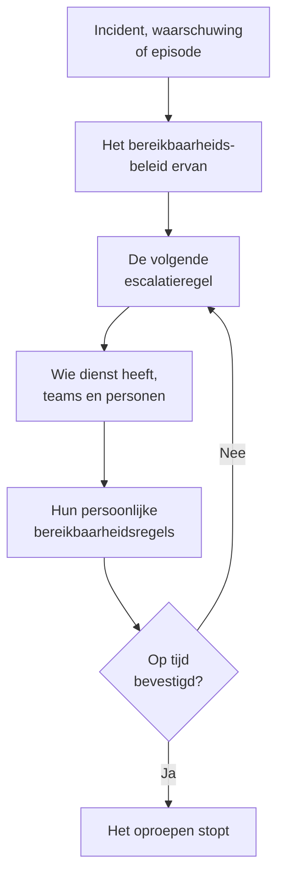

# Bereikbaarheid – Overzicht

Bereikbaarheidsdienst is hoe OneUptime iemand op elk uur bij een probleem krijgt. Als een incident, een waarschuwing of een episode iemand nodig heeft, roept het bereikbaarheidsbeleid ervan mensen niveau voor niveau op tot iemand bevestigt, en elke persoon wordt bereikt zoals die dat heeft gekozen: een pushmelding, een sms, een oproep, een e-mail of een chatbericht. Deze pagina laat zien hoe de onderdelen samenhangen en waar elk onderdeel staat.

:::cards
- [Hoe een oproep iemand bereikt](#hoe-een-oproep-iemand-bereikt): Van een nieuw incident tot de persoon die antwoordt.
- [De bouwstenen](#de-bouwstenen): Beleid, escalatieregels, schema's, overschrijvingen en persoonlijke regels.
- [Bereikbaarheid instellen](#bereikbaarheid-instellen): Van niets tot een team dat wordt opgeroepen, in vijf stappen.
- [Waar de bereikbaarheid staat](#waar-de-bereikbaarheid-staat): Het menu Bereikbaarheidsdienst, sectie voor sectie.
:::

## Hoe een oproep iemand bereikt

1. Een nieuw incident, een nieuwe waarschuwing of episode voert meteen het bereikbaarheidsbeleid uit dat het heeft: het beleid dat erop is gekozen en het beleid dat de bereikbaarheidsregels toevoegen. Elk beleid loopt op zichzelf. Een bereikbaarheidsregel op **Alleen tijdens werktijden** laat het beleid dat ze toevoegt wachten tot die tijden beginnen.
2. De eerste escalatieregel van een beleid roept meteen op: wie nu dienst heeft in de schema's ervan, elk lid van de teams ervan en de personen die de regel noemt.
3. Is een van hen afwezig, dan stuurt een gebruikersoverschrijving de oproep naar de persoon die vervangt, of slaat die persoon over.
4. Elke persoon wordt bereikt via de eigen persoonlijke bereikbaarheidsregels: welke methode wordt geprobeerd en na hoeveel tijd. Een oproep zonder regel bereikt de persoon toch via de methoden die die heeft geverifieerd.
5. Bevestigt niemand voordat de wachttijd van de regel voorbij is, dan roept de volgende regel op. Na de laatste begint het beleid opnieuw als het zich herhaalt, en anders stopt het.

Het incident, de waarschuwing of de episode bevestigen of oplossen stopt elk beleid dat er nog voor oproept. OneUptime brengt lopend beleid elke minuut een stap verder en legt elke uitvoering, regel voor regel, vast in **Uitvoeringslogboeken**.

De eerste keer dat een oproep iemand bereikt, legt OneUptime dat vast op het incident, de waarschuwing of de episode als `First Paged At`. Een meting kan vanaf dat moment tellen: **Tijd tot bevestiging na de oproep** meet hoe lang mensen erover deden om te antwoorden nadat ze waren opgeroepen, niet hoe lang het incident, de waarschuwing of de episode wachtte voordat er iemand werd opgeroepen. Zie [Tijd tot bevestiging na de oproep](/docs/incidents/settings#tijd-tot-bevestiging-na-de-oproep).

> [!NOTE]
> Een incident, waarschuwing of episode die al bevestigd of opgelost wordt aangemaakt, voert geen enkel beleid uit, en de feed ervan zegt dat. Zie [Al bevestigd of opgelost aangemaakt](/docs/alerts/index#al-bevestigd-of-opgelost-aangemaakt).

## De bouwstenen

| Bouwsteen | Wat die bepaalt | Meer lezen |
| --- | --- | --- |
| Bereikbaarheidsbeleid | Wie wordt opgeroepen voor een incident of waarschuwing, niveau voor niveau | [Bereikbaarheidsbeleid](/docs/on-call/policies) |
| Escalatieregel | Eén niveau van een beleid: wie het oproept en hoe lang het op een bevestiging wacht | [Escalatieregels](/docs/on-call/escalation-rules) |
| Bereikbaarheidsschema | Wie op elk moment dienst heeft, om de beurt | [Bereikbaarheidsschema's](/docs/on-call/schedules) |
| Gebruikersoverschrijving | Wie iemand vervangt terwijl die afwezig is | [Gebruikersoverschrijvingen](/docs/on-call/user-overrides) |
| Persoonlijke bereikbaarheidsregels | Hoe één persoon wordt bereikt: via welke methode en na hoeveel tijd | [Persoonlijke bereikbaarheidsregels](/docs/notifications/on-call-rules) |
| Beleid voor inkomende oproepen | Een telefoonnummer dat overgaat bij wie dienst heeft | [Beleid voor inkomende oproepen](/docs/on-call/incoming-call-policy) |

Beleid, escalatieregels, schema's en overschrijvingen horen bij het project, onder **Bereikbaarheidsdienst**. Meldingsmethoden en persoonlijke bereikbaarheidsregels horen bij elke persoon zelf, onder **Gebruikersinstellingen**: een beheerder kan de instellingen van iemand bekijken, maar alleen die persoon kan de eigen telefoon of e-mail verifiëren. Zie [Hoe OneUptime je bereikt](/docs/notifications/index).

## Bereikbaarheid instellen

:::steps
### Een schema maken

Open **Bereikbaarheidsdienst** via het menu **Producten** en ga naar **Bereikbaarheidsschema's**. Klik op **Bereikbaarheidsschema maken**, geef het een naam en kies onder **Wie wisselen elkaar af?** de personen in de volgorde waarin ze elkaar afwisselen. Zie [Bereikbaarheidsschema's](/docs/on-call/schedules).

### Een beleid maken

Ga naar **Bereikbaarheidsbeleid** en klik op **Bereikbaarheidsbeleid aanmaken**. Kies onder **Wie wordt als eerste opgeroepen?** het schema. Het wordt de eerste escalatieregel van het beleid, **Level 1**, die 30 minuten op een bevestiging wacht.

### De volgende niveaus toevoegen

Klik op de pagina **Escalatieregels** van het beleid op **Escalatieregel toevoegen** voor elk niveau na het eerste: de volgende persoon in de rotatie van hetzelfde schema, een teamleider, een manager. Zie [Escalatieregels](/docs/on-call/escalation-rules).

### Het beleid automatisch uitvoeren

Het eerste beleid van een project kan dit al bij het aanmaken: laat **Activeren bij elk nieuw incident en elke nieuwe waarschuwing** aan staan. Voor elk ander beleid gaat u naar **Incidenten → Regels → Bereikbaarheidsregels** of **Waarschuwingen → Regels → Bereikbaarheidsregels** en voegt u een regel toe die het uitvoert voor de incidenten of waarschuwingen die erbij passen, bijvoorbeeld elk kritiek incident. Zie [Wat een beleid uitvoert](/docs/on-call/policies#wat-een-beleid-uitvoert).

### Controleren of iedereen bereikbaar is

Open **Bereikbaarheidsdienst → Gereedheid**. Iedereen die je beleid kan oproepen staat daar als **Gereed**, **Moet worden ingesteld** of **Onbereikbaar**, met wat er ontbreekt. Zie [Gereedheid en rapporten](/docs/on-call/readiness).
:::

> [!NOTE]
> In OneUptime Cloud zitten bereikbaarheidsbeleid en escalatieregels in elk abonnement. Bereikbaarheidsschema's, gebruikersoverschrijvingen, uitvoeringslogboeken en het rapport over bereikbaarheidstijd hebben het abonnement **Growth** nodig.

## Waar de bereikbaarheid staat

Open **Bereikbaarheidsdienst** via het menu **Producten** in de bovenste balk. Het opent op **Bereikbaarheidsbeleid**, op `/dashboard/{projectId}/on-call-duty/policies`, en het zijmenu bevat de rest:

| Sectie | Pagina's |
| --- | --- |
| **Beleidsregels** | **Bereikbaarheidsbeleid** en **Gereedheid**: wie je beleid echt bereikt |
| **Schema's** | **Bereikbaarheidsschema's**, **Tijdlijn van bereikbaarheidsschema's** en **Agendafeeds** |
| **Inkomende gesprekken** | **Beleid inkomende gesprekken**: een telefoonnummer dat overgaat bij wie dienst heeft |
| **Geavanceerd** | **Gebruikersoverschrijvingen**, **Uitvoeringslogboeken** en **Gearchiveerde beleidsregels** |
| **Rapporten** | **Bereikbaarheidstijd gebruiker**: hoe lang elke persoon dienst had |
| **Werkruimte** | **Slack** en **Microsoft Teams**: regels die bereikbaarheidsgebeurtenissen in een kanaal plaatsen |
| **Instellingen** | **Aangepaste velden**, **Labelregels** en **Eigenaarsregels** |
| **Ontwikkelaars** | **Terraform**, **API** en **AI-assistenten**: bereikbaarheid ingericht vanuit code |

**Beleidsregels**, **Schema's** en **Inkomende gesprekken** staan open; de andere secties beginnen ingeklapt, en een sectie gaat vanzelf open als je op een van de pagina's ervan bent. **Werkruimte** toont de chattools die het project heeft gekoppeld, of **Slack of Teams koppelen** als het er geen heeft.

Als je dienst hebt voor een beleid, laat de bel rechtsboven dat zien. Klik erop om **Mijn bereikbaarheidsbeleid** te openen: elk beleid waarvoor je dienst hebt, in al je projecten, en of je er direct in staat, via een team of via een schema.

## Probleemoplossing

:::details Niemand werd opgeroepen voor een nieuw incident
Open de pagina **Bereikbaarheidsuitvoeringen** van het incident. Is die leeg, dan had het incident geen bereikbaarheidsbeleid: er is er geen op gekozen en geen bereikbaarheidsregel paste erbij. Een uitvoering met **Execution Completed - No One Notified** is door elke escalatieregel gegaan zonder iemand te vinden: meestal een schema waarin niemand dienst heeft. Zie [Uitvoeringslogboeken](/docs/on-call/policies#uitvoeringslogboeken). Een uitvoering met **Wachten** wacht op werktijden, voor een bereikbaarheidsregel op **Alleen tijdens werktijden**, en roept niemand op tot ze beginnen.
:::

:::details Iemand werd via het verkeerde kanaal opgeroepen, of helemaal niet
Open **Bereikbaarheidsdienst → Gereedheid** en klik op **Coverage** in de rij van die persoon. Je ziet de methoden die die heeft geverifieerd en elke ernst waarvoor die geen regel heeft. Alleen die persoon kan dat oplossen, onder **Gebruikersinstellingen**: stuur een herinnering om de instellingen af te ronden vanaf dezelfde pagina. Zie [Gereedheid en rapporten](/docs/on-call/readiness). Op OneUptime Cloud kan een telefoon die onbekende bellers blokkeert een oproep stilzetten: zet [de nummers van OneUptime](/docs/on-call/phone-number-whitelist) op de lijst met toegestane nummers.
:::

:::details Iemand op vakantie wordt nog steeds opgeroepen
Voeg een gebruikersoverschrijving toe met die persoon onder **Wie is afwezig?**. Een overschrijving onder **Bereikbaarheidsdienst → Geavanceerd → Gebruikersoverschrijvingen** geldt voor elk beleid; een op de pagina **Gebruikersoverschrijvingen** van een beleid geldt alleen voor dat beleid. Zie [Gebruikersoverschrijvingen](/docs/on-call/user-overrides).
:::

## Volgende stappen

:::cards
- [Bereikbaarheidsbeleid](/docs/on-call/policies): Een beleid maken, bepalen wat het uitvoert en nalezen wat het deed.
- [Escalatieregels](/docs/on-call/escalation-rules): Mensen niveau voor niveau oproepen tot iemand reageert.
- [Bereikbaarheidsschema's](/docs/on-call/schedules): Roosters, lagen en overdrachten.
- [Hoe OneUptime je bereikt](/docs/notifications/index): De methoden en regels die bepalen hoe elke persoon wordt bereikt.
:::
