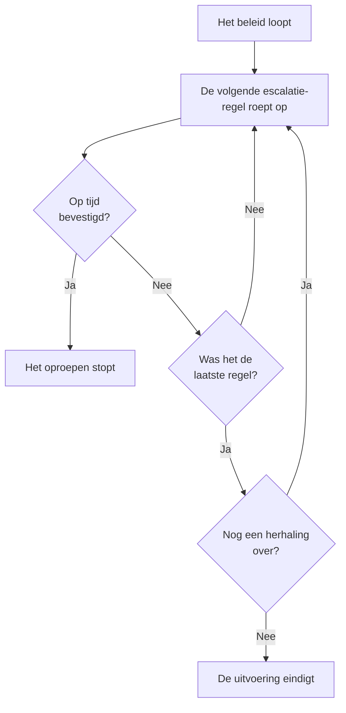

# Bereikbaarheidsbeleid

Een bereikbaarheidsbeleid bepaalt wie wordt opgeroepen voor een incident of waarschuwing, en wie de volgende is als niemand bevestigt. De escalatieregels ervan zijn de niveaus, en de incidenten, waarschuwingen en episodes die het gebruiken, voeren het uit. Deze pagina behandelt het maken van een beleid, wat het uitvoert, wat de pagina's ervan tonen en hoe elke uitvoering wordt vastgelegd.

:::cards
- [Een beleid maken](#een-beleid-maken): Een naam, en wie als eerste wordt opgeroepen.
- [Wat een beleid uitvoert](#wat-een-beleid-uitvoert): Regels, sjablonen, monitors, chat en jijzelf.
- [Uitvoeringslogboeken](#uitvoeringslogboeken): Elke uitvoering, regel voor regel, en waarom die stopte.
- [Een beleid archiveren of verwijderen](#een-beleid-archiveren-of-verwijderen): Een beleid uit dienst nemen.
:::

## Een beleid maken

:::steps
1. Ga naar **Bereikbaarheid → Bereikbaarheidsbeleid** en klik op **Bereikbaarheidsbeleid aanmaken**.
2. Vul een **Naam** in, bijvoorbeeld "Betalingen primair". Een naam die een ander beleid van het project al heeft, ook een gearchiveerd beleid, wordt geweigerd, ongeacht hoofdletters en spaties, zodat elke keuzelijst ze uit elkaar houdt.
3. Klik onder **Wie wordt als eerste opgeroepen?** op **Ontvanger toevoegen** en kies de bereikbaarheidsschema's, teams en personen die als eerste worden opgeroepen.
4. Klik op **Bereikbaarheidsbeleid aanmaken**. Het beleid opent op de pagina **Escalatieregels**, met **Level 1** al op zijn plek.
:::

**Wie wordt als eerste opgeroepen?** is optioneel en wordt alleen gevraagd aan wie escalatieregels mag toevoegen: blijft het leeg, dan roept het beleid niemand op tot het een regel heeft. **Beschrijving** en **Labels** staan onder **Meer velden**. Hoe je de volgende niveaus toevoegt, lees je bij [Escalatieregels](/docs/on-call/escalation-rules).

Het formulier vraagt ook **Activeren bij elk nieuw incident en elke nieuwe waarschuwing**, aan wie bereikbaarheidsregels mag toevoegen. Het voegt een regel toe onder **Incidenten → Regels → Bereikbaarheidsregels** en een onder **Waarschuwingen → Regels → Bereikbaarheidsregels**, die elk bij alles passen en dit beleid uitvoeren. Bij het eerste beleid van een project staat het aan, zolang het project geen bereikbaarheidsbeleid en geen bereikbaarheidsregel heeft, en bij elk later beleid uit: twee beleidsregels activeren bij elk nieuw incident en elke nieuwe waarschuwing is een bewuste keuze. Staat het uit, dan roept het beleid niemand op totdat een regel, een monitor of iemand het uitvoert.

Wilt u liever stap voor stap begeleid worden, van uw telefoon tot een testoproep, klik dan op **Begeleide installatie**: in de lege lijst **Bereikbaarheidsbeleid** of onder **Hoe het werkt**. Zie [Opgeroepen worden via telefoon, sms of push](/docs/guides/paging).

De lijst **Bereikbaarheidsbeleid** toont van elk beleid **Naam**, **Eerst opgeroepen**, **Beschrijving**, **Labels** en **Eigenaren**. **Eerst opgeroepen** geeft aan wie de eerste escalatieregel van het beleid oproept: de bereikbaarheidsschema's ervan, elk met wie er nu dienst heeft, de teams ervan en de personen die de regel noemt, of **Geen escalatieregels** of **Geen ontvangers** als het beleid niemand oproept. Selecteer beleid om **Labels toevoegen**, **Labels verwijderen**, **Eigenaar toevoegen**, **Eigenaar verwijderen**, **Archiveren** of **JSON exporteren** uit te voeren, of om het te verwijderen. **JSON importeren** maakt beleid aan uit een export: een export bevat de eigen instellingen van een beleid, niet de escalatieregels of eigenaren ervan. Een beleid met dezelfde naam als een ander beleid, uit de tijd dat namen nog niet hoefden te verschillen, is gemarkeerd met **Zelfde naam als een ander beleid**, en de lijst zegt hoeveel het er zijn: vergelijk hun escalatieregels en hernoem er dan één met **Hernoemen** in de rij ervan.

## Wat een beleid uitvoert

Een beleid roept niemand op tot iets het uitvoert. Elk incident, elke waarschuwing en elke episode voert het beleid dat het heeft uit zodra het wordt aangemaakt:

| Wat | Hoe het beleid wordt toegevoegd | Meer lezen |
| --- | --- | --- |
| Het record zelf | Het veld **Bereikbaarheidsbeleid** bij het aanmaken van een incident of waarschuwing, een incidentsjabloon, of het ingeklapte deel **Bereikbaarheid** in de criteria van een monitor | [Een incident melden](/docs/incidents/declaring-incidents) |
| Bereikbaarheidsregels | **Incidenten → Regels → Bereikbaarheidsregels** en **Waarschuwingen → Regels → Bereikbaarheidsregels** voegen het beleid van elke passende regel toe | [Bereikbaarheidsregels voor incidenten](/docs/incidents/settings#bereikbaarheidsregels-voor-incidenten) |
| Groeperingsregels | Een groeperingsregel voert het eigen beleid uit wanneer die een episode opent | [Waarschuwingsepisoden en groeperingsregels](/docs/alerts/episodes) |
| Met de hand | **Bereikbaarheidsdienstbeleid uitvoeren**, in het menu **Acties** van een feed, of bij een bericht in Slack of Microsoft Teams | [De incidentfeed](/docs/incidents/notes-owners-and-feed#de-incidentfeed) |
| Chat en workflows | `/oneuptime page` in Slack of Microsoft Teams, en de stap **Page an On-Call Policy** van een workflow | [Paging](/docs/workflows/components#paging) |

Een beleid dat meerdere regels toevoegen, loopt één keer. Een ernst voert nooit zelf een beleid uit: dat doet een bereikbaarheidsregel die bij die ernst past. Een incident of waarschuwing die al bevestigd of opgelost wordt aangemaakt, voert geen enkel beleid uit. Een bereikbaarheidsregel op **Alleen tijdens werktijden** laat het beleid dat ze toevoegt wachten tot die tijden beginnen.

## De pagina's van een beleid

Open een beleid vanuit de lijst. Het zijmenu ervan bevat alles over het beleid:

| Sectie | Pagina's |
| --- | --- |
| **Basis** | **Overzicht**, **Escalatieregels** en **Eigenaren** |
| **Logboeken** | **Uitvoeringslogboeken** en **Meldingslogboeken** |
| **Ontwikkelaars** | **Terraform**, **Crossplane**, **API**, **CLI** en **AI-assistenten** |
| **Geavanceerd** | **Gebruikersoverschrijvingen**, **Aangepaste velden**, **Instellingen**, **Auditlogboeken** en **Beleid verwijderen** |

**Basis** staat open; de andere secties beginnen ingeklapt tot je erop klikt.

- **Overzicht** toont de **Details bereikbaarheidsbeleid**, dan **Beleid in één oogopslag**: hoeveel niveaus en ontvangers het beleid heeft, hoe lang het duurt tot het laatste niveau en hoe vaak het zich herhaalt. **Gereedheid van ontvangers** zegt of iedereen die het kan oproepen nu bereikbaar is, en **Feed van het bereikbaarheidsbeleid** toont wat er is veranderd: toegevoegde of verwijderde personen, teams en schema's, overschrijvingen en overdrachten. Zijn regels voor Slack, Microsoft Teams en Mattermost plaatsen ze in je kanalen, een overdracht in één regel: zie [Dienstberichten](/docs/workspace-connections/slack#dienstberichten).
- **Eigenaren** zijn de personen en teams die verantwoordelijk zijn voor het beleid. Vindt een oproep van het beleid voor iemand geen regel, of kan die niet worden afgeleverd, dan krijgen zij een e-mail; een beleid zonder eigenaren mailt in plaats daarvan de Projecteigenaren.
- **Meldingslogboeken** toont elk bericht dat het beleid stuurde, met een tabblad per kanaal.
- **Gebruikersoverschrijvingen** vervangt personen alleen in dit beleid. Zie [Gebruikersoverschrijvingen](/docs/on-call/user-overrides).
- **Instellingen** bevat **Bereikbaarheidsbeleid exporteren** en de kaart die het beleid archiveert.

**Wat dit beleid activeert**, op het **Overzicht**, toont de bereikbaarheidsregels, de monitoren waarvan de criteria het beleid activeren, de sjablonen en andere regels die het activeren, en de workflows die dat doen, elk met een link. Een uitgeschakelde regel toont **Uit**. Activeert niets het beleid, dan zegt de kaart het: het roept niemand op totdat iets het activeert. Het beleid verwijderen of archiveren zegt eerst hetzelfde. Wat u niet mag openen, wordt geteld maar niet genoemd.

## Een beleid herhalen

Loopt de wachttijd van het laatste niveau af zonder dat iemand bevestigt, dan stopt een beleid, tenzij het zich herhaalt. Open om dat te kiezen de pagina **Escalatieregels** van het beleid en klik op **Bewerken** op de kaart **Herhaalbeleid** onder de regels. **Herhaalbeleid bewerken** vraagt **Als niemand bevestigt na het laatste niveau**:

| Antwoord | Wat het doet |
| --- | --- |
| **Stoppen met oproepen** | Niemand wordt opnieuw opgeroepen, dus het beleid loopt één keer. Een nieuw beleid begint met dit antwoord. |
| **Opnieuw beginnen bij Level 1** | Elk niveau wordt opnieuw opgeroepen, op volgorde. **Hoe vaak nog?** zegt hoe vaak: 1 of meer. |

Een beleid dat nog drie keer opnieuw begint, gaat in totaal vier keer door zijn niveaus. Een ronde waarin geen enkel niveau iemand had om op te roepen, wordt niet herhaald: een volgende zou ook niemand oproepen, dus het beleid stopt. De regel **Na het laatste niveau** op de kaart zegt wat het beleid doet, en **Beleid in één oogopslag** op het **Overzicht** zegt hetzelfde in woorden.

## Opnieuw oproepen als het niet is opgelost

Bevestigen stopt het oproepen van een beleid voorgoed, ook als daarna niemand het incident of de waarschuwing oplost. Een beleid kan in plaats daarvan opnieuw oproepen: open de pagina **Escalatieregels** ervan, open onderaan **Meer instellingen** en klik op **Bewerken** op de kaart **Time-out na bevestiging**. **Time-out na bevestiging bewerken** vraagt **Als het bevestigd maar niet opgelost is**:

| Antwoord | Wat het doet |
| --- | --- |
| **Niet opnieuw oproepen** | Bevestigen stopt het oproepen voorgoed. Een nieuw beleid begint met dit antwoord. |
| **Opnieuw oproepen** | Roept op wie het bevestigde en wie nu dienst heeft. **Na hoeveel minuten?** bepaalt wanneer: van 5 tot 1440, eerst 30. |

De minuten tellen vanaf elke bevestiging, en een beleid roept voor één incident, waarschuwing of episode hoogstens 5 keer opnieuw op. Een nieuwe oproep begint op het niveau dat opriep toen er werd bevestigd, roept op wie daar nu dienst heeft en gaat daarna door de niveaus zoals de eerste uitvoering. Het incident of de waarschuwing blijft bevestigd: de nieuwe oproep is een eigen uitvoering, in de feed en in de uitvoeringslogboeken van het beleid, waar de **Status** "Opnieuw opgeroepen (1 van 5)" zegt.

Wie opnieuw wordt opgeroepen, bevestigt vanuit het bericht of met **Opnieuw bevestigen** op de pagina van het incident of de waarschuwing, en de minuten beginnen opnieuw; **Escaleren** geeft de oproep door aan het volgende niveau. Het incident of de waarschuwing oplossen of verwijderen, het beleid archiveren of verwijderen, of **Niet opnieuw oproepen** kiezen stopt het. De rij **Na een bevestiging** op de kaart zegt wat het beleid doet, en **Meer instellingen** toont de minuten zolang het is ingeklapt. **Beleid in één oogopslag** op het **Overzicht** en **Escalatieoverzicht** zeggen hetzelfde in woorden.

## Als meerdere beleidsregels oproepen

Een incident, waarschuwing of episode voert elk van zijn beleidsregels apart uit, tegelijk.

- Wie in twee ervan dienst heeft, wordt maar één keer opgeroepen. Bereikt een niveau van een beleid iemand die er al door een ander beleid over wordt opgeroepen, dan roept het diegene niet opnieuw op: het uitvoeringslogboek ervan toont diegene als **Al opgeroepen**, en de feed van het incident en het bericht van het beleid in Slack en Microsoft Teams noemen het beleid waardoor diegene wordt opgeroepen. Het niveau wacht toch zijn minuten af voordat het volgende niveau aan de beurt is, zoals bij iedereen die erdoor is opgeroepen. Een antwoord op die ene oproep geldt voor beide beleidsregels. Binnen één beleid wordt iemand die een niveau twee keer noemt, persoonlijk en via een team of een schema, maar één keer opgeroepen.
- Een oproep die rechtstreeks naar mensen gaat, telt ook. Bereikt een niveau van een beleid iemand die er al over wordt opgeroepen door een oproep vanuit Slack of Microsoft Teams, of door het oproepblok van een workflow, dan roept het diegene niet opnieuw op: het uitvoeringslogboek ervan noemt wie die oproep stuurde, of de workflow. Ook het oproepblok van een workflow roept niemand opnieuw op die al door een beleid of een andere oproep wordt opgeroepen.
- Het incident of de waarschuwing bevestigen stopt binnen een minuut elk beleid dat ervoor loopt, waar het ook wordt bevestigd: vanuit elke oproep erover, op de eigen pagina, in de mobiele app, of in Slack of Microsoft Teams. Er wordt geen volgend niveau opgeroepen, en geen gesprek of sms die nog wacht, wordt verstuurd. Meldingen die al zijn verstuurd, blijven verstuurd.

Eén keer opgeroepen worden betekent niet dat iemand een oproep mist. Die ene oproep kan eindigen zonder antwoord: diegene escaleert hem vanuit een van de berichten ervan, wat alleen die oproep escaleert, de oproep kan niet worden verstuurd, of hij stopt. Dan roept het andere beleid, of het blok van de workflow, diegene binnen een minuut zelf op, zonder opnieuw te versturen wat diegene al had bereikt. **Escaleren** op de pagina van het incident of in de mobiele app escaleert beide. Een nieuwe oproep, een beleid dat met de hand is gestart en een oproep die iemand vanuit Slack of Microsoft Teams stuurde, roepen hun mensen altijd zelf op, ook iemand die al door een ander beleid wordt opgeroepen. Een oproep aan een waarnemer en een oproep aan een ontvanger worden nooit samengevoegd.

Sommige oproepen gaan na de bevestiging door, tot iemand die ze opriepen antwoordt of het is opgelost: een nieuwe oproep, een oproep aan waarnemers, een oproep die iemand vanuit Slack of Microsoft Teams naar mensen stuurde, en een beleid dat met de hand is gestart.

Een beleid dat met de hand is gestart, is gestart met **Bereikbaarheidsdienstbeleid uitvoeren**, of door een oproep vanuit Slack of Microsoft Teams die het noemt. Het roept niveau voor niveau op zoals elke uitvoering, met gesprekken en herhaalde pushmeldingen, en dat iemand anders het incident bevestigt, stopt het niet: zo roep je een ander team op voor een incident waar al iemand mee bezig is. Wie het opriep, antwoordt vanuit het bericht van zijn oproep, met een gesprek of een sms, of door zelf het incident te bevestigen; zodra het incident bevestigd is, biedt de pagina van het incident **Opnieuw bevestigen** aan. **Escaleren** geeft het door aan het volgende niveau. Bij een incident, waarschuwing of episode dat is opgelost, wordt niets gestart, en je krijgt te horen waarom: het dashboard zet **Bereikbaarheidsdienstbeleid uitvoeren** uit en noemt de reden. De meldingen ervan zeggen wie welk beleid heeft gestart, en bevatten het bericht dat met een oproep vanuit Slack of Microsoft Teams is meegestuurd.

## Een beleid testen

**Dit beleid testen**, bij de escalatieregels van een beleid, roept het eerste niveau op als test, zonder incident erachter: in elk bericht staat TEST, en geen statuspagina, abonnee of kanaal krijgt bericht. Zet **Elk escalatieniveau doorlopen** aan om elk niveau om de beurt op te roepen, hoogstens 2 minuten na elkaar, tot iemand bevestigt. Voordat er iets wordt verstuurd, toont het dialoogvenster wie de test oproept en hoe, en wat hij kost op OneUptime Cloud.

**Testoproep sturen** blijft uit zolang de test niemand zou bereiken: iedereen die hij oproept heeft zich afgemeld voor die ernst, heeft er geen regel voor en niets om op terug te vallen, of heeft alleen methoden die niet geverifieerd zijn of in het project zijn uitgeschakeld. Een regel onder de lijst zegt waarom. Kan alleen een later niveau worden bereikt, dan biedt de regel **Elk escalatieniveau doorlopen** aan met één klik.

Wie wordt opgeroepen, bevestigt de test via elk van zijn berichten: de link in een e-mail, een sms of een chatbericht, de 1 bij een oproep, of de pushmelding in de OneUptime On-Call-app, in versies nieuwer dan 1.6.0. Een beleid kan eens per 5 minuten worden getest, en een project verstuurt hoogstens 20 tests per uur.

### Een alarmoefening houden voor een monitor

**Alarmoefening houden**, op de kaart **Als dit uitvalt** van een monitor, oefent een van zijn storingen: een incident of waarschuwing die een van zijn criteria opent, of het incident dat een incidentregel voor waarschuwingen van zo'n waarschuwing maakt. Ze test elk bereikbaarheidsbeleid dat die storing zou oproepen, elk zoals **Dit beleid testen** het test, en er gebeurt niets openbaars: er wordt geen incident of waarschuwing gemaakt, en geen statuspagina, abonnee of kanaal krijgt bericht. Voordat er iets wordt verstuurd, noemt het dialoogvenster de storing, elk beleid en wie dat beleid nu oproept. Bij zo'n incident noemt het ook de regel en hoelang de waarschuwing eerst open blijft: de oefening test de beleidsregels van het incident meteen, zonder die wachttijd.

Een oefening roept het eerste niveau van elk beleid op. Zet onder **Meer velden** de optie **Elk escalatieniveau doorlopen** aan om de niveaus van elk beleid om de beurt op te roepen, hoogstens 2 minuten na elkaar, tot iemand bevestigt: het dialoogvenster toont dan elk niveau dat elk beleid bereikt, en wat het doorlopen hoogstens kost. Als niemand op de eerste niveaus bereikbaar is maar een later niveau wel, biedt de regel onder de lijst **Elk escalatieniveau doorlopen** met één klik aan.

**Alarmoefening starten** blijft uit zolang een van die beleidsregels er een is die u niet kunt testen, omdat u het niet kunt bewerken, of zolang niemand die ze oproepen kan worden bereikt. Elk beleid van een oefening telt als een eigen test: een beleid dat in de laatste 5 minuten is getest, houdt de hele oefening tegen, en een oefening van drie beleidsregels neemt drie van de 20 tests per uur van het project.

Zodra het dialoogvenster dicht is, zegt **Laatste alarmoefening** op de kaart welke storing de laatste oefening van de monitor heeft geoefend, wanneer en door wie ze is gestart, en hoeveel van haar tests zijn bevestigd. **Details tonen** toont de test van elk beleid: of hij is bevestigd, door wie, waarmee en hoe snel. Elke test blijft in de uitvoeringslogboeken van zijn beleid, gemarkeerd als alarmoefening van de monitor. De resultaten van een oefening zijn te zien voor wie de monitor en elk van die uitvoeringslogboeken kan lezen.

## Uitvoeringslogboeken

Elke keer dat een beleid loopt, schrijft het een uitvoeringslogboek, en dat logboek doorloopt zijn statussen naarmate de uitvoering vordert:

| Status | Wat die betekent |
| --- | --- |
| **Wachten** | Een bereikbaarheidsregel op **Alleen tijdens werktijden** laat de uitvoering wachten tot die tijden beginnen: ze zegt wanneer het oproepen begint, en roept tot dan niemand op. Ze eindigt zonder oproep als het incident of de waarschuwing eerst wordt bevestigd of opgelost. Ze begint meteen met oproepen als het incident of de waarschuwing verandert en nu op een bereikbaarheidsregel past die direct oproept. |
| **Gepland**, **Gestart** | De uitvoering wordt voorbereid. Een die er na 5 minuten nog staat, is niet klaar met starten: die gaat door naar **Wordt uitgevoerd** en roept op vanaf waar de start stopte. Een directe oproep of een testoproep die er nog staat, wordt gestopt als **Fout**. |
| **Wordt uitgevoerd** | De uitvoering roept op. OneUptime brengt haar elke minuut een stap verder. Een stap die even mislukt, bijvoorbeeld omdat de database niet bereikbaar was, wordt een minuut later opnieuw geprobeerd, daarna na 2 en 4 minuten, en daarna elke 5 minuten. |
| **Uitvoering voltooid** | Iemand heeft bevestigd, het incident of de waarschuwing is opgelost, elke regel en herhaling is gebruikt, of het beleid is gearchiveerd. |
| **Uitvoering voltooid - niemand gemeld** | De uitvoering is door elke regel gegaan zonder iemand op te roepen: meestal een schema waarin niemand dienst heeft, of een niveau zonder ontvangers. |
| **Fout** | De uitvoering is mislukt: een stap mislukte op een manier die een nieuwe poging niet kan herstellen, zoals een verwijderde escalatieregel, of mislukte 10 pogingen achter elkaar, in ongeveer 37 minuten. **Statusbericht bekijken** zegt waarom. |

Uitvoeringslogboeken vind je op drie plekken:

- in de eigen **Uitvoeringslogboeken** van het beleid, onder **Logboeken**;
- onder **Bereikbaarheid → Geavanceerd → Uitvoeringslogboeken**, voor elk beleid, waar directe oproepen vanuit workflows en chat staan als **Directe oproep**;
- op de pagina **Bereikbaarheidsuitvoeringen** van een incident of een waarschuwing.

Elke rij toont wat de uitvoering startte, wanneer, de **Status** ervan en wie haar bevestigde. **Tijdlijn bekijken** opent de **Tijdlijn van de uitvoering**: elke escalatieregel, wie die opriep, via welk schema en hoe elke oproep afliep. **Gemeld via** toont hoe elke oproep de persoon bereikte: telefoonoproep, sms, e-mail, pushmelding enzovoort. Een schema waarin niemand dienst heeft, toont **Niemand was bereikbaar** in plaats van een persoon. Een niveau dat niemand opriep, zegt waarom, met **Direct doorgegaan** eronder: het beleid heeft er niet op gewacht. Iemand die al door een ander beleid of een rechtstreekse oproep werd opgeroepen, toont **Al opgeroepen**: zie [Als meerdere beleidsregels oproepen](#als-meerdere-beleidsregels-oproepen). In OneUptime Cloud hebben uitvoeringslogboeken het abonnement **Growth** nodig.

## Een beleid archiveren of verwijderen

Archiveren neemt een beleid uit dienst en bewaart alles: open de **Instellingen** van het beleid en klik op **Archiveren** op de archiefkaart ervan, of selecteer beleid in de lijst en kies **Archiveren**.

- Een gearchiveerd beleid roept niemand op. Incidenten en waarschuwingen die het gebruiken slaan het over, en een uitvoering die nog escaleert, stopt bij haar volgende stap.
- Het verdwijnt uit de lijst **Bereikbaarheidsbeleid** naar **Bereikbaarheid → Geavanceerd → Gearchiveerde beleidsregels**, waar **Uit het archief halen** het weer in dienst neemt. Het houdt zijn naam: wie een nieuw beleid met die naam aanmaakt, krijgt de melding dit beleid in plaats daarvan uit het archief te halen.

**Beleid verwijderen**, onder **Geavanceerd**, verwijdert het beleid samen met de escalatieregels en gebruikersoverschrijvingen ervan. Verwijderen vanuit de lijst vraagt eerst om bevestiging en stelt voor om in plaats daarvan te archiveren.

## Wie een beleid mag wijzigen

**Projecteigenaar**, **Projectbeheerder**, **Projectlid**, **Bereikbaarheidsbeheerder** en **Bereikbaarheidslid** mogen beleid maken, wijzigen en verwijderen; **Kijker** en **Bereikbaarheidskijker** mogen het lezen. In een aangepaste rol heten de rechten **Create On-Call Policy**, **Edit On-Call Policy**, **Delete On-Call Policy** en **Read On-Call Policy**, en een rol die tot bepaalde labels is beperkt, bereikt alleen het beleid met die labels. Eigenaren en aangepaste velden toevoegen heeft in OneUptime Cloud het abonnement **Growth** nodig.

## API en Terraform

Bereikbaarheidsbeleid is de resource `/api/on-call-duty-policy`, en in Terraform de resource `oneuptime_on_call_policy`:

| Instelling | API-veld |
| --- | --- |
| **Naam** | `name` |
| **Beschrijving** | `description` |
| **Als niemand bevestigt na het laatste niveau** | `repeatPolicyIfNoOneAcknowledges` |
| **Hoe vaak nog?** | `repeatPolicyIfNoOneAcknowledgesNoOfTimes` |
| **Na hoeveel minuten?** | `acknowledgementTimeoutInMinutes` |
| Gearchiveerd | `isArchived` |

`repeatPolicyIfNoOneAcknowledges` is `false` voor **Stoppen met oproepen** en `true` voor **Opnieuw beginnen bij Level 1**. Met `true` moet `repeatPolicyIfNoOneAcknowledgesNoOfTimes` een geheel getal van 1 of meer zijn: OneUptime weigert `0`. Een ouder beleid dat met `0` is opgeslagen, herhaalt zich nooit, en het dashboard toont het als **Stoppen met oproepen**.

`acknowledgementTimeoutInMinutes` is `null` voor **Niet opnieuw oproepen**, en een heel aantal minuten van 5 tot 1440 voor **Opnieuw oproepen**. OneUptime weigert elke andere waarde.

Hoe je een beleid met zijn eerste niveau in één verzoek maakt, lees je bij [Regels maken met de API of Terraform](/docs/on-call/escalation-rules#regels-maken-met-de-api-of-terraform).

## Probleemoplossing

:::details Een beleid liep, maar niemand werd opgeroepen
De uitvoering ervan toont **Uitvoering voltooid - niemand gemeld**. Open **Tijdlijn bekijken**: een rij met **Niemand was bereikbaar** wijst op een schema met een gat, en het statusbericht van een rij **Overgeslagen** zegt waarom, bijvoorbeeld iemand die afwezig was zonder vervanger. **Bereikbaarheid → Gereedheid** toont wie niet bereikt kon worden.
:::

:::details Het volgende niveau werd een minuut na zijn wachttijd opgeroepen
OneUptime brengt lopend beleid één keer per minuut een stap verder, dus een niveau wordt opgeroepen bij de eerste controle nadat de wachttijd voorbij is.
:::

:::details Het volgende niveau werd meteen opgeroepen, zonder wachttijd
Het niveau ervoor had niemand om op te roepen: geen ontvangers, niemand met dienst in zijn schema's of niemand die bereikbaar was. Een niveau dat niemand oproept, heeft geen wachttijd, dus het volgende niveau wordt opgeroepen zodra het beleid het bereikt. **Tijdlijn bekijken** toont waarom dat niveau niemand opriep.
:::

:::details Een incident noemt een beleid dat niemand opriep
Het beleid is gearchiveerd: een gearchiveerd beleid blijft staan bij de incidenten en waarschuwingen die het gebruiken, roept niemand op, en het uitvoeringslogboek ervan zegt dat het niet is uitgevoerd. Haal het uit het archief onder **Bereikbaarheid → Geavanceerd → Gearchiveerde beleidsregels**.
:::

:::details Iemand werd voor één incident twee keer opgeroepen
Wie dienst heeft in twee van de beleidsregels die het incident uitvoert, wordt maar één keer opgeroepen, door het eerste beleid dat diegene bereikt, net als iemand die zowel een beleid als een oproep vanuit Slack, Microsoft Teams of een workflow bereikt. Het tweede roept diegene ook op als het een nieuwe oproep is, een beleid dat met de hand is gestart, een oproep vanuit Slack of Microsoft Teams of een oproep aan waarnemers, die hun mensen allemaal zelf oproepen, of als de eerste oproep al voorbij was voordat het tweede diegene bereikte: diegene had hem geëscaleerd, of hij was gestopt. In **Tijdlijn bekijken** van de tweede oproep staat iemand die er niet opnieuw door werd opgeroepen als **Al opgeroepen**.
:::

:::details Een beleid bleef oproepen nadat het incident was bevestigd
Het is met de hand gestart, of het is een nieuwe oproep: het gaat door tot iemand die het opriep antwoordt, of het incident is opgelost. Zie [Als meerdere beleidsregels oproepen](#als-meerdere-beleidsregels-oproepen).
:::

## Volgende stappen

:::cards
- [Escalatieregels](/docs/on-call/escalation-rules): De niveaus toevoegen die een beleid oproept, en hoe lang elk wacht.
- [Gebruikersoverschrijvingen](/docs/on-call/user-overrides): De oproepen van iemand naar een collega sturen zolang die afwezig is.
- [Gereedheid en rapporten](/docs/on-call/readiness): Controleren of iedereen die een beleid oproept bereikbaar is.
:::
