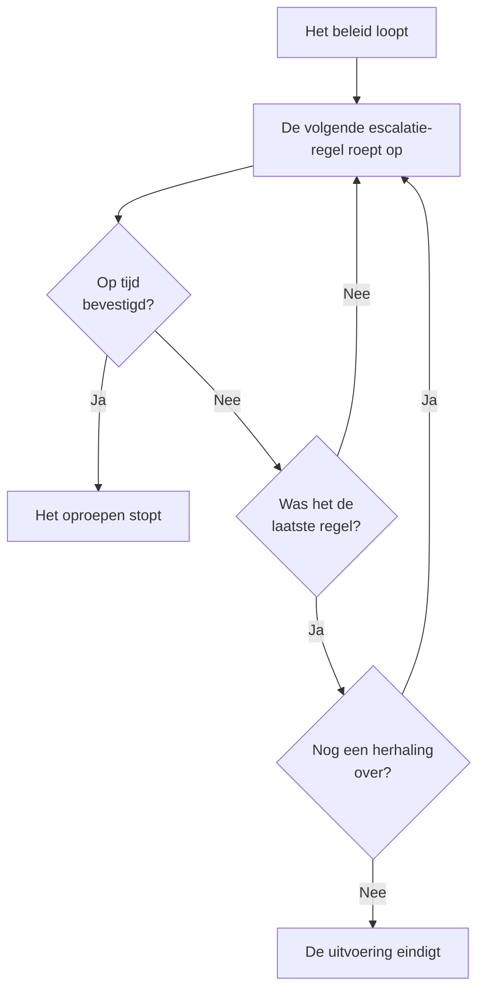

# Bereikbaarheidsbeleid

Een bereikbaarheidsbeleid bepaalt wie wordt opgeroepen voor een incident of waarschuwing, en wie de volgende is als niemand bevestigt. De escalatieregels ervan zijn de niveaus, en de incidenten, waarschuwingen en episodes die het gebruiken, voeren het uit. Deze pagina behandelt het maken van een beleid, wat het uitvoert, wat de pagina's ervan tonen en hoe elke uitvoering wordt vastgelegd.

:::cards
- [Een beleid maken](#een-beleid-maken): Een naam, en wie als eerste wordt opgeroepen.
- [Wat een beleid uitvoert](#wat-een-beleid-uitvoert): Regels, sjablonen, monitors, chat en jijzelf.
- [Uitvoeringslogboeken](#uitvoeringslogboeken): Elke uitvoering, regel voor regel, en waarom die stopte.
- [Een beleid archiveren of verwijderen](#een-beleid-archiveren-of-verwijderen): Een beleid uit dienst nemen.
:::

## Een beleid maken

:::steps
1. Ga naar **Bereikbaarheidsdienst → Bereikbaarheidsbeleid** en klik op **Bereikbaarheidsbeleid aanmaken**.
2. Vul een **Naam** in, bijvoorbeeld "Betalingen primair".
3. Klik onder **Wie wordt als eerste opgeroepen?** op **Ontvanger toevoegen** en kies de bereikbaarheidsschema's, teams en personen die als eerste worden opgeroepen.
4. Klik op **Bereikbaarheidsbeleid aanmaken**. Het beleid opent op de pagina **Escalatieregels**, met **Level 1** al op zijn plek.
:::

**Wie wordt als eerste opgeroepen?** is optioneel en wordt alleen gevraagd aan wie escalatieregels mag toevoegen: blijft het leeg, dan roept het beleid niemand op tot het een regel heeft. **Beschrijving** en **Labels** staan onder **Meer velden**. Hoe je de volgende niveaus toevoegt, lees je bij [Escalatieregels](/docs/on-call/escalation-rules).

De lijst **Bereikbaarheidsbeleid** toont van elk beleid **Naam**, **Beschrijving**, **Labels** en **Eigenaren**. Selecteer beleid om **Labels toevoegen**, **Labels verwijderen**, **Eigenaar toevoegen**, **Eigenaar verwijderen**, **Archiveren** of **JSON exporteren** uit te voeren, of om het te verwijderen. **Import JSON** maakt beleid aan uit een export: een export bevat de eigen instellingen van een beleid, niet de escalatieregels of eigenaren ervan.

## Wat een beleid uitvoert

Een beleid roept niemand op tot iets het uitvoert. Elk incident, elke waarschuwing en elke episode voert het beleid dat het heeft uit zodra het wordt aangemaakt:

| Wat | Hoe het beleid wordt toegevoegd | Meer lezen |
| --- | --- | --- |
| Het record zelf | Het veld **Bereikbaarheidsbeleid** bij het aanmaken van een incident of waarschuwing, een incidentsjabloon, of het ingeklapte deel **Bereikbaarheid** in de criteria van een monitor | [Een incident melden](/docs/incidents/declaring-incidents) |
| Bereikbaarheidsregels | **Incidenten → Regels → Bereikbaarheidsregels** en **Waarschuwingen → Regels → Bereikbaarheidsregels** voegen het beleid van elke passende regel toe | [Bereikbaarheidsregels voor incidenten](/docs/incidents/settings#bereikbaarheidsregels-voor-incidenten) |
| Groeperingsregels | Een groeperingsregel voert het eigen beleid uit wanneer die een episode opent | [Waarschuwingsepisoden en groeperingsregels](/docs/alerts/episodes) |
| Met de hand | **Bereikbaarheidsdienstbeleid uitvoeren**, in het menu **Acties** van een feed, of bij een bericht in Slack of Microsoft Teams | [De incidentfeed](/docs/incidents/notes-owners-and-feed#de-incidentfeed) |
| Chat en workflows | `/oneuptime page` in Slack of Microsoft Teams, en de stap **Page an On-Call Policy** van een workflow | [Paging](/docs/workflows/components#paging) |

Een beleid dat meerdere regels toevoegen, loopt één keer. Een ernst voert nooit zelf een beleid uit: dat doet een bereikbaarheidsregel die bij die ernst past. Een incident of waarschuwing die al bevestigd of opgelost wordt aangemaakt, voert geen enkel beleid uit. Een bereikbaarheidsregel op **Alleen tijdens werktijden** laat het beleid dat ze toevoegt wachten tot die tijden beginnen.

## De pagina's van een beleid

Open een beleid vanuit de lijst. Het zijmenu ervan bevat alles over het beleid:

| Sectie | Pagina's |
| --- | --- |
| **Basis** | **Overzicht**, **Escalatieregels** en **Eigenaren** |
| **Logboeken** | **Uitvoeringslogboeken** en **Meldingslogboeken** |
| **Ontwikkelaars** | **Terraform**, **API** en **AI-assistenten** |
| **Geavanceerd** | **Gebruikersoverschrijvingen**, **Aangepaste velden**, **Instellingen**, **Auditlogboeken** en **Beleid verwijderen** |

**Basis** staat open; de andere secties beginnen ingeklapt tot je erop klikt.

- **Overzicht** toont de **Details bereikbaarheidsbeleid**, dan **Beleid in één oogopslag**: hoeveel niveaus en ontvangers het beleid heeft, hoe lang het duurt tot het laatste niveau en hoe vaak het zich herhaalt. **Gereedheid van ontvangers** zegt of iedereen die het kan oproepen nu bereikbaar is, en **Feed van het bereikbaarheidsbeleid** toont wat er is veranderd: toegevoegde of verwijderde personen, teams en schema's, overschrijvingen en overdrachten.
- **Eigenaren** zijn de personen en teams die verantwoordelijk zijn voor het beleid. Vindt een oproep van het beleid voor iemand geen regel, of kan die niet worden afgeleverd, dan krijgen zij een e-mail; een beleid zonder eigenaren mailt in plaats daarvan de eigenaren van het project.
- **Meldingslogboeken** toont elk bericht dat het beleid stuurde, met een tabblad per kanaal.
- **Gebruikersoverschrijvingen** vervangt personen alleen in dit beleid. Zie [Gebruikersoverschrijvingen](/docs/on-call/user-overrides).
- **Instellingen** bevat **Bereikbaarheidsbeleid exporteren** en de kaart die het beleid archiveert.

## Een beleid herhalen

Loopt de wachttijd van het laatste niveau af zonder dat iemand bevestigt, dan stopt een beleid, tenzij het zich herhaalt. Open om dat te kiezen de pagina **Escalatieregels** van het beleid en klik op **Bewerken** op de kaart **Herhaalbeleid** onder de regels. **Herhaalbeleid bewerken** vraagt **Als niemand bevestigt na het laatste niveau**:

| Antwoord | Wat het doet |
| --- | --- |
| **Stoppen met oproepen** | Niemand wordt opnieuw opgeroepen, dus het beleid loopt één keer. Een nieuw beleid begint met dit antwoord. |
| **Opnieuw beginnen bij Level 1** | Elk niveau wordt opnieuw opgeroepen, op volgorde. **Hoe vaak nog?** zegt hoe vaak: 1 of meer. |

Een beleid dat nog drie keer opnieuw begint, gaat in totaal vier keer door zijn niveaus. De regel **Na het laatste niveau** op de kaart zegt wat het beleid doet, en **Beleid in één oogopslag** op het **Overzicht** zegt hetzelfde in woorden.

## Opnieuw oproepen als het niet is opgelost

Bevestigen stopt het oproepen van een beleid voorgoed, ook als daarna niemand het incident of de waarschuwing oplost. Een beleid kan in plaats daarvan opnieuw oproepen: open de pagina **Escalatieregels** ervan, open onderaan **Meer instellingen** en klik op **Bewerken** op de kaart **Time-out na bevestiging**. **Time-out na bevestiging bewerken** vraagt **Als het bevestigd maar niet opgelost is**:

| Antwoord | Wat het doet |
| --- | --- |
| **Niet opnieuw oproepen** | Bevestigen stopt het oproepen voorgoed. Een nieuw beleid begint met dit antwoord. |
| **Opnieuw oproepen** | Roept op wie het bevestigde en wie nu dienst heeft. **Na hoeveel minuten?** bepaalt wanneer: van 5 tot 1440, eerst 30. |

De minuten tellen vanaf elke bevestiging, en een beleid roept voor één incident, waarschuwing of episode hoogstens 5 keer opnieuw op. Een nieuwe oproep begint op het niveau dat opriep toen er werd bevestigd, roept op wie daar nu dienst heeft en gaat daarna door de niveaus zoals de eerste uitvoering. Het incident of de waarschuwing blijft bevestigd: de nieuwe oproep is een eigen uitvoering, in de feed en in de uitvoeringslogboeken van het beleid, waar de **Status** "Opnieuw opgeroepen (1 van 5)" zegt.

Wie opnieuw wordt opgeroepen, bevestigt vanuit het bericht of met **Opnieuw bevestigen** op de pagina van het incident of de waarschuwing, en de minuten beginnen opnieuw; **Escaleren** geeft de oproep door aan het volgende niveau. Het incident of de waarschuwing oplossen of verwijderen, het beleid archiveren of verwijderen, of **Niet opnieuw oproepen** kiezen stopt het. De rij **Na een bevestiging** op de kaart zegt wat het beleid doet, en **Meer instellingen** toont de minuten zolang het is ingeklapt. **Beleid in één oogopslag** op het **Overzicht** en **Escalatieoverzicht** zeggen hetzelfde in woorden.

## Uitvoeringslogboeken

Elke keer dat een beleid loopt, schrijft het een uitvoeringslogboek, en dat logboek doorloopt zijn statussen naarmate de uitvoering vordert:

| Status | Wat die betekent |
| --- | --- |
| **Wachten** | Een bereikbaarheidsregel op **Alleen tijdens werktijden** laat de uitvoering wachten tot die tijden beginnen: ze zegt wanneer het oproepen begint, en roept tot dan niemand op. Ze eindigt zonder oproep als het incident of de waarschuwing eerst wordt bevestigd of opgelost. Ze begint meteen met oproepen als het incident of de waarschuwing verandert en nu op een bereikbaarheidsregel past die direct oproept. |
| **Gepland**, **Gestart** | De uitvoering wordt voorbereid. Een die er na 5 minuten nog staat, wordt gestopt als **Fout**. |
| **Executing** | De uitvoering roept op. OneUptime brengt haar elke minuut een stap verder. |
| **Execution Completed** | Iemand heeft bevestigd, het incident of de waarschuwing is opgelost, elke regel en herhaling is gebruikt, of het beleid is gearchiveerd. |
| **Execution Completed - No One Notified** | De uitvoering is door elke regel gegaan zonder iemand op te roepen: meestal een schema waarin niemand dienst heeft. |
| **Fout** | De uitvoering is mislukt. **Statusbericht bekijken** zegt waarom. |

Uitvoeringslogboeken vind je op drie plekken:

- in de eigen **Uitvoeringslogboeken** van het beleid, onder **Logboeken**;
- onder **Bereikbaarheidsdienst → Geavanceerd → Uitvoeringslogboeken**, voor elk beleid, waar directe oproepen vanuit workflows en chat staan als **Directe oproep**;
- op de pagina **Bereikbaarheidsuitvoeringen** van een incident of een waarschuwing.

Elke rij toont wat de uitvoering startte, wanneer, de **Status** ervan en wie haar bevestigde. **Tijdlijn bekijken** opent de **Tijdlijn van de uitvoering**: elke escalatieregel, wie die opriep, via welk schema en hoe elke oproep afliep. Een schema waarin niemand dienst heeft, toont **Niemand was bereikbaar** in plaats van een persoon. In OneUptime Cloud hebben uitvoeringslogboeken het abonnement **Growth** nodig.

## Een beleid archiveren of verwijderen

Archiveren neemt een beleid uit dienst en bewaart alles: open de **Instellingen** van het beleid en klik op **Archiveren** op de archiefkaart ervan, of selecteer beleid in de lijst en kies **Archiveren**.

- Een gearchiveerd beleid roept niemand op. Incidenten en waarschuwingen die het gebruiken slaan het over, en een uitvoering die nog escaleert, stopt bij haar volgende stap.
- Het verdwijnt uit de lijst **Bereikbaarheidsbeleid** naar **Bereikbaarheidsdienst → Geavanceerd → Gearchiveerde beleidsregels**, waar **Uit archief halen** het weer in dienst neemt.

**Beleid verwijderen**, onder **Geavanceerd**, verwijdert het beleid samen met de escalatieregels en gebruikersoverschrijvingen ervan. Verwijderen vanuit de lijst vraagt eerst om bevestiging en stelt voor om in plaats daarvan te archiveren.

## Wie een beleid mag wijzigen

**Projecteigenaar**, **Projectbeheerder**, **Projectlid**, **Bereikbaarheidsbeheerder** en **Bereikbaarheidslid** mogen beleid maken, wijzigen en verwijderen; **Kijker** en **Bereikbaarheidskijker** mogen het lezen. In een aangepaste rol heten de rechten **Create On-Call Duty Policy**, **Edit On-Call Duty Policy**, **Delete On-Call Duty Policy** en **Read On-Call Duty Policy**, en een rol die tot bepaalde labels is beperkt, bereikt alleen het beleid met die labels. Eigenaren en aangepaste velden toevoegen heeft in OneUptime Cloud het abonnement **Growth** nodig.

## API en Terraform

Bereikbaarheidsbeleid is de resource `/api/on-call-duty-policy`, en in Terraform de resource `oneuptime_on_call_policy`:

| Instelling | API-veld |
| --- | --- |
| **Naam** | `name` |
| **Beschrijving** | `description` |
| **Als niemand bevestigt na het laatste niveau** | `repeatPolicyIfNoOneAcknowledges` |
| **Hoe vaak nog?** | `repeatPolicyIfNoOneAcknowledgesNoOfTimes` |
| **Na hoeveel minuten?** | `acknowledgementTimeoutInMinutes` |
| Gearchiveerd | `isArchived` |

`repeatPolicyIfNoOneAcknowledges` is `false` voor **Stoppen met oproepen** en `true` voor **Opnieuw beginnen bij Level 1**. Met `true` en `repeatPolicyIfNoOneAcknowledgesNoOfTimes` op `0` herhaalt een beleid zich nooit, en het dashboard toont het als **Stoppen met oproepen**.

`acknowledgementTimeoutInMinutes` is `null` voor **Niet opnieuw oproepen**, en een heel aantal minuten van 5 tot 1440 voor **Opnieuw oproepen**. OneUptime weigert elke andere waarde.

Hoe je een beleid met zijn eerste niveau in één verzoek maakt, lees je bij [Regels maken met de API of Terraform](/docs/on-call/escalation-rules#regels-maken-met-de-api-of-terraform).

## Probleemoplossing

:::details Een beleid liep, maar niemand werd opgeroepen
De uitvoering ervan toont **Execution Completed - No One Notified**. Open **Tijdlijn bekijken**: een rij met **Niemand was bereikbaar** wijst op een schema met een gat, en het statusbericht van een rij **Overgeslagen** zegt waarom, bijvoorbeeld iemand die afwezig was zonder vervanger. **Bereikbaarheidsdienst → Gereedheid** toont wie niet bereikt kon worden.
:::

:::details Het volgende niveau werd een minuut na zijn wachttijd opgeroepen
OneUptime brengt lopend beleid één keer per minuut een stap verder, dus een niveau wordt opgeroepen bij de eerste controle nadat de wachttijd voorbij is.
:::

:::details Een incident noemt een beleid dat niemand opriep
Het beleid is gearchiveerd: een gearchiveerd beleid blijft staan bij de incidenten en waarschuwingen die het gebruiken, roept niemand op, en het uitvoeringslogboek ervan zegt dat het niet is uitgevoerd. Haal het uit het archief onder **Bereikbaarheidsdienst → Geavanceerd → Gearchiveerde beleidsregels**.
:::

## Volgende stappen

:::cards
- [Escalatieregels](/docs/on-call/escalation-rules): De niveaus toevoegen die een beleid oproept, en hoe lang elk wacht.
- [Gebruikersoverschrijvingen](/docs/on-call/user-overrides): De oproepen van iemand naar een collega sturen zolang die afwezig is.
- [Gereedheid en rapporten](/docs/on-call/readiness): Controleren of iedereen die een beleid oproept bereikbaar is.
:::
