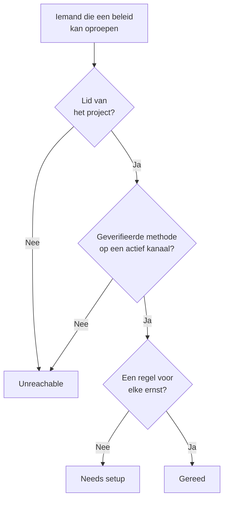

# Gereedheid en rapporten

Gereedheid beantwoordt een vraag voordat een incident dat doet: als er nu iets afging, zou dan iedereen die je bereikbaarheidsbeleid oproept echt worden bereikt? De pagina toont elke responder in het project, zegt wie gereed is en wie niet, en laat je mensen eraan herinneren hun instellingen af te ronden. Het rapport **Bereikbaarheidstijd gebruiker** toont daarna hoe lang elke persoon dienst had.

:::cards
- [Hoe een status wordt bepaald](#hoe-een-status-wordt-bepaald): Gereed, Needs setup of Unreachable, en waarom.
- [De pagina Gereedheid](#de-pagina-gereedheid): Elke responder in het project, in één lijst.
- [Mensen herinneren hun instellingen af te ronden](#mensen-herinneren-hun-instellingen-af-te-ronden): Een e-mail die zegt wat er ontbreekt.
- [Bereikbaarheidstijd gebruiker](#bereikbaarheidstijd-gebruiker): Hoe lang elke persoon dienst had.
:::

## Hoe een status wordt bepaald

Een responder is iedereen die een bereikbaarheidsbeleid kan oproepen: een persoon die in een escalatieregel staat, een lid van een team dat een regel oproept, iemand in een laag van een schema dat een regel oproept, en de vervanger in een gebruikersoverschrijving die nog niet voorbij is. Een schema dat geen beleid oproept, voegt niemand toe.

| Status | Wat die betekent |
| --- | --- |
| **Gereed** | De persoon heeft een geverifieerde methode op een kanaal dat het project heeft aangezet, en een regel voor elke ernst, op elk tabblad van de eigen bereikbaarheidsregels. |
| **Moet worden ingesteld** | De persoon is bereikbaar, maar voor sommige ernstniveaus is er geen regel. De rij telt deze gaten. |
| **Onbereikbaar** | Niets bereikt de persoon: geen geverifieerde methode, elke geverifieerde methode staat op een kanaal dat het project heeft uitgezet, of de persoon is geen lid van het project. |

Een gat is een ernst zonder regel, op het tabblad voor incidenten, incidentepisodes, waarschuwingen of waarschuwingsepisodes. Een regel die een ernst bewust uitzet, is geen gat. Een oproep die op een gat stuit, bereikt de persoon toch via de geverifieerde methoden, tenzij het project die terugval heeft uitgezet: zie [Als geen regel past](/docs/notifications/index#als-geen-regel-past).

## De pagina Gereedheid

Open **Bereikbaarheidsdienst → Gereedheid**. De kaart **On-call readiness** toont iedereen die een bereikbaarheidsbeleid in het project kan bereiken, met de mensen die eerst iets nodig hebben bovenaan. Iedereen in het project kan de pagina openen.

Boven de lijst tellen de tegels **Ontvangers**, **Gereed**, **Moet worden ingesteld** en **Onbereikbaar**. Klik op **Gereed**, **Moet worden ingesteld** of **Onbereikbaar** om alleen die responders te tonen, en klik er nog eens op om iedereen te tonen.

| Kolom | Wat die toont |
| --- | --- |
| **Ontvanger** | De persoon, met het e-mailadres. |
| **Status** | **Gereed**, **Onbereikbaar**, of hoeveel gaten de persoon heeft. |
| **Kanalen** | Een segment per kanaal: gevuld voor een geverifieerde methode, hol voor een die nog niet is geverifieerd. |
| **Coverage** | Voor hoeveel ernstniveaus er een regel is, op elk tabblad, van allemaal. |
| **Reached via** | Hoe het beleid de persoon bereikt: elk team dat de persoon via een escalatieregel oproept, met zijn naam, of **Direct**, **Schema** of **Overschrijving**. |

**Coverage** in een rij toont de meldingsmethoden van de persoon, waarom die deze status heeft, en een raster van elke ernst met of zonder regel. De trechter filtert de lijst op **Ontvanger**, **Status**, **Team** of **Reached via**. Het antwoord kan een minuut oud zijn: **Vernieuwen** bepaalt het opnieuw.

## Mensen herinneren hun instellingen af te ronden

Alleen de persoon zelf kan de eigen meldingsmethoden en regels toevoegen en verifiëren, dus de oplossing is het die persoon te vragen.

:::steps
1. Vink op de pagina Gereedheid de responders aan die je wilt herinneren. Responders die gereed zijn, kun je niet aanvinken: er is niets om ze aan te herinneren.
2. Klik op **Herinnering voor instellingen sturen**. De bevestiging noemt iedereen die zo een e-mail krijgt.
3. Bevestig. Elke persoon krijgt één e-mail die zegt wat er in de eigen instellingen ontbreekt, met een link naar de pagina die het oplost.
:::

Een banner zegt daarna hoeveel herinneringen zijn verstuurd, overgeslagen of mislukt, en waarom, voor elke herinnering die niet is verstuurd. Niemand wordt vaker dan één keer per 24 uur herinnerd, en één ronde herinnert hoogstens 250 mensen. Herinneringen versturen vraagt **Projecteigenaar**, **Projectbeheerder** of **Bereikbaarheidsbeheerder**, of **Edit On-Call Duty Policy** in een aangepaste rol.

## Gereedheid op andere pagina's

- Op het **Overzicht** van een beleid toont **Gereedheid van ontvangers** iedereen die dat beleid kan oproepen en aandacht nodig heeft, en **Opnieuw controleren** leest het opnieuw. Je eigen rij heeft een knop naar de pagina die het oplost; de rij van iemand anders opent een e-mail aan die persoon in je eigen mailprogramma, met de oplossing erin.
- Op de **Escalatieregels** van een beleid zegt een niveau op zijn kaart wanneer niet al zijn responders kunnen worden opgeroepen. Zie [Het escalatieoverzicht](/docs/on-call/escalation-rules#het-escalatieoverzicht).
- Open onder **Gebruikers** een lid, en dan **Gereedheid** in de sectie **Bereikbaarheid**: de status, de methoden en het dekkingsraster van die persoon.
- Voor je eigen instellingen leidt **Gebruikersinstellingen → Instellingschecklist** je erdoorheen. Zie [De instellingschecklist](/docs/notifications/index#de-instellingschecklist).

## De wekelijkse e-mail over gereedheid

Eén keer per week controleert OneUptime elk project dat een bereikbaarheidsbeleid heeft. Is iemand daarin **Onbereikbaar** of **Moet worden ingesteld**, dan krijgen de eigenaren van het project één e-mail die deze mensen in twee groepen toont, wie helemaal niet kan worden opgeroepen en wie met gaten bereikbaar is, tot 20 namen per groep, met een link naar de pagina Gereedheid.

Een week waarin iedereen gereed is, verstuurt niets, dus de e-mail betekent altijd dat er iets moet worden opgelost. Kan iemand helemaal niet worden opgeroepen, dan begint het onderwerp met `[Action Required]`.

## Bereikbaarheidstijd gebruiker

**Bereikbaarheidsdienst → Rapporten → Bereikbaarheidstijd gebruiker** toont hoe lang elke persoon dienst had, over een periode die je kiest: om te beginnen **Afgelopen maand**.

| Kolom | Wat die toont |
| --- | --- |
| **Gebruiker** | De persoon. |
| **Tijd dat de gebruiker bereikbaar was** | De tijd dat de persoon dienst had in de periode, in uren en minuten. |

Tijd wordt vastgelegd terwijl mensen dienst krijgen en weer afgeven: vanaf het moment dat een schema dat een regel oproept hun een beurt geeft, of dat ze direct of via een team aan een regel worden toegevoegd, tot de overdracht of tot ze worden weggehaald. Dienst via twee beleidsregels tegelijk telt één keer, en tijd die nog loopt, telt tot nu.

De **Tijdlijn van bereikbaarheidsschema's** en de agendafeeds tonen eerdere diensten zoals de rotatie vandaag is ingericht. Dit rapport wordt geschreven terwijl het gebeurt, dus gebruik het voor een eerlijke verdeling en de vergoeding van bereikbaarheidsdiensten.

> [!NOTE]
> In OneUptime Cloud heeft het rapport het abonnement **Growth** nodig, en tijd die meer dan 200 dagen geleden eindigde, wordt verwijderd. Een zelfgehoste installatie bewaart alles.

## Probleemoplossing

:::details Iemand is onbereikbaar, maar heeft een geverifieerd telefoonnummer
De methoden van die persoon staan misschien allemaal op kanalen die het project heeft uitgezet: sms, oproepen, WhatsApp en Telegram staan in een nieuw project uit. Zie [Een kanaal aanzetten voor je project](/docs/notifications/notification-methods#een-kanaal-aanzetten-voor-je-project).
:::

:::details Iemand ontbreekt in de lijst
De lijst bevat alleen mensen die een bereikbaarheidsbeleid kan oproepen. Een teamlid dat de uitnodiging niet heeft geaccepteerd, iemand in een schema dat geen beleid oproept, en een vervanger van wie de overschrijving voorbij is, staan er niet in.
:::

:::details De eigenaren krijgen de wekelijkse e-mail nooit
Die wordt alleen verstuurd in een week waarin iemand **Onbereikbaar** of **Moet worden ingesteld** is, en alleen naar de eigenaren van het project.
:::

## Volgende stappen

:::cards
- [Hoe OneUptime je bereikt](/docs/notifications/index): De methoden, regels en terugval achter elke status.
- [Meldingsmethoden](/docs/notifications/notification-methods): De manieren toevoegen en verifiëren waarop OneUptime iemand bereikt.
- [Persoonlijke bereikbaarheidsregels](/docs/notifications/on-call-rules): De gaten dichten, ernst voor ernst.
:::
