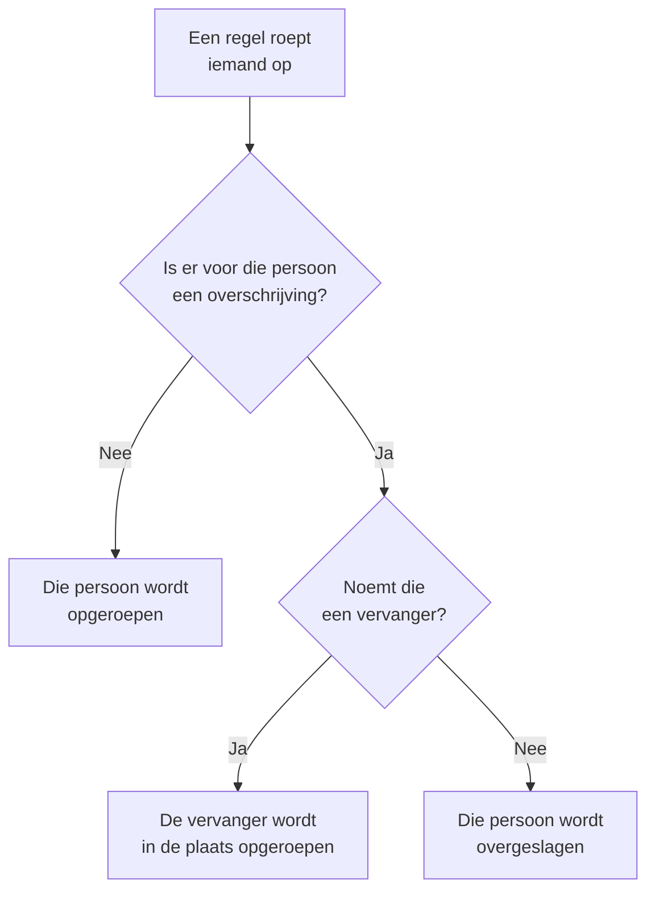

# Gebruikersoverschrijvingen

Terwijl iemand afwezig is, stuurt een gebruikersoverschrijving de oproepen die die persoon zouden bereiken naar degene die vervangt, voor een vaste periode. Is niemand als vervanger genoemd, dan slaat ze de persoon in plaats daarvan over: elke beurt van die persoon in een bereikbaarheidsschema gaat naar de volgende persoon in de rotatie. Gebruik er een voor een vakantie, een ziektedag of een geruilde dienst.

:::cards
- [Hoe een overschrijving een oproep verandert](#hoe-een-overschrijving-een-oproep-verandert): Wie in plaats daarvan wordt opgeroepen, en wanneer.
- [Een overschrijving toevoegen](#een-overschrijving-toevoegen): Wie afwezig is, wie vervangt, vanaf wanneer en tot wanneer.
- [Elk beleid, of één](#elk-beleid-of-één): Waar je een overschrijving toevoegt, en welke voorgaat.
- [Andere manieren om er een toe te voegen](#andere-manieren-om-er-een-toe-te-voegen): Vanuit een schema en vanuit je komende diensten.
:::

## Hoe een overschrijving een oproep verandert



Zolang een overschrijving geldt, van haar begin tot haar einde:

- Staat er iemand onder **Wie vervangt?**, dan krijgt die persoon alle oproepen van de afwezige persoon, uit elk schema, team en elke regel waarvoor de overschrijving geldt. De oproep bereikt de vervanger via diens eigen persoonlijke bereikbaarheidsregels.
- Is er geen vervanger, dan wordt de persoon overgeslagen. In een bereikbaarheidsschema gaat elke beurt van die persoon naar de volgende persoon in de rotatie die niet afwezig is; is iedereen in een laag afwezig, dan nemen de lagen eronder het over. Een regel die de persoon direct noemt, of via een team, roept die niet op, en de uitvoering van het beleid zegt dat die afwezig is, en tot wanneer.
- Overschrijvingen ketenen niet. Is de vervanger zelf ook afwezig, dan wordt toch de vervanger opgeroepen voor de persoon die die vervangt.

Is de overschrijving voorbij, dan zijn de oproepen weer van de persoon zelf. De **Tijdlijn van bereikbaarheidsschema's**, de lagen van een schema en de agendafeeds tonen allemaal wie elke vervangen dienst heeft.

## Een overschrijving toevoegen

:::steps
### De overschrijvingen openen

Ga naar **Bereikbaarheidsdienst → Geavanceerd → Gebruikersoverschrijvingen** om iemand in elk bereikbaarheidsbeleid te vervangen, of naar de pagina **Gebruikersoverschrijvingen** van een beleid, onder **Geavanceerd**, om iemand alleen in dat beleid te vervangen. Klik op **Gebruikersoverschrijving toevoegen**.

### Zeggen wie afwezig is

**Wie is afwezig?** begint bij jou, omdat je eigen vrije tijd vastleggen het meest voorkomt. Kies iemand anders om vervanging voor die persoon te regelen.

### Zeggen wie vervangt

Laat **Wie vervangt?** op **Volgende persoon in de rotatie** staan om de persoon over te slaan, of kies de collega die alle oproepen overneemt. De afwezige persoon wordt niet aangeboden.

### De tijd instellen

**Begint** staat op nu, tenzij je een andere tijd kiest. Zet **Eindigt** op het moment dat de persoon terug is: dat moet na het begin liggen. Klik op **Gebruikersoverschrijving toevoegen**.
:::

Elke overschrijving is een rij: **Afwezig**, **Vervangen door**, **Begint** en **Eindigt**, te filteren op begin en einde. **Vervangen door** toont **Volgende persoon in de rotatie** bij overslaan. Een overschrijving kun je niet bewerken: verwijder haar en voeg een nieuwe toe, of verwijder haar om iemand eerder terug te halen.

## Elk beleid, of één

| Toegevoegd onder | Kaart | Geldt voor |
| --- | --- | --- |
| **Bereikbaarheidsdienst → Geavanceerd → Gebruikersoverschrijvingen** | **Globale gebruikersoverschrijvingen** | Elk bereikbaarheidsbeleid in het project |
| **Gebruikersoverschrijvingen** van een beleid | **Gebruikersoverschrijvingen van het bereikbaarheidsbeleid** | Alleen dat beleid |

Overlappen twee overschrijvingen voor dezelfde persoon, dan gaat die van het beleid zelf voor op een globale, en gaat een die een vervanger noemt voor op overslaan. Een oproep zonder beleid, vanuit een workflow of vanuit chat, volgt alleen de globale overschrijvingen.

## Andere manieren om er een toe te voegen

- Vanuit een schema: klap op de pagina **Lagen** van een schema een laag open en klik op **Overslaan tot…** naast een persoon. Dat opent hetzelfde formulier met die persoon afwezig en de rotatie als vervanger, als globale overschrijving. Zie [Als iemand afwezig is](/docs/on-call/schedules#als-iemand-afwezig-is).
- Vanuit je komende diensten: **Vervanging regelen** bij een van je diensten, onder **Gebruikersinstellingen → Agenda → Agendafeed**, opent het formulier met jou afwezig voor de tijden van die dienst, zodat alleen **Wie vervangt?** nog overblijft. Zie [Komende diensten en vervanging](/docs/on-call/calendar-feeds#komende-diensten-en-vervanging).

Verlaat iemand het project, dan wordt elke overschrijving die die persoon noemt en nog niet voorbij is verwijderd, aan beide kanten.

## Wie overschrijvingen mag toevoegen

**Projecteigenaar**, **Projectbeheerder**, **Projectlid**, **Bereikbaarheidsbeheerder** en **Bereikbaarheidslid** mogen overschrijvingen toevoegen en verwijderen; **Kijker** en **Bereikbaarheidskijker** mogen ze zien. In een aangepaste rol heten de rechten **Create On-Call Duty Policy User Override**, **Delete On-Call Duty Policy User Override** en **Read On-Call Duty Policy User Override**. Op de **Tijdlijn van bereikbaarheidsschema's** zien alleen mensen die overschrijvingen mogen lezen wiens dienst wordt vervangen.

In OneUptime Cloud hebben gebruikersoverschrijvingen het abonnement **Growth** nodig.

## API

Gebruikersoverschrijvingen zijn de resource `/api/on-call-duty-policy-user-override`:

| Veld | Wat het bevat |
| --- | --- |
| `overrideUserId` | De persoon die afwezig is. Verplicht. |
| `routeAlertsToUserId` | De persoon die vervangt. Laat het weg om de persoon in plaats daarvan over te slaan. |
| `startsAt`, `endsAt` | Wanneer de overschrijving begint en eindigt. Beide zijn verplicht, en het einde ligt na het begin. |
| `onCallDutyPolicyId` | Het beleid waarvoor ze geldt. Laat het weg voor een globale overschrijving. |

```bash
curl -X POST https://oneuptime.com/api/on-call-duty-policy-user-override \
  -H "apikey: $ONEUPTIME_API_KEY" \
  -H "Content-Type: application/json" \
  -d '{
    "data": {
      "projectId": "<project-id>",
      "overrideUserId": "<away-user-id>",
      "routeAlertsToUserId": "<cover-user-id>",
      "startsAt": "2026-12-22T09:00:00Z",
      "endsAt": "2027-01-05T09:00:00Z"
    }
  }'
```

Een overschrijving waarin de afwezige persoon en de vervanger dezelfde zijn, wordt geweigerd, net als een die eindigt voordat ze begint.

## Probleemoplossing

:::details De persoon op vakantie werd toch opgeroepen
Controleer waar de overschrijving is toegevoegd. Een op de pagina **Gebruikersoverschrijvingen** van een beleid geldt alleen voor dat beleid, en ander beleid roept de persoon nog steeds op: voeg haar toe onder **Bereikbaarheidsdienst → Geavanceerd → Gebruikersoverschrijvingen** om elk beleid te dekken. Controleer ook **Begint** en **Eindigt**: tijden staan in jouw tijdzone.
:::

:::details De vervanger werd ook niet opgeroepen
Die wordt bereikt via de eigen persoonlijke bereikbaarheidsregels en geverifieerde methoden. Zoek die persoon op onder **Bereikbaarheidsdienst → Gereedheid**, en bekijk de uitvoering in de **Uitvoeringslogboeken** van het beleid.
:::

:::details Ik kan geen overschrijving toevoegen
Daarvoor heb je een van de rollen hierboven nodig, en in OneUptime Cloud het abonnement **Growth**.
:::

## Volgende stappen

:::cards
- [Bereikbaarheidsschema's](/docs/on-call/schedules): Rotaties, lagen en iemand in een laag overslaan.
- [Tijdlijn van bereikbaarheidsschema's](/docs/on-call/schedule-timeline): Elke vervangen dienst in alle schema's bekijken.
- [Agendafeeds](/docs/on-call/calendar-feeds): Vervanging regelen voor een van je eigen diensten.
:::
