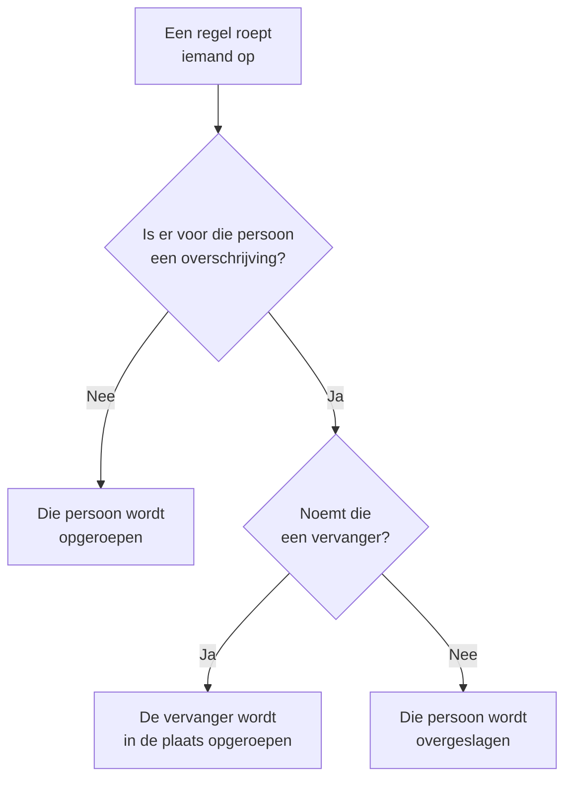

# Gebruikersoverschrijvingen

Terwijl iemand afwezig is, stuurt een gebruikersoverschrijving de oproepen die die persoon zouden bereiken naar degene die vervangt, voor een vaste periode. Is niemand als vervanger genoemd, dan slaat ze de persoon in plaats daarvan over: elke beurt van die persoon in een bereikbaarheidsschema gaat naar de volgende persoon in de rotatie. Gebruik er een voor een vakantie, een ziektedag of een geruilde dienst.

:::cards
- [Hoe een overschrijving een oproep verandert](#hoe-een-overschrijving-een-oproep-verandert): Wie in plaats daarvan wordt opgeroepen, en wanneer.
- [Een overschrijving toevoegen](#een-overschrijving-toevoegen): Wie afwezig is, wie vervangt, vanaf wanneer en tot wanneer.
- [Een overschrijving bewerken](#een-overschrijving-bewerken): Wijzigen wie vervangt, of wanneer ze begint en eindigt.
- [Een overschrijving eerder beëindigen](#een-overschrijving-eerder-beëindigen): Iemand terughalen voordat de overschrijving eindigt.
- [Elk beleid, of één](#elk-beleid-of-één): Waar je een overschrijving toevoegt, en welke voorgaat.
- [Andere manieren om er een toe te voegen](#andere-manieren-om-er-een-toe-te-voegen): Vanuit een schema en vanuit je komende diensten.
:::

## Hoe een overschrijving een oproep verandert



Zolang een overschrijving geldt, van haar begin tot haar einde:

- Staat er iemand onder **Wie vervangt?**, dan krijgt die persoon alle oproepen van de afwezige persoon, uit elk schema, team en elke regel waarvoor de overschrijving geldt. De oproep bereikt de vervanger via diens eigen persoonlijke bereikbaarheidsregels.
- Is er geen vervanger, dan wordt de persoon overgeslagen. In een bereikbaarheidsschema gaat elke beurt van die persoon naar de volgende persoon in de rotatie die niet afwezig is; is iedereen in een laag afwezig, dan nemen de lagen eronder het over. Een regel die de persoon direct noemt, of via een team, roept die niet op, en de uitvoering van het beleid zegt dat die afwezig is, en tot wanneer.
- Overschrijvingen ketenen niet. Is de vervanger zelf ook afwezig, dan wordt toch de vervanger opgeroepen voor de persoon die die vervangt.

Is de overschrijving voorbij, dan zijn de oproepen weer van de persoon zelf. De **Tijdlijn van bereikbaarheidsschema's**, de lagen van een schema en de agendafeeds tonen allemaal wie elke vervangen dienst heeft.

## Een overschrijving toevoegen

:::steps
### De overschrijvingen openen

Ga naar **Bereikbaarheid → Schema's → Gebruikersoverschrijvingen** om iemand in elk bereikbaarheidsbeleid te vervangen, of naar de pagina **Gebruikersoverschrijvingen** van een beleid, onder **Geavanceerd**, om iemand alleen in dat beleid te vervangen. Klik op **Gebruikersoverschrijving toevoegen**.

### Zeggen wie afwezig is

**Wie is afwezig?** begint bij jou, omdat je eigen vrije tijd vastleggen het meest voorkomt. Kies iemand anders om vervanging voor die persoon te regelen.

### Zeggen wie vervangt

Laat **Wie vervangt?** op **Volgende persoon in de rotatie** staan om de persoon over te slaan, of kies de collega die alle oproepen overneemt. De afwezige persoon wordt niet aangeboden.

### De tijd instellen

**Begint** staat op nu, tenzij je een andere tijd kiest. Zet **Eindigt** op het moment dat de persoon terug is: dat moet na het begin liggen. Klik op **Gebruikersoverschrijving toevoegen**.
:::

Elke overschrijving is een rij: **Afwezig**, **Vervangen door**, **Begint** en **Eindigt**, te filteren op begin en einde. **Vervangen door** toont **Volgende persoon in de rotatie** bij overslaan.

## Een overschrijving bewerken

Klik op **Bewerken** in de rij van een overschrijving, op een van beide pagina's **Gebruikersoverschrijvingen** of in de lijst met gebruikersoverschrijvingen op de pagina **Lagen** van een schema. Het formulier opent met de overschrijving zoals ze is opgeslagen: wijzig haar en klik op **Wijzigingen opslaan**.

- **Wie vervangt?** kan veranderen tot de overschrijving eindigt. Zet het terug op **Volgende persoon in de rotatie** om de persoon in plaats daarvan over te slaan.
- **Begint** kan verschuiven tot de overschrijving begint, en blijft daarna zoals het is. **Eindigt** kan verschuiven tot de overschrijving eindigt: gebruik **Nu beëindigen** om haar nu te beëindigen. Geen van beide kan naar het verleden worden verschoven.
- **Wie is afwezig?** kan niet veranderen. Voeg voor iemand anders een nieuwe overschrijving toe.

Een overschrijving die is afgelopen, kan niet meer worden gewijzigd: haar **Bewerken** is vergrendeld en zegt waarom. De mobiele app van OneUptime bewerkt overschrijvingen volgens dezelfde regels.

## Een overschrijving eerder beëindigen

Om iemand terug te halen voordat de overschrijving eindigt, klik je op **Nu beëindigen**: in het menu van de rij van de overschrijving op een van beide pagina's **Gebruikersoverschrijvingen**, ernaast in de lijst met gebruikersoverschrijvingen op de pagina **Lagen** van een schema, of onder **Eindigt** in haar bewerkformulier. Het vraagt eerst en zegt wat er met de resterende tijd gebeurt: wie vervangt, stopt met vervangen, of de persoon wordt niet langer overgeslagen, en vanaf dan zijn de oproepen weer van de persoon zelf. De overschrijving eindigt dan meteen.

**Nu beëindigen** wordt alleen aangeboden zolang een overschrijving loopt: een die nog niet is begonnen, heeft niets te beëindigen, dus verwijder haar in plaats daarvan. De mobiele app beëindigt een lopende overschrijving op dezelfde manier.

## Elk beleid, of één

| Toegevoegd onder | Kaart | Geldt voor |
| --- | --- | --- |
| **Bereikbaarheid → Schema's → Gebruikersoverschrijvingen** | **Globale gebruikersoverschrijvingen** | Elk bereikbaarheidsbeleid in het project |
| **Gebruikersoverschrijvingen** van een beleid | **Gebruikersoverschrijvingen van het bereikbaarheidsbeleid** | Alleen dat beleid |

Twee overschrijvingen voor dezelfde persoon mogen elkaar niet overlappen op hetzelfde beleid, en ook niet als ze allebei globaal zijn. Het formulier, en **Overslaan tot…** in de lagen van een schema, zeggen het naast de tijden zodra ze zijn gekozen, met **Die vervanging bewerken** om in plaats daarvan die andere te wijzigen. De ene kan eindigen wanneer de volgende begint.

De eigen overschrijving van een beleid mag een globale voor dezelfde persoon overlappen: op dat beleid wordt de eigen gebruikt zolang beide gelden, en het formulier zegt het. Een oproep zonder beleid, vanuit een workflow of vanuit chat, volgt alleen de globale overschrijvingen.

Overschrijvingen die elkaar al vóór deze regel overlapten, blijven zoals ze zijn. Beide krijgen de markering **Overlapt**, die zegt welke wordt gebruikt: een die een vervanger noemt vóór overslaan, dan die die het eerst begint, dan die die het eerst is toegevoegd. Elk van beide kan nog steeds worden ingekort, of beëindigd met **Nu beëindigen**: alleen een wijziging die tijd toevoegt, valt onder de regel.

## Andere manieren om er een toe te voegen

- Vanuit een schema: klap op de pagina **Lagen** van een schema een laag open en klik op **Overslaan tot…** naast een persoon. Dat opent hetzelfde formulier met die persoon afwezig en de rotatie als vervanger, als globale overschrijving. Zie [Als iemand afwezig is](/docs/on-call/schedules#als-iemand-afwezig-is).
- Vanuit je komende diensten: **Vervanging regelen** bij een van je diensten, onder **Gebruikersinstellingen → Profiel en agenda → Agendafeed**, opent het formulier met jou afwezig voor de tijden van die dienst, zodat alleen **Wie vervangt?** nog overblijft. Zie [Komende diensten en vervanging](/docs/on-call/calendar-feeds#komende-diensten-en-vervanging).

Verlaat iemand het project, dan wordt elke overschrijving die die persoon noemt en nog niet voorbij is verwijderd, aan beide kanten.

## Wie overschrijvingen mag toevoegen

**Projecteigenaar**, **Projectbeheerder**, **Projectlid**, **Bereikbaarheidsbeheerder** en **Bereikbaarheidslid** mogen overschrijvingen toevoegen, bewerken en verwijderen; **Kijker** en **Bereikbaarheidskijker** mogen ze zien. In een aangepaste rol heten de rechten **Create On-Call Policy User Override**, **Edit On-Call Policy User Override**, **Delete On-Call Policy User Override** en **Read On-Call Policy User Override**. Op de **Tijdlijn van bereikbaarheidsschema's** zien alleen mensen die overschrijvingen mogen lezen wiens dienst wordt vervangen.

Een overschrijving op een beleid volgt het bereik van dat beleid. Geef een team **Bereikbaarheidslid**, beperkt tot het beleid dat het bezit of tot zijn label, en zijn leden voegen alleen op dat beleid overschrijvingen toe en bewerken en verwijderen ze alleen daar. Een globale overschrijving geldt voor elk beleid, ook dat van een ander team, dus het toevoegen, bewerken of verwijderen ervan vraagt het recht voor overschrijvingen over het hele project. Met een smaller recht zijn **Gebruikersoverschrijving toevoegen**, **Bewerken**, **Nu beëindigen** en **Verwijderen** onder **Bereikbaarheid → Schema's → Gebruikersoverschrijvingen** vergrendeld en zeggen ze waarom. **Overslaan tot…** in de lagen van een schema en **Vervanging regelen** bij je komende diensten, die globale overschrijvingen toevoegen, bieden in plaats daarvan het beleid aan waarvoor je overschrijvingen mag toevoegen, met één overschrijving per beleid, net als de vervanging in de mobiele app; waar je dat voor geen enkel beleid mag, zijn ze vergrendeld en zeggen ze waarom. Het team voegt zijn overschrijvingen toe op de eigen pagina **Gebruikersoverschrijvingen** van elk beleid. Hetzelfde geldt voor de API: een overschrijving zonder `onCallDutyPolicyId` wordt geweigerd voor een recht dat tot labels of tot eigen beleid is beperkt.

Wil je een team alleen onder zijn eigen mensen vervanging laten regelen, geef het dan **Manage On-Call Policy User Overrides for Own Team**, direct of via een aangepaste rol. Zijn leden voegen dan alleen overschrijvingen toe, bewerken en verwijderen ze alleen, als de persoon die afwezig is en de persoon die vervangt elk in een van hun teams zitten dat dit recht heeft gekregen; hun andere teams tellen niet mee. **Wie is afwezig?** en **Wie vervangt?** tonen alleen de mensen van die teams en zeggen waarom, en **Bewerken**, **Nu beëindigen** en **Verwijderen** zijn vergrendeld, met de reden erbij, bij een overschrijving die iemand anders noemt. **Overslaan tot…** in de lagen van een schema is vergrendeld naast iedereen anders, met de reden erbij, en de mobiele app toont en vergrendelt op dezelfde manier. Om de overschrijvingen te zien, hebben ze nog steeds **Read On-Call Policy User Override** nodig, of een rol die het heeft, zoals **Bereikbaarheidskijker**. De API, Terraform en de mobiele app volgen dezelfde regel; een API-sleutel zit in geen enkel team en bereikt er niemand mee. Wie ook **Bereikbaarheidslid** heeft, of een ander recht dat iedereen bereikt, wordt er niet door beperkt.

In OneUptime Cloud hebben gebruikersoverschrijvingen het abonnement **Growth** nodig.

## API

Gebruikersoverschrijvingen zijn de resource `/api/on-call-duty-policy-user-override`:

| Veld | Wat het bevat |
| --- | --- |
| `overrideUserId` | De persoon die afwezig is. Verplicht. |
| `routeAlertsToUserId` | De persoon die vervangt. Laat het weg om de persoon in plaats daarvan over te slaan. |
| `startsAt`, `endsAt` | Wanneer de overschrijving begint en eindigt. Beide zijn verplicht, en het einde ligt na het begin. |
| `onCallDutyPolicyId` | Het beleid waarvoor ze geldt. Laat het weg voor een globale overschrijving. |

```bash
curl -X POST https://oneuptime.com/api/on-call-duty-policy-user-override \
  -H "apikey: $ONEUPTIME_API_KEY" \
  -H "Content-Type: application/json" \
  -d '{
    "data": {
      "projectId": "<project-id>",
      "overrideUserId": "<away-user-id>",
      "routeAlertsToUserId": "<cover-user-id>",
      "startsAt": "2026-12-22T09:00:00Z",
      "endsAt": "2027-01-05T09:00:00Z"
    }
  }'
```

Een overschrijving waarin de afwezige persoon en de vervanger dezelfde zijn, wordt geweigerd, net als een die eindigt voordat ze begint. Net als een die een andere overschrijving voor dezelfde persoon overlapt op hetzelfde beleid, of als ze allebei globaal zijn: de weigering noemt de overschrijving die ze overlapt.

Om een overschrijving te wijzigen, stuur je `PUT /api/on-call-duty-policy-user-override/<override-id>` met de velden die veranderen in `data`: `routeAlertsToUserId` (`null` om de persoon in plaats daarvan over te slaan), `startsAt` en `endsAt`. `overrideUserId` en `onCallDutyPolicyId` kunnen niet veranderen. Een afgelopen overschrijving kan niet worden gewijzigd, net zomin als het begin van een die al is begonnen, en een gewijzigde tijd kan niet naar het verleden worden verschoven.

Om een lopende overschrijving te beëindigen, stuur je `POST /api/on-call-duty-policy-user-override/<override-id>/end-now`. Ze eindigt volgens de klok van de server, en het antwoord geeft haar nieuwe `endsAt`. Een die nog niet is begonnen, of al is afgelopen, wordt geweigerd.

## Probleemoplossing

:::details De persoon op vakantie werd toch opgeroepen
Controleer waar de overschrijving is toegevoegd. Een op de pagina **Gebruikersoverschrijvingen** van een beleid geldt alleen voor dat beleid, en ander beleid roept de persoon nog steeds op: voeg haar toe onder **Bereikbaarheid → Schema's → Gebruikersoverschrijvingen** om elk beleid te dekken. Controleer ook **Begint** en **Eindigt**: tijden staan in jouw tijdzone.
:::

:::details De vervanger werd ook niet opgeroepen
Die wordt bereikt via de eigen persoonlijke bereikbaarheidsregels en geverifieerde methoden. Zoek die persoon op onder **Bereikbaarheid → Gereedheid**, en bekijk de uitvoering in de **Uitvoeringslogboeken** van het beleid.
:::

:::details Ik kan geen overschrijving toevoegen
Daarvoor heb je een van de rollen hierboven nodig, en in OneUptime Cloud het abonnement **Growth**. Een globale overschrijving vraagt de rol over het hele project: is de rol van je team beperkt tot zijn eigen beleid of tot enkele labels, voeg de overschrijving dan toe op de eigen pagina **Gebruikersoverschrijvingen** van het beleid. **Overslaan tot…**, **Vervanging regelen** en de mobiele app bieden dan alleen het beleid aan waarvoor je overschrijvingen mag toevoegen, en zijn vergrendeld waar je dat voor geen enkel beleid mag.
:::

:::details Een overschrijving kan niet worden opgeslagen omdat ze een andere overlapt
De persoon heeft op een deel van die tijden al een overschrijving: op hetzelfde beleid, of een globale als deze ook globaal is. Klik onder **Eindigt** op **Die vervanging bewerken** om in plaats daarvan die te wijzigen, of kies tijden die haar niet overlappen.
:::

## Volgende stappen

:::cards
- [Bereikbaarheidsschema's](/docs/on-call/schedules): Rotaties, lagen en iemand in een laag overslaan.
- [Tijdlijn van bereikbaarheidsschema's](/docs/on-call/schedule-timeline): Elke vervangen dienst in alle schema's bekijken.
- [Agendafeeds](/docs/on-call/calendar-feeds): Vervanging regelen voor een van je eigen diensten.
:::
